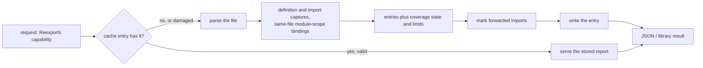

# Re-exports

A **re-export** is a statement that makes a name from another module part of
this file's public interface. Tree Hugger reports every re-export it can prove
from the file alone, in all 16 supported languages, and says honestly where
it cannot judge a file.

```typescript
import { a } from "./a";
export { a };                     // import, then export
export { parse as read } from "./parser";
export * from "./util";
```

```console
$ hug --json-full symbols index.ts
```

The file's index then carries a `reexports` report with three entries, and the
import of `a` has `"reexported": true`.

## Asking for the report

| Surface | How |
|---|---|
| CLI | `--json-full` prints the complete index, which includes `reexports` and `imports[].reexported`. `--json`, `--jsonl` and the text listings do not compute it. |
| Library, direct | `TreeFile::reexports()` always computes it. |
| Library, selective | `SymbolQuery::new().capabilities([Capability::Reexports])`. Its only prerequisite is `Declarations`, so no reference, semantic or diagnostic work runs. |
| Library, consumers | `ImportSymbol::is_reexport` (from `imported_symbols()`) and the `unused-import` exemption read the same report. |

`FileSymbolIndex::reexports` is `None` (the JSON key is absent) exactly when
`completed_capabilities` lacks `reexports`. Absent means *not computed*, never
*nothing found*.



Extraction reads only the analyzed file. It never opens the module a statement
forwards from, so a missing dependency changes nothing. (Rust `--prelude`
resolves a package's prelude module on purpose; that is a separate feature
and its records are marked synthetic.)

## Reading a report

```json
{ "coverage": { "state": "complete", "limits": [] },
  "entries": [ { "form": "named", "evidence": "syntax",
                 "exported_name": "read", "original_name": "parse",
                 "source": "./parser", "...": "…" } ] }
```

Every key is always written, including `null`, `[]` and `false`.

| Entry field | Meaning |
|---|---|
| `form` | `named` (one name), `wildcard` (every public name of `source`), `namespace` (a whole module under `exported_name`), `module` (`source` is the file's whole interface), `value_copy` (a new binding initialized from an import; identity is not preserved) |
| `evidence` | `syntax`: dedicated forwarding syntax. `declared`: a convention tooling treats as an explicit interface (Python `__all__`, Perl Exporter lists, CommonJS, a Lua returned table, a Go value copy). `exposed`: runtime exposure with no declaration (a public Python import in a module without `__all__`) |
| `exported_name` / `original_name` / `local_name` | the name callers import / the name in the source / the same-file binding the forward goes through |
| `source` | the module or path as written; `null` when the file states none (C# `TypeForwardedTo`) |
| `excluded_names` | names a wildcard excludes (Scala `x as _`) |
| `scope`, `restriction` | enclosing module or namespace; written visibility restriction such as `crate` |
| `type_only`, `conditional` | `export type {..}`; under a `cfg`, `#if`, `if`/`try` or build constraint (never evaluated) |
| `caveats` | `mutable_binding`, `source_unresolved`, `fallback_lookup`, `unstable_feature`, `inferred_package_name`, `givens_only` |
| `import_span` | the span of the import this entry forwards, when it forwards one |
| `span`, `statement_span` | the specifier, and the whole statement |

Entries are in source order. Captures of one site collapse into one entry;
distinct sites exposing the same name stay separate.

### Evidence and the import marker

An import's `reexported` is `true` only when a `syntax` or `declared` entry
forwards that exact import. `exposed` entries never set it, so a plain unused
Python import is still reported by `unused-import`. Read `reexported` only
next to a present `reexports`; it is `false` everywhere when the report was
not computed.

## Coverage: when an empty list is a negative

| `coverage.state` | Meaning |
|---|---|
| `complete` | no limit applies; an empty `entries` list means the file forwards nothing the language supports |
| `limited` | `limits` lists why; entries may be missing, so an empty list proves nothing |
| `not_applicable` | decided by language: Java, C, Bash, Zsh, PHP have no forwarding construct |

| Limit reason | Cause |
|---|---|
| `parse_error` | a syntax error contains or directly follows a forwarding statement (unrelated errors do not limit) |
| `grammar_gap` | forwarding syntax the pinned grammar cannot represent, such as C++20 module files (limited over the whole file) |
| `computed_export_list` | an export list not built from literals (Python `__all__ = names()`), or a Python `__all__` edit that may not run (see [Python `__all__` edits](#python-__all__-edits)) |
| `cross_file_export_list` | an export list extended from another module |
| `rebound_binding` | a forwarded name or table is reassigned, or a field of a Lua returned table is written outside chunk level or under a key whose string value is unknown (in an assignment or the table's constructor) |
| `shadowed_global` | `require`, `module`, `exports` or an import is shadowed by a declaration, or one of those globals is reassigned |
| `dynamic_forwarding` | `Object.assign`, spreads, Lua `module()` and metatables, a Lua returned table passed to a call or stored elsewhere, custom Perl `import` |
| `unexpanded_macro` | a Rust macro body that may contain `pub use` |

The report always describes the whole file. Kind filters, predicates and the
scan root never change it.

## What each language reports

Constructs not listed are not reported.

| Language | Reported | Limits and caveats | Not reported |
|---|---|---|---|
| Rust | `pub use` and restricted forms (`pub(crate)`, `pub(super)`, `pub(in path)`): `named`; glob: `wildcard`; `pub extern crate x [as y]`: `namespace`; `cfg` sets `conditional` | `unexpanded_macro` | `pub(self) use`, `use` inside function bodies |
| JavaScript | `export {..} from`, `export *`, `export * as ns`, default specifiers, import-then-export, `export default <import>` (`syntax`); CommonJS `module.exports = require()` (`module`) and `exports.x = require().x` (`named`), both `declared` | `parse_error`, `shadowed_global`, `dynamic_forwarding`, `rebound_binding` | local exports (see `exports`) |
| TypeScript | the JavaScript forms; `type` sets `type_only`; `export =` of an import (`module`); `export import A = B.C` for an imported `B` | `parse_error` / `grammar_gap` for `export type *` and `export import … = require()` | `export as namespace` |
| Python | names in a literal `__all__` bound by a module-level import, redundant aliases (`import x as x`) and `from m import *` (`declared`); other public module-level imports (`exposed`); `import a.b` exposes `a` as `namespace` | `computed_export_list`, `cross_file_export_list`, `rebound_binding` | function or class-local imports, `__future__`, underscore names |
| Go | `type X = pkg.Y` (`named`, `syntax`); package-level `var`/`const X = pkg.Y` (`value_copy`, `declared`); exported names only; a `//go:build` line sets `conditional` | `mutable_binding`, `inferred_package_name` | defined types, embedding, plain/blank/dot imports |
| Perl | names in literal `@EXPORT`, `@EXPORT_OK`, `%EXPORT_TAGS` bound by `use Mod qw(..)` in the same package with an Exporter marker (`named`, `declared`) | `computed_export_list`, `dynamic_forwarding`, `rebound_binding`, `grammar_gap` for qualified `@Pkg::EXPORT` | locally defined subs |
| Lua | `return require("m")` (`module`); a returned table or `M.x = <import-derived>; return M` (`named`), `declared` | `shadowed_global`, `rebound_binding`, `dynamic_forwarding` | table assignments without a final `return M` |
| Swift | `@_exported import M` (`wildcard`); `@_exported import struct M.T` (`named`); caveat `unstable_feature`; `#if` sets `conditional` | none | `public import`, plain `import` |
| Scala 3 | `export` selectors: `named` (renames), `*`/`_` as `wildcard` with `excluded_names`, `given` as `wildcard` with `givens_only` | `parse_error` for modified or annotated `export`, `grammar_gap` for multi-clause `export a.b, c.d.{e}` | Scala 2 |
| C++ | namespace-scope `using ns::x;` (`named`); `using namespace ns;` (`wildcard`, `fallback_lookup`); `scope` is the namespace | `grammar_gap` for module files, `parse_error` for `using typename` and multi-name `using` | type aliases, class-member `using`, `#include` |
| C# | `[assembly: TypeForwardedTo(typeof(N.T))]` (`named`, `exported_name` `N.T`, `source` `null`, `source_unresolved`) | none | all `using` forms |
| Java, C, Bash, Zsh, PHP | nothing: `not_applicable` | none | `requires transitive`, `#include`, `source`, `export -f`, `autoload`, `use`, `include`/`require`, `class_alias` |

## Python `__all__` edits

Tree Hugger reads `__all__` by applying its module-level edits in order:
assignment (`=`, including `+` of literal lists), `+=`, `.append("x")`,
`.extend([..])` and `.remove("x")`. It never evaluates a condition, so an edit
that may or may not run cannot be folded into the final list. Such an edit
makes the whole list `computed_export_list`: coverage is limited, no entry
comes from `__all__` membership, and no import is exempted from
`unused-import` because of it. Redundant aliases (`import x as x`) and star
imports stay declared, since they do not depend on the list.

| Where the edit is | Example | Result |
|---|---|---|
| module level, unguarded | `__all__.append("read")` | applied |
| under `if`, `try`, a loop or `match` | `if enabled: __all__.append("read")` | `computed_export_list` |
| in a function, class, lambda or comprehension | `def f(): __all__.append("read")`, `global __all__` | `computed_export_list` |
| inside a larger expression | `enabled and __all__.append("read")` | `computed_export_list` |
| any other edit | `__all__.insert(0, "x")`, `del __all__[0]`, `__all__[0] = "x"` | `computed_export_list` |

A guarded removal is limited the same way, so it never reads as proof that a
name is absent:

```python
from m import read
__all__ = ["read"]
if enabled:
    __all__.remove("read")   # computed_export_list: neither an entry nor a complete negative
```

## Scope and reachability limits

- Only module-scope bindings in the same file are followed; Tree Hugger does
  not check that the forwarded name exists in `source`.
- A forward is tied to the binding the exported name holds at the end of
  the module, not to every import with the same spelling:
  - **Python**: when a later module-level import binds the same name, only
    the final import is forwarded. The replaced import gets no entry, keeps
    `reexported: false`, and is still reported by `unused-import`. Imports in
    mutually exclusive branches (`try`/`except`, `if`/`elif`/`else`, `match`
    cases) are alternatives, so each stays a `conditional` entry. A later
    import that only *may* run after the earlier one (inside an `if`, a loop,
    or a `try` body's `else`) withholds the earlier one with
    `rebound_binding`. Two unaliased imports of one package (`import pkg.a`,
    `import pkg.b`) bind the same module and do not replace each other.

    ```python
    from old import read      # replaced: no entry, still an unused import
    from new import read      # the forward
    __all__ = ["read"]
    ```

  - **Scala**: an `export` path links to an `import` (setting `local_name`
    and `import_span`, and marking the import) only when that import comes
    before the export in the same or an enclosing template body or block,
    and no definition or class parameter of the same name sits in between.
    The nearest such import wins. Otherwise the entry is kept with
    `local_name` and `import_span` empty.

    ```scala
    import lib.Thing
    object Holder:
      val Thing = new Impl
      export Thing.x          // forwards Holder.Thing, not lib.Thing
    ```

  - **JavaScript and TypeScript**: a name in a CommonJS forward
    (`module.exports = m`, `exports.read = read`, `module.exports.read =
    m.read`, `{ a }` or `a: m.a` in an object literal) or in a nested
    namespace export resolves to the nearest declaration around it. A
    block-scoped `const`/`let`/`class`/`function`, a `catch` parameter, or a
    `for`/`for…of` loop variable that hides the module-scope `require` or
    `import` binding withholds the site with `shadowed_global`; the import
    keeps `reexported: false`. (A CommonJS write inside a function is
    already `dynamic_forwarding`; a namespace export hidden by an enclosing
    namespace's local is simply not a forward.) The same name declared in an unrelated
    function does not affect the forward. A module-scope reassignment
    withholds it with `rebound_binding`: an assignment, `for (m of ..)`,
    a second module-scope `var m = ..` with an initializer, a `var m = ..`
    inside a block (which hoists to module scope), or a `function m() {}`
    inside a module-level block (which, outside an ES module, assigns the
    module-scope `m` when the block runs). A bare `var m;` assigns nothing
    and leaves the forward complete, and so does a module-level
    `function m() {}`: it is hoisted, so the `var` initializer runs after
    it.

    ```javascript
    const m = require("m");
    { const m = {}; module.exports = m; }   // shadowed_global, no entry
    function other() { const m = {}; }      // does not hide the outer m
    ```

    ```javascript
    var m = require("m");
    var m;                                   // no initializer, no write
    module.exports = m;                      // complete module forward from m
    ```

    Assigning the loader or interface globals themselves (`require = f`,
    `module = o`, `exports = o`) anywhere they are not shadowed means they
    are no longer proven to be the originals: every forward that depends on
    the replaced global is withheld with `shadowed_global`. A replaced
    `require` covers `require(..)` calls, bindings initialized from one, and
    TypeScript `import x = require(..)` used by `export =`; a replaced
    `exports` leaves `module.exports.x = ..` forwards intact.

    A CommonJS forward is reported only when it is still the file's
    interface after every later write to `module.exports`, `exports` or
    TypeScript `export =`. The last definite write wins: a later
    module-level assignment or `delete` of the same member, or a later
    `module.exports = ..`, replaces the earlier forward, which is dropped
    with no limit. Once `module.exports` is replaced, `exports` still
    points at the original object, so an `exports.x = ..` written after
    that is not part of the interface either. A later write that may or
    may not replace the forward withholds it with `rebound_binding`:

    | Later write | Result for the earlier forward |
    | ----------- | ------------------------------ |
    | `exports.x = 1`, `module.exports.x = 1`, `delete exports.x` at module level | `x` dropped |
    | `module.exports = {..}` or `export = ..` at module level | every earlier forward dropped |
    | the same member under `if`, a loop, `try`, or in a function body | `rebound_binding`, `x` withheld |
    | `exports.x += 1`, `exports.x++` | `rebound_binding`, `x` withheld |
    | `exports[key] = 1`, `Object.assign(exports, other)` | `rebound_binding`, every earlier member withheld |
    | `module.exports.y = 1` after `module.exports = require("a")` | `rebound_binding`: it mutates `a`'s module object |
    | `exports.y = 1`, or a write of a different member | no effect |

    ```javascript
    exports.x = require("a").x;
    exports.x = 1;                 // x dropped: the file exports 1
    module.exports = require("b");
    module.exports = {};           // module forward from b dropped
    ```

    An earlier plain value never hides a later forward
    (`exports.x = 1; exports.x = require("a").x` reports `x`).
    `Object.defineProperty(exports, ..)` is not read as a write.

  - **Lua**: every name (the required local, the returned table, `require`
    itself) is resolved at the place it is written, by Lua's own scoping
    rules. A nearer `local`, `local function`, function parameter, or
    `for` loop variable of the same name is a different binding, so writing
    or reading it does not touch the chunk-level one. A write that does reach
    the chunk-level local, including one inside a function body or a
    `function m() end` statement, withholds the forward with
    `rebound_binding`. A later chunk-level `local m` or `local function m`
    replaces the earlier binding, so `return m` then forwards nothing.
    `require` stays the module loader unless it is declared at chunk level
    or the global itself is assigned; a `local require` inside a function
    only hides it there.

    ```lua
    local m = require("m")
    local function unrelated() local m; m = {} end  -- a separate local
    return m                                        -- still forwards "m"
    ```

    ```lua
    local m = require("m")
    local function reset() m = {} end  -- writes the chunk-level m
    return m                           -- rebound_binding, no entry
    ```

    A returned table `M` is described by its chunk-level field writes
    only, so any other use of that table that could change it limits
    coverage:

    | Use of `M` before `return M` | Limit | Entries withheld |
    |---|---|---|
    | a field write inside `if`, `do`, `while`, `for`, `repeat` or a function body (`if c then M.foo = 1 end`) | `rebound_binding` | that field |
    | a field write through `and`/`or`, which may or may not be `M` (`(M or {}).foo = 1`, `(t and M).foo = 1`) | `rebound_binding` | that field |
    | the same field written twice in one statement with an import-derived value (`M.foo, M.foo = m.foo, 1`) | `rebound_binding` | that field, unless a later write replaces it |
    | a write under a key whose string value is unknown (`M[key] = 1`), anywhere | `rebound_binding` | every field |
    | a constructor field under such a key (`{[key] = 1}`), or a repeated constructor key with an import-derived value (`{x = 1, ["x"] = m.x}`) | `rebound_binding` | every field |
    | a call argument (`configure(M)`, `rawset(M, ..)`, `setmetatable(M, ..)`) or a method call on it (`M:init()`) | `dynamic_forwarding` | every field |
    | storing it elsewhere (`local a = M`, `t.x = M`, `{M}`, `M or {}`, `return M` inside a function) | `dynamic_forwarding` | every field |
    | reassigning it (`M = {}`) | `rebound_binding` | every field |

    Reads (`M.foo`, `#M`, `M == x`, `if M then`) and chunk-level writes
    with a named key do not limit; a chunk-level `M.foo = 1` simply
    replaces the forward of `foo`. The rules apply alike to `local M = {}`
    with assigned fields and to `local M = {read = m.read}`.

    Parentheses never change what an expression is: `(M).foo = 1`,
    `(M)["foo"] = 1` and `((M)).foo = 1` are writes to `M` exactly as
    `M.foo = 1` is, and the same holds for `(m).foo`, `(require)("m")`,
    `require(("m"))`, `local M = ({..})`, `return (M)`, `(setmetatable)(..)`
    and `pcall((require), "m")`. Lua needs a `;` before a statement that
    opens with `(`, or it continues the previous line as a call.

    ```lua
    local m = require("m")
    local M = {foo = m.foo, bar = m.bar};
    (M).foo = 1;   -- replaces foo, as M.foo = 1 does
    return M       -- complete; forwards only "bar"
    ```

    A key names a field the same way wherever it is written: in a
    constructor (`{x = v}`, `{["x"] = v}`), an assignment (`M.x = v`,
    `M["x"] = v`, `function M:x() end`) or a member read (`m["x"]`).

    | Key | Field it names |
    |---|---|
    | an identifier: `x = v`, `M.x`, `M:x` | `x` |
    | a string literal in any quoting: `["x"]`, `['x']`, `[ [[x]] ]` | `x` |
    | a number or boolean: `[1]`, `[true]` | none, and it never replaces a named field |
    | anything else: `[key]`, `[a .. b]` | unknown: it may be any field |

    Equal keys are one field however each is spelled. Across assignment
    statements the last write wins; within one statement
    (`M.x, M.x = m.x, 1`) Lua leaves the order undefined, so the field is
    withheld as in the table above. Inside one constructor Lua leaves the order of
    assignments undefined when a key repeats, so a repeated key whose
    values include an import-derived one reports none of the constructor's
    fields and limits coverage with `rebound_binding`:

    ```lua
    local m = require("m")
    local M = {}
    M.x = m.x
    M["x"] = 1                     -- no entry: ["x"] replaces x
    return M
    ```

    ```lua
    local m = require("m")
    return { x = 1, ["x"] = m.x }  -- rebound_binding, no entry
    ```

    A returned table with an unknown key in its constructor reports none of
    its fields, because that key may equal any of them; the limit is
    `rebound_binding`, the same as for `M[key] = v`. A table that is not
    returned is not affected.

    ```lua
    local m = require("m")
    return { read = m.read, [key] = 1 }  -- rebound_binding, no entry
    ```

    **Limitation:** a string key is read as written, not decoded. A key
    containing an escape sequence (`["re\x61d"]`), a long-bracket key that
    starts with a newline, and the empty string `[""]` are treated as
    unknown keys, so they limit coverage rather than name a field.

    ```lua
    local m = require("m")
    local M = {}
    M.foo = m.foo
    M.bar = m.bar
    if enabled then M.foo = 1 end  -- rebound_binding; foo withheld
    return M                       -- still forwards "bar"
    ```
- Reachability from a package root (is this module itself public?) is not
  decided; `restriction` only echoes what was written.
- Conditions (`cfg`, `#if`, build constraints, `if`/`try`) are recorded as
  `conditional`, never evaluated.

## Caching

The report is stored in the symbol cache with the capability. A narrower
entry is widened by computing the report; a wider entry is narrowed back
without re-parsing. A cache hit always equals a fresh run. A stored report
that is internally inconsistent, or that disagrees with its capability list
or import markers, is refused and recomputed. See
[Cache Design](./cache-design.md).

## See also

- [Symbol Records](./symbol-records.md): where `reexports` sits in the file index
- [Using the Library](./library.md) and [Using the `hug` CLI](./cli.md)
- [Diagnostics](./library/diagnostics.md): the `unused-import` exemption
