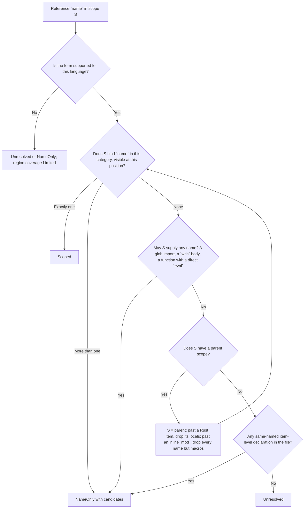
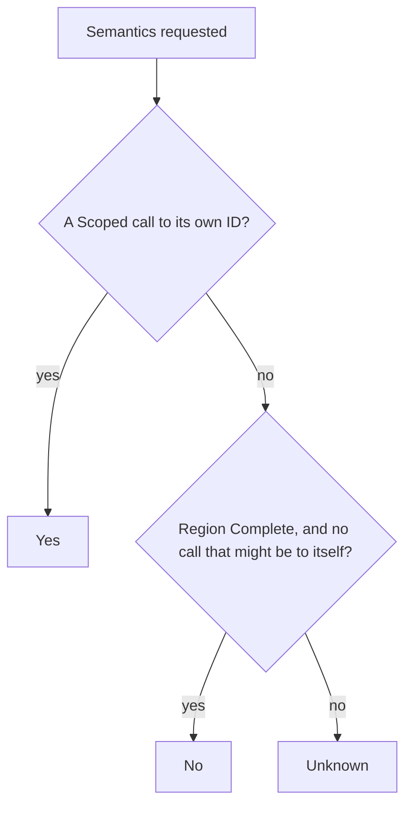
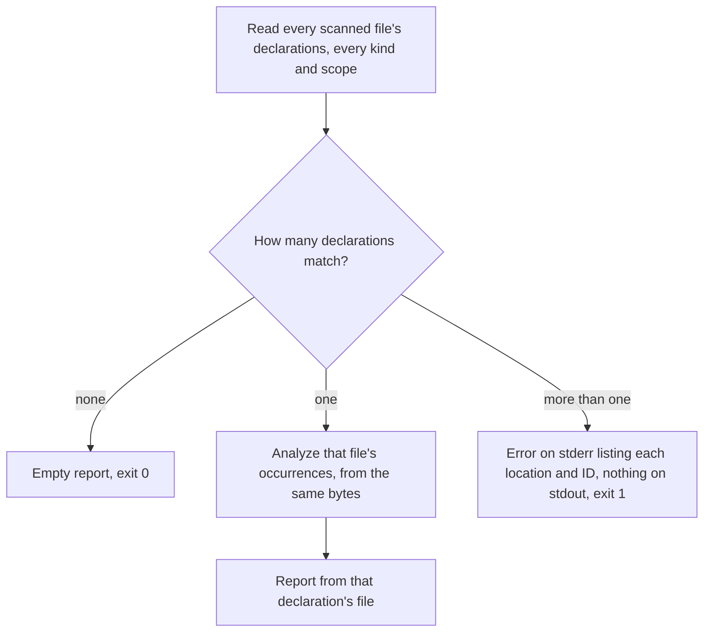

# Scope-Aware References

Occurrences, coverage, the relationship summaries derived from them,
`semantics.is_recursive`, their cache storage (record schema 5.0) and the
[`hug refs`](#hug-refs) command are described below.

Tree Hugger reports every reference it finds in a file as an
**occurrence**: where the name is written, which declaration owns the code
it sits in, and how sure the analysis is about what the name refers to.
The answer is never stronger than the evidence:

```rust
fn parse() {}

fn run() {
    let parse = || 1;   // shadows the function `parse`
    parse();            // Scoped -> the closure binding, not `fn parse`
    other.parse();      // a method call on an unknown receiver: not `fn parse`
}
```

Under first-match binding both `parse` calls point at `fn parse`. With scoped
references the first is bound to the local `let parse` (an established
binding), and the second stays uncertain because nothing in the file proves
which `parse` method `other` has.

```rust
let file = TreeFile::new("src/lib.rs")?;
let evidence = file.reference_evidence()?;
for occurrence in &evidence.occurrences {
    println!("{} {:?} {:?}", occurrence.target.name, occurrence.kind, occurrence.confidence);
}
```

Each occurrence has:

| Field | Meaning |
|---|---|
| `owner` | The nearest enclosing callable declaration record; absent for file-level code, anonymous callables and initializers (see [Ownership](#ownership)). |
| `owner_span` | The owning region's span: the callable, the initializer, or the whole file. |
| `target` | The name as written. `target.qualified_name` is the written path or receiver expression including the name (`Self::new`, `other.parse`, `::f`; see [Written paths](#written-paths)), not the declaration's qualified name; `target.id` is set only for a `Scoped` binding to a declaration record. |
| `candidates` | For `NameOnly`: the same-named declarations, in declaration order. Empty otherwise. |
| `span` | The name token (one-based line and byte column, half-open byte offsets, like every other span). |
| `kind` | `Call` for an invocation target (a call's function, a method name, `new X()`, a Rust tuple-struct constructor, a decorator, a shell command name; see [Invocation forms](#invocation-forms)), `Usage` for anything else, macro invocations included. |
| `confidence` | `Scoped`, `NameOnly` or `Unresolved` (below). |

Declaration and import names (including the name of a TS/JS named
function, generator or class expression, and declarations no symbol record
reports, such as a generic parameter or a pattern binder; see
[Declaration names in the other languages](#declaration-names-in-the-other-languages)), built-in syntax
markers that only look like names (Java's inferred-type `var`, a Lua `<const>`;
see [Syntax markers in the other languages](#syntax-markers-in-the-other-languages)), comments, strings, attributes,
Rust lifetimes and loop and block labels, the Rust `Self` keyword, the
wildcard `_` in Rust, Go, Swift and Scala (`_ = f()` discards a value and
names nothing; in Python, JS/TS, Lua, C/C++ and C# `_` is an ordinary name,
so a read of it is an occurrence),
everything inside a Rust `use` or TS/JS `import` statement or TS/JS
re-export (`export … from "m"`), the exported name of a TS/JS export
(`j` in `export { k as j }`), and the name any import binds are not
occurrences. In the other languages an import's
qualifier segments are reads (`a` and `b` in Java `import a.b.C;`, Scala
`import a.b.C` or Python `from a.b import c`, `b` in Python `import a.b`);
only the bound name is excluded (see
[What an import binds](#what-an-import-binds)). Two captures of the same
token are one occurrence; two calls on one line are two. Occurrences are
sorted by span, then owner span, kind, written target and confidence, so the
result never depends on the order the queries match in.

### Written paths

`target.qualified_name` is the source text from the outermost qualifier,
root or receiver through the name token, so it always ends at the
occurrence's `span`, and is absent for a name written alone. Type arguments
written after the name are outside it; those written inside a qualifier
stay. The span is still the name token alone, and a name is still one
occurrence however long its path.

| Written | Name | `qualified_name` |
|---|---|---|
| Rust `::f()`, `::m::f()` | `f`; `m` | `::f`, `::m::f`; `::m` |
| C++ `((::f))()` | `f` | `::f` |
| C++ `A::B::f()` | `B`; `f` | `A::B`; `A::B::f` |
| C++ `r4::f<int>()`, `N::C<int>::member()` | `f`; `C`; `member` | `r4::f`; `N::C`; `N::C<int>::member` |
| C++ `obj.template m<int>()`, `p->template m<int>()` | `m` | `obj.template m`, `p->template m` |
| C# `new global::N.C<int>()`, `X::C` | `N`; `C` | `global::N`; `global::N.C`, `X::C` |
| C# `obj?.A?.Invoke()` | `A`; `Invoke` | `obj?.A`; `obj?.A?.Invoke` |
| PHP `($o)?->m()`, `\A\B\f()` | `m`; `B`; `f` | `($o)?->m`; `\A\B`; `\A\B\f` |
| PHP `X::K`, `\N\X::K`, `static::K`, `X::$f` | `K`; `f` | `X::K`, `\N\X::K`, `static::K`; `X::$f` |
| Python `[*x.s] = r`, `f(*x.p)` | `s`; `p` | `x.s`; `x.p` |
| Perl `&R4::r4f()`, `R4->r4f()`, `$obj->r4f()` | `r4f` | `R4::r4f`, `R4->r4f`, `$obj->r4f` |
| Java/Scala `a.b.C`, Swift `Swift.Array<Int>`, Go `pkg.T` | `C`; `Array`; `T` | `a.b.C`; `Swift.Array`; `pkg.T` |
| Java `outer.new C()`, `(outer).new C<String>()`, `factory().new C() {}` | `C` | `outer.new C`, `(outer).new C`, `factory().new C` |
| Swift `!x.isEmpty()`, `-x.y.f()`, `-.some.f()`, `(!x).f()` | `isEmpty`; `f` | `x.isEmpty`; `x.y.f`, `.some.f`, `(!x).f` |
| Bash/Zsh `other/external` | `other/external` | absent: the command word is the name |

A Java construction can name an inner class through an enclosing instance
written before `new`. That receiver is part of the written target, and the
`new` between them stays in the path, the same way C++ keeps `template` in
`obj.template m`. Type arguments and an anonymous class body after the name
are not part of it. The receiver keeps its own occurrences: `factory` in
`factory().new C()` is a separate `Call`, `outer` in `holder.outer.new C()`
has the path `holder.outer`, and the keyword `this` is not an occurrence.

```java
outer.new C();          // C: Call, qualified_name "outer.new C"
holder.outer.new C();   // outer: "holder.outer"; C: "holder.outer.new C"
outer.new C<String>();  // C: "outer.new C"; String: Usage, no path
```

A Swift prefix operator applies to the result of the whole member chain
after it, so it is never part of a member's path: `!x.isEmpty()` negates
the result of `x.isEmpty()`, and the path of `isEmpty` is `x.isEmpty`.
Written parentheses change that: in `(!x).f()` the operator's result is the
receiver, so the path is `(!x).f`. An implicit member written after an
operator has no path of its own (`some` in `-.some.f()`), exactly as
without the operator, and the member after it keeps the leading `.`
(`.some.f`). Other languages' grammars already place a prefix operator,
`await`, `try` or a cast outside the member access, so it never enters a
path there. Python's grammar likewise writes the star of an unpacking
assignment target inside the receiver (`[*x.s] = r` as `(*x).s`), but the
star unpacks the whole target, so the path of `s` is `x.s`, as in
`f(*x.s)`.

A path is never evidence of one target: a qualified name that no rule
below establishes (`Self::f` and `Type::f` in Rust), and a Java receiver
before `new`, is `NameOnly` or `Unresolved` and adds no reference edge. In particular a rooted Rust name (`::f`) never reaches
ordinary lookup, so it never binds a `let f` or parameter that shadows the
item, and its root binding is unproved (`::f` is the crate root's `f` in
edition 2015 and the crate `f` from 2018), so a function calling `::f()`
from inside `f` is `is_recursive: Unknown`, never `No`.

## Invocation forms

`kind` is decided from syntax alone, the same way in every language, so a
call is a `Call` even where its binding can only be `NameOnly`. The callee
may be written inside wrappers that evaluate to exactly the wrapped value;
those are looked through. Anything that computes a different value is not:
its names are `Usage`s.

```ts
f();                    // Call
((f))();                // Call: parentheses only restate f
(f as () => void)();    // Call: `as`, `satisfies`, `<T>f` and `f!` are type-only
g((f));                 // f is a Usage: an argument, not the callee
(obj).m();              // obj is a Usage, m is the Call
(0, f)();               // f is a Usage: a sequence computes another value
(c ? f : g)();          // f and g are Usages: either may be called
```

A conditional or nullsafe call (C# `obj?.F()`, TS `obj?.m()`) is still a
`Call`: the syntax invokes the member, though a null receiver may skip it.
PHP callable creation is the opposite: `f(...)` (the literal `...`
placeholder) only makes a closure, so `f` is a `Usage`, while `f(...$args)`
unpacks arguments into a real call. A variable's value is invoked by PHP
`$cb()` and Perl `$cb->()` / `&$cb()`; the variable is the `Call`, and no
initializer is followed to find what it holds.

```php
f(...);          // f is a Usage: creates a closure
consume(f(...)); // consume is the Call, f a Usage
f(...$args);     // f is the Call: unpacking calls
($cb)();         // cb is the Call: a variable's value
(f)();           // f is a Usage: the constant f's value is called
```

| Language | Calls | Wrappers looked through | Never the callee |
|---|---|---|---|
| Rust | `f()`, `::f()`, `(::f)()`, `f::<T>()`, `x.f()`, `Type::f()`, `W(1)`, a value `cb()` | parentheses | `(*p)()`, `name!(…)` (a `Usage`) |
| TypeScript | `f()`, `f<T>()`, `f?.()`, `` f`x` ``, `new F()`, `x.m()`, `@f` | parentheses, `as`, `satisfies`, `<T>f`, `f!`, and an instantiation written apart from its call (`(f<T>)()`, `new (C<T>)()`, `(x.m<T>)()`) | sequence, conditional; an instantiation that is only a value or an argument (`const h = f<T>`, `g(f<T>)`) |
| JavaScript | as TypeScript, without the type forms | parentheses | sequence, conditional |
| Python | `f()`, `x.m()`, `@f`, `@a.b` | parentheses | conditional expression |
| Go | `f()`, `x.m()`, `pkg.F()` | parentheses | `f[T]()`: written like indexing `fs[0]()`, so never read as the callee |
| C | `f()`, `s.cb()`, `p->cb()` | parentheses | `(*f)()`, comma expression |
| C++ | as C, plus `f<T>()`, `ns::f()`, `::f()`, `((::f))()`, `obj.m()`, `obj.template m<T>()`, `new F()`, `new F`, `new ns::C<int>()`, `new (place) C<int>`, braced construction `F{}`, `ns::C<int>{x}` | parentheses | as C; an array `new F[n]` (no constructor is written); a declaration's type `C<int> v{}`; a C compound literal `(S){1}` constructs nothing |
| C# | `f()`, `f<T>()`, `x.m()`, `x!.m()`, `x?.m()`, `x?.M<T>()`, `x?.A()` (the delegate member), `x?.A?.Invoke()` and `cb?.Invoke()` (the last name), `new F()`, `new List<T>()` | parentheses, the null-forgiving `!` at any depth (`cb!()`, `(cb!)!()`, `((obj.F)!)()`, `obj?.F!()`, `obj.F!!()`) | casts; `A` in `x?.A?.Invoke()`; `cb!` that is not invoked (`consume(cb!)`); postfix `++`/`--` |
| Java | `f()`, `this.<T>f()`, `x.m()`, `new F()`, `new a.b.F()`, `new C<String>()`, `new a.b.C<>()`, `outer.new C<String>()`, `new C<String>() {}`, `new a.b.C<String>.D<Integer>()` (only `D`) | none: a method name is not an expression | array creation `new C<String>[2]`; type arguments, qualifiers, the receiver and annotations of a construction |
| Swift | `f()`, `f { }`, `x.m()`, `F()`, `C<Int>()`, `N.C<Int>()`, an implicit member `.f()`, `.init()`, `.some(x)`, and `f` in `!f()` / `-f()` (the operator applies to the call's result) | parentheses, the force unwrap `!` at any depth (`cb!()`, `(cb!)()`, `x.cb!()`, `(cb!)!()`, `(cb!)?()`), beside optional chaining `cb?()` | an implicit member that is not invoked (`let e: E = .none`), `(-f)()` (the negated value is called); a subscript's operand (`a[0]`, `a?[0]`, `x.items[0]`, `!a[0]`, `a[0]()`, `a[0] { … }`): the grammar writes a subscript like a call, but it invokes nothing |
| Scala | `f()`, `f[T]()`, `f { }`, `x.m()`, `a(0)` (Scala has no subscript syntax: it is `a.apply(0)`), `x m 1`, `x m`, `new F()`, `new a.b.F()`, `new C[Int]()`, `new C[Int]`, `new a.b.C[Int] {}`, `C` in `new C with T` | parentheses | the traits of a mixin construction; a declared base `extends C(1)` |
| PHP | `f()`, `N\f()`, `new F()`, `new F`, `F::m()`, `$x->m()`, `$x?->m()`, a variable's value `$cb()`, `new $C()`, and argument unpacking (`f(...$args)`, `$cb(...$args)`) | parentheses around a variable only (`($cb)()`, `(($cb))()`) | callable creation `f(...)`, `\Ns\f(...)`, `W::s(...)`, `$o->m(...)`, `$cb(...)`: it makes a closure and calls nothing; `(f)()`: a bare name in parentheses is a constant, so the call uses the constant's value; `($o->m)()` calls a property's value; `$o->$m()`: `$m` holds the method's name |
| Lua | `f()`, `f "s"`, `f {}`, `x:m()`, `x.m()` | parentheses | |
| Perl | `f()`, `f 1`, `f`, `&f()`, `&f`, `Pkg::f()`, `goto &f`, `$x->m()`, `Pkg->m()`, a code reference `$cb->()`, `$cb->(1)`, `&$cb()`, `&{$cb}(1)` | | `\&f`, `\&$cb`, `defined &f`, `exists &$cb`: they name the sub without calling it; `$cb` in `$cb->m()` is the receiver |
| Bash, Zsh | a command's name (`f`, `X=1 f arg`, `$(f)`, `$cmd arg`) | | an argument (`echo f`), the variable a command name expands (`cmd` in `$cmd`) |

Comments between the constructed name and type arguments do not change the call:
`C /* note */ <Int>()` is a Swift constructor call; `x: C /* note */ <Int>`
is a type usage.

A generic type is a call only where a construction holds it: in
`new C<String>()` (Java), `new C[Int]` (Scala), `C<Int>()` (Swift) or
`new C<int>` (C++) the constructed name is the `Call`, and its type
arguments and qualifiers are usages, while `C<String> x` stays a usage.

Grammar limit: the pinned Swift grammar parses `C<Int>.init()` as the
comparisons `C < Int > .init()`, so `init` is a `Call` and `C` a `Usage`
(the same kinds as `C.init()`), but `init` has no written path.

Grammar limit: the pinned Swift grammar reads the adjacent operators in
`cb!!()` and `cb?!()` as one custom infix operator (`!!`, `?!`) with a
missing operand, so the region is limited by the parse error and `cb` is a
`Usage`; the parenthesized spellings `(cb!)!()` and `(cb!)?()` are calls.

```java
new a.b.C<String>(y);   // C is the Call; a, b, String and y are Usages
C<String> x = null;     // C is a Usage: a type, not a construction
new C<String>[2];       // C is a Usage: array creation calls no constructor
```

Coverage reads a callee the same way. A call whose callee, once these
wrappers and generic instantiations are removed, is a plain name or path
(Rust `(f)()`, `(f::<u8>)()`, `(S::f)()`; TS/JS `((f))()`, `(f)?.()`,
``(f)`x` ``, `new (F)()`; TS `(f as any as () => void)()`, `f!()`,
`(f<number>)()`, `new (C<number>)()`) limits
its region no more than `f()` would: a call of a function the name binds is
`Complete`, so a caller of another function is `is_recursive: No`, never
`Unknown`. A sequence, conditional, dereference, member access or variable
still adds `indirect_dispatch` (see [Coverage](#coverage-and-limitation-reasons)). An `eval`
written inside these wrappers (`(eval)(…)`, `(eval as any)(…)`) is still a
direct `eval`; `(0, eval)(…)`, `globalThis.eval(…)` and an alias
(`const e = eval; e(…)`) are not, and neither are an optional call
(`eval?.(…)`, `(eval)?.(…)`) or a tagged template (``eval`…` ``).

```ts
function f() {}
function g() { (f as () => void)(); new (C)(); } // Complete: g is No
function h() { (0, f)(); }                      // Limited (indirect_dispatch): h is Unknown
class C {}
```

A member callee is a call through any depth of these wrappers:
`((obj.m))()`, `(obj.m as T)()`, `(<T>obj.m)()` and `(obj.m!)()` in
TypeScript, `(x.cb!)()` in Swift, `((obj.F)!)()` in C#, `((obj.m))()` in JavaScript, Go (`((pkg.F))()`), C
(`((s.cb))()`) and C++ (`((obj.template m<T>))()`), and `new ((ns.W))()`.
A member access passed as an argument, inside a sequence or conditional, or
dereferenced (`(*s.cb)()`) is not the callee. In Rust, `(x.f)()` calls the
field `f`, never a method, so `f` is no occurrence.

A member name that is not invoked is an occurrence only where the
language's reference query captures member accesses, and then in every
position it is written. Python, Java, C#, PHP, Lua, Swift and Scala report
it as a `Usage` with its path in an argument and equally as an assignment
or compound-assignment target, under `++`/`--`, `del`/`unset`, address-of,
a unary operator or a cast. TypeScript, JavaScript, C, C++, Go and Rust
report a member name only where it is invoked, so `f` is no occurrence in
any of these:

```ts
use(x.f); delete x.f; ++x.y; x.y += 1;  // only x is an occurrence
x.m();                                  // m is a Call, path x.m
```

Perl hash keys (`$x->{f}`) are not member names. A Lua assignment
`x.y = 1` declares the table member `y`, so `y` there is a record, not an
occurrence.

## Confidence

Every occurrence carries one of three confidence levels:

| Confidence | Meaning | Has a target ID? |
|---|---|---|
| `Scoped` | Syntax and the language's visibility rules establish exactly one binding. | Yes for an in-file declaration; no for a bound import (it names something outside the file). |
| `NameOnly` | Same-named declarations exist, but visibility or receiver evidence cannot pick one. They are listed as `candidates`. | No. Candidate IDs are suggestions. |
| `Unresolved` | No supported binding and no in-file candidate. | No. |

`Scoped` describes the source-level binding. It does not promise which
implementation runs: a `Scoped` call through a trait object or a virtual
method can still dispatch elsewhere, so method calls on receivers stay
`NameOnly` unless the language rules below prove one declaration.

## How a name is looked up

Each file gets a tree of lexical scopes: one root scope for the file, and a
child scope for each block, function body, closure and so on. Every
declaration is placed in the scope where its name is visible. A function's
name goes in the enclosing scope and its parameters in its body. A reference
is looked up from the innermost scope outward, and the first scope that binds
the name decides the result. Lookup never falls back to "any declaration with
this name".



Declarations whose kinds a query does not report (locals, parameters,
generic parameters) still take part in lookup, and so do bindings the
locals query never reports as records at all (`for` and `catch` bindings,
destructured names, generic parameters): those are `Scoped` without a target
ID. A hidden inner binding therefore blocks an outer match even when the
report never shows it.

When no scope binds the name, the candidates are the file's item-level
declarations of that name (for example a function inside an inline `mod`):
never another function's locals, and never a type's members, which a bare
name cannot reach. A Rust glob import (`use a::*;`) in a scope ends the
search there, because the glob may supply the name.

```rust
mod inner { pub fn helper() {} }
fn outer() { helper(); }   // NameOnly, candidate `inner::helper`
```

Not every enclosing scope can be reached. Lookup passes a scope only where
the language lets the name through:

- A Rust item (a nested `fn`, `const`, `static`, type, trait or `impl`)
  cannot capture. From inside it, the blocks around it still lend their
  items, but never their `let`s, parameters, pattern bindings or generic
  parameters. A closure is not an item and captures as usual.
- A Rust inline `mod` sees nothing of its parent without a `use`, except
  `macro_rules!` macros defined before it.
- A Rust `if let` binding (also each `let` of a `let` chain) is visible from
  its `let` to the end of the consequence, never in the `else` branch.
- A JavaScript or TypeScript `with` body first looks every name up as a
  property of its object, so a name not declared inside the body is never
  `Scoped`. A direct `eval(…)` call inside a function can add a `var` to
  that function, so the same holds for names the function does not declare
  itself (strict code cannot do this, but the file does not always say which
  it is). A file-level `eval` changes nothing: a `var` it adds is the global
  binding an assignment could change anyway.
- Only an ordinary call with an argument list is a direct `eval`. An
  optional call (`eval?.("var f = 1")`) is an indirect `eval`, which runs in
  the global scope, and a tagged template (``eval`var f = 1` ``) passes a
  strings array, which `eval` returns without running it. Neither can add a
  name to the function around it, so lookup goes on as if the call were not
  there. An optional `eval` still runs code, so its region keeps
  `indirect_dispatch`; a tagged one limits nothing.

```javascript
class Base {}
function outer() {
    function f() {
        eval?.("var f = 1");     // or eval`var f = 1`
        class D extends Base {}  // D extends Base's ID
        f();                     // Scoped to this f: is_recursive Yes
    }
}
```

```rust
fn f() {}
mod m { pub fn g() { f(); } }        // NameOnly: `f` is not in scope in `m`
fn h(x: Option<fn()>) {
    let c = || {};
    fn nested() { c(); }             // Unresolved: an item cannot capture `c`
    if let Some(f) = x { f(); }      // Scoped to the pattern's `f`
    else { f(); }                    // Scoped to `fn f`
}
```

```js
function f(obj) { with (obj) { f(obj); } }   // NameOnly: `obj.f` may be called
```

The same boundaries apply to declared type relations
([type-relations.md](type-relations.md)): a base written inside a `with` body
or in a function holding a direct `eval` stays written text; an optional or
tagged `eval` call changes nothing.

## Language support

Rust, TypeScript and JavaScript resolve the forms marked **Resolved** below.
JavaScript shares TypeScript's query and lookup rules but has no type names.
Every other language reports occurrences conservatively. Their targets are
never `Scoped`, and every region they own has `Limited` coverage with the
reason `unsupported_language`. A limited language never yields an empty
result that looks complete.

### Rust

| Rule | Behavior | State |
|---|---|---|
| Block vs function scope | Each `block`, function body, closure, `match` arm, `if`/`while`/`for`/`loop` body, inline `mod` body, trait, `const` and `static` is a scope; so is every item with generic parameters, so they never leak out. | Resolved |
| Item and module boundaries | Code inside a nested item (`fn`, `const`, `static`, type, trait, `impl`) sees the items of the blocks around it but not their `let`s, parameters, pattern bindings or generic parameters; an `impl` or trait member still sees its `impl`'s or trait's generic parameters. An inline `mod` sees only what it declares or imports, plus earlier `macro_rules!` macros. | Resolved |
| Declaration order | `let` is visible only after its statement, so `let f = f();` reads the *outer* `f` in its initializer. Items (`fn`, `struct`, `const`, `static`, `mod`, `use`) are visible throughout their block, before or after; a `macro_rules!` macro only after its definition. | Resolved |
| Shadowing | The latest preceding `let` of a name in a block wins; an inner scope's binding hides every outer one. | Resolved |
| Parameters and patterns | Function and closure parameters, including destructured ones, bind in the body; `while let`/`match` arm/`for` pattern bindings bind in their arm or body; an `if let` binding (and each `let` of a chain) only from its `let` to the end of the consequence, never in `else`; a `let … else` binding after the statement, never in its `else` block. A struct-pattern field shorthand (`S { x }`) is a pattern name like any other. | Resolved |
| Pattern names: binding or constant | Spelling decides nothing: Rust's naming conventions are lints. A pattern name written with `mut`, `ref` or `name @ …` always binds. A bare name, in any pattern (`let`, `let … else`, parameters, closure parameters, `for`, `match` arms, `if let`, `while let`, nested in tuple, struct, slice, or `&` patterns), is looked up where it is written, as rustc does: when it reaches a `const`, a unit struct or a `const` generic parameter, the pattern **reads** that declaration (a `Usage`, `Scoped` to it), and so does every use of the name in the arm or body; when it reaches a function, a local or nothing, it **binds** a new local, so `fn F(x: fn()) { if let F = x { F(); } }` calls the local (a call through a value) and is not recursive. `None` (the prelude's unit variant) and `Self` never bind. When an import or glob `use` is reached first, the file cannot tell whether it supplies a constant: in a refutable pattern (`match`, `if let`, `while let`, `let … else`) the name is then a `NameOnly`/`Unresolved` usage and every use of it is uncertain; in an irrefutable one it binds, because only a unit struct or a single-valued constant could be matched there. Declarations follow the same rule: a pattern name that reads a declaration, or whose identity is unknown in a refutable pattern, is never listed as a variable by `hug symbols` (no declaration is proved), and neither is the path of a tuple-struct pattern (`Some` in `Some(x)`), a range bound or path pattern in `if let` (`MAX` in `1..=MAX`, `E::A`) or a TypeScript/JavaScript parameter default (`a` in `b = a`). A binding nested in a pattern with `mut`, `ref` or `@` (`Some(mut x)`), or a bare `match` arm name, binds but has no declaration record either (the declaration query does not capture those forms); `let mut x` and a `mut x` parameter are listed. | Resolved; unknown identity through an import or glob |
| Name categories | Types (`struct`, `enum`, `trait`, `type`, `mod`, generic type parameters) and values (`fn`, `const`, `static`, `let`, parameters) are separate. A tuple or unit struct is in both, and macros are their own category. A `use` binding enters every category, because the file alone cannot tell which one it names. | Resolved |
| Imports and aliases | `use a::b as c;` binds `c` locally (`Scoped`, no target ID), and so does every name a `use` brings in: `use a;` binds `a`, `h` in `use a::{g::h};`, `a` for the `self` in `use a::{self, b};`, and `z` in `extern crate y as z;` (never `y`). The import record keeps the source path and the original name `b`. A glob `use a::*;` never binds a unique target: it is an on-demand import record (below) and binds nothing. | Resolved |
| Associated items | Methods, fields, variants and associated consts are not lexical names: a bare `f()` never reaches an `impl` member. `impl` and trait headers resolve in the enclosing scope, never in the impl body. | Resolved |
| Paths | `Self::f()` and `Type::f()` are `Scoped` only when `Type` (or the self type of the `impl` around `Self`) resolves to one in-file struct or enum and exactly one inherent `impl` of it declares `f`; `Enum::Variant` resolves the same way. Any other path keeps its written qualifier and is `NameOnly` or `Unresolved`; so is a rooted path (`::f`, `::m::f`), which is never looked up lexically and so never binds a shadowing `let` or parameter. Calling a path that names a value (`Self::C()` or `(S::C)()` with `const C: fn() = Self::f`), or whose candidates include a value, keeps the binding or candidates but is a call through a value: the constant's initializer is never followed. | Resolved; Limited (`indirect_dispatch`) for calls of a value |
| Method calls | `x.f()` and `self.f()` are `NameOnly` with in-file `f` methods as candidates: trait dispatch and auto-deref can select another implementation. | Limited (`indirect_dispatch`) |
| Nested callables | A closure is an anonymous owner. A nested `fn` is its own owner and is visible in its enclosing block. Calling a variable or parameter (a closure held in a `let`) is a call through a value. | Limited (`indirect_dispatch`) for calls through a value |
| Macros | `name!(…)` is a `Usage` of the macro. Its expansion is unknown, so the enclosing region's call coverage is limited. | Limited (`unexpanded_macro`) |

### TypeScript and JavaScript

| Rule | Behavior | State |
|---|---|---|
| Block vs function scope | `let`, `const`, `class` and block-level `function` are block scoped; `var` is function scoped. | Resolved |
| Declaration order | A block's `let`/`const`/`class` hides the outer name for the **whole** block, even before its declaration (the temporal dead zone). `function` and `var` are hoisted. | Resolved |
| Parameters | Plain, default, rest and destructured parameters bind in the function and are visible to later defaults and to the body. A default is evaluated before the body runs: it sees the parameters and everything outside the function, never a declaration of the body (`let`, `const`, `class`, `function` or `var`). When the parameter list holds an expression (a default, or a computed key in a destructured parameter), the body's `var`s form their own scope, so in `function g(x = f()) { var f = () => {}; }` the default calls the outer `f`, while every `f` in the body, before or after the `var` and in closures, is the body's `f`, and a body `var` named like a parameter is the body's own copy. Without such an expression a `var` named like a parameter declares the parameter again, so a use of that name is `NameOnly` with both declarations as candidates. A direct `eval` in the body limits only the body, never the defaults. | Resolved |
| Expression names | A named function, generator or class expression (`const g = function f() { f(); }`) binds its name only inside itself: its parameters, body and, for a class, its `extends` clause. Inside, `f` is `Scoped` with no target ID (the expression has no declaration record) and hides any outer `f`; outside, `f` is the outer declaration. A self-call through that name proves nothing about an outer function of the same name, which keeps its own recursion verdict. | Resolved |
| Calls through values | Calling a `const` bound to a function or class expression calls that function. Calling any other variable or parameter is a call through a value. | Limited (`indirect_dispatch`) for calls through a value |
| Loop and catch bindings | `for (let …)`, `for…of`/`for…in` and `catch (e)` bind in their statement. | Resolved |
| Export clauses | A local export reads its binding: `k` in `export { k }`, `export { k as j }` and `export = k` is `Scoped` to `k`. The exported name (`j`, `default` in `export { k as default }`) names the module's export and is no occurrence, and nothing in a re-export from another module is one either (`export { k as j } from "m"`, `export * as ns from "m"`, `export { default } from "m"`, TypeScript `export type { T } from "m"`), since those names are the other module's exports, never a local `k`. TypeScript `export as namespace X` declares a global name (no occurrence); `export import A = N.S` binds `A` like `import A = N.S` and reads `N`. Export records and their re-export flags are unchanged. | Resolved |
| Name categories (TypeScript) | `interface` and `type` are types only; `class`, `enum` and `namespace` are both; `function`, `var`, `let` and `const` are values. Type-only imports (`import type { F }` or `import { type F }`) bind only the type category: a local `function F() { F(); }` remains a proved self-call while `let x: F` uses the import. `typeof F` queries the value category even inside a type expression. | Resolved |
| Imports and aliases | `import { a as b }` binds `b`; `import * as ns` binds `ns`; a default import `import d from "m"` binds `d`; TypeScript `import q = require("m")` binds `q` and `import R = N.S` binds `R` (`N` is read). The original name is kept in the import record, never bound and never an import of its own. | Resolved |
| Members | Class and interface members are not lexical names. `this.f()` and `obj.f()` are `NameOnly`. | Limited (`indirect_dispatch`) |
| Class field initializers and static blocks | References resolve lexically, but the owner is absent and the region limited. | Limited (`ownership_unknown`) |
| Decorators | Evaluated in the scope enclosing the class, and owned by it. | Resolved |
| Dynamic access | `obj[name]()` and other calls of computed values never bind a unique target. A name inside a `with` body that the body does not declare, and a name inside a function holding a direct `eval(…)` that the function does not declare, is never `Scoped` (`NameOnly` or `Unresolved`), so it proves no caller and no recursion. An optional `eval?.(…)` or tagged ``eval`…` `` is no direct `eval` and hides no name. | Limited (`indirect_dispatch`; `unsupported_binding_form` for a direct `eval` and `with`; an optional `eval` only `indirect_dispatch`, a tagged one nothing) |

### Every other language

| Language | Scope captures today | Occurrences reported | State |
|---|---|---|---|
| Go | blocks, functions, `if`/`for`/`switch`, func literals | identifiers, call targets, package selectors, selector callees (`x.m()`, `pkg.F()`) | Limited (`unsupported_language`) |
| Python | module, functions, classes, comprehensions | identifiers, call targets, attribute objects, decorators | Limited (`unsupported_language`) |
| Java | blocks, methods, constructors, lambdas, loops, `catch` | identifiers (including method names), annotations, `new` types | Limited (`unsupported_language`) |
| C# | blocks only | identifiers, invocation targets, `new` types, attributes | Limited (`unsupported_language`) |
| C | translation unit, functions, compound statements, loops | identifiers, call targets, field-access objects, field callees (`s.cb()`) | Limited (`unsupported_language`) |
| C++ | as C, plus classes, namespaces, lambdas, templates, `catch` | as C, plus namespace qualifiers and method callees (`obj.m()`, `obj.template m<T>()`) | Limited (`unsupported_language`) |
| Scala | blocks, functions, lambdas, template bodies, `for` | identifiers, call targets, annotations | Limited (`unsupported_language`) |
| Swift | statements, functions, types, control flow | identifiers, call targets, navigation targets | Limited (`unsupported_language`) |
| PHP | classes, interfaces, traits, enums, functions, methods | names, variables, call targets, class constants | Limited (`unsupported_language`) |
| Lua | chunk, functions, control-flow blocks | identifiers, call targets, table objects | Limited (`unsupported_language`) |
| Perl | blocks, named subs | variables, bareword calls, method names, package names | Limited (`unsupported_language`) |
| Bash, Zsh | function bodies only | variable expansions, command names, words | Limited (`unsupported_language`) |

The scope captures exist, but several of them sit on declaration or import
nodes rather than bodies (Python imports, C++ function declarators, PHP
classes). None of these languages captures call targets separately from
other uses, so their scope trees and call coverage cannot yet support
`Scoped` results. Their occurrences are `NameOnly` with every same-named
declaration in the file as a candidate, or `Unresolved`; `kind` is `Call`
where the invocation syntax shows it.

A name that only reads something is an occurrence in these languages too,
never a declaration that would hide it: a parameter's type and default
value (`def g(x=external)` in Python, `void g(W x, int y = external)` in
C#), a PHP constant's value (`const B = A;`) and a PHP parameter default
are listed as usages, and the only candidates of `external`, `W` or `A` are
their real declarations. `hug refs external` therefore selects the function
alone, not an invented parameter of the same name.

A Java qualified name is an import only inside an `import` clause, and only
its final segment is: `import a.b.C;` imports `C`, `import a.b.*;` imports
everything in `b`, and `import static a.b.C.m;` imports `m`. Every other
qualified name is read where it is written, with its
[written path](#written-paths), exactly like a qualified type (`p.q.A x;`): a
qualified annotation, and every operand of a module directive.

```java
class A {}
@p.q.A class G {}
// ^ ^ ^ `p` and `q` are usages; `A` is a usage written `p.q.A`,
//       a suggestion for the class `A`. The file imports nothing.
```

```java
module m {
    requires a.b;
    exports p.q to x.y, z.w;
    uses a.b.C;
    provides a.b.C with d.e.D, f.g.F;
}
// every segment is a usage (`C` written `a.b.C`, `D` written `d.e.D`, …);
// `hug imports` lists nothing for this file
```

A C# `using` directive imports one name, and every other name in it is
read, the same way: `using A.B;` and `using static C.D;` import their last
segment (`B`, `D`; the record's `source` is the whole path), `global using`
and `using global::A.B;` likewise, and an alias directive imports its alias
(`using E = F.G;` imports `E` from `F.G`, whose `F` and `G` are reads; a
pointer or tuple target such as `using unsafe P = int*;` has no original
name). C# is limited, so a later `E` is an `Unresolved` usage, never bound
to the import.

```csharp
using A.B;      // `A` is a usage; `B` is the import, no occurrence
using E = F.G;  // `E` is the import; `F` and `G` (written `F.G`) are usages
```

A Swift selective import (`import struct Foo.Bar`, and likewise with
`typealias`, `class`, `enum`, `protocol`, `func`, `var` or `let`) imports
the one name it binds: the record is named `Bar`, its `source` is the path
`Foo.Bar`, and the module `Foo` is a usage. A whole-module import names the
module path it imports (`import Foo.Sub` is the import `Foo.Sub`), and no
segment of that path is an occurrence.

```swift
import struct Foo.Bar  // `Bar` is the import; `Foo` is a usage
import Foo.Sub         // the import `Foo.Sub`; neither segment is an occurrence
let z = Bar            // a usage (Swift is limited: `Unresolved`, never bound)
```

#### What an import binds

An import record (`hug imports`, `FileSymbolIndex::imports`) is the one name
an import brings into the file, at that name's token. Its `source` is the
path as written, and an alias also keeps the `original_name` it renames. The
token is never an occurrence, so an import that recorded a name it does not
bind would hide a real read, and one it missed would leave its name as a
read. An **on-demand import**, which binds no single name (`import a.b.*`),
is one record named by the last segment of the path it opens, with that name
as `alias` and `*` as `original_name`.

| Language | Import records (name ← written form) | Reads |
|---|---|---|
| Rust | `a` ← `use a;`; `h` ← `use a::{g::h};` (`source` `a::g`); `f` ← `e as f` (original `e`); `a` ← the `self` in `use a::{self};`; `z` ← `extern crate y as z;` (original `y`); on demand: `b` ← `use a::b::*;` (`source` `a::b`) | none: nothing inside a `use` is an occurrence |
| TypeScript, JavaScript | `d` ← `import d from "m"`; `b` ← `{ a as b }` (original `a`); `ns` ← `* as ns` (original `*`); TypeScript `q` ← `import q = require("m")`, `R` ← `import R = N.S` (original `N.S`) | `N` in `import R = N.S` |
| Python | `a` ← `import a.b` (`source` `a.b`: only `a` is bound); `c` ← `import a.b as c` (original `a.b`); `y` ← `from m import x as y` (original `x`); `annotations` ← `from __future__ import annotations` (`source` `__future__`); on demand: `b` ← `from a.b import *`, `.` ← `from . import *` | every other module path segment (`b` written `a.b` in `import a.b`, `a` and `b` in `from a.b import c`) and an aliased original (`x`) |
| Scala | `C` ← `import a.b.C` (`source` `a.b.C`); `b` and `d` ← `import a.b, c.d`; `D` ← `import a.{D}` (`source` `a.D`); `F` ← `E => F` or `E as F` (original `E`), including unbraced `import a.E as F` (`source` `a.E`); symbolic names and qualifiers work too (`import a.+`, `import a.+.C`, `import a.{C as ++}`); backticks stay as written; a hidden alias (`C as _`) binds nothing; on demand: `b` ← `import a.b.*` or `a.b._`, `a` ← `import a.given` or a selector wildcard `a.{_, given T}` (original `given` when it opens only given instances) | qualifiers (`b` written `a.b`), a rename's original, a hidden selector (`x` in `x => _`), a `given` selector's type |
| PHP | `A` ← `use A;`; `B` ← `use A\B;` (`source` `A\B`); `C` ← `use A\B as C;` (original `B`); `B` and `D` ← `use A\{B, C as D};` (`source` `A\B`, `A\C`); `use function` and `use const` alike | qualifiers and an aliased original |
| Go | `fmt` ← `import "fmt"` or the raw-string `` import `fmt` `` (`source` the path without quotes); `f` ← `import f "a/fmt"` (original `fmt`); `_` ← `import _ "a/fmt"` (a blank import binds nothing); on demand: `fmt` ← `import . "a/fmt"` | none (the path is a string) |
| Java, C#, Swift | below | below |
| C, C++, Lua, Perl, Bash, Zsh | none: `#include`, `using namespace`, `require`, `use` and `source` are not import records | their operands are ordinary occurrences |

```scala
import a.b.C              // `C` is the import; `a` and `b` (written `a.b`) are usages
import a.{D => E, F}      // `E` and `F` are imports; `D` is a usage
import a.b.*              // an on-demand import named `b`; `a` is a usage
import a.*                // an on-demand import named `a`; no qualifier read
import static a.*         // the same on-demand record convention
```

```python
import a.b         # `a` is the import (source `a.b`); `b` is a usage written `a.b`
from c import *    # an on-demand import named `c`
```

Within a supported import form, comments do not change its bound names. A comment is never an
import's name or original, it never ends a path early, and in Scala it never
decides whether a path segment is the bound name or a qualifier. A `source`
or written path that spans a comment keeps it as written; a TypeScript
entity alias's original is the target without its comments, because its
last segment is what [direct recursion](#direct-recursion) compares.

```typescript
import D /* note */ = N.S;  // `D`, original `N.S`
import E = N. /* note */ S; // `E`, original `N.S`
```

```scala
import a /* note */ .b.C   // `C`, source `a /* note */ .b.C`; `b` written `a /* note */ .b`
import a.b. /* note */ *   // an on-demand import named `b`, source `a.b`
import C /* note */, d.E   // `C` and `E` are both imports
```

#### Declaration names in the other languages

The token that declares a name is never an occurrence, even when the
declaration is not reported as a symbol record. Only the reads around it
are listed:

```java
class T {}
class G<T> { T f(T x) { return x; } }
//      ^ declares the type parameter: not an occurrence
//           ^   ^ read `T`: usages (suggestions for the class `T`)
```

A declared name written as a path declares every one of its segments, so
no segment is an occurrence: a package, module or namespace path (Java
`package a.b;` and `module a.b`, Scala `package a.b`, Perl `package A::B;`,
PHP `namespace A\B;`, C# `namespace A.B`, C++ `namespace A::B` and
`namespace A::inline B`, TypeScript `namespace A.B` and `module A.B`) and a
Swift whole-module import path. A C++ type declared through a qualified
name (`union A::U {}`, `enum class A::E {}`) declares only its last name;
the qualifier `A` reads the enclosing scope. This holds in TypeScript too,
whose namespace prefix is never bound to a same-named class:

```typescript
class A {}
namespace A.B { export function f() {} } // `A` declares: no occurrence
let x: A;                                // reads the class: Scoped to `A`
```

The declaration sites below are recognized by their syntax, never by
spelling (except Scala's own rule that a lower-case pattern name binds and a
capitalized one, or one in backquotes, reads a stable identifier). Bounds,
constraints, defaults, iterables, initializers, computed keys and later
uses stay occurrences, a bare name included: in `int k = xs;` only `k` is
the declaration, and `xs` is a usage.

| Language | Declaration names that are not occurrences, beyond reported declarations |
|---|---|
| Java | type parameters (`<T extends Bound>`), a compact constructor's name, statement labels, pattern binders (`o instanceof P p`, `case String s`, record pattern components), `try` resources, annotation types (`@interface A`, top-level or nested; a later `@A` reads) and their elements, module names (`module m`, `open module a.b`; directive operands read), package names |
| Scala | type parameters (also variant, higher-kinded, polymorphic-function and type-lambda ones, `[X] =>> F[X]`), named context bounds (`[T: Ord as o]`), abstract `type` members, `given` names, package clauses (statement, stacked and braced) and package objects, an import rename's new name (`import a.{b => bb, c as cc}`: `b` and `c` read), named tuple element names (`(x: Int)`), lower-case names bound by `val`/`var` patterns, `case` patterns (`x @ …` binders whatever their spelling) and `for` enumerators (`x <- xs`, `y = …`) |
| Go | type parameters, a type switch's `t :=`, a `select` case's `m := <-ch` (not `m = <-ch`) |
| Python | `from __future__ import` feature names and aliases (an aliased feature `division as d` reads `division`), PEP 695 type parameters (`T`, the name of `T: Bound`, `*Ts`, `**P`), a `type` alias's name, lambda parameters, `*args`/`**kwargs` with annotations, `match` captures (sequence, mapping values and `**rest`, class pattern arguments, `as` aliases), assignment, `for` and `with … as` targets including starred and nested ones. `del`, `global`/`nonlocal` names and augmented assignment targets stay occurrences |
| C++ | defaulted and pack type parameters, template-template parameter names, range-`for` variables, structured bindings (`auto [a, b]`), namespace aliases and namespace names, `struct`/`class`/`union`/`enum` names that are defined or declared alone (`enum class E;`, `enum class G : int;`; an explicit specialization `S<int>` reads `S`), destructor names in declarations (`~C()`, `C::~C()`), lambda init-captures (`[z = xs]`) |
| C# | `catch` variables, declaration and designation patterns (`x is C p`, `x is var v`, `case C q`, `{ … } named`), delegate and destructor names, `static` constructor names, event names with accessors (`event Action E { add {} remove {} }`; in `IFace.E` only `E`), `extern alias` names (a later `A::T` reads `A`), namespace names, statement labels, query variables (`from`, `let`, `join`, `into`), tuple element names |
| Swift | macro names (`macro foo() = …`; a call `foo()` reads), precedence group names (`precedencegroup P`; `higherThan: P` and an operator's `: P` read), external parameter labels and `_`, closure parameters, parameter packs (`each T`; `repeat each T` reads), `let`/`var` pattern names (`if let`, `guard let`, `while let`, `case let`, tuple patterns, `for (i, j) in`), setter and observer parameter names, capture-list initializers (`[k = o]`; `[weak self]` reads), enum associated-value and subscript labels |
| PHP | namespace names, promoted constructor parameters (`private int $p`, `&$p`), variadic parameters (`...$xs`), `catch` variables, `static` variables, destructuring targets (`[$a, $b] = …`, `list($a, $b)`, in `foreach` too; a key before `=>` reads) |
| Perl | package names (`package A::B;`, `package A::B v1.0 { … }`), `for my $x`/`foreach our $x` iterators (a `for $x` without `my`/`our` reads), signature parameters |
| Lua | literal table keys (`{ field = v }`; `{ [key] = v }` reads the key), labels (`::name::`) |
| Bash, Zsh | the operands of `declare`, `typeset`, `local`, `export` and `readonly` (and Zsh `integer`, `float`) after their options: `local x`, `typeset +x y`, `declare -f g`. Only a declaration with a value (`local x=1`) is a reported record, so a bare `local x` is excluded without one. An expansion operand (`local $v`) reads, and so does any word passed to an ordinary command (Bash has no `integer` builtin, so `integer i` there is a command and `i` a usage) |
| C | `struct`/`union`/`enum` names that are defined or declared alone (also reported records); an elaborated use (`struct S x;`, a parameter `struct S *p`, `typedef struct S T;`) reads `S` and is no record |

Recognizing a declaration adds no record, no candidate and no binding: the
language stays `Limited (unsupported_language)` and its reads stay
`NameOnly` or `Unresolved`.

#### Syntax markers in the other languages

Some tokens the reference queries capture as names are built-in syntax: they
read no binding, so they are never occurrences and never suggestions for a
declaration that happens to share their spelling. The same spelling in a
name role is still an occurrence:

```lua
local const = 1
local x <const> = const
--       ^ the variable attribute: not an occurrence
--                ^ reads the local `const`: a usage
```

```java
void g() { var x = factory(); int var = 1; use(var); }
//         ^ the inferred-type marker: not an occurrence
//                                              ^ reads the variable `var`: a usage
```

Each marker is recognized by its grammar role. Where that role also holds
real names, only the one spelling the language reserves there is a marker:

| Language | Markers that are not occurrences | Still occurrences |
|---|---|---|
| Java | a bare `var` as the type of a local variable (with or without `final`), an enhanced `for` variable, a `try` resource, an explicitly typed lambda parameter (`(var z) -> z`) and a record pattern component (`P(var a)`) | a variable named `var` and its reads; `var` as a field, parameter or return type, or qualified (`a.var`) |
| Lua | the attribute of a local variable (`<const>`, `<close>`) | the initializer and every other read of a local named `const` or `close` |
| C# | `global` in `global::X.Y` (also in `using global::System.Text;`) | the path's names (`X`, `Y`), an `extern alias` qualifier (`A::T`) |
| PHP | `self`, `static` and `parent` (any letter case) as a type (`: static`, `?self`, `self\|null`), after `new` and after `instanceof` | a method named `static`, `self` or `parent` and its calls (`$this->static()`, `static::static()`), a constant `C::self` |
| Swift | in a `precedencegroup` body, each directive name (`associativity`, `assignment`, `higherThan`, `lowerThan`) and the value of `associativity` (`left`, `right`, `none`); every word of a pre-Swift 3 operator body (`infix operator +++ { associativity left precedence 140 }`); the platforms of `#available(iOS 13, *)`; the name of a built-in attribute (`@objc`, `@escaping`, `@_spi`; list below), every identifier argument of `@available`, `@objc`, `@convention`, `@inline` and `@exclusivity`, and an attribute argument's label (`of:`); the operands of an `#if`/`#elseif` condition (`os(macOS)`, `DEBUG`, `canImport(UIKit)`) | the group named after `higherThan` or `lowerThan`, an operator's group (`infix operator +++ : P`), a property wrapper, result builder or global actor name (`@W`, `@MainActor`), `@Sendable`, the arguments of any other attribute (`@Wrapper(message)`, `@derivative(of: f)`'s `f`), and any variable named like a marker (`left`, `macOS`, `DEBUG`), with its reads |
| Bash, Zsh | the options of `declare`, `typeset`, `local`, `export` and `readonly` (`-i`, `+x`, through `--`) | any word passed to an ordinary command (`grep -i`); the operands after the options are declaration names (see [Declaration names in the other languages](#declaration-names-in-the-other-languages)) |

Java has reserved `var` as a type name since Java 10, so no class may be
called `var` and a bare `var` in these slots is the marker. Source written
for Java 9 or earlier could name a type `var`; a file that declares one
(a class, interface, enum, record, annotation type or type parameter) or
imports one by name with an ordinary single-type import (`import a.b.var;`)
can only be such source, so there every `var` in these slots stays a usage
of that type:

```java
class var {}
class R { void g() { var x = make(); } } // `var` is a usage of the class
```

Other imports prove nothing, and the marker is excluded: an on-demand import
(`import a.b.*;`, `import static a.B.*;`), an import that writes `var` only as
a qualifier (`import p.var.T;`), and a static import, even one ending in
`var`. A static import names a static field or method as readily as a
member type, so it is no evidence of a type:

```java
import static p.Methods.var;
record G() {
    void g() { var x = var(); }
    //         ^ the inferred-type marker: not an occurrence
    //                 ^ calls the imported method `var`: a call
}
``` In the slots where Java never infers a type (fields, method
parameters, return types) a bare `var` is always a usage.

PHP reserves `self`, `static` and `parent` as class names, so in a type,
`new` or `instanceof` operand they always mean the class around the code;
`static::f()` and `self::K` write them as a scope, which was never an
occurrence. C#'s implicitly typed `var`, C++ `auto` and the modifiers of
every other language are not captured at all. A contextual keyword that can
name a declaration stays an occurrence: C# `dynamic` and `nameof`, Go `any`
and `comparable`, Python's soft keywords `match` and `type` used as names.
Swift's `Self` also stays a usage: a declaration can take that name only in
backquotes (``func `Self`()``), so it never becomes a suggestion.

A Swift attribute's name slot holds both built-in attributes and real types
(a property wrapper `@W`, a result builder, a global actor `@MainActor`, an
attached macro), so a name there is a marker only when it is spelled as one
of the compiler's built-in attributes, which the compiler matches before it
looks for a custom attribute. The list is the Swift 5.10 one (the language
the pinned grammar parses): `available`, `objc`, `nonobjc`, `objcMembers`,
`discardableResult`, `escaping`, `autoclosure`, `convention`, `inline`,
`inlinable`, `usableFromInline`, `frozen`, `main`, `testable`, `unknown`,
`unchecked`, `retroactive`, `preconcurrency`, `exclusivity`,
`dynamicCallable`, `dynamicMemberLookup`, `propertyWrapper`,
`resultBuilder`, `globalActor`, `attached`, `freestanding`, `backDeployed`,
`specialize`, `derivative`, `differentiable`, `transpose`, `noDerivative`,
`storageRestrictions`, `requires_stored_property_inits`,
`warn_unqualified_access`, `NSCopying`, `NSManaged`, `NSApplicationMain`,
`UIApplicationMain`, `LLDBDebuggerFunction`, `GKInspectable` and the `IB…`
attributes (`IBAction`, `IBDesignable`, `IBInspectable`, `IBOutlet`,
`IBSegueAction`), plus every `_`-prefixed name (`@_spi`). A spelling that
also names a real type stays a usage: `@Sendable` (the `Sendable` protocol)
and `@MainActor`. Only the arguments of `@available`, `@objc` (selector
pieces), `@convention`, `@inline` and `@exclusivity` are all keywords; any
other argument is an expression and stays a read except for its label
(`@derivative(of: f)` reads `f`, `@_spi(Internal)` keeps `Internal`):

```swift
@objc func h() {}
// ^ a built-in attribute: not an occurrence
struct S { @W var q: Int }
//          ^ a property wrapper type: a usage
```

A label is not a read either. A named argument names a parameter of the
callee and a tuple label names an element, so neither reads a binding in
view, while the value written after it does:

```python
x = 1
f(x=x)
# ^ the label: not an occurrence
#   ^ reads the module's `x`: a usage
```

| Language | Labels that are not occurrences | Still occurrences |
|---|---|---|
| Python | a keyword argument's name (`f(x=v)`, `class K(metaclass=M)`) | the value |
| C# | a named argument (`f(x: v)`) and a named attribute argument (`[A(x: 1)]`) | the value; a member assigned in an attribute or object initializer (`[A(X = 2)]`, `new C { X = 1 }`) |
| PHP | a named argument (`f(x: v)`) | the value |
| Swift | a call's argument label (`f(x: v)`), the labels of a function reference (`f(x:)`, `#selector(f(x:))`), tuple labels in an expression (`(x: v)`), a type (`(x: Int)`) and a pattern (`case (x: let a, y: _)`) | the value, a member (`t.x`), a dictionary key (`[k: v]`) |
| Scala | a named argument, an assignment written directly in an argument list (`f(x = v)`, `new C(x = v)`) | the value; a parenthesized assignment (`f((x = 2))`) |
| Perl | the word before a fat comma (`x => v`), which Perl quotes | the value; a call `x()` |
| Go | a field key of a composite literal whose type is a written `struct { … }` | the value; a map key (`map[K]V{X: 1}`) and the key of a literal of a named type (`T{X: 1}`), which the grammar cannot tell from a map key or array index |

Rust, TypeScript and JavaScript capture no field or property key (`S { x: y }`,
`{ x: y }`), and their shorthand (`S { x }`, `{ x }`) is a read. C and C++
designators (`.x = v`) and Lua table keys (`{ x = v }`) are never captured.

Like a declaration name, a marker adds no record, no candidate and no
binding, and changes no coverage: the language stays
`Limited (unsupported_language)`.

## Coverage and limitation reasons

`reference_coverage` lists each owning region of the file (the whole file
first, then outer regions before inner ones) with an optional owner, its
span, and a state of `Complete` or `Limited` with machine-readable reasons,
in ascending order. A named callable has a region exactly when it has a body,
even one that holds no occurrence (`function e() end` in Lua, or a Lua body
holding only a comment); a signature without a body (a Rust trait method
`fn r();`) has none. A reason belongs to the innermost region where it occurs, so a
macro inside a closure limits the closure, not the function around it:

| Reason | When |
|---|---|
| `unsupported_language` | The language has no resolver rules (every region of such a file). |
| `unsupported_binding_form` | The region uses a binding form the language table does not support. |
| `missing_call_capture` | The region has invocation syntax the reference query does not capture. |
| `indirect_dispatch` | A call goes through a receiver, a variable or dynamic access, calls a name or path that is, or may be, a value (a constant, static, variable, parameter, field or property, such as Rust `Self::C()` with `const C: fn()`), or calls a value that is not a name or path once [transparent wrappers](#invocation-forms) are removed (a sequence, conditional or dereference). A name of a function, method, constructor, enum variant, tuple struct or other type is never a value. |
| `unexpanded_macro` | A macro invocation whose expansion could hide calls. |
| `ownership_unknown` | Code whose evaluating owner cannot be established (for example field initializers). |
| `parse_error` | The region contains a syntax error. |
| `empty_reference_query` | The language has no reference query at all. |

New reasons may be added; existing ones keep their meaning.
`Complete` is never inferred from "the pass ran" or "nothing was found".

## Ownership

An occurrence's `owner` is the nearest enclosing callable declaration record.
Code with no such record still keeps its occurrences, and is distinguished by
`owner_span`:

- File-level code: owner absent, `owner_span` covers the whole file.
- Anonymous callables (closures, arrow functions, lambdas): owner absent,
  `owner_span` is the callable itself, so two closures never merge.
- Rust `const`/`static` initializers inside a function: owner absent,
  `owner_span` is the item, so they never count as calls of the function.
- TypeScript/JavaScript class field initializers and static blocks: owner
  absent, `owner_span` is the field or block, region
  `Limited(ownership_unknown)`.
- A parameter default belongs to its function; a decorator to the code
  around the class (the file, for a top-level class).

```ts
function make(n = seed()) {}   // `seed()` is owned by `make`
class Widget {
  size = compute();            // owner absent, ownership_unknown
  @track run() {}              // `track` is owned by the file
}
```

## Asking for occurrences

Occurrences are computed by the bind pass and kept in a result only when the
query asks for them:

```rust
let query = SymbolQuery::new()
    .kinds([SymbolKindV2::Function])
    .capabilities([Capability::Occurrences]);
let index = file.query(&query)?.index;
// index.occurrences and index.reference_coverage describe the whole file
```

- `Capability::Occurrences` requires `References`, and `Semantics` requires
  `Occurrences`, so recursion always reads the same evidence the occurrences
  show. `SymbolQuery::complete_index()` (and `hug --json-full`) includes it.
- The evidence describes the **whole file**, whatever kinds or predicates
  the query selects: a functions-only query reports occurrences inside
  types and at file level too, and a target or owner may be a declaration
  that is not in `symbols`.
- `References` without `Occurrences` resolves the same occurrences, builds
  the summaries below and then drops the evidence; `occurrences` and
  `reference_coverage` are then empty, meaning "not computed".
- Declaration and containment queries run no reference work at all.
- `TreeFile::reference_evidence()` is a shortcut for an `Occurrences`
  query that selects no declarations.
- The persistent cache stores the evidence with the entry and serves it only
  after checking it against the source, the records it keeps, the
  summaries and `semantics` derived from it, and itself (IDs in generated
  form, every ID naming a stored record of the written name unless the
  entry omits that record's kind, one region per callable with a body that
  contains that body, each reference owned by its innermost region, each
  written path the source text ending at its name and agreeing with the
  cache-only start the entry stores beside it, so a path deleted alone is
  recomputed in every language, candidates in
  declaration order, summaries without repeats in first-occurrence order);
  damaged or contradictory evidence is recomputed, never read as "no
  references" (see [the cache design](./cache-design.md#reference-evidence)).

## Relationship summaries

Each record's `relations.references`, `dependencies` and `referenced_by` are
read from the occurrences, in the order the occurrences appear in the file,
each target once:

- `references`: the `Scoped` targets with an in-file ID, and the imports a
  `Scoped` occurrence is bound to, of occurrences the record owns.
- `dependencies`: only those imports.
- `referenced_by`: the owners of `Scoped` occurrences whose target is the
  record.

`NameOnly` and `Unresolved` occurrences make no edge; they stay in the
occurrence list. Neither does an occurrence without an owner (file-level
code, an initializer, a closure), so nothing invents a caller:

```rust
fn a() {}
fn main() { a(); a(); }           // main.references = [a]; a.referenced_by = [main]
fn shadow() { let a = 1; a; }      // the local `a`, never an edge to `fn a`
fn go(x: Widget) { x.a(); }        // NameOnly: no edge to any `a`
const TOP: () = a();               // owner absent: no edge
fn wrap() { let c = || a(); }      // the closure owns the call: no edge for `wrap`
```

A language without resolver rules establishes nothing, so its records have
no summary edges; its occurrences are still reported.

## Direct recursion

`semantics.is_recursive` is computed for functions, methods and
constructors when `Semantics` is requested (otherwise it is absent). Only the
calls a callable's own region owns count; a nested closure or function has
its own region.



A call "might be to itself" when it is `NameOnly` with the callable among its
candidates, `Unresolved` with the callable's name, bound to an import whose
original name is the callable's name (`use crate::f as g;` inside `f`), or,
in a constructor, a call of its own class. A declaration without a body is
`Unknown`.

```rust
fn countdown(n: u32) -> u32 { if n == 0 { 0 } else { countdown(n - 1) } } // Yes
fn leaf() -> u32 { 1 }                                                    // No
fn keep() { let _f = keep; }          // No: a value, not a call
fn call(cb: fn()) { cb(); }           // Unknown: indirect_dispatch
impl S { const C: fn() = Self::f; fn f() { Self::C(); } } // f: Unknown: indirect_dispatch, the call is to C
impl W { fn m(&self) { self.m(); } }  // Unknown: NameOnly receiver call
fn log() { println!("x"); }           // Unknown: unexpanded_macro
fn a() { b() } fn b() { a() }         // No, No: mutual recursion is not direct
```

A proven self-call is `Yes` even when the rest of the body is uncertain.

## Upgrading from schema 4.x

Record schema 5.0 keeps the 4.3 field layout, but `relations.references`,
`dependencies`, `referenced_by` and `semantics.is_recursive` now mean "proven
by a `Scoped` occurrence" instead of "the first declaration with this name".
A consumer that read those fields gets edges to the declaration the name
really binds, and `is_recursive` is decided instead of always `Unknown`:

```rust
fn parse() {}
fn run() { let parse = || 1; parse(); }
fn countdown(n: u32) -> u32 { if n == 0 { 0 } else { countdown(n - 1) } }
fn walk(w: &W) { w.walk(); }
```

| Field | 4.x | 5.0 |
|---|---|---|
| `run.references` | the function `parse` | the local `let parse` (its own record ID) |
| `fn parse`'s `referenced_by` | `[run]` | `[]` |
| `countdown.semantics.is_recursive` | `Unknown` (never trusted) | `Yes` |
| `parse.semantics.is_recursive` | `Unknown` | `No` |
| `walk.semantics.is_recursive` | `Unknown` | `Unknown` (`w.walk()` is a receiver call) |

A file index may also carry `occurrences` and `reference_coverage` (only
under `Capability::Occurrences`). The `--json` envelopes report
`schema_version` `{"major":5,"minor":1}`.

Nothing has to be migrated by hand. The persistent cache serves an entry
only when it and every record in it are exactly 5.0, so an entry written by
an earlier version is analyzed again on first use and rewritten (see
[Cache Design](./cache-design.md#schema-versions)).

## `hug refs`

`hug refs` shows the evidence above for one declaration: where it is
referenced, or which calls it makes, with each row's confidence.

```sh
hug refs parse 'src/**'                                  # references to `parse`
hug refs 'src/parser.rs#Parser::parse' --callers 'src/**' # incoming calls only
hug refs --id <ID> --callees 'src/**'                     # calls `parse` makes
```

```text
References to private function parse() -> u32 src/a.rs:3:1
References are resolved within one file: only the declaration's own file is searched, so a caller in another file is never listed, even when it uses the same name.

Established (Scoped to this declaration)
  src/a.rs#run 4:1
    - Call parse 9:5
    - Usage parse 13:5
  file-level code [1:1–16:1]
    - Call parse 15:17
```

### Selecting the declaration

Give exactly one selector: a name, or `--id <ID>`. The first value after
`refs` is the name, and the rest are file filters (`--id` makes every value
a file filter). Discovery works as for the declaration commands: `.gitignore`,
the default test-data exclusions, `--exclude-files`, `--language` and
`--no-cache` all apply.

| Selector | Matches |
|---|---|
| `parse` | Every declaration named exactly `parse`, of any kind and scope (locals and parameters included). All-lowercase ignores case, so `parse` also matches `Parse`. |
| `Parse` | Only `Parse`: an uppercase letter makes the name case-sensitive. |
| `Parser::parse`, `src/parser.rs#Parser::parse` | The qualified name, with the language's separator; the `file#` prefix is the scan-root-relative path. |
| `--id 3f…` | The record with that ID, compared case-sensitively (IDs come from any `--json` report). |

The selector is checked across every scanned file before anything is
printed. Only the declarations of most files are needed for that, so the
occurrences are analyzed for one file only, the one that declares the match:



A scan of a single file has nothing to choose between, so it asks for that
file's occurrences straight away and analyzes it once. Each analysis is one
lookup in `--verbose`'s cache counts: a cold `hug refs parse 'src/**'` over
three files, with `parse` declared in one, reports

```text
cache: 0 hits, 1 partial hits, 3 misses; parsed 4 files, 4 definition captures, 0 diagnostics runs
```

(three declaration lookups, then the declaring file's entry widened to its
occurrences), and the same run warm reports `4 hits` and `parsed 0 files`.
The other files' cache entries keep only their declarations.

```text
$ hug refs shared
error: `shared` names 2 declarations; select one with `--id` or a file-prefixed qualified name:
  one.ts:1:8  function one.ts#shared  6c1e…
  two.ts:1:8  function two.ts#shared  a04b…
```

### What is listed

| Flag | Lists |
|---|---|
| (none) | Incoming `Call` and `Usage` occurrences. |
| `--callers` | Incoming `Call` occurrences only. |
| `--callees` | The `Call` occurrences the declaration's own body owns, whatever their confidence. Calls inside a nested closure belong to the closure, not to the declaration. |

`--callers` and `--callees` cannot be combined.

Incoming rows come in two separate groups:

- **Established**: `Scoped` occurrences whose target ID is the declaration's.
- **Name-only suggestions**: `NameOnly` occurrences that list the declaration
  among their candidates. They are not proven to refer to it. An `Unresolved`
  occurrence with the same name is never attached, and selecting by `--id`
  never makes a suggestion established.

Every call site is its own row (two calls on one line are two rows), grouped
under the region that owns it: a declaration by its qualified name, file-level
code as `file-level code [span]`, and an anonymous callable or an initializer
as `code without a declaration owner [span]`. When regions of the file have
`Limited` coverage, the report says how many, since a reference there may be
uncertain and so not established.

`--callees` explains every row without a target ID:

```text
Callees of private function run(n: u32) -> u32 src/a.rs:4:1
coverage: limited (indirect_dispatch)

  - Call fs::read 6:9 — Unresolved (no binding or same-named declaration in this file)
  - Call slurp 7:5 — Scoped to an import (outside this file, no ID)
  - Call parse 9:5
  - Call other.parse 11:11 — Unresolved (no binding or same-named declaration in this file)
```

| `absent_id` | Text | Meaning |
|---|---|---|
| `import` | Scoped to an import | Bound to the particular import identified by the occurrence's `import_span`: it names something outside the file. A local binding that reuses its name is not an import. |
| `binding_without_record` | Scoped to a binding that is not a declaration record | Bound to a local such as a `for…of` or `catch` binding that has no record. |
| `name_only` | NameOnly, candidates: … | The candidates are suggestions, not a target. |
| `unresolved` | Unresolved | No supported binding and no same-named declaration in the file. |

### The file-local boundary

Resolution never leaves a file, so only the selected declaration's own file
can reference it. `hug refs parse` over a tree where `other.ts` imports and
calls `parse` lists nothing from `other.ts`: that call is bound to an import,
not to the declaration. Every report states this boundary, including an
empty one.

### JSON

`--json` writes one envelope. The declaration's file is the only entry in
`files`, and `errors` comes last:

```json
{"report_schema_version":1,"schema_version":{"major":5,"minor":1},
 "root_dir":"/work/repo",
 "boundary":"References are resolved within one file: …",
 "selector":{"name":"parse"},"direction":"references",
 "declaration":{"id":"a992…","kind":"Function","identity":{"qualified_name":"src/a.rs#parse"}},
 "files":[{"file":"src/a.rs","language":"Rust",
   "completed_capabilities":["declarations","containment","references","occurrences"],
   "occurrences":[{"owner":{"id":"b73a…","name":"run","qualified_name":"src/a.rs#run"},
     "owner_span":{…},"target":{"id":"a992…","name":"parse"},"span":{…},
     "kind":"Call","confidence":"Scoped"}],
   "name_only_suggestions":[],
   "coverage":[{"owner":{…},"span":{…},"state":"Limited","reasons":["indirect_dispatch"]}],
   "limited_regions":1}],
 "errors":[]}
```

- `selector` is `{"name": …}` or `{"id": …}`; `direction` is `references`,
  `callers` or `callees`.
- `declaration` is the selected record, trimmed and scan-root-relative like
  `--json` records, or `null` when nothing matched (then `files` is `[]`).
- Each row is an occurrence as above, plus `absent_id` when it has no target
  ID. Owner and candidate `qualified_name`s carry the `file#` prefix, like
  record names; the target keeps the name as written.
- `coverage` holds the region of every listed row, and for `--callees` the
  declaration's own region. `limited_regions` (incoming only) counts the
  file's `Limited` regions.
- A file that cannot be analyzed is listed in `errors` and makes the exit
  status 1. `--json-full`, `--jsonl`, `--format`, `--count`, `--stats` and
  the declaration selectors (`--kind`, `--name`, …) are rejected.

## Identifier identity and written names

Reference lookup compares Rust raw identifiers without `r#` and normalizes
Rust identifiers to NFC: `fn r#f() { f(); }` is a self-call. TypeScript and
JavaScript decode identifier Unicode escapes: `function \u0066() { f(); }`
is also a self-call. ECMAScript does not normalize literal Unicode names;
composed and decomposed spellings remain distinct. These rules apply to local
bindings, patterns, generic parameters, overload candidates and import aliases.

Public names, spans and written qualifiers retain their source spelling.
String-named imported exports decode string escapes as one name: `"\u0053"`
names `S`, while `"A.S"` is a single export name containing a dot. A call
through a file-local import still has no external declaration ID and remains
unknown for recursion when its original identity could name the callable.
TypeScript ambient functions and overload signatures retain their own
declaration IDs; multiple declarations of one identity stay uncertain.

### Selected import provenance

An occurrence's optional `import_span` identifies the name span of the exact
`ImportRecord` selected by lexical lookup. It is present only for a Scoped
import binding with no target ID. Local bindings, declaration IDs, NameOnly
suggestions and Unresolved names carry no import span. The span remains the
written import token, including raw Rust or escaped JavaScript spellings.

```rust
fn f() { use other::g as q; q(); }
fn h() { use other::f as q; q(); }
```

The call in `f` selects its own import of `g`. The import of `f` in `h` does
not make `f` potentially recursive. A loop or pattern binding named `q` has no
import span, even if its owner also calls an import named `q`.

Recursion and outgoing reports read this occurrence evidence; dependency-name
membership cannot identify a call's binding. Persisted entries require the
nullable import span and a redundant start offset, validate their agreement
with the selected import and dependency summaries, and keep them through
record-only widening and projections. Schema 5.1 adds this field; entries in
schema 5.0 are recomputed.
