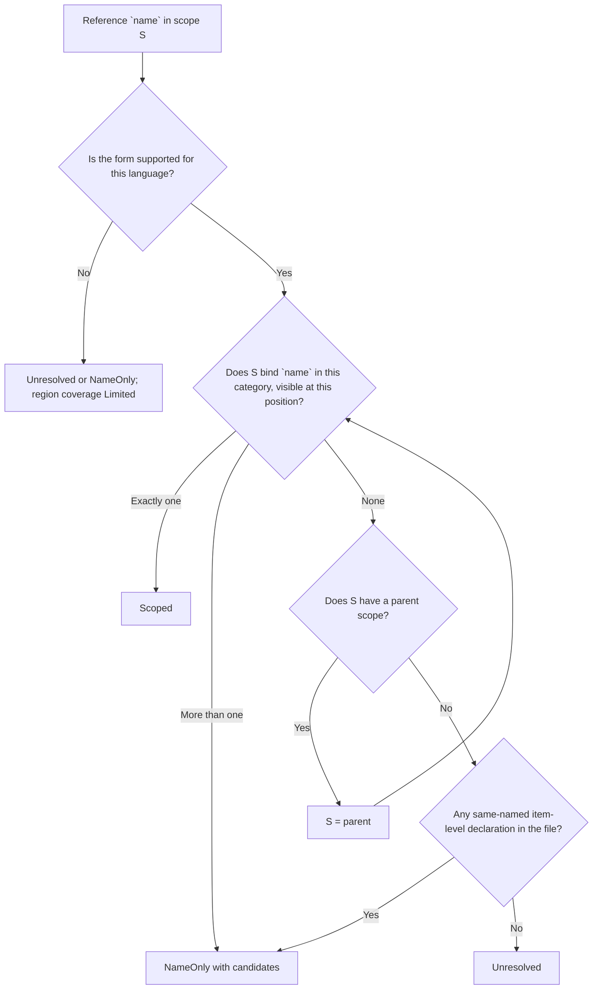
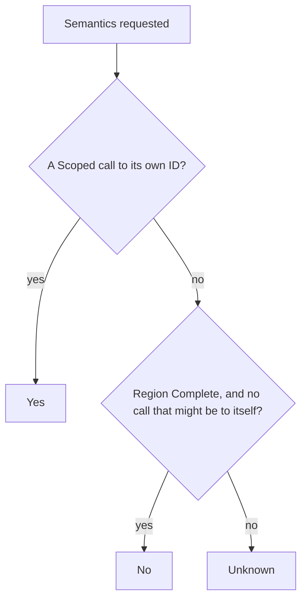

# Scope-Aware References

> **Status: partly built.** Occurrences, coverage, the relationship
> summaries derived from them and `semantics.is_recursive` are built and
> described below. Still **planned**: storing the evidence under the next
> record schema (today's cache entries carry it without strict validation)
> and the `hug refs` command.

Tree Hugger reports every reference it finds in a file as an
**occurrence**: where the name is written, which declaration owns the code
it sits in, and how sure the analysis is about what the name refers to.
The answer is never stronger than the evidence:

```rust
fn parse() {}

fn run() {
    let parse = || 1;   // shadows the function `parse`
    parse();            // Scoped -> the closure binding, not `fn parse`
    other.parse();      // a method call on an unknown receiver: not `fn parse`
}
```

Under first-match binding both `parse` calls point at `fn parse`. With scoped
references the first is bound to the local `let parse` (an established
binding), and the second stays uncertain because nothing in the file proves
which `parse` method `other` has.

```rust
let file = TreeFile::new("src/lib.rs")?;
let evidence = file.reference_evidence()?;
for occurrence in &evidence.occurrences {
    println!("{} {:?} {:?}", occurrence.target.name, occurrence.kind, occurrence.confidence);
}
```

Each occurrence has:

| Field | Meaning |
|---|---|
| `owner` | The nearest enclosing callable declaration record; absent for file-level code, anonymous callables and initializers (see [Ownership](#ownership)). |
| `owner_span` | The owning region's span: the callable, the initializer, or the whole file. |
| `target` | The name as written. `target.qualified_name` is the written path or receiver expression including the name (`Self::new`, `other.parse`), not the declaration's qualified name; `target.id` is set only for a `Scoped` binding to a declaration record. |
| `candidates` | For `NameOnly`: the same-named declarations, in declaration order. Empty otherwise. |
| `span` | The name token (one-based line and byte column, half-open byte offsets, like every other span). |
| `kind` | `Call` for an invocation target (a call's function, a method name, `new X()`, a Rust tuple-struct constructor), `Usage` for anything else, macro invocations included. |
| `confidence` | `Scoped`, `NameOnly` or `Unresolved` (below). |

Declaration and import names, comments, strings, attributes, Rust lifetimes
and loop labels, the Rust `Self` keyword, and everything inside an import
statement (`use`, `import`) are not occurrences. Two captures of the same
token are one occurrence; two calls on one line are two. Occurrences are
sorted by span, then owner span, kind, written target and confidence, so the
result never depends on the order the queries match in.

## Confidence

Every occurrence carries one of three confidence levels:

| Confidence | Meaning | Has a target ID? |
|---|---|---|
| `Scoped` | Syntax and the language's visibility rules establish exactly one binding. | Yes for an in-file declaration; no for a bound import (it names something outside the file). |
| `NameOnly` | Same-named declarations exist, but visibility or receiver evidence cannot pick one. They are listed as `candidates`. | No. Candidate IDs are suggestions. |
| `Unresolved` | No supported binding and no in-file candidate. | No. |

`Scoped` describes the source-level binding. It does not promise which
implementation runs: a `Scoped` call through a trait object or a virtual
method can still dispatch elsewhere, so method calls on receivers stay
`NameOnly` unless the language rules below prove one declaration.

## How a name is looked up

Each file gets a tree of lexical scopes: one root scope for the file, and a
child scope for each block, function body, closure and so on. Every
declaration is placed in the scope where its name is visible. A function's
name goes in the enclosing scope and its parameters in its body. A reference
is looked up from the innermost scope outward, and the first scope that binds
the name decides the result. Lookup never falls back to "any declaration with
this name".



Declarations whose kinds a query does not report (locals, parameters,
generic parameters) still take part in lookup, and so do bindings the
locals query never reports as records at all (`for` and `catch` bindings,
destructured names, generic parameters): those are `Scoped` without a target
ID. A hidden inner binding therefore blocks an outer match even when the
report never shows it.

When no scope binds the name, the candidates are the file's item-level
declarations of that name (for example a function inside an inline `mod`):
never another function's locals, and never a type's members, which a bare
name cannot reach. A Rust glob import (`use a::*;`) in a scope ends the
search there, because the glob may supply the name.

```rust
mod inner { pub fn helper() {} }
fn outer() { helper(); }   // NameOnly, candidate `inner::helper`
```

## Language support

Rust, TypeScript and JavaScript resolve the forms marked **Resolved** below.
JavaScript shares TypeScript's query and lookup rules but has no type names.
Every other language reports occurrences conservatively. Their targets are
never `Scoped`, and every region they own has `Limited` coverage with the
reason `unsupported_language`. A limited language never yields an empty
result that looks complete.

### Rust

| Rule | Behavior | State |
|---|---|---|
| Block vs function scope | Each `block`, function body, closure, `match` arm, `if`/`while`/`for`/`loop` body, inline `mod` body and trait is a scope; so is every item with generic parameters, so they never leak out. | Resolved |
| Declaration order | `let` is visible only after its statement, so `let f = f();` reads the *outer* `f` in its initializer. Items (`fn`, `struct`, `const`, `static`, `mod`, `use`) are visible throughout their block, before or after; a `macro_rules!` macro only after its definition. | Resolved |
| Shadowing | The latest preceding `let` of a name in a block wins; an inner scope's binding hides every outer one. | Resolved |
| Parameters and patterns | Function and closure parameters, including destructured ones, bind in the body; `if let`/`while let`/`match` arm/`for` pattern bindings bind in their arm or body. In a `match` arm or `if let` pattern a bare capitalized name (`None`, `MAX`) is read as a constant or unit variant and binds nothing. | Resolved |
| Name categories | Types (`struct`, `enum`, `trait`, `type`, `mod`, generic type parameters) and values (`fn`, `const`, `static`, `let`, parameters) are separate. A tuple or unit struct is in both, and macros are their own category. A `use` binding enters every category, because the file alone cannot tell which one it names. | Resolved |
| Imports and aliases | `use a::b as c;` binds `c` locally (`Scoped`, no target ID). The import record keeps the source path and the original name `b`. A glob `use a::*;` never binds a unique target. | Resolved |
| Associated items | Methods, fields, variants and associated consts are not lexical names: a bare `f()` never reaches an `impl` member. `impl` and trait headers resolve in the enclosing scope, never in the impl body. | Resolved |
| Paths | `Self::f()` and `Type::f()` are `Scoped` only when `Type` (or the self type of the `impl` around `Self`) resolves to one in-file struct or enum and exactly one inherent `impl` of it declares `f`; `Enum::Variant` resolves the same way. Any other path keeps its written qualifier and is `NameOnly` or `Unresolved`. | Resolved |
| Method calls | `x.f()` and `self.f()` are `NameOnly` with in-file `f` methods as candidates: trait dispatch and auto-deref can select another implementation. | Limited (`indirect_dispatch`) |
| Nested callables | A closure is an anonymous owner. A nested `fn` is its own owner and is visible in its enclosing block. Calling a variable or parameter (a closure held in a `let`) is a call through a value. | Limited (`indirect_dispatch`) for calls through a value |
| Macros | `name!(…)` is a `Usage` of the macro. Its expansion is unknown, so the enclosing region's call coverage is limited. | Limited (`unexpanded_macro`) |

### TypeScript and JavaScript

| Rule | Behavior | State |
|---|---|---|
| Block vs function scope | `let`, `const`, `class` and block-level `function` are block scoped; `var` is function scoped. | Resolved |
| Declaration order | A block's `let`/`const`/`class` hides the outer name for the **whole** block, even before its declaration (the temporal dead zone). `function` and `var` are hoisted. | Resolved |
| Parameters | Plain, default, rest and destructured parameters bind in the function. A default value sees earlier parameters and is evaluated by the function itself. | Resolved |
| Calls through values | Calling a `const` bound to a function or class expression calls that function. Calling any other variable or parameter is a call through a value. | Limited (`indirect_dispatch`) for calls through a value |
| Loop and catch bindings | `for (let …)`, `for…of`/`for…in` and `catch (e)` bind in their statement. | Resolved |
| Name categories (TypeScript) | `interface` and `type` are types only; `class`, `enum` and `namespace` are both; `function`, `var`, `let` and `const` are values. | Resolved |
| Imports and aliases | `import { a as b }` binds `b`; `import * as ns` binds `ns`; the original name is kept in the import record, never bound. | Resolved |
| Members | Class and interface members are not lexical names. `this.f()` and `obj.f()` are `NameOnly`. | Limited (`indirect_dispatch`) |
| Class field initializers and static blocks | References resolve lexically, but the owner is absent and the region limited. | Limited (`ownership_unknown`) |
| Decorators | Evaluated in the scope enclosing the class, and owned by it. | Resolved |
| Dynamic access | `obj[name]()` and other calls of computed values never bind a unique target. `eval` and `with` can also introduce bindings. | Limited (`indirect_dispatch`; `unsupported_binding_form` for `eval` and `with`) |

### Every other language

| Language | Scope captures today | Occurrences reported | State |
|---|---|---|---|
| Go | blocks, functions, `if`/`for`/`switch`, func literals | identifiers, call targets, package selectors | Limited (`unsupported_language`) |
| Python | module, functions, classes, comprehensions | identifiers, call targets, attribute objects, decorators | Limited (`unsupported_language`) |
| Java | blocks, methods, constructors, lambdas, loops, `catch` | identifiers (including method names), annotations, `new` types | Limited (`unsupported_language`) |
| C# | blocks only | identifiers, invocation targets, `new` types, attributes | Limited (`unsupported_language`) |
| C | translation unit, functions, compound statements, loops | identifiers, call targets, field-access objects | Limited (`unsupported_language`) |
| C++ | as C, plus classes, namespaces, lambdas, templates, `catch` | as C, plus namespace qualifiers | Limited (`unsupported_language`) |
| Scala | blocks, functions, lambdas, template bodies, `for` | identifiers, call targets, annotations | Limited (`unsupported_language`) |
| Swift | statements, functions, types, control flow | identifiers, call targets, navigation targets | Limited (`unsupported_language`) |
| PHP | classes, interfaces, traits, enums, functions, methods | names, variables, call targets, class constants | Limited (`unsupported_language`) |
| Lua | chunk, functions, control-flow blocks | identifiers, call targets, table objects | Limited (`unsupported_language`) |
| Perl | blocks, named subs | variables, bareword calls, package names | Limited (`unsupported_language`) |
| Bash, Zsh | function bodies only | variable expansions, command names, words | Limited (`unsupported_language`) |

The scope captures exist, but several of them sit on declaration or import
nodes rather than bodies (Python imports, C++ function declarators, PHP
classes). None of these languages captures call targets separately from
other uses, so their scope trees and call coverage cannot yet support
`Scoped` results. Their occurrences are `NameOnly` with every same-named
declaration in the file as a candidate, or `Unresolved`; `kind` is `Call`
where the invocation syntax shows it.

## Coverage and limitation reasons

`reference_coverage` lists each owning region of the file (the whole file
first, then outer regions before inner ones) with an optional owner, its
span, and a state of `Complete` or `Limited` with machine-readable reasons,
in ascending order. A named callable has a region even when its body holds no
occurrence. A reason belongs to the innermost region where it occurs, so a
macro inside a closure limits the closure, not the function around it:

| Reason | When |
|---|---|
| `unsupported_language` | The language has no resolver rules (every region of such a file). |
| `unsupported_binding_form` | The region uses a binding form the language table does not support. |
| `missing_call_capture` | The region has invocation syntax the reference query does not capture. |
| `indirect_dispatch` | A call goes through a receiver, a variable or dynamic access. |
| `unexpanded_macro` | A macro invocation whose expansion could hide calls. |
| `ownership_unknown` | Code whose evaluating owner cannot be established (for example field initializers). |
| `parse_error` | The region contains a syntax error. |
| `empty_reference_query` | The language has no reference query at all. |

New reasons may be added; existing ones keep their meaning.
`Complete` is never inferred from "the pass ran" or "nothing was found".

## Ownership

An occurrence's `owner` is the nearest enclosing callable declaration record.
Code with no such record still keeps its occurrences, and is distinguished by
`owner_span`:

- File-level code: owner absent, `owner_span` covers the whole file.
- Anonymous callables (closures, arrow functions, lambdas): owner absent,
  `owner_span` is the callable itself, so two closures never merge.
- Rust `const`/`static` initializers inside a function: owner absent,
  `owner_span` is the item, so they never count as calls of the function.
- TypeScript/JavaScript class field initializers and static blocks: owner
  absent, `owner_span` is the field or block, region
  `Limited(ownership_unknown)`.
- A parameter default belongs to its function; a decorator to the code
  around the class (the file, for a top-level class).

```ts
function make(n = seed()) {}   // `seed()` is owned by `make`
class Widget {
  size = compute();            // owner absent, ownership_unknown
  @track run() {}              // `track` is owned by the file
}
```

## Asking for occurrences

Occurrences are computed by the bind pass and kept in a result only when the
query asks for them:

```rust
let query = SymbolQuery::new()
    .kinds([SymbolKindV2::Function])
    .capabilities([Capability::Occurrences]);
let index = file.query(&query)?.index;
// index.occurrences and index.reference_coverage describe the whole file
```

- `Capability::Occurrences` requires `References`, and `Semantics` requires
  `Occurrences`, so recursion always reads the same evidence the occurrences
  show. `SymbolQuery::complete_index()` (and `hug --json-full`) includes it.
- The evidence describes the **whole file**, whatever kinds or predicates
  the query selects: a functions-only query reports occurrences inside
  types and at file level too, and a target or owner may be a declaration
  that is not in `symbols`.
- `References` without `Occurrences` resolves the same occurrences, builds
  the summaries below and then drops the evidence; `occurrences` and
  `reference_coverage` are then empty, meaning "not computed".
- Declaration and containment queries run no reference work at all.
- `TreeFile::reference_evidence()` is a shortcut for an `Occurrences`
  query that selects no declarations.

## Relationship summaries

Each record's `relations.references`, `dependencies` and `referenced_by` are
read from the occurrences, in the order the occurrences appear in the file,
each target once:

- `references`: the `Scoped` targets with an in-file ID, and the imports a
  `Scoped` occurrence is bound to, of occurrences the record owns.
- `dependencies`: only those imports.
- `referenced_by`: the owners of `Scoped` occurrences whose target is the
  record.

`NameOnly` and `Unresolved` occurrences make no edge; they stay in the
occurrence list. Neither does an occurrence without an owner (file-level
code, an initializer, a closure), so nothing invents a caller:

```rust
fn a() {}
fn main() { a(); a(); }           // main.references = [a]; a.referenced_by = [main]
fn shadow() { let a = 1; a; }      // the local `a`, never an edge to `fn a`
fn go(x: Widget) { x.a(); }        // NameOnly: no edge to any `a`
const TOP: () = a();               // owner absent: no edge
fn wrap() { let c = || a(); }      // the closure owns the call: no edge for `wrap`
```

A language without resolver rules establishes nothing, so its records have
no summary edges; its occurrences are still reported.

## Direct recursion

`semantics.is_recursive` is computed for functions, methods and
constructors when `Semantics` is requested (otherwise it is absent). Only the
calls a callable's own region owns count; a nested closure or function has
its own region.



A call "might be to itself" when it is `NameOnly` with the callable among its
candidates, `Unresolved` with the callable's name, bound to an import whose
original name is the callable's name (`use crate::f as g;` inside `f`), or,
in a constructor, a call of its own class. A declaration without a body is
`Unknown`.

```rust
fn countdown(n: u32) -> u32 { if n == 0 { 0 } else { countdown(n - 1) } } // Yes
fn leaf() -> u32 { 1 }                                                    // No
fn keep() { let _f = keep; }          // No: a value, not a call
fn call(cb: fn()) { cb(); }           // Unknown: indirect_dispatch
impl W { fn m(&self) { self.m(); } }  // Unknown: NameOnly receiver call
fn log() { println!("x"); }           // Unknown: unexpanded_macro
fn a() { b() } fn b() { a() }         // No, No: mutual recursion is not direct
```

A proven self-call is `Yes` even when the rest of the body is uncertain.
