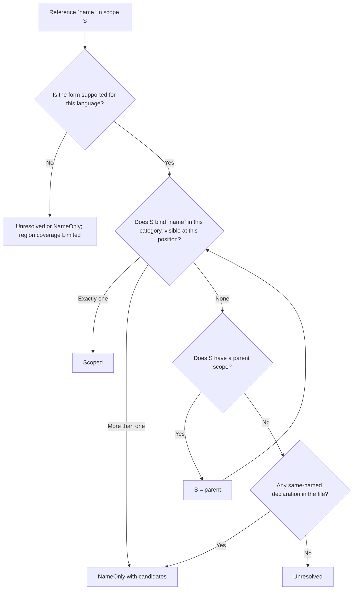

# Scope-Aware References

> **Status: planned.** Nothing on this page is built yet. Today the bind
> pass connects a reference to the *first* declaration of the same name in
> the file, and `semantics.is_recursive` is always `Unknown`. This page
> records the decided behavior and the per-language support table that the
> implementation will follow; each section loses its **planned** marker when
> the code that implements it lands.

Tree Hugger will report every reference it finds in a file as an
**occurrence**: where the name is written, which declaration owns the code
it sits in, and how sure the analysis is about what the name refers to.
The answer is never stronger than the evidence:

```rust
fn parse() {}

fn run() {
    let parse = || 1;   // shadows the function `parse`
    parse();            // Scoped -> the closure binding, not `fn parse`
    other.parse();      // a method call on an unknown receiver: not `fn parse`
}
```

Under first-match binding both `parse` calls point at `fn parse`. With scoped
references the first is bound to the local `let parse` (an established
binding), and the second stays uncertain because nothing in the file proves
which `parse` method `other` has.

## Confidence (planned)

Every occurrence carries one of three confidence levels:

| Confidence | Meaning | Has a target ID? |
|---|---|---|
| `Scoped` | Syntax and the language's visibility rules establish exactly one binding. | Yes for an in-file declaration; no for a bound import (it names something outside the file). |
| `NameOnly` | Same-named declarations exist, but visibility or receiver evidence cannot pick one. They are listed as `candidates`. | No. Candidate IDs are suggestions. |
| `Unresolved` | No supported binding and no in-file candidate. | No. |

`Scoped` describes the source-level binding. It does not promise which
implementation runs: a `Scoped` call through a trait object or a virtual
method can still dispatch elsewhere, so method calls on receivers stay
`NameOnly` unless the language rules below prove one declaration.

## How a name is looked up (planned)

Each file gets a tree of lexical scopes: one root scope for the file, and a
child scope for each block, function body, closure and so on. Every
declaration is placed in the scope where its name is visible. A function's
name goes in the enclosing scope and its parameters in its body. A reference
is looked up from the innermost scope outward, and the first scope that binds
the name decides the result. Lookup never falls back to "any declaration with
this name".



Declarations whose kinds a query does not report (locals, parameters,
generic parameters) still take part in lookup. A hidden inner binding
therefore blocks an outer match even when the report never shows it.

## Language support (planned)

Rust, TypeScript and JavaScript resolve the forms marked **Resolved** below.
JavaScript shares TypeScript's query and lookup rules but has no type names.
Every other language reports occurrences conservatively. Their targets are
never `Scoped`, and every region they own has `Limited` coverage with the
reason `unsupported_language`. A limited language never yields an empty
result that looks complete.

### Rust

| Rule | Behavior | State |
|---|---|---|
| Block vs function scope | Each `block`, function body, closure, `match` arm, `if`/`while`/`for`/`loop` body and inline `mod` body is a scope. | Resolved |
| Declaration order | `let` is visible only after its statement, so `let f = f();` reads the *outer* `f` in its initializer. Items (`fn`, `struct`, `const`, `static`, `mod`, `use`) are visible throughout their block, before or after; a `macro_rules!` macro only after its definition. | Resolved |
| Shadowing | The latest preceding `let` of a name in a block wins; an inner scope's binding hides every outer one. | Resolved |
| Parameters and patterns | Function and closure parameters, including destructured ones, bind in the body; `if let`/`while let`/`match` arm/`for` pattern bindings bind in their arm or body. | Resolved |
| Name categories | Types (`struct`, `enum`, `trait`, `type`, `mod`, generic type parameters) and values (`fn`, `const`, `static`, `let`, parameters) are separate. A tuple or unit struct is in both, and macros are their own category. A `use` binding enters every category, because the file alone cannot tell which one it names. | Resolved |
| Imports and aliases | `use a::b as c;` binds `c` locally (`Scoped`, no target ID). The import record keeps the source path and the original name `b`. A glob `use a::*;` never binds a unique target. | Resolved |
| Associated items | Methods, fields, variants and associated consts are not lexical names: a bare `f()` never reaches an `impl` member. `impl` and trait headers resolve in the enclosing scope, never in the impl body. | Resolved |
| Paths | `Self::f()` and `Type::f()` are `Scoped` only when `Type` resolves to one in-file type and exactly one inherent `impl` of it declares `f`. Any other path keeps its written qualifier and is `NameOnly` or `Unresolved`. | Resolved |
| Method calls | `x.f()` and `self.f()` are `NameOnly` with in-file `f` methods as candidates: trait dispatch and auto-deref can select another implementation. | Limited (`indirect_dispatch`) |
| Nested callables | A closure is an anonymous owner. A nested `fn` is its own owner and is visible in its enclosing block. | Resolved |
| Macros | `name!(…)` is a `Usage` of the macro. Its expansion is unknown, so the enclosing region's call coverage is limited. | Limited (`unexpanded_macro`) |

### TypeScript and JavaScript

| Rule | Behavior | State |
|---|---|---|
| Block vs function scope | `let`, `const`, `class` and block-level `function` are block scoped; `var` is function scoped. | Resolved |
| Declaration order | A block's `let`/`const`/`class` hides the outer name for the **whole** block, even before its declaration (the temporal dead zone). `function` and `var` are hoisted. | Resolved |
| Parameters | Plain, default, rest and destructured parameters bind in the function. A default value sees earlier parameters and is evaluated by the function itself. | Resolved |
| Loop and catch bindings | `for (let …)`, `for…of`/`for…in` and `catch (e)` bind in their statement. | Resolved |
| Name categories (TypeScript) | `interface` and `type` are types only; `class`, `enum` and `namespace` are both; `function`, `var`, `let` and `const` are values. | Resolved |
| Imports and aliases | `import { a as b }` binds `b`; `import * as ns` binds `ns`; the original name is kept in the import record, never bound. | Resolved |
| Members | Class and interface members are not lexical names. `this.f()` and `obj.f()` are `NameOnly`. | Limited (`indirect_dispatch`) |
| Class field initializers and static blocks | References resolve lexically, but the owner is absent and the region limited. | Limited (`ownership_unknown`) |
| Decorators | Evaluated in the scope enclosing the class, and owned by it. | Resolved |
| Dynamic access | `obj[name]()`, `eval` and `with` never bind a unique target. | Limited (`indirect_dispatch`) |

### Every other language

| Language | Scope captures today | Occurrences reported | State |
|---|---|---|---|
| Go | blocks, functions, `if`/`for`/`switch`, func literals | identifiers, call targets, package selectors | Limited (`unsupported_language`) |
| Python | module, functions, classes, comprehensions | identifiers, call targets, attribute objects, decorators | Limited (`unsupported_language`) |
| Java | blocks, methods, constructors, lambdas, loops, `catch` | identifiers (including method names), annotations, `new` types | Limited (`unsupported_language`) |
| C# | blocks only | identifiers, invocation targets, `new` types, attributes | Limited (`unsupported_language`) |
| C | translation unit, functions, compound statements, loops | identifiers, call targets, field-access objects | Limited (`unsupported_language`) |
| C++ | as C, plus classes, namespaces, lambdas, templates, `catch` | as C, plus namespace qualifiers | Limited (`unsupported_language`) |
| Scala | blocks, functions, lambdas, template bodies, `for` | identifiers, call targets, annotations | Limited (`unsupported_language`) |
| Swift | statements, functions, types, control flow | identifiers, call targets, navigation targets | Limited (`unsupported_language`) |
| PHP | classes, interfaces, traits, enums, functions, methods | names, variables, call targets, class constants | Limited (`unsupported_language`) |
| Lua | chunk, functions, control-flow blocks | identifiers, call targets, table objects | Limited (`unsupported_language`) |
| Perl | blocks, named subs | variables, bareword calls, package names | Limited (`unsupported_language`) |
| Bash, Zsh | function bodies only | variable expansions, command names, words | Limited (`unsupported_language`) |

The scope captures exist, but several of them sit on declaration or import
nodes rather than bodies (Python imports, C++ function declarators, PHP
classes). None of these languages captures call targets separately from
other uses, so their scope trees and call coverage cannot yet support
`Scoped` results.

## Coverage and limitation reasons (planned)

`reference_coverage` lists each owning region of the file with an optional
owner, its span, and a state of `Complete` or `Limited` with
machine-readable reasons:

| Reason | When |
|---|---|
| `unsupported_language` | The language has no resolver rules (every region of such a file). |
| `unsupported_binding_form` | The region uses a binding form the language table does not support. |
| `missing_call_capture` | The region has invocation syntax the reference query does not capture. |
| `indirect_dispatch` | A call goes through a receiver, a variable or dynamic access. |
| `unexpanded_macro` | A macro invocation whose expansion could hide calls. |
| `ownership_unknown` | Code whose evaluating owner cannot be established (for example field initializers). |
| `parse_error` | The region contains a syntax error. |
| `empty_reference_query` | The language has no reference query at all. |

New reasons may be added; existing ones keep their meaning.
`Complete` is never inferred from "the pass ran" or "nothing was found".

## Ownership (planned)

An occurrence's `owner` is the nearest enclosing callable declaration record.
Code with no such record still keeps its occurrences, and is distinguished by
`owner_span`:

- File-level code: owner absent, `owner_span` covers the whole file.
- Anonymous callables (closures, arrow functions, lambdas): owner absent,
  `owner_span` is the callable itself, so two closures never merge.
- Rust `const`/`static` initializers inside a function: owner absent,
  `owner_span` is the item, so they never count as calls of the function.

## Direct recursion (planned)

`semantics.is_recursive` will be `Yes` only when a function's own body
contains a `Scoped` `Call` to its own ID. It will be `No` only when the
body's call coverage is `Complete` and no unresolved or indirect call could
be recursive. In every other case it will be `Unknown`. Using the function
as a value (`consume(f)`) is not recursion, and mutual recursion is not
direct recursion.
