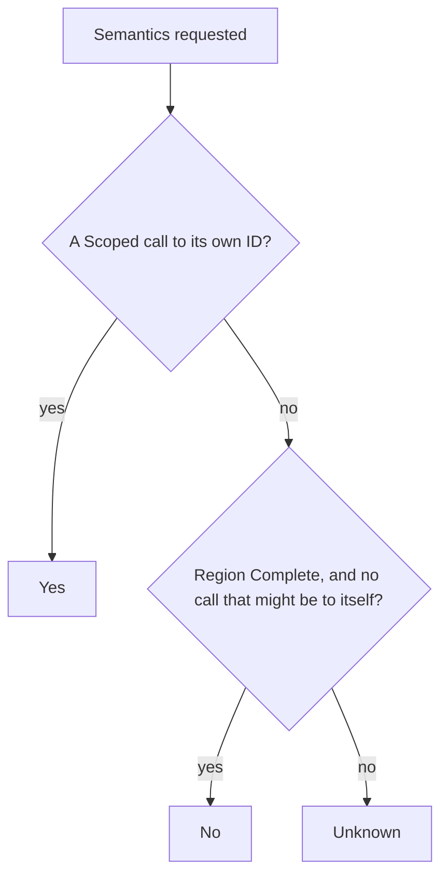

# Scope-Aware References

Tree Hugger can tell you where a declaration is used, which calls a function
makes, and whether a function calls itself. It answers from the syntax of
one file and the scoping rules of its language, and it never claims more than
that evidence proves: a name that could mean several things is reported as
uncertain, never guessed.

This page explains the ideas you need to read those answers. The rules for
each language, the full `hug refs` contract and other details are on the
[detail pages](#detail-pages).

## A first look

Take this Rust file, `src/lib.rs`:

```rust
use std::fs::read_to_string as slurp;

fn parse(text: &str) -> usize {
    text.len()
}

fn run(path: &str, other: &Parser) -> usize {
    let text = slurp(path).unwrap_or_default();
    let total = parse(&text);
    let parse = |s: &str| s.len();      // a local closure that shadows `fn parse`
    total + parse("x") + other.parse()
}

fn countdown(n: u32) -> u32 {
    if n == 0 { 0 } else { countdown(n - 1) }
}

struct Parser;
impl Parser {
    fn parse(&self) -> usize { 0 }
}
```

Three things in the file are called `parse`: the function, the closure in
`run`, and the method on `Parser`. A plain text search cannot tell them
apart. `hug refs` can, and it refuses to guess which one you mean:

```text
$ hug refs parse 'src/**'
error: `parse` names 3 declarations; select one with `--id` or a file-prefixed qualified name:
  src/lib.rs:3:1  function src/lib.rs#parse  ac4bb622…
  src/lib.rs:10:9  let src/lib.rs#run::parse  b51163dc…
  src/lib.rs:20:5  method src/lib.rs#Parser::parse  61c62346…
```

Asking for the function by its qualified name finds only the first call in
`run`. The second, `parse("x")`, calls the closure:

```text
$ hug refs 'src/lib.rs#parse' 'src/**'
References to private function parse(text: &str) -> usize src/lib.rs:3:1
References are resolved within one file: only the declaration's own file is searched, so a caller in another file is never listed, even when it uses the same name.

Established (Scoped to this declaration)
  src/lib.rs#run 7:1
    - Call parse 9:17

3 regions of this file have limited coverage; a reference there may be uncertain and is then not listed as established.
```

The method is called once, through `other.parse()`. Nothing in the file
proves what type `other` is at run time, so that call is listed as a
suggestion, not as an established reference:

```text
$ hug refs 'src/lib.rs#Parser::parse' 'src/**'
References to private method parse(self) -> usize [in type Parser] src/lib.rs:20:5
...
Name-only suggestions (same name, not proven to refer to this declaration)
  src/lib.rs#run 7:1
    - Call other.parse 11:32 — NameOnly, candidates: src/lib.rs#Parser::parse
```

`--callees` turns the question around and lists the calls `run` makes, with
a reason beside every call that is not bound to a declaration in this file:

```text
$ hug refs 'src/lib.rs#run' --callees 'src/**'
Callees of private function run(path: &str, other: &Parser) -> usize src/lib.rs:7:1
...
coverage: limited (indirect_dispatch)

  - Call slurp 8:16 — Scoped to an import (outside this file, no ID)
  - Call slurp(path).unwrap_or_default 8:28 — Unresolved (no binding or same-named declaration in this file)
  - Call parse 9:17
  - Call parse 11:13
  - Call other.parse 11:32 — NameOnly, candidates: src/lib.rs#Parser::parse
```

The rest of this page explains the terms in that output: occurrences,
owners, confidence, coverage, and the summaries built from them.

## Occurrences

An **occurrence** is one place where a name is used: a call, or any other
read of a name. Tree Hugger records each one with where it is written, the
code that contains it, and how sure the analysis is about what it refers to.

| Field | Meaning |
|---|---|
| `span` | The name token: one-based line and byte column, and half-open byte offsets, like every other span. |
| `kind` | `Call` when the name is what gets invoked (`f()`, a method name, `new X()`, a decorator, a shell command); `Usage` for every other read, macro invocations included. See [Invocation forms](references/invocation-forms.md). |
| `target` | The name as written. `target.qualified_name` is the written path or receiver through the name (`other.parse`, `Self::new`), absent for a name written alone; `target.id` is set only when the name is bound to a declaration record in the file. See [Identity and written names](references/identity-and-written-names.md). |
| `confidence` | `Scoped`, `NameOnly` or `Unresolved`; see [Confidence](#confidence). |
| `candidates` | For `NameOnly` only: the same-named declarations that might be meant, in declaration order. |
| `import_span` | For a name bound to an import only: the name token of that import. |
| `owner`, `owner_span` | The code the occurrence belongs to; see [Owners](#owners). |

Only reads are occurrences. The name in a declaration, everything an import
statement writes, comments, strings and attributes are not, and neither is a
keyword that only looks like a name (Java's inferred-type `var`, Rust's
`Self`). [Language support](references/language-support.md#what-is-not-an-occurrence)
lists the exact rules per language.

Two captures of the same token are one occurrence, and two calls on one line
are two. Occurrences are sorted by position, so the result never depends on
the order in which the analysis found them.

## Owners

An occurrence's **owner** is the nearest enclosing named function, method or
constructor. Code that has no such declaration still keeps its occurrences;
`owner` is then absent and `owner_span` says which region the code belongs
to:

- File-level code: `owner_span` covers the whole file.
- Anonymous callables (closures, arrow functions, lambdas): `owner_span` is
  the callable itself, so two closures never merge.
- Rust `const` and `static` initializers inside a function: `owner_span` is
  the item, so they never count as calls the function makes.
- TypeScript and JavaScript class field initializers and static blocks:
  `owner_span` is the field or block, and its coverage is
  `Limited (ownership_unknown)` (see [Coverage](#coverage)).
- A parameter default belongs to its function, and a decorator to the code
  around the class (the file, for a top-level class).

```ts
function make(n = seed()) {}   // `seed()` is owned by `make`
class Widget {
  size = compute();            // owner absent, ownership_unknown
  @track run() {}              // `track` is owned by the file
}
```

Ownership is what makes "who calls this?" answerable without inventing
callers: a call inside a closure belongs to the closure, never to the
function that defines it.

## Confidence

Every occurrence carries one of three confidence levels:

| Confidence | Meaning | Has a target ID? |
|---|---|---|
| `Scoped` | The syntax and the language's visibility rules establish exactly one binding. | Yes for a declaration in the file; no for a name bound to an import (it names something outside the file) or to a local that has no declaration record. |
| `NameOnly` | Declarations with this name exist in the file, but the evidence cannot pick one. They are listed as `candidates`. | No. The candidates are suggestions. |
| `Unresolved` | No binding the analysis supports, and no candidate in the file. | No. |

To decide, Tree Hugger looks a name up the way the language does: from the
innermost scope (block, function body, closure) outward, and the first scope
that declares the name wins. A local `let parse` therefore hides
`fn parse`, as in the example above. Lookup never falls back to "any
declaration with this name". [Name lookup](references/name-lookup.md)
describes the walk, the scopes a name cannot cross, and the cases that make
a name uncertain.

`Scoped` describes the binding in the source, not which code runs. A call
through a trait object or a virtual method can still dispatch elsewhere,
which is why a method call on a receiver (`other.parse()`) stays `NameOnly`
unless the language's rules prove one declaration.

## Coverage

Some code cannot be analyzed with certainty: a call through a variable, a
macro whose expansion is unknown, or a language Tree Hugger has no lookup
rules for. Rather than return an empty answer that looks complete, Tree
Hugger reports **coverage** for every owning region (the whole file, and
each function body, closure or initializer that owns code; see
[Owners](#owners)): `Complete`, or `Limited` with one or more reasons
such as `indirect_dispatch` or `unexpanded_macro`.

In the example, `run` is `Limited (indirect_dispatch)` because of
`other.parse()`, and so is `fn parse`, because of `text.len()`. `countdown`
is `Complete`. `Complete` is never inferred from "nothing was found".
[Coverage and limitation reasons](references/coverage.md) lists every
reason.

### Why results are file-local

Resolution never leaves the file. Following an import into another file
would mean resolving modules, packages and build configuration, which the
syntax of one file cannot settle. So a name bound to an import is `Scoped`
to that import, with no ID, and only the declaration's own file can
reference a declaration. Every `hug refs` report states this boundary, even
an empty one.

### Which languages resolve

Rust, TypeScript and JavaScript have full lookup rules and can produce
`Scoped` results. Every other supported language reports its occurrences
conservatively: never `Scoped`, and every region `Limited` with the reason
`unsupported_language`. [Language support](references/language-support.md)
has the rules for each language.

## Relationship summaries

Each declaration record carries three lists in `relations`, read from the
occurrences in the order they appear in the file, each target once:

- `references`: what the record's own code refers to: the `Scoped` targets
  with an in-file ID, plus the imports a `Scoped` occurrence is bound to.
- `dependencies`: only those imports.
- `referenced_by`: the owners of `Scoped` occurrences that target the
  record.

`NameOnly` and `Unresolved` occurrences make no edge, and neither does an
occurrence without an owner, so nothing invents a caller:

```rust
fn a() {}
fn main() { a(); a(); }           // main.references = [a]; a.referenced_by = [main]
fn shadow() { let a = 1; a; }      // the local `a`, never an edge to `fn a`
fn go(x: Widget) { x.a(); }        // NameOnly: no edge to any `a`
const TOP: () = a();               // owner absent: no edge
fn wrap() { let c = || a(); }      // the closure owns the call: no edge for `wrap`
```

A language without lookup rules establishes nothing, so its records have no
summary edges, though its occurrences are still reported.

## Direct recursion

`semantics.is_recursive` says whether a function, method or constructor
calls itself directly. Only the calls its own region owns count: a nested
closure or function has its own region.



A call "might be to itself" when it is `NameOnly` with the callable among
its candidates, `Unresolved` with the callable's name, bound to an import
whose original name is the callable's name (`use crate::f as g;` inside
`f`), or, in a constructor, a call of its own class. A declaration without a
body is `Unknown`. A proven self-call is `Yes` even when the rest of the
body is uncertain.

```rust
fn countdown(n: u32) -> u32 { if n == 0 { 0 } else { countdown(n - 1) } } // Yes
fn leaf() -> u32 { 1 }                                                    // No
fn keep() { let _f = keep; }          // No: a value, not a call
fn call(cb: fn()) { cb(); }           // Unknown: indirect_dispatch
impl S { const C: fn() = Self::f; fn f() { Self::C(); } } // f: Unknown: indirect_dispatch, the call is to C
impl W { fn m(&self) { self.m(); } }  // Unknown: NameOnly receiver call
fn log() { println!("x"); }           // Unknown: unexpanded_macro
fn a() { b() } fn b() { a() }         // No, No: mutual recursion is not direct
```

Mutual recursion is not detected: `is_recursive` covers direct self-calls
only.

## Using the library

Occurrences are computed only when a query asks for them:

```rust
let query = SymbolQuery::new()
    .kinds([SymbolKindV2::Function])
    .capabilities([Capability::Occurrences]);
let index = file.query(&query)?.index;
// index.occurrences and index.reference_coverage describe the whole file
```

- `Capability::Occurrences` requires `References`, and `Semantics` requires
  `Occurrences`, so recursion always reads the same evidence the occurrences
  show. `SymbolQuery::complete_index()` (and `hug --json-full`) includes
  all three.
- The evidence describes the **whole file**, whatever kinds the query
  selects: a functions-only query still reports occurrences inside types and
  at file level, and a target or owner may be a record that is not in
  `symbols`.
- `References` without `Occurrences` builds the summaries and then drops the
  evidence; `occurrences` and `reference_coverage` are then empty, meaning
  "not computed".
- Declaration-only queries do no reference work at all.
- `TreeFile::reference_evidence()` is a shortcut for an `Occurrences` query
  that selects no declarations:

```rust
let file = TreeFile::new("src/lib.rs")?;
let evidence = file.reference_evidence()?;
for occurrence in &evidence.occurrences {
    println!("{} {:?} {:?}", occurrence.target.name, occurrence.kind, occurrence.confidence);
}
```

The persistent cache stores the evidence with each file's entry and checks
it against the source before serving it; damaged or contradictory evidence
is recomputed, never read as "no references" (see
[Cache Design](./cache-design/robustness.md#reference-evidence)). These fields are part
of record schema 5.1; [Upgrading from schema 4.x](references/upgrading-from-schema-4.md)
explains what changed for older consumers.

## `hug refs`

`hug refs` shows this evidence for one declaration: where it is referenced
(the default), only its incoming calls (`--callers`), or the calls its own
body makes (`--callees`).

```sh
hug refs parse 'src/**'                                   # references to `parse`
hug refs 'src/parser.rs#Parser::parse' --callers 'src/**' # incoming calls only
hug refs --id <ID> --callees 'src/**'                     # calls the declaration makes
```

Give one selector, a name or `--id`; a name that matches more than one
declaration is an error that lists each match. Incoming rows are split into
**Established** (`Scoped` to the declaration) and **Name-only suggestions**,
and `--json` writes the same report as one envelope.
[`hug refs` in full](references/hug-refs.md) covers selection, every row
type, the JSON shape and the cache behavior.

## Detail pages

- [Invocation forms](references/invocation-forms.md): when an occurrence is
  a `Call` and when a `Usage`, language by language.
- [Name lookup](references/name-lookup.md): the scope walk and the scopes a
  name cannot cross.
- [Language support](references/language-support.md): the Rust and
  TypeScript/JavaScript rule tables, the other languages, what imports
  bind, and which names are never occurrences.
- [Coverage and limitation reasons](references/coverage.md): every region
  and every reason.
- [`hug refs` in full](references/hug-refs.md): the command's complete
  contract.
- [Identity and written names](references/identity-and-written-names.md):
  written paths, raw and escaped identifiers, and import provenance.
- [Upgrading from schema 4.x](references/upgrading-from-schema-4.md): what
  changed in the meaning of the relationship fields.

## Related pages

- [Symbol Reports](./symbol-reports.md): the declaration commands and their
  output formats.
- [Using the `hug` CLI](./cli.md): every command and flag.
- [Symbol Records](./symbol-records.md): the record schema these
  fields belong to.
- [Declared Type Relations](./type-relations.md): declared bases and implemented
  interfaces, which follow the same lookup boundaries.
- [Cache Design](./cache-design.md): how reference evidence is stored and
  validated.
