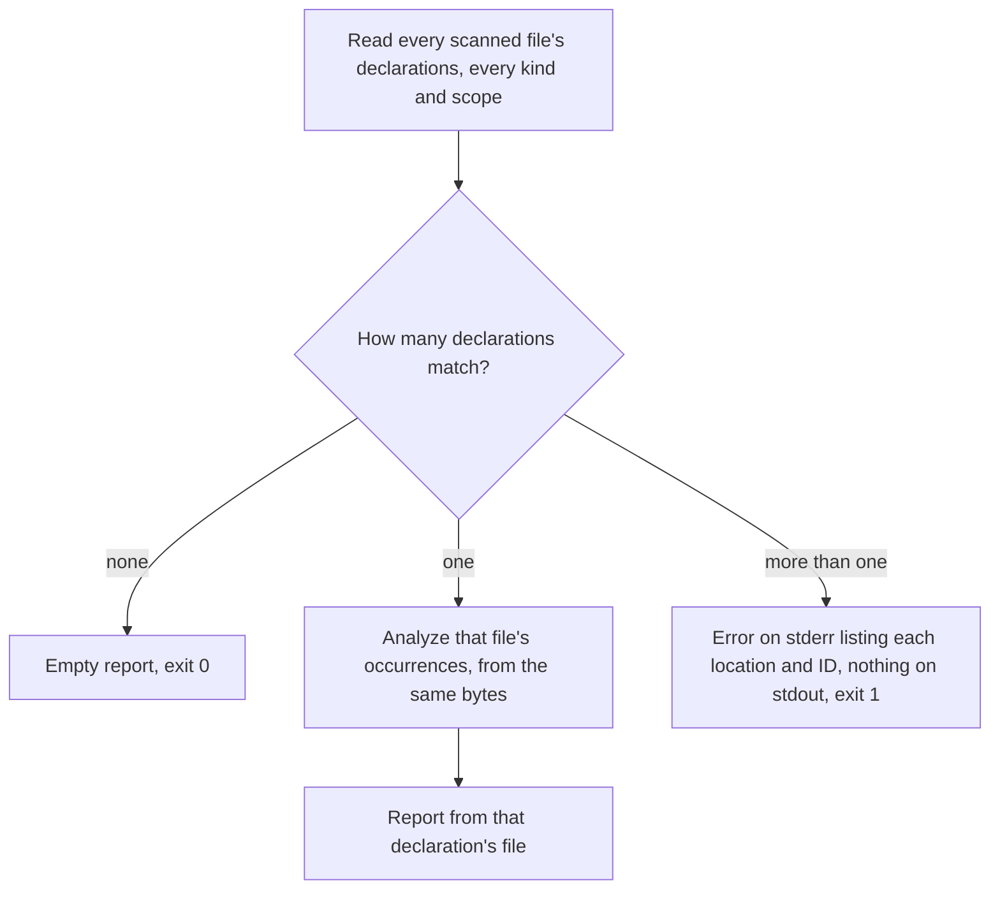

# `hug refs`

Part of [Scope-Aware References](../references.md).

`hug refs` shows the [occurrence](../references.md#occurrences) evidence
for one declaration: where it is referenced, or which calls it makes, with
each row's confidence.

```sh
hug refs parse 'src/**'                                   # references to `parse`
hug refs 'src/parser.rs#Parser::parse' --callers 'src/**' # incoming calls only
hug refs --id <ID> --callees 'src/**'                     # calls the declaration makes
```

Given this `src/a.rs`:

```rust
fn parse() -> u32 {
    1
}

fn run() -> u32 {
    let f = parse;
    parse() + f()
}

const TOP: u32 = 0;
static LAZY: fn() -> u32 = parse;
```

the first command reports both reads in `run` (the value read and the call)
and the read in the `static`, which belongs to file-level code:

```text
$ hug refs parse 'src/**'
References to private function parse() -> u32 src/a.rs:1:1
References are resolved within one file: only the declaration's own file is searched, so a caller in another file is never listed, even when it uses the same name.

Established (Scoped to this declaration)
  src/a.rs#run 5:1
    - Usage parse 6:13
    - Call parse 7:5
  file-level code [1:1–12:1]
    - Usage parse 11:28

1 region of this file has limited coverage; a reference there may be uncertain and is then not listed as established.
```

The limited region is `run`: `f()` calls a value, which is
`indirect_dispatch` (see [Coverage](coverage.md)).

## Selecting the declaration

Give exactly one selector: a name, or `--id <ID>`. The first value after
`refs` is the name, and the rest are file filters (`--id` makes every value
a file filter). Discovery works as for the declaration commands: `.gitignore`,
the default test-data exclusions, `--exclude-files`, `--language` and
`--no-cache` all apply.

| Selector | Matches |
|---|---|
| `parse` | Every declaration named exactly `parse`, of any kind and scope (locals and parameters included). All-lowercase ignores case, so `parse` also matches `Parse`. |
| `Parse` | Only `Parse`: an uppercase letter makes the name case-sensitive. |
| `Parser::parse`, `src/parser.rs#Parser::parse` | The qualified name, with the language's separator; the `file#` prefix is the scan-root-relative path. |
| `--id 3f…` | The record with that ID, compared case-sensitively (IDs come from any `--json` report). |

The selector is checked across every scanned file before anything is
printed. Only the declarations of most files are needed for that, so the
occurrences are analyzed for one file only, the one that declares the match:



A name that matches nothing is not an error: the report says so and the
exit status is 0. A name that matches several declarations is:

```text
$ hug refs shared
error: `shared` names 2 declarations; select one with `--id` or a file-prefixed qualified name:
  src/one.ts:1:8  function src/one.ts#shared  f7744c57…
  src/two.ts:1:8  function src/two.ts#shared  ce7fe0fd…
```

### Cost and caching

Selecting costs memory per matching file, not per match: a file declaring
forty same-named methods is kept once, its exact bytes (or, in a one-file
scan, its analysis), and each match adds only what the ambiguity error lists.
A file without a match keeps nothing.

A scan of a single file has nothing to choose between, so it asks for that
file's occurrences straight away and analyzes it once. Each analysis is one
lookup in `--verbose`'s cache counts: a cold `hug refs parse 'src/**'` over
three files, with `parse` declared in one, reports

```text
cache: 0 hits, 1 partial hits, 3 misses; parsed 4 files, 4 definition captures, 0 diagnostics runs
```

(three declaration lookups, then the declaring file's entry widened to its
occurrences), and the same run warm reports `4 hits` and `parsed 0 files`.
The other files' cache entries keep only their declarations.

## What is listed

| Flag | Lists |
|---|---|
| (none) | Incoming `Call` and `Usage` occurrences. |
| `--callers` | Incoming `Call` occurrences only. |
| `--callees` | The `Call` occurrences the declaration's own body owns, whatever their confidence. Calls inside a nested closure belong to the closure, not to the declaration. |

`--callers` and `--callees` cannot be combined.

Incoming rows come in two separate groups:

- **Established**: `Scoped` occurrences whose target ID is the declaration's.
- **Name-only suggestions**: `NameOnly` occurrences that list the declaration
  among their candidates. They are not proven to refer to it. An `Unresolved`
  occurrence with the same name is never attached, and selecting by `--id`
  never makes a suggestion established.

Every call site is its own row (two calls on one line are two rows), grouped
under the region that owns it: a declaration by its qualified name, file-level
code as `file-level code [span]`, and an anonymous callable or an initializer
as `code without a declaration owner [span]`. When regions of the file have
`Limited` coverage, the report says how many, since a reference there may be
uncertain and so not established.

`--callees` explains every row without a target ID. For `run` in the
[example on the entry page](../references.md#a-first-look):

```text
$ hug refs 'src/lib.rs#run' --callees 'src/**'
Callees of private function run(path: &str, other: &Parser) -> usize src/lib.rs:7:1
References are resolved within one file: only the declaration's own file is searched, so a caller in another file is never listed, even when it uses the same name.
coverage: limited (indirect_dispatch)

  - Call slurp 8:16 — Scoped to an import (outside this file, no ID)
  - Call slurp(path).unwrap_or_default 8:28 — Unresolved (no binding or same-named declaration in this file)
  - Call parse 9:17
  - Call parse 11:13
  - Call other.parse 11:32 — NameOnly, candidates: src/lib.rs#Parser::parse
```

The two `parse` rows have target IDs, so they carry no explanation: the
first calls `fn parse`, the second the local closure `run::parse`. The
`--json` row carries the reason as `absent_id`:

| `absent_id` | Text | Meaning |
|---|---|---|
| `import` | Scoped to an import | Bound to the particular import identified by the occurrence's `import_span`: it names something outside the file. A local binding that reuses its name is not an import. |
| `binding_without_record` | Scoped to a binding that is not a declaration record | Bound to a local such as a `for…of` or `catch` binding that has no record. |
| `name_only` | NameOnly, candidates: … | The candidates are suggestions, not a target. |
| `unresolved` | Unresolved | No supported binding and no same-named declaration in the file. |

## The file-local boundary

Resolution never leaves a file (see
[why](../references.md#why-results-are-file-local)), so only the selected
declaration's own file can reference it. `hug refs parse` over a tree where `other.ts` imports and
calls `parse` lists nothing from `other.ts`: that call is bound to an import,
not to the declaration. Every report states this boundary, including an
empty one.

## JSON

`--json` writes one envelope. The declaration's file is the only entry in
`files`, and `errors` comes last:

```json
{"report_schema_version":1,"schema_version":{"major":5,"minor":1},
 "root_dir":"/work/repo",
 "boundary":"References are resolved within one file: …",
 "selector":{"name":"parse"},"direction":"references",
 "declaration":{"id":"a992…","kind":"Function","identity":{"qualified_name":"src/a.rs#parse"}},
 "files":[{"file":"src/a.rs","language":"Rust",
   "completed_capabilities":["declarations","containment","references","occurrences"],
   "occurrences":[{"owner":{"id":"b73a…","name":"run","qualified_name":"src/a.rs#run"},
     "owner_span":{…},"target":{"id":"a992…","name":"parse"},"span":{…},
     "kind":"Call","confidence":"Scoped"}],
   "name_only_suggestions":[],
   "coverage":[{"owner":{…},"span":{…},"state":"Limited","reasons":["indirect_dispatch"]}],
   "limited_regions":1}],
 "errors":[]}
```

- `selector` is `{"name": …}` or `{"id": …}`; `direction` is `references`,
  `callers` or `callees`.
- `declaration` is the selected record, trimmed and scan-root-relative like
  `--json` records, or `null` when nothing matched (then `files` is `[]`).
- Each row is an [occurrence](../references.md#occurrences), plus `absent_id` when it has no target
  ID. Owner and candidate `qualified_name`s carry the `file#` prefix, like
  record names; the target keeps the name as written.
- `coverage` holds the region of every listed row, and for `--callees` the
  declaration's own region. `limited_regions` (incoming only) counts the
  file's `Limited` regions.
- A file that cannot be analyzed is listed in `errors` and makes the exit
  status 1. `--json-full`, `--jsonl`, `--format`, `--count`, `--stats` and
  the declaration selectors (`--kind`, `--name`, …) are rejected.

## Related pages

- [Using the `hug` CLI](../cli.md): the other commands and the shared flags.
- [Cache Design](../cache-design.md): what the `--verbose` cache counts mean.
