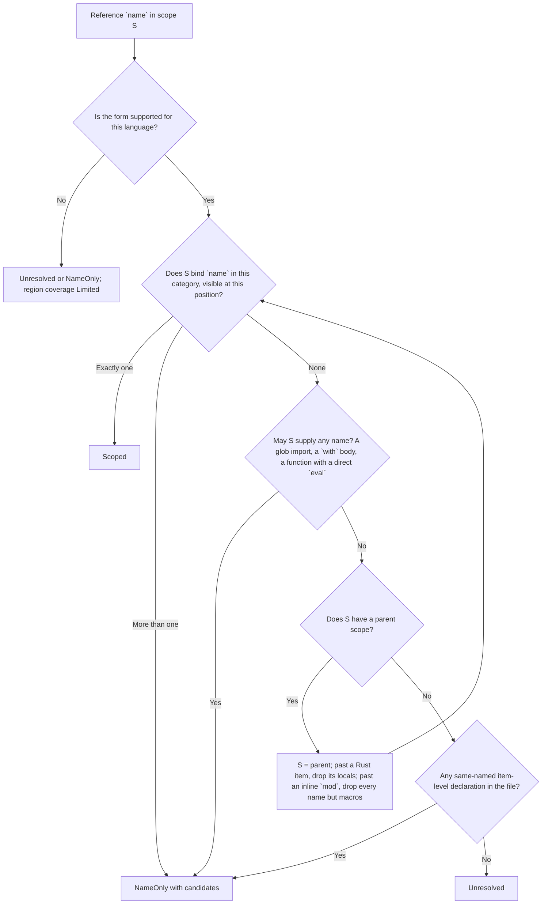

# Name Lookup

Part of [Scope-Aware References](../references.md).

This page describes how a name is matched to the declaration it refers to,
which decides an occurrence's [confidence](../references.md#confidence).

```rust
fn parse() {}

fn run() {
    let parse = || 1;   // shadows the function `parse`
    parse();            // Scoped -> the closure binding, not `fn parse`
    other.parse();      // a method call on an unknown receiver: not `fn parse`
}
```

A lookup that took the first declaration with a matching name would point
both calls at `fn parse`. Scoped lookup binds the first call to the local
`let parse`, and leaves the second uncertain because nothing in the file
proves which `parse` method `other` has.

## The scope walk

Each file gets a tree of lexical scopes: one root scope for the file, and a
child scope for each block, function body, closure and so on. Every
declaration is placed in the scope where its name is visible. A function's
name goes in the enclosing scope and its parameters in its body. A reference
is looked up from the innermost scope outward, and the first scope that binds
the name decides the result. Lookup never falls back to "any declaration with
this name".



Declarations whose kinds a query does not report (locals, parameters,
generic parameters) still take part in lookup, and so do bindings the
locals query never reports as records at all (`for` and `catch` bindings,
destructured names, generic parameters): those are `Scoped` without a target
ID. A hidden inner binding therefore blocks an outer match even when the
report never shows it.

## When no scope binds the name

When no scope binds the name, the candidates are the file's item-level
declarations of that name (for example a function inside an inline `mod`):
never another function's locals, and never a type's members, which a bare
name cannot reach. A Rust glob import (`use a::*;`) in a scope ends the
search there, because the glob may supply the name.

```rust
mod inner { pub fn helper() {} }
fn outer() { helper(); }   // NameOnly, candidate `inner::helper`
```

## Scopes a name cannot cross

Not every enclosing scope can be reached. Lookup passes a scope only where
the language lets the name through:

- A Rust item (a nested `fn`, `const`, `static`, type, trait or `impl`)
  cannot capture. From inside it, the blocks around it still lend their
  items, but never their `let`s, parameters, pattern bindings or generic
  parameters. A closure is not an item and captures as usual.
- A Rust inline `mod` sees nothing of its parent without a `use`, except
  `macro_rules!` macros defined before it.
- A Rust `if let` binding (also each `let` of a `let` chain) is visible from
  its `let` to the end of the consequence, never in the `else` branch.
- A JavaScript or TypeScript `with` body first looks every name up as a
  property of its object, so a name not declared inside the body is never
  `Scoped`. A direct `eval(…)` call inside a function can add a `var` to
  that function, so the same holds for names the function does not declare
  itself (strict code cannot do this, but the file does not always say which
  it is). A file-level `eval` changes nothing: a `var` it adds is the global
  binding an assignment could change anyway.
- Only an ordinary call with an argument list is a direct `eval`. An
  optional call (`eval?.("var f = 1")`) is an indirect `eval`, which runs in
  the global scope, and a tagged template (``eval`var f = 1` ``) passes a
  strings array, which `eval` returns without running it. Neither can add a
  name to the function around it, so lookup goes on as if the call were not
  there. An optional `eval` still runs code, so its region keeps
  `indirect_dispatch`; a tagged one limits nothing.

```javascript
class Base {}
function outer() {
    function f() {
        eval?.("var f = 1");     // or eval`var f = 1`
        class D extends Base {}  // D extends Base's ID
        f();                     // Scoped to this f: is_recursive Yes
    }
}
```

```rust
fn f() {}
mod m { pub fn g() { f(); } }        // NameOnly: `f` is not in scope in `m`
fn h(x: Option<fn()>) {
    let c = || {};
    fn nested() { c(); }             // Unresolved: an item cannot capture `c`
    if let Some(f) = x { f(); }      // Scoped to the pattern's `f`
    else { f(); }                    // Scoped to `fn f`
}
```

```js
function f(obj) { with (obj) { f(obj); } }   // NameOnly: `obj.f` may be called
```

The same boundaries apply to declared type relations
([type-relations.md](../type-relations.md)): a base written inside a `with` body
or in a function holding a direct `eval` stays written text; an optional or
tagged `eval` call changes nothing.

## Related pages

- [Language support](language-support.md): the binding rules each language
  adds to this walk.
- [Coverage and limitation reasons](coverage.md): the reasons a region is
  `Limited`.
