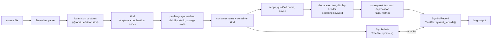
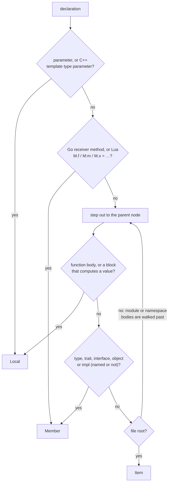
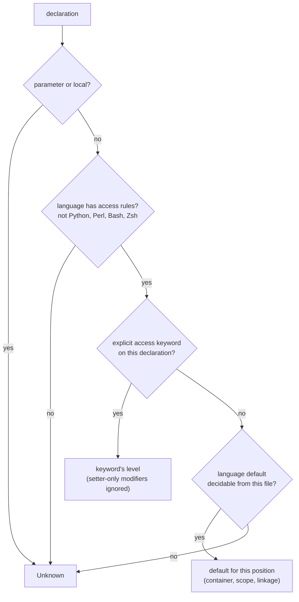
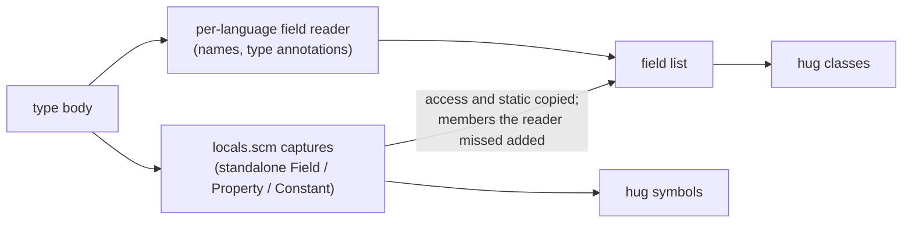

# Symbol Kinds, Visibility and `static`

This page explains what Tree Hugger reports for each declaration it finds:

- its **kind**: function, method, class, field, and so on
- its **visibility**: the access level the source declares or implies
- whether it is **`static`**, and which of the two meanings of `static` applies
- its **container**, and the **declaration text**, **display header** and
  **declaring keyword** stored on its record
- its **scope** (`Item`, `Member` or `Local`), its in-file **qualified name**
  and whether it is declared **`async`**

It covers all 16 supported languages. Read it to learn why `hug` prints
`crate method new() [in type Point]`, why a declaration has no visibility
label, or why a symbol you expected is missing.

## Where the values come from

Tree Hugger parses a file with Tree-sitter, runs the language's `locals.scm`
query to find declarations, and then decides every fact about a declaration
**once**, at extraction, from that declaration's own syntax node. Nothing
re-classifies a symbol later, so the library's two symbol models and the CLI
always agree. A type's field list (what `hug classes` shows) is built from the
same standalone member symbols, so it lists the same members with the same
flags; see [Field lists](#field-lists).



The two models are:

| Model | API | Where kind, visibility and `static` live |
|---|---|---|
| `SymbolInfo` (v1) | `TreeFile::symbols()` | `kind`, `scope`, `visibility` (`None` = unknown), `is_static`, `is_static_storage`, `is_async`, `container_name`, `container_kind`, `qualified_name`, `is_namespace_rooted` |
| `SymbolRecord` (schema 4.1) | `TreeFile::symbol_records()`, `symbol_index_v2()` | `kind`, `scope`, `visibility.level`, `modifiers` (`Static`, `StaticStorage`, `Async`, and the written `Const`, `Readonly`, `Unsafe`, `Mut` and `Custom` keywords), `attributes`, `identity.container_name`, `identity.container_kind`, `identity.qualified_name`, `identity.is_namespace_rooted`, `identity.keyword`, `source.declaration_text`, `source.signature_text`, `relations.implements` |

The adapter between them (`From<SymbolInfo> for SymbolRecord` and back)
preserves kind, scope, visibility, both `static` flags, `async`, container
kind, the qualified name and its namespace root, and the signature, with its
parameters. The declaring keyword, declaration text,
display header, `relations.implements`, the test and deprecation flags and
the `metrics` facet exist only on records, because `SymbolInfo` has no field
for them.

Every change to what extraction produces bumps
`tree_hugger::EXTRACTOR_REVISION`, including a repair made on a branch that has
not been released: a warm cache written from an earlier commit of that branch
is otherwise served unchanged. The CLI's persistent cache key contains
that value, so cached output from an older extractor is recomputed instead of
being shown (see [Cache Design](./cache-design.md)).

## Kinds

`SymbolKind` (v1) and `SymbolKindV2` have the same variants: Function, Method,
Constructor, Type, TypeAlias, Class, Interface, Enum, EnumVariant, Trait,
Module, Namespace, Variable, Parameter, Field, Property, Macro, Constant and
Unknown. No construct in the test fixtures of any language reports `Unknown`.

### What each language reports

| Language | Function / method | Types | Members | Modules |
|---|---|---|---|---|
| Rust | `fn` → Function; `fn` in an `impl` or trait → Method (with or without `self`, with or without a body) | `struct`, `union` → Type; `enum` → Enum; `trait` → Trait; `type` and associated `type` → TypeAlias | field → Field; variant → EnumVariant; `const` → Constant; `static`, `static mut` → Variable | `mod` → Module |
| TypeScript | function → Function; class, abstract and interface method signatures (also `#private`) → Method; `constructor` in a class body → Constructor (an object literal's `constructor()` is a Method) | `class`, `abstract class` → Class; `interface` → Interface; `enum` (also `const enum`) → Enum; `type` → TypeAlias | class-body property (also `#private`, quoted `"label"` and numeric names; a quoted name is reported without its quotes) and interface property signature → Property; enum member (`Red`, `Blue = 2`, quoted `"x y" = 1`) → EnumVariant | `namespace` and `module` (also `declare namespace`, and dotted `namespace A.B` as one record named `A.B`) → Namespace |
| JavaScript | function → Function; class method → Method; `constructor` in a class body → Constructor (an object literal's `constructor()` is a Method) | `class` → Class | class-body field (`x = 1;`, `static y;`, `#z`, `"quoted" = 1;`) → Property | — |
| Go | `func` → Function; method with a receiver → Method | every `type` declaration (struct and interface alike) → Type; `type A = B` (alone, grouped or generic) → TypeAlias | each named field of a named struct type (`X, Y int` is two Fields) → Field | `package` → Namespace |
| Python | `def` → Function; `def` in a class body (also `@staticmethod`, `@classmethod`) → Method; `__init__` in a class body (also decorated) → Constructor | `class` → Class | class-body attribute, every target of a chained (`a = b = 0`) or one-level tuple/list (`a, b = …`) assignment → Field | — |
| Java | method → Method; explicit constructor (also in an enum or record) → Constructor | `class` → Class; `interface` → Interface; `enum` → Enum; `record` → Type | field and interface constant → Field; enum constant (`RED`, `MERCURY(1.0)`, `BLUE { … }`) → EnumVariant | `package` → Namespace |
| C# | method → Method; explicit instance constructor (block or `=>` body, also in a struct or record, with or without `: this(…)`) → Constructor; local function → Function | `class` → Class; `interface` → Interface; `enum` → Enum; `struct`, `record` → Type | field and `event` field → Field; property → Property (in classes, structs, records and interfaces); enum member → EnumVariant | `namespace` (block and file-scoped) → Namespace |
| C | function → Function | named `struct`/`union` tag → Type; `enum` → Enum; `typedef` → TypeAlias (also `typedef int *P;`, `typedef int (*Fn)(int);`) | struct or union field, under any pointer, array, function-pointer or attributed declarator (`**p`, `a[3]`, `(*cb)(int)`, `x [[maybe_unused]]`), and the members of an anonymous `struct`/`union` → Field; enumerator of a named, anonymous or `typedef`'d enum → EnumVariant | — |
| C++ | function → Function; function declared or defined in a class body, whatever its return declarators (`int (*m(int))(long);`) → Method; constructor declared or defined in a class body (`C();`, `explicit C(int);`, `C() = default;`, `C(C&&) = delete;`, under `template<…>`, with an attribute on the name `C [[deprecated]] ()` or the name in parentheses `(C)()`) → Constructor | `class` → Class; `struct`, `union` → Type; `enum` → Enum; `typedef` (also behind a declarator), `using` → TypeAlias | data member, under any pointer, array, reference, function-pointer or attributed declarator, also a variable template (`template<class T> static T cache[3];`) and an anonymous union's members → Field; enumerator of a scoped or unscoped enum → EnumVariant | `namespace` → Namespace |
| Swift | `func` → Function; `func` in a type, extension or protocol (requirements too) → Method; `init`, `init?` and `init!` in a type, extension or protocol → Constructor, named `init` | `struct`, `class` and `enum` all → Type; `protocol` → Interface; `typealias` → TypeAlias | stored property (every binding of `var a = 1, b = 2`) and protocol property requirement → Field; `case` → EnumVariant | — |
| Scala | `def` → Function; `def` in a class, trait, enum, object, anonymous class (`new T { … }`) or `given … with` instance → Method; an `extension` method belongs to the type around the block (a Function at top level); a `package object`'s `def` stays a Function with no container | `class`, `case class` → Class; `trait` → Trait; `enum` → Enum; `type A = B` (also generic) → TypeAlias | `val`, `var` and `lazy val`, defined or only declared, directly in a class, trait, object or enum body → Field, one per name of a grouped `val a, b: Int` (a tuple pattern `val (a, b) = …` declares none); enum `case` (`case Red, Blue`, `case Value(x: Int)`) → EnumVariant | `object` → Module |
| PHP | function → Function; method (also in a trait) → Method; a method named `__construct`, in any letter case → Constructor | `class` → Class; `interface` → Interface; `trait` → Trait; `enum` → Enum | property → Field; `const` → Constant (members and top-level); enum `case` (unit or backed) → EnumVariant | named `namespace`, semicolon or braced → Namespace |
| Lua | `function` and `M.f` → Function; `function M:m()` → Method | — | — | — |
| Perl | named `sub` → Function | — | `my`, `our`, `state` names → Variable | `package` → Module |
| Bash, Zsh | function → Function | — | — | — |

Variables, constants and parameters are reported in every language that has
them; a Swift `let` inside a function body is a Variable, never a Field. A
parameter of function type is a Parameter, never a Function: in C and C++
`int f(void cb(int), void (*ptr)(int))` reports `cb` and `ptr` as Parameters
(and so are names inside them, such as `value` in `void cb(int value)`).

**One rule makes a function a method.** A function declared directly in the
body of a class, struct, enum, trait, interface, protocol, object, `impl`
block or extension is a Method, whatever its receiver, decorators or
`static`-ness. A function nested inside another function stays a Function.
The rule holds whatever a query captured: a C# local function, even a
`static` one, is a Function, and a field or property capture inside a
function body would be a Variable. What decides is the nearest enclosing
function or type: a member of a class, struct, class expression, anonymous
class or object literal declared inside a function is still that type's
member. A Lua `function M:m()` names its table, so it is a Method wherever it
is written.

```python
class Shape:
    @staticmethod
    def unit():            # Method (static)
        def helper(): ...  # Function: nested in a function, not in the class
```

**Wrappers do not change membership.** A Python decorator list, a C++
`template<…>` header and a C, C++ or C# preprocessor conditional (`#if`,
`#ifdef`, `#elif`, `#else`, …) sit between a declaration and the body around
it without being a scope. A member stays a member through any number of them,
nested or not, for its kind, both `static` flags, its access (a C++ section or
a C# default) and its type's field and enum-member lists alike; a declaration
outside a type stays outside:

```cpp
class Sweep {
public:
    template<class T> static void make(T x) {}  // Method, member static, Public
    template<class T> void use(T x) {}          // Method, instance, Public
    template<class T> static T cache;           // Field, member static, Public
#ifdef DEBUG
    int probes;                                 // Field, Public
#endif
};
template<class T> void free_helper(T x) {}      // Function
```

The same holds in C#: an unmarked member under `#if` is Private in a class,
struct or record and Public in an interface, and an unmarked type under `#if`
at the top level or in a namespace is Internal:

```csharp
class Conditional {
#if FLAG
    static int count;      // Field, member static, Private, in the field list
    void Tick() {}         // Method, Private
#else
    int fallback;          // Field, Private, in the field list
#endif
}
interface IConditional {
#if FLAG
    int Count { get; }     // Property, Public, in the field list
#endif
}
```

Swift `#if`, `#elseif` and `#else` and C# `#region` are not wrappers: the
grammars parse them as directives beside the members they guard, so those
members read exactly like unguarded ones.

A `friend` function declared in a class is not a member and stays a
Function. A C++ access section written inside a conditional applies to the
members after it in the same branch; an `#else` branch does not inherit one
from the branch it replaces, and members after `#endif` take the nearest
section outside the conditional.

### Constructors

A constructor is an explicit instance constructor written in its type's
body. It is recognized from the declaration's syntax, never by comparing its
name with the type's: only Python `__init__` and PHP `__construct` are
recognized by name, and only once the declaration is known to be a method.

| Language | Constructor | Stays what it was |
|---|---|---|
| TypeScript, JavaScript | `constructor(…)` in a class body | an object literal's `constructor()`: Method |
| Python | `def __init__(self, …)` in a class body, decorated or not | top-level or function-local `__init__`: Function; `__new__`: Method |
| Java | `C(int x) {}` in a class, enum or record | `void C() {}`: Method; a compact record constructor `R { … }` and initializer blocks: not reported |
| C# | `public C(int x) {}`, `S(int x) => X = x;` | `int C()`: Method; `static C() {}`, `~C() {}` and a primary constructor `class P(int x)`: not reported (`x` is a Parameter) |
| C++ | `C();`, `C(int x) {}`, `C() = default;` in a class body, also with an attribute on the name or the name in parentheses (`C [[deprecated]] (int x);`, `(C)(int x);`) | `~C();` and `operator bool()`: not reported; `int m [[deprecated]] (int x);`: Method; out-of-class `C::C() {}`: Function with no container |
| Swift | `init`, `init?`, `init!` in a type, extension or protocol | `deinit`: not reported; `static func make()`: Method |
| PHP | `function __construct()`, any letter case | a legacy `function Legacy()` in `class Legacy`: Method; a top-level `__construct`: Function |

A constructor's record keeps the declared name (`init`, `__init__`,
`__construct`, or the class name), its parameters with their defaults, and
the type as container. It is never `static`, and it has no return type, since
none is written:

```java
class Counter {
    Counter(int start) {}   // Constructor, container Counter, parameter start
    void tick() {}          // Method
}
```

Overloads are separate records, each with its own parameters and ID. No
constructor is synthesized: a class without one has none.

### Enum variants

Each named member of an enum is an EnumVariant whose container is the enum.
A declaration that declares several names (`case Red, Blue`) gives one record
per name. A use of a member is never a variant:

```c
enum Color { RED, BLUE = 2 };   // RED, BLUE: EnumVariant, container Color
enum { ANON_A };                // ANON_A: EnumVariant, no container
int x = RED;                    // x: Variable; RED is a use, not a variant
```

A variant record has no payload of its own (its `kind_data` is `Unknown`).
Its value and fields are in the enum's variant list
([Field lists](#field-lists)). Java constant bodies (`BLUE { void f() {} }`)
are unnamed owners, so `f` has no container.

### Module or Namespace

The two kinds are deliberately not unified; each language keeps the kind that
matches its own vocabulary:

| Module | Namespace |
|---|---|
| Rust `mod`, Perl `package`, Scala `object` | Go `package`, Java `package`, C# `namespace`, C++ `namespace`, TypeScript `namespace`/`module`, PHP `namespace` |

A namespace record carries the full name as written, and the names of its
members are prefixed with it once:

```typescript
namespace Space {
  export function inside() {}   // Space.inside, container Space
}
export namespace A.B {          // one Namespace named A.B
  export const v = 1;           // A.B.v
}
```

```php
<?php
namespace App;                  // Namespace App
function inside() {}            // App\inside, no container
namespace App\Braced {          // Namespace App\Braced
    function inside() {}        // App\Braced\inside, container App\Braced
}
```

A PHP semicolon namespace has no body, so the declarations after it are not
its members and have no container; their names still start with it. Neither
a PHP global `namespace { … }` nor a TypeScript string-named
`declare module "x" { … }` declares a named namespace, so neither has a
record. A TypeScript or PHP `use`/`import` of a namespace declares nothing.

### Interface and protocol members that are not methods

They use the member kind their language uses in a class:

```java
interface Shape { int SIDES = 0; }      // SIDES: Field, static, Public
```

```typescript
interface Named { name: string; }       // name: Property, Public
```

```swift
protocol Named { var name: String { get } }  // name: Field
```

### Perl

Perl reports named subs (Function), packages (Module) and the names declared
by `my`, `our` and `state` (Variable). A list declaration reports each name
separately, and names keep their sigil:

```perl
package Fixture::Greeter;         # Module
our $greeting = "hi";             # Variable $greeting, container Fixture::Greeter
sub greet {                       # Function
    my ($first, $last) = @_;      # Variables $first and $last, container greet
    state $count = 0;             # Variable $count
    local $_ = $first;            # not reported
}
```

`local` is not reported, because it temporarily overrides an existing variable
rather than declaring a new one. Anonymous subs have no name and are not
reported. Sub parameters are not identified as parameters; names unpacked
from `@_` are ordinary variables of the sub.

## Containers

A member's container is the nearest enclosing declaration that can hold it,
and the record also stores that container's kind. `hug` prints both:
`[in class Box]`, `[in trait Shape]`, or just `[in Box]` when the kind is
unknown. A declaration is never its own container, and a C++ class member's
container is its class, never the namespace around the class.

When the nearest owner has no name, the member has **no container**, never
the named type around the owner. Unnamed owners are anonymous classes (Java
`new T() { … }` and enum-constant bodies, PHP `new class { … }`, Scala
`new T { … }` and `given … with` instances), JavaScript and TypeScript class expressions and object
literals, and a C or C++ `struct`, `class` or `union` without a tag. So
`hug classes` never lists their members under the enclosing class:

```java
class Sweep {
    void outer() {                                   // container Sweep
        Runnable r = new Runnable() {
            public void run() {}                     // Method, no container, Public
        };
    }
}
```

A tagless `struct` or `union` that declares no member name of its own
(`union { int a; float b; };`) is an anonymous member: C and C++ make its
fields members of the enclosing type, so they keep that type as their
container and, in C++, the access of the section that holds the anonymous
member (`class K { union { int u; }; };` makes `u` Private). A member of any type declared inside a function, named or not,
keeps its written access; only the function's own locals have none.

A block that computes a value is local scope too, even outside a function: a
Scala `val`, `var`, `lazy val` or alias `given` initializer block and a
`match` arm, a Rust `const` or `static` initializer block, a Java `static { … }`
or instance initializer block, and a Swift computed property, accessor or
`willSet`/`didSet` body. A `def`, `fn` or `func` written there is a Function
with Unknown access, never static, and keeps the enclosing type as its
container like any nested function; the member that holds the block keeps its
own access and `static`:

```scala
object Host:
  val held: Int = {               // Public, static
    def helper(): Int = 1         // Function, Unknown, container Host
    helper()
  }
```

Perl `package Foo;` statements and C# file-scoped namespaces contain the
declarations that **follow** them, up to the next package statement or the
end of the enclosing block or file. The block form `package Foo { … }`
contains only what is inside it.

### Go receiver methods and Lua table members

Two languages name a member's owner in the declaration itself rather than by
nesting it. The container is that owner, found by name in the same file:

```go
type Point struct{ X int }
func (p *Point) Move() {}        // Method, container Point, kind Type
```

```lua
local M = {}
function M.new() end             -- Function, container M, kind Variable
function M:describe() end        -- Method, container M, kind Variable
M.size = 1                       -- Variable, container M, kind Variable
```

- A Go receiver's base type is the container, through a pointer and generic
  arguments (`func (p *Point[T]) M()` → `Point`). The receiver, the
  parameters and the locals of a method have no container, as in any Go
  function.
- A Lua container is the table expression as written (`a.b` for
  `function a.b.c()`). Its kind is the kind of the file-level declaration of
  that name, and absent when there is none or they disagree. When two tables
  share a name (`local M = {}` in two `do … end` blocks), a member is linked
  to the nearest one declared before it.

### Swift extension members

A member of an extension names the extended type as written as its
container, and is linked to that type's record when the file declares it,
by qualified name, so same-named nested types stay apart:

```swift
class Left { class Repeated {} }
class Right { class Repeated {} }
extension Left.Repeated { func a() {} }    // Left.Repeated.a -> Left.Repeated
extension Right.Repeated { func b() {} }   // Right.Repeated.b -> Right.Repeated
```

### Rust `impl` members

A member of an `impl` block names the **implemented type** as its container,
not the `impl`:

```rust
struct Point;
impl Point { fn new() -> Self { Point } }        // container Point, kind Type
impl fmt::Display for Point {
    fn fmt(&self, f: &mut fmt::Formatter<'_>) -> fmt::Result { Ok(()) }
}                                                // container Point, kind Type
impl crate::geo::Coord { fn x(&self) {} }        // container Coord
impl<T> Wrapper<T> { fn get(&self) {} }          // container Wrapper
impl Foreign { fn f(&self) {} }                  // container Foreign, no kind
```

- The container name is the last path segment of the type, without generic
  arguments.
- The container kind is that type's own kind when it is declared in the same
  file (Type for a struct or union, Enum for an enum), and absent otherwise.
  A same-named type whose path disagrees with the `impl`'s is not that
  type: `impl other::W` beside a local `enum W` has no container kind.
- Two same-named types in different `mod`s of one file share a container
  name, but each member is linked (`relations.parent`, the owner's
  `relations.members`, `hug classes`, `--tree`) to the type its qualified
  name names, by record ID. The qualified name keeps the `impl`'s path and
  module, so the owner is never just the first type of that name:

  ```rust
  mod left { pub struct Boxed; impl Boxed { pub fn work(&self) {} } }   // left::Boxed::work -> left::Boxed
  mod right { pub struct Boxed; impl Boxed { pub fn work(&self) {} } }  // right::Boxed::work -> right::Boxed
  impl right::Boxed { fn more(&self) {} }                               // right::Boxed::more -> right::Boxed
  impl Boxed { fn guess(&self) {} }                                     // Boxed::guess -> no owner
  ```

  A member whose qualified name names none of several same-named types (the
  last line) has no owner. With only one type of that name in the file, that
  type is the owner only when the `impl` path agrees with it: `impl W`,
  `impl crate::W` from a nested module, and `impl V` after `use a::V` all
  link, but `impl other::W` (a `W` declared in another file) never joins a
  local `W`; it keeps the qualified name `other::W::probe` and has no
  owner. The same rule holds for a Swift `extension External.Owner` and a
  Lua `function External.Owner.f()` beside a local `Owner`. If the
  same-named declarations disagree on kind, the container kind is left
  absent.
- The trait of a trait impl is not part of the container. Each member of
  `impl Trait for Type` records it in `relations.implements`: one entry named
  after the trait's last path segment (`Display` above), whose `id` is the
  trait's record ID when exactly one trait of that name is declared in the
  same file. Members of
  an inherent impl have an empty list.

## Scope

Every declaration has a **scope** that says where it sits, for presentation:
`hug symbols` hides `Local` declarations unless `--scope local` or
`--all-scopes` asks for them, and `--scope` selects any scope in every
declaration command (see [Symbol Reports](./symbol-reports.md#selecting-declarations)).
It is decided by the nearest *semantic* declaration around it, not by the
nearest brace:

| Scope | Meaning | Examples |
|---|---|---|
| `Item` | at file level, or in a namespace, package or module body | free functions, types, top-level constants, Rust inline-module contents, C++/C# namespace contents |
| `Member` | in a type, trait, interface, object or `impl` body | methods, fields, enum variants, associated constants |
| `Local` | in a function body, or a parameter | `let`, `var`, `:=`, parameters, nested functions and types |

```rust
mod schema {
    pub struct Record { id: u32 }      // Record: Item, id: Member
    impl Record { fn load() {} }       // load: Member
}
fn build(width: u32) {                 // build: Item, width: Local
    struct Scratch { cells: u8 }       // Scratch: Local, cells: Member
    mod helpers { pub fn h() {} }      // helpers and h: Local
}
```

Walking out from the declaration, the first function body decides `Local`
and the first type, trait, interface, object or `impl` decides `Member`. A
body is decided by what owns it, so a Rust `declaration_list` is `Item` space
under a `mod` and `Member` space under an `impl` or `trait`.



The rules below follow from that:

- A member of a type declared inside a function is a `Member`; the type
  itself is `Local`.
- Members of unnamed owners (anonymous classes, object literals, class
  expressions, Scala `given … with`) are `Member`, even though they have no
  container.
- A Go receiver method and a Lua `M.f`, `M:m` or `M.x = …` are `Member`
  wherever they are written: they name their owner.
- **Parameters are `Local` only where they are extracted**: 13 languages
  produce `Parameter` records (Rust, TypeScript, JavaScript, Go, Python, Java,
  C#, C, C++, Swift, Scala, PHP and Lua). Perl, Bash and Zsh produce none, so
  `--scope local` lists no parameters there: Perl subs and shell functions
  declare no parameter list, and names unpacked from `@_` are ordinary
  variables.
- A C++ template type parameter is `Local`.
- **Bash and Zsh functions defined inside a function body are `Local`,** even
  though the shell makes them global once the outer function runs. Scope
  follows where a declaration is written, not when it takes effect:

  ```sh
  outer() {
    inner() { echo hi; }   # inner: Local
  }
  ```
- A block that computes a value (see [Containers](#containers)) is local
  scope; a chunk-level Lua `if` or `do` block is not a function body, so its
  `local` declarations stay `Item`.

Scope is computed for every declaration, including those a kind selection
leaves out of a report.

## Qualified names

`identity.qualified_name` is a readable lookup name built from the file's own
source: the enclosing named declarations joined with the language's own
separators, ending in the declaration's name. It is not unique (overloads and
repeated locals share one); the record ID is.

| Language | Separator | Example |
|---|---|---|
| Rust, C++, Perl | `::` | `schema::Record::load`, `ns::Widget::draw`, `Fixture::Greeter::greet` |
| PHP | `\` after a namespace, `::` after anything else (a type or function) | `App\Models\User::find`, `App\Models\User::__construct::id` |
| Lua | `.`, and `:` before a method | `Widget.new`, `Widget:describe` |
| all others | `.` | `com.example.Point.area`, `Shape.area`, `outer.inner` |

What becomes a segment:

- extracted functions, types, enum variants, modules and namespaces around
  the declaration; a local's name includes its function (`Shape.area.self`),
  and a Rust struct-variant field its variant (`Shape::Circle::radius`)
- a Rust `impl` block's implemented type as its path is written, without
  generic arguments (`impl right::Repeated` qualifies `right::Repeated::second`;
  a leading `super` climbs one enclosing `mod`, `crate` starts at the file,
  `self` is dropped), a Go receiver's base type and a Lua table, written in
  the declaration
- a Swift extension's type and a named function that is not extracted
  itself (a C# static constructor or a Java compact record constructor:
  `C.C.k` for a local `k`)
- nothing past an unnamed owner: a member of an anonymous class is qualified
  by its own name alone

**Explicit namespaces root the name.** A Java, Scala or Go `package`, a C# or
PHP `namespace` (file-scoped or block), a named C++ `namespace` and a Perl
`package` start the name, and `identity.is_namespace_rooted` is `true`
(`com.example.symbols.PublicWidget`). Consecutive file-level Scala package
clauses nest (`package outer` then `package inner` gives
`outer.inner.PackageProbe.work`); a later PHP `namespace X;` or Perl
`package X;` replaces an earlier one. A Scala block package
(`package p { … }`) is never a record of its own, but it names everything in
its body: each enclosing block adds its segment after the file-level clauses
before it, and a block with no file-level clause before it still roots the
name. The block does not carry over to declarations after it:

```scala
package example.symbols
package left { class W { def probe() = () } }      // example.symbols.left.W.probe
package right { class W { def probe() = () } }     // example.symbols.right.W.probe
package outer { package inner { class Nested } }   // example.symbols.outer.inner.Nested
class After                                        // example.symbols.After
```

Without the first line the names are `left.W.probe`, `outer.inner.Nested`
and so on, still rooted (no file prefix); `After` is then `file#After`. A Rust inline `mod`, a TypeScript
`namespace` and a type qualify the name but do not root it: `schema::Record`
is not complete without its file. A Perl package name is absolute wherever it
is written.

**What you see is the in-file name behind a prefix.** The cache stores only
the in-file name. A query result puts a prefix in front of every name that is
not namespace-rooted, after the cache lookup, from query inputs that are not
part of the cache key. The stored name, the record ID and the cache entry
therefore never depend on where `hug` runs:

| Query input | Prefix | Example |
|---|---|---|
| a scan root (`SymbolQuery::scan_root`; `hug` passes its own) | the file's portable path from the root (`/`-separated, climbing with `../` for a file outside it), then `#` | `lib/src/symbol.rs#Symbol::new` |
| none (the library default) | the file name, then `#` (the file's directory is the root) | `symbol.rs#Symbol::new` |
| a naming context (`NamingContext::new(root, prefix)`), file below its root | the context prefix and the file's route as module segments, in the language's separator | `crate::shared::symbol::SymbolInfo::new`, `package.module.Class.method` |

```text
scan root tree-hugger/      ->  lib/src/symbol.rs#Symbol::new
scan root tree-hugger/lib/  ->  src/symbol.rs#Symbol::new
both: one cache entry, one symbol ID, in-file name Symbol::new
```

A naming context drops the file extension and adds no segment for a Rust
`mod.rs`, a Rust `lib.rs` or `main.rs` directly in its root, or a Python
`__init__.py`; a file outside its root gets the file prefix. Nothing guesses a
module path: `hug` has no naming-context option and never sets one, so its
Rust and Python names always use the file form (`src/symbol.rs#Symbol::new`,
`pkg/module.py#Class.method`), while namespace-rooted names (`com.example.Point`)
take no prefix at all. `SymbolQueryResult::name_prefix()` reports the prefix a
result's names carry, so the in-file name is the displayed name without it.
Relation and export references (`SymbolRef::qualified_name`) keep the in-file
name: a referenced record may not be in the result, and its namespace root is
then unknown.

**IDs derive from the qualified name.** A record's ID is a digest of the
language, the file's [identity](./cache-design.md#file-identity), the kind,
the in-file qualified name and the declaration's order among records of the
same kind and qualified name. Reading one file through two spellings of its
path, or from two scan roots, gives the same IDs.

## `async`

A declaration written `async` carries `Modifier::Async` (`SymbolInfo::is_async`):

| Language | Declarations |
|---|---|
| Rust | `async fn`, in and outside `impl` and `trait` blocks |
| JavaScript, TypeScript | `async` functions, methods, function expressions and arrow functions, and a name bound to one (`const f = async () => …`, a class field holding one) |
| Python | `async def`, decorated or not |
| C# | `async` methods and local functions |
| Swift | functions, methods, initializers (`init() async`) and protocol requirements written `async` |

The flag is read from the declaration's own `async` keyword, never from its
body or its return type. A JavaScript or TypeScript name bound to a function
value takes that function's keyword. Go, Java, C, C++, Scala, PHP, Perl, Lua,
Bash and Zsh have no async declarations and never report it; a C++ coroutine
is marked in its body (`co_await`), not its declaration.

```rust
async fn fetch() {}                              // async
fn spawn() { let _ = async { fetch().await }; }  // not async: only the block is
```

## Documentation

A declaration's documentation (`SymbolInfo::doc_comment`, the record's
`docs.raw_doc`) is the run of **doc comments** directly before it, with their
delimiters removed; ordinary comments are skipped, never read. Python reads
the docstring instead.

| Language | Documentation |
|---|---|
| Rust | `///` and `/** … */` (`//!` documents the enclosing module, not the next item); attributes between them and the item are skipped |
| Go | every comment in the group that ends on the line before the declaration (a blank line ends the group), minus its directive lines (see below) |
| Java, JavaScript, TypeScript, PHP, Scala | `/** … */` |
| C#, Swift | `///` and `/** … */` |
| C, C++ | Doxygen's `///`, `//!`, `/** … */` and `/*! … */`, but not their `<` forms (`///<`, `//!<`, `/**<`, `/*!<`), which document the member before them |
| Python | the docstring: a first statement of a `def` or `class` body that is a string constant (see below) |
| Lua, Perl, Bash, Zsh | none: these languages have no doc-comment detection |

```ts
/** Adds two numbers. */          // documents `add`
export const add = (a: number, b: number) => a + b;

// A plain comment documents nothing.
function helper() {}
```

**A comment that trails code documents nothing after it** in Go, JavaScript
and TypeScript. A comment that starts on the line where the previous code
ends, and any comment that starts on the line where such a comment ends,
belongs to that code: Go makes it the line comment of the previous line, and
TypeScript's JSDoc scan, used for both languages, starts after the line
break. Rust, Java, C#, PHP, Scala, Swift and a plain C or C++ `///` give a
same-line doc comment to the next declaration, as their own readers do.

```go
const (
	A = 1 // A's line comment     <- documents nothing: B is undocumented
	B = 2
)
```

```js
let a = 1; /** about a */         // trails `a`: `b` is undocumented
let b = 2;
```

```c
struct S {
  int a; ///< documents a, never b   <- not read: b is undocumented
  int b;
};
```

A declaration with no doc comments of its own is documented by those before
the wrapper around it:

- `export`, a JavaScript or TypeScript variable statement or `declare`, and a
  C++ `template<…>` header
- a Go `var`, `const` or `type` declaration, alone or grouped in parentheses:
  every name in it shares the declaration's doc, and inside a group a spec's
  own doc wins over the group's (as `go doc` reads them). A spec has its own
  doc whenever a comment group is attached to it, even one that reads as no
  text (a bare `//`, an empty `/* */`, only directives): that spec is
  undocumented and does not inherit the group's doc or its `Deprecated:`
  paragraph. Only a spec with no attached group shares the group's doc; a
  comment separated from the spec by a blank line, or trailing the previous
  spec on its line, is not attached
- a C or C++ `extern "C"` that declares one function or variable; the members
  of a braced `extern "C" { … }` block need their own docs
- a Scala `extension` that declares one method; the methods of a collective
  extension need their own docs

```go
// Limit documents both names.
var Limit, Floor int

// Deprecated: use Config.     <- documents A and C, and deprecates them
const (
	A = 1
	// B has its own doc.       <- B's doc, not the group's
	B = 2
	C = 3
	//                          <- attached but empty: D is undocumented
	D = 4
	//go:noinline               <- only a directive: E is undocumented
	E = 5
)

func run() {
	// Never documentation: a local variable has no doc.
	var count int
}
```

A doc comment that is empty after its delimiters are removed is no
documentation. Outside Go, such an empty doc does not stop the climb: a
declaration under one of the wrappers above whose own doc is empty is still
documented by the wrapper's.

**A Python docstring is a string constant, as Python decides it.** The first
statement of the body must be one ordinary string literal, with no prefix or
an `r`/`u` prefix and any quoting, or several of them written next to each
other (adjacent literals are one constant), optionally in parentheses. A
bytes literal (`b"…"`, `rb"…"`) or a formatted one (`f"…"`, `rf"…"`, `t"…"`)
is an expression, not a docstring, and so is a concatenation with one in it.
The text is the literals' content as written, joined and trimmed; escapes are
never evaluated, so `"\u0041"` documents and `""`, `"" ""` or a
whitespace-only string do not.

```python
def plain():
    "Documented."                # has_docs = true
def joined():
    "Docu" "mented."             # has_docs = true: one constant
def formatted():
    f"Not a docstring."          # has_docs = false
def raw_bytes():
    b"Not a docstring."          # has_docs = false
```

A doc comment is recognized by its opening delimiter alone: `/**/` and
`/***/` are ordinary block comments, and `////` is an ordinary line
comment.

**Block-comment decoration is removed the way each language's doc tool
removes it.** After the delimiters go (`/**` or `/*!` and `*/`; `///`,
`//!` or `//` for a line comment, which never loses a `*`, so `/// *`
documents), a leading `*` on a line is either decoration or text:

| Language | A leading `*` is decoration when… |
|---|---|
| Java, JavaScript, TypeScript, PHP, Scala, C, C++ | always: one leading `*` is removed from every line, whatever the other lines hold |
| Rust (rustdoc) | every line after the first (the first too when it starts with `*`; leading and trailing blank lines skipped) has its first `*` at the same column with only spaces or tabs before it; a line indented differently from the first keeps its `*`, and the `*` itself goes only when nothing, a space or another `*` follows it |
| C# (compiler) | the second line starts with spaces/tabs, `*`, spaces/tabs, and every later line shares a prefix with it that holds the `*`; a blank, unstarred or differently indented line cancels the removal for the whole comment |
| Swift (compiler) | the comment starts with a line break and its second line is ` * ` (or a lone ` *`) at the comment's own column; then only lines with that same decoration lose it |
| Go | never: see the Go paragraphs below |

A star that is not decoration is documentation text. In Rust, C# and Swift
a block of only stars that are not consistently placed therefore documents
its declaration, and so does the one-line `/** * */`; in the other block
languages both are undocumented.

```rust
/**
 *
  *
*/
pub fn misaligned() {}      // has_docs = true: the stars disagree, so one is text

/**
 *
 *
 */
pub fn aligned() {}         // has_docs = false: consistent decoration only

/**
Intro
 *b* is next
*/
pub fn mixed() {}           // raw doc "Intro\n*b* is next"
```

Every line of the cleaned doc is then trimmed and blank lines are dropped.
The structured-docs pass (`docs.parsed`, from `--json-full`) reads that
cleaned text as it is: a `*` or `//` still at the start of a line is part of
the summary.

## Deprecation and test flags

Two flags are computed when a query asks for `Capability::Flags`, which
`hug --json`, `--jsonl` and `--json-full` always do; without it both are
`false`, meaning "not computed".

**`visibility.is_deprecated`** is set by exactly these markers; every other
language and form (including an ordinary comment that says "deprecated")
leaves it `false`:

| Language | Marker |
|---|---|
| Rust | `#[deprecated]`, with or without arguments |
| Java | `@Deprecated` (or `@java.lang.Deprecated`), or a doc line that starts with the `@deprecated` tag |
| C# | `[Obsolete]`, also qualified (`System.Obsolete`) or with the `Attribute` suffix |
| JavaScript, TypeScript, PHP | a doc line that starts with the `@deprecated` tag (`@deprecated use load()` counts; `@deprecatedSoon`, a mid-line mention, a quoted or backticked `@deprecated` and a line inside a fenced code block do not; fences are described below the table) |
| Go | a doc paragraph that starts with `Deprecated:`, in `//` or `/* */` docs alike (a blank line starts a paragraph; an indented line is a code block, not a paragraph) |
| Swift | `@available(*, deprecated…)`: a top-level `deprecated` argument (a single-platform `@available(iOS, deprecated: 13)` and the word inside `message: "…"` do not count) |
| Scala | `@deprecated` (or `@scala.deprecated`) |
| C++ | `[[deprecated]]` before the declaration or right after the declared name (`C [[deprecated]] (int x);`, `int a [[deprecated]], b;` deprecates only `a`); one after a parameter list or array bound (`int f(int) [[deprecated]];`) belongs to the type and does not count, nor does a vendor form such as `[[gnu::deprecated]]` |
| Python | the `@deprecated` decorator, bare or as `typing_extensions.deprecated` or `warnings.deprecated` |

A fenced code block in a Java, JavaScript, TypeScript or PHP doc block
follows CommonMark, read after the leading `*` and spaces of each line are
removed:

- a fence opens on a line starting with three or more backticks or three
  or more tildes; a backtick fence's info string cannot contain a backtick,
  so a backtick run followed by text holding another backtick opens nothing;
- it closes only on a line made of the **same** character, at least as many
  as the opening run, followed by nothing but whitespace;
- every other line is example text: a shorter run, the other character, or
  a run followed by text (```` ```text ```` inside an open fence);
- a fence that never closes runs to the end of the doc block;
- a `@deprecated` line after the real closing fence is a tag again.

```text
/**
 * ````text
 * ```                      <- three backticks: content, the fence stays open
 * @deprecated example      <- inside the example: no effect
 * ````                     <- closes the four-backtick fence
 * @deprecated use other    <- a tag: is_deprecated = true
 */
```

A Go doc is read as Go reads it (`go/ast`'s `CommentGroup.Text`, then
`go/doc/comment`). Go defines no comment decoration, so only the delimiters
go: `//` and one space after it, or `/*` (with the whitespace after it on
its line) and `*/`. Every other character is doc text, including a third
opening `*` and a `*` at the start of a line: `/* *Deprecated: … */`,
`/**Deprecated: … */` and a body line ` * Deprecated: …` are not markers,
and a comment holding only `*` (`/* * */`, `// *`) documents its
declaration. The whitespace prefix that every nonblank line shares is then
removed, and a line still indented after that is a code block, so an
indented `Deprecated:` line is example text. The first unindented line after
a code block starts a new paragraph.

A Go **directive** is not documentation. A `//` line comment with no space
after `//` that starts `line `, `extern ` or `export `, or has the form
`name:x` with a lowercase-letter-or-digit name and a lowercase letter or
digit right after the colon (`//go:generate …`, `//go:noinline`,
`//a1:b2`), is dropped before anything else is decided. A declaration whose
group holds only directives is undocumented, and a directive leaves no blank
line behind, so it neither starts nor ends a paragraph. `// go:noinline`,
`//Go:noinline`, `//go: noinline`, `//go:` and `/*go:noinline*/` are prose.

```go
//go:generate echo generated     <- directive: ReviewGenerate is undocumented
func ReviewGenerate() {}

//go:generate echo generated
// Deprecated: use New.           <- still a paragraph start: is_deprecated = true
func ReviewBeforeMarker() {}

// Intro line.
//go:noinline
// Deprecated: use New.           <- same paragraph as the intro: not deprecated
func Mid() {}
```

Attributes are read from the syntax tree, not their text: a comment inside
an attribute is ignored (`#[deprecated /* why */]`, `[Obsolete /* why */]`
and `@java.lang. /* why */ Deprecated` count), and the marker word inside a
string argument or another attribute's arguments never counts
(`[[nodiscard("deprecated")]]`, `@nowarn("deprecated")`). A Python
decorator is read through parentheses (`@(deprecated)`). The record's
`attributes` list is this same parsed list; TypeScript and JavaScript
decorators appear there too but mark no flag (those languages' deprecation
reads only the doc block).

```go
// Deprecated: use NewPoint.      <- doc paragraph: is_deprecated = true
func MakePoint() {}

/* OldPoint makes a point.

Deprecated: use NewPoint.         <- block doc paragraph: is_deprecated = true
*/
func OldPoint() {}

func run() {
    // this path is deprecated      <- ordinary comment: no effect
}
```

**`visibility.is_test`** means **test-only code**. It is `true` for:

- every declaration of a test file, helpers included: Go `*_test.go`; Python
  `test_*.py`, `*_test.py` and `conftest.py`; JavaScript and TypeScript
  `*.test.*` and `*.spec.*`; Rust files below the `tests/` directory of the
  nearest enclosing Cargo package (the nearest directory holding a
  `Cargo.toml`; with none, the rule does not apply). The package layout is
  read on every query, cached or not, so adding, moving or removing a
  manifest changes the answer without touching the file (see
  [Cache Design](./cache-design.md#test-flags-source-facts-are-stored-file-wide-rules-are-not));
- a declaration with a test attribute: Rust `#[test]` and `#[<path>::test]`
  (`#[tokio::test]`), Java `@Test` (also qualified, `@org.junit.Test`), C#
  `[Test]`, `[Fact]` and `[TestMethod]`;
- everything inside a Rust item marked `#[cfg(test)]`, or a module or file
  whose inner attributes say `#![cfg(test)]`, nested declarations included.
  The predicate is read as tokens, so `#[cfg(/* why */ test)]` counts.

```rust
#[cfg(test)]
mod tests {                 // is_test
    fn helper() {}          // is_test (inside cfg(test))
}

#[cfg(any(test, feature = "x"))]
fn shared() {}              // not a test: compiled outside tests too

pub fn test_helper() {}     // not a test: the name decides nothing
```

**An out-of-line test module is not followed.** `#[cfg(test)] mod tests;`
marks only that `mod` declaration. The file holding its body is read on its
own, so its declarations are tests only when its path matches a file-name
rule, and a file under `src/` never does:

```rust
// src/parser.rs
#[cfg(test)]
mod tests;                  // is_test

// src/parser/tests.rs
fn helper() {}              // not a test: nothing in this file says cfg(test)
```

Add `#![cfg(test)]` at the top of the other file to mark it. Only the exact
predicate `cfg(test)` counts: `#[cfg(all(test, …))]` is not recognized.

The rules are a syntax and file-name heuristic, not a claim that a test
runner executes the symbol. Only the attributes named here are read; nothing
is resolved through imports, and other languages report `false`. There is no
rule for Python `unittest.TestCase` subclasses or JavaScript `describe`/`it`
calls; the file-name rules cover them in files named as tests.

## Metrics

The `metrics` facet is present when a query asks for `Capability::Metrics`,
which `hug --json-full`, `--stats` and the `--undocumented` and `--min-params`
filters do; without it the facet is absent. Inside a computed facet an
unsupported metric is `null` and a measured zero is `0`. A `null` never
matches a filter, and doc coverage counts it as unavailable rather than
undocumented (see [Symbol Reports](./symbol-reports.md)).

| Metric | Definition | `null` when |
|---|---|---|
| `parameters` | the declared parameters of a function, method or constructor: its own parameter list (every list of a curried Scala `def`), whatever binds each parameter (a name, a destructuring pattern or `_`), without a receiver (a Rust `self`, a Java `Type this` or a TypeScript `this: T`; a Go receiver is a separate list and never counted); a variadic parameter counts once; unnamed C, C++ and Go parameters count; `(void)` and `()` are `0` | the declaration is not a function, it has no parameter list (`def area: Int` in Scala), or the language is Perl, Bash or Zsh, whose parameters are not extracted |
| `has_docs` | whether the declaration has [documentation](#documentation): a doc comment that is not empty once its delimiters are removed, or a nonempty Python docstring (a string constant; bytes and formatted literals do not count); ordinary comments do not count | the language is Lua, Perl, Bash or Zsh, which have no doc-comment detection |
| `lines` | the physical lines a function, method or constructor's `source.body_span` touches (see [Body lines](#body-lines)): `{}` on one line is `1`, an empty body is `0` | the declaration is not a function, method or constructor (a class or module body is not counted), or it has no body: a prototype, an abstract, interface or protocol method, a defaulted or deleted C++ member |

```python
class Receiver:
    def with_receiver(self, only):   # parameters = 2: `self` is an ordinary
        """Documented."""            # parameter in Python; has_docs = true
```

A parameter bound by a pattern is listed in the signature under the pattern
as written, with its declared type, so `--param-type` sees that type:

```rust
pub fn patterned((a, b): (u32, u32), _: String) {} // parameters = 2:
// `(a, b)` of type `(u32, u32)` and `_` of type `String`
```

```scala
def patterned(a: Int)(b: String): Int = a // parameters = 2, both lists
```

### Body lines

`lines` measures source size, not executable lines: every line the body
touches counts, braces, blank lines, comments and nested declarations
included. It is computed from the record's own `source.body_span`, so the two
always agree:

```rust
fn multi() {          // body_span: line 1, column 12 → line 5, column 2
    // a comment
                      // lines = 5 - 1 + 1 = 5
    fn nested() {}    // `nested` has its own body: lines = 1
}
```

For a body span from line `s` to line `e` (one-based), `lines` is `e - s + 1`,
or `e - s` when the span ends at column 1 (it stops before that line). CRLF
and LF files count the same. Which text is the body:

| Body form | The span | Example |
|---|---|---|
| a block | the block, braces included | `fn f() {}` → `{}`, 1 |
| an expression body | the expression only, never the `=>` or `=` that introduces it | TS/JS `(x) => x * 2` → `x * 2`; C# `int M() => 1;` → `1`; Scala `def f = 1` → `1` |
| Python and Lua | from the first statement or comment after the header (`:` in Python, the parameters in Lua) to the last one before `end`; a comment on the header's own line is not body | `def f():` with `# note` and `return 1` on the next two lines → 2 |
| an empty Lua body | an empty span at `end` | `local function f() end` → `0` |
| C and C++ | the definition's body; a C++ function-try-block is the whole `try … catch` | `int f() try { … } catch (...) { … }` |

The span never ends in whitespace: tree-sitter-scala's braceless (Scala 3)
body and Perl's `sub` block extend over the blank lines or the line break
after them, and those are left out. A default value (`def f(x=lambda: 1)`,
Swift `cb: () -> Int = { 1 }`), a return type (`n(): { a: number }`) and a
nested or returned callable are never taken for the body; a function that
returns a closure (`() => () => 1`) has that closure as its expression body.

## Visibility

### What the level means

The level is the access **declared or implied at this declaration**. It is not
the effective access through every enclosing module, type or package, and it
is not an export flag. `pub fn f()` inside a private Rust module is still
Public. Parameters, local variables and local functions have no level.

The levels are:

| `Visibility` / `VisibilityLevel` | `hug` label | Typical source |
|---|---|---|
| `Public` | `public` | `public`, `pub`, `export`, Go uppercase name |
| `Protected` | `protected` | `protected` |
| `Private` | `private` | `private`, `#name`, unmarked Rust item |
| `Internal` | `internal` | C# and Swift `internal` |
| `Package` | `package` | unmarked Java member, Swift `package`, lowercase Go name |
| `Crate` | `crate` | Rust `pub(crate)`, `pub(super)`, `pub(in path)` |
| `ModulePrivate` | `module-private` | C `static`, Swift `fileprivate`, unexported module-level JS/TS |
| `ProtectedInternal` | `protected internal` | C# `protected internal` |
| `PrivateProtected` | `private protected` | C# `private protected` |
| `Unknown` (v1: `None`) | no label | no access rules apply, or the file cannot tell |

`hug` omits the label for Unknown rather than printing a guess.

### How a level is decided



Only the declaration itself and its nearest container are read. A private
method never makes its public class private.

### Unmarked declarations, per language

| Language | Keyword → level | No keyword → level |
|---|---|---|
| Rust | `pub` → Public; `pub(crate)`, `pub(super)`, `pub(in path)` → Crate; `pub(self)` → Private | Private for items and fields. Trait items and enum variants (and their fields) take the trait's or enum's level. Trait-impl items: see below. `macro_rules!` → Unknown |
| TypeScript | `public`, `protected`, `private`; `#name` → Private; top-level `export` → Public | class and interface members → Public; enum members → the enum's level; unexported top-level (a `namespace` too) → ModulePrivate in a module file, Unknown in a script |
| JavaScript | `#name` → Private; top-level `export` → Public | class members → Public; unexported top-level → ModulePrivate in a module file, Unknown in a script |
| Go | uppercase initial (any Unicode uppercase) → Public | Package; the `package` clause itself → Unknown |
| Java | `public`, `protected`, `private` | Package; interface members and enum constants → Public; an enum's constructor → Private; `package` declaration → Unknown |
| C# | `public`, `protected`, `private`, `internal`, `protected internal`, `private protected`; `file` → ModulePrivate | class/struct/record members (constructors too) → Private; top-level types → Internal; interface members and enum members → Public |
| C | — | file-scope functions and variables → Public unless the linkage rule makes them ModulePrivate; types, tags, fields, enumerators, macros → Unknown |
| C++ | `public:`, `protected:`, `private:` sections | `class` members → Private; `struct`/`union` members → Public; namespace-scope functions and variables → linkage rule; enumerators → Unknown |
| Swift | `open`, `public` → Public; `package` → Package; `internal` → Internal; `fileprivate` → ModulePrivate; `private` → Private | Internal, with the member rules below |
| Scala | `private`, `protected`, qualified forms below | Public; an enum `case` → the enum's level |
| PHP | `public`, `protected`, `private` | Public (enum cases too); namespaces → Unknown |
| Lua | — | global → Public; chunk-level `local` → ModulePrivate; `local` inside a block → Unknown; table fields (`M.f`, `M:m`) → Unknown |
| Python, Perl, Bash, Zsh | — | Unknown. Privacy is only a naming convention (`_name`) or does not exist, and a guess would be reported as fact. |

The rules that do not fit in a table cell follow.

### Rust trait implementations

An item in `impl Trait for Type` takes the level of `Trait` when `Trait` is
declared in the same file, and is Unknown otherwise. Standard-library traits
are not special-cased, because the level would then depend on a hard-coded
list rather than on the file:

```rust
pub trait Shape { fn area(&self) -> u32; }
impl Shape for Square { fn area(&self) -> u32 { 4 } }       // Public: Shape is here
impl fmt::Display for Square { fn fmt(/* … */) { /* … */ } } // Unknown
```

Restricted access such as `pub(in crate::a)` is reported as Crate, an upper
bound; the exact text survives in `source.declaration_text`.

### C and C++ linkage

A file-scope (C) or namespace-scope (C++) function or variable is Public,
unless any of these holds, which makes it ModulePrivate:

- it is declared `static`
- it is inside an unnamed `namespace { … }` (C++)
- it is a C++ variable that is itself `const` (`constexpr` counts), declared
  without `extern` or `inline` (see "Which `const` counts" below)
- an **earlier** declaration of the same function in the same file is `static`

```cpp
static int helper(int);          // ModulePrivate
int helper(int x) { return x; }  // ModulePrivate: earlier static prototype
int helper(long x);              // Public: different overload
namespace { int hidden; }        // ModulePrivate
const int LIMIT = 3;             // ModulePrivate (C++)
constexpr int MAX = 8;           // ModulePrivate (C++)
const char* name = "n";          // Public: the pointer itself is not const
char* const slot = nullptr;      // ModulePrivate (C++): const pointer
extern const int SHARED = 4;     // Public
extern "C" void api(void);       // Public
```

**Which `const` counts.** Only the variable's own type decides, and that is
the declarator nearest its name: read the declarator from the name outward,
through any parentheses and attributes. A `const` written after the `*`
next to the name makes the pointer itself const; a `const` deeper in, or on
the base type, belongs to what the pointer points to. An array is as const
as its elements. A reference is never a const object, even when declared
`constexpr`; any other `constexpr` variable is const. Each name of a
multi-name declaration is decided on its own.

```cpp
char **const a = 0;              // ModulePrivate: a is a const pointer
char *const *b;                  // Public: b points to a const pointer
char **const c[2] = {};          // ModulePrivate: array of const pointers
char *const *d[2];               // Public: array of mutable pointers
int (*const e)(int) = 0;         // ModulePrivate: const function pointer
const int (*f)[2];               // Public: pointer to a const array
int (*const g)[2] = 0;           // ModulePrivate: const pointer to an array
const int (&h)[2] = arr;         // Public: a reference
constexpr const int &i = arr[0]; // Public: a reference
constexpr int *j = nullptr;      // ModulePrivate: constexpr pointer
int k, **const l = 0, *const *m = 0; // k Public, l ModulePrivate, m Public
```

The same rule holds inside a named namespace, a preprocessor conditional or an
`extern "C" { … }` block. C has no such rule: a file-scope `const` object in C
is Public unless it is `static`. A function-local variable has no linkage
(Unknown), and a member takes its access level, never this rule.

"The same function" means the same name in C. In C++ it means the same
name, the same namespace, and the same parameter types; for a function
template, the rest of its signature as well (see **Function templates**
below), since a template and a non-template function with the same
parameters are different functions. Spelling that changes none of these is
ignored:

- **The function is the declarator that names it.** In
  `int (*make(int value))(long)`, `make` takes `int` and returns a pointer to
  a function taking `long`. Only the parameters of `make` itself are compared,
  so naming them, or the parameters of the returned type, changes nothing.
  The same holds for a returned function reference (`int (&f(int))(int)`) or
  pointer to an array (`int (*f(int))[2]`). A function pointer variable
  (`int (*p)(int);`) declares no function.
- **Namespaces** are compared as a list of segments, so
  `namespace a::b { … }` and `namespace a { namespace b { … } }` are the same
  namespace. An unqualified declaration belongs to exactly the namespace it
  sits in: a `static` in an enclosing namespace does not reach a function in
  a nested one. A definition qualified by a namespace (`int b::f(int x)`
  inside `namespace a`) looks `b` up outward, as the compiler does: it
  belongs to `a::b` when the file declares `a::b` before it, otherwise to
  `b` when the file declares `b`, otherwise to no namespace the file knows,
  and then no earlier declaration matches it. An `inline` namespace is still
  a segment of its own.
- **Parameter names** are ignored at every level, including the parameters of
  a callback parameter, and so are comments, default arguments, attributes
  on a name (`int x [[maybe_unused]]`), and parentheses around a name.
- **Parameter adjustments** apply: a top-level `const` or `volatile` is
  dropped, an array parameter is a pointer, a function parameter is a pointer
  to that function, `(void)` is an empty list, and `const int` equals
  `int const`.
- **Function templates** also compare, token by token as written, the
  `template<…>` parameter list, the return type in both its leading
  (`int f(T)`) and trailing (`auto f(T) -> int`) position, the `requires`
  clause after the `template<…>` header, and the `requires` clause after the
  parameter list. A constraint present on one declaration and absent on the
  other, or moved from one position to the other, is a different template.
  A function with an `auto` parameter (`void f(auto x)`,
  `void f(Concept auto x)`) is an abbreviated template and is compared the
  same way. The exception specification (`noexcept`) is never compared, and
  an ordinary function's return type is not either, since a redeclaration
  cannot change it.

```cpp
static int callback(void (*)(int));
int callback(void (*cb)(int value)) { return 0; }  // ModulePrivate

static int (*make(int))(long);
int (*make(int value))(long) { return 0; }         // ModulePrivate

namespace a { namespace b { static int helper(int); } }
namespace a::b { int helper(int value) { return value; } }  // ModulePrivate

static int leak(int);
namespace other { int leak(int x) { return x; } }  // Public: other::leak

namespace shadow { static int choose(int); }
namespace host {
namespace shadow { int choose(int); }              // Public
int shadow::choose(int x) { return x; }            // Public: host::shadow::choose
}

static int limit(const int);
int limit(int n) { return n; }                     // ModulePrivate

static int pick(const int*);
int pick(int* p) { return 0; }                     // Public: pointee differs

static int log(int, ...);
int log(int level) { return level; }               // Public: no `...`

template<class T> static int convert(int);
int convert(int x) { return x; }                   // Public: not a template

template<class T> static auto shape(T) -> int;
template<class T> auto shape(T v) -> long { return 0; }  // Public: returns long
template<class T> static auto size(T) -> int;
template<class T> auto size(T v) -> int { return 0; }    // ModulePrivate

template<class T> requires Small<T> static int fit(T);
template<class T> requires Big<T> int fit(T v) { return 0; }   // Public
template<class T> static int span(T) requires Small<T>;
template<class T> int span(T v) { return 0; }                  // Public: unconstrained
template<class T> static int keep(T) requires Small<T>;
template<class T> int keep(T v) requires Small<T> { return 0; } // ModulePrivate

static auto twice(auto) -> int;
auto twice(auto v) -> long { return 0; }           // Public: abbreviated template
```

Every declarator of a declaration counts: `static int a(int), b(int);` makes
later definitions of both `a` and `b` ModulePrivate, and so does
`static int a(int), (*b(int))(int);` for `b`. A declaration under a
`template<…>` header, a preprocessor conditional, a reopened namespace block
or an `extern "C"`/`extern "C++"` block counts like any other.

Type names are compared as written. A typedef'd spelling of a parameter type,
or a synonym such as `long int` for `long`, does not match, so that
declaration falls back to its own rule. A definition qualified by more than
one level (`int a::b::f(int)`) or from the global namespace
(`int ::a::f(int)`) is not reported as a symbol at all. Type names are
assumed to name the same type in both declarations.

Every condition above is one a redeclaration must meet, so the scan can only
miss a `static`, never invent one: whatever it cannot establish (a typedef'd
spelling, a qualifier naming a namespace declared in another file, a renamed
template parameter, a constraint spelled differently, `auto f() -> int`
redeclared as `int f()`) leaves the later declaration with its own rule. Whether
the file is a header does not matter.

### JavaScript and TypeScript module files

A file is a **module** when any of these holds:

- its extension is `.mjs`, `.cjs`, `.mts` or `.cts`
- it has an `import` or `export` statement
- anywhere in the file, even inside a function or an `if`, it calls
  `require(...)` or assigns to `module.exports` or `exports.…`

In a module, an unexported top-level declaration is ModulePrivate. In any
other file (a classic script, or a TypeScript global script) it is Unknown,
because a script's top-level declarations are global. CommonJS files count as
modules because Node wraps each one in a function, so its top-level
declarations stay private to the file. `package.json`'s `"type"` field is not
read, so extraction never looks beyond the one file.

A function bound to a top-level `const` or `let` has the access, and the
export, of the declaration that binds it:

```javascript
// lib.js (a module)
export const load = async () => 1;  // Public, exported
const helper = (value) => value;    // ModulePrivate
```

```javascript
// script.js: no module evidence
function helper() {}             // Unknown
```

```javascript
// lib.js
const fs = require("fs");
function helper() {}             // ModulePrivate
module.exports = { helper };
```

### C# interface members and compound levels

Any interface member without an access keyword is Public, including
default-implemented methods, static members and nested types. An explicit
interface implementation in a class is Private, which is how the C# compiler
reports it:

```csharp
interface IShape {
    double Area();                          // Public
    void Draw() { }                         // Public: default implementation
    static IShape Unit() => new Square();   // Public
    class Helper { }                        // Public: nested type
    private void Log() { }                  // Private: explicit keyword
}
class Square : IShape {
    double IShape.Area() => 1;              // Private: explicit implementation
    protected internal int a;               // ProtectedInternal
    private protected int b;                // PrivateProtected
}
```

### Swift members of types and extensions

Enum cases and protocol requirements take their container's level. Any other
unmarked member takes its level from the nearest enclosing type or extension
that has an explicit access keyword:

- inside a `private` or `fileprivate` type → ModulePrivate
- inside an extension with an explicit level → that level
- inside a `public` or `open` type → Internal
- otherwise → Internal

```swift
private struct Hidden { func a() {} }       // a: ModulePrivate
private extension Widget { func b() {} }    // b: ModulePrivate
public extension Widget { func c() {} }     // c: Public
public struct Api {
    func d() {}                             // d: Internal
    private struct Inner { func e() {} }    // e: ModulePrivate (Inner is nearest)
}
struct Plain { func f() {} }                // f: Internal
```

A top-level `private` declaration itself reports Private (its keyword).

### Setter-only modifiers

A modifier that restricts only the setter does not change the declaration's
level. The restriction is still visible in `source.declaration_text`.

```swift
public private(set) var count = 0           // Public
private(set) var total = 0                  // Internal (the default)
```

```csharp
public int Count { get; private set; }      // Public
internal int Total { get; private set; }    // Internal
```

### Scala qualified access

A qualifier is resolved only from what the file shows:

```scala
package com.acme.shapes

class Shape {
  private[this] val id = 0                  // Private
  protected[this] def tick() = ()           // Protected
  private[shapes] def area() = 0            // Package: a segment of the package clause
  private[acme] def scale() = 1             // Package
  private[Shape] def secret() = 2           // Unknown; text kept in declaration_text
}
```

A segment of a block package (`package shapes { … }`, nested blocks
included) is a package segment too.

### A level is not an export

`visibility.is_exported` comes only from export syntax and the bind pass,
never from a Public level: a top-level declaration inside a JavaScript or
TypeScript `export` (each name of `export const a = 1, f = () => …;`
included), or a Rust item with a `pub…` modifier. Members (methods,
constructors, fields, properties, enum variants) are never marked exported. A
Public Java class or TypeScript class method is not exported. Converting a
`SymbolInfo` to a record always gives `is_exported: false`, because
`SymbolInfo` carries no export information.

## `static`

`static` has two unrelated meanings, and Tree Hugger keeps them apart:

| | Member `static` | Storage `static` |
|---|---|---|
| Meaning | the member is used without an instance | storage duration or file linkage |
| v1 | `SymbolInfo::is_static` (copied to `FunctionSignature::is_static` and `FieldInfo::is_static`) | `SymbolInfo::is_static_storage` |
| v2 | `Modifier::Static` | `Modifier::StaticStorage` |
| `hug classes` | listed under *Static Methods* / *Static Fields* | never listed as a static member |

Member `static` is set for:

- TypeScript, JavaScript, Java, C# and PHP `static`
- members the language makes static without the keyword: Java interface
  constants (implicitly `static` whether or not they say so), C# `const`
  fields (in a class, struct, record or interface), Rust associated `const`s
  (in an inherent `impl` or a trait) and PHP `const` constants (in a class,
  interface, trait or enum; a top-level `const` is not a member)
- C++ `static` data members and member functions
- Swift `static` and `class` members
- Scala members whose nearest owning type is an `object` (a standalone or
  companion object, also one nested in a class)
- Python methods declared in a class body with the decorator `@staticmethod`
  or `@classmethod`, also spelled `@builtins.staticmethod` /
  `@builtins.classmethod`, and class attributes (below)
- Rust associated functions without a `self` receiver, in impls and traits; a
  typed receiver such as `self: Box<Self>` is a receiver

No other supported language makes a member static without a keyword: a C++
`static constexpr` member says `static`, and Swift, TypeScript, JavaScript and
Scala `let`/`readonly`/`val` members are instance members unless declared
`static` (or, in Scala, in an `object`).

Constructors and enum variants are never static. A constructor has no
receiver parameter in most languages, and an enum constant behaves like a
static value, but neither says `static`; a Scala enum `case` is owned by its
enum, not by an object.

```csharp
class Limits {
    public const int Max = 1;    // Static Fields
    int count;                   // Instance Fields
}
```

```rust
trait Shape { const SIDES: u32; }   // SIDES: Static Fields of Shape
```

Python class methods and Swift `class` methods are grouped with static members
because they need no instance, although they are not identical to static
methods.

Only the declaration's own keyword, modifier or decorator counts, never a name
or text that contains it, and only the type that directly owns the member
decides:

```python
class Sweep:
    @notstaticmethod        # some other decorator: instance method
    def probe(self): ...
    @wrap(staticmethod)     # a call to `wrap`: instance method
    def wrapped(self): ...
    @staticmethod           # Static Methods
    def make(): ...

@staticmethod               # not in a class: never a static member
def helper(): ...
```

```scala
object Registry {
  def lookup(): Unit = ()                  // static: owned by the object
  trait Entry { def key(): String }        // instance: owned by the trait
  class Slot { def fill(): Unit = () }     // instance: owned by the class
  val anon = new Runnable { def run(): Unit = () } // `run` is an instance member
}
```

A member of a Scala `class`, `trait`, `case class`, `enum`, anonymous class
(`new T { … }`) or `given` instance is never static, even when that type is
declared inside an object. An `extension` method written in an object belongs
to the object and is static; one written in a class is an instance method. A
`package object` is not a container, so its members are top-level Functions
and never static.

Storage `static` is set for Rust `static` and `static mut` items, C and C++
file-scope or namespace-scope `static` functions and variables, and C and C++
function-local `static` variables:

```cpp
class Counter {
    static int total;            // member static: Static Fields
    int bump() {
        static int calls = 0;    // storage static: not a member
        return ++calls;
    }
};
static int helper() { return 0; } // storage static (and ModulePrivate)
```

### Python class attributes

A name declared in a class body is a Field of that class; its annotation
decides whether it is static. The annotation's expression is read, not its
text: `ClassVar`, bare or subscripted, under any qualifier (`typing.ClassVar`,
`t.ClassVar[int]`), makes a class attribute; `ClassVarLike[int]`,
`MyClassVar` and a string annotation such as `"ClassVar[int]"` do not:

```python
from typing import ClassVar

class Point:
    x: int                       # instance Field
    y: int = 0                   # instance Field
    origin: ClassVar[int] = 0    # static Field (class attribute)
    count = 0                    # static Field (class attribute)

    def move(self):
        self.z = 1               # not reported
```

An unannotated `count = 0` is a class attribute that an instance may shadow by
assigning `self.count`; the record describes the class-level declaration.
This follows PEP 526 and dataclass semantics. `hug symbols` and `hug classes`
apply the same rule.

Every name an unannotated class-body assignment binds is a static Field: each
target of a chain and each name directly in a tuple or list pattern, with or
without parentheses. A chained assignment outside a class declares Variables.

```python
class Pair:
    first = second = 0           # both static Fields
    a, b = (1, 2)                # both static Fields
    [c, d] = 1, 2                # both static Fields
```

## Field lists

A type's `TypeMetadata::fields` is its field list: `hug classes` prints it as
*Static Fields* and *Instance Fields*, and `hug symbols` prints it after the
type's name (`struct Point { x: i32, y: i32 }`). It lists exactly the
members the type declares in its own body, in source order:

- every standalone `Field`, `Property` or `Constant` symbol whose container is
  the type, with that symbol's access and member `static`, so a member is in
  `hug classes` exactly when `hug symbols` reports it inside the type;
- members that have no standalone symbol: Java and C# record components (they
  are Parameters), Rust tuple-struct positions (`0`, `1`) and Scala class
  parameters. Their access and `static` are read from the declaration.

Each entry appears once, whichever source listed it. A Go field and a Scala
body `val`/`var` are both a standalone Field and an entry of the list, and
the entry keeps the type written in the source:

```scala
class Box(p: Int) {
  val width: Int = 1   // Field; list entry width: Int
  var height = 2       // Field; list entry height (no written type)
  val x, y: Int = 0    // two Fields; list entries x: Int and y: Int
}                      // p: Parameter; list entry p, no Field record
```



The per-language reader supplies each entry's type annotation; an entry added
from a standalone symbol that no reader listed carries its doc comment but no
type. Readers cover the forms in the [kinds table](#what-each-language-reports),
including unions, anonymous members, every declarator form, C# properties and
`event` fields, record bodies, Python chains and patterns and Swift
multi-binding declarations.

```typescript
abstract class Shape { static count = 0; }   // Static Fields: count
class Counter { static #total = 0; }         // Static Fields: private #total
interface Named { "label": string; }         // Instance Fields: label: string
```

```cpp
struct Fields {
    int values[3];                           // Instance Fields
    int (*callback)(int);                    // Instance Fields
    template<class T> static T cache[3];     // Static Fields
    union { int i; float f; };               // i and f: Instance Fields
};
```

Two owners keep a narrower list:

- an **enum** lists its variants, not fields (`hug classes` lists no enums).
  The variant list and the standalone EnumVariant records name the same
  variants, once each and in source order. A variant's value is the list
  entry's `discriminant` (`BLUE = 2` gives `2`), since a variant record has
  no payload of its own. A declared payload is the entry's too, with its
  types as written: Rust tuple variants list `tuple_fields`, Rust struct
  variants and Scala cases with class parameters list named `struct_fields`.
  A Scala case lists every parameter clause in order, keeps a type parameter
  unresolved (`T`), and a default (`x: Int = 1`) is not a discriminant:

  ```scala
  enum Shape[T]:
    case Red, Green                          // Red, Green: no payload
    case Sized(x: Int = 1, y: List[String])  // x: Int, y: List[String]
    case Held(item: T)(using o: Ordering[T]) // item: T, o: Ordering[T]
  ```

  Each case parameter is still its own Parameter record (`Shape.Sized.x`).
  A context parameter written by type alone (`case U(using Int)`) parses as
  a parameter named `Int` with no type, and is listed that way. Only an
  Enum has a variant list: a Swift `enum` is
  reported as Type and lists none, though its `case` records are still
  EnumVariants;
- a **Rust `impl`** is not the type's body, so its associated constants are
  not in the struct's field list (its methods appear in `hug classes` through
  the type's members). A trait's associated constants are in the trait's
  list, under *Static Fields*.

## C and C++ names behind declarators

A C or C++ name is reported wherever its declarator puts it: behind an
attribute written after the name, inside extra parentheses, or under the
pointer, reference, array and callback layers of a return type. What the
declarator declares decides the kind, so a function-pointer field stays a
Field while a member function returning a callback is a Method:

```cpp
int count [[maybe_unused]];              // Variable
int legacy [[deprecated]] (int value);   // Function, parameter value
int (wrapped)(int value);                // Function
struct Owner {
    int values [[maybe_unused]] [2];     // Field, listed by `hug classes`
    int (*callback)(int);                // Field: a pointer, not a function
    int (*handler(int value))(long);     // Method, parameter value
    int **lookup(int key) { return 0; }  // Method
    int size();                          // Method
};
int Owner::size [[nodiscard]] () { return 0; }  // Function (out of class)
typedef int (*Callback)(int);            // TypeAlias
```

These names get the same access, `static` flags and signature as the same
declaration without the wrapper, and an attributed field is in its type's
field list. An attribute before the declaration (`[[maybe_unused]] int x;`)
was never in the way. A typedef name behind a declarator (`typedef struct
node *NodePtr;`) carries the typedef's doc comment but no field list: the
fields belong to the struct, not to the pointer.

## C and C++ signatures

A C or C++ function's signature lists the parameters of that function, read
from the declarator nearest its name with only parentheses between. Pointers,
references, arrays and function types wrapped around it belong to the return
type, so their parameters are never the function's:

```c
int *pointer_return(int value);                  // value
int (*callback_return(int actual))(long other);  // actual, not other
int (*array_return(int actual))[2];              // actual
```

The same rule applies to prototypes, definitions, `static`, `#if`,
`extern "C"`, templates, in-class members and out-of-class `A::f`
definitions. Each parameter is named by its own declarator, under any
pointer, reference, array, parenthesized, attributed or function-pointer
layer; a callback parameter is named by its own name, never one from its
parameter list:

| Parameter | Reported |
|---|---|
| `char **argv`, `int values[2]`, `int (*value)`, `int value [[maybe_unused]]` | the name |
| `int (*callback)(long ignored)` | `callback` |
| `int defaulted = 1` (C++) | `defaulted`, default value `1` |
| `Ts... values`, `Ts&&... values` (C++ pack) | `values`, variadic |
| `...` (C and C++) | `...`, variadic |
| `int`, `int (*)(long)` (unnamed) | not listed |

`int (value)` is an unnamed parameter of function type, not a parenthesized
name: the grammar applies C's rule that a parenthesized identifier in a
parameter is read as a type name.

## Declaration text

Every record carries `source.declaration_text`: the declaration from its start
up to, but not including, its body, with trailing whitespace trimmed. A
declaration without a body contributes its whole text. It includes the
modifiers, access keywords and attributes that the grammar parses as part of
the declaration node, so syntax a level cannot express is never lost. Doc
comments are not included.

| Declaration | `declaration_text` |
|---|---|
| `pub(in crate::a) fn f() { … }` | `pub(in crate::a) fn f()` |
| `fn area(&self) -> u32;` (trait method, no body) | `fn area(&self) -> u32;` |
| `public private(set) var count = 0` | `public private(set) var count = 0` |
| `public int Count { get; private set; }` | `public int Count { get; private set; }` |
| `private[Shape] def secret() = 2` | `private[Shape] def secret() =` |
| `my ($a, $b) = @_;` | `my ($a, $b)`, for both `$a` and `$b` |

Syntax the grammar places outside the declaration node, such as a Rust
`#[…]` attribute, a Python decorator or a TypeScript `export` wrapper, is not
included. The text appears in records, not in `SymbolInfo`. It is evidence
rather than display, so the CLI's default `--json` report omits it and
`--json-full` carries it.

## Display header

`source.signature_text` is the declaration as a reader recognizes it: the
header without what follows it. `declaration_text` is evidence (everything up
to the body, initializers included); `signature_text` is display, and is
always a contiguous part of `declaration_text`, read from the same node in
the same pass.

Starting from `declaration_text`, the header drops:

- **leading annotations**: annotations, attributes and decorators written
  before the first modifier or keyword (Java `@Override`, C# `[Obsolete]`,
  Swift `@available`, Scala `@deprecated`, JavaScript `@decorator`, PHP
  `#[…]`, C/C++ `[[…]]`)
- **initializers**: everything from the `=` (Go: `:=`) that binds a value,
  including a type alias's aliased type and a C macro's replacement text
- **bodies and accessors**: a C# `{ get; set; }` list, a Swift `{ get }`
  requirement or computed body, a Go struct field list or interface method
  list
- **introducers and terminators**: the `=`, `=>` or `:` that introduces a
  body, and a `;` (Lua: `end`) that ends a bodyless declaration

Outer whitespace is stripped; line breaks and indentation inside a
multi-line header are kept.

| Declaration | `signature_text` |
|---|---|
| `@Override public void run() { … }` | `public void run()` |
| `public @Deprecated static void m() { … }` | `public @Deprecated static void m()` (an annotation between modifiers stays) |
| `pub const TABLE: [u32; 4] = [ … ];` | `pub const TABLE: [u32; 4]` |
| `fn area(&self) -> u32;` (trait method) | `fn area(&self) -> u32` |
| `def total(self) -> int:` | `def total(self) -> int` |
| `const twice = (value: number): number => value * 2;` | `(value: number): number` (the arrow function is the declaration) |
| `type Point struct { X int }` | `type Point struct` |
| `local function helper() end` (Lua, empty body) | `local function helper()` |
| `type ( A struct{ … }; B int )` (Go group, for `B`) | `B int` (each spec is its own declaration) |
| `public init(x: Int, y: Int = 2) {}` (Swift) | `public init(x: Int, y: Int = 2)` (a parameter default is not an initializer) |
| `X, y int` (Go struct fields, for both) | `X, y int` |
| `enum E { RED, BLUE = 2 };` (C, for `BLUE`) | `BLUE` |
| `case Value(x: Int)` (Scala) | `Value(x: Int)`; `case`, which one group `case A, B` shares, is the keyword but not in the header |

The header is omitted when no contiguous part names the symbol by itself:

| Declaration | Why `signature_text` is omitted |
|---|---|
| `typedef struct { int x; } Point;` | the alias name follows the struct body |
| `int a = 1, b = 2;` (for `b`) | `a`'s initializer ends the header before `b` |
| `first = second = 0` (Python, for `second`) | `first`'s `=` ends the header before `second` |

## Declaring keywords

`identity.keyword` is the grammar token that introduces a declaration. It is
read from the syntax tree, so a comment naming a keyword never supplies one,
and it is a single token: Scala `case class` reports `class`, C++ `enum
class` reports `enum`, Swift `class func` reports `func`, Lua `local function`
reports `function`. It is omitted when the construct has no keyword. A
construct the extractor does not report as a symbol (see
[Current limitations](#current-limitations)) has no record to carry one.

| Language | Keywords reported | No keyword |
|---|---|---|
| Rust | `fn`, `struct`, `union`, `enum`, `trait`, `type`, `mod`, `const`, `static`, `let`, `macro_rules!` | fields, enum variants, parameters |
| Go | `func`, `type` (also on a type alias), `const`, `var`, `package` | `:=` locals, parameters, struct fields |
| Swift | `class`, `struct`, `enum`, `actor`, `protocol`, `func`, `init`, `typealias`, `case`, `var`, `let` | parameters |
| Scala | `def`, `val`, `var`, `class`, `object`, `trait`, `enum`, `type`, `case` (enum cases); `val`/`var` on a class parameter | plain class and method parameters |
| TypeScript | `function`, `class`, `interface`, `enum`, `type`, `namespace`, `module`, `const`, `let`, `var` | methods, fields, constructors, enum members, arrow functions, parameters |
| JavaScript | `function`, `class`, `const`, `let`, `var` | methods, fields, constructors, arrow functions, parameters |
| Java | `class`, `interface`, `enum`, `record`, `package` | methods, constructors, fields, enum constants, locals, parameters |
| C# | `class`, `struct`, `interface`, `enum`, `record`, `namespace`, `event` | methods, constructors, properties, fields (`const` is a modifier), enum members, locals, parameters |
| C | `struct`, `union`, `enum`, `typedef`, `#define` | functions, variables, fields, enumerators, parameters |
| C++ | C's, plus `class`, `namespace`, `using`, and `class`/`typename` template parameters | as C, plus methods and constructors |
| PHP | `function` (also on a constructor), `class`, `interface`, `trait`, `enum`, `case`, `namespace`, `const`, legacy `var` properties | typed properties, parameters |
| Python | `def` (also on `__init__`), `class` | assignments, parameters |
| Perl | `sub`, `package`, `my`, `our`, `state` | — |
| Lua | `function`, `local` | global assignments, parameters |
| Bash, Zsh | `function`; `local`, `declare`, `typeset`, `export`, `readonly` (and Zsh `integer`, `float`) on a variable | `name()` functions, plain assignments |

For a Go `const`/`var` spec and a Lua or shell `local`, the keyword belongs
to the statement that wraps the declaration, so the record reports it even
though its `declaration_text` and `signature_text` do not contain it:

```go
const Limit = 3 // keyword "const", signature_text "Limit"
```

### Labels in `hug` output

`hug` prints the keyword as the label before a name only for Type,
Variable, Field and Constant records, whose kind name alone would hide the
construct (`struct Point`, `let total`, `my $queue`, `local M`). Every other
kind, and a record without a keyword, is labeled with its kind (`function`,
`method`, `enum variant`), so a Rust function prints `function parse`, not
`fn parse`. A container suffix always names the container's kind:
`[in type Point]`.

## Current limitations

These are limits of the extractor today, not of the grammars, except the
one [grammar limit](#grammar-limits) below:

- **Swift** structs, classes and enums all report Type, and **Go** structs
  and interfaces both report Type. So a Go field's or a Swift initializer's
  container kind is Type (`[in type Point]`), and a Swift enum has no variant
  list.
- **Constructors beyond explicit instance constructors** keep their old
  kind or stay unreported: Java compact record constructors, C# static and
  primary constructors and destructors are not reported; a C++
  out-of-class `C::C() {}` is a Function with no container (its class is
  not resolved by name); PHP legacy class-name constructors and Python
  `__new__` are Methods.
- **Go struct members**: an embedded field (`type S struct { Base }`) and
  the fields of an anonymous struct type (`Inner` in
  `anon struct{ Inner int }`) are not reported; `anon` itself is. Go
  interface method elements (`M()` in `interface{ M() }`) are reported
  neither as symbols nor as entries of the interface's list.
- **Scala abstract type members** (`type Element`, with no `=`) are not
  reported; they declare no alias.
- **TypeScript `declare namespace D {}`** reports Unknown access, like every
  other `declare` declaration.
- **A standalone Field record's payload** (`kind_data`) has no type text,
  and its `is_mutable`/`is_readonly` are fixed at true/false whatever the
  declaration says; the type and the written annotation are in the owning
  type's field list.
- **C++ `= default;` and `= delete;` members** keep the clause in their
  header, terminator included (`C(const C&) = default;`).
- **Qualified names of out-of-class C++ definitions** do not include the
  class or namespace written in the definition's name (`void ns::W::f() {}`
  qualifies its locals as `k`, not `ns::W::f::k`).
- **Destructuring members**: a Python class-body target nested more than one
  pattern deep or starred (`a, (b, c) = …`, `a, *rest = …`), a Swift
  tuple-pattern property (`let (a, b) = (1, 2)`) and a Scala tuple-pattern
  member (`val (a, b) = (1, 2)`) are not reported, as symbols or field-list
  entries.
- **C and C++ field types** list the base type only: `int *ptrs[2]` is
  `ptrs: int`. Parameter and return types do the same: `char **argv` has
  type `char`, and `int (*f(int))(long)` returns `int`.
- **C and C++ unnamed parameters** (`int f(int);`) are not listed in the
  signature.
- **C++ out-of-class definitions** are reported behind one attribute or one
  pair of parentheses around the qualified name (`int S::f [[nodiscard]] ()`),
  not behind more (`int (S::f [[nodiscard]])()`).
- **Python `self.x`** attributes and **JavaScript `this.x`** properties
  assigned only in methods, never declared in the class body, are not
  reported. TypeScript never reported them.
- **Perl** coverage is narrow: subs, packages and `my`/`our`/`state`
  variables only; names keep their sigil.
- **Unresolved access** stays Unknown: Rust items implementing a trait
  declared elsewhere, Scala qualifiers that name a class, JS/TS script
  globals, and any language without access rules.
- **Cross-file facts** are not resolved: out-of-line C++ member definitions
  get no class container, and a Rust `impl` for a type declared in another
  file has no container kind.
- **Out-of-line `#[cfg(test)] mod tests;`** marks only the `mod`
  declaration; the other file's declarations are tests only when its path
  matches a file-name rule. `#[cfg(all(test, …))]` is not recognized either.
- **Test attributes mark only their own declaration**: the parameters and
  locals of a `#[test]` function are not tests (inside `#[cfg(test)]` they
  are).
- **Python test classes** (`unittest.TestCase` subclasses, `test_*`
  functions) count as tests only in a file whose name matches a rule; PHP's
  `#[\Deprecated]` attribute is not read (only the doc tag is).
- **Python `self`** counts as a parameter, since nothing in the syntax sets
  it apart.
- **Adapter gaps**: converting a `SymbolInfo` to a record drops
  `TypeMetadata::type_parameters` and a TypeAlias's field metadata (C
  `typedef struct { … } Alias`).

### Grammar limits

One form cannot be represented by the pinned grammar, so it cannot be
reported correctly until the grammar changes:

| Snippet | Grammar | Observed | What is reported |
|---|---|---|---|
| `object W { private enum Hidden { case H } }` (also `protected`, also at the top level) | tree-sitter-scala 0.24.0 | `ERROR(access_modifier)` followed by a separate `enum_definition`; the file has a parse error | `Hidden` is an Enum with access Public (the modifier is lost), and its case `H` an EnumVariant with the same Public access |

A Scala enum written without an access modifier is parsed and reported
normally, and its cases take the enum's access.

One more Scala form parses without an error but into the wrong shape. A
grouped declaration with no initializer (`val e, f: Int`) followed on the
next line by an unmodified `val` or `var` without a written type
(`var z = 1`, `val (p, q) = …`) is read by tree-sitter-scala 0.24.0 as one
definition whose type is the infix type `Int var z`: `e` and `f` are still
Fields, but their written type is that infix text and the following member
is lost. A single-name declaration, or a following member with a written
type, a modifier or another keyword (`val z: Int = 1`, `lazy val z = 1`,
`def`), parses as written.
