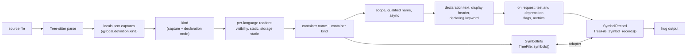

# Symbol Kinds, Visibility and `static`

Tree Hugger finds every declaration in a source file (functions, types,
fields, variables, parameters and more) and describes each one with a
**symbol record**. This page explains what the facts on a record mean, so you
can read `hug` output and the JSON it exports, and filter on those facts with
confidence. It covers all 16 supported languages.

Read it to learn why `hug` prints `crate method new() [in type Point]`, why a
declaration has no visibility label, or why a symbol you expected is missing.
Each section below is a short summary; the linked detail pages hold the full
per-language rules.

## A first look

Take this Rust file:

```rust
mod geo {
    /// A point on a plane.
    pub struct Point {
        pub x: i32,
        y: i32,
    }

    impl Point {
        /// Makes a point at the origin.
        pub(crate) fn new() -> Self {
            Point { x: 0, y: 0 }
        }

        #[deprecated]
        pub async fn fetch(&self, scale: i32) -> i32 {
            if scale > 1 { self.x * scale } else { self.y }
        }
    }

    static mut COUNT: u32 = 0;
}
```

`hug symbols` lists one line per declaration:

```text
$ hug symbols shapes.rs
  - private module geo shapes.rs:1:1
  - public struct Point { x: i32, y: i32 } shapes.rs:3:5
  - public field x [in type Point] shapes.rs:4:13
  - private field y [in type Point] shapes.rs:5:9
  - crate method new() -> Self [in type Point] shapes.rs:10:9
  - public method fetch(self, scale: i32) -> i32 [in type Point] shapes.rs:15:9
  - private static COUNT shapes.rs:20:5
```

Read a line left to right: the **visibility** (`crate`), a label that is the
**kind** or the declaring **keyword** (`method`, `struct`, `static`), the
name with its signature or field list, the **container** (`[in type Point]`)
and the location. Small TypeScript and Python classes read the same way.
Python has no access rules, so its lines carry no visibility at all, while
TypeScript's `#secret` is private and an unexported top-level function is
module-private:

```text
$ hug symbols shapes.ts shapes.py
  - class Point { origin: ClassVar[int], x: int } shapes.py:3:1
  - field origin [in class Point] shapes.py:5:5
  - constructor __init__(self, x) [in class Point] shapes.py:8:5
  - method unit() [in class Point] shapes.py:12:5
  - public class Shape { count, #secret } shapes.ts:2:8
  - private property #secret [in class Shape] shapes.ts:4:3
  - public method size(): Promise<number> [in class Shape] shapes.ts:7:3
  - module-private function helper(value: number) shapes.ts:10:16
```

(trimmed). `hug --json-full` exports the whole record. Trimmed to the facts
this page covers, the record for `fetch` is:

```json
{
  "kind": "Method",
  "scope": "Member",
  "identity": {
    "name": "fetch",
    "qualified_name": "shapes.rs#geo::Point::fetch",
    "container_name": "Point",
    "container_kind": "Type",
    "keyword": "fn"
  },
  "source": {
    "declaration_text": "pub async fn fetch(&self, scale: i32) -> i32",
    "signature_text": "pub async fn fetch(&self, scale: i32) -> i32"
  },
  "visibility": { "level": "Public", "is_deprecated": true, "is_test": false },
  "modifiers": [{ "type": "Async" }],
  "metrics": { "parameters": 1, "has_docs": false, "lines": 3, "cyclomatic": 2 }
}
```

## What each fact means

### Kind

The kind says what was declared: Function, Method, Constructor, Class,
Interface, Trait, Type (a struct or similar), TypeAlias, Enum, EnumVariant,
Module, Namespace, Variable, Constant, Field, Property, Parameter or Macro.
Each language keeps its own vocabulary, so a Rust `struct` is a Type while a
Java `class` is a Class, and a Rust `mod` is a Module while a C++ `namespace`
is a Namespace. One rule decides methods everywhere: a function declared
directly in a type, trait, interface, object or `impl` body is a Method; one
nested in another function stays a Function. See
[Kinds and Containers](./symbol-kinds-and-visibility/kinds-and-containers.md#kinds).

### Container

The container is the nearest enclosing declaration that can hold a member,
stored with its kind: `fetch` is in `Point`, a Type. A member of an unnamed
owner (an anonymous class, an object literal, a tagless C `struct`) has no
container. Some languages write the owner in the declaration instead of
around it: a Go receiver method, a Lua `function M.f()`, a Swift `extension`
member and a Rust `impl` member all name their type, and Tree Hugger links
them to it. See
[Kinds and Containers](./symbol-kinds-and-visibility/kinds-and-containers.md#containers).

### Scope

The scope says where a declaration sits: `Item` at file, module or namespace
level; `Member` inside a type, trait, interface, object or `impl`; `Local` in
a function body, or a parameter. `hug symbols` hides `Local` declarations
unless you pass `--scope local` or `--all-scopes`. See
[Scope](./symbol-kinds-and-visibility/scope-and-qualified-names.md#scope).

### Qualified name

The qualified name joins the enclosing names with the language's own
separator: `geo::Point::fetch` in Rust, `Shape.size` in TypeScript,
`com.example.Counter.tick` in Java. A name that starts at a declared
`package` or `namespace` (Java, Go, C#, PHP, Scala, C++, Perl) is complete as
it is; any other name is shown behind the file's path and `#`
(`shapes.rs#geo::Point::fetch`), because it means nothing without its file.
Qualified names are readable, not unique: the record ID is the unique key.
See
[Qualified names](./symbol-kinds-and-visibility/scope-and-qualified-names.md#qualified-names).

### `async`

A declaration written with an `async` keyword (Rust, JavaScript, TypeScript,
Python, C#, Swift) carries the `Async` modifier. It is read from the
declaration's own keyword, never from its body or return type. See
[`async`](./symbol-kinds-and-visibility/scope-and-qualified-names.md#async).

### Visibility

The visibility level is the access **declared or implied at this
declaration**: `public`, `protected`, `private`, `internal`, `package`,
`crate`, `module-private` or a C# compound level. It is not the effective
access through enclosing modules (a `pub fn` in a private Rust module is
still Public), and it is not an export flag. When there is no keyword, the
language's default for that position applies: an unmarked Rust item is
Private, an unmarked Java member is Package, an unexported top-level
TypeScript function in a module is ModulePrivate. Parameters, locals, and
every declaration in Python, Perl, Bash and Zsh are Unknown, and `hug`
prints no label for Unknown rather than a guess. See
[Visibility](./symbol-kinds-and-visibility/visibility.md).

### `static`

`static` has two unrelated meanings, and a record keeps them apart. **Member
`static`** (`Static`) means a member is used without an instance: a Java
`static` method, a Python `@staticmethod`, a Rust associated function with no
`self`, a Scala `object` member. **Storage `static`** (`StaticStorage`) means
storage duration or file linkage: a Rust `static` item, a C file-scope
`static` function, a C++ function-local `static` variable. Only member
`static` puts a member under *Static Methods* or *Static Fields* in
`hug classes`. See [`static`](./symbol-kinds-and-visibility/static.md).

### Documentation, deprecation and test flags

A record's documentation is the run of **doc comments** directly before the
declaration (`///`, `/** … */`, a Python docstring, and so on), never an
ordinary comment. `visibility.is_deprecated` is set by a language's own
deprecation marker (`#[deprecated]`, `@Deprecated`, `[Obsolete]`, a
`@deprecated` doc tag, a Go `Deprecated:` paragraph). `visibility.is_test`
marks test-only code: declarations in a test file such as `*_test.go`, ones
with a test attribute such as `#[test]` or `@Test`, and everything inside a
Rust `#[cfg(test)]` item. Both flags are syntax and file-name heuristics. See
[Documentation, Flags and Metrics](./symbol-kinds-and-visibility/documentation-flags-and-metrics.md).

### Metrics

When a query asks for them (`hug --json-full`, `--stats`, `--undocumented`
and `--min-params` do), records carry four metrics: `parameters` (the
declared parameters, without a receiver such as Rust `&self`), `has_docs`,
`lines` (the lines a function's body touches) and `cyclomatic` (1 plus one
per decision in the body). A metric that does not apply is `null`, which is
different from a measured `0`. See
[Metrics](./symbol-kinds-and-visibility/documentation-flags-and-metrics.md#metrics).

### Declaration text, display header and keyword

Each record keeps three pieces of its own source. `declaration_text` is
everything up to the body, initializers and access syntax included, so
nothing a visibility level cannot express is lost. `signature_text` is the
header a reader recognizes, used for display (`int old` for Java
`@Deprecated int old;`). `keyword` is the single token that introduces the
declaration (`fn`, `class`, `const`), and `hug` uses it as the label for
types, variables, fields and constants (`struct Point`, `static COUNT`). See
[Declaration Text, Headers and Keywords](./symbol-kinds-and-visibility/declarations.md).

### When a symbol is missing or looks wrong

Some constructs are not reported yet, a few facts cannot be decided from one
file, and a handful of forms cannot be parsed correctly by the pinned
Tree-sitter grammars. All of them are listed in
[Current Limitations](./symbol-kinds-and-visibility/limitations.md).

## How the values are decided

Tree Hugger parses a file with Tree-sitter, runs the language's `locals.scm`
query to find declarations, and then decides every fact about a declaration
**once**, at extraction, from that declaration's own syntax node. Nothing
re-classifies a symbol later, so the library's two symbol models and the CLI
always agree. A type's field list (what `hug classes` shows) is built from the
same standalone member symbols, so it lists the same members with the same
flags; see
[Field lists](./symbol-kinds-and-visibility/kinds-and-containers.md#field-lists).



Every change to what extraction produces bumps
`tree_hugger::EXTRACTOR_REVISION`, including a repair made on a branch that has
not been released: a warm cache written from an earlier commit of that branch
is otherwise served unchanged. The CLI's persistent cache key contains that
value, so cached output from an older extractor is recomputed instead of
being shown (see [Cache Design](./cache-design.md)).

## In the library

The library exposes the same facts through two models:

| Model | API | Where kind, visibility and `static` live |
|---|---|---|
| `SymbolInfo` (v1) | `TreeFile::symbols()` | `kind`, `scope`, `visibility` (`None` = unknown), `is_static`, `is_static_storage`, `is_async`, `container_name`, `container_kind`, `qualified_name`, `is_namespace_rooted` |
| `SymbolRecord` (schema 5) | `TreeFile::symbol_records()`, `symbol_index_v2()` | `kind`, `scope`, `visibility.level`, `modifiers` (`Static`, `StaticStorage`, `Async`, and the written `Const`, `Readonly`, `Unsafe`, `Mut` and `Custom` keywords), `attributes`, `identity.container_name`, `identity.container_kind`, `identity.qualified_name`, `identity.is_namespace_rooted`, `identity.keyword`, `source.declaration_text`, `source.signature_text`, `relations.extends`, `relations.implements`, `relations.unclassified_bases` |

The adapter between them (`From<SymbolInfo> for SymbolRecord` and back)
preserves kind, scope, visibility, both `static` flags, `async`, container
kind, the qualified name and its namespace root, and the signature, with its
parameters. The declaring keyword, declaration text, display header,
`relations.extends` and `relations.implements`, the test and deprecation
flags and the `metrics` facet exist only on records, because `SymbolInfo`
has no field for them. The full record layout is in
[Symbol Records](./symbol-records.md).

## Related pages

- [Kinds and Containers](./symbol-kinds-and-visibility/kinds-and-containers.md): per-language kinds, constructors, enum variants, containers and field lists
- [Scope, Qualified Names and `async`](./symbol-kinds-and-visibility/scope-and-qualified-names.md)
- [Visibility](./symbol-kinds-and-visibility/visibility.md): levels, per-language defaults, C and C++ linkage
- [`static`](./symbol-kinds-and-visibility/static.md): member and storage `static`
- [Documentation, Flags and Metrics](./symbol-kinds-and-visibility/documentation-flags-and-metrics.md)
- [Declaration Text, Headers and Keywords](./symbol-kinds-and-visibility/declarations.md)
- [Current Limitations](./symbol-kinds-and-visibility/limitations.md): unreported constructs and grammar limits
- [Symbol Reports](./symbol-reports.md): the `hug` commands and filters that read these facts
- [Symbol Records](./symbol-records.md): the record format
- [Declared Type Relations](./type-relations.md): `extends`, `implements` and member links
