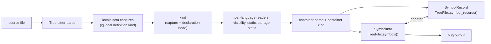
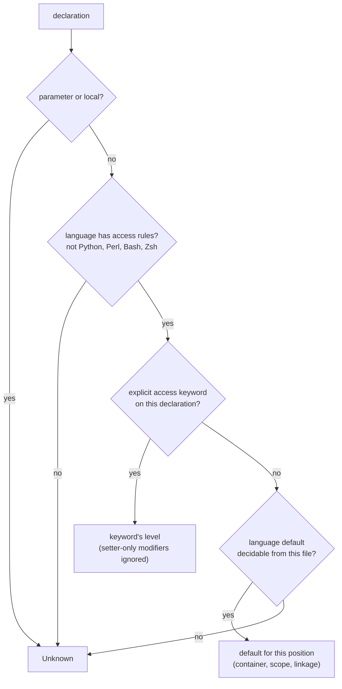

# Symbol Kinds, Visibility and `static`

This page explains what Tree Hugger reports for each declaration it finds:

- its **kind**: function, method, class, field, and so on
- its **visibility**: the access level the source declares or implies
- whether it is **`static`**, and which of the two meanings of `static` applies
- its **container**, and the **declaration text** stored on its record

It covers all 16 supported languages. Read it to learn why `hug` prints
`crate method new() [in type Point]`, why a declaration has no visibility
label, or why a symbol you expected is missing.

## Where the values come from

Tree Hugger parses a file with Tree-sitter, runs the language's `locals.scm`
query to find declarations, and then decides every fact about a declaration
**once**, at extraction, from that declaration's own syntax node. Nothing
re-classifies a symbol later, so the library's two symbol models and the CLI
always agree.



The two models are:

| Model | API | Where kind, visibility and `static` live |
|---|---|---|
| `SymbolInfo` (v1) | `TreeFile::symbols()` | `kind`, `visibility` (`None` = unknown), `is_static`, `is_static_storage`, `container_name`, `container_kind` |
| `SymbolRecord` (schema 3.0) | `TreeFile::symbol_records()`, `symbol_index_v2()` | `kind`, `visibility.level`, `modifiers` (`Static`, `StaticStorage`), `identity.module_path`, `identity.container_kind`, `source.declaration_text`, `relations.implements` |

The adapter between them (`From<SymbolInfo> for SymbolRecord` and back)
preserves kind, visibility, both `static` flags, container kind and signature
presence. Declaration text and `relations.implements` exist only on records,
because `SymbolInfo` has no field for them.

Every change to what extraction produces bumps
`tree_hugger::EXTRACTOR_REVISION`. The CLI's persistent cache key contains
that value, so cached output from an older extractor is recomputed instead of
being shown (see [Cache Design](./cache-design.md)).

## Kinds

`SymbolKind` (v1) and `SymbolKindV2` have the same variants: Function, Method,
Constructor, Type, TypeAlias, Class, Interface, Enum, EnumVariant, Trait,
Module, Namespace, Variable, Parameter, Field, Property, Macro, Constant and
Unknown. No construct in the test fixtures of any language reports `Unknown`.

### What each language reports

| Language | Function / method | Types | Members | Modules |
|---|---|---|---|---|
| Rust | `fn` → Function; `fn` in an `impl` or trait → Method (with or without `self`, with or without a body) | `struct`, `union` → Type; `enum` → Enum; `trait` → Trait; `type` and associated `type` → TypeAlias | field → Field; variant → EnumVariant; `const` → Constant; `static`, `static mut` → Variable | `mod` → Module |
| TypeScript | function → Function; class, abstract and interface method signatures (also `#private`) → Method; `constructor` → Constructor | `class`, `abstract class` → Class; `interface` → Interface; `enum` → Enum; `type` → TypeAlias | class-body property and interface property signature → Property | `namespace` is not yet reported |
| JavaScript | function → Function; class method → Method; `constructor` → Constructor | `class` → Class | class-body field (`x = 1;`, `static y;`, `#z`) → Property | — |
| Go | `func` → Function; method with a receiver → Method | every `type` declaration (struct and interface alike) → Type | not yet reported | `package` → Namespace |
| Python | `def` → Function; `def` in a class body (also `@staticmethod`, `@classmethod`) → Method | `class` → Class | class-body attribute → Field | — |
| Java | method → Method (constructors are not yet distinguished) | `class` → Class; `interface` → Interface; `enum` → Enum; `record` → Type | field and interface constant → Field | `package` → Namespace |
| C# | method → Method (constructors are not yet distinguished) | `class` → Class; `interface` → Interface; `enum` → Enum; `struct`, `record` → Type | field → Field; property → Property | `namespace` (block and file-scoped) → Namespace |
| C | function → Function | named `struct`/`union` tag → Type; `enum` → Enum; `typedef` → TypeAlias | struct field (pointer fields too) → Field | — |
| C++ | function → Function; function declared or defined in a class body → Method | `class` → Class; `struct`, `union` → Type; `enum` → Enum; `typedef`, `using` → TypeAlias | data member → Field | `namespace` → Namespace |
| Swift | `func` → Function; `func` in a type, extension or protocol (requirements too) → Method | `struct`, `class` and `enum` all → Type; `protocol` → Interface | stored property and protocol property requirement → Field; `case` → EnumVariant | — |
| Scala | `def` → Function; `def` in a class, trait or object → Method | `class`, `case class` → Class; `trait` → Trait; `enum` → Enum | not yet reported | `object` → Module |
| PHP | function → Function; method (also in a trait) → Method | `class` → Class; `interface` → Interface; `trait` → Trait; `enum` → Enum | property → Field | `namespace` is not yet reported |
| Lua | `function` and `M.f` → Function; `function M:m()` → Method | — | — | — |
| Perl | named `sub` → Function | — | `my`, `our`, `state` names → Variable | `package` → Module |
| Bash, Zsh | function → Function | — | — | — |

Variables, constants and parameters are reported in every language that has
them; a Swift `let` inside a function body is a Variable, never a Field.

**One rule makes a function a method.** A function declared directly in the
body of a class, struct, enum, trait, interface, protocol, object, `impl`
block or extension is a Method, whatever its receiver, decorators or
`static`-ness. A function nested inside another function stays a Function.

```python
class Shape:
    @staticmethod
    def unit():            # Method (static)
        def helper(): ...  # Function: nested in a function, not in the class
```

### Module or Namespace

The two kinds are deliberately not unified; each language keeps the kind that
matches its own vocabulary:

| Module | Namespace |
|---|---|
| Rust `mod`, Perl `package`, Scala `object` | Go `package`, Java `package`, C# `namespace`, C++ `namespace` |

TypeScript `namespace` and PHP `namespace` are not yet reported.

### Interface and protocol members that are not methods

They use the member kind their language uses in a class:

```java
interface Shape { int SIDES = 0; }      // SIDES: Field, static, Public
```

```typescript
interface Named { name: string; }       // name: Property, Public
```

```swift
protocol Named { var name: String { get } }  // name: Field
```

### Perl

Perl reports named subs (Function), packages (Module) and the names declared
by `my`, `our` and `state` (Variable). A list declaration reports each name
separately, and names keep their sigil:

```perl
package Fixture::Greeter;         # Module
our $greeting = "hi";             # Variable $greeting, container Fixture::Greeter
sub greet {                       # Function
    my ($first, $last) = @_;      # Variables $first and $last, container greet
    state $count = 0;             # Variable $count
    local $_ = $first;            # not reported
}
```

`local` is not reported, because it temporarily overrides an existing variable
rather than declaring a new one. Anonymous subs have no name and are not
reported. Sub parameters are not identified as parameters; names unpacked
from `@_` are ordinary variables of the sub.

## Containers

A member's container is the nearest enclosing declaration that can hold it,
and the record also stores that container's kind. `hug` prints both:
`[in class Box]`, `[in trait Shape]`, or just `[in Box]` when the kind is
unknown. A declaration is never its own container, and a C++ class member's
container is its class, never the namespace around the class.

Perl `package Foo;` statements and C# file-scoped namespaces contain the
declarations that **follow** them, up to the next package statement or the
end of the enclosing block or file. The block form `package Foo { … }`
contains only what is inside it.

### Rust `impl` members

A member of an `impl` block names the **implemented type** as its container,
not the `impl`:

```rust
struct Point;
impl Point { fn new() -> Self { Point } }        // container Point, kind Type
impl fmt::Display for Point {
    fn fmt(&self, f: &mut fmt::Formatter<'_>) -> fmt::Result { Ok(()) }
}                                                // container Point, kind Type
impl crate::geo::Coord { fn x(&self) {} }        // container Coord
impl<T> Wrapper<T> { fn get(&self) {} }          // container Wrapper
impl Foreign { fn f(&self) {} }                  // container Foreign, no kind
```

- The container name is the last path segment of the type, without generic
  arguments.
- The container kind is that type's own kind when it is declared in the same
  file (Type for a struct or union, Enum for an enum), and absent otherwise.
- The lookup is by name, so two same-named types in different `mod`s of one
  file share a container name, and `hug classes` may merge their members. If
  those declarations disagree on kind, the container kind is left absent.
- The trait of a trait impl is not part of the container. Each member of
  `impl Trait for Type` records it in `relations.implements`: one entry named
  after the trait's last path segment (`Display` above), whose `id` is the
  trait's record ID when exactly one trait of that name is declared in the
  same file. Members of
  an inherent impl have an empty list.

## Visibility

### What the level means

The level is the access **declared or implied at this declaration**. It is not
the effective access through every enclosing module, type or package, and it
is not an export flag. `pub fn f()` inside a private Rust module is still
Public. Parameters, local variables and local functions have no level.

The levels are:

| `Visibility` / `VisibilityLevel` | `hug` label | Typical source |
|---|---|---|
| `Public` | `public` | `public`, `pub`, `export`, Go uppercase name |
| `Protected` | `protected` | `protected` |
| `Private` | `private` | `private`, `#name`, unmarked Rust item |
| `Internal` | `internal` | C# and Swift `internal` |
| `Package` | `package` | unmarked Java member, Swift `package`, lowercase Go name |
| `Crate` | `crate` | Rust `pub(crate)`, `pub(super)`, `pub(in path)` |
| `ModulePrivate` | `module-private` | C `static`, Swift `fileprivate`, unexported module-level JS/TS |
| `ProtectedInternal` | `protected internal` | C# `protected internal` |
| `PrivateProtected` | `private protected` | C# `private protected` |
| `Unknown` (v1: `None`) | no label | no access rules apply, or the file cannot tell |

`hug` omits the label for Unknown rather than printing a guess.

### How a level is decided



Only the declaration itself and its nearest container are read. A private
method never makes its public class private.

### Unmarked declarations, per language

| Language | Keyword → level | No keyword → level |
|---|---|---|
| Rust | `pub` → Public; `pub(crate)`, `pub(super)`, `pub(in path)` → Crate; `pub(self)` → Private | Private for items and fields. Trait items and enum variants (and their fields) take the trait's or enum's level. Trait-impl items: see below. `macro_rules!` → Unknown |
| TypeScript | `public`, `protected`, `private`; `#name` → Private; top-level `export` → Public | class and interface members → Public; unexported top-level → ModulePrivate in a module file, Unknown in a script |
| JavaScript | `#name` → Private; top-level `export` → Public | class members → Public; unexported top-level → ModulePrivate in a module file, Unknown in a script |
| Go | uppercase initial (any Unicode uppercase) → Public | Package; the `package` clause itself → Unknown |
| Java | `public`, `protected`, `private` | Package; interface members → Public; `package` declaration → Unknown |
| C# | `public`, `protected`, `private`, `internal`, `protected internal`, `private protected`; `file` → ModulePrivate | class/struct/record members → Private; top-level types → Internal; interface members → Public |
| C | — | file-scope functions and variables → Public unless the linkage rule makes them ModulePrivate; types, tags, fields, enumerators, macros → Unknown |
| C++ | `public:`, `protected:`, `private:` sections | `class` members → Private; `struct`/`union` members → Public; namespace-scope functions and variables → linkage rule |
| Swift | `open`, `public` → Public; `package` → Package; `internal` → Internal; `fileprivate` → ModulePrivate; `private` → Private | Internal, with the member rules below |
| Scala | `private`, `protected`, qualified forms below | Public |
| PHP | `public`, `protected`, `private` | Public; namespaces → Unknown |
| Lua | — | global → Public; chunk-level `local` → ModulePrivate; `local` inside a block → Unknown; table fields (`M.f`, `M:m`) → Unknown |
| Python, Perl, Bash, Zsh | — | Unknown. Privacy is only a naming convention (`_name`) or does not exist, and a guess would be reported as fact. |

The rules that do not fit in a table cell follow.

### Rust trait implementations

An item in `impl Trait for Type` takes the level of `Trait` when `Trait` is
declared in the same file, and is Unknown otherwise. Standard-library traits
are not special-cased, because the level would then depend on a hard-coded
list rather than on the file:

```rust
pub trait Shape { fn area(&self) -> u32; }
impl Shape for Square { fn area(&self) -> u32 { 4 } }       // Public: Shape is here
impl fmt::Display for Square { fn fmt(/* … */) { /* … */ } } // Unknown
```

Restricted access such as `pub(in crate::a)` is reported as Crate, an upper
bound; the exact text survives in `source.declaration_text`.

### C and C++ linkage

A file-scope (C) or namespace-scope (C++) function or variable is Public,
unless any of these holds, which makes it ModulePrivate:

- it is declared `static`
- it is inside an unnamed `namespace { … }` (C++)
- it is a C++ variable that is itself `const` (`constexpr` counts), declared
  without `extern` or `inline`
- an **earlier** declaration of the same function in the same file is `static`

```cpp
static int helper(int);          // ModulePrivate
int helper(int x) { return x; }  // ModulePrivate: earlier static prototype
int helper(long x);              // Public: different overload
namespace { int hidden; }        // ModulePrivate
const int LIMIT = 3;             // ModulePrivate (C++)
constexpr int MAX = 8;           // ModulePrivate (C++)
const char* name = "n";          // Public: the pointer itself is not const
char* const slot = nullptr;      // ModulePrivate (C++): const pointer
extern const int SHARED = 4;     // Public
extern "C" void api(void);       // Public
```

"The same function" means the same name in C. In C++ it means the same
enclosing namespace, name, and parameter types compared as text (whitespace
and parameter names ignored). A typedef'd spelling of a parameter type does
not match, so that declaration falls back to its own rule. The scan can only
miss a `static`, never invent one. Whether the file is a header does not
matter.

### JavaScript and TypeScript module files

A file is a **module** when any of these holds:

- its extension is `.mjs`, `.cjs`, `.mts` or `.cts`
- it has an `import` or `export` statement
- anywhere in the file, even inside a function or an `if`, it calls
  `require(...)` or assigns to `module.exports` or `exports.…`

In a module, an unexported top-level declaration is ModulePrivate. In any
other file (a classic script, or a TypeScript global script) it is Unknown,
because a script's top-level declarations are global. CommonJS files count as
modules because Node wraps each one in a function, so its top-level
declarations stay private to the file. `package.json`'s `"type"` field is not
read, so extraction never looks beyond the one file.

```javascript
// script.js: no module evidence
function helper() {}             // Unknown
```

```javascript
// lib.js
const fs = require("fs");
function helper() {}             // ModulePrivate
module.exports = { helper };
```

### C# interface members and compound levels

Any interface member without an access keyword is Public, including
default-implemented methods, static members and nested types. An explicit
interface implementation in a class is Private, which is how the C# compiler
reports it:

```csharp
interface IShape {
    double Area();                          // Public
    void Draw() { }                         // Public: default implementation
    static IShape Unit() => new Square();   // Public
    class Helper { }                        // Public: nested type
    private void Log() { }                  // Private: explicit keyword
}
class Square : IShape {
    double IShape.Area() => 1;              // Private: explicit implementation
    protected internal int a;               // ProtectedInternal
    private protected int b;                // PrivateProtected
}
```

### Swift members of types and extensions

Enum cases and protocol requirements take their container's level. Any other
unmarked member takes its level from the nearest enclosing type or extension
that has an explicit access keyword:

- inside a `private` or `fileprivate` type → ModulePrivate
- inside an extension with an explicit level → that level
- inside a `public` or `open` type → Internal
- otherwise → Internal

```swift
private struct Hidden { func a() {} }       // a: ModulePrivate
private extension Widget { func b() {} }    // b: ModulePrivate
public extension Widget { func c() {} }     // c: Public
public struct Api {
    func d() {}                             // d: Internal
    private struct Inner { func e() {} }    // e: ModulePrivate (Inner is nearest)
}
struct Plain { func f() {} }                // f: Internal
```

A top-level `private` declaration itself reports Private (its keyword).

### Setter-only modifiers

A modifier that restricts only the setter does not change the declaration's
level. The restriction is still visible in `source.declaration_text`.

```swift
public private(set) var count = 0           // Public
private(set) var total = 0                  // Internal (the default)
```

```csharp
public int Count { get; private set; }      // Public
internal int Total { get; private set; }    // Internal
```

### Scala qualified access

A qualifier is resolved only from what the file shows:

```scala
package com.acme.shapes

class Shape {
  private[this] val id = 0                  // Private
  protected[this] def tick() = ()           // Protected
  private[shapes] def area() = 0            // Package: a segment of the package clause
  private[acme] def scale() = 1             // Package
  private[Shape] def secret() = 2           // Unknown; text kept in declaration_text
}
```

### A level is not an export

`visibility.is_exported` comes only from export syntax and the bind pass,
never from a Public level: a top-level declaration inside a JavaScript or
TypeScript `export`, or a Rust item with a `pub…` modifier. Members (methods,
constructors, fields, properties, enum variants) are never marked exported. A
Public Java class or TypeScript class method is not exported. Converting a
`SymbolInfo` to a record always gives `is_exported: false`, because
`SymbolInfo` carries no export information.

## `static`

`static` has two unrelated meanings, and Tree Hugger keeps them apart:

| | Member `static` | Storage `static` |
|---|---|---|
| Meaning | the member is used without an instance | storage duration or file linkage |
| v1 | `SymbolInfo::is_static` (copied to `FunctionSignature::is_static` and `FieldInfo::is_static`) | `SymbolInfo::is_static_storage` |
| v2 | `Modifier::Static` | `Modifier::StaticStorage` |
| `hug classes` | listed under *Static Methods* / *Static Fields* | never listed as a static member |

Member `static` is set for:

- TypeScript, JavaScript, Java, C# and PHP `static`
- Java interface constants, which are implicitly `static` whether or not they
  say so
- C++ `static` data members and member functions
- Swift `static` and `class` members
- Scala `object` members
- Python `@staticmethod` and `@classmethod` methods, and class attributes
  (below)
- Rust associated functions without a `self` receiver, in impls and traits

Python class methods and Swift `class` methods are grouped with static members
because they need no instance, although they are not identical to static
methods.

Storage `static` is set for Rust `static` and `static mut` items, C and C++
file-scope or namespace-scope `static` functions and variables, and C and C++
function-local `static` variables:

```cpp
class Counter {
    static int total;            // member static: Static Fields
    int bump() {
        static int calls = 0;    // storage static: not a member
        return ++calls;
    }
};
static int helper() { return 0; } // storage static (and ModulePrivate)
```

### Python class attributes

A name declared in a class body is a Field of that class; its annotation
decides whether it is static:

```python
from typing import ClassVar

class Point:
    x: int                       # instance Field
    y: int = 0                   # instance Field
    origin: ClassVar[int] = 0    # static Field (class attribute)
    count = 0                    # static Field (class attribute)

    def move(self):
        self.z = 1               # not reported
```

An unannotated `count = 0` is a class attribute that an instance may shadow by
assigning `self.count`; the record describes the class-level declaration.
This follows PEP 526 and dataclass semantics. `hug symbols` and `hug classes`
apply the same rule.

## Declaration text

Every record carries `source.declaration_text`: the declaration from its start
up to, but not including, its body, with trailing whitespace trimmed. A
declaration without a body contributes its whole text. It includes the
modifiers, access keywords and attributes that the grammar parses as part of
the declaration node, so syntax a level cannot express is never lost. Doc
comments are not included.

| Declaration | `declaration_text` |
|---|---|
| `pub(in crate::a) fn f() { … }` | `pub(in crate::a) fn f()` |
| `fn area(&self) -> u32;` (trait method, no body) | `fn area(&self) -> u32;` |
| `public private(set) var count = 0` | `public private(set) var count = 0` |
| `public int Count { get; private set; }` | `public int Count { get; private set; }` |
| `private[Shape] def secret() = 2` | `private[Shape] def secret() =` |
| `my ($a, $b) = @_;` | `my ($a, $b)`, for both `$a` and `$b` |

Syntax the grammar places outside the declaration node, such as a Rust
`#[…]` attribute, a Python decorator or a TypeScript `export` wrapper, is not
included. The text appears in records and in the JSON `symbol_indexes`, not
in `SymbolInfo`.

## Current limitations

These are limits of the extractor today, not of the grammars:

- **Swift** structs, classes and enums all report Type.
- **Go** structs and interfaces both report Type; `type A = B` aliases are
  not reported at all; struct fields are not reported as symbols.
- **Constructors** are reported only for TypeScript and JavaScript. Python,
  Java, C#, C++, Swift and PHP constructors are Methods or are absent.
- **Enum variants** are reported only for Rust and Swift.
- **TypeScript and PHP namespaces** are not reported.
- **Scala** fields are not reported.
- **Python `self.x`** attributes and **JavaScript `this.x`** properties
  assigned only in methods, never declared in the class body, are not
  reported. TypeScript never reported them.
- **Perl** coverage is narrow: subs, packages and `my`/`our`/`state`
  variables only; names keep their sigil.
- **Unresolved access** stays Unknown: Rust items implementing a trait
  declared elsewhere, Scala qualifiers that name a class, JS/TS script
  globals, and any language without access rules.
- **Cross-file facts** are not resolved: out-of-line C++ member definitions
  get no class container, and a Rust `impl` for a type declared in another
  file has no container kind.
- **Adapter gaps**: converting a `SymbolInfo` to a record drops
  `TypeMetadata::type_parameters` and a TypeAlias's field metadata (C
  `typedef struct { … } Alias`).
