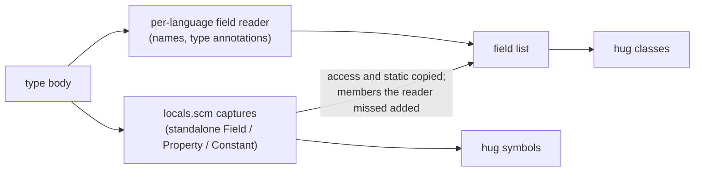

# Kinds and Containers

Part of [Symbol Kinds, Visibility and `static`](../symbol-kinds-and-visibility.md).

A record's **kind** says what was declared: a function, a method, a class, a
field, an enum variant, and so on. Its **container** says which declaration
holds it, such as the class a method belongs to. Both are visible in every
`hug` listing:

```text
$ hug symbols shapes.rs
  - private module geo shapes.rs:1:1
  - public struct Point { x: i32, y: i32 } shapes.rs:3:5
  - public field x [in type Point] shapes.rs:4:13
  - crate method new() -> Self [in type Point] shapes.rs:10:9
```

This page lists, per language, which syntax produces which kind; how the
container is found, including for members written outside their type (Go
receiver methods, Lua table functions, Swift extensions and Rust `impl`
blocks); and how a type's field list, which `hug classes` prints, is built.

## Kinds

`SymbolKind` (v1) and `SymbolKindV2` have the same variants: Function, Method,
Constructor, Type, TypeAlias, Class, Interface, Enum, EnumVariant, Trait,
Module, Namespace, Variable, Parameter, Field, Property, Macro, Constant and
Unknown. No construct in the test fixtures of any language reports `Unknown`.

### What each language reports

| Language | Function / method | Types | Members | Modules |
|---|---|---|---|---|
| Rust | `fn` → Function; `fn` in an `impl` or trait → Method (with or without `self`, with or without a body) | `struct`, `union` → Type; `enum` → Enum; `trait` → Trait; `type` and associated `type` → TypeAlias | field → Field; variant → EnumVariant; `const` → Constant; `static`, `static mut` → Variable | `mod` → Module |
| TypeScript | function → Function; class, abstract and interface method signatures (also `#private`) → Method; `constructor` in a class body → Constructor (an object literal's `constructor()` is a Method) | `class`, `abstract class` → Class; `interface` → Interface; `enum` (also `const enum`) → Enum; `type` → TypeAlias | class-body property (also `#private`, quoted `"label"` and numeric names; a quoted name is reported without its quotes) and interface property signature → Property; enum member (`Red`, `Blue = 2`, quoted `"x y" = 1`) → EnumVariant | `namespace` and `module` (also `declare namespace`, and dotted `namespace A.B` as one record named `A.B`) → Namespace |
| JavaScript | function → Function; class method → Method; `constructor` in a class body → Constructor (an object literal's `constructor()` is a Method) | `class` → Class | class-body field (`x = 1;`, `static y;`, `#z`, `"quoted" = 1;`) → Property | — |
| Go | `func` → Function; method with a receiver → Method | every `type` declaration (struct and interface alike) → Type; `type A = B` (alone, grouped or generic) → TypeAlias | each named field of a named struct type (`X, Y int` is two Fields) → Field | `package` → Namespace |
| Python | `def` → Function; `def` in a class body (also `@staticmethod`, `@classmethod`) → Method; `__init__` in a class body (also decorated) → Constructor | `class` → Class | class-body attribute, every target of a chained (`a = b = 0`) or one-level tuple/list (`a, b = …`) assignment → Field | — |
| Java | method → Method; explicit constructor (also in an enum or record) → Constructor | `class` → Class; `interface` → Interface; `enum` → Enum; `record` → Type | field and interface constant → Field; enum constant (`RED`, `MERCURY(1.0)`, `BLUE { … }`) → EnumVariant | `package` → Namespace |
| C# | method → Method; explicit instance constructor (block or `=>` body, also in a struct or record, with or without `: this(…)`) → Constructor; local function → Function | `class` → Class; `interface` → Interface; `enum` → Enum; `struct`, `record` → Type | field and `event` field → Field; property → Property (in classes, structs, records and interfaces); enum member → EnumVariant | `namespace` (block and file-scoped) → Namespace |
| C | function → Function | named `struct`/`union` tag → Type; `enum` → Enum; `typedef` → TypeAlias (also `typedef int *P;`, `typedef int (*Fn)(int);`) | struct or union field, under any pointer, array, function-pointer or attributed declarator (`**p`, `a[3]`, `(*cb)(int)`, `x [[maybe_unused]]`), and the members of an anonymous `struct`/`union` → Field; enumerator of a named, anonymous or `typedef`'d enum → EnumVariant | — |
| C++ | function → Function; function declared or defined in a class body, whatever its return declarators (`int (*m(int))(long);`) → Method; constructor declared or defined in a class body (`C();`, `explicit C(int);`, `C() = default;`, `C(C&&) = delete;`, under `template<…>`, with an attribute on the name `C [[deprecated]] ()` or the name in parentheses `(C)()`) → Constructor | `class` → Class; `struct`, `union` → Type; `enum` → Enum; `typedef` (also behind a declarator), `using` → TypeAlias | data member, under any pointer, array, reference, function-pointer or attributed declarator, also a variable template (`template<class T> static T cache[3];`) and an anonymous union's members → Field; enumerator of a scoped or unscoped enum → EnumVariant | `namespace` → Namespace |
| Swift | `func` → Function; `func` in a type, extension or protocol (requirements too) → Method; `init`, `init?` and `init!` in a type, extension or protocol → Constructor, named `init` | `struct`, `class` and `enum` all → Type; `protocol` → Interface; `typealias` → TypeAlias | stored property (every binding of `var a = 1, b = 2`) and protocol property requirement → Field; `case` → EnumVariant | — |
| Scala | `def` → Function; `def` in a class, trait, enum, object, anonymous class (`new T { … }`) or `given … with` instance → Method; an `extension` method belongs to the type around the block (a Function at top level); a `package object`'s `def` stays a Function with no container | `class`, `case class` → Class; `trait` → Trait; `enum` → Enum; `type A = B` (also generic) → TypeAlias | `val`, `var` and `lazy val`, defined or only declared, directly in a class, trait, object or enum body → Field, one per name of a grouped `val a, b: Int` (a tuple pattern `val (a, b) = …` declares none); enum `case` (`case Red, Blue`, `case Value(x: Int)`) → EnumVariant | `object` → Module |
| PHP | function → Function; method (also in a trait) → Method; a method named `__construct`, in any letter case → Constructor | `class` → Class; `interface` → Interface; `trait` → Trait; `enum` → Enum | property → Field; `const` → Constant (members and top-level); enum `case` (unit or backed) → EnumVariant | named `namespace`, semicolon or braced → Namespace |
| Lua | `function` and `M.f` → Function; `function M:m()` → Method | — | — | — |
| Perl | named `sub` → Function | — | `my`, `our`, `state` names → Variable | `package` → Module |
| Bash, Zsh | function → Function | — | — | — |

Variables, constants and parameters are reported in every language that has
them; a Swift `let` inside a function body is a Variable, never a Field. A
parameter of function type is a Parameter, never a Function: in C and C++
`int f(void cb(int), void (*ptr)(int))` reports `cb` and `ptr` as Parameters
(and so are names inside them, such as `value` in `void cb(int value)`).

Only the name a declaration binds is reported. A parameter's type and its
default value are references, never parameters, in every language: in
`def g(x: W = external)` (Python) and `void g(W x, int y = external)` (C#)
the parameters are `x` and `y`, while `W` and `external` are read. The same
holds for a constant's value (`const B = A;` in PHP declares only `B`), the
target object of a Python class-body assignment (`obj.attr = 1` declares
nothing), the value of a walrus operator (`y := external` declares `y`), and
a range bound or path in a Rust `if let` (`if let 1..=MAX = n`,
`if let E::A = v` declare nothing).

A C or C++ `struct`, `union` or `class` name is a declaration only when the
specifier has a body or is written alone (`struct S;`, also as a member or in
a namespace, template or `extern "C"` body). Anywhere else the name is an
elaborated type use, a read of the type, and no record:

```c
struct S { int a; };     // Type S
struct F;                // Type F (declared alone)
struct S x;              // Variable x; `S` is a read
void f(struct S *p);     // Parameter p; `S` is a read
typedef struct S T;      // TypeAlias T; `S` is a read
```

**One rule makes a function a method.** A function declared directly in the
body of a class, struct, enum, trait, interface, protocol, object, `impl`
block or extension is a Method, whatever its receiver, decorators or
`static`-ness. A function nested inside another function stays a Function.
The rule holds whatever a query captured: a C# local function, even a
`static` one, is a Function, and a field or property capture inside a
function body would be a Variable. What decides is the nearest enclosing
function or type: a member of a class, struct, class expression, anonymous
class or object literal declared inside a function is still that type's
member. A Lua `function M:m()` names its table, so it is a Method wherever it
is written.

```python
class Shape:
    @staticmethod
    def unit():            # Method (static)
        def helper(): ...  # Function: nested in a function, not in the class
```

**Wrappers do not change membership.** A Python decorator list, a C++
`template<…>` header and a C, C++ or C# preprocessor conditional (`#if`,
`#ifdef`, `#elif`, `#else`, …) sit between a declaration and the body around
it without being a scope. A member stays a member through any number of them,
nested or not, for its kind, both `static` flags, its access (a C++ section or
a C# default) and its type's field and enum-member lists alike; a declaration
outside a type stays outside:

```cpp
class Sweep {
public:
    template<class T> static void make(T x) {}  // Method, member static, Public
    template<class T> void use(T x) {}          // Method, instance, Public
    template<class T> static T cache;           // Field, member static, Public
#ifdef DEBUG
    int probes;                                 // Field, Public
#endif
};
template<class T> void free_helper(T x) {}      // Function
```

The same holds in C#: an unmarked member under `#if` is Private in a class,
struct or record and Public in an interface, and an unmarked type under `#if`
at the top level or in a namespace is Internal:

```csharp
class Conditional {
#if FLAG
    static int count;      // Field, member static, Private, in the field list
    void Tick() {}         // Method, Private
#else
    int fallback;          // Field, Private, in the field list
#endif
}
interface IConditional {
#if FLAG
    int Count { get; }     // Property, Public, in the field list
#endif
}
```

Swift `#if`, `#elseif` and `#else` and C# `#region` are not wrappers: the
grammars parse them as directives beside the members they guard, so those
members read exactly like unguarded ones.

A `friend` function declared in a class is not a member and stays a
Function. A C++ access section written inside a conditional applies to the
members after it in the same branch; an `#else` branch does not inherit one
from the branch it replaces, and members after `#endif` take the nearest
section outside the conditional.

### Constructors

A constructor is an explicit instance constructor written in its type's
body. It is recognized from the declaration's syntax, never by comparing its
name with the type's: only Python `__init__` and PHP `__construct` are
recognized by name, and only once the declaration is known to be a method.

| Language | Constructor | Stays what it was |
|---|---|---|
| TypeScript, JavaScript | `constructor(…)` in a class body | an object literal's `constructor()`: Method |
| Python | `def __init__(self, …)` in a class body, decorated or not | top-level or function-local `__init__`: Function; `__new__`: Method |
| Java | `C(int x) {}` in a class, enum or record | `void C() {}`: Method; a compact record constructor `R { … }` and initializer blocks: not reported |
| C# | `public C(int x) {}`, `S(int x) => X = x;` | `int C()`: Method; `static C() {}`, `~C() {}` and a primary constructor `class P(int x)`: not reported (`x` is a Parameter) |
| C++ | `C();`, `C(int x) {}`, `C() = default;` in a class body, also with an attribute on the name or the name in parentheses (`C [[deprecated]] (int x);`, `(C)(int x);`) | `~C();` and `operator bool()`: not reported; `int m [[deprecated]] (int x);`: Method; out-of-class `C::C() {}`: Function with no container |
| Swift | `init`, `init?`, `init!` in a type, extension or protocol | `deinit`: not reported; `static func make()`: Method |
| PHP | `function __construct()`, any letter case | a legacy `function Legacy()` in `class Legacy`: Method; a top-level `__construct`: Function |

A constructor's record keeps the declared name (`init`, `__init__`,
`__construct`, or the class name), its parameters with their defaults, and
the type as container. It is never `static`, and it has no return type, since
none is written:

```java
class Counter {
    Counter(int start) {}   // Constructor, container Counter, parameter start
    void tick() {}          // Method
}
```

Overloads are separate records, each with its own parameters and ID. No
constructor is synthesized: a class without one has none.

### Enum variants

Each named member of an enum is an EnumVariant whose container is the enum.
A declaration that declares several names (`case Red, Blue`) gives one record
per name. A use of a member is never a variant:

```c
enum Color { RED, BLUE = 2 };   // RED, BLUE: EnumVariant, container Color
enum { ANON_A };                // ANON_A: EnumVariant, no container
int x = RED;                    // x: Variable; RED is a use, not a variant
```

A variant record has no payload of its own (its `kind_data` is `Unknown`).
Its value and fields are in the enum's variant list
([Field lists](#field-lists)). Java constant bodies (`BLUE { void f() {} }`)
are unnamed owners, so `f` has no container.

### Module or Namespace

The two kinds are deliberately not unified; each language keeps the kind that
matches its own vocabulary:

| Module | Namespace |
|---|---|
| Rust `mod`, Perl `package`, Scala `object` | Go `package`, Java `package`, C# `namespace`, C++ `namespace`, TypeScript `namespace`/`module`, PHP `namespace` |

A namespace record carries the full name as written, and the names of its
members are prefixed with it once:

```typescript
namespace Space {
  export function inside() {}   // Space.inside, container Space
}
export namespace A.B {          // one Namespace named A.B
  export const v = 1;           // A.B.v
}
```

```php
<?php
namespace App;                  // Namespace App
function inside() {}            // App\inside, no container
namespace App\Braced {          // Namespace App\Braced
    function inside() {}        // App\Braced\inside, container App\Braced
}
```

A PHP semicolon namespace has no body, so the declarations after it are not
its members and have no container; their names still start with it. Neither
a PHP global `namespace { … }` nor a TypeScript string-named
`declare module "x" { … }` declares a named namespace, so neither has a
record. A TypeScript or PHP `use`/`import` of a namespace declares nothing.

### Interface and protocol members that are not methods

They use the member kind their language uses in a class:

```java
interface Shape { int SIDES = 0; }      // SIDES: Field, static, Public
```

```typescript
interface Named { name: string; }       // name: Property, Public
```

```swift
protocol Named { var name: String { get } }  // name: Field
```

### Perl

Perl reports named subs (Function), packages (Module) and the names declared
by `my`, `our` and `state` (Variable). A list declaration reports each name
separately, and names keep their sigil:

```perl
package Fixture::Greeter;         # Module
our $greeting = "hi";             # Variable $greeting, container Fixture::Greeter
sub greet {                       # Function
    my ($first, $last) = @_;      # Variables $first and $last, container greet
    state $count = 0;             # Variable $count
    local $_ = $first;            # not reported
}
```

`local` is not reported, because it temporarily overrides an existing variable
rather than declaring a new one. Anonymous subs have no name and are not
reported. Sub parameters are not identified as parameters; names unpacked
from `@_` are ordinary variables of the sub.

## Containers

A member's container is the nearest enclosing declaration that can hold it,
and the record also stores that container's kind. `hug` prints both after
a function, method, constructor, field, property, constant, enum variant or
parameter: `[in class Box]`, `[in trait Shape]`, or just `[in Box]` when the
kind is unknown. Other kinds (a variable, a nested type) print no suffix,
though their records still carry the container. A declaration is never its own container, and a C++ class member's
container is its class, never the namespace around the class.

When the nearest owner has no name, the member has **no container**, never
the named type around the owner. Unnamed owners are anonymous classes (Java
`new T() { … }` and enum-constant bodies, PHP `new class { … }`, Scala
`new T { … }` and `given … with` instances), JavaScript and TypeScript class expressions and object
literals, and a C or C++ `struct`, `class` or `union` without a tag. So
`hug classes` never lists their members under the enclosing class:

```java
class Sweep {
    void outer() {                                   // container Sweep
        Runnable r = new Runnable() {
            public void run() {}                     // Method, no container, Public
        };
    }
}
```

A tagless `struct` or `union` that declares no member name of its own
(`union { int a; float b; };`) is an anonymous member: C and C++ make its
fields members of the enclosing type, so they keep that type as their
container and, in C++, the access of the section that holds the anonymous
member (`class K { union { int u; }; };` makes `u` Private). A member of any type declared inside a function, named or not,
keeps its written access; only the function's own locals have none.

A block that computes a value is local scope too, even outside a function: a
Scala `val`, `var`, `lazy val` or alias `given` initializer block and a
`match` arm, a Rust `const` or `static` initializer block, a Java `static { … }`
or instance initializer block, and a Swift computed property, accessor or
`willSet`/`didSet` body. A `def`, `fn` or `func` written there is a Function
with Unknown access, never static, and keeps the enclosing type as its
container like any nested function; the member that holds the block keeps its
own access and `static`:

```scala
object Host:
  val held: Int = {               // Public, static
    def helper(): Int = 1         // Function, Unknown, container Host
    helper()
  }
```

Perl `package Foo;` statements and C# file-scoped namespaces contain the
declarations that **follow** them, up to the next package statement or the
end of the enclosing block or file. The block form `package Foo { … }`
contains only what is inside it.

### Go receiver methods and Lua table members

Two languages name a member's owner in the declaration itself rather than by
nesting it. The container is that owner, found by name in the same file:

```go
type Point struct{ X int }
func (p *Point) Move() {}        // Method, container Point, kind Type
```

```lua
local M = {}
function M.new() end             -- Function, container M, kind Variable
function M:describe() end        -- Method, container M, kind Variable
M.size = 1                       -- Variable, container M, kind Variable
```

- A Go receiver's base type is the container, through a pointer and generic
  arguments (`func (p *Point[T]) M()` → `Point`). The receiver, the
  parameters and the locals of a method have no container, as in any Go
  function.
- A Lua container is the table expression as written (`a.b` for
  `function a.b.c()`). Its kind is the kind of the file-level declaration of
  that name, and absent when there is none or they disagree. When two tables
  share a name (`local M = {}` in two `do … end` blocks), a member is linked
  to the nearest one declared before it. Two Go types of one name are
  competing declarations instead: a receiver method of that name joins
  neither.

### Swift extension members

A member of an extension names the extended type as written as its
container, and is linked to that type's record when the extended path names
exactly one type of the file, by the same lookup that decides the
extension's conformances ([Declared Type Relations](../type-relations.md#c-swift-and-scala)),
so same-named nested types stay apart:

```swift
class Left { class Repeated {} }
class Right { class Repeated {} }
extension Left.Repeated { func a() {} }    // Left.Repeated.a -> Left.Repeated
extension Right.Repeated { func b() {} }   // Right.Repeated.b -> Right.Repeated
```

When the path names no such type, the member keeps its container name and
`container_kind`, and its `relations.container` is the extended type as
written with no ID and no `parent`; no local type lists it. That is the
case for an external owner, an alias, a selective type import of the name,
and two same-named owners anywhere along the path. An extension is written
at file scope, so a type declared in a function, a closure or a block, or
nested in such a type, is never its owner, whatever its qualified name ends
with:

```swift
func f() { class Local {} }
extension Local { func c() {} }            // Local.c -> container `Local`, no owner (f.Local is out of view)
struct Holder { struct Base {} }
struct Holder {}
extension Holder.Base { func e() {} }      // Holder.Base.e -> container `Holder.Base`, no owner: two Holders
```

"Nested in such a type" is decided by where the declaration is written,
not by its qualified name. A closure's type has no function name in front
of it, so a closure's `Holder` and a file-level `Holder` share the name
`Holder`, and so do their nested types. Only the closure's types are out of
view; the file-level nested type still owns the extension's members:

```swift
struct Holder { struct Inner {} }
let make = { struct Holder { struct Inner {} } }
extension Holder.Inner { func d() {} }     // Holder.Inner.d -> the file-level Holder.Inner
```

### Rust `impl` members

A member of an `impl` block names the **implemented type** as its container,
not the `impl`:

```rust
struct Point;
impl Point { fn new() -> Self { Point } }        // container Point, kind Type
impl fmt::Display for Point {
    fn fmt(&self, f: &mut fmt::Formatter<'_>) -> fmt::Result { Ok(()) }
}                                                // container Point, kind Type
impl crate::geo::Coord { fn x(&self) {} }        // container Coord
impl<T> Wrapper<T> { fn get(&self) {} }          // container Wrapper
impl Foreign { fn f(&self) {} }                  // container Foreign, no kind
```

- The container name is the last path segment of the type, without generic
  arguments.
- The container kind is that type's own kind when it is declared in the same
  file (Type for a struct or union, Enum for an enum), and absent otherwise.
  A same-named type whose path disagrees with the `impl`'s is not that
  type: `impl other::W` beside a local `enum W` has no container kind.
- Two same-named types in different `mod`s of one file share a container
  name, but each member is linked (`relations.parent`, the owner's
  `relations.members`, `hug classes`, `--tree`) to the type its qualified
  name names, by record ID. The qualified name keeps the `impl`'s path and
  module, so the owner is never just the first type of that name:

  ```rust
  mod left { pub struct Boxed; impl Boxed { pub fn work(&self) {} } }   // left::Boxed::work -> left::Boxed
  mod right { pub struct Boxed; impl Boxed { pub fn work(&self) {} } }  // right::Boxed::work -> right::Boxed
  impl right::Boxed { fn more(&self) {} }                               // right::Boxed::more -> right::Boxed
  impl Boxed { fn guess(&self) {} }                                     // Boxed::guess -> no owner
  ```

  A member whose qualified name names none of several same-named types (the
  last line) has no owner. A Rust impl member's owner is the impl's self
  type resolved by its full written path in the impl's module
  ([Declared Type Relations](../type-relations.md#rust-impls)): `impl W` and
  `impl crate::W` from a nested module link to the local `W`, but
  `impl other::W` (a `W` declared in another file), `impl V` after
  `use a::V` (an imported name) and `impl Tr for &W` (a reference type)
  never join a local type. Such a member keeps its qualified name
  (`other::W::probe`) and `container_name`, and its `relations.container`
  is the self type as written (`other::W`) with no ID and no parent. The
  same rule holds for a Swift `extension External.Owner` (a textual
  container, as above) and a Lua `function External.Owner.f()` beside a
  local `Owner`, which gets no container at all. If the same-named
  declarations disagree on kind, the container kind is left absent.
- The trait of a trait impl is not part of the container. Each member of
  `impl Trait for Type` records it in `relations.implements` as written
  (`fmt::Display` above), with the trait's record ID only when that path
  names exactly one same-file trait; the resolved self type lists the
  trait too. Members of an inherent impl have an empty list.

## Field lists

A type's `TypeMetadata::fields` is its field list: `hug classes` prints it as
*Static Fields* and *Instance Fields*, and `hug symbols` prints it after the
type's name (`struct Point { x: i32, y: i32 }`). It lists exactly the
members the type declares in its own body, in source order:

- every standalone `Field`, `Property` or `Constant` symbol whose container is
  the type, with that symbol's access and member `static`, so a member is in
  `hug classes` exactly when `hug symbols` reports it inside the type;
- members that have no standalone symbol: Java and C# record components (they
  are Parameters), Rust tuple-struct positions (`0`, `1`) and Scala class
  parameters. Their access and `static` are read from the declaration.

Each entry appears once, whichever source listed it. A Go field and a Scala
body `val`/`var` are both a standalone Field and an entry of the list, and
the entry keeps the type written in the source:

```scala
class Box(p: Int) {
  val width: Int = 1   // Field; list entry width: Int
  var height = 2       // Field; list entry height (no written type)
  val x, y: Int = 0    // two Fields; list entries x: Int and y: Int
}                      // p: Parameter; list entry p, no Field record
```



The per-language reader supplies each entry's type annotation; an entry added
from a standalone symbol that no reader listed carries its doc comment but no
type. Readers cover the forms in the [kinds table](#what-each-language-reports),
including unions, anonymous members, every declarator form, C# properties and
`event` fields, record bodies, Python chains and patterns and Swift
multi-binding declarations.

```typescript
abstract class Shape { static count = 0; }   // Static Fields: count
class Counter { static #total = 0; }         // Static Fields: private #total
interface Named { "label": string; }         // Instance Fields: label: string
```

```cpp
struct Fields {
    int values[3];                           // Instance Fields
    int (*callback)(int);                    // Instance Fields
    template<class T> static T cache[3];     // Static Fields
    union { int i; float f; };               // i and f: Instance Fields
};
```

Two owners keep a narrower list:

- an **enum** lists its variants, not fields (`hug classes` lists no enums).
  The variant list and the standalone EnumVariant records name the same
  variants, once each and in source order. A variant's value is the list
  entry's `discriminant` (`BLUE = 2` gives `2`), since a variant record has
  no payload of its own. A declared payload is the entry's too, with its
  types as written: Rust tuple variants list `tuple_fields`, Rust struct
  variants and Scala cases with class parameters list named `struct_fields`.
  A Scala case lists every parameter clause in order, keeps a type parameter
  unresolved (`T`), and a default (`x: Int = 1`) is not a discriminant:

  ```scala
  enum Shape[T]:
    case Red, Green                          // Red, Green: no payload
    case Sized(x: Int = 1, y: List[String])  // x: Int, y: List[String]
    case Held(item: T)(using o: Ordering[T]) // item: T, o: Ordering[T]
  ```

  Each case parameter is still its own Parameter record (`Shape.Sized.x`).
  A context parameter written by type alone (`case U(using Int)`) parses as
  a parameter named `Int` with no type, and is listed that way. Only an
  Enum has a variant list: a Swift `enum` is
  reported as Type and lists none, though its `case` records are still
  EnumVariants;
- a **Rust `impl`** is not the type's body, so its associated constants are
  not in the struct's field list (its methods appear in `hug classes` through
  the type's members). A trait's associated constants are in the trait's
  list, under *Static Fields*.
