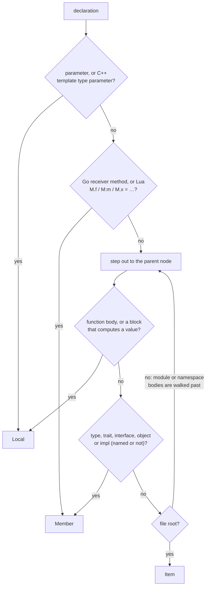

# Scope, Qualified Names and `async`

Part of [Symbol Kinds, Visibility and `static`](../symbol-kinds-and-visibility.md).

Three facts describe *where* a declaration sits and what it is called:

- its **scope**: `Item` (file, module or namespace level), `Member` (in a
  type) or `Local` (in a function, or a parameter)
- its **qualified name**: the enclosing names joined with the language's own
  separator, such as `geo::Point::new` in Rust or `com.example.Counter.tick`
  in Java
- whether it is declared **`async`**

```json
{ "name": "fetch", "kind": "Method", "scope": "Member",
  "qualified_name": "shapes.rs#geo::Point::fetch", "modifiers": [{ "type": "Async" }] }
```

(trimmed from `hug --json symbols shapes.rs fetch!`; the `shapes.rs#`
prefix is explained under [Qualified names](#qualified-names)).

## Scope

Every declaration has a **scope** that says where it sits, for presentation:
`hug symbols` hides `Local` declarations unless `--scope local` or
`--all-scopes` asks for them, and `--scope` selects any scope in every
declaration command (see [Symbol Reports](../symbol-reports.md#selecting-declarations)).
It is decided by the nearest *semantic* declaration around it, not by the
nearest brace:

| Scope | Meaning | Examples |
|---|---|---|
| `Item` | at file level, or in a namespace, package or module body | free functions, types, top-level constants, Rust inline-module contents, C++/C# namespace contents |
| `Member` | in a type, trait, interface, object or `impl` body | methods, fields, enum variants, associated constants |
| `Local` | in a function body, or a parameter | `let`, `var`, `:=`, parameters, nested functions and types |

```rust
mod schema {
    pub struct Record { id: u32 }      // Record: Item, id: Member
    impl Record { fn load() {} }       // load: Member
}
fn build(width: u32) {                 // build: Item, width: Local
    struct Scratch { cells: u8 }       // Scratch: Local, cells: Member
    mod helpers { pub fn h() {} }      // helpers and h: Local
}
```

Walking out from the declaration, the first function body decides `Local`
and the first type, trait, interface, object or `impl` decides `Member`. A
body is decided by what owns it, so a Rust `declaration_list` is `Item` space
under a `mod` and `Member` space under an `impl` or `trait`.



The rules below follow from that:

- A member of a type declared inside a function is a `Member`; the type
  itself is `Local`.
- Members of unnamed owners (anonymous classes, object literals, class
  expressions, Scala `given … with`) are `Member`, even though they have no
  container.
- A Go receiver method and a Lua `M.f`, `M:m` or `M.x = …` are `Member`
  wherever they are written: they name their owner.
- **Parameters are `Local` only where they are extracted**: 13 languages
  produce `Parameter` records (Rust, TypeScript, JavaScript, Go, Python, Java,
  C#, C, C++, Swift, Scala, PHP and Lua). Perl, Bash and Zsh produce none, so
  `--scope local` lists no parameters there: Perl subs and shell functions
  declare no parameter list, and names unpacked from `@_` are ordinary
  variables.
- A C++ template type parameter is `Local`.
- **Bash and Zsh functions defined inside a function body are `Local`,** even
  though the shell makes them global once the outer function runs. Scope
  follows where a declaration is written, not when it takes effect:

  ```sh
  outer() {
    inner() { echo hi; }   # inner: Local
  }
  ```
- A block that computes a value (see [Containers](./kinds-and-containers.md#containers)) is local
  scope; a chunk-level Lua `if` or `do` block is not a function body, so its
  `local` declarations stay `Item`.

Scope is computed for every declaration, including those a kind selection
leaves out of a report.

## Qualified names

`identity.qualified_name` is a readable lookup name built from the file's own
source: the enclosing named declarations joined with the language's own
separators, ending in the declaration's name. It is not unique (overloads and
repeated locals share one); the record ID is.

| Language | Separator | Example |
|---|---|---|
| Rust, C++, Perl | `::` | `schema::Record::load`, `ns::Widget::draw`, `Fixture::Greeter::greet` |
| PHP | `\` after a namespace, `::` after anything else (a type or function) | `App\Models\User::find`, `App\Models\User::__construct::id` |
| Lua | `.`, and `:` before a method | `Widget.new`, `Widget:describe` |
| all others | `.` | `com.example.Point.area`, `Shape.area`, `outer.inner` |

What becomes a segment:

- extracted functions, types, enum variants, modules and namespaces around
  the declaration; a local's name includes its function (`Shape.area.self`),
  and a Rust struct-variant field its variant (`Shape::Circle::radius`)
- a Rust `impl` block's implemented type as its path is written, without
  generic arguments (`impl right::Repeated` qualifies `right::Repeated::second`;
  a leading `super` climbs one enclosing `mod`, `crate` starts at the file,
  `self` is dropped), a Go receiver's base type and a Lua table, written in
  the declaration
- a Swift extension's type and a named function that is not extracted
  itself (a C# static constructor or a Java compact record constructor:
  `C.C.k` for a local `k`)
- nothing past an unnamed owner: a member of an anonymous class is qualified
  by its own name alone

**Explicit namespaces root the name.** A Java, Scala or Go `package`, a C# or
PHP `namespace` (file-scoped or block), a named C++ `namespace` and a Perl
`package` start the name, and `identity.is_namespace_rooted` is `true`
(`com.example.symbols.PublicWidget`). Consecutive file-level Scala package
clauses nest (`package outer` then `package inner` gives
`outer.inner.PackageProbe.work`); a later PHP `namespace X;` or Perl
`package X;` replaces an earlier one. A Scala block package
(`package p { … }`) is never a record of its own, but it names everything in
its body: each enclosing block adds its segment after the file-level clauses
before it, and a block with no file-level clause before it still roots the
name. The block does not carry over to declarations after it:

```scala
package example.symbols
package left { class W { def probe() = () } }      // example.symbols.left.W.probe
package right { class W { def probe() = () } }     // example.symbols.right.W.probe
package outer { package inner { class Nested } }   // example.symbols.outer.inner.Nested
class After                                        // example.symbols.After
```

Without the first line the names are `left.W.probe`, `outer.inner.Nested`
and so on, still rooted (no file prefix); `After` is then `file#After`. A Rust inline `mod`, a TypeScript
`namespace` and a type qualify the name but do not root it: `schema::Record`
is not complete without its file. A Perl package name is absolute wherever it
is written.

**What you see is the in-file name behind a prefix.** The cache stores only
the in-file name. A query result puts a prefix in front of every name that is
not namespace-rooted, after the cache lookup, from query inputs that are not
part of the cache key. The stored name, the record ID and the cache entry
therefore never depend on where `hug` runs:

| Query input | Prefix | Example |
|---|---|---|
| a scan root (`SymbolQuery::scan_root`; `hug` passes its own) | the file's portable path from the root (`/`-separated, climbing with `../` for a file outside it), then `#` | `lib/src/symbol.rs#Symbol::new` |
| none (the library default) | the file name, then `#` (the file's directory is the root) | `symbol.rs#Symbol::new` |
| a naming context (`NamingContext::new(root, prefix)`), file below its root | the context prefix and the file's route as module segments, in the language's separator | `crate::shared::symbol::SymbolInfo::new`, `package.module.Class.method` |

```text
scan root tree-hugger/      ->  lib/src/symbol.rs#Symbol::new
scan root tree-hugger/lib/  ->  src/symbol.rs#Symbol::new
both: one cache entry, one symbol ID, in-file name Symbol::new
```

A naming context drops the file extension and adds no segment for a Rust
`mod.rs`, a Rust `lib.rs` or `main.rs` directly in its root, or a Python
`__init__.py`; a file outside its root gets the file prefix. Nothing guesses a
module path: `hug` has no naming-context option and never sets one, so its
Rust and Python names always use the file form (`src/symbol.rs#Symbol::new`,
`pkg/module.py#Class.method`), while namespace-rooted names (`com.example.Point`)
take no prefix at all. `SymbolQueryResult::name_prefix()` reports the prefix a
result's names carry, so the in-file name is the displayed name without it.
Relation and export references (`SymbolRef::qualified_name`) keep the in-file
name: a referenced record may not be in the result, and its namespace root is
then unknown.

**IDs derive from the qualified name.** A record's ID is a digest of the
language, the file's [identity](../cache-design.md#file-identity), the kind,
the in-file qualified name and the declaration's order among records of the
same kind and qualified name. Reading one file through two spellings of its
path, or from two scan roots, gives the same IDs.

## `async`

A declaration written `async` carries `Modifier::Async` (`SymbolInfo::is_async`):

| Language | Declarations |
|---|---|
| Rust | `async fn`, in and outside `impl` and `trait` blocks |
| JavaScript, TypeScript | `async` functions, methods, function expressions and arrow functions, and a name bound to one (`const f = async () => …`, a class field holding one) |
| Python | `async def`, decorated or not |
| C# | `async` methods and local functions |
| Swift | functions, methods, initializers (`init() async`) and protocol requirements written `async` |

The flag is read from the declaration's own `async` keyword, never from its
body or its return type. A JavaScript or TypeScript name bound to a function
value takes that function's keyword. Go, Java, C, C++, Scala, PHP, Perl, Lua,
Bash and Zsh have no async declarations and never report it; a C++ coroutine
is marked in its body (`co_await`), not its declaration.

```rust
async fn fetch() {}                              // async
fn spawn() { let _ = async { fetch().await }; }  // not async: only the block is
```
