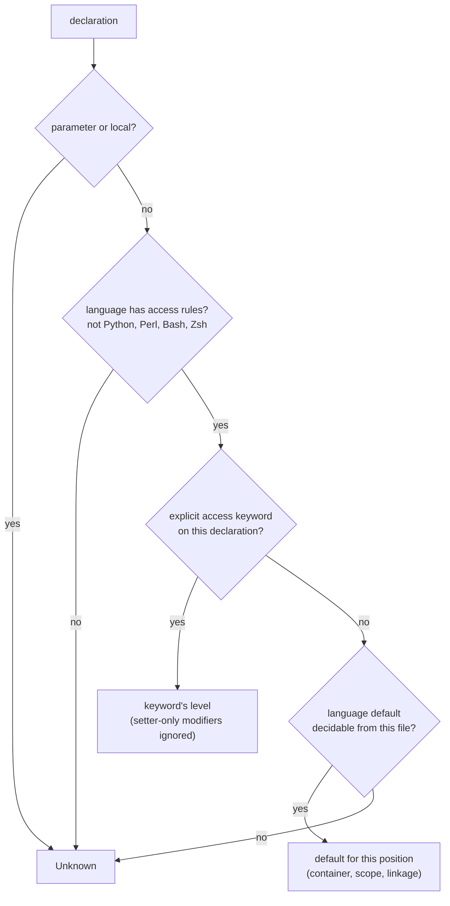

# Visibility

Part of [Symbol Kinds, Visibility and `static`](../symbol-kinds-and-visibility.md).

A record's **visibility level** is the access the source declares or implies
for that declaration: `public`, `private`, `crate`, `package`, and so on.
`hug` prints it as the first word of a line, and omits it when the level is
Unknown:

```text
$ hug symbols Shape.java m.go
  - package interface Shape { SIDES: int } Shape.java:2:1
  - public field SIDES [in interface Shape] Shape.java:2:23
  - public type Point { X int, y int } m.go:4:1
  - package field y [in type Point] m.go:4:20
  - public field X [in type Point] m.go:4:20
```

Go's lowercase `y` and Java's unmarked `interface Shape` have no keyword,
so their level comes from the language's default for that position. This
page explains what a level means, how it is decided, the per-language
defaults, and the rules that need more than a table cell.

## What the level means

The level is the access **declared or implied at this declaration**. It is not
the effective access through every enclosing module, type or package, and it
is not an export flag. `pub fn f()` inside a private Rust module is still
Public. Parameters, local variables and local functions have no level.

The levels are:

| `Visibility` / `VisibilityLevel` | `hug` label | Typical source |
|---|---|---|
| `Public` | `public` | `public`, `pub`, `export`, Go uppercase name |
| `Protected` | `protected` | `protected` |
| `Private` | `private` | `private`, `#name`, unmarked Rust item |
| `Internal` | `internal` | C# and Swift `internal` |
| `Package` | `package` | unmarked Java member, Swift `package`, lowercase Go name |
| `Crate` | `crate` | Rust `pub(crate)`, `pub(super)`, `pub(in path)` |
| `ModulePrivate` | `module-private` | C `static`, Swift `fileprivate`, unexported module-level JS/TS |
| `ProtectedInternal` | `protected internal` | C# `protected internal` |
| `PrivateProtected` | `private protected` | C# `private protected` |
| `Unknown` (v1: `None`) | no label | no access rules apply, or the file cannot tell |

`hug` omits the label for Unknown rather than printing a guess.

## How a level is decided



Only the declaration itself and its nearest container are read. A private
method never makes its public class private.

## Unmarked declarations, per language

| Language | Keyword → level | No keyword → level |
|---|---|---|
| Rust | `pub` → Public; `pub(crate)`, `pub(super)`, `pub(in path)` → Crate; `pub(self)` → Private | Private for items and fields. Trait items and enum variants (and their fields) take the trait's or enum's level. Trait-impl items: see below. `macro_rules!` → Unknown |
| TypeScript | `public`, `protected`, `private`; `#name` → Private; top-level `export` → Public | class and interface members → Public; enum members → the enum's level; unexported top-level (a `namespace` too) → ModulePrivate in a module file, Unknown in a script |
| JavaScript | `#name` → Private; top-level `export` → Public | class members → Public; unexported top-level → ModulePrivate in a module file, Unknown in a script |
| Go | uppercase initial (any Unicode uppercase) → Public | Package; the `package` clause itself → Unknown |
| Java | `public`, `protected`, `private` | Package; interface members and enum constants → Public; an enum's constructor → Private; `package` declaration → Unknown |
| C# | `public`, `protected`, `private`, `internal`, `protected internal`, `private protected`; `file` → ModulePrivate | class/struct/record members (constructors too) → Private; top-level types → Internal; interface members and enum members → Public |
| C | — | file-scope functions and variables → Public unless the linkage rule makes them ModulePrivate; types, tags, fields, enumerators, macros → Unknown |
| C++ | `public:`, `protected:`, `private:` sections | `class` members → Private; `struct`/`union` members → Public; namespace-scope functions and variables → linkage rule; enumerators → Unknown |
| Swift | `open`, `public` → Public; `package` → Package; `internal` → Internal; `fileprivate` → ModulePrivate; `private` → Private | Internal, with the member rules below |
| Scala | `private`, `protected`, qualified forms below | Public; an enum `case` → the enum's level |
| PHP | `public`, `protected`, `private` | Public (enum cases too); namespaces → Unknown |
| Lua | — | global → Public; chunk-level `local` → ModulePrivate; `local` inside a block → Unknown; table fields (`M.f`, `M:m`) → Unknown |
| Python, Perl, Bash, Zsh | — | Unknown. Privacy is only a naming convention (`_name`) or does not exist, and a guess would be reported as fact. |

The rules that do not fit in a table cell follow.

## Rust trait implementations

An item in `impl Trait for Type` takes the level of `Trait` when `Trait` is
declared in the same file, and is Unknown otherwise. Standard-library traits
are not special-cased, because the level would then depend on a hard-coded
list rather than on the file:

```rust
pub trait Shape { fn area(&self) -> u32; }
impl Shape for Square { fn area(&self) -> u32 { 4 } }       // Public: Shape is here
impl fmt::Display for Square { fn fmt(/* … */) { /* … */ } } // Unknown
```

Restricted access such as `pub(in crate::a)` is reported as Crate, an upper
bound; the exact text survives in `source.declaration_text`.

## C and C++ linkage

A file-scope (C) or namespace-scope (C++) function or variable is Public,
unless any of these holds, which makes it ModulePrivate:

- it is declared `static`
- it is inside an unnamed `namespace { … }` (C++)
- it is a C++ variable that is itself `const` (`constexpr` counts), declared
  without `extern` or `inline` (see "Which `const` counts" below)
- an **earlier** declaration of the same function in the same file is `static`

```cpp
static int helper(int);          // ModulePrivate
int helper(int x) { return x; }  // ModulePrivate: earlier static prototype
int helper(long x);              // Public: different overload
namespace { int hidden; }        // ModulePrivate
const int LIMIT = 3;             // ModulePrivate (C++)
constexpr int MAX = 8;           // ModulePrivate (C++)
const char* name = "n";          // Public: the pointer itself is not const
char* const slot = nullptr;      // ModulePrivate (C++): const pointer
extern const int SHARED = 4;     // Public
extern "C" void api(void);       // Public
```

**Which `const` counts.** Only the variable's own type decides, and that is
the declarator nearest its name: read the declarator from the name outward,
through any parentheses and attributes. A `const` written after the `*`
next to the name makes the pointer itself const; a `const` deeper in, or on
the base type, belongs to what the pointer points to. An array is as const
as its elements. A reference is never a const object, even when declared
`constexpr`; any other `constexpr` variable is const. Each name of a
multi-name declaration is decided on its own.

```cpp
char **const a = 0;              // ModulePrivate: a is a const pointer
char *const *b;                  // Public: b points to a const pointer
char **const c[2] = {};          // ModulePrivate: array of const pointers
char *const *d[2];               // Public: array of mutable pointers
int (*const e)(int) = 0;         // ModulePrivate: const function pointer
const int (*f)[2];               // Public: pointer to a const array
int (*const g)[2] = 0;           // ModulePrivate: const pointer to an array
const int (&h)[2] = arr;         // Public: a reference
constexpr const int &i = arr[0]; // Public: a reference
constexpr int *j = nullptr;      // ModulePrivate: constexpr pointer
int k, **const l = 0, *const *m = 0; // k Public, l ModulePrivate, m Public
```

The same rule holds inside a named namespace, a preprocessor conditional or an
`extern "C" { … }` block. C has no such rule: a file-scope `const` object in C
is Public unless it is `static`. A function-local variable has no linkage
(Unknown), and a member takes its access level, never this rule.

"The same function" means the same name in C. In C++ it means the same
name, the same namespace, and the same parameter types; for a function
template, the rest of its signature as well (see **Function templates**
below), since a template and a non-template function with the same
parameters are different functions. Spelling that changes none of these is
ignored:

- **The function is the declarator that names it.** In
  `int (*make(int value))(long)`, `make` takes `int` and returns a pointer to
  a function taking `long`. Only the parameters of `make` itself are compared,
  so naming them, or the parameters of the returned type, changes nothing.
  The same holds for a returned function reference (`int (&f(int))(int)`) or
  pointer to an array (`int (*f(int))[2]`). A function pointer variable
  (`int (*p)(int);`) declares no function.
- **Namespaces** are compared as a list of segments, so
  `namespace a::b { … }` and `namespace a { namespace b { … } }` are the same
  namespace. An unqualified declaration belongs to exactly the namespace it
  sits in: a `static` in an enclosing namespace does not reach a function in
  a nested one. A definition qualified by a namespace (`int b::f(int x)`
  inside `namespace a`) looks `b` up outward, as the compiler does: it
  belongs to `a::b` when the file declares `a::b` before it, otherwise to
  `b` when the file declares `b`, otherwise to no namespace the file knows,
  and then no earlier declaration matches it. An `inline` namespace is still
  a segment of its own.
- **Parameter names** are ignored at every level, including the parameters of
  a callback parameter, and so are comments, default arguments, attributes
  on a name (`int x [[maybe_unused]]`), and parentheses around a name.
- **Parameter adjustments** apply: a top-level `const` or `volatile` is
  dropped, an array parameter is a pointer, a function parameter is a pointer
  to that function, `(void)` is an empty list, and `const int` equals
  `int const`.
- **Function templates** also compare, token by token as written, the
  `template<…>` parameter list, the return type in both its leading
  (`int f(T)`) and trailing (`auto f(T) -> int`) position, the `requires`
  clause after the `template<…>` header, and the `requires` clause after the
  parameter list. A constraint present on one declaration and absent on the
  other, or moved from one position to the other, is a different template.
  A function with an `auto` parameter (`void f(auto x)`,
  `void f(Concept auto x)`) is an abbreviated template and is compared the
  same way. The exception specification (`noexcept`) is never compared, and
  an ordinary function's return type is not either, since a redeclaration
  cannot change it.

```cpp
static int callback(void (*)(int));
int callback(void (*cb)(int value)) { return 0; }  // ModulePrivate

static int (*make(int))(long);
int (*make(int value))(long) { return 0; }         // ModulePrivate

namespace a { namespace b { static int helper(int); } }
namespace a::b { int helper(int value) { return value; } }  // ModulePrivate

static int leak(int);
namespace other { int leak(int x) { return x; } }  // Public: other::leak

namespace shadow { static int choose(int); }
namespace host {
namespace shadow { int choose(int); }              // Public
int shadow::choose(int x) { return x; }            // Public: host::shadow::choose
}

static int limit(const int);
int limit(int n) { return n; }                     // ModulePrivate

static int pick(const int*);
int pick(int* p) { return 0; }                     // Public: pointee differs

static int log(int, ...);
int log(int level) { return level; }               // Public: no `...`

template<class T> static int convert(int);
int convert(int x) { return x; }                   // Public: not a template

template<class T> static auto shape(T) -> int;
template<class T> auto shape(T v) -> long { return 0; }  // Public: returns long
template<class T> static auto size(T) -> int;
template<class T> auto size(T v) -> int { return 0; }    // ModulePrivate

template<class T> requires Small<T> static int fit(T);
template<class T> requires Big<T> int fit(T v) { return 0; }   // Public
template<class T> static int span(T) requires Small<T>;
template<class T> int span(T v) { return 0; }                  // Public: unconstrained
template<class T> static int keep(T) requires Small<T>;
template<class T> int keep(T v) requires Small<T> { return 0; } // ModulePrivate

static auto twice(auto) -> int;
auto twice(auto v) -> long { return 0; }           // Public: abbreviated template
```

Every declarator of a declaration counts: `static int a(int), b(int);` makes
later definitions of both `a` and `b` ModulePrivate, and so does
`static int a(int), (*b(int))(int);` for `b`. A declaration under a
`template<…>` header, a preprocessor conditional, a reopened namespace block
or an `extern "C"`/`extern "C++"` block counts like any other.

Type names are compared as written. A typedef'd spelling of a parameter type,
or a synonym such as `long int` for `long`, does not match, so that
declaration falls back to its own rule. A definition qualified by more than
one level (`int a::b::f(int)`) or from the global namespace
(`int ::a::f(int)`) is not reported as a symbol at all. Type names are
assumed to name the same type in both declarations.

Every condition above is one a redeclaration must meet, so the scan can only
miss a `static`, never invent one: whatever it cannot establish (a typedef'd
spelling, a qualifier naming a namespace declared in another file, a renamed
template parameter, a constraint spelled differently, `auto f() -> int`
redeclared as `int f()`) leaves the later declaration with its own rule. Whether
the file is a header does not matter.

## JavaScript and TypeScript module files

A file is a **module** when any of these holds:

- its extension is `.mjs`, `.cjs`, `.mts` or `.cts`
- it has an `import` or `export` statement
- anywhere in the file, even inside a function or an `if`, it calls
  `require(...)` (also written `(require)(...)`) or assigns to
  `module.exports` or `exports.…`

In a module, an unexported top-level declaration is ModulePrivate. In any
other file (a classic script, or a TypeScript global script) it is Unknown,
because a script's top-level declarations are global. CommonJS files count as
modules because Node wraps each one in a function, so its top-level
declarations stay private to the file. `package.json`'s `"type"` field is not
read, so extraction never looks beyond the one file.

A function bound to a top-level `const` or `let` has the access, and the
export, of the declaration that binds it:

```javascript
// lib.js (a module)
export const load = async () => 1;  // Public, exported
const helper = (value) => value;    // ModulePrivate
```

```javascript
// script.js: no module evidence
function helper() {}             // Unknown
```

```javascript
// lib.js
const fs = require("fs");
function helper() {}             // ModulePrivate
module.exports = { helper };
```

## C# interface members and compound levels

Any interface member without an access keyword is Public, including
default-implemented methods, static members and nested types. An explicit
interface implementation in a class is Private, which is how the C# compiler
reports it:

```csharp
interface IShape {
    double Area();                          // Public
    void Draw() { }                         // Public: default implementation
    static IShape Unit() => new Square();   // Public
    class Helper { }                        // Public: nested type
    private void Log() { }                  // Private: explicit keyword
}
class Square : IShape {
    double IShape.Area() => 1;              // Private: explicit implementation
    protected internal int a;               // ProtectedInternal
    private protected int b;                // PrivateProtected
}
```

## Swift members of types and extensions

Enum cases and protocol requirements take their container's level. Any other
unmarked member takes its level from the nearest enclosing type or extension
that has an explicit access keyword:

- inside a `private` or `fileprivate` type → ModulePrivate
- inside an extension with an explicit level → that level
- inside a `public` or `open` type → Internal
- otherwise → Internal

```swift
private struct Hidden { func a() {} }       // a: ModulePrivate
private extension Widget { func b() {} }    // b: ModulePrivate
public extension Widget { func c() {} }     // c: Public
public struct Api {
    func d() {}                             // d: Internal
    private struct Inner { func e() {} }    // e: ModulePrivate (Inner is nearest)
}
struct Plain { func f() {} }                // f: Internal
```

A top-level `private` declaration itself reports Private (its keyword).

## Setter-only modifiers

A modifier that restricts only the setter does not change the declaration's
level. The restriction is still visible in `source.declaration_text`.

```swift
public private(set) var count = 0           // Public
private(set) var total = 0                  // Internal (the default)
```

```csharp
public int Count { get; private set; }      // Public
internal int Total { get; private set; }    // Internal
```

## Scala qualified access

A qualifier is resolved only from what the file shows:

```scala
package com.acme.shapes

class Shape {
  private[this] val id = 0                  // Private
  protected[this] def tick() = ()           // Protected
  private[shapes] def area() = 0            // Package: a segment of the package clause
  private[acme] def scale() = 1             // Package
  private[Shape] def secret() = 2           // Unknown; text kept in declaration_text
}
```

A segment of a block package (`package shapes { … }`, nested blocks
included) is a package segment too.

## A level is not an export

`visibility.is_exported` comes only from export syntax and the bind pass,
never from a Public level: a top-level declaration inside a JavaScript or
TypeScript `export` (each name of `export const a = 1, f = () => …;`
included), or a Rust item with a `pub…` modifier. Members (methods,
constructors, fields, properties, enum variants) are never marked exported. A
Public Java class or TypeScript class method is not exported. Converting a
`SymbolInfo` to a record always gives `is_exported: false`, because
`SymbolInfo` carries no export information.
