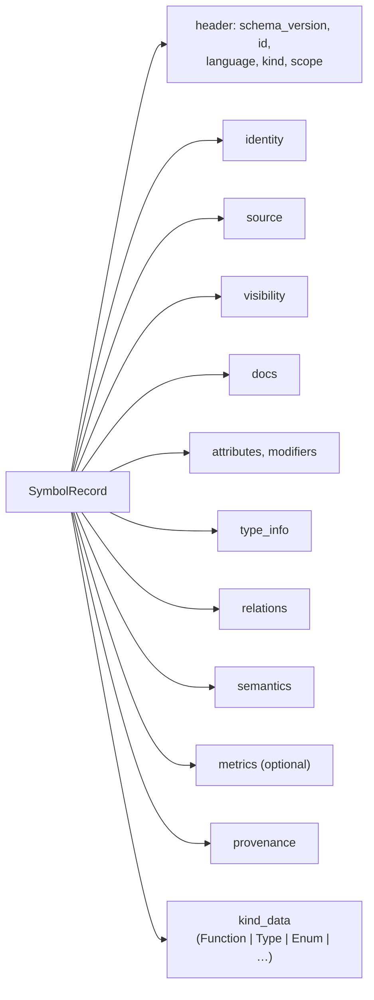

# Symbol Records

Tree Hugger turns every declaration it finds in a source file (a function, a
type, a field, an enum variant, a parameter) into one **symbol record**: a
JSON object, and the Rust type `SymbolRecord`, that says what the declaration
is, where it is written, who can see it, what it looks like and how it relates
to the rest of the file. Every `hug` JSON report, the library's query API and
the persistent symbol cache all carry the same record, so a script written
against `hug --json` reads exactly what a Rust caller of the library sees.

This page shows a real record, explains its overall shape, and links to
detail pages for every field.

## A record, by example

Given this Rust file:

```rust
/// A point on a plane.
#[derive(Debug, Clone)]
pub struct Point {
    pub x: f64,
    pub y: f64,
}

impl Point {
    /// Distance from the origin.
    pub fn norm(&self) -> f64 {
        if self.x == 0.0 { self.y.abs() } else { (self.x * self.x + self.y * self.y).sqrt() }
    }
}
```

`hug --json symbols shapes.rs` reports one record per declaration. This is
the record of `norm`, with its spans shortened to one line each:

```json
{
  "schema_version": { "major": 5, "minor": 1 },
  "id": "ea8352547f52deac7db272b1651b1c84bfec409adcff861bcc69d19350062cd9",
  "language": "Rust",
  "kind": "Method",
  "scope": "Member",
  "identity": {
    "name": "norm",
    "display_name": "norm",
    "qualified_name": "shapes.rs#Point::norm",
    "is_namespace_rooted": false,
    "container_name": "Point",
    "container_kind": "Type",
    "keyword": "fn",
    "stable_key": "rust::shapes.rs::Method::Point::norm::0"
  },
  "source": {
    "file_path": "shapes.rs",
    "declaration_span": { "start": { "line": 10, "column": 5 }, "end": { "line": 12, "column": 6 }, "start_byte": 153, "end_byte": 280 },
    "body_span":        { "start": { "line": 10, "column": 31 }, "end": { "line": 12, "column": 6 }, "start_byte": 179, "end_byte": 280 },
    "name_span":        { "start": { "line": 10, "column": 12 }, "end": { "line": 10, "column": 16 }, "start_byte": 160, "end_byte": 164 },
    "signature_text": "pub fn norm(&self) -> f64"
  },
  "visibility": {
    "level": "Public",
    "is_exported": false,
    "is_reexported": false,
    "is_default_export": false,
    "is_imported": false,
    "is_external": false,
    "is_generated": false,
    "is_synthetic": false,
    "is_deprecated": false,
    "is_experimental": false,
    "is_test": false
  },
  "docs": { "raw_doc": "Distance from the origin." },
  "type_info": {
    "primary_type": "f64",
    "views": [ { "kind": "Declared", "text": "f64" }, { "kind": "Canonical", "text": "f64" } ]
  },
  "relations": {},
  "semantics": {},
  "provenance": { "extractor": "tree-sitter", "extractor_version": "0.1.0+rev.50", "parse_pass": "parse" },
  "kind_data": {
    "kind_data_type": "Function",
    "data": {
      "parameters": [
        { "name": "self", "position": 0, "is_optional": false, "is_variadic": false,
          "is_keyword_only": false, "is_positional_only": false }
      ],
      "return_info": { "type_text": "f64", "never_returns": false },
      "is_variadic": false,
      "arity": 1
    }
  }
}
```

`relations` and `semantics` are empty here because `hug --json symbols` only
asks for declarations and their flags. `hug --json-full` asks for everything, and the
same record then also carries:

```json
"relations": {
  "parent":    { "id": "cad9ce0f…", "name": "Point", "qualified_name": "Point" },
  "container": { "id": "cad9ce0f…", "name": "Point", "qualified_name": "Point" }
},
"semantics": { "may_throw": "Unknown", "may_panic": "Unknown", "is_recursive": "Unknown",
               "mutates_self": "Unknown", "mutates_arguments": "Unknown" },
"metrics": { "parameters": 0, "has_docs": true, "lines": 3, "cyclomatic": 2 },
"docs": { "raw_doc": "Distance from the origin.", "comments": [ … ],
          "parsed": { "summary": "Distance from the origin." } },
"provenance": { "extractor": "tree-sitter", "extractor_version": "0.1.0+rev.50", "parse_pass": "docs" }
```

## The shape of a record

A record is built from **facets**: groups of related fields that every record
has, whatever its kind. One field, `kind_data`, is different: it holds a
payload whose shape depends on the kind (a function's parameters, an enum's
variants).



| Part | What it answers | Example from `norm` |
|---|---|---|
| `schema_version`, `id`, `language`, `kind`, `scope` | which record format, which declaration, what kind of thing, where it sits | `5.2`, a 64-character hash, `Rust`, `Method`, `Member` |
| `identity` | its names: plain, qualified, its container's, the keyword that declares it | `Point::norm`, `fn` |
| `source` | where it is written: spans, the declaration's text and its display header | lines 10 to 12, `pub fn norm(&self) -> f64` |
| `visibility` | its access level, and flags such as exported, deprecated, test-only | `Public`, not exported |
| `docs` | its doc comment, raw and parsed | `Distance from the origin.` |
| `attributes`, `modifiers` | the attributes and modifier keywords it writes | `#[derive(Debug, Clone)]` on `Point`; `async`, `unsafe`, `mut` |
| `type_info` | declared return type text, generic parameters and constraints | `f64` |
| `relations` | its owner and members, base types, and reference edges | parent `Point` |
| `semantics` | inferred flags such as direct recursion | `is_recursive: Unknown` |
| `metrics` | measurements: parameter count, body lines, cyclomatic complexity | `lines: 3`, `cyclomatic: 2` |
| `provenance` | which extractor made it and the last pass that changed it | `tree-sitter`, `parse` |
| `kind_data` | the kind-specific payload | the parameter list and return type |

Several conventions hold everywhere:

- **Absent means empty.** An optional value that is not set, and a list that
  is empty, is left out of the JSON rather than written as `null` or `[]`.
  `metrics` is the one exception: inside it, `null` is a real value (see
  [Field reference](./symbol-records/fields.md#metrics)).
- **Text is as written.** Type texts, defaults, attribute arguments and
  headers keep the source spelling; nothing is inferred or resolved through
  another file.
- **Spans** give 1-based lines and columns and 0-based byte offsets.

The detail pages describe every field:

- [Field reference](./symbol-records/fields.md): the header and every facet,
  field by field, including the fields that are declared but not yet filled.
- [Generic parameters](./symbol-records/generic-parameters.md): how
  `type_info.generic_params` and `type_info.constraints` are read, per
  language.
- [Kind-specific payloads](./symbol-records/kind-data.md): `kind_data` for
  functions, types, enums, aliases, fields and parameters.

What each `kind`, `scope`, visibility level and `static` modifier means in
each language is described in
[Symbol Kinds, Visibility and `static`](./symbol-kinds-and-visibility.md).

## What is filled, and when

Not every field costs the same to compute, so a record holds what the caller
asked for. The library asks for work in **capabilities** (declarations,
containment, references, flags, metrics and so on), and the `hug` report
chosen decides which ones are requested:

| Facts | `hug --json` / `--jsonl` | `hug --json-full` |
|---|---|---|
| header, `identity`, `source` spans and `signature_text`, `visibility.level`, `attributes`, `modifiers`, `type_info`, `kind_data` | yes | yes |
| `visibility.is_test`, `visibility.is_deprecated` | yes | yes |
| `source.declaration_text`, `docs.comments` | dropped from the output | yes |
| `relations.parent`, `container`, `members` | only for commands that group by owner (`classes`) | yes |
| `relations` reference edges, `semantics`, `docs.parsed` | no | yes |
| `metrics` | only with a filter that reads it (`--undocumented`, `--min-params`) | yes |

An empty facet therefore means one of two things: nothing to report, or not
computed. The file index records which work ran (`completed_passes`, and in
`hug --json` also `completed_capabilities`), so a reader can tell the two
apart. [The file index](./symbol-records/file-index.md) lists every
capability and what it fills.

## IDs

Every record has an `id` that stays the same across runs, machines and
versions of Tree Hugger, as long as the declaration stays put. It is built in
two steps:

1. A readable **stable key** joins the language, the file, the kind, the
   in-file qualified name and an ordinal that tells same-named declarations
   of one kind apart (C++ overloads, repeated locals):
   `rust::/repo/src/shapes.rs::Method::Point::norm::0`. The file is its
   resolved absolute path, so the key does not depend on the directory a scan
   started from or on how the path was spelled.
2. The `id` is the [BLAKE3](https://github.com/BLAKE3-team/BLAKE3) hash of the
   key, in lowercase hex.

```text
rust::/repo/src/shapes.rs::Method::Point::norm::0  --BLAKE3-->  ea8352547f52…
```

The schema version and the extractor revision are not part of the key, so a
version bump keeps every ID. A relation, an export or a reference occurrence
points at a record by this `id`.

`hug` makes paths portable before printing: `source.file_path` and the file
part of `identity.stable_key` become relative to the scan root
(`rust::shapes.rs::Method::Point::norm::0` above). The `id` is left as it was
computed, so it still matches the cache and other runs over the same
checkout; it is not the hash of the key `hug` prints.

## The file index

Records travel inside a per-file container, the **file index**
(`FileSymbolIndex`), which adds the file's import and export records,
diagnostics and, when asked for, every reference occurrence in the file.
`hug --json-full` prints one file index per scanned file:

```json
{
  "schema_version": { "major": 5, "minor": 1 },
  "file": "shapes.rs",
  "language": "Rust",
  "file_hash": "9826b89b1b423fd2",
  "completed_passes": ["Parse", "Bind", "Semantic", "Docs", "Diagnostics"],
  "symbols": [ … ],
  "imports": [],
  "exports": [ { "name": "Point", "span": { … }, "symbol": { "id": "cad9ce0f…", "name": "Point", "qualified_name": "Point" } } ],
  "diagnostics": [],
  "occurrences": [ … ],
  "reference_coverage": [ … ]
}
```

A file is analyzed in up to five **passes**: parse, bind, semantic, docs and
diagnostics. `completed_passes` lists only the passes that ran, so an empty
`diagnostics` list without `Diagnostics` in `completed_passes` means "not
checked", not "clean". The passes, the capabilities, the library query API
and its predicates are described in
[The file index](./symbol-records/file-index.md).

## Schema version

Every record and file index, and every `hug` JSON envelope, carries
`schema_version`; the current version is **5.2**. The minor number moves when
the record gains a field, the major number when a field is renamed or
removed or its meaning changes. The symbol cache serves only entries written
in exactly the current version and recomputes anything else. The full
history, and how the record converts to and from the library's older
`SymbolInfo` model, are in
[Schema versions](./symbol-records/versions.md).

## Related pages

- [Symbol Kinds, Visibility and `static`](./symbol-kinds-and-visibility.md):
  what each kind, scope, visibility level and modifier means per language.
- [Declared Type Relations](./type-relations.md): `relations.extends`,
  `implements` and `unclassified_bases`.
- [Scope-Aware References](./references.md): reference occurrences and the
  reference edges and recursion flag derived from them.
- [Cyclomatic Complexity](./cyclomatic-complexity.md): how
  `metrics.cyclomatic` is counted.
- [Symbol Reports](./symbol-reports.md): the `hug` reports and envelopes that
  carry records.
- [Using the `hug` CLI](./cli.md): commands and output formats.
- [Persistent Symbol Cache](./cache-design.md): how records are stored and reused.
