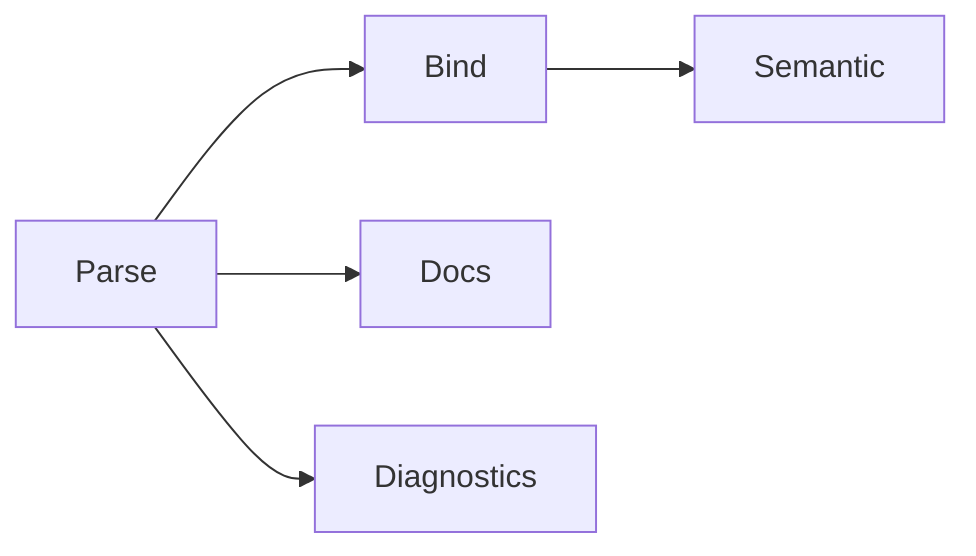

Part of [Symbol Records](../symbol-records.md).

# The File Index

Symbol records never travel alone. Tree Hugger analyzes one file at a time,
and the result of analyzing a file is a **file index** (`FileSymbolIndex`):
the file's records, plus its imports, exports, diagnostics and, when asked
for, every reference written in it. This page describes the index, the
passes and capabilities that decide what it holds, and the library API that
asks for them.

## What an index holds

`hug --json-full` prints one index per scanned file. For this TypeScript
file:

```ts
import { path as p } from "os";
export function run() { return p.join("a"); }
```

```json
{
  "schema_version": { "major": 5, "minor": 2 },
  "file": "m.ts",
  "language": "TypeScript",
  "file_hash": "…",
  "completed_passes": ["Parse", "Bind", "Semantic", "Docs", "Diagnostics"],
  "symbols": [ … ],
  "imports": [
    { "name": "p", "alias": "p", "source": "os",
      "span": { … }, "statement_span": { … },
      "symbol": { "name": "p", "qualified_name": "path" },
      "reexported": false }
  ],
  "exports": [
    { "name": "run", "span": { … },
      "symbol": { "id": "4a10131a…", "name": "run", "qualified_name": "run" } }
  ],
  "diagnostics": [],
  "occurrences": [ … ],
  "reference_coverage": [ … ],
  "reexports": { "coverage": { … }, "entries": [] }
}
```

| Field | Holds |
|---|---|
| `schema_version` | the record format; see [Schema versions](./versions.md) |
| `file` | the analyzed file (scan-root-relative in `hug` output) |
| `language` | the file's language |
| `file_hash` | a hash of the file's contents |
| `completed_passes` | the passes that ran, and only those |
| `symbols` | the symbol records |
| `imports` | one entry per imported name |
| `exports` | one entry per exported name |
| `diagnostics` | lint and syntax diagnostics, when the diagnostics pass ran |
| `occurrences` | every reference written in the file, when asked for; omitted otherwise |
| `reference_coverage` | how completely each region's references were assessed, beside `occurrences`; omitted otherwise |
| `reexports` | the file's re-export report (`entries` and `coverage`), when asked for; omitted otherwise |

An **import** entry has the `name` it binds in the file, the `alias` when it
was renamed, the module `source` it comes from, the `span` of the bound name,
the `span` of the whole import statement (`statement_span`) and a `symbol`
reference whose `qualified_name` is the imported name as the source module
spells it. An **export** entry has the exported `name`, its `span` and a
`symbol` reference that carries the exported record's `id` once the bind pass
has matched it. An import's `reexported` is `true` when a `syntax` or
`declared` re-export entry forwards that exact import; it is `false` for every
import when the report was not computed, so read it only beside a present
`reexports`.

The **re-export report** says which names or modules the file forwards from
other modules. `coverage.state` is `complete`, `limited` or `not_applicable`
(the language has no forwarding construct: Java, C, Bash, Zsh, PHP), and
`coverage.limits` explains every `limited` result. An empty `entries` list is
a negative only when the state is `complete`. The report is absent unless it
was asked for; `TreeFile::reexports()` always computes it.

Every other language has an extractor that reads only the analyzed file. It
reports the language's dedicated forwarding syntax and its bounded static
conventions, and it limits coverage (never a `complete` negative) where the
file uses a form it cannot judge, such as a computed export list or syntax the
pinned grammar cannot parse. A C++20 module file is `limited` over the whole
file with the `grammar_gap` reason.

`occurrences` and `reference_coverage` are described in
[Scope-Aware References](../references.md).

`hug --json` and `--jsonl` print a smaller per-file entry rather than the
whole index: `file`, `language`, `completed_passes`, `completed_capabilities`
and the selected `symbols`. The envelopes are described in
[Symbol Reports](../symbol-reports.md).

## Passes

A file is analyzed in up to five **passes**. Each pass after the first
builds on an earlier one:



| Pass | Fills |
|---|---|
| **Parse** | each record's identity, source, visibility, modifiers, attributes, type info, `kind_data`, `relations.extends`/`implements`, the raw doc comment, and the file's import and export records |
| **Bind** | `relations.parent`, `container` and `members`, the file's reference occurrences and their coverage, the reference edges read from them, and export targets |
| **Semantic** | the `semantics` facet of functions, methods and constructors |
| **Docs** | `docs.parsed` |
| **Diagnostics** | the index's `diagnostics` |

A caller asks for the passes it needs; the prerequisites are added,
duplicates removed and each pass runs once, in the order above:

| Request | `completed_passes` |
|---|---|
| `tree_file.symbol_index_with_passes(&[])` | Parse |
| `&[Docs, Semantic, Semantic]` | Parse, Bind, Semantic, Docs |
| `&[Diagnostics]` | Parse, Diagnostics |
| `tree_file.symbol_index_v2()` | Parse, Bind, Semantic, Docs, Diagnostics |

`completed_passes` lists only work that ran. An index without `Diagnostics`
has an empty `diagnostics` list because diagnostics were not computed, not
because the file is clean. Each pass that changes a record writes its name to
that record's `provenance.parse_pass`.

## Capabilities

Passes are coarse. A **capability** names a narrower piece of work, so a
caller can ask for, say, containment without paying for reference
resolution. Asking for a capability adds its prerequisites:

| Capability | Requires | Produces |
|---|---|---|
| `Declarations` (always) | — | the parse pass |
| `Containment` | Declarations | `relations.parent`, `container` and `members` only; no reference analysis |
| `References` | Containment | the bind pass (the edges; the occurrences are resolved and then dropped) |
| `Occurrences` | References | `occurrences` and `reference_coverage` kept in the index, over the whole file |
| `Semantics` | Occurrences | the semantic pass |
| `StructuredDocs` | Declarations | the docs pass |
| `Diagnostics` | Reexports | the diagnostics pass |
| `Flags` | Declarations | `visibility.is_test` and `is_deprecated`, read while records are built (no extra pass) |
| `Metrics` | Declarations | the `metrics` facet, read while records are built (no extra pass) |
| `Reexports` | Declarations | `reexports` and the imports' `reexported` markers, over the whole file; no reference captures |

In JSON, capabilities are written in lowercase (`"declarations"`,
`"flags"`). `hug --json` lists the ones it computed in
`completed_capabilities`, so an empty facet can be told apart from one that
was never computed:

```json
{ "file": "shapes.rs", "language": "Rust",
  "completed_passes": ["Parse"],
  "completed_capabilities": ["declarations", "containment", "flags"],
  "symbols": [ … ] }
```

## Querying from the library

`SymbolQuery` asks for kinds and capabilities rather than passes. A
`SourceFile` and a parsed `TreeFile` accept the same query:

```rust
let query = SymbolQuery::new()
    .kinds([SymbolKindV2::Function, SymbolKindV2::Method])
    .capabilities([Capability::Containment]);
let result = SourceFile::read("src/lib.rs")?.query(&query)?;
// result.index.symbols:          the functions and methods only
// result.index.completed_passes: [Parse]
// result.completed_capabilities: [Declarations, Containment]
// result.selected_kinds:         Some([Function, Method])
```

`SymbolQuery::complete_index()` asks for every capability, and
`SymbolQuery::for_passes(&[…])` for the capabilities that make up those
passes. The persistent cache answers the same query:
`SymbolCache::query(SourceFile::read(path)?, &query)` returns exactly this
result, reading the file's cache entry when it covers the query's kinds and
capabilities and widening the entry when it does not (see
[Cache Design](../cache-design.md)).

### Kind selection

Selecting kinds skips work, but never data a selected record depends on.
Declarations of unselected kinds are still extracted with their identity,
spans and container, because they can own or shadow a selected symbol; only
their metadata (visibility, `static` flags, signatures, type metadata, doc
comments, header texts) is skipped, and they are dropped from the result
after binding. A selected method therefore keeps its unselected class as
`relations.parent`, and its references resolve exactly as in a full query.

When a type kind is selected, its `Field`, `Property` and `Constant` members
keep their metadata too, because the type's field list copies their access
and `static` flags; when `Enum` is selected, its `EnumVariant` members keep
theirs, because the variant list is completed from them. A narrow query's
records equal the same records of a full query with the same capabilities:
`hug functions --kind constructor` returns exactly the `Constructor` records
of a complete index.

### Predicates

Predicates select records within the selected kinds. Each is applied to the
result after analysis and cache lookup, so it never changes a cache entry or
an ID. A list predicate matches when any of its values does, and every
predicate must match:

```rust
let query = SymbolQuery::new()
    .kinds([SymbolKindV2::Function, SymbolKindV2::Method])
    .scopes([SymbolScope::Item, SymbolScope::Member])
    .visibility(VisibilityLevel::Public)
    .exclude_tests(true)
    .name(NamePattern::new("parse"))
    .scan_root("tree-hugger");
```

| Predicate | Keeps | Adds to the query |
|---|---|---|
| `scopes([..])` | records in one of the scopes | — |
| `visibility(level)` (repeatable) | records whose level is exactly one of them; `Unknown` matches only `Unknown` | — |
| `exported(true)` | records with `visibility.is_exported` | — |
| `exclude_tests(true)` / `tests_only(true)` (the last call wins) | records whose `is_test` is `false` / `true` | `Flags` |
| `deprecated(true)` | records with `is_deprecated` | `Flags` |
| `undocumented(true)` | records whose `metrics.has_docs` is `false`; `null` never matches | `Metrics` |
| `is_async(true)` | functions with the `Async` modifier | function kinds |
| `returns(glob)` | functions whose declared return type text matches | function kinds |
| `param_type(glob)` | functions with a parameter (not a Rust `self`) whose declared type text matches | function kinds |
| `min_params(n)` | functions whose `metrics.parameters` is at least `n`; `null` never matches | function kinds, `Metrics` |
| `in_container(pattern)` (repeatable) | records whose `container_name` matches; a qualified pattern matches the enclosing declaration's qualified name | — |
| `name(pattern)` (repeatable) | records whose name matches; a qualified pattern matches the displayed `qualified_name` | — |
| `exclude_name(pattern)` (repeatable) | drops matching records; wins over every inclusion | — |

"Function kinds" are `Function`, `Method` and `Constructor`, intersected with
any kind selection, whatever order the builder calls come in. A capability a
predicate adds appears in `completed_capabilities`.

A `NamePattern` uses smart case (with no uppercase letter it is
case-insensitive) and matches a substring, unless it contains `*` (a
whole-string wildcard) or is exact (`NamePattern::exact`, or a trailing `!`:
whole-string, with `*` taken literally). It is qualified when it holds `#` or
the language's separator. Type globs (`glob_match`) are whole-string and
case-sensitive. `SymbolQuery::matches(record)` applies the same predicates to
any record.

### Name prefixes

The last step of every query, cached or not, adds a prefix to each record's
`identity.qualified_name` (unless it is namespace-rooted) and applies the
predicates. `scan_root` gives the file-path prefix `hug` uses
(`src/shapes.rs#Point::norm`). A library caller can instead set a
**naming context**, which turns the file's route below a root into module
segments:

```rust
let query = SymbolQuery::new()
    .naming_context(NamingContext::new("crate/src", "crate"));
let result = cache.query(SourceFile::read("crate/src/shapes.rs")?, &query)?.result;
// stored in the cache entry: Point::norm
// in the result:             crate::shapes::Point::norm
// result.name_prefix():      "crate::shapes::"
```

`hug` never sets a naming context, so its Rust and Python names always take
the file form. A file outside the context's root falls back to the file
prefix. `name_prefix()` reports the prefix, so a caller can strip it back to
the stored in-file name. Neither the scan root nor the naming context is a
cache-key input. The prefix rules for each language are in
[Symbol Kinds, Visibility and `static`](../symbol-kinds-and-visibility.md).

### Reusing a result

A result can answer a narrower query without parsing again:
`result.narrowed(&narrower)` returns exactly what `narrower` computes over
the same source *now*, or `None` when the result lacks one of its kinds or
capabilities. Facts read from the source are reused. The file-wide test rules
and the name prefix, which read the filesystem, are decided again, so a
`Cargo.toml` added or removed since the result was made is honored. A `None`
means "analyze again"; `hug --prelude` uses `narrowed` to reuse the prelude's
analyses in the scan.

A filtered result narrows only to a query with the same predicates and the
same prefix and, when a test predicate filtered it, only while the file-wide
test decision it was filtered under still holds (a record the predicate
dropped could match now). An unfiltered result narrows to any covered query
and is re-prefixed for it.
