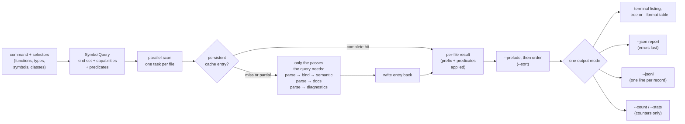
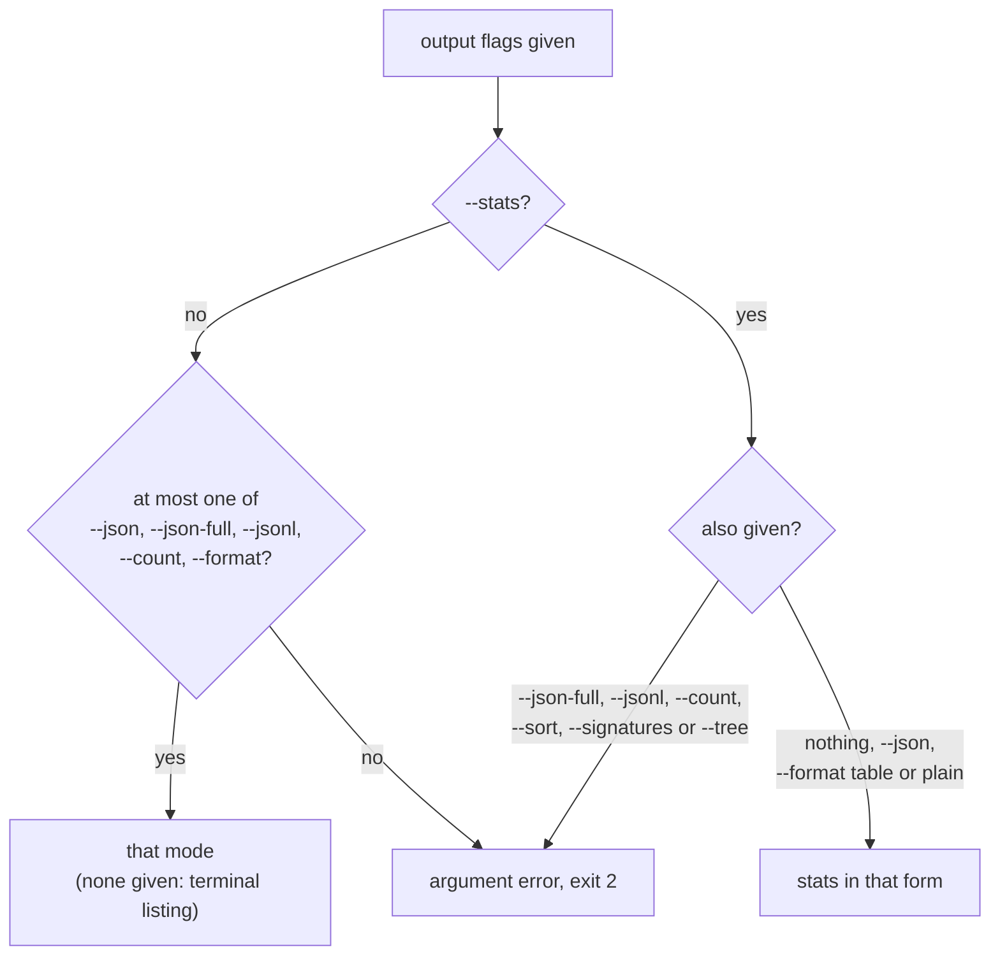

# Symbol Reports

How the `hug` declaration commands (`functions`, `types`, `symbols` and
`classes`) pick what to analyze, what their terminal, table, outline, JSON,
JSON Lines, count and stats output contain, how output is ordered, and what
`--verbose` reports.

```bash
hug functions                 # every function, method and constructor in the package
hug types --sort name         # type declarations, ordered by name
hug functions --in TreeFile --undocumented   # undocumented members of TreeFile
hug --json symbols 'src/**'  # every declaration under src/, as a JSON report
hug --json-full symbols       # every file's complete index, diagnostics included
hug symbols --jsonl | jq -c .record.identity.name   # one JSON object per declaration
hug symbols --tree            # members nested under their type
hug functions --format table  # one table row per declaration
hug functions --count         # just the number
hug symbols --stats           # counts by kind, visibility and language, plus doc coverage
hug --verbose functions       # same listing, plus cache and work stats on stderr
```

Global flags (`--json`, `--json-full`, `--plain`, `--verbose`) come before
the command; command flags (`--sort`, `--no-cache`, `--group-by-file`, …)
come after it.

## The four commands and what they analyze

Each command asks the library for a fixed set of kinds (narrowed by
`--kind`) and only the analysis work its output and its filters need.
Nothing a listing does not show or filter on is computed: no
listing runs lint or syntax diagnostics, reference resolution, semantic
analysis or structured documentation. That is why a listing is far cheaper
than `hug lint`.

| Command | Kinds listed | Extra analysis |
|---|---|---|
| `functions` | Function, Method, Constructor | none |
| `types` | Type, Class, Interface, Enum, Trait, TypeAlias | none |
| `symbols` | every kind, `item` and `member` scopes only (no locals) unless `--scope`/`--all-scopes` | none |
| `classes` | Class, Type, Interface, Trait as containers; Method and Constructor as their members | containment (links each member to its container) |

Kind names are the library's `SymbolKind` values; a Rust `struct` or a C
`union` is a Type, a Swift `protocol` an Interface. The per-language rules
are in [Symbol Kinds, Visibility and `static`](./symbol-kinds-and-visibility.md).

### What `classes` displays

`classes` prints one section per container, with its methods and
constructors split into *Static Methods* and *Instance Methods*, and its
fields split into *Static Fields* and *Instance Fields*:

```text
src/shapes.rs (Rust)
  type Point [2:1]
    Instance Methods (1)
      - public norm(self) -> f64 [in type Point] [9:5]
    Instance Fields (2)
      - public x: f64
      - public y: f64
```

- Fields come from the container's own type metadata, so each field keeps its
  visibility and `static` flag even though Field, Property and Constant
  records are not part of the command's kind set.
- Members of a Rust `impl` block appear under the type they implement.
- `--static-only` and `--instance-only` keep only that half; together they
  are an argument error.
- The [selectors](#selecting-declarations) split between containers and
  members: kind, scope, name, `--in`, visibility, export, test, docs and
  deprecation filters choose **containers** (`--in Box` selects the container
  named `Box`), while `--async`, `--returns`, `--param-type`, `--min-params`
  and `--static-only`/`--instance-only` choose the **members** displayed. A
  selected container may show no member, and a signature filter hides the
  field sections (fields have no signature). To filter members by kind,
  visibility or docs, use `hug functions --in Box` instead.
- A member is static when it needs no instance (a Java `static` method, a
  Rust associated function, a C# `const`). Storage `static`, such as a C++
  function-local `static`, never makes a member static.

### Where each kind is listed

Each kind belongs to the commands whose kind set holds it, and `--kind`
narrows that set:

| Kind | `functions` | `types` | `symbols` (default scopes) | `classes` |
|---|---|---|---|---|
| Constructor | yes | — | yes (member) | with the methods |
| TypeAlias | — | yes | yes (item or member) | — |
| EnumVariant | — | — | yes (member) | — |
| Field | — | — | yes (member) | in the field sections |
| Namespace | — | — | yes (item) | — |

A worked example over a small mixed-language directory:

```java
// Shapes.java
class Counter {
    Counter(int start) {}
    void tick() {}
}

enum Color { RED, BLUE }
```

```go
// shapes.go
package shapes

type Alias = int

type Point struct {
	X, Y int
	label string
}
```

```scala
// model.scala
class Box {
  val width: Int = 1
  var height = 2
  def area(): Int = width
}

object Registry {
  val count = 0
  type Key = String
}
```

`--kind constructor` keeps the constructors and `--kind method` drops them:

```text
$ hug functions --kind constructor
  - package constructor Counter(start: int) [in class Counter] Shapes.java:2:5
$ hug functions Shapes.java --kind method
  - package method tick() -> void [in class Counter] Shapes.java:3:5
$ hug types --kind type_alias
  - public type alias Key model.scala:9:3
  - public type alias Alias shapes.go:3:1
```

`Key` is a member of `Registry` (JSON `identity.container_name`), but the
terminal prints the `[in …]` suffix only for member kinds such as methods,
fields and variants, never for a type or alias.

`hug symbols` lists an enum with its variant list and then each variant as
its own record, and a struct with its field list and then each field:

```text
$ hug symbols Shapes.java shapes.go
  - package class Counter Shapes.java:1:1
  - package constructor Counter(start: int) [in class Counter] Shapes.java:2:5
  - package method tick() -> void [in class Counter] Shapes.java:3:5
  - package enum Color { RED, BLUE } Shapes.java:6:1
  - public enum variant RED [in enum Color] Shapes.java:6:14
  - public enum variant BLUE [in enum Color] Shapes.java:6:19
  - namespace shapes shapes.go:1:9
  - public type alias Alias shapes.go:3:1
  - public type Point { X int, Y int, label string } shapes.go:5:1
  - public field Y [in type Point] shapes.go:6:2
  - public field X [in type Point] shapes.go:6:2
  - package field label [in type Point] shapes.go:7:2
```

The list after a type's name and its standalone records always name the same
members, once each: a list is completed from the records, and a record that
is also in a reader's list is paired with that entry rather than added
again. A field list entry keeps the type written in the source; a variant
list entry keeps the value (`BLUE = 2` would list `BLUE` with `2` as its
`discriminant` in JSON). A standalone variant record has no payload of its
own (`kind_data` is `Unknown`), so JSON consumers read values from the
enum's list. Variants never appear in a field list. `X` and `Y` above share
one declaration, so they are ordered by the [tie-breakers](#ordering), not
by their written order.

`hug classes` puts constructors with the methods, and its field sections
list the same fields as `hug symbols`:

```text
$ hug classes
Shapes.java (Java)
  class Counter [1:1]
    Instance Methods (2)
      - package Counter(start: int) [in class Counter] [2:5]
      - package tick() -> void [in class Counter] [3:5]

model.scala (Scala)
  class Box [1:1]
    Instance Methods (1)
      - public area() -> Int [in class Box] [4:3]
    Instance Fields (2)
      - public width: Int
      - public height

shapes.go (Go)
  type Point [5:1]
    Instance Fields (3)
      - public X int
      - public Y int
      - package label string
```

The field sections follow source order (`X` before `Y`). `Registry` is an
`object`, a Module, so `classes` does not list it; its `count` is a static
Field in `hug symbols`. Counts, `--stats`, `--json` and `--jsonl` read the
same records as these listings, so `hug functions --kind constructor
--count` prints `1` here.

`imports` and `lint` are not declaration commands: they keep their own
output, accept no `--sort` and never print the report described below.

## Selecting declarations

Every declaration command accepts the same selectors; they combine with AND,
and the values of a repeatable selector are alternatives (OR). Exclusions win
over inclusions.

```bash
hug functions 'src/**' parse         # files under src/ (a glob), names containing "parse"
hug functions --file src/lib.rs       # one file, even if .gitignore or a fixtures/ rule would skip it
hug functions --name parse --exact    # the name `parse` and nothing longer
hug functions --exclude-symbols 'test_*'      # drop names starting with test_
hug symbols --exclude-files '**/generated/**' # drop generated files
hug symbols --kind trait --kind interface     # only traits and interfaces
hug symbols --scope member                    # fields, methods, … of types only
hug symbols --all-scopes                      # locals and parameters too
hug functions --visibility crate --visibility public
hug symbols --exported                        # what the module exports
hug functions --in '*shared::SymbolInfo'      # members of one of several SymbolInfo types
hug functions --exclude-tests                 # drop test functions and helpers in test files
hug functions --tests-only                    # only those
hug symbols --undocumented                    # declarations with no doc comment
hug symbols --deprecated                      # declarations marked deprecated
hug functions --async                         # async functions and methods
hug functions --returns 'Result<*'            # declared return type starts with Result<
hug functions --param-type 'Point'            # takes a Point (a receiver does not count)
hug functions --min-params 2                  # at least two declared parameters
```

| Selector | Keeps | Notes |
|---|---|---|
| positional `FILTER` | files (a path with `/`, a glob, a name with a source extension such as `lib.rs` or `*.rs`) or names (anything else) | a name filter is a `--name` |
| `--file PATH\|GLOB` | scans that file, directory pattern or glob | never taken for a name; see below |
| `--name PATTERN`, `-n` | records whose name matches | see [Name patterns](#name-patterns) |
| `--exact` | — | `--name`, positional names and `--in` match whole and literally |
| `--exclude-symbols PATTERN` | drops records whose name matches | name pattern rules; a trailing `!` is exact |
| `--exclude-files GLOB` | drops files | also drops a file named by `--file` |
| `--kind KIND` | records of that kind | snake_case `SymbolKind` names: `function`, `type_alias`, `enum_variant`, …; narrows the command's kinds, never widens them (`hug types --kind function` lists nothing); an unknown name is an argument error |
| `--scope item\|member\|local` | records in that scope | replaces the default; `symbols` defaults to `item` and `member`, the other commands to every scope |
| `--all-scopes` | every scope | conflicts with `--scope` |
| `--visibility LEVEL` | records with exactly that level | `public`, `protected`, `private`, `internal`, `package`, `crate`, `module_private`, `protected_internal`, `private_protected`, `unknown`; `unknown` matches only Unknown, never public or private |
| `--exported` | exported records (`is_exported`, re-exports included) | independent of `--visibility`: a public method is usually not a module export |
| `--in PATTERN` | members of a container whose name matches | the immediate container (`container_name`); a qualified pattern matches the enclosing declaration's qualified name |
| `--exclude-tests` / `--tests-only` | non-test / test-only records | mutually exclusive; uses the test rules in [Symbol Kinds](./symbol-kinds-and-visibility.md) |
| `--undocumented` | records with no doc comment | never matches Lua, Perl, Bash or Zsh, which have no doc-comment detection |
| `--deprecated` | records marked deprecated | |
| `--async` | `async` functions, methods and constructors | |
| `--returns GLOB` | functions whose **declared** return type matches | whole-string, case-sensitive, `*` wildcard; no declared type never matches |
| `--param-type GLOB` | functions with a non-receiver parameter whose declared type matches | Rust `self` is skipped |
| `--min-params N` | functions with at least N declared parameters | an unsupported count never matches |

The four signature selectors (`--async` to `--min-params`) keep only
functions, methods and constructors, whatever `--kind` says.

`hug symbols` hides locals by default: over `tree-hugger/` it lists under a
third of the declarations `--all-scopes` lists (parameters, function-local
variables and nested functions are locals). `functions` and `types` keep every
scope, so a nested function stays discoverable.

### Name patterns

Names use **smart case**: a pattern with no uppercase letter ignores case, any
uppercase letter makes it case-sensitive. Case folding works on whole
characters, so `ünï` also matches `Ünï_big`.

| Pattern | Matches |
|---|---|
| `parse` | any name containing `parse`, `Parse`, `PARSE`, … |
| `Parse` | names containing exactly `Parse` |
| `parse*` | names starting with `parse` (a `*` makes the pattern cover the whole name) |
| `parse!` or `--exact parse` | the name `parse` (any case), and nothing longer |
| `--exact 'a*'` | the name `a*`: `*` is literal under `--exact` |

A pattern containing `#` or the language's qualified-name separator (`::`
in Rust, C++, Perl and PHP; `.` elsewhere) matches the displayed
**qualified name**, which starts with the file's path from the scan root
(`src/symbol.rs#SymbolInfo::new`) unless the language roots it in a
namespace (a C++ `namespace`, a Java `package`). A wildcard pattern is
anchored at the start of that name, so:

```bash
hug symbols --name 'symbol.rs#*'      # a symbol.rs at the scan root only
hug symbols --name '*/symbol.rs#*'    # a symbol.rs anywhere below it
hug functions --name 'Widget::*'      # nothing: the name starts with its file
hug functions --name '*Widget::*'     # every Widget member
hug symbols --name 'geometry::*'      # a C++ namespace: no file prefix
```

### `--file` and `--name` versus positional filters

A positional token is guessed to be a file or a name. `--file` and `--name`
say which it is, so a name with a `/` (a file-qualified pattern) or a file
without a source extension can be given. File values are alternatives, as are
name values; the two lists intersect.

- A `--file` value naming an existing file (relative to the working
  directory, then the repository root; `~/`, `./` and the other
  [file reference](../../biscuit-file/docs/topics/file-references.md) forms
  work) is scanned even when `.gitignore` or the default test-data
  exclusions (`fixtures/`, `__fixtures__/`, `snapshots/`, `testdata/`) would
  skip it. `--exclude-files` still removes it.
- Any other value (a glob) is used like a positional file filter. A value
  that is not a valid file reference is an argument error.
- A directory, positional or `--file`, selects nothing today: `hug functions
  src/` reports that no source files were found. Write it as a glob instead,
  `hug functions 'src/**'`.

### `imports`

`imports` takes only file filters positionally, and `--file`, `--name`,
`--exact` and `--exclude-symbols`. An import matches when its local name, its
alias or its original name matches, so both `--name HashMap` and `--name Map`
find `use std::collections::HashMap as Map;`. A qualified pattern
(`std::collections::*`) matches the whole original path.

### `--prelude`

`--prelude` keeps the names a package re-exports from its Rust prelude
(`src/prelude.rs`, `src/prelude/mod.rs`, or the same under a direct child
package), plus any comma-separated names in the `PRELUDE` environment
variable. Each prelude re-export is listed as its own record under the
alias name, marked synthetic and re-exported (`visibility.is_synthetic`,
`is_reexported`), with its own ID. When the target is found the record
takes its kind, keyword, doc comment and declaration location; otherwise
it sits at the `pub use` line with kind Unknown. The prelude and its
targets are analyzed once and reused by the scan; a target outside the
scan is resolved but not listed. The selectors apply to these records too.

### Selectors and the cache

Kinds narrow what is extracted, and a selector that reads the test,
deprecation or metric facts asks for them (`--undocumented` and
`--min-params` compute the `metrics` facet, `--exclude-tests`,
`--tests-only` and `--deprecated` the flags), but every other predicate, and
the qualified-name prefix, is applied to each file's result **after** the
cache lookup. A filtered run therefore reuses the entry an unfiltered run
wrote, and two runs from different scan roots share one entry and the same
IDs; only the displayed prefix differs.

## The flow of one run



- A **complete cache hit** parses nothing. A **partial hit** (the entry holds
  some of the needed work) runs only what is missing and widens the entry.
  `--no-cache` neither reads nor writes the cache; the output is identical.
  The cache is described in [Cache Design](./cache-design.md).
- `--json-full` replaces the command's query with the complete index: every
  kind and every pass, diagnostics included.
- Files are analyzed in parallel, in batches of four times the worker count.
  Results are always delivered in a fixed file order (see
  [Streaming](#streaming)), so the output never depends on the number of
  workers or on which file finished first, and each batch is written before
  the next one starts.

## Terminal output

```text
  - public struct Point { x: f64, y: f64 } src/shapes.rs:2:1
  - public field x [in type Point] src/shapes.rs:3:9
  - public method norm(self) -> f64 [in type Point] src/shapes.rs:9:5
```

Each line shows the visibility (omitted when not known), a label, the name
with its signature or fields, the container (`[in type Point]`) and the
location. The label is the declaring keyword for types, variables, fields
and constants (`struct`, `class`, `let`, `const`, `my`, `local`, …) and the
kind for everything else (`function`, `method`, `enum variant`, …). Both
come from the record; nothing is guessed from the source line.

`--plain` drops colors and hyperlinks. `--comments` adds each symbol's doc
comment under its line.

**Wrapping.** Output to an interactive terminal wraps at the terminal's
width, and a wrapped line continues under the item's text (a hanging
indent). A token longer than the space left is broken with a hyphen.
Redirected output, `--plain` and `--format plain` never wrap. A positive
`COLUMNS` environment variable sets the width instead of the detected one,
and forced color (`CLICOLOR_FORCE=1`) counts as interactive:

```text
$ COLUMNS=40 hug functions wide.py
  - function summarize_quarterly_revenue(
    regional_breakdown: dict[str, float],
    …
```

**Signatures.** `--signatures` sets how much of each signature a text
format shows:

| Mode | Shows | Example |
|---|---|---|
| `short` (default) | the compact form; a type's field or variant list past four entries ends in `… +N` | `public struct Wide { a: u8, b: u8, c: u8, d: u8, … +1 }` |
| `full` | the declaration header as written (multi-line headers on one line), in place of visibility and label | `pub fn grow(&mut self, by: u32) [in type Widget]` |
| `none` | names only, with the container and location | `public method grow [in type Widget]` |

`full` falls back to the short form for a declaration whose header was not
extracted.

**Source text is shown, never interpreted.** Names, signatures, comments and
paths come from the scanned files. Every control character in them (an
escape sequence, a bell, a tab) is printed as its `\u{..}` escape, and markup
such as `**x**` or `<red>` prints as written, so a file cannot restyle the
terminal, clear the screen or plant a link:

```text
  - function paint(color = "\u{1b}[31m<red>**x**</red>") paint.py:1:1
```

**Package sections.** When the scanned files belong to two or more packages
(directories with a `Cargo.toml`, `package.json`, `go.mod`, `pyproject.toml`
or another manifest), the listing is split into one section per package, each
under its path, and a package without declarations shows `(no symbols)`.
Files outside every package form the scan root's own section, whose heading
is empty. A scan within one package is one flat list without headings.

The decision depends only on which packages the scanned files belong to,
never on what they declare, so it is made before anything is analyzed and no
package waits for a later one. A scan in which only one of several packages
declares anything is therefore still sectioned:

```text

core

  - public function parse(input: &str) -> Ast core/src/lib.rs:1:1


docs-site

(no symbols)

```

Every `--sort` and grouping follows the same rule.

## Output modes

Exactly one output mode is active: the default terminal listing, `--json`,
`--json-full`, `--jsonl`, `--count`, `--stats`, or an explicit `--format`.
Giving two is an argument error (exit `2`). The one exception is `--stats`,
which chooses *what* is reported and composes with *how*: with `--json`
(the stats envelope), and with the default output, `--format table` or
`--format plain` (the stats tables). `--plain` only drops styling, so it
combines with every mode and changes no machine format.

```bash
hug symbols --stats --json      # accepted: the stats envelope
hug symbols --stats --format plain   # accepted: unstyled stats tables
hug symbols --json --jsonl      # error: `--json` and `--jsonl` are different output modes
hug symbols --stats --sort name # error: `--sort` has no meaning for `--stats`
```



`--sort`, `--signatures` and `--tree` are argument errors with `--stats`.
`--tree` is terminal output only (see [Outline](#outline---tree)).
`hug imports` has no `--jsonl`, `--count`, `--stats`, `--format`,
`--signatures` or `--tree`.

### Plain (`--format plain`)

The terminal listing without colors, hyperlinks or wrapping, one declaration
per line; the same text `--plain` gives, and the form to pipe into `grep` or
a diff:

```text
$ hug functions --format plain
  - public method norm(self) -> f64 [in type Point] src/shapes.rs:9:5
  - public method scale(self, by: f64, origin: Point) [in type Point] src/shapes.rs:13:5
  - public function load(path: &str) -> Result<Point, String> src/shapes.rs:17:1
```

### Table (`--format table`)

One biscuit-terminal table per file with a selection, one row per
declaration, in `--sort` order:

```text
┌────────────┬──────────┬────────────┬──────────────┬─────────────────────┐
│ Location   │ Kind     │ Visibility │ Name         │ Signature           │
├────────────┼──────────┼────────────┼──────────────┼─────────────────────┤
│ rust.rs:9  │ method   │ public     │ new          │ (size: u32) -> Self │
│ rust.rs:25 │ function │ public     │ build_widget │ () -> Widget        │
└────────────┴──────────┴────────────┴──────────────┴─────────────────────┘
```

- **Location** is `file:line`, a link to the file in an interactive terminal
  that supports OSC 8 links.
- **Signature** follows `--signatures` (`full` shows the header as written,
  `none` drops the column) and is the only column that wraps. A terminal too
  narrow for the other columns gets the table at its natural width.
- `classes` lists each selected container followed by its displayed members.
- A table per file keeps the output streaming; a scan with no selected
  declaration prints `(no symbols)`.

### Outline (`--tree`)

`functions`, `types` and `symbols` accept `--tree`, which nests each
declaration under the container that holds it, matched by the container's
record ID. Methods of out-of-body Rust `impl` blocks and Go receiver methods
therefore sit under their type, and every `impl` block of a type shares it.
The outline replaces the flat listing's `[in …]` suffix:

```text
lib.rs
  public struct Widget { size: u32 } [2:1]
    public field size [3:9]
    public method new(size: u32) -> Self [7:5]
    public method grow(self, by: u32) [13:5]
  [in Elsewhere]
    public method visit(self) [19:5]
```

When a declaration's container is not listed (the command does not select
its kind, a filter dropped it, or it is declared in another file), the
declaration sits under a marked heading such as `[in type Widget]` or
`[in Elsewhere]`. A member with no container in the file is headed by its
qualified owner as far as the source names it, so the methods of
`impl other::W` sit under `[in other::W]`, apart from a local `W` and from
the methods of `impl another::W`. The heading is context only: it is never a listed
declaration and `--count` or `--stats` never counts it. Overloads stay
separate rows in source order. Containment covers declarations the library
links; a parameter is placed under the container its record names, which
for a Rust method's parameters is the `impl` type.

#### Declared bases on type rows

C#, Swift and Scala preserve bases with an unknown category in
`relations.unclassified_bases`, displayed as `unclassified bases External`.
Swift extension conformances follow the type's header entries. Under full
signatures, source-span evidence hides only entries written in the header,
so `struct Box: P` plus `extension Box: Q` shows
`struct Box: P implements Q`.

A type row (class, interface, trait, type, enum) ends with the bases its
record declares: `extends`, `implements`, then `unclassified bases`, each as written, in source
order, joined by `; `. A list that is empty is left out, so a type with no
bases looks as it always did. The row shows its bases even when no member
of it is listed, as in `hug types --tree`:

```text
shapes.ts
  interface Shape [1:1]
  class Base [2:1]
  class Square extends Base<number>; implements Shape, Comparable<Square> [3:1]
lib.rs
  public trait Shown extends Base, std::fmt::Debug [2:1]
  public struct W { 0: T } implements std::fmt::Display, Base [3:1]
```

- Only type rows show bases. A Rust method keeps the trait of its `impl` in
  its JSON record, but its row does not show it, and a `[in …]` heading
  never shows bases. `hug functions --tree` lists no type row, so it shows
  none.
- Selectors are not widened: a base is named on the row, never added as a
  row of its own, and a type a selector dropped is not brought back to show
  its bases.
- `--signatures none` and `short` show both lists. `--signatures full` shows
  the declaration header as written, which already writes most base lists
  (`class Square extends Base<number> implements Shape, …`); a list the
  header writes is not repeated. Two lists are read from elsewhere and so
  still follow the header: a Rust type's `implements`, which comes from its
  `impl` blocks (`pub struct W<T: std::fmt::Display> implements
  std::fmt::Display, Base`), and a Go interface's `extends`, which comes from
  the interfaces embedded in its body.
- Bases wrap with the row, under the same hanging indent, and are text: the
  `<…>` of `Comparable<Square>` is never read as markup.
- `--count` and `--stats` gain no category for bases. The same lists are in
  `relations.extends` and `relations.implements` of the `--json`, `--jsonl`
  and `--json-full` records; see [Declared Type Relations](./type-relations.md)
  for what each language records.

| Combination | Behavior |
|---|---|
| `--tree` alone | files in path order; containers and members in source order |
| `--tree --sort name\|kind` | within each file, containers ordered, and separately the members under each container; a heading sorts by its container's name |
| `--tree --group-by-file` | accepted, no extra effect: the outline is already per file |
| `--tree --group-by-module` | a directory heading where the directory changes |
| `--tree --format plain` | the outline without styles or wrapping |
| `--tree --format table` | argument error |
| `--tree` with `--json`, `--json-full`, `--jsonl`, `--count` or `--stats` | argument error |
| `classes --tree` | argument error: `classes` already nests members |

### `--count`

The number of selected declarations, as one decimal integer and a newline,
`0` included:

```text
$ hug functions --count
3
$ hug functions --count --undocumented
2
```

`classes --count` counts selected containers, not their
members. A failed file is still reported on stderr and makes the exit status
`1`; the count covers the files that were analyzed.

### `--stats`

Counts of the selected declarations by kind, by visibility and by language,
and their doc coverage. Every filter applies first. `classes --stats` counts
selected containers only.

```text
┌──────────┬───────┐
│ Kind     │ Count │
├──────────┼───────┤
│ function │     3 │
│ method   │     2 │
└──────────┴───────┘
…
Doc coverage: 4 of 78 documented (5.1%); 15 unavailable
```

A terminal narrower than a table gets that table at its natural width,
which the terminal then wraps; the tables are never replaced by a notice.

**Doc coverage** counts `documented` declarations (`metrics.has_docs` true)
over `total` (declarations whose `has_docs` is known). Lua, Perl, Bash and
Zsh have no doc-comment detection: their declarations are counted as
`unavailable`, never as documented or undocumented. The ratio is `n/a`
(JSON `null`) when `total` is 0. Synthetic prelude exports (`--prelude`)
count in the three tables and are reported apart as `synthetic_exports`,
outside doc coverage. With `--stats --json`, see
[Stats JSON](#stats-json---stats---json).

### Streaming

The terminal listing is written as files are analyzed: after each batch of
files, everything that batch completed is on stdout. `hug symbols | head`
therefore stops after a batch or two, and a large repository starts printing
at once instead of after the whole scan. A run holds only the part of the
listing that later files can still change:

| Layout | Held until written |
|---|---|
| default (`--sort file`), `classes` under any `--sort` | one file |
| `--group-by-file` (alone or with `--group-by-module`), any `--sort` | one file's group |
| `--group-by-module`, any `--sort` | one directory's group |
| `--sort name` or `--sort kind` without grouping | one package: a name or kind order interleaves every file of the package |
| `--prelude` | one package: a prelude lists declarations that live in other files |
| `--jsonl`, `--format table`, `--tree` | one file |
| `--count`, `--stats` | only the counters; the result is written at the end |

For example, `hug symbols --sort name` prints nothing until each package is
fully analyzed, and over a single-package repository that is the whole scan.
Group by file to keep a name order streaming:

```bash
hug symbols --group-by-file --sort name   # each file's declarations by name, printed file by file
```

Package sections add no wait: whether to print them is known before the
first file is analyzed (see [Package sections](#terminal-output)), and a
package's heading is written when its first file arrives.

To keep each unit complete on arrival, the listing commands analyze files in
the order they are listed: by package, then directory (with
`--group-by-module`), then path. `classes` and the JSON reports analyze files
in path order.

## Ordering

`--sort` sets the order of the listed declarations. Only the four
declaration commands accept it, and only once.

| `--sort` | Order |
|---|---|
| `file` (default) | by file, then source position |
| `name` | by the written name, case-sensitive (`Widget` before `apply`) |
| `kind` | modules and namespaces, types, then callables, then values (Module, Namespace, Type, Class, Interface, Trait, Enum, TypeAlias, Function, Method, Constructor, Macro, Constant, Field, Property, EnumVariant, Variable, Parameter, Unknown) |

**Tie-breakers.** Every order ends with the same chain: file path, start of
the declaration, end of the declaration, kind (in the `--sort kind` order),
then record ID. Two declarations therefore never compare equal, and two runs
over the same tree print the same order. For example, with `--sort name` a
`Widget` declared in both `rust.rs` and `nested/go.go` lists `nested/go.go`
first, because the file path breaks the tie.

Declarations that share one declaration span reach the record ID:
`X` and `Y` of the Go field declaration `X, Y int`, the aliases of C
`typedef int A, B;` and the names of Go `var a, b int`. Their order is the
same on every run in one checkout, but it is not their written order, and it
can differ in a checkout at another path, since the ID includes the file's
absolute path.

**File paths** are compared directory by directory on their `/`-separated
form, so a directory's files stay together: `a/b.rs` sorts before `a-c.rs`.

**Grouping.** `--group-by-file` and `--group-by-module` (the file's
directory) split the listing into groups, ordered by path. `--sort` orders
the declarations inside each group:

```bash
hug symbols --group-by-module --sort kind   # per directory: types first, then functions, …
```

**JSON** never reorders files. A report has one entry per file in path
order, and `--sort` orders only the records inside each file's array, with
the same keys and tie-breakers. This holds for `--json` (`files[].symbols`)
and `--json-full` (`indexes[].symbols`), for every command. `--jsonl`,
`--format table` and `--tree` follow the same rule: files in path order,
`--sort` within each file. A full index's
other arrays (`imports`, `exports`, `diagnostics`) are not declarations and
keep the order the analysis produced them in.

**`classes` members** stay in source order whatever `--sort` says: `--sort`
orders the containers, and each container's method sections (and its JSON
`members` list) follow source position, with the same tie-breakers.

`--sort container`, a repeated `--sort`, and `--sort` given to `lint` or
`imports` are argument errors (exit `2`). The old `--sort-by-kind` and
`--sort-by-module` flags no longer exist: use `--sort kind`, and the default
`--sort file` lists a directory's files together.

## JSON reports

`--json` prints one report per run:

```json
{
  "report_schema_version": 1,
  "schema_version": { "major": 5, "minor": 0 },
  "root_dir": "/private/tmp/sample",
  "files": [
    {
      "file": "src/shapes.rs",
      "language": "Rust",
      "completed_passes": ["Parse"],
      "completed_capabilities": ["declarations", "flags"],
      "symbols": [
        {
          "schema_version": { "major": 5, "minor": 0 },
          "id": "65e1e0ed…",
          "language": "Rust",
          "kind": "Method",
          "scope": "Member",
          "identity": {
            "name": "norm",
            "qualified_name": "src/shapes.rs#Point::norm",
            "is_namespace_rooted": false,
            "container_name": "Point",
            "container_kind": "Type",
            "keyword": "fn",
            "stable_key": "rust::src/shapes.rs::Method::Point::norm::0"
          },
          "source": {
            "file_path": "src/shapes.rs",
            "signature_text": "pub fn norm(&self) -> f64"
          },
          "visibility": { "level": "Public", "is_test": false, "is_deprecated": false },
          "docs": { "raw_doc": "Distance from the origin." }
        }
      ]
    }
  ],
  "errors": []
}
```

(Pretty-printed and abridged; `hug` writes the report on one line, and real
records also carry spans, modifiers (`Static`, `Async`, …), the rest of the
visibility facet, type information, kind-specific data and provenance.
`scope` and `qualified_name` are described in
[Symbol Kinds, Visibility and `static`](./symbol-kinds-and-visibility.md#scope).
A `qualified_name` that does not start at a declared namespace or package
carries the file's path from the scan root plus `#`, so running from
another directory changes only that prefix and `file_path`; the `id` and the
cache entry stay the same.)

| Field | Meaning |
|---|---|
| `report_schema_version` | version of this envelope (`1`) |
| `schema_version` | version of the records inside (`5.0`); the record format is described in [Symbol Schema Design](./symbol-schema-design.md) |
| `root_dir` | the scan root; every path in the report is relative to it |
| `files` | one entry per file with at least one listed record, in path order |
| `files[].completed_passes`, `completed_capabilities` | the analysis that was actually done for this file |
| `files[].symbols` | the command's records only, ordered by `--sort` |
| `files[].members` | `classes` only: each container's displayed methods and constructors in source order, keyed by the container's `id` |
| `errors` | files that could not be analyzed; always present, always last |

What a default report leaves out:

- **Source text.** Records carry the declaration header
  (`source.signature_text`) but not `declaration_text`, the body or attached
  comments; the doc comment stays as `docs.raw_doc`.
- **Work the command did not ask for.** No references, semantics,
  diagnostics or `metrics`; `completed_passes` and `completed_capabilities`
  say so. The test and deprecation flags are the exception: `--json` always
  computes them (the `flags` capability), so `"is_test": false` means "not
  test-only code", never "not checked". Their rules are in
  [Symbol Kinds, Visibility and `static`](./symbol-kinds-and-visibility.md#deprecation-and-test-flags).
- **Timestamps.** Records have none, so the same files always produce the
  same bytes: cold or warm cache, one worker or many.

Every path is `/`-separated and relative to `root_dir`, on every operating
system: `files[].file`, `indexes[].file`, `errors[].file`, each record's
`source.file_path`, and the file segment of `identity.stable_key`. Record IDs
are not rewritten: they are derived from the file's absolute path when it was
analyzed, so the same file has different IDs in two checkouts at different
locations.

Every spelling of one file is the same file: `src/lib.rs`,
`src/../src/lib.rs`, its absolute path, and a symlink to it are analyzed
once, listed once (also when a glob matches the same file), reported under
the same path, and carry the same IDs. A symlink is reported as its target.
[cache-design.md](./cache-design.md#file-identity) describes this file
identity.

A file named on the command line from outside the scan root climbs out of
it with `..` segments:

```sh
cd /work/repo
hug --json functions --language rust /work/vendor/external.rs
# "root_dir":"/work/repo", "file":"../vendor/external.rs",
# "stable_key":"rust::../vendor/external.rs::Function::parse::0"
```

- **Symlinked spellings agree.** When a path does not lie under `root_dir`
  as written, it is compared again with the directories of both resolved
  through symlinks, so `/var/folders/…/repo/src/lib.rs` is `src/lib.rs` under
  the root `/private/var/folders/…/repo` (macOS temp directories are
  symlinked this way).
- **No relative path exists.** A file on another Windows drive or network
  share than `root_dir` has no `..` route to it. Its path is then the file's
  absolute path, `/`-separated where it has a drive (`D:/vendor/external.rs`);
  a UNC path that cannot be written with forward slashes keeps its native
  `\\server\share\…` spelling. A consumer can tell this case apart because the
  path is absolute.
- **A record's file and its key's file are projected separately.** A
  `--prelude` re-export alias is located at its target's declaration but
  keyed by the prelude file, so `source.file_path` is `src/alpha.rs` while
  `stable_key` is `rust::src/prelude.rs::Enum::prelude-export::ElevatedEnum::0`.

An empty selection is still a complete report:
`{"report_schema_version":1,…,"files":[],"errors":[]}`.

### JSON Lines (`--jsonl`)

One line per selected declaration, each a complete envelope, so a saved or
piped line is usable without the rest of the output:

```json
{"report_schema_version":1,"schema_version":{"major":5,"minor":0},"file":"src/shapes.rs","language":"Rust","completed_passes":["Parse"],"completed_capabilities":["declarations","flags"],"record":{…}}
```

- `report_schema_version` and `schema_version` mean what they mean in the
  `--json` envelope; `file`, `language`, `completed_passes` and
  `completed_capabilities` repeat that file's values.
- `record` is one record, trimmed like `--json` records (no source text).
  Like `--json`, every line carries computed `is_test` and `is_deprecated`.
- A `classes` line's `record` is a container, and the line adds `members`:
  a **list** of that container's displayed members. The `--json` class
  report keeps a `members` **map** keyed by container ID instead, because it
  holds many containers.
- Lines follow the JSON ordering rule (files in path order, `--sort` within
  each file), never the order workers finish in, and stream file by file.
- An empty selection writes nothing. A failed file is reported on stderr and
  makes the exit status `1`, even after earlier lines were written; the
  stream has no `errors` array.

### Stats JSON (`--stats --json`)

```json
{"report_schema_version":1,"root_dir":"/work/repo",
 "stats":{"by_kind":{"Function":3,"Method":2},"by_visibility":{"Public":5},"by_language":{"Rust":5},
          "doc_coverage":{"documented":2,"total":4,"unavailable":1,"ratio":0.5},
          "synthetic_exports":0},
 "errors":[]}
```

Keys are spelled as records spell kinds, visibility levels and languages.
There is no record `schema_version`, since the envelope holds no record.
`ratio` is `null` when `total` is 0. `root_dir` and `errors` follow the
`--json` rules: `errors` is always present and last, and a non-empty one
means exit status `1`.

### `--json-full`

`--json-full` has the same envelope with `indexes` in place of `files`: one
complete index per scanned file, whether or not anything matched, with every
kind, every pass (`Parse`, `Bind`, `Semantic`, `Docs`, `Diagnostics`),
every capability (the test and deprecation flags and the `metrics` facet
included), imports, exports, diagnostics, `declaration_text`, and the
file's reference `occurrences` and `reference_coverage` (see
[Scope-Aware References](./references.md); their names stay in-file, without
the file prefix records carry). A
callable's `metrics.lines` and `metrics.cyclomatic` therefore appear on every
`--json-full` record, but on `--json`/`--jsonl` records only when
`--undocumented` or `--min-params` asked for metrics (see
[Cyclomatic Complexity](./cyclomatic-complexity.md)); `--stats` computes
metrics for doc coverage but reports no complexity statistic.

Because it reports everything, `--json-full` rejects any flag that narrows
records (exit `2`): a symbol-name filter, `--name`, `--exclude-symbols`,
`--exported`, `--prelude`, `--kind`, `--scope`, `--all-scopes`,
`--visibility`, `--in`, `--exclude-tests`, `--tests-only`, `--undocumented`,
`--deprecated`, `--async`, `--returns`, `--param-type`, `--min-params`, and
for `classes` `--static-only` and `--instance-only`. File selectors (paths,
globs, `--file`, `--exclude-files`, `--language`), `--exact`, `--sort` and
`--no-cache` are allowed. `lint` and `imports`
reject `--json-full`.

```bash
hug --json-full functions greet
# error: `--json-full` reports complete indexes and cannot be combined with
#        symbol selectors (a symbol-name FILTER)
```

### Failed files and exit status

A file that cannot be read or analyzed does not stop the run. It is
reported three ways:

1. on stderr, as `error: <message>`, in the order files are analyzed (see
   [Streaming](#streaming));
2. as one entry in `errors`, with a portable `file`, the error `kind` (`io`,
   `parse_failed`, `unsupported_language`, `too_many_generic_parameters`
   for a selected declaration whose generic parameter positions do not fit
   in `u16`, …) and the `message`;
3. through the exit status, which becomes `1`.

```json
"errors": [
  {
    "file": "src/locked.rs",
    "kind": "io",
    "message": "Failed to read `/repo/src/locked.rs`: Permission denied (os error 13)"
  }
]
```

The other files are listed as usual. Because `errors` is written last, a
report cut short (a killed process, a full disk) never parses as valid JSON,
so a failure can never look like an empty success.

| Exit status | When |
|---|---|
| `0` | every file was analyzed and the output was written, an empty selection included; also when stdout closes early (`hug symbols \| head`), which ends the run quietly |
| `1` | a file failed, or stdout could not be written for any other reason (`error: cannot write output`) |
| `2` | an argument error |

Every output mode reports a failed file on stderr and exits `1`; the modes
with an envelope (`--json`, `--json-full`, `--stats --json`) also list it in
`errors`, while `--jsonl`, `--count` and the terminal formats keep their
output to the good files.

A failed write to stdout, a closed pipe included, stops the run: no further
batch of files is analyzed. The terminal listing, tables, outlines, JSON
Lines and the JSON reports are flushed after every batch, so the run stops before the next batch, even when
the batch added nothing but the JSON envelope. The status is then `0` for a
closed pipe (even if a file had failed) and `1` for any other write error.

## `--verbose`

By default a run prints nothing on stderr except failed files. Cache
problems are recoverable (the file is analyzed anyway), so they are silent.
`--verbose` reports them, and ends with one stats line:

```text
cache: src/old.rs: entry for a different source hash
cache: 0 hits, 0 partial hits, 1 misses; parsed 1 files, 1 definition captures, 0 diagnostics runs
```

- One `cache: <path>: <reason>` line per file whose entry could not be used
  (unreadable, malformed, written for a different input); a file with no
  entry yet is counted, not listed.
- One `cache: <path>: write failed: <error>` line per entry that could not be
  saved.
- The stats line: complete hits, partial hits and misses, then the work
  done: files parsed, definition-query runs and diagnostics runs. Under
  `--no-cache` it starts `cache: disabled;`. With `--prelude` it adds
  `R reused in this run` for files analyzed once for the prelude and reused
  by the scan.

The stats line is the quickest way to see what a run cost. A warm listing
reads `parsed 0 files`; any listing reads `0 diagnostics runs`.

## Related

- [CLI README](../cli/README.md): every flag, with examples.
- [Cache Design](./cache-design.md): cache keys, coverage and robustness.
- [Symbol Schema Design](./symbol-schema-design.md): the record format.
- [Scope-Aware References](./references.md#hug-refs): `hug refs`, the per-declaration reference report.
