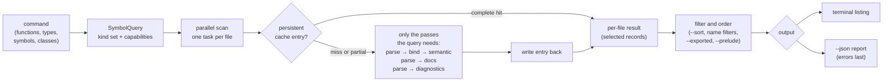

# Symbol Reports

How the `hug` declaration commands (`functions`, `types`, `symbols` and
`classes`) pick what to analyze, what their terminal and JSON output contain,
how output is ordered, and what `--verbose` reports.

```bash
hug functions                 # every function, method and constructor in the package
hug types --sort name         # type declarations, ordered by name
hug --json symbols src/       # every declaration under src/, as a JSON report
hug --json-full symbols       # every file's complete index, diagnostics included
hug --verbose functions       # same listing, plus cache and work stats on stderr
```

Global flags (`--json`, `--json-full`, `--plain`, `--verbose`) come before
the command; command flags (`--sort`, `--no-cache`, `--group-by-file`, …)
come after it.

## The four commands and what they analyze

Each command asks the library for a fixed set of kinds and only the analysis
work its output needs. Nothing a listing does not show is computed: no
listing runs lint or syntax diagnostics, reference resolution, semantic
analysis or structured documentation. That is why a listing is far cheaper
than `hug lint`.

| Command | Kinds listed | Extra analysis |
|---|---|---|
| `functions` | Function, Method, Constructor | none |
| `types` | Type, Class, Interface, Enum, Trait, TypeAlias | none |
| `symbols` | every kind | none |
| `classes` | Class, Type, Interface, Trait as containers; Method and Constructor as their members | containment (links each member to its container) |

Kind names are the library's `SymbolKind` values; a Rust `struct` or a C
`union` is a Type, a Swift `protocol` an Interface. The per-language rules
are in [Symbol Kinds, Visibility and `static`](./symbol-kinds-and-visibility.md).

### What `classes` displays

`classes` prints one section per container, with its methods and
constructors split into *Static Methods* and *Instance Methods*, and its
fields split into *Static Fields* and *Instance Fields*:

```text
src/shapes.rs (Rust)
  type Point [2:1]
    Instance Methods (1)
      - public norm(self) -> f64 [in type Point] [9:5]
    Instance Fields (2)
      - public x: f64
      - public y: f64
```

- Fields come from the container's own type metadata, so each field keeps its
  visibility and `static` flag even though Field, Property and Constant
  records are not part of the command's kind set.
- Members of a Rust `impl` block appear under the type they implement.
- `--static-only` and `--instance-only` keep only that half; `--name <TEXT>`
  keeps containers whose name contains the text.
- A member is static when it needs no instance (a Java `static` method, a
  Rust associated function, a C# `const`). Storage `static`, such as a C++
  function-local `static`, never makes a member static.

`imports` and `lint` are not declaration commands: they keep their own
output, accept no `--sort` and never print the report described below.

### Narrowing the listing

- **Positional filters** are either file filters (paths, globs, extensions
  such as `src/**/*.rs` or `rs`) or symbol-name filters: `cache` (contains),
  `*cache*` (wildcard) or `cache!` (exact name).
- `--exclude-files` and `--exclude-symbols` take globs.
- `--exported` keeps exported (public) declarations.
- `--prelude` keeps the names a package re-exports from its Rust prelude
  (`src/prelude.rs`, `src/prelude/mod.rs`, or the same under a direct child
  package), plus any comma-separated names in the `PRELUDE` environment
  variable. Each prelude re-export is listed as its own record under the
  alias name, marked synthetic and re-exported (`visibility.is_synthetic`,
  `is_reexported`), with its own ID. When the target is found the record
  takes its kind, keyword, doc comment and declaration location; otherwise
  it sits at the `pub use` line with kind Unknown. The prelude and its
  targets are analyzed once and reused by the scan; a target outside the
  scan is resolved but not listed.

These filters choose records after analysis; they never change the kind set
or the work done.

## The flow of one run



- A **complete cache hit** parses nothing. A **partial hit** (the entry holds
  some of the needed work) runs only what is missing and widens the entry.
  `--no-cache` neither reads nor writes the cache; the output is identical.
  The cache is described in [Cache Design](./cache-design.md).
- `--json-full` replaces the command's query with the complete index: every
  kind and every pass, diagnostics included.
- Files are analyzed in parallel, in batches of four times the worker count.
  Results are always delivered in a fixed file order (see
  [Streaming](#streaming)), so the output never depends on the number of
  workers or on which file finished first, and each batch is written before
  the next one starts.

## Terminal output

```text
  - public struct Point { x: f64, y: f64 } src/shapes.rs:2:1
  - public field x [in type Point] src/shapes.rs:3:9
  - public method norm(self) -> f64 [in type Point] src/shapes.rs:9:5
```

Each line shows the visibility (omitted when not known), a label, the name
with its signature or fields, the container (`[in type Point]`) and the
location. The label is the declaring keyword for types, variables, fields
and constants (`struct`, `class`, `let`, `const`, `my`, `local`, …) and the
kind for everything else (`function`, `method`, `enum variant`, …). Both
come from the record; nothing is guessed from the source line.

`--plain` drops colors and hyperlinks. `--comments` adds each symbol's doc
comment under its line. Lines never wrap, whatever the terminal width.

**Package sections.** When the scanned files belong to two or more packages
(directories with a `Cargo.toml`, `package.json`, `go.mod`, `pyproject.toml`
or another manifest), the listing is split into one section per package, each
under its path, and a package without declarations shows `(no symbols)`.
Files outside every package form the scan root's own section, whose heading
is empty. A scan within one package is one flat list without headings.

The decision depends only on which packages the scanned files belong to,
never on what they declare, so it is made before anything is analyzed and no
package waits for a later one. A scan in which only one of several packages
declares anything is therefore still sectioned:

```text

core

  - public function parse(input: &str) -> Ast core/src/lib.rs:1:1


docs-site

(no symbols)

```

Every `--sort` and grouping follows the same rule.

### Streaming

The terminal listing is written as files are analyzed: after each batch of
files, everything that batch completed is on stdout. `hug symbols | head`
therefore stops after a batch or two, and a large repository starts printing
at once instead of after the whole scan. A run holds only the part of the
listing that later files can still change:

| Layout | Held until written |
|---|---|
| default (`--sort file`), `classes` under any `--sort` | one file |
| `--group-by-file` (alone or with `--group-by-module`), any `--sort` | one file's group |
| `--group-by-module`, any `--sort` | one directory's group |
| `--sort name` or `--sort kind` without grouping | one package: a name or kind order interleaves every file of the package |
| `--prelude` | one package: a prelude lists declarations that live in other files |

For example, `hug symbols --sort name` prints nothing until each package is
fully analyzed, and over a single-package repository that is the whole scan.
Group by file to keep a name order streaming:

```bash
hug symbols --group-by-file --sort name   # each file's declarations by name, printed file by file
```

Package sections add no wait: whether to print them is known before the
first file is analyzed (see [Package sections](#terminal-output)), and a
package's heading is written when its first file arrives.

To keep each unit complete on arrival, the listing commands analyze files in
the order they are listed: by package, then directory (with
`--group-by-module`), then path. `classes` and the JSON reports analyze files
in path order.

## Ordering

`--sort` sets the order of the listed declarations. Only the four
declaration commands accept it, and only once.

| `--sort` | Order |
|---|---|
| `file` (default) | by file, then source position |
| `name` | by the written name, case-sensitive (`Widget` before `apply`) |
| `kind` | modules and namespaces, types, then callables, then values (Module, Namespace, Type, Class, Interface, Trait, Enum, TypeAlias, Function, Method, Constructor, Macro, Constant, Field, Property, EnumVariant, Variable, Parameter, Unknown) |

**Tie-breakers.** Every order ends with the same chain: file path, start of
the declaration, end of the declaration, kind (in the `--sort kind` order),
then record ID. Two declarations therefore never compare equal, and two runs
over the same tree print the same order. For example, with `--sort name` a
`Widget` declared in both `rust.rs` and `nested/go.go` lists `nested/go.go`
first, because the file path breaks the tie.

**File paths** are compared directory by directory on their `/`-separated
form, so a directory's files stay together: `a/b.rs` sorts before `a-c.rs`.

**Grouping.** `--group-by-file` and `--group-by-module` (the file's
directory) split the listing into groups, ordered by path. `--sort` orders
the declarations inside each group:

```bash
hug symbols --group-by-module --sort kind   # per directory: types first, then functions, …
```

**JSON** never reorders files. A report has one entry per file in path
order, and `--sort` orders only the records inside each file's array, with
the same keys and tie-breakers. This holds for `--json` (`files[].symbols`)
and `--json-full` (`indexes[].symbols`), for every command. A full index's
other arrays (`imports`, `exports`, `diagnostics`) are not declarations and
keep the order the analysis produced them in.

**`classes` members** stay in source order whatever `--sort` says: `--sort`
orders the containers, and each container's method sections (and its JSON
`members` list) follow source position, with the same tie-breakers.

`--sort container`, a repeated `--sort`, and `--sort` given to `lint` or
`imports` are argument errors (exit `2`). The old `--sort-by-kind` and
`--sort-by-module` flags no longer exist: use `--sort kind`, and the default
`--sort file` lists a directory's files together.

## JSON reports

`--json` prints one report per run:

```json
{
  "report_schema_version": 1,
  "schema_version": { "major": 4, "minor": 0 },
  "root_dir": "/private/tmp/sample",
  "files": [
    {
      "file": "src/shapes.rs",
      "language": "Rust",
      "completed_passes": ["Parse"],
      "completed_capabilities": ["declarations"],
      "symbols": [
        {
          "schema_version": { "major": 4, "minor": 0 },
          "id": "65e1e0ed…",
          "language": "Rust",
          "kind": "Method",
          "identity": {
            "name": "norm",
            "qualified_name": "Point::norm",
            "container_name": "Point",
            "container_kind": "Type",
            "keyword": "fn",
            "stable_key": "rust::src/shapes.rs::Method::Point::norm::0"
          },
          "source": {
            "file_path": "src/shapes.rs",
            "signature_text": "pub fn norm(&self) -> f64"
          },
          "visibility": { "level": "Public" },
          "docs": { "raw_doc": "Distance from the origin." }
        }
      ]
    }
  ],
  "errors": []
}
```

(Pretty-printed and abridged; `hug` writes the report on one line, and real
records also carry spans, type information, kind-specific data and
provenance.)

| Field | Meaning |
|---|---|
| `report_schema_version` | version of this envelope (`1`) |
| `schema_version` | version of the records inside (`4.0`); the record format is described in [Symbol Schema Design](./symbol-schema-design.md) |
| `root_dir` | the scan root; every path in the report is relative to it |
| `files` | one entry per file with at least one listed record, in path order |
| `files[].completed_passes`, `completed_capabilities` | the analysis that was actually done for this file |
| `files[].symbols` | the command's records only, ordered by `--sort` |
| `files[].members` | `classes` only: each container's displayed methods and constructors in source order, keyed by the container's `id` |
| `errors` | files that could not be analyzed; always present, always last |

What a default report leaves out:

- **Source text.** Records carry the declaration header
  (`source.signature_text`) but not `declaration_text`, the body or attached
  comments; the doc comment stays as `docs.raw_doc`.
- **Work the command did not ask for.** No references, semantics or
  diagnostics; `completed_passes` says so.
- **Timestamps.** Records have none, so the same files always produce the
  same bytes: cold or warm cache, one worker or many.

Every path is `/`-separated and relative to `root_dir`, on every operating
system: `files[].file`, `indexes[].file`, `errors[].file`, each record's
`source.file_path`, and the file segment of `identity.stable_key`. Record IDs
are not rewritten: they are derived from the file's absolute path when it was
analyzed, so the same file has different IDs in two checkouts at different
locations.

Every spelling of one file is the same file: `src/lib.rs`,
`src/../src/lib.rs`, its absolute path, and a symlink to it are analyzed
once, listed once (also when a glob matches the same file), reported under
the same path, and carry the same IDs. A symlink is reported as its target.
[cache-design.md](./cache-design.md#file-identity) describes this file
identity.

A file named on the command line from outside the scan root climbs out of
it with `..` segments:

```sh
cd /work/repo
hug --json functions --language rust /work/vendor/external.rs
# "root_dir":"/work/repo", "file":"../vendor/external.rs",
# "stable_key":"rust::../vendor/external.rs::Function::parse::0"
```

- **Symlinked spellings agree.** When a path does not lie under `root_dir`
  as written, it is compared again with the directories of both resolved
  through symlinks, so `/var/folders/…/repo/src/lib.rs` is `src/lib.rs` under
  the root `/private/var/folders/…/repo` (macOS temp directories are
  symlinked this way).
- **No relative path exists.** A file on another Windows drive or network
  share than `root_dir` has no `..` route to it. Its path is then the file's
  absolute path, `/`-separated where it has a drive (`D:/vendor/external.rs`);
  a UNC path that cannot be written with forward slashes keeps its native
  `\\server\share\…` spelling. A consumer can tell this case apart because the
  path is absolute.
- **A record's file and its key's file are projected separately.** A
  `--prelude` re-export alias is located at its target's declaration but
  keyed by the prelude file, so `source.file_path` is `src/alpha.rs` while
  `stable_key` is `rust::src/prelude.rs::Enum::prelude-export::ElevatedEnum::0`.

An empty selection is still a complete report:
`{"report_schema_version":1,…,"files":[],"errors":[]}`.

### `--json-full`

`--json-full` has the same envelope with `indexes` in place of `files`: one
complete index per scanned file, whether or not anything matched, with every
kind, every pass (`Parse`, `Bind`, `Semantic`, `Docs`, `Diagnostics`),
imports, exports, diagnostics and `declaration_text`.

Because it reports everything, `--json-full` rejects any flag that narrows
records (exit `2`): a symbol-name filter, `--exclude-symbols`, `--exported`,
`--prelude`, and for `classes` `--name`, `--static-only` and
`--instance-only`. File selectors (paths, globs, `--exclude-files`,
`--language`), `--sort` and `--no-cache` are allowed. `lint` and `imports`
reject `--json-full`.

```bash
hug --json-full functions greet
# error: `--json-full` reports complete indexes and cannot be combined with
#        symbol selectors (a symbol-name FILTER)
```

### Failed files and exit status

A file that cannot be read or analyzed does not stop the run. It is
reported three ways:

1. on stderr, as `error: <message>`, in the order files are analyzed (see
   [Streaming](#streaming));
2. as one entry in `errors`, with a portable `file`, the error `kind` (`io`,
   `parse_failed`, `unsupported_language`, …) and the `message`;
3. through the exit status, which becomes `1`.

```json
"errors": [
  {
    "file": "src/locked.rs",
    "kind": "io",
    "message": "Failed to read `/repo/src/locked.rs`: Permission denied (os error 13)"
  }
]
```

The other files are listed as usual. Because `errors` is written last, a
report cut short (a killed process, a full disk) never parses as valid JSON,
so a failure can never look like an empty success.

| Exit status | When |
|---|---|
| `0` | every file was analyzed and the output was written; also when stdout closes early (`hug symbols \| head`), which ends the run quietly |
| `1` | a file failed, or stdout could not be written for any other reason (`error: cannot write output`) |

| `2` | an argument error |

A failed write to stdout, a closed pipe included, stops the run: no further
batch of files is analyzed. The terminal listing and the JSON reports are
flushed after every batch, so the run stops before the next batch, even when
the batch added nothing but the JSON envelope. The status is then `0` for a
closed pipe (even if a file had failed) and `1` for any other write error.

## `--verbose`

By default a run prints nothing on stderr except failed files. Cache
problems are recoverable (the file is analyzed anyway), so they are silent.
`--verbose` reports them, and ends with one stats line:

```text
cache: src/old.rs: entry for a different source hash
cache: 0 hits, 0 partial hits, 1 misses; parsed 1 files, 1 definition captures, 0 diagnostics runs
```

- One `cache: <path>: <reason>` line per file whose entry could not be used
  (unreadable, malformed, written for a different input); a file with no
  entry yet is counted, not listed.
- One `cache: <path>: write failed: <error>` line per entry that could not be
  saved.
- The stats line: complete hits, partial hits and misses, then the work
  done: files parsed, definition-query runs and diagnostics runs. Under
  `--no-cache` it starts `cache: disabled;`. With `--prelude` it adds
  `R reused in this run` for files analyzed once for the prelude and reused
  by the scan.

The stats line is the quickest way to see what a run cost. A warm listing
reads `parsed 0 files`; any listing reads `0 diagnostics runs`.

## Related

- [CLI README](../cli/README.md): every flag, with examples.
- [Cache Design](./cache-design.md): cache keys, coverage and robustness.
- [Symbol Schema Design](./symbol-schema-design.md): the record format.
