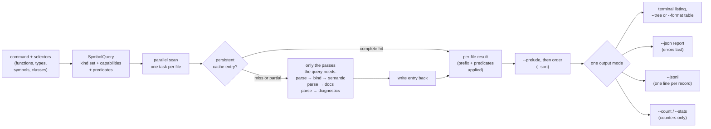
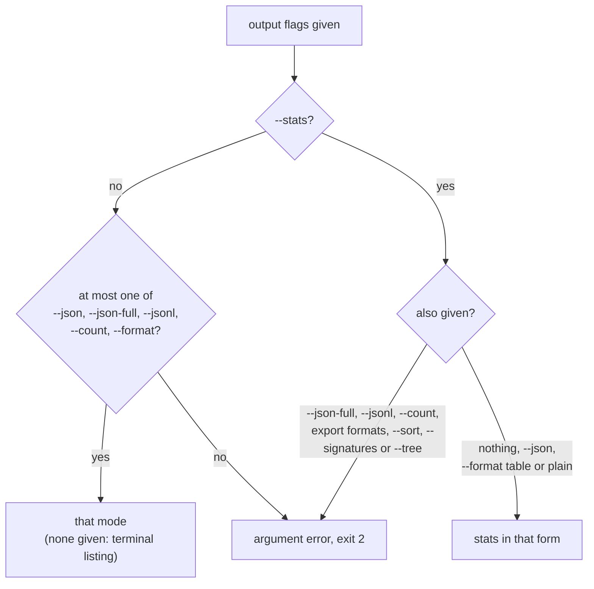

# Symbol Reports

A **symbol report** is what the four `hug` declaration commands print:
`functions`, `types`, `symbols` and `classes`. Each one scans source files,
picks the declarations you asked for, and writes them as a terminal listing,
a JSON report, counts or an export file. This page explains what each command
analyzes, how to select declarations, what happens during one run, and which
output modes exist; the detail pages linked from each section hold the full
rules.

```text
$ hug --plain functions
  - public method norm(self) -> f64 [in type Point] src/lib.rs:6:5
  - public method scale(self, by: f64) -> Point [in type Point] src/lib.rs:7:5
  - public function load() -> Point src/lib.rs:9:1
```

```bash
hug functions                 # every function, method and constructor in the package
hug types --sort name         # type declarations, ordered by name
hug functions --in TreeFile --undocumented   # undocumented members of TreeFile
hug --json symbols 'src/**'  # every declaration under src/, as a JSON report
hug --json-full symbols       # every file's complete index, diagnostics included
hug symbols --jsonl | jq -c .record.identity.name   # one JSON object per declaration
hug symbols --tree            # members nested under their type
hug functions --format table  # one table row per declaration
hug symbols --format ctags > tags # numeric-line navigation tags
hug functions --count         # just the number
hug symbols --stats           # counts by kind, visibility and language, plus doc coverage
hug functions --changed       # only files with uncommitted Git changes
hug --verbose functions       # same listing, plus cache and work stats on stderr
```

The global flags (`--json`, `--json-full`, `--plain`, `--verbose`) may come
before or after the command name; command flags (`--sort`, `--no-cache`,
`--group-by-file`, …) come after it. Every command and flag is listed in
[Using the `hug` CLI](./cli.md).

## The four commands and what they analyze

Each command asks the library for a fixed set of **kinds** (the category of
a declaration: function, method, type, field, …), narrowed by `--kind`, and
only the analysis work its output and its filters need. Nothing a listing
does not show or filter on is computed: no listing runs lint or syntax
diagnostics, reference resolution, semantic analysis or structured
documentation. That is why a listing is far cheaper than `hug lint`.

| Command | Kinds listed | Extra analysis |
|---|---|---|
| `functions` | Function, Method, Constructor | none |
| `types` | Type, Class, Interface, Enum, Trait, TypeAlias | none |
| `symbols` | every kind, `item` and `member` scopes only (no locals) unless `--scope`/`--all-scopes` | none |
| `classes` | Class, Type, Interface, Trait as containers; Method and Constructor as their members | containment (links each member to its container) |

Kind names are the library's `SymbolKind` values; a Rust `struct` or a C
`union` is a Type, a Swift `protocol` an Interface. The per-language rules
are in [Symbol Kinds, Visibility and `static`](./symbol-kinds-and-visibility.md).

A few kinds are easy to misplace, because they belong to more than one
command or to none of the obvious ones:

| Kind | `functions` | `types` | `symbols` (default scopes) | `classes` |
|---|---|---|---|---|
| Constructor | yes | — | yes (member) | with the methods |
| TypeAlias | — | yes | yes (item or member) | — |
| EnumVariant | — | — | yes (member) | — |
| Field | — | — | yes (member) | in the field sections |
| Namespace | — | — | yes (item) | — |

[Kinds by Command](./symbol-reports/kinds-by-command.md) walks through these
with a mixed Java, Go and Scala example.

`imports` and `lint` are not declaration commands: they keep their own
output, accept no `--sort` and never print a symbol report. They are
described in [Using the `hug` CLI](./cli.md).

### What `classes` displays

`classes` prints one section per container, with its methods and
constructors split into *Static Methods* and *Instance Methods*, and its
fields split into *Static Fields* and *Instance Fields*:

```text
src/shapes.rs (Rust)
  type Point [2:1]
    Instance Methods (1)
      - public norm(self) -> f64 [in type Point] [9:5]
    Instance Fields (2)
      - public x: f64
      - public y: f64
```

- Fields come from the container's own type metadata, so each field keeps its
  visibility and `static` flag even though Field, Property and Constant
  records are not part of the command's kind set.
- Members of a Rust `impl` block appear under the type they implement.
- `--static-only` and `--instance-only` keep only that half; together they
  are an argument error.
- The [selectors](#selecting-declarations) split between containers and
  members: kind, scope, name, `--in`, visibility, export, test, docs and
  deprecation filters choose **containers** (`--in Box` selects the container
  named `Box`), while `--async`, `--returns`, `--param-type`, `--min-params`
  and `--static-only`/`--instance-only` choose the **members** displayed. A
  selected container may show no member, and a signature filter hides the
  field sections (fields have no signature). To filter members by kind,
  visibility or docs, use `hug functions --in Box` instead.
- A member is static when it needs no instance (a Java `static` method, a
  Rust associated function, a C# `const`). Storage `static`, such as a C++
  function-local `static`, never makes a member static.

## Selecting declarations

Every declaration command accepts the same **selectors**: flags and
positional filters that choose which files are scanned and which
declarations are reported. They combine with AND, and the values of a
repeatable selector are alternatives (OR). Exclusions win over inclusions.

```bash
hug functions 'src/**' parse         # files under src/ (a glob), names containing "parse"
hug functions --file src/lib.rs       # one file, even if .gitignore or a fixtures/ rule would skip it
hug functions --name parse --exact    # the name `parse` and nothing longer
hug functions --exclude-symbols 'test_*'      # drop names starting with test_
hug symbols --exclude-files '**/generated/**' # drop generated files
hug symbols --kind trait --kind interface     # only traits and interfaces
hug symbols --scope member                    # fields, methods, … of types only
hug symbols --all-scopes                      # locals and parameters too
hug functions --visibility crate --visibility public
hug symbols --exported                        # what the module exports
hug functions --in '*shared::SymbolInfo'      # members of one of several SymbolInfo types
hug functions --exclude-tests                 # drop test functions and helpers in test files
hug functions --tests-only                    # only those
hug symbols --undocumented                    # declarations with no doc comment
hug symbols --deprecated                      # declarations marked deprecated
hug functions --async                         # async functions and methods
hug functions --returns 'Result<*'            # declared return type starts with Result<
hug functions --param-type 'Point'            # takes a Point (a receiver does not count)
hug functions --min-params 2                  # at least two declared parameters
hug symbols --changed                         # only files with Git changes
```

| Selector | Keeps | Notes |
|---|---|---|
| positional `FILTER` | files (a path with `/`, a glob, a name with a source extension such as `lib.rs` or `*.rs`) or names (anything else) | a name filter is a `--name` |
| `--file PATH\|GLOB` | scans that file, directory pattern or glob | never taken for a name; see [`--file` and `--name`](./symbol-reports/selectors.md#--file-and---name-versus-positional-filters) |
| `--name PATTERN`, `-n` | records whose name matches | see [Name patterns](./symbol-reports/selectors.md#name-patterns) |
| `--exact` | — | `--name`, positional names and `--in` match whole and literally |
| `--exclude-symbols PATTERN` | drops records whose name matches | name pattern rules; a trailing `!` is exact |
| `--exclude-files GLOB` | drops files | also drops a file named by `--file` |
| `--kind KIND` | records of that kind | snake_case `SymbolKind` names: `function`, `type_alias`, `enum_variant`, …; narrows the command's kinds, never widens them (`hug types --kind function` lists nothing); an unknown name is an argument error |
| `--scope item\|member\|local` | records in that scope | replaces the default; `symbols` defaults to `item` and `member`, the other commands to every scope |
| `--all-scopes` | every scope | conflicts with `--scope` |
| `--visibility LEVEL` | records with exactly that level | `public`, `protected`, `private`, `internal`, `package`, `crate`, `module_private`, `protected_internal`, `private_protected`, `unknown`; `unknown` matches only Unknown, never public or private |
| `--exported` | exported records (`is_exported`, declarations only; synthetic prelude records under `--prelude`) | independent of `--visibility`: a public method is usually not a module export |
| `--prelude` | the names a package re-exports from its Rust prelude | see [`--prelude`](./symbol-reports/selectors.md#--prelude) |
| `--in PATTERN` | members of a container whose name matches | the immediate container (`container_name`); a qualified pattern matches the enclosing declaration's qualified name |
| `--exclude-tests` / `--tests-only` | non-test / test-only records | mutually exclusive; uses the test rules in [Deprecation and test flags](./symbol-kinds-and-visibility/documentation-flags-and-metrics.md#deprecation-and-test-flags) |
| `--undocumented` | records with no doc comment | never matches Lua, Perl, Bash or Zsh, which have no doc-comment detection |
| `--deprecated` | records marked deprecated | |
| `--async` | `async` functions, methods and constructors | |
| `--returns GLOB` | functions whose **declared** return type matches | whole-string, case-sensitive, `*` wildcard; no declared type never matches |
| `--param-type GLOB` | functions with a non-receiver parameter whose declared type matches | Rust `self` is skipped |
| `--min-params N` | functions with at least N declared parameters | an unsupported count never matches |
| `--changed[=REF]` | files Git reports as changed | see [Changed Files](./symbol-reports/changed-files.md) |

The four signature selectors (`--async` to `--min-params`) keep only
functions, methods and constructors, whatever `--kind` says.

Names use **smart case**: a pattern with no uppercase letter ignores case,
and any uppercase letter makes it case-sensitive. A pattern containing `#` or
the language's qualified-name separator matches the qualified name, which
usually starts with the file's path (`src/symbol.rs#SymbolInfo::new`), so
`--name '*Widget::*'` finds every `Widget` member. File filters are globs, so
a bare directory selects nothing: write `'src/**'`, not `src/`.

`hug symbols` hides locals by default: over `tree-hugger/` it lists under a
third of the declarations `--all-scopes` lists (parameters, function-local
variables and nested functions are locals). `functions` and `types` keep every
scope, so a nested function stays discoverable.

[Selector Details](./symbol-reports/selectors.md) has the full name-pattern
rules, how a positional filter is told apart from a name, the `imports`
selectors, `--prelude`, and why selectors never cost a cache entry.
[Changed Files](./symbol-reports/changed-files.md) covers `--changed`.

## The flow of one run



- A **complete cache hit** parses nothing. A **partial hit** (the entry holds
  some of the needed work) runs only what is missing and widens the entry.
  `--no-cache` neither reads nor writes the cache; the output is identical.
  The cache is described in [Cache Design](./cache-design.md).
- `--json-full` replaces the command's query with the complete index: every
  kind and every pass, diagnostics included.
- Files are analyzed in parallel, at most four per worker thread ahead of
  the output already written. Results are always delivered in a fixed file
  order, so the output never depends on the number of workers or on which
  file finished first. Output is written as files arrive, so
  `hug symbols | head` stops the scan after a window or two;
  [Streaming and Failed Files](./symbol-reports/streaming-and-failures.md#streaming)
  says how much each layout holds back.

## Output modes

Exactly one output mode is active: the default terminal listing, `--json`,
`--json-full`, `--jsonl`, `--count`, `--stats`, or an explicit `--format`.
Giving two is an argument error (exit `2`). The one exception is `--stats`,
which chooses *what* is reported and composes with *how*: with `--json`
(the stats envelope), and with the default output, `--format table` or
`--format plain` (the stats tables). `--plain` only drops styling, so it
combines with every mode and changes no machine format.

```bash
hug symbols --stats --json      # accepted: the stats envelope
hug symbols --stats --format plain   # accepted: unstyled stats tables
hug symbols --json --jsonl      # error: `--json` and `--jsonl` are different output modes
hug symbols --stats --sort name # error: `--sort` has no meaning for `--stats`
```



| Mode | What it prints | Details |
|---|---|---|
| terminal listing (default) | one line per declaration: visibility, label, name and signature, container, location | [Terminal Output](./symbol-reports/terminal-output.md) |
| `--format plain` | the listing without colors, links or wrapping | [Plain](./symbol-reports/terminal-output.md#plain---format-plain) |
| `--format table` | one table per file, one row per declaration | [Table](./symbol-reports/terminal-output.md#table---format-table) |
| `--tree` | an outline with members nested under their container | [Outline](./symbol-reports/terminal-output.md#outline---tree) |
| `--format tsv\|markdown\|prose\|ctags` | a UTF-8 export file | [Text Exports and Tags](./symbol-reports/exports.md) |
| `--json`, `--jsonl`, `--json-full` | a JSON report, JSON Lines, or complete indexes | [JSON](#json) |
| `--count` | the number of selected declarations | [below](#--count) |
| `--stats` | counts by kind, visibility and language, plus doc coverage, per package | [Package Stats](./symbol-reports/package-stats.md) |

`--sort`, `--signatures` and `--tree` are argument errors with `--stats`.
Markdown and Prose exports nest under `--tree` the same way the terminal
outline does. `hug imports` has no `--jsonl`, `--count`, `--stats`,
`--format`, `--signatures` or `--tree`.

Interactive output wraps at the terminal width (a positive `COLUMNS`
overrides it); redirected output, `--plain` and `--format plain` never wrap.
`--signatures short|full|none` sets how much of each declaration header the
text formats show; see
[Signatures](./symbol-reports/terminal-output.md#signatures).

### `--count`

The number of selected declarations, as one decimal integer and a newline,
`0` included:

```text
$ hug functions --count
3
$ hug functions --count --undocumented
2
```

`classes --count` counts selected containers, not their
members. A failed file is still reported on stderr and makes the exit status
`1`; the count covers the files that were analyzed.

## Ordering

`--sort` sets the order of the listed declarations. Only the four
declaration commands accept it, and only once.

| `--sort` | Order |
|---|---|
| `file` (default) | by file, then source position |
| `name` | by the written name, case-sensitive (`Widget` before `apply`) |
| `kind` | modules and namespaces, types, then callables, then values (Module, Namespace, Type, Class, Interface, Trait, Enum, TypeAlias, Function, Method, Constructor, Macro, Constant, Field, Property, EnumVariant, Variable, Parameter, Unknown) |

**Tie-breakers.** Every order ends with the same chain: file path, start of
the declaration, end of the declaration, kind (in the `--sort kind` order),
then record ID. Two declarations therefore never compare equal, and two runs
over the same tree print the same order. For example, with `--sort name` a
`Widget` declared in both `rust.rs` and `nested/go.go` lists `nested/go.go`
first, because the file path breaks the tie.

Declarations that share one declaration span reach the record ID:
`X` and `Y` of the Go field declaration `X, Y int`, the aliases of C
`typedef int A, B;` and the names of Go `var a, b int`. Their order is the
same on every run in one checkout, but it is not their written order, and it
can differ in a checkout at another path, since the ID includes the file's
absolute path.

**File paths** are compared directory by directory on their `/`-separated
form, so a directory's files stay together: `a/b.rs` sorts before `a-c.rs`.

**Grouping.** `--group-by-file` and `--group-by-module` (the file's
directory) split the listing into groups, ordered by path. `--sort` orders
the declarations inside each group:

```bash
hug symbols --group-by-module --sort kind   # per directory: types first, then functions, …
```

**JSON** never reorders files. A report has one entry per file in path
order, and `--sort` orders only the records inside each file's array, with
the same keys and tie-breakers. This holds for `--json` (`files[].symbols`)
and `--json-full` (`indexes[].symbols`), for every command. `--jsonl`,
`--format table` and `--tree` follow the same rule: files in path order,
`--sort` within each file. A full index's
other arrays (`imports`, `exports`, `diagnostics`) are not declarations and
keep the order the analysis produced them in.

**`classes` members** stay in source order whatever `--sort` says: `--sort`
orders the containers, and each container's method sections (and its JSON
`members` list) follow source position, with the same tie-breakers. The flat
TSV and ctags exports are the exception: they have no container sections, so
containers and members are sorted together as one sequence per file.

`--sort container`, a repeated `--sort`, and `--sort` given to `lint` or
`imports` are argument errors (exit `2`). The old `--sort-by-kind` and
`--sort-by-module` flags no longer exist: use `--sort kind`, and the default
`--sort file` lists a directory's files together.

## JSON

`--json` prints one report per run: an envelope naming the scan root, one
entry per file with its selected records, and an `errors` array that is
always present and always last.

```json
{"report_schema_version":1,"schema_version":{"major":5,"minor":1},
 "root_dir":"/work/repo",
 "files":[{"file":"src/shapes.rs","language":"Rust",
           "completed_passes":["Parse"],"completed_capabilities":["declarations","flags"],
           "symbols":[{"kind":"Method","identity":{"name":"norm","container_name":"Point",…},…}]}],
 "errors":[]}
```

- `--jsonl` writes one self-contained object per declaration instead, and
  streams file by file.
- `--json-full` writes every scanned file's complete index (every kind, every
  pass, diagnostics included) and therefore rejects every selector that
  narrows records.
- Records carry no timestamps, and every path is `/`-separated and relative
  to `root_dir`, so two runs over the same files print the same bytes.

[JSON Reports](./symbol-reports/json-reports.md) documents the envelopes,
what a record carries and leaves out, the path rules, JSON Lines and
`--json-full`. The record fields are defined in
[Symbol Records](./symbol-records.md).

## Exit status

A file that cannot be read or analyzed does not stop the run: it is reported
on stderr, listed in `errors` by the modes with an envelope, and the other
files are reported as usual.

| Exit status | When |
|---|---|
| `0` | every file was analyzed and the output was written, an empty selection included; also when stdout closes early (`hug symbols \| head`), which ends the run quietly |
| `1` | a file failed, a ctags record was skipped, Git or package discovery failed, or stdout could not be written for any other reason (`error: cannot write output`) |
| `2` | an argument error |

[Streaming and Failed Files](./symbol-reports/streaming-and-failures.md)
gives the full rules, including what a failed write or a closed pipe does to
work already in flight.

## `--verbose`

By default a run prints nothing on stderr except failed files. Cache
problems are recoverable (the file is analyzed anyway), so they are silent.
`--verbose` reports them, and ends with one stats line:

```text
cache: src/old.rs: entry for a different source hash
cache: 0 hits, 0 partial hits, 1 misses; parsed 1 files, 1 definition captures, 0 diagnostics runs
```

- One `cache: <path>: <reason>` line per file whose entry could not be used
  (unreadable, malformed, written for a different input); a file with no
  entry yet is counted, not listed.
- One `cache: <path>: write failed: <error>` line per entry that could not be
  saved.
- The stats line: complete hits, partial hits and misses, then the work
  done: files parsed, definition-query runs and diagnostics runs. Under
  `--no-cache` it starts `cache: disabled;`. With `--prelude` it adds
  `R reused in this run` for files analyzed once for the prelude and reused
  by the scan.

The stats line is the quickest way to see what a run cost. A warm listing
reads `parsed 0 files`; any listing reads `0 diagnostics runs`.

## Related pages

- [Using the `hug` CLI](./cli.md): every command and flag, with examples
- Detail pages for this topic:
  [Kinds by Command](./symbol-reports/kinds-by-command.md),
  [Selector Details](./symbol-reports/selectors.md),
  [Changed Files](./symbol-reports/changed-files.md),
  [Terminal Output](./symbol-reports/terminal-output.md),
  [Text Exports and Tags](./symbol-reports/exports.md),
  [Package Stats](./symbol-reports/package-stats.md),
  [JSON Reports](./symbol-reports/json-reports.md),
  [Streaming and Failed Files](./symbol-reports/streaming-and-failures.md)
- [Symbol Records](./symbol-records.md): the JSON record fields
- [Cache Design](./cache-design.md): cache keys, coverage and robustness
- [Scope-Aware References](./references/hug-refs.md): `hug refs`, the per-declaration reference report
