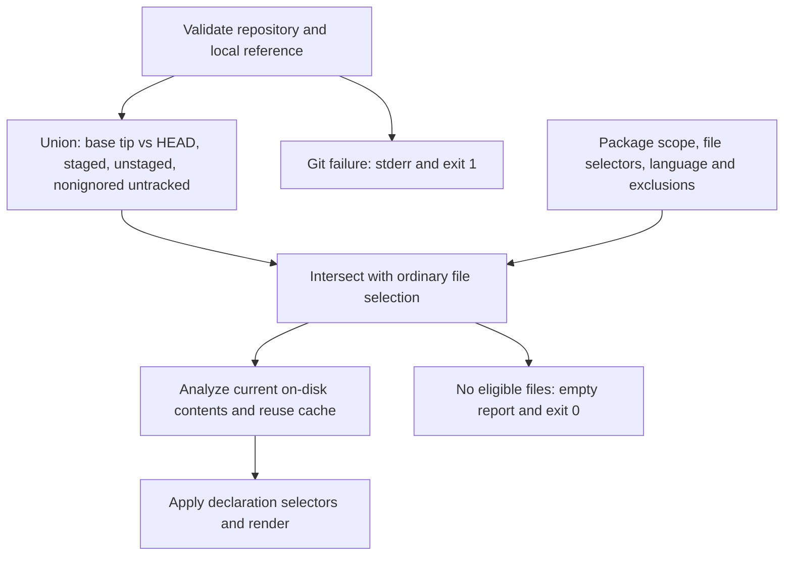

# Changed Files

Part of [Symbol Reports](../symbol-reports.md).

`--changed` narrows `functions`, `types`, `symbols` or `classes` to the
files Git reports as changed, and lists those files' **current on-disk
declarations**. It answers "what does the code I am about to commit
declare?" without scanning the whole package:

```text
$ echo 'pub fn load() -> Point { … }' >> src/lib.rs
$ hug --plain functions --changed
  - public method norm(self) -> f64 [in type Point] src/lib.rs:6:5
  - public method scale(self, by: f64) -> Point [in type Point] src/lib.rs:7:5
  - public function load() -> Point src/lib.rs:9:1
```

A changed file is reported whole: every declaration in it is listed, not only
the lines that changed.

```bash
hug functions --changed                 # staged, unstaged, and nonignored untracked files
hug symbols --changed=main              # also include differences from the local main tip
hug symbols --changed --file 'src/**'    # intersect with the normal file selection
hug --json-full symbols --changed       # complete indexes for selected changed files
hug functions --changed --count         # 0 when no eligible changed files remain
```



## Choosing the base

Bare `--changed` uses `HEAD`: it selects only uncommitted changes. With
`--changed=main`, Git compares the local `main` commit directly to `HEAD`,
then adds uncommitted changes. It does not fetch or compare a common
ancestor; changes on a divergent `main` branch can select files too. Commit
IDs and tags naming commits also work. Always use `=` for a reference:
`--changed main` leaves `main` as a positional filter. Empty reference
values and repeated flags are argument errors.

## How it combines with other selectors

The changed set intersects the ordinary scan. Running inside a package
keeps that package's scan scope; positional file selectors and `--file`
remain alternatives, then `--changed` narrows their combined result.
`--exclude-files` still wins, and name and declaration selectors apply
later. Existing language, ignore, and fixture rules remain in effect.
An explicitly selected changed file outside the package can survive if it
belongs to the same repository. Ignored untracked files never survive,
even when explicitly named; tracked ignored files can use normal explicit
overrides. Linked worktrees use their own checkout and index. Submodule
contents and independent nested repositories are not scanned recursively
for changes.

## What counts as a changed file

A file is reported once even if it is both staged and unstaged. Staging an
edit and undoing it on disk still selects the file, but reports the restored
content. Deleted paths are skipped unless recreated on disk; renames select
eligible destinations. Source is never read from a historical commit or the
index. Selection happens before source analysis and per-file cache lookups;
the flag and reference do not change cache keys.

Git-reported file-type replacements count too: replacing `leaf.rs` with a
symlink to another source in the same checkout still selects it with
`--file leaf.rs`. Default directory scans retain their symlink exclusion.

Changed aliases (symlinks) must stay in the active checkout: targets in
another checkout, nested repository, or submodule are excluded, even with an
explicit alias or target selector. Directory and file aliases cannot cross
those boundaries and return eligibility to an outer source file, including
targets such as `inner/../clean.rs` when `inner` is a nested repository.
Ordinary directory parents remain valid: `ordinary/../clean.rs` can select
`clean.rs` when `ordinary` belongs to the active checkout. Parents after
directory aliases follow the alias destination, matching filesystem
resolution.

## Empty results

A valid request with no eligible files exits `0`: text listings, tables,
and declaration outlines show `(no symbols)` with no declaration records;
`classes` terminal/plain outlines emit no text. JSON Lines emits no lines.
`--count` prints `0` followed by a newline. Stats have zero totals and doc
coverage `n/a` (`ratio: null` in JSON); JSON has empty `files` (or `indexes`
for `--json-full`) and `errors: []`. Without `--changed`, a scan with no
source files keeps its normal error behavior.

## Errors and limits

`--changed` cannot be combined with `--prelude` (exit `2`), because prelude
exports can refer to declarations in other files. The flag is unavailable
on `imports`, `lint`, `god-files`, and `completions`. Missing or bare
repositories, unresolved or non-commit references, corrupt Git data, and
index conflicts anywhere in the repository exit `1` before printing a
report. A truncated index is one such failure: stderr names the repository
and index-read cause, stdout stays empty, and no source analysis or
symbol-cache lookup runs. An absent index or a valid empty index is allowed.

An unborn repository (no first commit) accepts bare `--changed`; explicit
`--changed=HEAD` must resolve and therefore fails there. A valid explicit
base on unborn `HEAD` compares against the empty current commit tree.

Per-file failures after selection retain the normal partial report and exit
status. Concurrent edits are not an atomic snapshot.
