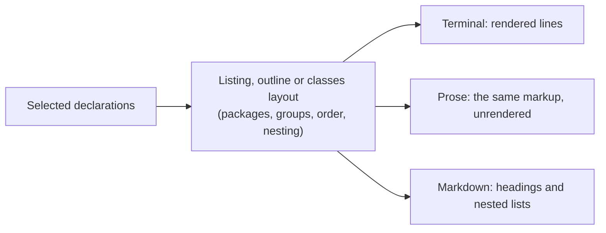
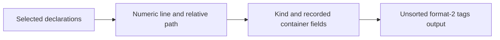

# Text Exports and Tags

Part of [Symbol Reports](../symbol-reports.md).

The declaration commands can write their selection as a file instead of a
terminal listing. Four `--format` values are exports:

| Format | What you get | Use it for |
|---|---|---|
| `tsv` | eight fixed tab-separated columns, one row per declaration | spreadsheets, `awk`, `cut`, diffs |
| `markdown` | the listing's layout as CommonMark headings and nested lists | pasting into a document or pull request |
| `prose` | the biscuit-terminal Prose markup the terminal renders, with local source links | rendering later with styles |
| `ctags` | an unsorted format-2 tags file | jump-to-definition in Neovim |

```text
$ hug functions --format tsv
file	line	column	kind	name	qualified_name	visibility	signature
src/lib.rs	6	5	method	norm	src/lib.rs#Point::norm	public	(self) -> f64
src/lib.rs	7	5	method	scale	src/lib.rs#Point::scale	public	(self, by: f64) -> Point
src/lib.rs	9	1	function	load	src/lib.rs#load	public	() -> Point
```

## Text exports

Every export is UTF-8 with LF line endings, contains no terminal escape
sequences, and does not wrap to the terminal width. TSV and ctags list files
in portable path order, with `--sort` ordering declarations within each file;
Markdown and Prose keep the listing's own layout and order (see
[Markdown and Prose](#markdown-and-prose)). The selection rules are the
same as for a listing. Export selection adds no references, diagnostics,
semantics or metrics work; ctags requests containment for recorded ownership,
`--tree` requests it as the terminal outline does, and `classes` always needs
containment to select its members.

```bash
hug functions --format tsv > functions.tsv
hug symbols --format markdown --comments > symbols.md
hug functions --format prose > functions.prose
hug symbols --format ctags > tags
```

Some options do not combine with an export:

| Combination | Result |
|---|---|
| Any export with `--json`, `--json-full`, `--jsonl`, `--count` or `--stats` | argument error, exit 2 |
| `--tree` with TSV or ctags | argument error, exit 2 |
| `--tree` with Markdown or Prose | accepted on functions, types and symbols; nests members as the terminal outline does |
| `classes --tree` | argument error, exit 2 |
| `--comments` with TSV or ctags | argument error, exit 2 |
| Explicit `--signatures`, including `short`, with ctags | argument error, exit 2 |
| Global `--plain` | accepted; removes generated Prose styles and links, leaves other exports unchanged |

Exports retain successful files when another file fails, report failures on
stderr, and exit 1. A closed stdout pipe exits 0. Verbose/cache messages
remain on stderr.

### TSV

TSV always starts with this eight-column header, even for an empty selection:

```text
file    line    column    kind    name    qualified_name    visibility    signature
```

The separators are tabs. `file`, `line` and `column` are where the record is
declared: a [`--prelude`](./selectors.md#--prelude) alias in `src/prelude.rs` for a type on
line 2 of `src/alpha.rs` is the row `src/alpha.rs`, `2`, `1`. Paths use
scan-root-relative `/` spelling, whichever directory `hug` runs from, with
the usual [outside-root fallback](./json-reports.md#paths). `kind` and known visibility values
use snake_case; unknown visibility is empty. Qualified names retain their
existing file prefix. Every row has eight cells, including trailing empties.

Each cell escapes backslash as `\\`, tab as `\t`, CR as `\r` and LF as
`\n` in one pass; other controls use visible `\u{..}` notation. Unicode,
spaces and quotes stay literal. Thus a written backslash followed by `n`
is `\\n`, while an actual newline is `\n`.

`--signatures short|full|none` uses the table's signature rules; `none`
keeps an empty eighth cell. Grouping flags add no headings or blank rows.
`classes` flattens selected containers and displayed methods/constructors,
deduplicating by record ID; summary field metadata does not become rows.
The flattened rows are one sequence in `--sort` order, so a member sorts
among the containers rather than under its own. For this `Order.java`:

```java
class Zebra { void aardvark() {} }
class Alpha { void zulu() {} }
```

`hug classes Order.java --sort name --format tsv` writes the rows `Alpha`,
`Zebra`, `aardvark`, `zulu` (names compare case-sensitively, so upper case
sorts first), and `--sort kind` writes both classes, then both methods, each
pair in source order.

### Markdown and Prose

Markdown and Prose are the declaration listing itself, written for a
document instead of a terminal. They accept the listing's layout options and
show the same content in the same order:

- package sections when the scanned files span two or more packages, with
  `(no symbols)` under a package that has no selected declaration
- `--group-by-file` and `--group-by-module` groups
- `--sort name|kind` across a whole package when no group is given
- `--tree` outlines: members under their container, an `[in class Box]`
  context line for members whose container was not selected (the container
  itself is not listed), and declared bases on type rows, also under
  `--signatures none`
- the `classes` static and instance method and field sections, as selected by
  `--static-only` and `--instance-only`
- the declaration text of each `--signatures` mode, and `--comments` doc lines
  under their declaration



**Prose** is the biscuit-terminal Prose markup the terminal renders, laid
out exactly as the plain listing. Rendering it one line at a time, without
wrapping, gives the `--format plain` text: directly on a terminal without
colors or links, and after removing escape sequences on a terminal that
follows OSC 8 links. Each generated tag closes within its line. Source
locations link to local `file:` URLs ending in `#L<line>`; the URLs encode
reserved characters and Unicode using native file-path conversion, and are
meant for local rendering, not for navigation in a hosted pull request.
Source text is escaped as literal Prose content, and control characters
become visible `\u{..}` notation. Global `--plain` removes the generated
styles and links and keeps the layout and the literal escaping:

```text
$ hug --plain types Example.java --tree --signatures none --format prose
Example.java
  package class Base \[1:1\]
  package class Box extends Base \[2:1\]

```

**Markdown** turns the same layout into CommonMark:

- a package section is a `##` heading (the scan root's own package is
  `## .`), a module group or a file's outline or `classes` heading is `###`,
  and a file inside a module group is `####`
- listing bullets, outline rows, `[in …]` context lines and class section
  titles are list items, nested two spaces per level
- doc lines continue their item after a hard line break (a trailing `\`)
- bold and italic stay as `**` and `*`; colors, dimming and underlines are
  dropped
- locations are readable labels (`src/a.rs:3:1`, or `[3:1]` under a file
  heading), never links
- names, signatures, comments and paths are escaped as literal CommonMark
  text, so they cannot open a link, HTML, an entity, emphasis, a heading or
  a list; control characters, newlines included, appear as `\u{..}`
- an empty report is the paragraph `(no symbols)`; for `classes`, where the
  terminal and Prose print nothing, Markdown prints it too

Global `--plain` leaves Markdown unchanged.

```markdown
### **Example.java**

- *package* class **Base** \[1:1\]
- *package* class **Box** extends Base \[2:1\]
  - *package* method **build() -\> void** \[3:5\]
  - *package* method **open() -\> void** \[4:5\]
```

## Tags output

```text
$ hug functions --format ctags
!_TAG_FILE_FORMAT	2	/extended format/
!_TAG_FILE_SORTED	0	/0=unsorted/
norm	src/lib.rs	6;"	kind:method	class:Point
scale	src/lib.rs	7;"	kind:method	class:Point
load	src/lib.rs	9;"	kind:function
```

Use `--format ctags` to write an unsorted format-2 tags file. It always
starts with the two pseudo-tag lines above, which tell the reader the format
and that the entries are not sorted. Each selected
record becomes one tab-separated entry with a numeric source line, a `kind:`
field, and a `class:` field when the record has recorded container ownership.
Paths are relative to the scan root and use `/` separators; a file selected
outside the root gets a `../` path. Save the tags file at the scan root, or
rebase its paths when moving it. Duplicate names
and overloads remain separate entries; synthetic exports and records without a
source location are omitted. `classes` includes its selected containers and
displayed methods or constructors, but does not turn summary fields into tags.
Entries follow the TSV row order: files in path order, then every record of
the file, `classes` members included, in one `--sort` order.

The `kind:` value is Hug's lower-case kind name for all 16 supported languages:
`function`, `method`, `constructor`, `type`, `class`, `interface`, `enum`,
`trait`, `module`, `namespace`, `field`, `property`, `variable`, `constant`,
`parameter`, `type_alias`, `enum_variant`, `macro`, or `unknown`. Generic
`type` and `unknown` values remain generic. A `class:` value comes only from
recorded ownership; Hug does not infer it by comparing declaration names.

### What is written as is, and what is skipped

The supported reader is Neovim. It decodes no escape sequence in any tags
field, so the name, path and `class:` value are written byte for byte, with
no escaping. A PHP namespace and its member look like this:

```text
Outer\Inner	bank.php	2;"	kind:namespace
deposit	bank.php	4;"	kind:method	class:Outer\Inner\Account
```

Neovim reads `Outer\Inner` back as 11 bytes and the owner as 19, exactly as
recorded. A doubled `\\`, as Universal Ctags writes in extension fields,
would stay doubled there. On Unix a backslash in a file name is an ordinary
character: `back\slash.rs` is written as it is and opens that file. On
Windows a backslash is a separator, and paths use `/`.

Spaces, Unicode, a leading space, `%`, `#`, `*`, `?`, `{…}`, a `~` after the
first character, and a `$` followed by `.`, a space, `/` or nothing are also
written as they are; each opens the file as written.

Some values would not be read back as written. Hug skips such a record,
prints a warning, and exits 1, so an incomplete tags file never looks
complete:

| Value | Example | What Neovim would do instead |
|---|---|---|
| Control character in a name, path or container | `bad\u{9b}31m.java` | End the field or the line |
| Name starting with `!_` | Bash `!_TAG_X() { :; }` | Treat the line as a pseudo-tag and drop it |
| `$` before any other character | `a$x.rs`, `$HOME.rs`, `a$$.rs` | Substitute an environment or shell value, opening another file |
| Backtick | `` a`echo b`c.rs `` | Run the command |
| `[` | `a[b].rs` | Match `ab.rs` instead, when it exists |
| Leading `~` | `~/f.rs`, `~root/g.rs` | Open a file under a home directory |
| A name on the path that is not valid Unicode | Linux `bad\xff.java`, a Windows name holding an unpaired surrogate | Open `bad�.java`, a different or missing file |

A tags file is UTF-8, and a native file name is not always Unicode text:
Linux names are bytes and Windows names are UTF-16 code units, so either can
hold something UTF-8 cannot spell. Writing that name with a replacement
character (`�`) would point the tag at another file, so Hug decides from the
declaration's own native path instead. Only the path that would be written is
checked, the route from the scan root:

| Native layout | Written path | Result |
|---|---|---|
| `repo/bad\xff.java` | `bad�.java` | skipped |
| `repo/bad\xff/Example.java` | `bad�/Example.java` | skipped |
| `repo/sub/link.java` → `repo/bad\xff.java`, scanned from `sub` | `../bad�.java` | skipped: a link is tagged at the file it resolves to |
| `repo/bad\xff/Example.java`, scanned from `repo/bad\xff` | `Example.java` | written |
| `repo/bad�.java`, really named with U+FFFD | `bad�.java` | written |

When `bad�.java` also exists as a real file, its own declarations are tagged
there, and the skipped file's declarations never are.

The warning names the reason and the path, with each control shown as its
`\u{..}` escape, so it stays one inert stderr line. A name that is not valid
Unicode is shown with `�` in the warning only:

```text
warning: ctags skipped unsupported control character in bad\u{9b}31m.java at line 1
warning: ctags skipped file name Neovim would expand in a$x.rs at line 1
warning: ctags skipped pseudo-tag name starting with !_ in pseudo.sh at line 1
warning: ctags skipped file name that is not valid Unicode in bad�.java at line 3
```

TSV, Markdown and the JSON reports are display formats and keep showing such
a name with `�`; Prose and table links go to the native file.

This is a documented navigation subset, not a promise of Universal Ctags
compatibility. Readers that decode Universal Ctags escapes in extension fields
read a backslash in a `class:` value differently.

A headless Neovim reader test checks this subset with a tags file saved at
the scan root. For each case it checks the `taglist()` entry's line, `kind:`
and `class:` values, then jumps with `:{n}tag!` and checks the opened file and
cursor line. The cases are:

- both entries of a name declared in two files;
- a method whose `class:` value is a Unicode owner;
- a file whose directory name contains a space and whose own name is Unicode;
- a `../` path to a file outside the scan root, selected with `--file`;
- a PHP namespace name and a method whose `class:` value contain backslashes;
- files named with a leading space, `%`, `$` and `#`;
- on Unix, a file name containing a backslash.

It also checks that a scan holding only values from the skip table writes no
tag line, warns once for each, and exits 1. A failed check makes the test
fail. The test runs without opening or focusing a window.


