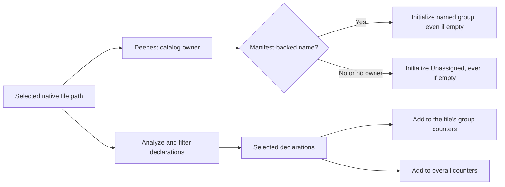

# Package Stats

Part of [Symbol Reports](../symbol-reports.md).

`--stats` replaces the listing with counts of the selected declarations by
kind, by visibility and by language, plus their doc coverage. It answers
questions such as "how much of this crate's public API is documented?"
without reading a listing:

```bash
hug symbols --stats                 # every declaration in the package
hug functions --stats --json        # the same counts as one JSON envelope
hug classes --stats --format plain  # containers only, without styling
hug symbols --exported --stats      # only what the package exports
```

```text
$ hug --plain symbols --stats
All selected declarations

┌──────────┬───────┐
│ Kind     │ Count │
├──────────┼───────┤
│ field    │     2 │
│ function │     1 │
│ method   │     2 │
│ type     │     1 │
└──────────┴───────┘

┌────────────┬───────┐
│ Visibility │ Count │
├────────────┼───────┤
│ public     │     6 │
└────────────┴───────┘

┌──────────┬───────┐
│ Language │ Count │
├──────────┼───────┤
│ Rust     │     6 │
└──────────┴───────┘

Doc coverage: 2 of 6 documented (33.3%); 0 unavailable

shapes (.)
…
Doc coverage: 2 of 6 documented (33.3%); 0 unavailable
```

## What is counted

Every selector applies first, so the counts describe exactly the
declarations a listing with the same flags would show. `classes --stats`
counts selected containers only, not their members.

`--stats` composes with the default output, `--format table` and
`--format plain` (the tables above) and with `--json` (the
[stats envelope](#stats-json---stats---json)). `--sort`, `--signatures`,
`--tree` and every other output mode are argument errors with it.

A terminal narrower than a table gets that table at its natural width,
which the terminal then wraps; the tables are never replaced by a notice.

## Package sections

Stats automatically prints **All selected declarations**, followed by one
section per selected package labeled `name (path)`. Named groups sort by
portable package path, then name; **Unassigned** comes last. Each section uses
the same tables, coverage line, and conditional synthetic-export count.
Names and paths display literally, including markup; control characters are
shown as Unicode escapes. `--format plain` emits no terminal escapes or links.



A selected file uses its deepest package boundary and only a manifest-backed
name; unnamed owners and files outside the catalog belong to Unassigned.
Selected files with zero matches or failed analysis retain a zero group with
`n/a` coverage. Packages without selected files are absent. An empty successful
`--changed` selection emits overall zeros and no groups; ordinary empty scans
retain their existing error. Synthetic exports belong to the prelude file
even when their displayed declaration location points elsewhere.

Summing the groups' category counts, coverage counts and synthetic-export
counts reproduces the overall figures. Overall coverage is computed from
overall counts, never averaged from group ratios.

The [release notes](../release-notes.md#automatic-package-sections-in-stats)
show the terminal output before and after automatic grouping.

## Doc coverage

**Doc coverage** counts `documented` declarations (`metrics.has_docs` true)
over `total` (declarations whose `has_docs` is known). Lua, Perl, Bash and
Zsh have no doc-comment detection: their declarations are counted as
`unavailable`, never as documented or undocumented. The ratio is `n/a`
(JSON `null`) when `total` is 0. Synthetic prelude exports (`--prelude`)
count in the three tables and are reported apart as `synthetic_exports`,
outside doc coverage: they count as neither known nor unavailable.

## Package discovery and errors

Stats first captures a structure-only package catalog from the active Git
worktree root, or the scan root outside Git. It does not request an inventory,
lockfiles, or network data. A discovery error fails with exit `1`, repair
guidance on stderr, and empty stdout. For example, an unclosed `members = [`
in the root Cargo manifest prevents a stats report; ordinary listings and
`--count` still analyze explicitly selected source files without that catalog.
A directory with no discovered packages remains a successful stats input,
with every file under Unassigned. Listings, `--count`, JSON Lines and
`--json-full` never acquire a package catalog.

After discovery, file failures keep the partial counters, appear once in the
top-level `errors`, and cause exit `1`.

## Stats JSON (`--stats --json`)

```json
{"report_schema_version":1,"root_dir":"/work/repo/crates/utils",
 "package_root_dir":"/work/repo",
 "stats":{"by_kind":{"Function":1},"by_visibility":{"Public":1},"by_language":{"Rust":1},
          "doc_coverage":{"documented":0,"total":1,"unavailable":0,"ratio":0.0},
          "synthetic_exports":0},
 "groups":[{"package":{"name":"utils","path":"crates/utils"},
            "stats":{"by_kind":{"Function":1},"by_visibility":{"Public":1},"by_language":{"Rust":1},
                     "doc_coverage":{"documented":0,"total":1,"unavailable":0,"ratio":0.0},
                     "synthetic_exports":0}}],
 "errors":[]}
```

`stats` retains the overall totals. Each entry in `groups` has the identical
stats shape and `package: {"name", "path"}`, or `package: null` for Unassigned.
A real package named `Unassigned` therefore remains distinct. Group paths are
relative to the portable absolute `package_root_dir`, use `/` separators, and
are `.` for a root package. That frame is the active worktree root in Git and
the scan root otherwise; `root_dir` keeps its normal scan frame, so the two
can differ when invoked inside a package: scanning `crates/utils` inside
`/work/repo`, as above, keeps that scan root while reporting the group path
`crates/utils` relative to `/work/repo`. `package_root_dir` is present even
for an empty `groups: []` report or an Unassigned-only report.

Keys are spelled as records spell kinds, visibility levels and languages.
There is no record `schema_version`, since the envelope holds no record.
`ratio` is `null` when `total` is 0. `errors` is always present and last, and
a non-empty one means exit status `1`; the envelope ends with a newline.
Additive report fields, such as `package_root_dir` and `groups`, retain
`report_schema_version: 1` because existing fields keep their meanings. The
symbol-record schema has its own version policy.
