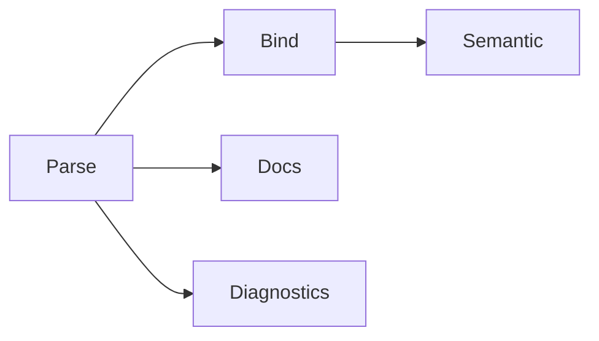

# Symbol Schema Design for Tree Hugger

## Status

Draft design for a major refactor, partly implemented. `SymbolRecord` and
`FileSymbolIndex` ship in `lib/src/shared/schema_v2/` and serialize as schema
**4.0** (the Rust module and type names keep their historical `v2`). Sections
below describe the implemented shape unless marked **planned**. Per-language
extraction rules for kinds, visibility and `static` are in
[Symbol Kinds, Visibility and `static`](./symbol-kinds-and-visibility.md).

## Context

`tree-hugger` currently extracts symbols, imports/exports, and diagnostics from multiple languages via Tree-sitter. The existing symbol model is useful but too narrow for high-fidelity static analysis, API diffing, semantic search, and richer documentation workflows.

This design proposes a new Rust schema that treats symbol metadata as composable facets with kind-specific payloads. It is intentionally broader than the current `SymbolInfo`/`TypeMetadata` model and is designed for staged adoption.

## Goals

1. Preserve syntax fidelity from Tree-sitter.
2. Support semantic enrichment in later passes without schema churn.
3. Model documentation as structured data, not only plain text.
4. Represent type information in multiple views (declared, canonical, resolved, expanded).
5. Scale across all supported languages without making Rust-specific assumptions mandatory.
6. Provide stable IDs and relationship edges for graph-based analysis.
7. Keep JSON serialization deterministic and backward-compatible via schema versioning.

## Non-Goals

1. Full type-checker parity for every language in v1.
2. Complete inter-file semantic resolution in the parse pass.
3. Perfect purity/side-effect inference in v1.

## Design Principles

1. Facet composition over giant optional structs.
2. Loss-minimizing capture: keep raw text and structured forms.
3. Incremental enrichment: parse -> bind -> semantic; parse -> docs; parse -> diagnostics.
4. Language portability with language-specific extension slots.
5. Stable public schema with explicit version field.

## High-Level Model

Each symbol record has:

1. Common facets for all symbols.
2. A discriminated `kind_data` payload with symbol-kind-specific fields.
3. Optional enrichment facets populated by later analysis passes.

```text
SymbolRecord
├── identity
├── source
├── visibility
├── docs
├── attributes
├── modifiers
├── type_info
├── relations
├── semantics
├── provenance
└── kind_data (Function | Type | Enum | Module | ...)
```

## Proposed Rust Types

### Core Primitives

```rust
#[derive(Debug, Clone, PartialEq, Eq, Hash, Serialize, Deserialize)]
pub struct SymbolId(pub String);

#[derive(Debug, Clone, PartialEq, Eq, Hash, Serialize, Deserialize)]
pub struct TypeId(pub String);

#[derive(Debug, Clone, Copy, PartialEq, Eq, Serialize, Deserialize)]
pub struct SchemaVersion {
    pub major: u16,
    pub minor: u16,
}

#[derive(Debug, Clone, Copy, PartialEq, Eq, Serialize, Deserialize)]
pub struct TextPoint {
    pub line: u32,   // 1-based
    pub column: u32, // 1-based UTF-8 column
}

#[derive(Debug, Clone, PartialEq, Eq, Serialize, Deserialize)]
pub struct TextSpan {
    pub start: TextPoint,
    pub end: TextPoint,
    pub start_byte: u32,
    pub end_byte: u32,
}
```

### Top-Level Symbol Record

```rust
#[derive(Debug, Clone, Serialize, Deserialize)]
pub struct SymbolRecord {
    pub schema_version: SchemaVersion,
    pub id: SymbolId,
    pub language: ProgrammingLanguage,
    pub kind: SymbolKindV2,
    pub scope: SymbolScope,                 // Item, Member or Local
    pub identity: IdentityFacet,
    pub source: SourceFacet,
    pub visibility: VisibilityFacet,
    pub docs: DocsFacet,
    pub attributes: Vec<Attribute>,
    pub modifiers: Vec<Modifier>,
    pub type_info: TypeFacet,
    pub relations: RelationFacet,
    pub semantics: SemanticFacet,
    pub metrics: Option<MetricsFacet>,      // absent unless requested
    pub provenance: ProvenanceFacet,
    pub kind_data: SymbolKindData,
    pub extensions: std::collections::BTreeMap<String, serde_json::Value>,
}
```

**Additive 4.x fields.** `scope`, `identity.qualified_name` (now always
present), `identity.is_namespace_rooted`, the `Async` entry of `modifiers`,
`visibility.is_test`, values for the existing `visibility.is_deprecated` and
the `metrics` facet were added on top of 4.0 without a version bump;
`EXTRACTOR_REVISION` moved on instead (it is 9 now), so no cache entry written
without them is served. Three parts of the record are declared but still empty on every
record: `attributes`, `type_info.generic_params`, and the type links of
`relations` (`extends`, `overrides`, and `implements` outside Rust; see
[Relation Facet](#relation-facet)).

| Fact | When computed |
|---|---|
| `scope`, the `async` modifier, the in-file `qualified_name` | always, for every declaration (also those a kind selection leaves out) |
| `visibility.is_test`, `visibility.is_deprecated` | with `Capability::Flags`; without it both are `false`, meaning "not computed" (`hug --json`, `--jsonl` and `--json-full` always ask for it) |
| `metrics` (`parameters`, `has_docs`) | with `Capability::Metrics`, on every selected record; without it the facet is absent (`hug --json-full` and `--stats` ask for it) |

Scope, `async` and the qualified name are lightweight and every record needs
them (the qualified name feeds the ID, and scope decides the default
listing). The flags and metrics read more of the syntax tree (attributes,
test-file names, parameter lists, doc comments), so only a filter or report
that uses them computes them. JSON output always asks for the flags, so a
`false` there always means "computed and not set".

```rust
pub enum SymbolScope { Item, Member, Local }

pub struct MetricsFacet {
    pub parameters: Option<u32>,  // `null` = unsupported for this declaration
    pub has_docs: Option<bool>,   // `null` = no doc-comment detection
}
```

Inside a present `metrics` facet both keys are required: `null` means the
metric is unsupported, and an absent key is malformed. An absent facet means
"not requested". `parameters` is the length of the declaration's own
parameter list (every list of a curried Scala `def`), counting a parameter
bound by a pattern (`(a, b): (u32, u32)`, `_`, `{x}`) like a named one,
without a Rust `self` (a Go receiver has its own list), one variadic
parameter counting once; it is `null` for a declaration that is not
a function, one with no parameter list (`def area: Int` in Scala), and in
Perl, Bash and Zsh. `has_docs` is whether `docs.raw_doc` is present; it is
`null` in Lua, Perl, Bash and Zsh, which have no doc-comment detection. A
predicate never matches a `null` metric, so `undocumented(true)` skips a Lua
function rather than reporting it as undocumented:

```json
"metrics": { "parameters": 2, "has_docs": false }   // Python: measured
"metrics": { "parameters": null, "has_docs": null } // Bash: both unsupported
                                                     // no "metrics" key: not requested
```

The flag rules are in
[Deprecation and test flags](./symbol-kinds-and-visibility.md#deprecation-and-test-flags),
which comments count as documentation in
[Documentation](./symbol-kinds-and-visibility.md#documentation), and the
metric definitions in [Metrics](./symbol-kinds-and-visibility.md#metrics).
Scope rules are in [Scope](./symbol-kinds-and-visibility.md#scope).

### Symbol Kind and Payload

```rust
#[derive(Debug, Clone, Copy, PartialEq, Eq, Serialize, Deserialize)]
pub enum SymbolKindV2 {
    Function,
    Method,
    Constructor,
    Type,
    Class,
    Interface,
    Enum,
    Trait,
    Module,
    Namespace,
    Field,
    Property,
    Variable,
    Constant,
    Parameter,
    TypeAlias,
    EnumVariant,
    Macro,
    Unknown,
}

#[derive(Debug, Clone, Serialize, Deserialize)]
#[serde(tag = "kind_data_type", content = "data")]
pub enum SymbolKindData {
    Function(FunctionData),
    Type(TypeData),
    TypeAlias(TypeAliasData),
    Enum(EnumData),
    Field(FieldData),
    Module(ModuleData),
    Variable(VariableData),
    Parameter(ParameterSymbolData),
    Unknown,
}

pub struct ParameterSymbolData {
    pub name: String,
    pub position: u16,
    pub type_text: Option<String>,
}
```

## Facets

### Identity Facet

```rust
#[derive(Debug, Clone, Serialize, Deserialize)]
pub struct IdentityFacet {
    pub name: String,
    pub display_name: String,
    pub qualified_name: String,                    // in-file name, never empty
    pub is_namespace_rooted: bool,                 // starts at a declared namespace
    pub container_name: Option<String>,            // the container's name
    pub container_kind: Option<SymbolKindV2>,      // the container's kind
    pub keyword: Option<String>,                   // the declaring keyword
    pub stable_key: String, // language + file + kind + qualified name + ordinal
}
```

`stable_key` is deterministic and used to produce `SymbolId`. It joins the
language, the file's identity, the kind, the in-file `qualified_name` and the
record's order among records of that kind and qualified name
(`rust::/repo/src/shapes.rs::Method::Point::norm::0`), so IDs do not depend on
the scan root or on how the file's path was spelled. Before revision 7 the
key used `container::name` with `::` in every language; switching to the
native in-file spelling changed every symbol ID, and every relation and
export ID that points at one, once. Cache entries from before the change are
never served, because the revision is part of the cache key.

`qualified_name` is built from the file's own source with the language's
separators (`schema::Record::load`, `com.example.Point.area`,
`App\Models\User::find`). A file or module **prefix** is not stored: a query
result adds it after the cache lookup, from the query's scan root or naming
context (`src/shapes.rs#Point::norm`, `crate::shapes::Point::norm`), which is
why neither is a cache-key input. `is_namespace_rooted` marks names that
already start at a declared `package` or `namespace` and so get no prefix.

```rust
let query = SymbolQuery::new()
    .naming_context(NamingContext::new("crate/src", "crate"));
let result = cache.query(SourceFile::read("crate/src/shapes.rs")?, &query)?.result; // a SymbolCache
// stored in the entry:  Point::norm
// in result:            crate::shapes::Point::norm
// result.name_prefix(): "crate::shapes::"
```

The naming context is **library-only**: `hug` never sets one, so its Rust and
Python names always take the file form. A file outside the context's root
falls back to the file prefix. The prefix and the query's predicates are
applied in one last step, `SymbolQueryResult::finish`, on every result
(cached or not), and `name_prefix()` reports the prefix so a caller can strip
it back to the stored name. The prefix rules are in
[Qualified names](./symbol-kinds-and-visibility.md#qualified-names).

`container_name` holds the name of the symbol's nearest container (a class, trait,
module, or the implemented type of a Rust `impl`), and `container_kind` holds
that container's kind as extracted from its own declaration. `container_kind`
is omitted when there is no container or the file cannot tell its kind, for
example a Rust `impl` for a type declared in another file:

```json
"identity": {
  "name": "fmt",
  "qualified_name": "PublicStruct::fmt",
  "is_namespace_rooted": false,
  "container_name": "PublicStruct",
  "container_kind": "Type",
  "keyword": "fn"
}
```

`container_name` is a display name and may be shared by several records (two
`Boxed` structs in different Rust `mod`s). The containment link
(`relations.parent`, `relations.container`, the owner's `relations.members`)
identifies the owner by record ID: the smallest same-named declaration
around the member, else the same-named record of `container_kind` whose
qualified name qualifies the member's (`right::Boxed` for
`right::Boxed::work`), else the only such record whose qualified name ends
with the member's owner path (the member's qualified name without its last
segment); with several and none qualifying, the member has no parent. A
lone same-named record never overrides a qualification that names another
owner: beside a local `W`, the method of `impl other::W` is
`other::W::probe` with no parent, and `container_kind` is likewise read
only from same-named records that agree with that owner path.

`keyword` is the grammar token that introduces the declaration, such as `fn`,
`struct`, `def`, `func`, `const`, `let`, `var`, `class`, `protocol`, `sub`,
`my` or `#define`. It is read from the syntax tree, never from source text, so
a comment that names a keyword cannot supply one. It is one token: Scala
`case class` reports `class`, C++ `enum class` reports `enum`, Swift
`class func` reports `func`. It is omitted when the construct has none, for
example a Java or C# method, a C variable or a TypeScript class member. For a
Go `const`/`var` spec and a Lua or shell `local`, the keyword belongs to the
statement that wraps the declaration, so it is reported even though
`declaration_text` does not contain it. Per-language keywords are listed in
[Symbol Kinds, Visibility and `static`](./symbol-kinds-and-visibility.md#declaring-keywords).

### Source Facet

```rust
#[derive(Debug, Clone, Serialize, Deserialize)]
pub struct SourceFacet {
    pub file_path: std::path::PathBuf,
    pub declaration_span: TextSpan,
    pub body_span: Option<TextSpan>,
    pub name_span: Option<TextSpan>,
    pub doc_span: Option<TextSpan>,
    pub source_text: Option<String>,
    pub declaration_text: Option<String>,
    pub signature_text: Option<String>,
    pub body_text: Option<String>,
}
```

`source_text` and `body_text` should be feature-gated or size-limited for large-scale indexing.

`declaration_text` is filled for every record: the declaration from its start
up to, but not including, its body, trailing whitespace trimmed (a bodyless
declaration contributes its whole text). It keeps the modifiers, access
keywords and attributes the grammar parses inside the declaration node, so
syntax a `VisibilityLevel` cannot express survives:

| Declaration | `declaration_text` |
|---|---|
| `pub(in crate::a) fn f() { … }` | `pub(in crate::a) fn f()` |
| `public int Count { get; private set; }` | `public int Count { get; private set; }` |
| `private[Shape] def secret() = 2` | `private[Shape] def secret() =` |

Doc comments and syntax outside the declaration node (a Rust `#[…]` attribute,
a Python decorator, a TypeScript `export` wrapper) are not included.

`signature_text` is the display header: the part of the same declaration a
reader needs to recognize the symbol. It is always a contiguous part of
`declaration_text`, filled from the same node in the same extraction pass:

- outer whitespace is stripped; internal whitespace and line breaks are kept
- it excludes initializers, accessor lists (C# `{ get; set; }`, Swift
  `{ get }`), the annotations, attributes and decorators that come before the
  first modifier or keyword, doc comments, a `;` (Lua: `end`) terminator, and
  the `=`, `=>` or `:` that introduces a body
- an annotation written between modifiers stays, because removing it would
  break contiguity
- it is omitted when no contiguous header can be isolated: a C/C++
  declaration whose type carries a body (`typedef struct { … } Point;`), or a
  second name that an earlier name's initializer would cut off
  (`int a = 1, b = 2;` for `b`)
- each type of a grouped Go `type ( … )` block is declared by its own spec,
  so `Second` in `type ( First struct{ a int }; Second int )` has the
  declaration text, header and span `Second int`; the `type` keyword is
  still its `keyword`

The three fields have distinct contracts: `declaration_text` is evidence,
`signature_text` is display, and `keyword` comes from the syntax tree rather
than either text.

| Declaration | `declaration_text` | `signature_text` | `keyword` |
|---|---|---|---|
| `pub(in crate::a) fn f() { … }` | `pub(in crate::a) fn f()` | `pub(in crate::a) fn f()` | `fn` |
| `pub const TABLE: [u8; 256] = [0, 1, …];` | `pub const TABLE: [u8; 256] = [0, 1, …];` | `pub const TABLE: [u8; 256]` | `const` |
| `public private(set) var count = 0` | `public private(set) var count = 0` | `public private(set) var count` | `var` |
| `@Override public void run() { … }` | `@Override public void run()` | `public void run()` | omitted |
| `public @Deprecated static void m() { … }` | `public @Deprecated static void m()` | `public @Deprecated static void m()` | omitted |
| `private[Shape] def secret() = 2` | `private[Shape] def secret() =` | `private[Shape] def secret()` | `def` |
| `public int Count { get; private set; }` | `public int Count { get; private set; }` | `public int Count` | omitted |

A type alias's aliased type counts as its initializer: `pub type Alias = u32;`
has the header `pub type Alias` (the aliased type is in `kind_data`). A C
`typedef` names the alias last, so `typedef unsigned long Count;` keeps its
whole text.

`body_text` is not yet filled (**planned**).

### Visibility Facet

```rust
#[derive(Debug, Clone, Copy, PartialEq, Eq, Serialize, Deserialize)]
pub enum VisibilityLevel {
    Public,
    Protected,
    Private,
    Internal,
    Package,
    Crate,
    ModulePrivate,
    ProtectedInternal, // C# `protected internal`
    PrivateProtected,  // C# `private protected`
    Unknown,
}

#[derive(Debug, Clone, Serialize, Deserialize)]
pub struct VisibilityFacet {
    pub level: VisibilityLevel,
    pub is_exported: bool,
    pub is_reexported: bool,
    pub is_default_export: bool,
    pub is_imported: bool,
    pub is_external: bool,
    pub is_generated: bool,
    pub is_synthetic: bool,
    pub is_deprecated: bool,
    pub is_experimental: bool,
    pub is_test: bool,          // test-only code (Capability::Flags)
}
```

**Visibility ownership.** `level` is the only home of a symbol's access level:
the access declared or implied at the declaration, not effective access
through enclosing modules or types. `Unknown` covers declarations without
access rules (parameters, locals, Python, Perl, shell) and access the file
cannot establish. The v1 model mirrors it as `SymbolInfo::visibility`
(`Unknown` is `None`); `FunctionSignature` has no visibility, and a type's
`FieldInfo::visibility` is a copy of the matching standalone field's level.

**Export is separate from visibility.** `is_exported` comes only from export
syntax (`export` in JavaScript/TypeScript, a `pub…` Rust item; never a member)
and the bind pass. A Public level never implies an export, so a Public Java
class or TypeScript class method has `is_exported: false`, and a record
converted from a v1 `SymbolInfo` is never exported.

### Documentation Facet

```rust
#[derive(Debug, Clone, Serialize, Deserialize)]
pub enum CommentKind {
    Doc,
    Line,
    Block,
}

#[derive(Debug, Clone, Serialize, Deserialize)]
pub enum CommentAttachment {
    Leading,
    Trailing,
    Inline,
    Detached,
}

#[derive(Debug, Clone, Serialize, Deserialize)]
pub struct AttachedComment {
    pub kind: CommentKind,
    pub attachment: CommentAttachment,
    pub span: TextSpan,
    pub raw_text: String,
    pub cleaned_text: String,
    pub line_distance: Option<u16>,
}

#[derive(Debug, Clone, Serialize, Deserialize)]
pub struct DocParam {
    pub name: String,
    pub description: String,
}

#[derive(Debug, Clone, Serialize, Deserialize)]
pub struct DocTag {
    pub name: String, // param, returns, throws, deprecated, see, example, ...
    pub value: String,
}

#[derive(Debug, Clone, Default, Serialize, Deserialize)]
pub struct ParsedDocs {
    pub summary: Option<String>,
    pub params: Vec<DocParam>,
    pub returns: Option<String>,
    pub tags: Vec<DocTag>,
}

#[derive(Debug, Clone, Default, Serialize, Deserialize)]
pub struct DocsFacet {
    pub raw_doc: Option<String>,
    pub comments: Vec<AttachedComment>,
    pub parsed: Option<ParsedDocs>, // None until the docs pass runs
}
```

**Planned:** dedicated `description`, `throws`, `examples`, `remarks`,
`deprecated_message` and `since` fields; today such tags land in `tags`.

This preserves raw and parsed docs to avoid information loss.

### Attributes and Modifiers

```rust
#[derive(Debug, Clone, Serialize, Deserialize)]
pub struct Attribute {
    pub name: String,
    pub value: Option<String>,
}

#[derive(Debug, Clone, Serialize, Deserialize)]
#[serde(tag = "type", content = "value")]
pub enum Modifier {
    Static,        // member usable without an instance
    StaticStorage, // storage or linkage `static`; never implies Static
    Async,
    Const,
    Readonly,
    Unsafe,
    Mut,
    Custom(String),
}
```

`Static` and `StaticStorage` are the two meanings of the `static` keyword.
`Static` marks a member used without an instance (Java/C#/TS `static`, Python
`@classmethod`, a Rust associated function without `self`, a Java interface
constant). `StaticStorage` marks Rust `static` items and C/C++ file-scope,
namespace-scope and function-local `static`. The v1 model carries them as
`SymbolInfo::is_static` and `SymbolInfo::is_static_storage`.

**Planned:** further modifiers (`Abstract`, `Final`, `Sealed`, `Open`,
`Virtual`, `Override`, `Extern`, `Generator`).

### Type Facet

```rust
#[derive(Debug, Clone, Copy, PartialEq, Eq, Serialize, Deserialize)]
pub enum TypeViewKind {
    Declared,
    Canonical,
    Resolved,
    Expanded,
}

#[derive(Debug, Clone, Serialize, Deserialize)]
pub struct TypeView {
    pub kind: TypeViewKind,
    pub text: Option<String>,
    pub ast: Option<serde_json::Value>,
    pub referenced_symbol_ids: Vec<SymbolId>,
}

#[derive(Debug, Clone, Copy, PartialEq, Eq, Serialize, Deserialize)]
pub enum GenericParamKind {
    Type,
    Lifetime,
    Const,
}

#[derive(Debug, Clone, Serialize, Deserialize)]
pub struct GenericParam {
    pub name: String,
    pub kind: GenericParamKind,
    pub constraints: Vec<String>,
    pub default: Option<String>,
    pub variance: Option<String>,
    pub position: u16,
}

#[derive(Debug, Clone, Default, Serialize, Deserialize)]
pub struct TypeFacet {
    pub primary_type: Option<String>,
    pub views: Vec<TypeView>,
    pub generic_params: Vec<GenericParam>,
    pub constraints: Vec<String>,
    pub nullability: Option<String>,
}
```

`ast` can begin as lightweight JSON from Tree-sitter nodes and evolve later to a strongly typed internal AST.

### Relation Facet

```rust
#[derive(Debug, Clone, Serialize, Deserialize)]
pub struct SymbolRef {
    pub id: Option<SymbolId>,   // unresolved references keep this None
    pub name: String,
    pub qualified_name: Option<String>,
}

#[derive(Debug, Clone, Default, Serialize, Deserialize)]
pub struct RelationFacet {
    pub parent: Option<SymbolRef>,
    pub container: Option<SymbolRef>,
    pub members: Vec<SymbolRef>,
    pub extends: Vec<SymbolRef>,
    pub implements: Vec<SymbolRef>,
    pub overrides: Vec<SymbolRef>,
    pub references: Vec<SymbolRef>,
    pub referenced_by: Vec<SymbolRef>,
    pub dependencies: Vec<SymbolRef>,
    pub related: Vec<SymbolRef>,
}
```

`implements` is filled for Rust trait-impl members: each member of
`impl Trait for Type` carries one entry named after the trait's last path
segment without generic arguments (`impl fmt::Display for Point` gives
`Display`), with `id` set when exactly one trait of that name is declared in
the same file. Members
of an inherent impl have an empty list, and the trait never appears in the
container. Other languages do not fill it yet (**planned**).

### Semantic Facet

```rust
#[derive(Debug, Clone, Copy, PartialEq, Eq, Serialize, Deserialize)]
pub enum TriState {
    Yes,
    No,
    Unknown,
}

#[derive(Debug, Clone, Default, Serialize, Deserialize)]
pub struct SemanticFacet {
    pub is_pure: Option<TriState>,
    pub has_side_effects: Option<TriState>,
    pub may_throw: Option<TriState>,
    pub may_panic: Option<TriState>,
    pub is_recursive: Option<TriState>,
    pub mutates_self: Option<TriState>,
    pub mutates_arguments: Option<TriState>,
    pub reads_global_state: Option<TriState>,
    pub writes_global_state: Option<TriState>,
    pub allocates: Option<TriState>,
    pub blocks: Option<TriState>,
}
```

`Option<TriState>` intentionally distinguishes "not analyzed" from "analyzed unknown".

`is_recursive` is `Some(Unknown)` on every function and method whenever the
semantic pass runs, and `None` when it did not run. References are bound by
name only (see [Extraction Pipeline Contract](#extraction-pipeline-contract)),
which can neither prove that a same-named call targets the enclosing function
nor that none does, so a `Yes` or `No` would be a guess:

```rust
fn countdown(n: u32) -> u32 { if n == 0 { 0 } else { countdown(n - 1) } }
// semantic pass ran:     "semantics": { "is_recursive": "Unknown", ... }
// semantic pass not run: "semantics": {}
```

### Provenance Facet

```rust
#[derive(Debug, Clone, Serialize, Deserialize)]
pub struct ProvenanceFacet {
    pub extractor: String, // e.g. "tree-sitter"
    pub extractor_version: String,
    pub parse_pass: String, // parse, bind, semantic, docs
}
```

Records carry no wall-clock time, so two runs over the same files produce
identical records and identical cache entries.

## Kind-Specific Payloads

### Function and Method Data

```rust
#[derive(Debug, Clone, Serialize, Deserialize)]
pub enum ReceiverKind {
    Value,
    Ref,
    MutRef,
    This,
    Custom(String),
}

#[derive(Debug, Clone, Serialize, Deserialize)]
pub struct ReceiverInfo {
    pub name: String,
    pub kind: ReceiverKind,
    pub type_text: Option<String>,
}

#[derive(Debug, Clone, Serialize, Deserialize)]
pub struct ParameterData {
    pub name: String,
    pub position: u16,
    pub label: Option<String>,
    pub type_text: Option<String>,
    pub type_ast: Option<serde_json::Value>,
    pub default_value: Option<String>,
    pub is_optional: bool,
    pub is_variadic: bool,
    pub is_keyword_only: bool,
    pub is_positional_only: bool,
    pub mutability: Option<String>,
    pub ownership_mode: Option<String>,
    pub docs: Option<String>,
    pub attributes: Vec<Attribute>,
}

#[derive(Debug, Clone, Serialize, Deserialize)]
pub struct ReturnData {
    pub type_text: Option<String>,
    pub type_ast: Option<serde_json::Value>,
    pub error_type: Option<String>,
    pub yields_type: Option<String>,
    pub never_returns: bool,
}

#[derive(Debug, Clone, Serialize, Deserialize)]
pub struct FunctionData {
    pub receiver: Option<ReceiverInfo>,
    pub parameters: Vec<ParameterData>,
    pub return_info: ReturnData,
    pub abi: Option<String>,
    pub calling_convention: Option<String>,
    pub is_variadic: bool,
    pub arity: u16,
    pub overload_set: Vec<SymbolRef>,
}
```

`return_info.type_text` and each parameter's `type_text` are the type text
the source declares, never an inferred one: a Rust function without `->` and
a Go function without a result have no return type text (before revision 9,
Rust reported `()` and a Go method its own parameter list).

### Type/Class/Interface/Trait Data

```rust
#[derive(Debug, Clone, Serialize, Deserialize)]
pub struct FieldData {
    pub name: String,
    pub qualified_name: Option<String>,
    pub type_text: Option<String>,
    pub visibility: Option<VisibilityLevel>,
    pub is_static: bool,
    pub is_readonly: bool,
    pub is_mutable: bool,
    pub is_optional: bool,
    pub default_value: Option<String>,
    pub docs: Option<String>,
}

#[derive(Debug, Clone, Serialize, Deserialize)]
pub struct TypeData {
    pub members: Vec<SymbolRef>,  // methods, fields, nested types
    pub fields: Vec<FieldData>,   // denormalized convenience
    pub constructors: Vec<SymbolRef>,
    pub associated_types: Vec<String>,
    pub associated_constants: Vec<String>,
    pub is_abstract: bool,
    pub is_final: bool,
    pub is_sealed: bool,
    pub is_open: bool,
    pub is_partial: bool,
}
```

### Enum and Type Alias Data

```rust
#[derive(Debug, Clone, Serialize, Deserialize)]
pub struct EnumVariantData {
    pub name: String,
    pub discriminant: Option<String>,
    pub tuple_fields: Vec<String>,
    pub struct_fields: Vec<FieldData>,
    pub docs: Option<String>,
}

#[derive(Debug, Clone, Serialize, Deserialize)]
pub struct EnumData {
    pub backing_type: Option<String>,
    pub variants: Vec<EnumVariantData>,
}

#[derive(Debug, Clone, Serialize, Deserialize)]
pub struct TypeAliasData {
    pub aliased_type_text: Option<String>,
    pub aliased_type_ast: Option<serde_json::Value>,
    pub is_recursive: bool,
}
```

### Module and Variable Data

```rust
#[derive(Debug, Clone, Serialize, Deserialize)]
pub struct ModuleData {
    pub members: Vec<SymbolRef>,
}

#[derive(Debug, Clone, Serialize, Deserialize)]
pub struct VariableData {
    pub type_text: Option<String>,
    pub initializer_text: Option<String>,
    pub is_const: bool,
}
```

## Package-Level Container

```rust
#[derive(Debug, Clone, Serialize, Deserialize)]
pub struct FileSymbolIndex {
    pub schema_version: SchemaVersion,
    pub file: std::path::PathBuf,
    pub language: ProgrammingLanguage,
    pub file_hash: String,
    pub completed_passes: Vec<AnalysisPass>, // only the passes that ran
    pub symbols: Vec<SymbolRecord>,
    pub imports: Vec<ImportRecord>,
    pub exports: Vec<ExportRecord>,
    pub diagnostics: Vec<Diagnostic>,
}
```

`ImportRecord` and `ExportRecord` carry a `symbol: SymbolRef`, aligned with `RelationFacet`.

## ID Strategy

1. Compute `stable_key` as: `<language>::<file_identity>::<Kind>::<in_file_qualified_name>::<sibling_ordinal>`, where `<file_identity>` is the file's [identity](./cache-design.md#file-identity) with `\` written as `/`, `<Kind>` is the `SymbolKindV2` variant name (`Method`), the qualified name is the stored one without any display prefix, and `<sibling_ordinal>` counts the earlier records in the file with the same kind and qualified name (`0` for the first). For example `rust::/repo/src/shapes.rs::Method::Point::norm::0`.
2. Hash `stable_key` with BLAKE3 and encode as lowercase hex.
3. Keep both hashed `id` and unhashed `stable_key` for debugging and diff tooling.

## Extraction Pipeline Contract

A file is analyzed in up to five passes (`AnalysisPass`):

1. **Parse** (Tree-sitter): identity, source, modifiers, declared signatures,
   raw comments, and the file's import and export records.
2. **Bind**: parent/container and members, references, dependencies,
   referenced-by edges, export targets.
3. **Semantic**: inferred flags (panics, recursion; see
   [Semantic Facet](#semantic-facet)).
4. **Docs**: doc comments parsed into structured `ParsedDocs`.
5. **Diagnostics**: lint (pattern and semantic rules) and syntax diagnostics
   in `FileSymbolIndex::diagnostics`.

### What runs, and in which order

A caller asks for the work it needs and the planner adds the prerequisites,
removes duplicates and runs each pass once, in this order:



| Request | Passes that run (`completed_passes`) |
|---|---|
| `symbol_index_with_passes(&[])` | Parse |
| `&[Docs, Semantic, Semantic]` | Parse, Bind, Semantic, Docs |
| `&[Diagnostics]` | Parse, Diagnostics |
| `TreeFile::symbol_index_v2()` | Parse, Bind, Semantic, Docs, Diagnostics |

`completed_passes` lists only work that ran. An index without `Diagnostics`
has an empty `diagnostics` list because they were not computed, not because
the file is clean. `symbol_index_v2()` is the complete-index convenience API
and always includes diagnostics; `symbol_index_with_passes` includes them only
when `AnalysisPass::Diagnostics` is requested.

Each pass that changes a record updates its `provenance.parse_pass`
(diagnostics change no record).

### Selective queries

`SymbolQuery` asks for kinds and capabilities rather than passes, through the
same planner. `SourceFile::read(path)?.query(&query)` and
`TreeFile::query(&query)` accept the same query:

```rust
let query = SymbolQuery::new()
    .kinds([SymbolKindV2::Function, SymbolKindV2::Method])
    .capabilities([Capability::Containment]);
let result = SourceFile::read("src/lib.rs")?.query(&query)?;
// result.index.symbols: the functions and methods only
// result.index.completed_passes: [Parse]
// result.completed_capabilities: [Declarations, Containment]
```

| Capability | Requires | Produces |
|---|---|---|
| `Declarations` (always) | — | the parse pass |
| `Containment` | Declarations | `relations.parent`, `container`, `members` only; no reference query |
| `References` | Containment | the bind pass |
| `Semantics` | References | the semantic pass |
| `StructuredDocs` | Declarations | the docs pass |
| `Diagnostics` | Declarations | the diagnostics pass |
| `Flags` | Declarations | `visibility.is_test` and `is_deprecated`, read while records are built (no extra pass) |
| `Metrics` | Declarations | the `metrics` facet, read while records are built (no extra pass) |

`completed_capabilities` records work narrower than a pass, such as
containment without references, so an empty facet can be told apart from one
that was never computed. `selected_kinds` records the kind selection (`None`
for every kind).

A result can answer a narrower query without parsing again:
`result.narrowed(&narrower)` returns exactly what `narrower` computes over
the same source *now*, or `None` when the result lacks one of its kinds or
capabilities. Facts read from the source are reused; the file-wide test
rules and the name prefix, which read the filesystem, are decided again, so a
`Cargo.toml` added or removed since the result was made is honored (see
[Cache Design](./cache-design.md#test-flags-source-facts-are-stored-file-wide-rules-are-not)).
A `None` means "analyze again"; `hug --prelude` uses `narrowed` to reuse the
prelude's every-kind analyses in the scan and analyzes the file when it gets
`None`.

The same query can be served from the persistent cache:
`SymbolCache::query(SourceFile::read(path)?, &query)` returns exactly this
result, reading the file's entry when it covers the query's kinds and
capabilities and widening the entry when it does not (see
[Cache Design](./cache-design.md)).

Predicates select records within the kinds. Each is applied to the result
after analysis and cache lookup, so it never changes a cache entry or an ID;
a list predicate matches when any of its values does, and every predicate must
match:

```rust
let query = SymbolQuery::new()
    .kinds([SymbolKindV2::Function, SymbolKindV2::Method])
    .scopes([SymbolScope::Item, SymbolScope::Member])
    .visibility(VisibilityLevel::Public)
    .exclude_tests(true)
    .name(NamePattern::new("parse"))
    .scan_root("tree-hugger");
```

| Predicate | Keeps | Pushes into the plan |
|---|---|---|
| `scopes([..])` | records in one of the scopes | — |
| `visibility(level)` (repeatable) | records whose level is exactly one of them; `Unknown` matches only `Unknown` | — |
| `exported(true)` | `visibility.is_exported` records | — |
| `exclude_tests(true)` / `tests_only(true)` (the last call wins) | records whose `is_test` is false / true | `Flags` |
| `deprecated(true)` | `is_deprecated` records | `Flags` |
| `undocumented(true)` | records whose `metrics.has_docs` is `Some(false)`; `None` never matches | `Metrics` |
| `is_async(true)` | functions with the `Async` modifier | function kinds |
| `returns(glob)` | functions whose declared return type text matches | function kinds |
| `param_type(glob)` | functions with a parameter (not a Rust `self`) whose declared type text matches | function kinds |
| `min_params(n)` | functions whose `metrics.parameters` is at least `n`; `None` never matches | function kinds, `Metrics` |
| `in_container(pattern)` (repeatable) | records whose `container_name` matches; a qualified pattern matches the enclosing declaration's qualified name | — |
| `name(pattern)` (repeatable) | records whose name matches; a qualified pattern matches the displayed `qualified_name` | — |
| `exclude_name(pattern)` (repeatable) | drops matching records; wins over every inclusion | — |

"Function kinds" are Function, Method and Constructor, intersected with any
kind selection whatever order the builder calls come in; a pushed capability
appears in `completed_capabilities`. A `NamePattern` uses smart case (no
uppercase letter: case-insensitive), matches a substring unless it has `*`
(whole-string wildcard) or is exact (`NamePattern::exact` or a trailing `!`:
whole-string, `*` literal), and is qualified when it holds `#` or the
language's separator. Type globs (`glob_match`) are whole-string and
case-sensitive. `SymbolQuery::matches(record)` applies the same predicates to
any record.

A filtered result narrows (`narrowed`) only to a query with the same
predicates and the same prefix and, when a test selector filtered it, only
while the file-wide test decision it was filtered under still holds (a record
the selector dropped could match now); an unfiltered one narrows to any
covered query and is re-prefixed for it.

Kind selection skips work but never data a selected record depends on.
Declarations of unselected kinds are still extracted with their identity,
spans and container, because they can own or shadow a selected symbol; only
their metadata (visibility, `static` flags, signatures, type metadata, doc
comments, header texts) is skipped, and they are dropped from the result after
binding. A selected method therefore keeps its unselected class as
`relations.parent`, and its references resolve exactly as in a full query.
When a type kind is selected, its Field, Property and Constant members keep
their metadata too, because the type's field list copies their access and
`static` flags. A narrow query's records equal the same records of a full
query with the same capabilities.

### Work done once per file

One analysis runs the definition (locals) query once; the records, the export
records, the reference filter and the semantic lint rules all read that one
result. Metadata is extracted after duplicate captures of the same name and
span are removed: the winning capture (highest kind priority, the first of
equal priority) supplies each field, and a later equal-priority capture is
read only for a field the winner lacks.

`tree_hugger::work_counters()` counts lint-diagnostics runs, parser
constructions and definition-query executions process-wide (atomics, so work
on any thread is counted); tests compare two snapshots with
`WorkCounters::since`.

### Binding by name

References bind by name only: a reference targets the first record with that
name in the file, found through a name index built once per file rather than
a scan per reference. An owner's `references`, `dependencies` and
`referenced_by` list each target once: resolved references repeat when their
IDs are equal, unresolved ones (no ID, such as an import) when their name and
qualified name are equal. Two unresolved references are never equal just
because both lack an ID:

```python
from os import path
from sys import argv

def run():          # references: path, argv (both unresolved, path once)
    path.join("a")
    path.join("b")
    return argv
```

## Serialization and Compatibility

1. Derive `Serialize`/`Deserialize` on all public schema structs.
2. Use `#[serde(default)]` for forward-compatible additions.
3. Use `#[serde(skip_serializing_if = "...")]` for optional large fields (`source_text`, `body_text`, AST blobs).
4. Version schema with `SchemaVersion` and bump:
   1. `minor` for additive fields.
   2. `major` for breaking changes (renames, semantic changes, enum variant removals).
5. Readers of persisted data apply their own rule on top: the symbol cache
   serves an entry only when the entry and every record in it are exactly the
   current version, minor included, and recomputes anything else (see
   [the cache design](./cache-design.md#schema-versions)).

Version history:

| Version | Change |
|---|---|
| 2.0 | first emitted record shape; no longer emitted |
| 3.0 | kinds decided at extraction (Constructor, Property, TypeAlias, EnumVariant no longer collapse to Unknown); visibility for every kind with the C# compound levels; `Modifier::StaticStorage`; `identity.container_kind`; `declaration_text`; Rust `relations.implements`; `is_exported` no longer derived from a Public level. Emitted on records, file indexes, CLI envelopes and analyzer fingerprints |
| 4.0 (current) | `identity.module_path` renamed `container_name`; `identity.keyword` added; `source.signature_text` filled; `provenance.created_at_epoch_ms` and `updated_at_epoch_ms` removed. Emitted on records, file indexes, CLI envelopes and analyzer fingerprints. Later extended, still as 4.0, with the [additive 4.x fields](#top-level-symbol-record) |

The additive 4.x fields did not follow the minor-bump rule (4.1 above):
records still say 4.0. A consumer of 4.0 output only sees new keys, but
`scope`, `identity.qualified_name`, `identity.is_namespace_rooted` and
`visibility.is_test` are required when a record is read back, so a record
written before them does not deserialize. Within this crate, persisted
records are read back only by the symbol cache, which never meets such a
record because the extractor revision in its key changed with them.

A record before and after 4.0 (other fields unchanged):

```json
// 3.0
"identity": { "name": "fmt", "module_path": "PublicStruct", "container_kind": "Type" },
"source": { "declaration_text": "fn fmt(&self, f: &mut Formatter) -> Result" },
"provenance": { "extractor": "tree-sitter", "extractor_version": "0.1.0+rev.4",
                "parse_pass": "docs", "created_at_epoch_ms": 1759500000000,
                "updated_at_epoch_ms": 1759500000004 }

// 4.0
"identity": { "name": "fmt", "container_name": "PublicStruct", "container_kind": "Type",
              "keyword": "fn" },
"source": { "declaration_text": "fn fmt(&self, f: &mut Formatter) -> Result",
            "signature_text": "fn fmt(&self, f: &mut Formatter) -> Result" },
"provenance": { "extractor": "tree-sitter", "extractor_version": "0.1.0+rev.6",
                "parse_pass": "docs" }
```

Cache entries written under 3.0 are not migrated; their key no longer matches,
so they are recomputed.

The cache fingerprint also contains `EXTRACTOR_REVISION`, so a change to
extraction rules invalidates cached records without a schema bump (see
[Cache Design](./cache-design.md)).

## Migration from Current Model

### Mapping from existing fields

1. `SymbolInfo.name` -> `identity.name`.
2. `SymbolInfo.kind` -> `kind`.
3. `SymbolInfo.range` -> `source.declaration_span`.
4. `SymbolInfo.doc_comment` -> `docs.raw_doc`.
5. `FunctionSignature` -> `kind_data: FunctionData` (+ `modifiers`).
6. `TypeMetadata` -> `kind_data: TypeData` or `EnumData`.
7. `SymbolInfo.visibility` <-> `visibility.level` (`None` <-> `Unknown`).
8. `SymbolInfo.is_static` <-> `Modifier::Static`; `SymbolInfo.is_static_storage` <-> `Modifier::StaticStorage`.
9. `SymbolInfo.container_name` / `container_kind` <-> `identity.container_name` / `identity.container_kind`.
10. `SymbolInfo.scope` <-> `scope`; `SymbolInfo.is_async` <-> `Modifier::Async`.
11. `SymbolInfo.qualified_name` / `is_namespace_rooted` <-> `identity.qualified_name` / `identity.is_namespace_rooted` (an empty v1 `qualified_name` converts as the bare name, and the ID is keyed on it).

Both kind and visibility conversions are wildcard-free `match`es, so a new
variant on one side fails to compile until the other side handles it. The
adapter does not carry `keyword`, `declaration_text`, `signature_text`,
`relations` or `semantics` (v1 has no field for them, so in particular no
recursion flag), the `is_test` and `is_deprecated` flags, the `metrics`
facet, `TypeMetadata::type_parameters`, or a TypeAlias's field metadata.

### Recommended migration phases

1. Introduce `SymbolRecord` and emit it behind a feature flag while keeping existing JSON output.
2. Add adapters:
   1. `impl From<SymbolInfo> for SymbolRecord`.
   2. `impl TryFrom<SymbolRecord> for SymbolInfo` (best effort).
3. Update CLI `--json` to emit the schema version (done; currently 4.0).
4. The v1 API (`TreeFile::symbols()`, `SymbolInfo`) and both adapters are
   retained; removing v1 is a separate decision.

## Testing Strategy for the New Schema

1. Fixture-based cross-language tests for all `SymbolKindV2` variants that can be emitted today.
2. Golden JSON tests for `--json` output stability.
3. Round-trip serde tests for every schema type.
4. Migration tests from v1 `SymbolInfo` to v2 `SymbolRecord`.
5. Precision tests for doc attachment modes (leading/trailing/inline/detached).
6. Type-view tests ensuring declared/canonical/resolved/expanded fields can coexist without overwrite.

## Open Decisions

1. Whether `type_ast` should remain `serde_json::Value` long-term or move to a typed internal AST enum.
2. Size controls for raw snippets in very large files (hard cap vs opt-in).
3. Whether `SymbolRef.name` should include original spelling and normalized spelling separately.
4. Whether relation edges should be kept only per symbol or also emitted as a package-level edge table.

## Recommended Initial Cut (v2.0)

Ship first with:

1. `SymbolRecord` core facets.
2. `FunctionData`, `TypeData`, `EnumData`, `FieldData`.
3. `DocsFacet` raw + parsed summary/params/returns.
4. `TypeFacet` with declared and canonical views.
5. `RelationFacet` parent/container/members/references.

Defer to v2.1+:

1. Fully resolved and expanded type views.
2. Rich semantic inference fields for all languages.
3. Package-level global relationship table.

