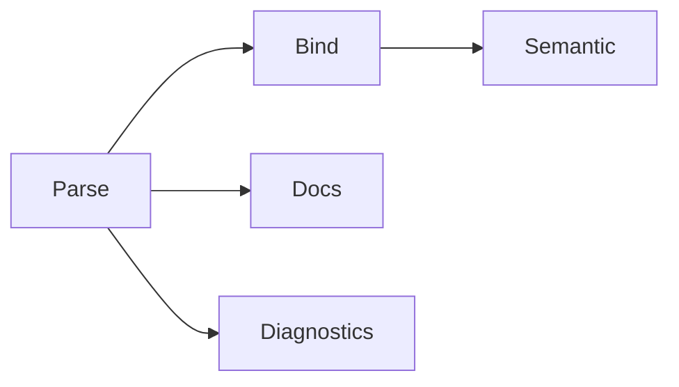

# Symbol Schema Design for Tree Hugger

## Status

Draft design for a major refactor, partly implemented. `SymbolRecord` and
`FileSymbolIndex` ship in `lib/src/shared/schema_v2/` and serialize as schema
**4.3** (the Rust module and type names keep their historical `v2`). Sections
below describe the implemented shape unless marked **planned**. Per-language
extraction rules for kinds, visibility and `static` are in
[Symbol Kinds, Visibility and `static`](./symbol-kinds-and-visibility.md).

## Context

`tree-hugger` currently extracts symbols, imports/exports, and diagnostics from multiple languages via Tree-sitter. The existing symbol model is useful but too narrow for high-fidelity static analysis, API diffing, semantic search, and richer documentation workflows.

This design proposes a new Rust schema that treats symbol metadata as composable facets with kind-specific payloads. It is intentionally broader than the current `SymbolInfo`/`TypeMetadata` model and is designed for staged adoption.

## Goals

1. Preserve syntax fidelity from Tree-sitter.
2. Support semantic enrichment in later passes without schema churn.
3. Model documentation as structured data, not only plain text.
4. Represent type information in multiple views (declared, canonical, resolved, expanded).
5. Scale across all supported languages without making Rust-specific assumptions mandatory.
6. Provide stable IDs and relationship edges for graph-based analysis.
7. Keep JSON serialization deterministic and backward-compatible via schema versioning.

## Non-Goals

1. Full type-checker parity for every language in v1.
2. Complete inter-file semantic resolution in the parse pass.
3. Perfect purity/side-effect inference in v1.

## Design Principles

1. Facet composition over giant optional structs.
2. Loss-minimizing capture: keep raw text and structured forms.
3. Incremental enrichment: parse -> bind -> semantic; parse -> docs; parse -> diagnostics.
4. Language portability with language-specific extension slots.
5. Stable public schema with explicit version field.

## High-Level Model

Each symbol record has:

1. Common facets for all symbols.
2. A discriminated `kind_data` payload with symbol-kind-specific fields.
3. Optional enrichment facets populated by later analysis passes.

```text
SymbolRecord
├── identity
├── source
├── visibility
├── docs
├── attributes
├── modifiers
├── type_info
├── relations
├── semantics
├── provenance
└── kind_data (Function | Type | Enum | Module | ...)
```

## Proposed Rust Types

### Core Primitives

```rust
#[derive(Debug, Clone, PartialEq, Eq, Hash, Serialize, Deserialize)]
pub struct SymbolId(pub String);

#[derive(Debug, Clone, PartialEq, Eq, Hash, Serialize, Deserialize)]
pub struct TypeId(pub String);

#[derive(Debug, Clone, Copy, PartialEq, Eq, Serialize, Deserialize)]
pub struct SchemaVersion {
    pub major: u16,
    pub minor: u16,
}

#[derive(Debug, Clone, Copy, PartialEq, Eq, Serialize, Deserialize)]
pub struct TextPoint {
    pub line: u32,   // 1-based
    pub column: u32, // 1-based UTF-8 column
}

#[derive(Debug, Clone, PartialEq, Eq, Serialize, Deserialize)]
pub struct TextSpan {
    pub start: TextPoint,
    pub end: TextPoint,
    pub start_byte: u32,
    pub end_byte: u32,
}
```

### Top-Level Symbol Record

```rust
#[derive(Debug, Clone, Serialize, Deserialize)]
pub struct SymbolRecord {
    pub schema_version: SchemaVersion,
    pub id: SymbolId,
    pub language: ProgrammingLanguage,
    pub kind: SymbolKindV2,
    pub scope: SymbolScope,                 // Item, Member or Local
    pub identity: IdentityFacet,
    pub source: SourceFacet,
    pub visibility: VisibilityFacet,
    pub docs: DocsFacet,
    pub attributes: Vec<Attribute>,
    pub modifiers: Vec<Modifier>,
    pub type_info: TypeFacet,
    pub relations: RelationFacet,
    pub semantics: SemanticFacet,
    pub metrics: Option<MetricsFacet>,      // absent unless requested
    pub provenance: ProvenanceFacet,
    pub kind_data: SymbolKindData,
    pub extensions: std::collections::BTreeMap<String, serde_json::Value>,
}
```

**Additive 4.x fields.** `scope`, `identity.qualified_name` (now always
present), `identity.is_namespace_rooted`, the `Async` entry of `modifiers`,
`visibility.is_test`, values for the existing `visibility.is_deprecated` and
the `metrics` facet were added on top of 4.0 without a version bump;
`EXTRACTOR_REVISION` moved on instead, so no cache entry written without
them is served. The `metrics.lines` key changed the record shape and so
follows the minor-version rule: it is schema 4.1. Filling a declared
field (`type_info.generic_params` and `type_info.constraints`, see
[Generic parameters](#generic-parameters); `attributes` and the written
modifiers, see [Attributes and Modifiers](#attributes-and-modifiers))
changes no shape and only moves `EXTRACTOR_REVISION`. One part of the
record is declared but still empty on every record: `relations.overrides`.
Mixed inheritance/conformance lists preserve uncertain entries separately
in `relations.unclassified_bases` (see [Relation Facet](#relation-facet)).

| Fact | When computed |
|---|---|
| `scope`, the `async` modifier, the in-file `qualified_name` | always, for every declaration (also those a kind selection leaves out) |
| `visibility.is_test`, `visibility.is_deprecated` | with `Capability::Flags`; without it both are `false`, meaning "not computed" (`hug --json`, `--jsonl` and `--json-full` always ask for it) |
| `type_info.generic_params`, `type_info.constraints` | always, on every selected record (no capability needed); empty on a record a kind selection leaves out |
| `attributes`, the modifiers other than `static` and `async` | always, on every selected record (no capability needed); empty on a record a kind selection leaves out |
| `metrics` (`parameters`, `has_docs`, `lines`, `cyclomatic`) | with `Capability::Metrics`, on every selected record; without it the facet is absent (`hug --json-full` and `--stats` ask for it) |

Scope, `async` and the qualified name are lightweight and every record needs
them (the qualified name feeds the ID, and scope decides the default
listing). The flags and metrics read more of the syntax tree (attributes,
test-file names, parameter lists, doc comments), so only a filter or report
that uses them computes them. JSON output always asks for the flags, so a
`false` there always means "computed and not set".

```rust
pub enum SymbolScope { Item, Member, Local }

pub struct MetricsFacet {
    pub parameters: Option<u32>,  // `null` = unsupported for this declaration
    pub has_docs: Option<bool>,   // `null` = no doc-comment detection
    pub lines: Option<u32>,       // `null` = not a callable, or no body
}
```

Inside a present `metrics` facet every key is required: `null` means the
metric is unsupported, and an absent key is malformed. An absent facet means
"not requested". `parameters` is the length of the declaration's own
parameter list (every list of a curried Scala `def`), counting a parameter
bound by a pattern (`(a, b): (u32, u32)`, `_`, `{x}`) like a named one,
without a Rust `self` (a Go receiver has its own list), one variadic
parameter counting once; it is `null` for a declaration that is not
a function, one with no parameter list (`def area: Int` in Scala), and in
Perl, Bash and Zsh. `has_docs` is whether `docs.raw_doc` is present; it is
`null` in Lua, Perl, Bash and Zsh, which have no doc-comment detection.
`lines` counts the physical lines a function, method or constructor's
`source.body_span` touches (`0` for an empty Lua body); it is `null` for
every other kind, even one with a body span, and for a callable without a
body (see [Body lines](./symbol-kinds-and-visibility.md#body-lines)).
`cyclomatic` is the cyclomatic complexity of that same body: 1 plus one per
decision (`if`/else-if, a loop with a condition, a ternary, `&&`/`||`/`??`
and `&&=`/`||=`/`??=`, every Rust `match` arm but the last, every JS/TS
`switch` arm but `default` (labels sharing one body are one arm), a guard,
a Rust `let … else`, a `catch`), nested functions, closures, classes and
items left out. It is `null` for every other kind, a callable without a
body, a language without reviewed counting rules (every language but Rust,
JavaScript and TypeScript today), a syntax error inside the counted body,
or a total beyond `u32`;
`null` is never zero. A facet without either key (schema 4.0 without
`lines`, 4.2 without `cyclomatic`) is malformed, never read as `null`. A predicate never matches a `null` metric, so `undocumented(true)` skips a Lua
function rather than reporting it as undocumented:

```json
"metrics": { "parameters": 2, "has_docs": false, "lines": 3, "cyclomatic": 2 }         // Rust, JavaScript, TypeScript: measured
"metrics": { "parameters": 2, "has_docs": false, "lines": 3, "cyclomatic": null }      // Python: no counting rules
"metrics": { "parameters": null, "has_docs": null, "lines": null, "cyclomatic": null } // Bash: unsupported
                                                                     // no "metrics" key: not requested
```

The flag rules are in
[Deprecation and test flags](./symbol-kinds-and-visibility.md#deprecation-and-test-flags),
which comments count as documentation in
[Documentation](./symbol-kinds-and-visibility.md#documentation), and the
metric definitions in [Metrics](./symbol-kinds-and-visibility.md#metrics).
Scope rules are in [Scope](./symbol-kinds-and-visibility.md#scope).

### Symbol Kind and Payload

```rust
#[derive(Debug, Clone, Copy, PartialEq, Eq, Serialize, Deserialize)]
pub enum SymbolKindV2 {
    Function,
    Method,
    Constructor,
    Type,
    Class,
    Interface,
    Enum,
    Trait,
    Module,
    Namespace,
    Field,
    Property,
    Variable,
    Constant,
    Parameter,
    TypeAlias,
    EnumVariant,
    Macro,
    Unknown,
}

#[derive(Debug, Clone, Serialize, Deserialize)]
#[serde(tag = "kind_data_type", content = "data")]
pub enum SymbolKindData {
    Function(FunctionData),
    Type(TypeData),
    TypeAlias(TypeAliasData),
    Enum(EnumData),
    Field(FieldData),
    Module(ModuleData),
    Variable(VariableData),
    Parameter(ParameterSymbolData),
    Unknown,
}

pub struct ParameterSymbolData {
    pub name: String,
    pub position: u16,
    pub type_text: Option<String>,
}
```

The payload follows the kind. Function, Method and Constructor carry
`Function`; Enum carries `Enum` (with its variant list); TypeAlias carries
`TypeAlias`; Field carries `Field`. An EnumVariant and a Namespace carry the
`Unknown` payload, which only means "no payload": it is not the Unknown
kind. A variant's value and fields are entries of its enum's
`EnumData.variants`, never a payload of the variant record:

```json
{ "kind": "EnumVariant", "identity": { "name": "Off", "container_name": "Mode" },
  "kind_data": { "kind_data_type": "Unknown" } }
{ "kind": "Enum", "identity": { "name": "Mode" },
  "kind_data": { "kind_data_type": "Enum",
                 "data": { "variants": [ { "name": "On" }, { "name": "Off", "discriminant": "2" } ] } } }
```

## Facets

### Identity Facet

```rust
#[derive(Debug, Clone, Serialize, Deserialize)]
pub struct IdentityFacet {
    pub name: String,
    pub display_name: String,
    pub qualified_name: String,                    // in-file name, never empty
    pub is_namespace_rooted: bool,                 // starts at a declared namespace
    pub container_name: Option<String>,            // the container's name
    pub container_kind: Option<SymbolKindV2>,      // the container's kind
    pub keyword: Option<String>,                   // the declaring keyword
    pub stable_key: String, // language + file + kind + qualified name + ordinal
}
```

`stable_key` is deterministic and used to produce `SymbolId`. It joins the
language, the file's identity, the kind, the in-file `qualified_name` and the
record's order among records of that kind and qualified name
(`rust::/repo/src/shapes.rs::Method::Point::norm::0`), so IDs do not depend on
the scan root or on how the file's path was spelled. Before revision 7 the
key used `container::name` with `::` in every language; switching to the
native in-file spelling changed every symbol ID, and every relation and
export ID that points at one, once. Cache entries from before the change are
never served, because the revision is part of the cache key.

`qualified_name` is built from the file's own source with the language's
separators (`schema::Record::load`, `com.example.Point.area`,
`App\Models\User::find`). A file or module **prefix** is not stored: a query
result adds it after the cache lookup, from the query's scan root or naming
context (`src/shapes.rs#Point::norm`, `crate::shapes::Point::norm`), which is
why neither is a cache-key input. `is_namespace_rooted` marks names that
already start at a declared `package` or `namespace` and so get no prefix;
a block-form namespace counts wherever it encloses the declaration (a Scala
`package left { class W }` gives `left.W`, rooted, although the package
itself is not a record).

```rust
let query = SymbolQuery::new()
    .naming_context(NamingContext::new("crate/src", "crate"));
let result = cache.query(SourceFile::read("crate/src/shapes.rs")?, &query)?.result; // a SymbolCache
// stored in the entry:  Point::norm
// in result:            crate::shapes::Point::norm
// result.name_prefix(): "crate::shapes::"
```

The naming context is **library-only**: `hug` never sets one, so its Rust and
Python names always take the file form. A file outside the context's root
falls back to the file prefix. The prefix and the query's predicates are
applied in one last step, `SymbolQueryResult::finish`, on every result
(cached or not), and `name_prefix()` reports the prefix so a caller can strip
it back to the stored name. The prefix rules are in
[Qualified names](./symbol-kinds-and-visibility.md#qualified-names).

`container_name` holds the name of the symbol's nearest container (a class, trait,
module, or the implemented type of a Rust `impl`), and `container_kind` holds
that container's kind as extracted from its own declaration. `container_kind`
is omitted when there is no container or the file cannot tell its kind, for
example a Rust `impl` for a type declared in another file:

```json
"identity": {
  "name": "fmt",
  "qualified_name": "PublicStruct::fmt",
  "is_namespace_rooted": false,
  "container_name": "PublicStruct",
  "container_kind": "Type",
  "keyword": "fn"
}
```

`container_name` is a display name and may be shared by several records (two
`Boxed` structs in different Rust `mod`s). The containment link
(`relations.parent`, `relations.container`, the owner's `relations.members`)
identifies the owner by record ID: the smallest same-named declaration
around the member, else the same-named record of `container_kind` whose
qualified name qualifies the member's (`right::Boxed` for
`right::Boxed::work`), else the only such record whose qualified name ends
with the member's owner path (the member's qualified name without its last
segment); with several and none qualifying, the member has no parent. A
lone same-named record never overrides a qualification that names another
owner: beside a local `W`, the method of `impl other::W` is
`other::W::probe` with no parent. A Rust `impl` member's `container_kind`
is the kind of the declaration its self type resolves to by the rules in
[Declared Type Relations](./type-relations.md#when-a-target-gets-an-id), and
is omitted when the self type does not resolve: `impl ::ext::B` beside a
local `mod ext { struct B; }`, or `impl Base for T` inside `fn outer<T>()`
beside a file-level `struct T`. Other members found by name read
`container_kind` only from same-named records that agree with their owner
path.

`keyword` is the grammar token that introduces the declaration, such as `fn`,
`struct`, `def`, `func`, `const`, `let`, `var`, `class`, `protocol`, `sub`,
`my` or `#define`. It is read from the syntax tree, never from source text, so
a comment that names a keyword cannot supply one. It is one token: Scala
`case class` reports `class`, C++ `enum class` reports `enum`, Swift
`class func` reports `func`. It is omitted when the construct has none, for
example a Java or C# method, a C variable or a TypeScript class member. For a
Go `const`/`var` spec and a Lua or shell `local`, the keyword belongs to the
statement that wraps the declaration, so it is reported even though
`declaration_text` does not contain it. Per-language keywords are listed in
[Symbol Kinds, Visibility and `static`](./symbol-kinds-and-visibility.md#declaring-keywords).

### Source Facet

```rust
#[derive(Debug, Clone, Serialize, Deserialize)]
pub struct SourceFacet {
    pub file_path: std::path::PathBuf,
    pub declaration_span: TextSpan,
    pub body_span: Option<TextSpan>,
    pub name_span: Option<TextSpan>,
    pub doc_span: Option<TextSpan>,
    pub source_text: Option<String>,
    pub declaration_text: Option<String>,
    pub signature_text: Option<String>,
    pub body_text: Option<String>,
}
```

`source_text` and `body_text` should be feature-gated or size-limited for large-scale indexing.

`body_span` of a function, method or constructor is its own implementation
body, the span `metrics.lines` counts: a block, or an expression body
without its `=>`/`=`, never a default value, a return type or a nested
callable, and never ending in whitespace (the forms are listed under
[Body lines](./symbol-kinds-and-visibility.md#body-lines)). It is absent for
a callable without a body (a prototype, an abstract or interface method, a
defaulted or deleted C++ member). Other declarations keep the body of their
own node (a class body, an enum body), when the grammar has one.

`declaration_text` is filled for every record: the declaration from its start
up to, but not including, its body, trailing whitespace trimmed (a bodyless
declaration contributes its whole text). It keeps the modifiers, access
keywords and attributes the grammar parses inside the declaration node, so
syntax a `VisibilityLevel` cannot express survives:

| Declaration | `declaration_text` |
|---|---|
| `pub(in crate::a) fn f() { … }` | `pub(in crate::a) fn f()` |
| `public int Count { get; private set; }` | `public int Count { get; private set; }` |
| `private[Shape] def secret() = 2` | `private[Shape] def secret() =` |

Doc comments and syntax outside the declaration node (a Rust `#[…]` attribute,
a Python decorator, a TypeScript `export` wrapper) are not included.

`signature_text` is the display header: the part of the same declaration a
reader needs to recognize the symbol. It is always a contiguous part of
`declaration_text`, filled from the same node in the same extraction pass:

- outer whitespace is stripped; internal whitespace and line breaks are kept
- it excludes initializers, accessor lists (C# `{ get; set; }`, Swift
  `{ get }`), the annotations, attributes and decorators that come before the
  first modifier or keyword, doc comments, a `;` (Lua: `end`) terminator, and
  the `=`, `=>` or `:` that introduces a body
- an annotation written between modifiers stays, because removing it would
  break contiguity
- it is omitted when no contiguous header can be isolated: a C/C++
  declaration whose type carries a body (`typedef struct { … } Point;`), or a
  second name that an earlier name's initializer would cut off
  (`int a = 1, b = 2;` for `b`)
- each type of a grouped Go `type ( … )` block is declared by its own spec,
  so `Second` in `type ( First struct{ a int }; Second int )` has the
  declaration text, header and span `Second int`; the `type` keyword is
  still its `keyword`. A grouped alias is cut at its `=` like every alias:
  `grouped = map[string]int` has the header `grouped`

The three fields have distinct contracts: `declaration_text` is evidence,
`signature_text` is display, and `keyword` comes from the syntax tree rather
than either text.

| Declaration | `declaration_text` | `signature_text` | `keyword` |
|---|---|---|---|
| `pub(in crate::a) fn f() { … }` | `pub(in crate::a) fn f()` | `pub(in crate::a) fn f()` | `fn` |
| `pub const TABLE: [u8; 256] = [0, 1, …];` | `pub const TABLE: [u8; 256] = [0, 1, …];` | `pub const TABLE: [u8; 256]` | `const` |
| `public private(set) var count = 0` | `public private(set) var count = 0` | `public private(set) var count` | `var` |
| `@Override public void run() { … }` | `@Override public void run()` | `public void run()` | omitted |
| `public @Deprecated static void m() { … }` | `public @Deprecated static void m()` | `public @Deprecated static void m()` | omitted |
| `private[Shape] def secret() = 2` | `private[Shape] def secret() =` | `private[Shape] def secret()` | `def` |
| `public int Count { get; private set; }` | `public int Count { get; private set; }` | `public int Count` | omitted |

A type alias's aliased type counts as its initializer: `pub type Alias = u32;`
has the header `pub type Alias` (the aliased type is in `kind_data`). A C
`typedef` names the alias last, so `typedef unsigned long Count;` keeps its
whole text.

`body_text` is not yet filled (**planned**).

### Visibility Facet

```rust
#[derive(Debug, Clone, Copy, PartialEq, Eq, Serialize, Deserialize)]
pub enum VisibilityLevel {
    Public,
    Protected,
    Private,
    Internal,
    Package,
    Crate,
    ModulePrivate,
    ProtectedInternal, // C# `protected internal`
    PrivateProtected,  // C# `private protected`
    Unknown,
}

#[derive(Debug, Clone, Serialize, Deserialize)]
pub struct VisibilityFacet {
    pub level: VisibilityLevel,
    pub is_exported: bool,
    pub is_reexported: bool,
    pub is_default_export: bool,
    pub is_imported: bool,
    pub is_external: bool,
    pub is_generated: bool,
    pub is_synthetic: bool,
    pub is_deprecated: bool,
    pub is_experimental: bool,
    pub is_test: bool,          // test-only code (Capability::Flags)
}
```

**Visibility ownership.** `level` is the only home of a symbol's access level:
the access declared or implied at the declaration, not effective access
through enclosing modules or types. `Unknown` covers declarations without
access rules (parameters, locals, Python, Perl, shell) and access the file
cannot establish. The v1 model mirrors it as `SymbolInfo::visibility`
(`Unknown` is `None`); `FunctionSignature` has no visibility, and a type's
`FieldInfo::visibility` is a copy of the matching standalone field's level.

**Export is separate from visibility.** `is_exported` comes only from export
syntax (`export` in JavaScript/TypeScript, a `pub…` Rust item; never a member)
and the bind pass. A Public level never implies an export, so a Public Java
class or TypeScript class method has `is_exported: false`, and a record
converted from a v1 `SymbolInfo` is never exported.

### Documentation Facet

```rust
#[derive(Debug, Clone, Serialize, Deserialize)]
pub enum CommentKind {
    Doc,
    Line,
    Block,
}

#[derive(Debug, Clone, Serialize, Deserialize)]
pub enum CommentAttachment {
    Leading,
    Trailing,
    Inline,
    Detached,
}

#[derive(Debug, Clone, Serialize, Deserialize)]
pub struct AttachedComment {
    pub kind: CommentKind,
    pub attachment: CommentAttachment,
    pub span: TextSpan,
    pub raw_text: String,
    pub cleaned_text: String,
    pub line_distance: Option<u16>,
}

#[derive(Debug, Clone, Serialize, Deserialize)]
pub struct DocParam {
    pub name: String,
    pub description: String,
}

#[derive(Debug, Clone, Serialize, Deserialize)]
pub struct DocTag {
    pub name: String, // param, returns, throws, deprecated, see, example, ...
    pub value: String,
}

#[derive(Debug, Clone, Default, Serialize, Deserialize)]
pub struct ParsedDocs {
    pub summary: Option<String>,
    pub params: Vec<DocParam>,
    pub returns: Option<String>,
    pub tags: Vec<DocTag>,
}

#[derive(Debug, Clone, Default, Serialize, Deserialize)]
pub struct DocsFacet {
    pub raw_doc: Option<String>,
    pub comments: Vec<AttachedComment>,
    pub parsed: Option<ParsedDocs>, // None until the docs pass runs
}
```

**Planned:** dedicated `description`, `throws`, `examples`, `remarks`,
`deprecated_message` and `since` fields; today such tags land in `tags`.

This preserves raw and parsed docs to avoid information loss.

### Attributes and Modifiers

```rust
#[derive(Debug, Clone, Serialize, Deserialize)]
pub struct Attribute {
    pub name: String,
    pub value: Option<String>,
}

#[derive(Debug, Clone, PartialEq, Eq, PartialOrd, Ord, Serialize, Deserialize)]
#[serde(tag = "type", content = "value")]
pub enum Modifier {
    Static,        // member usable without an instance
    StaticStorage, // storage or linkage `static`; never implies Static
    Async,
    Const,
    Readonly,
    Unsafe,
    Mut,
    Custom(String),
}
```

`Static` and `StaticStorage` are the two meanings of the `static` keyword.
`Static` marks a member used without an instance (Java/C#/TS `static`, Python
`@classmethod`, a Rust associated function without `self`, a Java interface
constant). `StaticStorage` marks Rust `static` items and C/C++ file-scope,
namespace-scope and function-local `static`. The v1 model carries them as
`SymbolInfo::is_static` and `SymbolInfo::is_static_storage`.

A record lists each modifier once, in one fixed order: `Static`,
`StaticStorage`, `Async`, `Const`, `Readonly`, `Unsafe`, `Mut`, then
distinct `Custom` values in lexical order. The order is the derived `Ord`,
so the variant order above is part of the output format:

```json
"modifiers": [{ "type": "Static" }, { "type": "Async" },
              { "type": "Custom", "value": "abstract" }, { "type": "Custom", "value": "final" }]
```

Every modifier is a token the declaration itself writes. A keyword in its
body, a string, its type (TypeScript `size: readonly string[]`) or a
parameter (`fn f(mut x: u32)` marks the parameter `x`, not `f`) never marks
it, and none is inferred: Java interface methods are not `abstract`, a
Python `@abstractmethod` adds no modifier.

| Modifier | Written as |
|---|---|
| `Const` | Rust `const fn` only; Java `final` and C++ `const` objects or member functions are not `Const` |
| `Unsafe` | Rust `unsafe fn`, `unsafe trait` |
| `Readonly` | TypeScript `readonly` fields, interface properties and constructor parameter properties; C# `readonly` fields, structs and members |
| `Mut` | Rust bindings (`let mut x`, `static mut S`, `mut x: T`, `mut self`) and a method whose receiver is written with `mut` (`&mut self`, `mut self`, `self: &mut Self`) |
| `Custom("abstract")` | TypeScript, Java, C#, Scala, PHP |
| `Custom("final")` | Java, C++ (class and member `final`), Swift, Scala, PHP |
| `Custom("override")` | TypeScript, C#, C++, Swift, Scala |
| `Custom("virtual")` | C#, C++ |
| `Custom("sealed")` | C# only (never renamed `final`) |
| `Custom("mutating")` | Swift only (never Rust's `Mut`) |

Go, C, JavaScript, Python, Perl, Bash, Zsh and Lua write none of these.
Other keywords (Scala and Java `sealed`, Swift `open`/`nonmutating`, PHP
`readonly`, C++ `constexpr`) are not read.

`attributes` lists the declaration's own attributes, annotations and
decorators in source order, repeats kept. `name` is the path as written
with whitespace and comments removed, without the marker (`#[…]`, `@`,
`[…]`); `value` is the raw text between the outer delimiters, trimmed,
`None` without an argument list and `""` for an explicit `()`:

| Source | `name` | `value` |
|---|---|---|
| Rust `#[tokio::test]` | `tokio::test` | `None` |
| Java `@Deprecated(since = "9")` | `Deprecated` | `since = "9"` |
| Rust `#[allow()]` | `allow` | `""` |
| Rust `#[cfg_attr(test, derive(Debug))]` | `cfg_attr` | `test, derive(Debug)` (one attribute, never expanded) |
| Rust `#[doc = "a  b"]` | `doc` | `"a  b"` |
| Python `@(lambda f: f)` | `lambda f: f` | `None` |

A decorator that is neither a path nor a call of a path keeps its whole
expression, as written, as the name. They are read from Rust outer
attributes, C++ `[[…]]`, Java and Scala annotations, C# attribute lists,
Swift attributes and Python, TypeScript and JavaScript decorators (an
exported class's decorator written before `export` is the class's; a
parameter's decorator is the parameter's). File-level forms (Rust
`#![…]`, C# `[assembly: …]`) and doc comments are never a declaration's
attributes. PHP `#[…]` attributes, Perl sub attributes and C
`__attribute__` are not read. The deprecation and test flags read the same
parsed list (see [`symbol-kinds-and-visibility.md`](./symbol-kinds-and-visibility.md));
adding decorators changed no flag.

Grammar limit: tree-sitter-typescript 0.23.2 and tree-sitter-javascript
0.25.0 accept only a path, a call of a path or a parenthesized one of those
as a decorator; `@(flag ? one : two) m() {}` is a syntax error, so a
TypeScript or JavaScript decorator is never the "whole expression" case.

**Planned:** further modifiers (`Open`, `Extern`, `Generator`).

### Type Facet

```rust
#[derive(Debug, Clone, Copy, PartialEq, Eq, Serialize, Deserialize)]
pub enum TypeViewKind {
    Declared,
    Canonical,
    Resolved,
    Expanded,
}

#[derive(Debug, Clone, Serialize, Deserialize)]
pub struct TypeView {
    pub kind: TypeViewKind,
    pub text: Option<String>,
    pub ast: Option<serde_json::Value>,
    pub referenced_symbol_ids: Vec<SymbolId>,
}

#[derive(Debug, Clone, Copy, PartialEq, Eq, Serialize, Deserialize)]
pub enum GenericParamKind {
    Type,
    Lifetime,
    Const,
}

#[derive(Debug, Clone, Serialize, Deserialize)]
pub struct GenericParam {
    pub name: String,
    pub kind: GenericParamKind,
    pub constraints: Vec<String>,
    pub default: Option<String>,
    pub variance: Option<String>,
    pub position: u16,
}

#[derive(Debug, Clone, Default, Serialize, Deserialize)]
pub struct TypeFacet {
    pub primary_type: Option<String>,
    pub views: Vec<TypeView>,
    pub generic_params: Vec<GenericParam>,
    pub constraints: Vec<String>,
    pub nullability: Option<String>,
}
```

`ast` can begin as lightweight JSON from Tree-sitter nodes and evolve later to a strongly typed internal AST.

### Generic parameters

`type_info.generic_params` lists the parameters a declaration writes in its
own parameter list, in source order; `type_info.constraints` holds the
requirements whose subject is not one of those parameters. Both are read
from syntax alone, on every selected record.

```rust
pub struct Bag<T: Clone = String> { value: T }
impl<T: Clone> Bag<T> {
    pub fn get<U>(&self, value: U) -> U where U: Copy, T: Default { value }
}
```

```json
"Bag": { "generic_params": [{ "name": "T", "kind": "Type", "constraints": ["Clone"], "default": "String", "position": 0 }] }
"get": { "generic_params": [{ "name": "U", "kind": "Type", "constraints": ["Copy"], "position": 0 }],
         "constraints": ["T: Default"] }
```

The rules, each visible in the example:

- **Only the declaration's own list.** `get` does not receive `Bag`'s `T`,
  and `Bag` does not receive the `impl` block's `T`. A Rust `impl` block has
  no record of its own. A C++ member template reads only the `template`
  directly around it.
- **A requirement the declaration writes is its own, with or without a
  parameter list.** A member that constrains itself on its enclosing type's
  parameter keeps that requirement and still owns no parameters; a
  requirement written on the enclosing template stays with the template:

  ```cpp
  template <class T> requires Small<T> struct Bound { void plain(); };
  template <class T> struct Gate {
      void check() requires Small<T>;   // constraints ["Small<T>"], generic_params []
      Gate() requires Small<T> {}       // constraints ["Small<T>"], generic_params []
  };
  ```

  `Bound` has `T` and `["Small<T>"]`; `plain` has neither. The same holds for
  a Rust or Swift method's `where` on its type's `T`, and for a C# `where`
  clause on a declaration with no list (which the compiler rejects but the
  grammar accepts).
- **Bounds attach to their parameter, in source order.** An inline bound
  (`T: Clone`) comes first, then bounds written in a `where` clause on the
  same bare name (`where U: Copy`). A requirement on anything else (`T` of
  the enclosing `impl`, `T::Item: Copy`, `Vec<T>: Send`, `for<'b> &'b T: …`,
  Swift `U == Int`, a C++ `requires` clause) goes to `type_info.constraints`
  as written, once. Nothing is inferred from how a parameter is used.
- **Texts are as written.** Bounds and defaults keep their source text
  (generic arguments, qualification and inner whitespace included) with
  outer whitespace trimmed. A bound list is split at its grammar entries
  (Rust `+`, Java `&`, C# `,`), never inside a nested type; comments
  between entries are dropped. A default omits its `=`.
- **Kinds.** Rust lifetimes are `Lifetime` and keep their apostrophe
  (`'a`); Rust `const N: usize` and C++ non-type parameters are `Const`, and
  their declared type is not a constraint (it stays in
  `source.declaration_text`); everything else is `Type`, including packs
  (C++ `class... Ts`, Python `*Ts` and `**P`, named without the stars, Swift
  `each T`, named without `each`) and higher-kinded parameters (Scala
  `F[_]`, C++ `template <class> class TT`, whose default in
  `template <class> class TT = Box` is `Box`).
- **Variance** is recorded as written: C# `in`/`out`, Scala `+`/`-`;
  otherwise absent.
- **Positions** are zero-based indexes in the written list and are `u16`.
  An unnamed C++ parameter (`template <typename, int N>`) has no entry but
  keeps its slot, so `N` is position 1. A Rust attribute on a parameter is
  not a parameter: in `<#[cfg(feature = "x")] T, U>`, `T` is position 0. A selected declaration with more
  than 65 536 parameters fails its file with
  `TreeHuggerError::TooManyGenericParameters` (`hug` reports
  `too_many_generic_parameters`); positions are never truncated.

| Language | Parameters read from | Bounds | Defaults | Variance | `constraints` |
|---|---|---|---|---|---|
| Rust | items, functions, methods, traits, aliases | `T: A + B`, `where T: …` | `T = X`, `const N: u8 = 3` | — | other `where` predicates |
| TypeScript | classes, interfaces, aliases, functions, methods, arrow functions | `extends X` (one entry) | `= X` | — | — |
| Go | types (each spec of a `type` group), functions | the whole constraint (`~int \| ~float64`), shared by `K, V any` | — | — | — |
| Python | `class C[T]`, `def f[T]` | `T: int`, `T: (int, str)` | — | — | — |
| Java | classes, interfaces, records, methods, constructors | `extends A & B` | — | — | — |
| C# | classes, structs, interfaces, records, methods | `where T : class, new()` | — | `in`, `out` | a `where` clause naming no declared parameter |
| C++ | the `template` directly around the declaration | — | `= int`, `= 3`, `template <class> class TT = Box` | — | `requires` after that template's parameters; a function's own trailing `requires`, wrapped or not |
| Swift | types, functions, aliases | `T: P`, `where T: P` (after the list, or inside it: `<T where T: P>`) | — | — | `where` requirements on anything else (`U == Int`) |
| Scala | classes, traits, enums, functions, type aliases | `>: L`, `<: U`, `: Ctx`, operator kept | — | `+`, `-` | — |
| JavaScript, C, PHP, Perl, Bash, Zsh, Lua | — (no declared generic parameters; JSDoc and PHPDoc `@template` are not read) | | | | |

Scala keeps each bound's operator because one list mixes lower, upper and
context bounds; the other languages list only upper bounds and drop their
keyword (`extends`, `:`).

**Limits of the pinned grammars and the extractor.** These are pinned by
`symbols_generics::GENERICS_MATRIX`:

- tree-sitter-python 0.25.0 rejects a type-parameter default
  (`class C[T = str]`, PEP 696), and the `type A[T] = …` statement produces
  no record, so neither carries generics.
- tree-sitter-typescript 0.23.2 rejects variance annotations
  (`interface K<in T>`).
- tree-sitter-cpp 0.23.4 parses a concept-constrained type parameter
  (`template <std::integral T>`) exactly like a non-type parameter of a
  named type (`template <MyEnum E>`), so it is read as `Const` with no
  constraint. A `typename`/`class` parameter with a `requires` clause is
  read exactly.
- C# delegates produce no record, so their parameters are not reported.

The older model's `TypeMetadata::type_parameters` (names only, types only)
is a separate reader with its own coverage, and the v1↔v2 adapter does not
carry `generic_params` across.

### Relation Facet

```rust
#[derive(Debug, Clone, Serialize, Deserialize)]
pub struct SymbolRef {
    pub id: Option<SymbolId>,   // unresolved references keep this None
    pub name: String,
    pub qualified_name: Option<String>,
}

#[derive(Debug, Clone, Default, Serialize, Deserialize)]
pub struct RelationFacet {
    pub parent: Option<SymbolRef>,
    pub container: Option<SymbolRef>,
    pub members: Vec<SymbolRef>,
    pub extends: Vec<SymbolRef>,
    pub implements: Vec<SymbolRef>,
    pub unclassified_bases: Vec<SymbolRef>,
    pub overrides: Vec<SymbolRef>,
    pub references: Vec<SymbolRef>,
    pub referenced_by: Vec<SymbolRef>,
    pub dependencies: Vec<SymbolRef>,
    pub related: Vec<SymbolRef>,
}
```

`extends` and `implements` hold the base types a declaration writes in its
own header, each as written (`pkg.Base<T>`, `fmt::Display`), with a
same-file `id` and in-file `qualified_name` only when the path names exactly
one eligible declaration. A Rust trait impl adds its trait to each of its
members and to the resolved self type. The per-language table, the
resolution rules and Rust impl ownership are in
[Declared Type Relations](./type-relations.md). C#, Swift and Scala classify
bases from syntax or proven same-file target kinds; uncertain entries go to
`unclassified_bases` rather than changing the meaning of `extends`. Swift
conformances added by local-owner extensions retain `source_span` evidence
for full-signature rendering.

### Semantic Facet

```rust
#[derive(Debug, Clone, Copy, PartialEq, Eq, Serialize, Deserialize)]
pub enum TriState {
    Yes,
    No,
    Unknown,
}

#[derive(Debug, Clone, Default, Serialize, Deserialize)]
pub struct SemanticFacet {
    pub is_pure: Option<TriState>,
    pub has_side_effects: Option<TriState>,
    pub may_throw: Option<TriState>,
    pub may_panic: Option<TriState>,
    pub is_recursive: Option<TriState>,
    pub mutates_self: Option<TriState>,
    pub mutates_arguments: Option<TriState>,
    pub reads_global_state: Option<TriState>,
    pub writes_global_state: Option<TriState>,
    pub allocates: Option<TriState>,
    pub blocks: Option<TriState>,
}
```

`Option<TriState>` intentionally distinguishes "not analyzed" from "analyzed unknown".

`is_recursive` is `Some(Unknown)` on every function and method whenever the
semantic pass runs, and `None` when it did not run. References are bound by
name only (see [Extraction Pipeline Contract](#extraction-pipeline-contract)),
which can neither prove that a same-named call targets the enclosing function
nor that none does, so a `Yes` or `No` would be a guess:

```rust
fn countdown(n: u32) -> u32 { if n == 0 { 0 } else { countdown(n - 1) } }
// semantic pass ran:     "semantics": { "is_recursive": "Unknown", ... }
// semantic pass not run: "semantics": {}
```

### Provenance Facet

```rust
#[derive(Debug, Clone, Serialize, Deserialize)]
pub struct ProvenanceFacet {
    pub extractor: String, // e.g. "tree-sitter"
    pub extractor_version: String,
    pub parse_pass: String, // parse, bind, semantic, docs
}
```

Records carry no wall-clock time, so two runs over the same files produce
identical records and identical cache entries.

## Kind-Specific Payloads

### Function and Method Data

```rust
#[derive(Debug, Clone, Serialize, Deserialize)]
pub enum ReceiverKind {
    Value,
    Ref,
    MutRef,
    This,
    Custom(String),
}

#[derive(Debug, Clone, Serialize, Deserialize)]
pub struct ReceiverInfo {
    pub name: String,
    pub kind: ReceiverKind,
    pub type_text: Option<String>,
}

#[derive(Debug, Clone, Serialize, Deserialize)]
pub struct ParameterData {
    pub name: String,
    pub position: u16,
    pub label: Option<String>,
    pub type_text: Option<String>,
    pub type_ast: Option<serde_json::Value>,
    pub default_value: Option<String>,
    pub is_optional: bool,
    pub is_variadic: bool,
    pub is_keyword_only: bool,
    pub is_positional_only: bool,
    pub mutability: Option<String>,
    pub ownership_mode: Option<String>,
    pub docs: Option<String>,
    pub attributes: Vec<Attribute>,
}

#[derive(Debug, Clone, Serialize, Deserialize)]
pub struct ReturnData {
    pub type_text: Option<String>,
    pub type_ast: Option<serde_json::Value>,
    pub error_type: Option<String>,
    pub yields_type: Option<String>,
    pub never_returns: bool,
}

#[derive(Debug, Clone, Serialize, Deserialize)]
pub struct FunctionData {
    pub receiver: Option<ReceiverInfo>,
    pub parameters: Vec<ParameterData>,
    pub return_info: ReturnData,
    pub abi: Option<String>,
    pub calling_convention: Option<String>,
    pub is_variadic: bool,
    pub arity: u16,
    pub overload_set: Vec<SymbolRef>,
}
```

`return_info.type_text` and each parameter's `type_text` are the type text
the source declares, never an inferred one: a Rust function without `->` and
a Go function without a result have no return type text (before revision 9,
Rust reported `()` and a Go method its own parameter list). A constructor
has none either: its type is never written in as a return type.

A parameter's `default_value` is the default as written. Swift's grammar
places `= 2` beside the parameter rather than inside it, and it is still
read: `init(x: Int, y: Int = 2)` gives `y` the default `2`.

### Type/Class/Interface/Trait Data

```rust
#[derive(Debug, Clone, Serialize, Deserialize)]
pub struct FieldData {
    pub name: String,
    pub qualified_name: Option<String>,
    pub type_text: Option<String>,
    pub visibility: Option<VisibilityLevel>,
    pub is_static: bool,
    pub is_readonly: bool,
    pub is_mutable: bool,
    pub is_optional: bool,
    pub default_value: Option<String>,
    pub docs: Option<String>,
}

#[derive(Debug, Clone, Serialize, Deserialize)]
pub struct TypeData {
    pub members: Vec<SymbolRef>,  // methods, fields, nested types
    pub fields: Vec<FieldData>,   // denormalized convenience
    pub constructors: Vec<SymbolRef>,
    pub associated_types: Vec<String>,
    pub associated_constants: Vec<String>,
    pub is_abstract: bool,
    pub is_final: bool,
    pub is_sealed: bool,
    pub is_open: bool,
    pub is_partial: bool,
}
```

`TypeData.fields` lists each member the type declares in its own body once,
in source order: a reader's entry is paired with the standalone Field,
Property or Constant record of the same name, keeps the type written in the
source, and takes the record's access and `static` flag (and its doc
comment when the reader found none); a record no reader listed is added without a type. A Go struct field or Scala
body `val` is therefore both a Field record and a typed list entry. The
standalone Field record's own `FieldData` is thinner: it has no `type_text`,
and `is_mutable`/`is_readonly` are always `true`/`false`, so read a field's
type from its owner's list. `constructors` is not filled; a type's
constructors are the Constructor records whose container is the type.

### Enum and Type Alias Data

```rust
#[derive(Debug, Clone, Serialize, Deserialize)]
pub struct EnumVariantData {
    pub name: String,
    pub discriminant: Option<String>,
    pub tuple_fields: Vec<String>,
    pub struct_fields: Vec<FieldData>,
    pub docs: Option<String>,
}

#[derive(Debug, Clone, Serialize, Deserialize)]
pub struct EnumData {
    pub backing_type: Option<String>,
    pub variants: Vec<EnumVariantData>,
}

#[derive(Debug, Clone, Serialize, Deserialize)]
pub struct TypeAliasData {
    pub aliased_type_text: Option<String>,
    pub aliased_type_ast: Option<serde_json::Value>,
    pub is_recursive: bool,
}
```

`EnumData.variants` and the enum's standalone EnumVariant records name the
same variants, once each, in source order: a reader's entry is paired with
the record of the same name (the k-th entry with the k-th record), a record
no reader listed is added at its position, and the entry takes the record's
doc comment and value only when the reader had none. `discriminant` is the
member's `value` as written (Rust, C, C++, C#, TypeScript, PHP: `Off = 2`
gives `2`). Arguments are not a value: Java `MERCURY(1.0)` lists `MERCURY`
alone. A declared payload keeps its written types: Rust `Pair(i32, String)`
fills `tuple_fields`, and Rust `Named { x: i32 }` and Scala
`case Value(x: Int = 1)(using o: Ord)` fill `struct_fields` (every Scala
parameter clause, in order; a default is never a `discriminant`), while
Scala's `x` and `o` are still Parameter records (`Color.Value.x`). Only an
Enum has a list; a Swift `enum` is a Type, whose `TypeData` holds no
variants.

`aliased_type_text` is the alias's right-hand side as written, generics
included (Go `type GenAlias[T any] = []T` gives `[]T`, Swift
`typealias G<T> = Array<T>` gives `Array<T>`). It is never resolved, and the
target's fields are never copied onto the alias. An abstract Scala
`type Element` and a Swift `associatedtype` declare no alias and have no
record.

### Module and Variable Data

```rust
#[derive(Debug, Clone, Serialize, Deserialize)]
pub struct ModuleData {
    pub members: Vec<SymbolRef>,
}

#[derive(Debug, Clone, Serialize, Deserialize)]
pub struct VariableData {
    pub type_text: Option<String>,
    pub initializer_text: Option<String>,
    pub is_const: bool,
}
```

## Package-Level Container

```rust
#[derive(Debug, Clone, Serialize, Deserialize)]
pub struct FileSymbolIndex {
    pub schema_version: SchemaVersion,
    pub file: std::path::PathBuf,
    pub language: ProgrammingLanguage,
    pub file_hash: String,
    pub completed_passes: Vec<AnalysisPass>, // only the passes that ran
    pub symbols: Vec<SymbolRecord>,
    pub imports: Vec<ImportRecord>,
    pub exports: Vec<ExportRecord>,
    pub diagnostics: Vec<Diagnostic>,
}
```

`ImportRecord` and `ExportRecord` carry a `symbol: SymbolRef`, aligned with `RelationFacet`.

## ID Strategy

1. Compute `stable_key` as: `<language>::<file_identity>::<Kind>::<in_file_qualified_name>::<sibling_ordinal>`, where `<file_identity>` is the file's [identity](./cache-design.md#file-identity) with `\` written as `/`, `<Kind>` is the `SymbolKindV2` variant name (`Method`), the qualified name is the stored one without any display prefix, and `<sibling_ordinal>` counts the earlier records in the file with the same kind and qualified name (`0` for the first). For example `rust::/repo/src/shapes.rs::Method::Point::norm::0`.
2. Hash `stable_key` with BLAKE3 and encode as lowercase hex.
3. Keep both hashed `id` and unhashed `stable_key` for debugging and diff tooling.

## Extraction Pipeline Contract

A file is analyzed in up to five passes (`AnalysisPass`):

1. **Parse** (Tree-sitter): identity, source, modifiers, declared signatures,
   raw comments, and the file's import and export records.
2. **Bind**: parent/container and members, references, dependencies,
   referenced-by edges, export targets.
3. **Semantic**: inferred flags (panics, recursion; see
   [Semantic Facet](#semantic-facet)).
4. **Docs**: doc comments parsed into structured `ParsedDocs`.
5. **Diagnostics**: lint (pattern and semantic rules) and syntax diagnostics
   in `FileSymbolIndex::diagnostics`.

### What runs, and in which order

A caller asks for the work it needs and the planner adds the prerequisites,
removes duplicates and runs each pass once, in this order:



| Request | Passes that run (`completed_passes`) |
|---|---|
| `symbol_index_with_passes(&[])` | Parse |
| `&[Docs, Semantic, Semantic]` | Parse, Bind, Semantic, Docs |
| `&[Diagnostics]` | Parse, Diagnostics |
| `TreeFile::symbol_index_v2()` | Parse, Bind, Semantic, Docs, Diagnostics |

`completed_passes` lists only work that ran. An index without `Diagnostics`
has an empty `diagnostics` list because they were not computed, not because
the file is clean. `symbol_index_v2()` is the complete-index convenience API
and always includes diagnostics; `symbol_index_with_passes` includes them only
when `AnalysisPass::Diagnostics` is requested.

Each pass that changes a record updates its `provenance.parse_pass`
(diagnostics change no record).

### Selective queries

`SymbolQuery` asks for kinds and capabilities rather than passes, through the
same planner. `SourceFile::read(path)?.query(&query)` and
`TreeFile::query(&query)` accept the same query:

```rust
let query = SymbolQuery::new()
    .kinds([SymbolKindV2::Function, SymbolKindV2::Method])
    .capabilities([Capability::Containment]);
let result = SourceFile::read("src/lib.rs")?.query(&query)?;
// result.index.symbols: the functions and methods only
// result.index.completed_passes: [Parse]
// result.completed_capabilities: [Declarations, Containment]
```

| Capability | Requires | Produces |
|---|---|---|
| `Declarations` (always) | — | the parse pass |
| `Containment` | Declarations | `relations.parent`, `container`, `members` only; no reference query |
| `References` | Containment | the bind pass |
| `Semantics` | References | the semantic pass |
| `StructuredDocs` | Declarations | the docs pass |
| `Diagnostics` | Declarations | the diagnostics pass |
| `Flags` | Declarations | `visibility.is_test` and `is_deprecated`, read while records are built (no extra pass) |
| `Metrics` | Declarations | the `metrics` facet, read while records are built (no extra pass) |

`completed_capabilities` records work narrower than a pass, such as
containment without references, so an empty facet can be told apart from one
that was never computed. `selected_kinds` records the kind selection (`None`
for every kind).

A result can answer a narrower query without parsing again:
`result.narrowed(&narrower)` returns exactly what `narrower` computes over
the same source *now*, or `None` when the result lacks one of its kinds or
capabilities. Facts read from the source are reused; the file-wide test
rules and the name prefix, which read the filesystem, are decided again, so a
`Cargo.toml` added or removed since the result was made is honored (see
[Cache Design](./cache-design.md#test-flags-source-facts-are-stored-file-wide-rules-are-not)).
A `None` means "analyze again"; `hug --prelude` uses `narrowed` to reuse the
prelude's every-kind analyses in the scan and analyzes the file when it gets
`None`.

The same query can be served from the persistent cache:
`SymbolCache::query(SourceFile::read(path)?, &query)` returns exactly this
result, reading the file's entry when it covers the query's kinds and
capabilities and widening the entry when it does not (see
[Cache Design](./cache-design.md)).

Predicates select records within the kinds. Each is applied to the result
after analysis and cache lookup, so it never changes a cache entry or an ID;
a list predicate matches when any of its values does, and every predicate must
match:

```rust
let query = SymbolQuery::new()
    .kinds([SymbolKindV2::Function, SymbolKindV2::Method])
    .scopes([SymbolScope::Item, SymbolScope::Member])
    .visibility(VisibilityLevel::Public)
    .exclude_tests(true)
    .name(NamePattern::new("parse"))
    .scan_root("tree-hugger");
```

| Predicate | Keeps | Pushes into the plan |
|---|---|---|
| `scopes([..])` | records in one of the scopes | — |
| `visibility(level)` (repeatable) | records whose level is exactly one of them; `Unknown` matches only `Unknown` | — |
| `exported(true)` | `visibility.is_exported` records | — |
| `exclude_tests(true)` / `tests_only(true)` (the last call wins) | records whose `is_test` is false / true | `Flags` |
| `deprecated(true)` | `is_deprecated` records | `Flags` |
| `undocumented(true)` | records whose `metrics.has_docs` is `Some(false)`; `None` never matches | `Metrics` |
| `is_async(true)` | functions with the `Async` modifier | function kinds |
| `returns(glob)` | functions whose declared return type text matches | function kinds |
| `param_type(glob)` | functions with a parameter (not a Rust `self`) whose declared type text matches | function kinds |
| `min_params(n)` | functions whose `metrics.parameters` is at least `n`; `None` never matches | function kinds, `Metrics` |
| `in_container(pattern)` (repeatable) | records whose `container_name` matches; a qualified pattern matches the enclosing declaration's qualified name | — |
| `name(pattern)` (repeatable) | records whose name matches; a qualified pattern matches the displayed `qualified_name` | — |
| `exclude_name(pattern)` (repeatable) | drops matching records; wins over every inclusion | — |

"Function kinds" are Function, Method and Constructor, intersected with any
kind selection whatever order the builder calls come in; a pushed capability
appears in `completed_capabilities`. A `NamePattern` uses smart case (no
uppercase letter: case-insensitive), matches a substring unless it has `*`
(whole-string wildcard) or is exact (`NamePattern::exact` or a trailing `!`:
whole-string, `*` literal), and is qualified when it holds `#` or the
language's separator. Type globs (`glob_match`) are whole-string and
case-sensitive. `SymbolQuery::matches(record)` applies the same predicates to
any record.

A filtered result narrows (`narrowed`) only to a query with the same
predicates and the same prefix and, when a test selector filtered it, only
while the file-wide test decision it was filtered under still holds (a record
the selector dropped could match now); an unfiltered one narrows to any
covered query and is re-prefixed for it.

Kind selection skips work but never data a selected record depends on.
Declarations of unselected kinds are still extracted with their identity,
spans and container, because they can own or shadow a selected symbol; only
their metadata (visibility, `static` flags, signatures, type metadata, doc
comments, header texts) is skipped, and they are dropped from the result after
binding. A selected method therefore keeps its unselected class as
`relations.parent`, and its references resolve exactly as in a full query.
When a type kind is selected, its Field, Property and Constant members keep
their metadata too, because the type's field list copies their access and
`static` flags; when Enum is selected, its EnumVariant members keep theirs,
because the variant list is completed from them. A narrow query's records
equal the same records of a full query with the same capabilities, for every
kind: `hug functions --kind constructor` returns exactly the Constructor
records of a complete index.

### Work done once per file

One analysis runs the definition (locals) query once; the records, the export
records, the reference filter and the semantic lint rules all read that one
result. Metadata is extracted after duplicate captures of the same name and
span are removed: the winning capture (highest kind priority, the first of
equal priority) supplies each field, and a later equal-priority capture is
read only for a field the winner lacks.

`tree_hugger::work_counters()` counts lint-diagnostics runs, parser
constructions, definition-query executions, shared-context steps and
relation-linker runs (one per analysis: the declaration index for
`extends`/`implements` and, in Rust, the impl walk) process-wide (atomics, so work on any thread is counted); tests compare two
snapshots with `WorkCounters::since`.

Context that many declarations of one file share is derived once per file,
or once per module or class body, and looked up per declaration: the
file-level `package`/`namespace` in force at each top-level node (no index
at all for a language without such a statement), the C#/Perl sibling-scoped
container before each node, a Rust root's or module's inner
`#![cfg(test)]`, a C++ class body's access sections, the file's Rust traits,
its C/C++ `static` function declarations and C++ namespaces, its Scala
package segments, and the same-file owners and members that complete
containers and field lists.

Names repeat in ordinary source: a trait `Probe` or a `struct Probe` in every
module, a `local Probe` table redeclared down a Lua file, a `static void
probe()` in every C++ namespace or overloaded on its parameter type. So the
shared context is keyed by the decision each declaration asks for, never by
bare name alone, and a declaration never scans the declarations that share
its name:

| Decision | Looked up by |
| --- | --- |
| A Rust trait-impl member's level | trait name → the level its same-named traits agree on, decided once |
| An earlier C/C++ `static` declaration | the complete function identity (C: name; C++: namespace, parameter types, template signature) → its earliest `static` declaration |
| The namespace a qualified C++ name resolves to | namespace path → its earliest declaring block |
| A Scala `private[p]` qualifier | the set of the file's package segments |
| A member's container kind (`SameFileType`, `SameFileTable`) | a Rust impl member: the impl's resolved self type (the declared-base index below); otherwise name and qualified name, and name and each whole-segment tail of the qualified name → the kind those declarations agree on |
| A member's container record | an enclosing same-named record, from one span-ordered sweep per name; else name, kind and qualified name → the nearest preceding declaration |
| An export's target | name and name span |
| A declared base or Rust impl target (`extends`, `implements`, an impl member's container) | in-file qualified name, from one per-file index of every declaration, per enclosing scope → the one declaration of that name |

`shared_context_steps` counts building and reading all of it, containment
and export-target lookups included, so a per-declaration rescan shows up as
quadratic growth: `symbols_shared_context` doubles the declarations of each
generated shape, repeated names included, and requires the steps no more
than to double, with at most 16 per record.

### Binding by name

References bind by name only: a reference targets the first record with that
name in the file, found through a name index built once per file rather than
a scan per reference. An owner's `references`, `dependencies` and
`referenced_by` list each target once: resolved references repeat when their
IDs are equal, unresolved ones (no ID, such as an import) when their name and
qualified name are equal. Two unresolved references are never equal just
because both lack an ID:

```python
from os import path
from sys import argv

def run():          # references: path, argv (both unresolved, path once)
    path.join("a")
    path.join("b")
    return argv
```

## Serialization and Compatibility

1. Derive `Serialize`/`Deserialize` on all public schema structs.
2. Use `#[serde(default)]` for forward-compatible additions.
3. Use `#[serde(skip_serializing_if = "...")]` for optional large fields (`source_text`, `body_text`, AST blobs).
4. Version schema with `SchemaVersion` and bump:
   1. `minor` for additive fields.
   2. `major` for breaking changes (renames, semantic changes, enum variant removals).
5. Readers of persisted data apply their own rule on top: the symbol cache
   serves an entry only when the entry and every record in it are exactly the
   current version, minor included, and recomputes anything else (see
   [the cache design](./cache-design.md#schema-versions)).

Version history:

| Version | Change |
|---|---|
| 2.0 | first emitted record shape; no longer emitted |
| 3.0 | kinds decided at extraction (Constructor, Property, TypeAlias, EnumVariant no longer collapse to Unknown); visibility for every kind with the C# compound levels; `Modifier::StaticStorage`; `identity.container_kind`; `declaration_text`; Rust `relations.implements`; `is_exported` no longer derived from a Public level. Emitted on records, file indexes, CLI envelopes and analyzer fingerprints |
| 4.0 | `identity.module_path` renamed `container_name`; `identity.keyword` added; `source.signature_text` filled; `provenance.created_at_epoch_ms` and `updated_at_epoch_ms` removed. Later extended, still as 4.0, with the [additive 4.x fields](#top-level-symbol-record); no longer emitted |
| 4.1 | the required `metrics.lines` key inside a present `metrics` facet; no longer emitted |
| 4.2 | `relations.unclassified_bases` and the optional `source_span` on a relation's `SymbolRef`; no longer emitted |
| 4.3 (current) | the required `metrics.cyclomatic` key inside a present `metrics` facet. Emitted on records, file indexes, CLI envelopes and analyzer fingerprints |

The additive 4.x fields did not follow the minor-bump rule: records still
said 4.0. `metrics.lines` and `metrics.cyclomatic` do follow it, so 4.1
and 4.3 mark them. A consumer of 4.0 output only sees new keys, but
`scope`, `identity.qualified_name`, `identity.is_namespace_rooted` and
`visibility.is_test` are required when a record is read back, so a record
written before them does not deserialize. Within this crate, persisted
records are read back only by the symbol cache, which never meets such a
record because the extractor revision in its key changed with them.

A record before and after 4.0 (other fields unchanged):

```json
// 3.0
"identity": { "name": "fmt", "module_path": "PublicStruct", "container_kind": "Type" },
"source": { "declaration_text": "fn fmt(&self, f: &mut Formatter) -> Result" },
"provenance": { "extractor": "tree-sitter", "extractor_version": "0.1.0+rev.4",
                "parse_pass": "docs", "created_at_epoch_ms": 1759500000000,
                "updated_at_epoch_ms": 1759500000004 }

// 4.0
"identity": { "name": "fmt", "container_name": "PublicStruct", "container_kind": "Type",
              "keyword": "fn" },
"source": { "declaration_text": "fn fmt(&self, f: &mut Formatter) -> Result",
            "signature_text": "fn fmt(&self, f: &mut Formatter) -> Result" },
"provenance": { "extractor": "tree-sitter", "extractor_version": "0.1.0+rev.6",
                "parse_pass": "docs" }
```

Cache entries written under 3.0 or 4.0 are not migrated; their key no longer
matches, so they are recomputed.

The cache fingerprint also contains `EXTRACTOR_REVISION`, so a change to
extraction rules invalidates cached records without a schema bump (see
[Cache Design](./cache-design.md)).

## Migration from Current Model

### Mapping from existing fields

1. `SymbolInfo.name` -> `identity.name`.
2. `SymbolInfo.kind` -> `kind`.
3. `SymbolInfo.range` -> `source.declaration_span`.
4. `SymbolInfo.doc_comment` -> `docs.raw_doc`.
5. `FunctionSignature` -> `kind_data: FunctionData` (+ `modifiers`).
6. `TypeMetadata` -> `kind_data: TypeData` or `EnumData`.
7. `SymbolInfo.visibility` <-> `visibility.level` (`None` <-> `Unknown`).
8. `SymbolInfo.is_static` <-> `Modifier::Static`; `SymbolInfo.is_static_storage` <-> `Modifier::StaticStorage`.
9. `SymbolInfo.container_name` / `container_kind` <-> `identity.container_name` / `identity.container_kind`.
10. `SymbolInfo.scope` <-> `scope`; `SymbolInfo.is_async` <-> `Modifier::Async`.
11. `SymbolInfo.qualified_name` / `is_namespace_rooted` <-> `identity.qualified_name` / `identity.is_namespace_rooted` (an empty v1 `qualified_name` converts as the bare name, and the ID is keyed on it).

Both kind and visibility conversions are wildcard-free `match`es, so a new
variant on one side fails to compile until the other side handles it. The
adapter does not carry `keyword`, `declaration_text`, `signature_text`,
`relations` or `semantics` (v1 has no field for them, so in particular no
recursion flag; `extends`/`implements` included), the `is_test` and
`is_deprecated` flags, the `metrics` facet (`lines` included), `attributes`,
any modifier other than `Static`, `StaticStorage` and `Async`,
`type_info.generic_params` and `type_info.constraints`,
`TypeMetadata::type_parameters`, or a TypeAlias's field metadata. A record
converted to `SymbolInfo` and back therefore has none of these.

### Recommended migration phases

1. Introduce `SymbolRecord` and emit it behind a feature flag while keeping existing JSON output.
2. Add adapters:
   1. `impl From<SymbolInfo> for SymbolRecord`.
   2. `impl TryFrom<SymbolRecord> for SymbolInfo` (best effort).
3. Update CLI `--json` to emit the schema version (done; currently 4.3).
4. The v1 API (`TreeFile::symbols()`, `SymbolInfo`) and both adapters are
   retained; removing v1 is a separate decision.

## Testing Strategy for the New Schema

1. Fixture-based cross-language tests for all `SymbolKindV2` variants that can be emitted today.
2. Golden JSON tests for `--json` output stability.
3. Round-trip serde tests for every schema type.
4. Migration tests from v1 `SymbolInfo` to v2 `SymbolRecord`.
5. Precision tests for doc attachment modes (leading/trailing/inline/detached).
6. Type-view tests ensuring declared/canonical/resolved/expanded fields can coexist without overwrite.

## Open Decisions

1. Whether `type_ast` should remain `serde_json::Value` long-term or move to a typed internal AST enum.
2. Size controls for raw snippets in very large files (hard cap vs opt-in).
3. Whether `SymbolRef.name` should include original spelling and normalized spelling separately.
4. Whether relation edges should be kept only per symbol or also emitted as a package-level edge table.

## Recommended Initial Cut (v2.0)

Ship first with:

1. `SymbolRecord` core facets.
2. `FunctionData`, `TypeData`, `EnumData`, `FieldData`.
3. `DocsFacet` raw + parsed summary/params/returns.
4. `TypeFacet` with declared and canonical views.
5. `RelationFacet` parent/container/members/references.

Defer to v2.1+:

1. Fully resolved and expanded type views.
2. Rich semantic inference fields for all languages.
3. Package-level global relationship table.

