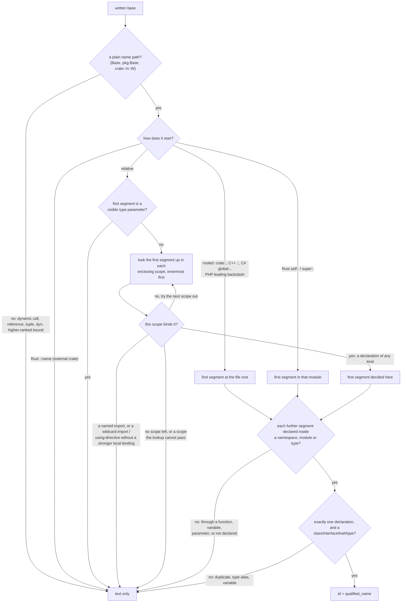
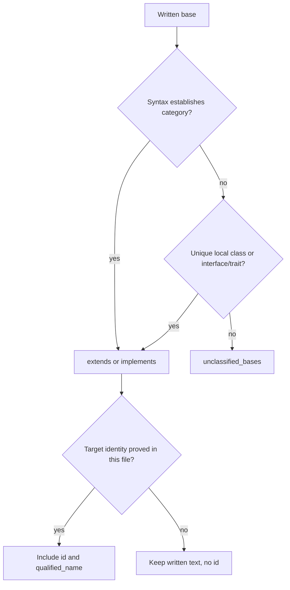

# Declared Type Relations

Every type-like record (class, interface, trait, type, enum) carries the base
types its declaration writes in its own header, plus same-file Swift extension conformances:

- `relations.extends`: classes, interfaces and traits it inherits from;
- `relations.implements`: interfaces and traits it declares conformance to;
- `relations.unclassified_bases`: written bases whose category is unknown.

Each entry is a `SymbolRef`. Its `name` is always the base **as written**. It
gets an `id` and an in-file `qualified_name` only when the name provably
refers to exactly one declaration in the same file. Rust `impl` blocks add a
type-level `implements` summary and decide which type their members belong
to.

These facts come from the syntax tree alone, during the parse pass. A
declarations-only query returns them, and no references, semantic, docs or
diagnostics pass is involved. `hug types --tree` and `hug symbols --tree`
show nonempty lists at the end of each type's row (see
[Symbol Reports](./symbol-reports.md#declared-bases-on-type-rows)).

```typescript
interface Shape {}
class Base {}
class Square extends Base implements Shape, Comparable<Square> {}
```

```json
"relations": {
  "extends":    [{ "id": "<Base>",  "name": "Base",  "qualified_name": "Base" }],
  "implements": [{ "id": "<Shape>", "name": "Shape", "qualified_name": "Shape" },
                 { "name": "Comparable<Square>" }]
}
```

`Comparable` is not declared in this file, so its entry keeps only the
written text.

## What is recorded per language

| Language | `extends` | `implements` | Not a relation |
|---|---|---|---|
| Rust | trait supertraits (`trait A: B + c::D<u8>`) | trait impls, on each member and on the resolved self type (see [Rust impls](#rust-impls)) | lifetime bounds (`'a`), `?Sized` |
| TypeScript | class `extends`, interface `extends` | class `implements` | |
| JavaScript | the class `extends` expression, as written | — | |
| Go | named types embedded in an `interface` (`Base`, `fmt.Stringer`, `G[int]`) | — | unions, `~T` terms, unshadowed predeclared non-interface types (`int`, `string`, …), embedded struct fields (composition) |
| Python | positional class bases, `*bases` kept as written | — | `metaclass=` and other keyword arguments, `**options` |
| Java | class `extends`, interface `extends` | class, enum and record `implements` | |
| C++ | every base specifier, private and `virtual` bases included | — | the `public`/`private`/`virtual` keywords (not part of the text) |
| PHP | class and interface `extends` | class and enum `implements` | trait `use` (composition) |
| C# | interface inheritance; proven class bases | struct/record-struct interfaces; entries after a class's first base; proven interface targets | enum underlying types |
| Swift | protocol inheritance; proven class bases | structs/actors, local-owner extensions, entries after a class's first base, proven protocol targets | proven enum raw-value types |
| Scala | trait inheritance; proven class bases | mixins after the first parent; proven trait targets on concrete owners | |
| C, Bash, Zsh | — (no inheritance) | — | |
| Perl | — | — | `@ISA`, `use parent` |
| Lua | — | — | metatables |

In every list:

- **Text as written.** Outer whitespace is trimmed. Generic arguments and
  call arguments stay (`pkg.Base<T>`, `mix(Base)`, `ns::TB<int>`, `G[int]`).
- **Source order, no repeats.** An expression written twice appears once.
  Different instantiations of the same base stay separate: `Mixin<string>`
  and `Mixin<number>` are two entries with the same `id`.
- **No inference.** Inherited members and transitive bases are never added.

## When a target gets an ID

A written base resolves to a same-file declaration only when its syntax,
qualification and lexical scope identify exactly one. Anything that cannot
be proved keeps its text alone. That counts as a successful result, not a
gap.

A path is resolved one segment at a time. Its **first segment** is decided
first, by the nearest scope that binds that name. Only then are the remaining
segments looked up, each inside the one before it.



Once a scope binds the first segment, outer scopes are never tried, even when
the full path does not exist there. A scope binds a name when it declares it
(a type, namespace, module, function, variable or parameter), when the name
qualifies a declaration there (a package or namespace that has no record of
its own), or when one of its imports names it.

The rules, with an example of each:

| Rule | Example | Result |
|---|---|---|
| A bare name resolves in the nearest enclosing scope that declares it | Python `class Outer: class Base` … `class Inner(Base)`, with `Inner` directly in `Outer`'s body | `Outer.Base`, not a module-level `Base` |
| A qualified name must match an in-file qualified name exactly | C++ `struct D : ns::B` | `ns::B` |
| A qualified path to another file never falls back to its last segment | `extends other.Root` next to a local `Root` | text only |
| A nearer binding of the first segment decides, even when it lacks the rest | C++ `namespace inner { namespace ns {} struct C : ns::B {}; }` next to a global `ns::B` | text only |
| A parameter is a binding | TypeScript `function f(ns: any) { class C extends ns.Inner {} }` next to `namespace ns` | text only |
| A function is not a namespace: its local classes are not reachable through its name | JavaScript `function outer() { class Local {} }` … `class C extends outer.Local {}` | text only |
| A type parameter shadows a local type, the enclosing declarations' included | C++ `template <class T> struct P : T` next to a `struct T` | text only |
| An enclosing declaration's type parameters shadow even when a query does not select it and its list is too long to number | Python `def factory[Base, T0, …, T65535]()` (65,537 parameters) with `class C(Base)` inside, next to a module-level `Base`, queried for types only | text only; a complete index, which selects `factory`, fails with `too_many_generic_parameters` |
| An alias would need expansion | TypeScript `implements Alias` where `type Alias = Root` | text only |
| Two declarations share the name (ambiguity) | Rust `#[cfg(a)] trait Amb` / `#[cfg(not(a))] trait Amb` | text only |
| An imported name has no declaration at its scope | Rust `use m::V; impl Tr for V` | text only |
| An import binds its name in the scope that holds it | Python `def g(): from lib import Base` then `class C(Base)` inside `g`, next to a module-level `Base` | text only |
| A wildcard import or C++ `using namespace` may bind any name | C++ `namespace n { using namespace other; struct C : B {}; }` next to a global `B` | text only |
| Every expression of a Scala `import` binds its name, and a rename binds its alias | Scala `import lib.Base, lib.Other`, `import lib.{Other}, lib.{Base}`, `import lib.Other as Base` or `import lib.{Other => Base}`, then `class C extends Base`, next to an outer `Base` | text only |
| A Scala exclusion or a rename to another name binds nothing else; only a wildcard (`_`, `*`, `given`) may bind any name | Scala `import lib.{Other as Renamed}` or `import lib.{Other => _}`, then `class C extends Base`, next to an outer `Base` | the outer `Base` |
| A Java, C++, C#, Swift or Scala type with bases may inherit the name, so lookup stops there | Java `class Sub extends A { class C extends Base {} }`, where `A` declares `Base` | text only |
| A class body is never a lexical scope in JS/TS | TypeScript `class Outer { Base = 1; m() { class C extends Base {} } }` | the module-level `Base` |
| A Python class body is a lexical scope only for code written directly in it: a nested class, method or function skips every enclosing class body, with its classes, variables and imports, and continues to the enclosing functions and the module | Python `class Outer: class Base` … `class Middle: class C(Base)`, or `def m(self): class C(Base)` | the module-level `Base`; text only when the module has none |
| A dynamic expression | JavaScript `class D extends mix(Base)` | text only |
| Rust names are looked up only as far as the nearest module | `mod b { trait T: Base {} }` with `Base` at the crate root | text only (`super::Base` resolves) |
| Rust `crate::`, `self::` and `super::` anchor the path | `trait U: crate::Base` | the crate-root `Base` |
| A Rust leading `::` names an external crate | `trait U: ::a::Dup` next to a local `mod a { trait Dup {} }` | text only |
| A C++ leading `::` anchors at the global namespace | `namespace ns { struct C : ::B {}; }` next to `ns::B` | the global `B` |
| C# `global::` anchors at the file root | `namespace N { class Child : global::Base {} }` next to a global `Base` | the global `Base` |
| A PHP leading `\` anchors at the file root | `implements \App\Other` | `App\Other` |
| A PHP name without a leading `\` is relative to its namespace only | `namespace Other; class C extends App\Root {}` next to `App\Root` | text only (it names `Other\App\Root`) |

A resolved target's `qualified_name` is the in-file name. The scan-root or
module prefix that reports add (`file.rs#Base`) never enters a stored
target.

In C#, Swift and Scala, a local declaration in the current scope takes
precedence over a wildcard or whole-module import. Explicit named imports
still stop the lookup. For example, `import Foundation; class Base {}` and
`class Child: Base {}` link to the local `Base`, while `import class Lib.Base`
leaves that base unresolved.

The lookup uses one per-file index of every declaration by in-file qualified
name. The index is built once per file from every record, including records
of kinds a query did not select. So a query for classes alone still resolves
a base that is an interface. The file's imports are collected in one walk of
its syntax tree, only when a lookup needs them.

## Rust impls

Each `impl` block in a Rust file is read once, empty ones included
(`impl Marker for Local {}` has no members but still says something). Its
self type is resolved by the rules above, using the full written path.
`Gen<T>` and `crate::m::W<T>` match their base declaration. A reference,
tuple, `dyn` or other composite self type (`&Local`) attaches to no
component type. Every generic parameter in view of the impl counts, not only
its own: those of the functions, impls and traits around it too, so
`fn outer<T>() { impl Base for T {} }` never attaches to a file-level
`struct T`.

| Impl | Members' `implements` | Self type's `implements` | Members belong to (with Containment) |
|---|---|---|---|
| `impl fmt::Display for Local { fn fmt… }` | `fmt::Display` | `fmt::Display` added | `Local` |
| `impl Local { fn new… }` (inherent) | none | nothing added | `Local` |
| `impl !Send for Local {}` (negative) | none | nothing added | `Local` |
| `impl Other for &Local { fn by_ref… }` | `Other` | nothing added | a textual container `&Local`, no parent |
| `impl Other for other::Local { fn ext… }` | `Other` | nothing added | a textual container `other::Local`, no parent |
| `impl<T> Base for T { fn blanket… }` | `Base` | nothing added (`T` is the impl's parameter) | a textual container `T`, no parent |
| `fn outer<T>() { impl Base for T { fn probe… } }` | `Base` | nothing added (`T` is `outer`'s parameter) | a textual container `T`, no parent |
| `impl ::ext::B { fn probe… }` next to a local `mod ext { struct B; }` | none | nothing added (an external crate's type) | a textual container `::ext::B`, no parent |

- The self type's `implements` lists every positive trait impl in file
  order, with repeats of the same written trait removed.
- Each member keeps its own trait relation, so a query that returns methods
  alone still shows which trait supplied each method.
- With Containment, each member (and anything the container search places on
  the impl's type from inside it, such as a method's parameters) belongs to
  the resolved type. It is added to `relations.members` next to the type's
  ordinary members and the members of its other impls, in record order.
- When the self type does not resolve, the member's `relations.container` is
  the self type as written, with no `id`; it has no `parent`, and no local
  type lists it.
- A member's `identity.container_kind` follows the same decision, with or
  without Containment: the resolved type's kind, and no kind when the self
  type does not resolve, even beside a same-named local type.
- Qualified names, `identity.container_name` and symbol IDs are not changed
  by any of this (`impl Other for &Local { fn by_ref }` is still
  `Local::by_ref`).

The self type's resolution exists only while the file is parsed; no record
retains it. Widening a cached Rust entry by Containment therefore parses the
file once (`CacheLookup::WidenedCapabilities { parsed: true }`) instead of
guessing a container from records. Other languages still add Containment
from stored records. See [Cache design](./cache-design.md).

## C#, Swift and Scala

These languages can mix inheritance and conformance in one written list.
Classification comes from syntax first, then from an unambiguous same-file
target declaration. It is independent of target identity: an external
interface can be known conformance while its `id` stays absent.

```csharp
interface I {}
class Child : External, I {}
struct Value : IDisposable {}
```

`Child` records `External` in `unclassified_bases` and `I` in `implements`.
`Value` records `IDisposable` in `implements` even without a local interface
declaration, because a struct's list can only declare interfaces. A class's
first entry can be either a superclass or an interface; subsequent entries
are interfaces. Interface inheritance stays in `extends`. Enum underlying
types do not create relations. A primary constructor's base invocation,
such as `class Child(int x) : External(x)`, establishes inheritance without
requiring a local target declaration; its relation retains `External(x)`.

```swift
protocol P {}
struct Point: P {}
extension Point: Codable {}
class Child: External {}
```

`Point` records `P` and `Codable` in `implements`; `Child` keeps `External`
in `unclassified_bases`. Struct, actor and extension lists declare
conformance. A class's first entry is classified only when its target is
proved; later entries are protocols. Protocol inheritance stays in `extends`.
Enum raw-value types established by raw-value cases or standard raw-type
names are excluded; a same-file protocol can classify an enum's first entry.
A standard raw-type name is excluded only while nothing in the file
redeclares it; see [Built-in spellings](#built-in-spellings).

### Built-in spellings

Two readers drop a written entry because its spelling names a built-in type
that is no base: a Go interface element spelled like a predeclared
non-interface type (`bool`, `byte`, `complex64`, `complex128`, `float32`,
`float64`, `int`, `int8`, `int16`, `int32`, `int64`, `rune`, `string`,
`uint`, `uint8`, `uint16`, `uint32`, `uint64`, `uintptr`), and a Swift
enum's first entry spelled like a standard raw-value type (`Int`, `Int8`,
`Int16`, `Int32`, `Int64`, `UInt`, `UInt8`, `UInt16`, `UInt32`, `UInt64`,
`String`, `Character`, `Float`, `Double`, `Unicode.Scalar`, each also
qualified as `Swift.Int`, `Swift.Unicode.Scalar`).

Both languages let a program redeclare those names, so the spelling alone
proves nothing. The entry is dropped only when no binding in view gives the
path's first segment (`int`, `Int`, `Unicode`, `Swift`) another meaning:

| Binding of the first segment | Result |
|---|---|
| none in this file | dropped: no relation |
| a same-file type declaration, in the declaring scope or any enclosing one (a Go function body included) | kept, with the declaration's `id` when the lookup proves it |
| a same-file alias, a Swift selective import of that name (`import protocol M.Int`), an import whose names cannot be read, a type parameter, or several declarations | kept as written, no `id` (Swift: in `unclassified_bases`) |

```go
type int interface{ M() }
type Child interface{ int }   // extends int, with the local interface's id
type Plain interface{ int }   // in a file without that declaration: no relation
```

```swift
protocol P {}
typealias Int = P
enum Child: Int { case a }        // unclassified_bases: Int, no id
enum Code: Swift.Int { case a }   // no relation
```

Only same-file evidence counts. A Swift whole-module import
(`import Foundation`), a member type inherited from a base, and a
declaration in another file of the Go package are not read, so they never
keep an entry. An explicit raw value (`case a = 1`) still proves a Swift
raw-value enum by syntax, whatever its first entry is named.

Extension conformances attach only to a uniquely resolved local class,
struct or enum. A qualified external owner, alias, or ambiguous name never
attaches to a same-named local type. The owner's header entries come first,
then extension entries in file order, with equal written expressions removed.
The relation is a written conformance summary: a conditional extension's
`where` requirements are not represented as edge conditions.

Swift targets retain `source_span`, the written target's location in the
same file. This evidence survives cache hits and distinguishes header
conformance from extension conformance. With `--signatures full`, an outline
shows `struct Point: P implements Codable`, retaining the extension addition
without repeating `P`.

```scala
trait T
class Child extends External with T
```

`Child` keeps `External` in `unclassified_bases` and `T` in `implements`.
Mixins following the first parent are conformance; a first parent resolving
to a local class is `extends`, and one resolving to a local trait is
`implements`. Objects follow the same rule as classes; their `Module`
records retain the written parents. A trait's own parent list remains
`extends`. Written generic and constructor arguments remain intact, such as
`Base[Int](1)`; the type's path is resolved independently of those arguments.



Uncertainty never changes the meaning of `extends`. Outlines label the
third list `unclassified bases External`; JSON and JSONL expose
`relations.unclassified_bases`. Each list preserves its own source order.

## Limitations

- Swift extension conformances on external, aliased or ambiguous owners
  cannot be attached to a local record. Conditional conformance requirements
  are not retained on the relation edge.
- An external first base in a mixed list remains unclassified when syntax
  cannot establish its category. This preserves the source fact.
- Go: a named type embedded in an interface constraint cannot be told apart
  from an embedded interface by syntax. Only the predeclared non-interface
  types (`bool`, `int`, `string`, …) are excluded, and only when no same-file
  declaration redeclares the name; a redeclaration in another file of the
  package is not seen.
- Name lookup is a bounded source lookup, not compiler resolution. Imports
  are read only as bindings that hide a declaration further out: an imported
  base never resolves, even when an unrelated local declaration has the same
  last segment. An import whose bound names cannot all be read counts as a
  wildcard, so lookup through its scope stays unresolved rather than
  guessing. Java and Go imports are not read, since a same-file
  declaration of an imported name does not compile.
- Python and TypeScript names are looked up without regard to statement
  order: a binding later in a scope hides an outer declaration just as an
  earlier one does.
- Older-model adapters (`SymbolInfo`) carry no relations. Converting a record
  to `SymbolInfo` drops them.
