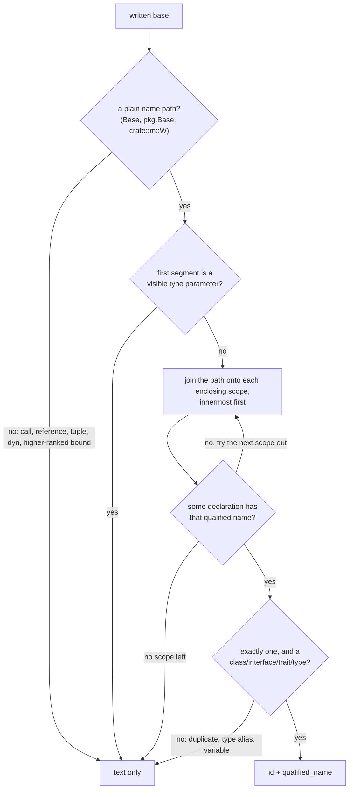

# Declared Type Relations

Every type-like record (class, interface, trait, type, enum) carries the base
types its declaration writes in its own header:

- `relations.extends`: classes, interfaces and traits it inherits from;
- `relations.implements`: interfaces and traits it declares conformance to.

Each entry is a `SymbolRef`. Its `name` is always the base **as written**. It
gets an `id` and an in-file `qualified_name` only when the name provably
refers to exactly one declaration in the same file. Rust `impl` blocks add a
type-level `implements` summary and decide which type their members belong
to.

These facts come from the syntax tree alone, during the parse pass. A
declarations-only query returns them, and no references, semantic, docs or
diagnostics pass is involved.

```typescript
interface Shape {}
class Base {}
class Square extends Base implements Shape, Comparable<Square> {}
```

```json
"relations": {
  "extends":    [{ "id": "<Base>",  "name": "Base",  "qualified_name": "Base" }],
  "implements": [{ "id": "<Shape>", "name": "Shape", "qualified_name": "Shape" },
                 { "name": "Comparable<Square>" }]
}
```

`Comparable` is not declared in this file, so its entry keeps only the
written text.

## What is recorded per language

| Language | `extends` | `implements` | Not a relation |
|---|---|---|---|
| Rust | trait supertraits (`trait A: B + c::D<u8>`) | trait impls, on each member and on the resolved self type (see [Rust impls](#rust-impls)) | lifetime bounds (`'a`), `?Sized` |
| TypeScript | class `extends`, interface `extends` | class `implements` | |
| JavaScript | the class `extends` expression, as written | — | |
| Go | named types embedded in an `interface` (`Base`, `fmt.Stringer`, `G[int]`) | — | unions, `~T` terms, predeclared non-interface types (`int`, `string`, …), embedded struct fields (composition) |
| Python | positional class bases, `*bases` kept as written | — | `metaclass=` and other keyword arguments, `**options` |
| Java | class `extends`, interface `extends` | class, enum and record `implements` | |
| C++ | every base specifier, private and `virtual` bases included | — | the `public`/`private`/`virtual` keywords (not part of the text) |
| PHP | class and interface `extends` | class and enum `implements` | trait `use` (composition) |
| C#, Swift, Scala | **planned**: these base lists mix inheritance and conformance; nothing is recorded until their classification is decided | | |
| C, Bash, Zsh | — (no inheritance) | — | |
| Perl | — | — | `@ISA`, `use parent` |
| Lua | — | — | metatables |

In every list:

- **Text as written.** Outer whitespace is trimmed. Generic arguments and
  call arguments stay (`pkg.Base<T>`, `mix(Base)`, `ns::TB<int>`, `G[int]`).
- **Source order, no repeats.** An expression written twice appears once.
  Different instantiations of the same base stay separate: `Mixin<string>`
  and `Mixin<number>` are two entries with the same `id`.
- **No inference.** Inherited members and transitive bases are never added.

## When a target gets an ID

A written base resolves to a same-file declaration only when its syntax,
qualification and lexical scope identify exactly one. Anything that cannot
be proved keeps its text alone. That counts as a successful result, not a
gap.



The rules, with an example of each:

| Rule | Example | Result |
|---|---|---|
| A bare name resolves in the nearest enclosing scope that declares it | Python `class Outer: class Base` … `class Inner(Base)` | `Outer.Base`, not a module-level `Base` |
| A qualified name must match an in-file qualified name exactly | C++ `struct D : ns::B` | `ns::B` |
| A qualified path to another file never falls back to its last segment | `extends other.Root` next to a local `Root` | text only |
| A type parameter shadows a local type | C++ `template <class T> struct P : T` next to a `struct T` | text only |
| An alias would need expansion | TypeScript `implements Alias` where `type Alias = Root` | text only |
| Two declarations share the name (ambiguity) | Rust `#[cfg(a)] trait Amb` / `#[cfg(not(a))] trait Amb` | text only |
| An imported name has no declaration at its scope | Rust `use m::V; impl Tr for V` | text only |
| A dynamic expression | JavaScript `class D extends mix(Base)` | text only |
| Rust names are looked up only as far as the nearest module | `mod b { trait T: Base {} }` with `Base` at the crate root | text only (`super::Base` resolves) |
| Rust `crate::`, `self::` and `super::` anchor the path | `trait U: crate::Base` | the crate-root `Base` |
| A PHP leading `\` anchors at the file root | `implements \App\Other` | `App\Other` |

A resolved target's `qualified_name` is the in-file name. The scan-root or
module prefix that reports add (`file.rs#Base`) never enters a stored
target.

The lookup uses one per-file index of every declaration by in-file qualified
name. The index is built once per file from every record, including records
of kinds a query did not select. So a query for classes alone still resolves
a base that is an interface.

## Rust impls

Each `impl` block in a Rust file is read once, empty ones included
(`impl Marker for Local {}` has no members but still says something). Its
self type is resolved by the rules above, using the full written path.
`Gen<T>` and `crate::m::W<T>` match their base declaration. A reference,
tuple, `dyn` or other composite self type (`&Local`) attaches to no
component type.

| Impl | Members' `implements` | Self type's `implements` | Members belong to (with Containment) |
|---|---|---|---|
| `impl fmt::Display for Local { fn fmt… }` | `fmt::Display` | `fmt::Display` added | `Local` |
| `impl Local { fn new… }` (inherent) | none | nothing added | `Local` |
| `impl !Send for Local {}` (negative) | none | nothing added | `Local` |
| `impl Other for &Local { fn by_ref… }` | `Other` | nothing added | a textual container `&Local`, no parent |
| `impl Other for other::Local { fn ext… }` | `Other` | nothing added | a textual container `other::Local`, no parent |
| `impl<T> Base for T { fn blanket… }` | `Base` | nothing added (`T` is the impl's parameter) | a textual container `T`, no parent |

- The self type's `implements` lists every positive trait impl in file
  order, with repeats of the same written trait removed.
- Each member keeps its own trait relation, so a query that returns methods
  alone still shows which trait supplied each method.
- With Containment, each member (and anything the container search places on
  the impl's type from inside it, such as a method's parameters) belongs to
  the resolved type. It is added to `relations.members` next to the type's
  ordinary members and the members of its other impls, in record order.
- When the self type does not resolve, the member's `relations.container` is
  the self type as written, with no `id`; it has no `parent`, and no local
  type lists it.
- Qualified names, `identity.container_name` and symbol IDs are not changed
  by any of this (`impl Other for &Local { fn by_ref }` is still
  `Local::by_ref`).

The self type's resolution exists only while the file is parsed; no record
retains it. Widening a cached Rust entry by Containment therefore parses the
file once (`CacheLookup::WidenedCapabilities { parsed: true }`) instead of
guessing a container from records. Other languages still add Containment
from stored records. See [Cache design](./cache-design.md).

## Limitations

- C#, Swift and Scala base lists are not read yet (**planned**).
- Go: a named type embedded in an interface constraint cannot be told apart
  from an embedded interface by syntax. Only the predeclared non-interface
  types (`bool`, `int`, `string`, …) are excluded.
- Name lookup is a bounded source lookup, not compiler resolution. It does
  not read imports, so an imported base never resolves, even when an
  unrelated local declaration has the same last segment.
- Older-model adapters (`SymbolInfo`) carry no relations. Converting a record
  to `SymbolInfo` drops them.
