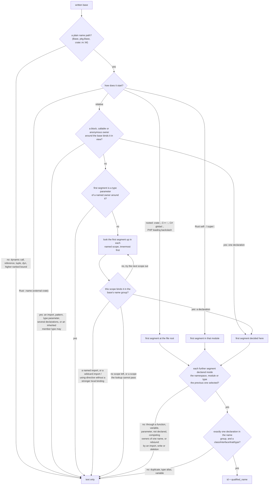

# Declared Type Relations

Every type-like record (class, interface, trait, type, enum) carries the base
types its declaration writes in its own header, plus same-file Swift extension conformances:

- `relations.extends`: classes, interfaces and traits it inherits from;
- `relations.implements`: interfaces and traits it declares conformance to;
- `relations.unclassified_bases`: written bases whose category is unknown.

Each entry is a `SymbolRef`. Its `name` is always the base **as written**. It
gets an `id` and an in-file `qualified_name` only when the name provably
refers to exactly one declaration in the same file. Rust `impl` blocks add a
type-level `implements` summary and decide which type their members belong
to.

These facts come from the syntax tree alone, during the parse pass. A
declarations-only query returns them, and no references, semantic, docs or
diagnostics pass is involved. `hug types --tree` and `hug symbols --tree`
show nonempty lists at the end of each type's row (see
[Symbol Reports](./symbol-reports.md#declared-bases-on-type-rows)).

```typescript
interface Shape {}
class Base {}
class Square extends Base implements Shape, Comparable<Square> {}
```

```json
"relations": {
  "extends":    [{ "id": "<Base>",  "name": "Base",  "qualified_name": "Base" }],
  "implements": [{ "id": "<Shape>", "name": "Shape", "qualified_name": "Shape" },
                 { "name": "Comparable<Square>" }]
}
```

`Comparable` is not declared in this file, so its entry keeps only the
written text.

## What is recorded per language

| Language | `extends` | `implements` | Not a relation |
|---|---|---|---|
| Rust | trait supertraits (`trait A: B + c::D<u8>`) | trait impls, on each member and on the resolved self type (see [Rust impls](#rust-impls)) | lifetime bounds (`'a`), `?Sized` |
| TypeScript | class `extends`, interface `extends` | class `implements` | |
| JavaScript | the class `extends` expression, as written | — | |
| Go | named types embedded in an `interface` (`Base`, `fmt.Stringer`, `G[int]`) | — | unions, `~T` terms, unshadowed predeclared non-interface types (`int`, `string`, …), embedded struct fields (composition) |
| Python | positional class bases, `*bases` kept as written | — | `metaclass=` and other keyword arguments, `**options` |
| Java | class `extends`, interface `extends` | class, enum and record `implements` | |
| C++ | every base specifier, private and `virtual` bases included | — | the `public`/`private`/`virtual` keywords (not part of the text) |
| PHP | class and interface `extends` | class and enum `implements` | trait `use` (composition) |
| C# | interface inheritance; proven class bases | struct/record-struct interfaces; entries after a class's first base; proven interface targets | enum underlying types |
| Swift | protocol inheritance; proven class bases | structs/actors, local-owner extensions, entries after a class's first base, proven protocol targets | proven enum raw-value types |
| Scala | trait inheritance; proven class bases | mixins after the first parent; proven trait targets on concrete owners | |
| C, Bash, Zsh | — (no inheritance) | — | |
| Perl | — | — | `@ISA`, `use parent` |
| Lua | — | — | metatables |

In every list:

- **Text as written.** Outer whitespace is trimmed. Generic arguments and
  call arguments stay (`pkg.Base<T>`, `mix(Base)`, `ns::TB<int>`, `G[int]`).
- **Source order, no repeats.** An expression written twice appears once.
  Different instantiations of the same base stay separate: `Mixin<string>`
  and `Mixin<number>` are two entries with the same `id`.
- **No inference.** Inherited members and transitive bases are never added.

## When a target gets an ID

A written base resolves to a same-file declaration only when its syntax,
qualification and lexical scope identify exactly one. Anything that cannot
be proved keeps its text alone. That counts as a successful result, not a
gap.

A path is resolved one segment at a time. Its **first segment** is decided
first, by the nearest scope that binds that name in the right **name group**
(see [Lexical scopes and name groups](#lexical-scopes-and-name-groups)). Only
then are the remaining segments looked up, each inside the declaration the
one before it selected (see [Paths through local owners](#paths-through-local-owners)).



Once a scope binds the first segment, outer scopes are never tried, even when
the full path does not exist there. A scope binds a name when it declares it
in the name group the lookup asks for, when the name qualifies a declaration
there (a package or namespace that has no record of its own), or when one of
its imports, patterns or type parameters names it.

The rules, with an example of each:

| Rule | Example | Result |
|---|---|---|
| A bare name resolves in the nearest enclosing scope that declares it | Python `class Outer: class Base` … `class Inner(Base)`, with `Inner` directly in `Outer`'s body | `Outer.Base`, not a module-level `Base` |
| A qualified name must match an in-file qualified name exactly | C++ `struct D : ns::B` | `ns::B` |
| A qualified path to another file never falls back to its last segment | `extends other.Root` next to a local `Root` | text only |
| A nearer binding of the first segment decides, even when it lacks the rest | C++ `namespace inner { namespace ns {} struct C : ns::B {}; }` next to a global `ns::B` | text only |
| A value binding hides a value lookup: a JS/TS class `extends` is an expression | TypeScript `function f(ns: any) { class C extends ns.Inner {} }` next to `namespace ns` | text only |
| Where types and values are separate name groups (every language but Go, Python and JavaScript), a value never hides a type a base clause names, in any scope and whether or not it has a record | Rust `const Base: usize = 0;` beside `trait Base {}`, then `trait C: Base {}`; Java `void m(int Base) { class C extends Base {} }`; TypeScript `const { x: { Base } } = e;` at module level beside `interface Base {}`, then `class C implements Base {}` | the trait / class / interface `Base` |
| In Go, Python and JavaScript any binding of the name hides it | Python `a, Base = e` at module level beside `class Base`, then `class C(Base)` | text only |
| A parameter of a Rust impl, or of a TypeScript signature with no body, is in view only inside it | `impl<Base> Holder<Base> {}` beside `trait Base {}`, then `trait C: Base {}` before or after the impl | the trait `Base` |
| A declaration in a finished or sibling block is out of view | Rust `fn f() { { trait Base {} } trait C: Base {} }` next to a file-level `Base` | the file-level `Base`; text only when there is none |
| A function is not a namespace: its local classes are not reachable through its name | JavaScript `function outer() { class Local {} }` … `class C extends outer.Local {}` | text only |
| A member rebound after its declaration names nothing: an import, deletion or other write of that name in the owner's body, or a write through the owner's path ([Members rebound after their declaration](#members-rebound-after-their-declaration)) | Python `class H: class Base: pass` then `from lib import Base` in `H`'s body, then `class C(H.Base)` | text only |
| A path through a local type or module stays inside the one its first segment names | C++ `void f() { { struct H { struct B {}; }; } { struct H {}; struct C : H::B {}; } }` | text only: the `H` in view has no `B` |
| A Rust module's items are reachable through its path, also for a module declared in a function | `fn f() { mod m { pub trait B {} } trait C: m::B {} }` | `f::m::B` |
| A type parameter shadows a local type, the enclosing declarations' included | C++ `template <class T> struct P : T` next to a `struct T` | text only |
| A value parameter (Rust `const N: usize`, C++ `template <int N>`) is no type parameter | C++ `template <int Base> struct C : Base {}` next to a `struct Base` | the `struct Base` |
| An enclosing declaration's type parameters shadow even when a query does not select it and its list is too long to number | Python `def factory[Base, T0, …, T65535]()` (65,537 parameters) with `class C(Base)` inside, next to a module-level `Base`, queried for types only | text only; a complete index, which selects `factory`, fails with `too_many_generic_parameters` |
| An alias would need expansion | TypeScript `implements Alias` where `type Alias = Root` | text only |
| Two declarations share the name (ambiguity) | Rust `#[cfg(a)] trait Amb` / `#[cfg(not(a))] trait Amb` | text only |
| Two owners share an intermediate name: every later segment stops, however unique the last one is ([Competing owners of one name](#competing-owners-of-one-name)) | Rust `mod H { pub trait B {} }` and `mod H {}`, then `trait C: H::B {}` | text only |
| A namespace reopened in one file is one owner | C++ `namespace ns { struct B {}; }` and `namespace ns {}`, then `struct C : ns::B {}` | `ns::B` |
| An imported name has no declaration at its scope | Rust `use m::V; impl Tr for V` | text only |
| An import binds its name in the scope that holds it | Python `def g(): from lib import Base` then `class C(Base)` inside `g`, next to a module-level `Base` | text only |
| A wildcard import or C++ `using namespace` may bind any name | C++ `namespace n { using namespace other; struct C : B {}; }` next to a global `B` | text only |
| Every expression of a Scala `import` binds its name, and a rename binds its alias | Scala `import lib.Base, lib.Other`, `import lib.{Other}, lib.{Base}`, `import lib.Other as Base` or `import lib.{Other => Base}`, then `class C extends Base`, next to an outer `Base` | text only |
| A Scala exclusion or a rename to another name binds nothing else; only a wildcard (`_`, `*`, `given`) may bind any name | Scala `import lib.{Other as Renamed}` or `import lib.{Other => _}`, then `class C extends Base`, next to an outer `Base` | the outer `Base` |
| A Java, C++, C#, Swift or Scala type with bases may inherit the name, so lookup stops there | Java `class Sub extends A { class C extends Base {} }`, where `A` declares `Base` | text only |
| A class body is never a lexical scope in JS/TS | TypeScript `class Outer { Base = 1; m() { class C extends Base {} } }` | the module-level `Base` |
| A Python class body is a lexical scope only for code written directly in it: a nested class, method or function skips every enclosing class body, with its classes, variables and imports, and continues to the enclosing functions and the module | Python `class Outer: class Base` … `class Middle: class C(Base)`, or `def m(self): class C(Base)` | the module-level `Base`; text only when the module has none |
| A dynamic expression | JavaScript `class D extends mix(Base)` | text only |
| Rust names are looked up only as far as the nearest module | `mod b { trait T: Base {} }` with `Base` at the crate root | text only (`super::Base` resolves) |
| Rust `crate::`, `self::` and `super::` anchor the path | `trait U: crate::Base` | the crate-root `Base` |
| A Rust leading `::` names an external crate | `trait U: ::a::Dup` next to a local `mod a { trait Dup {} }` | text only |
| A C++ leading `::` anchors at the global namespace | `namespace ns { struct C : ::B {}; }` next to `ns::B` | the global `B` |
| C# `global::` anchors at the file root | `namespace N { class Child : global::Base {} }` next to a global `Base` | the global `Base` |
| A PHP leading `\` anchors at the file root | `implements \App\Other` | `App\Other` |
| A PHP name without a leading `\` is relative to its namespace only, also inside a function | `namespace Other; class C extends App\Root {}` next to `App\Root` | text only (it names `Other\App\Root`) |
| A PHP class name never means a function of the same spelling | `namespace App; class Base {} function Base() {} class C extends Base {}` | `App\Base` |
| A PHP class declared in a function, method, closure or conditional is a class of its namespace ([Where a declaration is bound](#where-a-declaration-is-bound)) | `namespace App; function f() { class Base {} } class C extends Base {}` | `App\f::Base` |

A resolved target's `qualified_name` is the in-file name. The scan-root or
module prefix that reports add (`file.rs#Base`) never enters a stored
target.

In C#, Swift, Scala, Java and Go, a local declaration in the current scope
takes precedence over a wildcard, on-demand or whole-module import. Explicit named imports
still stop the lookup. For example, `import Foundation; class Base {}` and
`class Child: Base {}` link to the local `Base`, while `import class Lib.Base`
leaves that base unresolved.

The lookup uses one per-file index of every declaration by the name it is
bound under, which is its in-file qualified name except in the cases listed
in [Where a declaration is bound](#where-a-declaration-is-bound). The index
is built once per file from every record, including records
of kinds a query did not select. So a query for classes alone still resolves
a base that is an interface. The file's lexical scopes, the bindings that no
record reports and its imports are collected in one walk of its syntax tree,
only when a lookup needs them; reference resolution (`hug refs`) is not
needed.

The work a lookup does is bounded by the path it resolves, never by how many
declarations share a name. Each name's declarations are summarized once
(how many there are per name group, whether each is a namespace-like owner),
each lexical owner's own members are indexed once by owner and name, and
parameters of owners without a record are indexed by the owner. So a
namespace reopened 400 times, 400 sibling blocks that each declare a
`Holder` with a `Base`, or 400 impls that each name a parameter `Base` cost
each lookup the same as one would. A record's base lists drop repeated
written expressions with one membership check per base. Generic parameter
visits, subject-index construction and lookup comparisons are included in
work counters; a long parameter list remains input even when its owner has
no selected record. Separately written Rust, C# and Swift bounds use one
subject-name index per list, preserving parameter positions and bound order.

### Lexical scopes and name groups

Inside a callable, a block or an anonymous owner, a declaration's displayed
qualified name does not say where it is visible: a trait declared in a
finished block of `factory` is named `factory::Base`, exactly like one
declared beside the base. So the first segment is looked up through the
syntax scopes around the base first, innermost first:

- **Blocks are scopes** wherever the language makes them one: Rust, Go, C++,
  Java, JavaScript/TypeScript and Scala blocks, Swift `do` and other
  statement bodies, Go `case` clauses, C++/Java/JS `for` and `catch`. A Python
  `if` or `for` suite is not a scope; a Python function, lambda and
  comprehension are.
- **Declaration position** counts where the language says so: a Go local type
  is in view from its name and a local variable after its declaration, a C++
  declaration from its name, a Java local class from its name. A Rust item,
  a Swift or Scala local type, and a JavaScript/TypeScript declaration are in
  view in their whole scope.

  ```cpp
  struct Base {};
  void f() { struct C : Base {}; struct Base {}; }   // C extends ::Base
  ```

- **Name groups.** A base clause looks a type up, so a value of the same
  spelling (a parameter, local, field, method, function, constant, static,
  Rust `const` generic, C++ non-type template parameter, Scala `val`/`def`,
  PHP function) never hides it, and a type alias still does. A qualifier is
  looked up as a module, namespace or type (Rust, C++, Java, C#, Swift, PHP),
  as a term in Scala (an `object` or a value, so a companion `object` is never
  the base and a pattern-bound `val` hides an `object` qualifier), and as a
  namespace in a TypeScript type (`implements ns.I` ignores a value
  parameter `ns`). A JavaScript or TypeScript class `extends` is an
  expression and looks a value up. Go and Python have one group, so any
  binding hides an outer declaration.
- **Bindings no record reports** count: JS/TS destructuring parameters and
  variables (nested, renamed, defaulted, rest), `catch` and `for…of`
  bindings; Python nested, list and starred targets of an assignment, `for`
  or `with`, augmented assignment and `del` targets, `except … as`, walrus
  names and `match` captures; Scala pattern
  `val`s, `for` generators and `case` patterns (lowercase names; an uppercase
  name is a stable identifier). Such a binding never resolves. It keeps its
  name group and its scope wherever it is written, inside a callable or at
  module, package or object level: a destructured value or a pattern `val`
  is a value, so it hides only a value lookup (a JS/TS class `extends`, a
  Scala qualifier), and Python targets hide every lookup, Python having one
  group. The parameters of an owner that has no record of its own (a Rust
  `impl`, a TypeScript overload or `declare function` signature) are bindings
  of that owner alone.

  ```typescript
  interface Base {}
  const { x: { Base } } = external;    // a value
  class C implements Base {}           // implements the interface Base
  ```
- **Python directives** redirect writes as well as reads. `global Base`
  sends the lookup to the module and `nonlocal Base` to the nearest
  enclosing function that binds `Base`. Any write of `Base` in the
  directive's scope binds at that destination instead: an assignment
  (augmented included) or pattern target, `del`, an import, a `class` or
  `def`, a `for`, `with` or `except` target, a walrus (also inside a
  comprehension) or a `match` capture. Such a write means the destination's
  own declaration is no longer proved, so every base that sees the
  destination stays text only. For `global`, that covers bases anywhere in
  the module: the function may run before any of them. For `nonlocal`, it
  covers the bases inside the enclosing function. A `class Base` declared
  under `global` is not taken as the module's `Base` either, because the
  module binding has more than one writer. A class body's directive works
  the same way: `class H:` with `global Base` and then `class Base: ...` in
  its body declares the module's `Base`, not a member, so `H.Base` (and
  anything nested in that class, `H.Base.Inner`) stays text only. A
  comprehension's own target
  binds only inside the comprehension, and a nested function's assignment
  binds in that function. Neither is a write under the directive.

  ```python
  class Base: ...
  def probe(external):
      global Base
      Base = external          # rebinds the module's Base
      class C(Base): ...       # text only
  class D(Base): ...           # text only: probe() may have run
  ```
- **Anonymous owners** bind like named ones: the type parameters of a
  TypeScript class expression, a C++ generic lambda (`[]<class T>`) and a
  Scala polymorphic lambda (`[T] => …`) are in view inside them, and a Java
  anonymous class, a Scala `new X { … }` and a C++ unnamed `struct : X`
  inherit member types from their base, so lookup stops there as it does for
  a named type with bases. A captured C++ template parameter is never a
  target.
- **Swift extensions** see their owner's type parameters, including those
  of its actual enclosing declarations. For example,
  `struct Outer<T> { struct Inner {} }` followed by
  `extension Outer.Inner { class C: T {} }` keeps `T` as written, without a
  target ID. An extension conformance to `T` also remains textual. The
  owner's context is shared across its extensions and their bodies. These
  names affect lookup only; they are never copied into `C`'s own parameter
  list. A nearer method-local declaration still takes precedence, and an
  ordinary member of `Outer` does not become a lexical extension-header name.
  When the extended owner is not proved (external, aliased, imported, or
  [competing](#competing-owners-of-one-name)), its parameters and member
  types are unknown, not absent: `extension External { class C: Base {} }`
  keeps `Base` as written in `unclassified_bases` beside a file-level
  `class Base`, and an enum's raw-type spelling (`Int`, `Swift.Int`,
  `Unicode.Scalar`, …) is kept the same way instead of dropped. A
  method-local `Base` declared in the extension still decides.

When no lexical scope binds the name, the named scopes (types, namespaces,
modules, the file) are tried by in-file qualified name as above; they never
see a declaration of a block or callable.

### Competing owners of one name

A path continues through a namespace, module or type only when its name
means **one owner**. Repeated definitions are one owner only where the
language reopens them: a C++, TypeScript, C# or PHP `namespace`, including
the same canonical C++ inline namespace defined twice. Everywhere else two
same-named owners compete: two Rust `mod H` (also under opposite `cfg`
attributes, which extraction does not evaluate), two Scala `object H`, two
file-level types, and a C++ spelling that reaches two distinct namespaces
through inline namespaces (as `clang` reports "reference to `Shared` is
ambiguous"). A competing owner stops the path at that segment, so no later
segment, however unique, gets an ID.

```cpp
namespace ReviewNs {
    inline namespace a { namespace Shared { struct Base {}; } }
    inline namespace b { namespace Shared {} }
}
struct C : ReviewNs::Shared::Base {};      // text only: two Shared namespaces
struct D : ReviewNs::a::Shared::Base {};   // ReviewNs::a::Shared::Base, by its id
```

A lookup made **inside** one of the competing owners knows which one it is
in, from its place in the source: a bare name, `self::` or an inner
module's `super::` reads that owner's own members, never the other's.

```rust
mod holder {
    pub trait Base {}
    pub trait C: Base {}          // this module's Base, by its id
    pub trait D: self::Base {}    // the same Base
}
mod holder { pub trait Base {} }
trait E: holder::Base {}          // text only: two holder modules
```

| Path | Example | Result |
|---|---|---|
| through two C++ namespaces injected by different inline namespaces, bare, qualified or rooted | the `C` above; `::ReviewNs::Shared::Base`; `Shared::Base` written inside `ReviewNs` | text only |
| through a direct and an injected C++ namespace of one name | `namespace ns { namespace S {} inline namespace v { namespace S {} } }` then `ns::S::B` | text only |
| through the one canonical inline namespace | `ns::a::Shared::Base`, or `ns::Shared::Base` when only `a` declares `Shared` | the `Base` inside it |
| through two Rust modules or two Scala objects of one name | the `E` above; Scala `object H { class B }`, `object H`, then `class C extends H.B` | text only (Scala: in `unclassified_bases`) |
| inside one of them | the `C` and `D` above; Scala `object H { class B; class C extends B }` beside a second `object H { class B }` | that owner's `B` |
| a Scala companion class and object | `class H`, `object H { class B }`, then `class C extends H.B` | `H.B`: a qualifier names the object, a term |
| two C# declarations of one type name | `partial class H { class B {} }` and `partial class H {}` | looked up by name: `partial` declarations are one type |

### Paths through local owners

When the first segment names a type or Rust module declared in a callable
or block, the rest of the path is looked up among **that declaration's own
members**: what its body declares directly, not inside one of its methods,
blocks or anonymous owners. Two same-named owners in sibling blocks display
the same qualified names (`f::H::B`), so the displayed name never decides;
the owner's place in the syntax tree does. Further segments repeat the step
(C++ `H::M::B`, Scala `holder.middle.Base`, Rust `m::inner::B`).

```cpp
void f() {
    { struct H { struct B {}; }; }
    { struct H { struct B {}; };
      struct C : H::B {}; }      // C extends this block's H::B, by its id
    { struct H {};
      struct D : H::B {}; }      // D keeps H::B as written: this H has no B
}
```

| Path | Example | Result |
|---|---|---|
| both same-named owners declare the member | the `C` above | the member of the owner in view, by its `id` |
| the owner in view lacks the member, a sibling has it | the `D` above | text only (Swift and Scala: in `unclassified_bases`) |
| a three-segment path | Scala `object holder { object middle { class Base } }` then `class C extends holder.middle.Base`, in a block or at the top level | `holder.middle.Base` |
| a Rust module declared in a function | `fn f() { mod m { pub trait B {} } trait C: m::B {} }` | `f::m::B` |
| Rust `self::` and `super::` inside such a module | `mod m { pub trait B {} pub mod inner { pub trait C: super::B {} } }` inside a function | `f::m::B`; `super::` from the function's module itself names the crate-level item, never one of the function's |
| Rust `crate::` inside such a module | `trait C: crate::B {}` | the crate-level `B` |
| a JS/TS static field holding a class expression | `class H { static B = class {}; }` then `class C extends H.B {}` | text only: a field is no type declaration |

Rust impls take the same path: `impl Trait for m::S`, `impl m::Trait for S`
and `impl m::Trait for m::S` inside a function whose module `m` declares
`S` and `Trait` attach to those declarations (see [Rust impls](#rust-impls)).

| Binding in view | Example | Result |
|---|---|---|
| a type in a finished sibling block | Go `func f() { { type Base interface{} }; type C interface{ Base } }` | the package-level `Base` |
| a pattern binding | TypeScript `function f({ a: { Base } }) { class C extends Base {} }` | text only |
| a Python nested target | `(a, (Base, b)) = x` then `class C(Base)` in the same function | text only |
| a Scala pattern-bound qualifier | `val (a, ns) = (1, 2); class C extends ns.Base`, next to `object ns { class Base }` | text only, in `unclassified_bases` |
| a Python `global` with no write of the name | `global Base` then `class C(Base)` inside a function whose enclosing function declares `Base` | the module-level `Base` |
| a Python `global` or `nonlocal` with a write | `global Base`, `Base = x`, then `class C(Base)` | text only |
| a Python `nonlocal` with no write of the name | `nonlocal Base` then `class C(Base)` in a function nested in one that declares `Base` | that enclosing function's `Base` |
| a TypeScript namespace qualifier beside a value parameter | `function f(ns: number) { class C implements ns.I {} }` | `ns.I` |

### Members rebound after their declaration

A Python class body is a namespace that later statements can change, and a
module can write through a class's path. So each segment after the first
is checked against **every binding of that name in the selected owner**,
not only its declarations. The member resolves only when its declaration is
the one binding. This holds for an owner at module level (a named scope)
and for one declared in a function (a lexical owner), for the final member
and for an owner the path passes through.

```python
class Holder:
    class Base: pass
    from lib import object as Base   # rebinds Holder.Base
class C(Holder.Base): pass           # text only

class Other:
    class Base: pass
Other.Base = make()                  # a write through the proved path
class D(Other.Base): pass            # text only

class Plain:
    class Base: pass
    from lib import Unrelated        # another name: no effect
class E(Plain.Base): pass            # Plain.Base, by its id
```

| In the owner's body, or through its path | Example | Result |
|---|---|---|
| an import of the member's name, aliased or not | `from lib import Base`, `import lib as Base` | text only |
| a wildcard import (Python) | `from lib import *` | text only |
| a deletion or an augmented assignment | `del Base`, `Base += x` | text only |
| a pattern target or `match` capture | `(a, (Base, b)) = x`, `a, *Base = x`, `case {"k": Base}:` | text only |
| any other binding of the name | `Base = x`, `a, Base = x`, a `for`, `with`, `except` or walrus target, `def Base(self):`, a second `class Base` | text only |
| a write through the owner's path, anywhere in the file | `Holder.Base = x`, `Holder.Base += x`, `del Holder.Base`, also inside a function | text only |
| the same for an owner the path passes through | `from lib import Middle` in `Holder`, or `del Holder.Middle`, then `class C(Holder.Middle.Base)` | text only |
| a `global` or `nonlocal` directive before the declaration | `global Base` then `class Base: pass` in `Holder`'s body | text only: the class is the destination's `Base` |
| another name, or a write through another owner | `from lib import Other`, `del Other`, `Holder.Other = x`, `Unknown.Base = x` | the member, by its `id` |

A write's owner path counts only when it is a plain dotted name that
resolves to one declaration of the file, looked up from the write the same
way a base is. No expression is evaluated: `factory().Base = x` or
`items[0].Base = x` change nothing, and a write before the owner's
declaration or inside a function that may never run still counts.

In other languages an import beside a same-named member of the same owner
is a compile error, so the rule changes nothing there, with two exceptions
where an import never makes a member: a Scala import inside an object and a
Swift import. A Rust glob or C++ `using namespace` inside the owner yields
to the owner's own declarations, so only a Python star import makes every
member unprovable.

### Where a declaration is bound

A declaration's displayed qualified name is built from the declarations
around it. A few languages bind some declarations in a namespace that this
displayed name does not spell. The lookup indexes those declarations under
the namespace that actually binds them. Their `qualified_name` and `id` stay
as displayed.

| Language | Declaration | Displayed as | Found as |
|---|---|---|---|
| PHP | a class, interface, trait, enum or function declared in a function, method, closure or conditional | `Example\Symbols\probe::Base` | `Example\Symbols\Base` |
| Scala | a member of `package object q` in package `example` | `example.Base` | `example.q.Base` |
| C++ | a member of `inline namespace v1` inside `namespace ns` | `ns::v1::Base` | `ns::v1::Base` and `ns::Base` |

C++ lookup indexes canonical namespace identities and each member segment.
Inline descendants occupy a contiguous range in that index, so looking up
`ns::Base` searches the `Base` member points in `ns`'s range instead of
walking all inline descendants; a namespace with no inline namespace below
it is looked up by the exact name. Only queried prefixes and their bounded
candidate summaries are cached; the combinations of omitted namespace
segments are never enumerated. A namespace is inline when any definition
says `inline`, so reopenings share the same identity and lookup rules.

Each later segment is looked up below the **one owner** its prefix reaches:
a namespace or type, or a name that exists only as a qualifier. A function
or variable sharing the spelling is no owner, as in C++ qualified lookup.
Once a prefix reaches two owners, nothing below it is looked up at all: the
path is text only, and each further name written after that prefix costs
its own segment, not another search of every owner.

```cpp
namespace ns {
    inline namespace v1 { void Shared(); }
    inline namespace v2 { void Shared(); }
    namespace Shared { struct Base {}; }
}
struct C : ns::Shared::Base {};   // ns::Shared::Base, by its id
```

```php
namespace Example\Symbols;
function probe() {
    class Base {}
    class Child extends Base {}          // Example\Symbols\probe::Base, by its id
}
class Other extends Base {}              // the same Base
class Rooted extends \Example\Symbols\Base {}   // the same Base
```

The usual rules then apply to that name:

- **Exactly one declaration.** If two PHP functions in one namespace each
  declare `class Base`, or a namespace-level `Base` sits beside one declared
  in a function, then `Base` stays text only. The same applies to a C++
  `ns::Base` beside an inline `ns::v1::Base`. The lookup never takes the first
  match.
- **The binding namespace only.** A PHP class declared in a function in
  namespace `A` is not found by a relative name from namespace `B`. It is
  found by `\A\Base`. In Scala, `package object q`'s members are found
  inside the object and from the enclosing package as `q.Base`, but not as a
  bare `Base`. An import written inside a package object binds in its
  package as well.
- **Nested inline namespaces.** The name is found with any combination of
  inline namespaces left out. So `inline namespace v1 { inline namespace v2
  { struct B {}; } }` inside `ns` is found as `ns::v1::v2::B`, `ns::v1::B`,
  `ns::v2::B` and `ns::B`. A namespace that is not inline is never left out.
  The lookup work grows with the nesting depth, not with the number of
  spellings, which doubles with each level.

A TypeScript `declare global { interface G {} }` declaration stays text only
(`implements G`). A global interface merges with every declaration of that
name in the program, so a single file cannot prove that it is the only one.

## Rust impls

Each `impl` block in a Rust file is read once, empty ones included
(`impl Marker for Local {}` has no members but still says something). Its
self type is resolved by the rules above, using the full written path.
`Gen<T>` and `crate::m::W<T>` match their base declaration. A reference,
tuple, `dyn` or other composite self type (`&Local`) attaches to no
component type. Every generic parameter in view of the impl counts, not only
its own: those of the functions, impls and traits around it too, so
`fn outer<T>() { impl Base for T {} }` never attaches to a file-level
`struct T`. The self type and the trait are looked up from the impl's
position like a base: a same-named enum or trait in a finished block is out
of view, and a parameter of the enclosing function never hides a type.
The impl's own parameters are in view only inside the impl: `impl<Base>
Holder<Base> {}` does not hide a file-level `trait Base` from a declaration
before or after it, and a `const` parameter is a value, so it never hides a
type even inside (`impl<const Shape: usize>`, or a trait's
`<const Shape: usize>` around an impl in its method, still attaches to the
file-level `Shape`).

```rust
pub struct Shape;
pub trait Draw {}
fn f(Shape: u8) {
    { enum Shape {} trait Draw {} }
    impl Draw for Shape { fn draw(&self) {} }   // the file-level Shape and Draw
}

fn g() {
    mod shapes { pub struct Shape; pub trait Draw {} }
    impl Draw for shapes::Shape { fn draw(&self) {} }   // g's shapes::Shape, the file-level Draw
    impl shapes::Draw for Shape {}                        // the file-level Shape, g's shapes::Draw
}
```

| Impl | Members' `implements` | Self type's `implements` | Members belong to (with Containment) |
|---|---|---|---|
| `impl fmt::Display for Local { fn fmt… }` | `fmt::Display` | `fmt::Display` added | `Local` |
| `impl Local { fn new… }` (inherent) | none | nothing added | `Local` |
| `impl !Send for Local {}` (negative) | none | nothing added | `Local` |
| `impl Other for &Local { fn by_ref… }` | `Other` | nothing added | a textual container `&Local`, no parent |
| `impl Other for other::Local { fn ext… }` | `Other` | nothing added | a textual container `other::Local`, no parent |
| `impl<T> Base for T { fn blanket… }` | `Base` | nothing added (`T` is the impl's parameter) | a textual container `T`, no parent |
| `fn outer<T>() { impl Base for T { fn probe… } }` | `Base` | nothing added (`T` is `outer`'s parameter) | a textual container `T`, no parent |
| `impl ::ext::B { fn probe… }` next to a local `mod ext { struct B; }` | none | nothing added (an external crate's type) | a textual container `::ext::B`, no parent |

- The self type's `implements` lists every positive trait impl in file
  order, with repeats of the same written trait removed.
- Each member keeps its own trait relation, so a query that returns methods
  alone still shows which trait supplied each method.
- With Containment, each member (and anything the container search places on
  the impl's type from inside it, such as a method's parameters) belongs to
  the resolved type. It is added to `relations.members` next to the type's
  ordinary members and the members of its other impls, in record order.
- When the self type does not resolve, the member's `relations.container` is
  the self type as written, with no `id`; it has no `parent`, and no local
  type lists it. A self type or trait written through
  [competing owners](#competing-owners-of-one-name)
  (`mod H { pub struct S; }`, `mod H {}`, then `impl T for H::S`) does not
  resolve: `S` gains neither the trait nor the members, the members get no
  container kind, and the trait, when it resolves on its own, still stays
  on the members; `impl H::T for S` keeps `S` as the owner and `H::T` as
  text.
- A member's `identity.container_kind` follows the same decision, with or
  without Containment: the resolved type's kind, and no kind when the self
  type does not resolve, even beside a same-named local type.
- Qualified names, `identity.container_name` and symbol IDs are not changed
  by any of this (`impl Other for &Local { fn by_ref }` is still
  `Local::by_ref`).

The self type's resolution exists only while the file is parsed; no record
retains it. Widening a cached Rust entry by Containment therefore parses the
file once (`CacheLookup::WidenedCapabilities { parsed: true }`) instead of
guessing a container from records. Swift extension members do the same
(see [C#, Swift and Scala](#c-swift-and-scala)). Other languages still add
Containment from stored records. See [Cache design](./cache-design.md).

## C#, Swift and Scala

These languages can mix inheritance and conformance in one written list.
Classification comes from syntax first, then from an unambiguous same-file
target declaration. It is independent of target identity: an external
interface can be known conformance while its `id` stays absent.

```csharp
interface I {}
class Child : External, I {}
struct Value : IDisposable {}
```

`Child` records `External` in `unclassified_bases` and `I` in `implements`.
`Value` records `IDisposable` in `implements` even without a local interface
declaration, because a struct's list can only declare interfaces. A class's
first entry can be either a superclass or an interface; subsequent entries
are interfaces. Interface inheritance stays in `extends`. Enum underlying
types do not create relations. A primary constructor's base invocation,
such as `class Child(int x) : External(x)`, establishes inheritance without
requiring a local target declaration; its relation retains `External(x)`.

A same-file target is a superclass when its declaration is a class, a
`record` or a `record class`. Records report the `Type` kind, so the
declaration itself decides: a `struct` or `record struct` target is never a
superclass and stays in `unclassified_bases`.

```csharp
namespace NS { record Base; }
record Generic<T>;
record struct Point;
record Child : NS.Base;           // extends NS.Base, with the record's id
record Typed : Generic<int>;      // extends Generic<int>, with Generic's id
class Other : Point {}            // unclassified_bases: Point, with its id
```

`hug types --tree` labels the first two rows `extends NS.Base` and
`extends Generic<int>`. An alias or a duplicated record name still keeps the
entry as written, without an `id`, in `unclassified_bases`.

```swift
protocol P {}
struct Point: P {}
extension Point: Codable {}
class Child: External {}
```

`Point` records `P` and `Codable` in `implements`; `Child` keeps `External`
in `unclassified_bases`. Struct, actor and extension lists declare
conformance. A class's first entry is classified only when its target is
proved: a local `class` is a superclass, although Swift classes, structs,
actors and enums all report the `Type` kind. Later entries are protocols. Protocol inheritance stays in `extends`.
Enum raw-value types established by raw-value cases or standard raw-type
names are excluded; a same-file protocol can classify an enum's first entry.
A standard raw-type name is excluded only while nothing in the file
redeclares it; see [Built-in spellings](#built-in-spellings).

### Built-in spellings

Two readers drop a written entry because its spelling names a built-in type
that is no base: a Go interface element spelled like a predeclared
non-interface type (`bool`, `byte`, `complex64`, `complex128`, `float32`,
`float64`, `int`, `int8`, `int16`, `int32`, `int64`, `rune`, `string`,
`uint`, `uint8`, `uint16`, `uint32`, `uint64`, `uintptr`), and a Swift
enum's first entry spelled like a standard raw-value type (`Int`, `Int8`,
`Int16`, `Int32`, `Int64`, `UInt`, `UInt8`, `UInt16`, `UInt32`, `UInt64`,
`String`, `Character`, `Float`, `Double`, `Unicode.Scalar`, each also
qualified as `Swift.Int`, `Swift.Unicode.Scalar`).

Both languages let a program redeclare those names, so the spelling alone
proves nothing. The entry is dropped only when no binding in view gives the
path's first segment (`int`, `Int`, `Unicode`, `Swift`) another meaning:

| Binding of the first segment | Result |
|---|---|
| none in this file | dropped: no relation |
| a same-file type declaration in view, in the declaring scope or any enclosing one (a Go function body included; a finished or sibling block is not in view) | kept, with the declaration's `id` when the lookup proves it |
| a same-file alias, a Swift type import of that name (`import protocol M.Int`), an import whose names cannot be read, a type parameter, or several declarations | kept as written, no `id` (Swift: in `unclassified_bases`) |
| a Swift value import (`import func M.Int`, `import let`, `import var`) | dropped: a value never names the raw type |

```go
type int interface{ M() }
type Child interface{ int }   // extends int, with the local interface's id
type Plain interface{ int }   // in a file without that declaration: no relation
```

```swift
protocol P {}
typealias Int = P
enum Child: Int { case a }        // unclassified_bases: Int, no id
enum Code: Swift.Int { case a }   // no relation
```

Only same-file evidence counts. A Swift whole-module import
(`import Foundation`), a member type inherited from a base, and a
declaration in another file of the Go package are not read, so they never
keep an entry. An explicit raw value (`case a = 1`) still proves a Swift
raw-value enum by syntax, whatever its first entry is named.

Extension conformances attach only to a uniquely resolved local class,
struct or enum. A qualified external owner, alias, selective type import, or
ambiguous name never attaches to a same-named local type. The extension's
members follow the same decision under Containment: they belong to the
resolved owner, or, when it is not proved, have a container named by the
extended type as written (`ReviewHolder.ReviewBase`), with no `id` and no
`parent`, and no local type lists them, however its name or position reads.

```swift
protocol P {}
struct Holder { struct Base {} }
struct Holder {}
extension Holder.Base: P { func probe() {} }   // no conformance, no owner for probe()
``` The owner's header entries come first,
then extension entries in file order, with equal written expressions removed.
The relation is a written conformance summary: a conditional extension's
`where` requirements are not represented as edge conditions.

Swift targets retain `source_span`, the written target's location in the
same file. This evidence survives cache hits and distinguishes header
conformance from extension conformance. With `--signatures full`, an outline
shows `struct Point: P implements Codable`, retaining the extension addition
without repeating `P`.

```scala
trait T
class Child extends External with T
```

`Child` keeps `External` in `unclassified_bases` and `T` in `implements`.
Mixins following the first parent are conformance; a first parent resolving
to a local class is `extends`, and one resolving to a local trait is
`implements`. Objects follow the same rule as classes; their `Module`
records retain the written parents. A trait's own parent list remains
`extends`. Written generic and constructor arguments remain intact, such as
`Base[Int](1)`; the type's path is resolved independently of those arguments.


Uncertainty never changes the meaning of `extends`. Outlines label the
third list `unclassified bases External`; JSON and JSONL expose
`relations.unclassified_bases`. Each list preserves its own source order.

## Limitations

- Swift extension conformances and members on external, aliased, imported
  or ambiguous owners cannot be attached to a local record. Conditional conformance requirements
  are not retained on the relation edge.
- An external first base in a mixed list remains unclassified when syntax
  cannot establish its category. This preserves the source fact.
- Go: a named type embedded in an interface constraint cannot be told apart
  from an embedded interface by syntax. Only the predeclared non-interface
  types (`bool`, `int`, `string`, …) are excluded, and only when no same-file
  declaration redeclares the name; a redeclaration in another file of the
  package is not seen.
- Name lookup is a bounded source lookup, not compiler resolution. Imports
  are read only as bindings that hide a declaration further out: an imported
  base never resolves, even when an unrelated local declaration has the same
  last segment. An import whose bound names cannot all be read counts as a
  wildcard, so lookup through its scope stays unresolved rather than
  guessing. A Java import binds its last segment (a type, or any group for a
  `static` import) and a Go import its alias, else the package name Go tools
  assume for its path (the last element without a `.vN` suffix, or the one
  before a `/vN` element); a Go package whose name differs from that is not
  seen. So `import java.util.Map.Entry` keeps `Entry.Base` as written in a
  file whose own package is `Entry`.
- Python, TypeScript, JavaScript, Rust, Swift and Scala names are looked up
  without regard to statement order within their scope: a binding later in a
  scope hides an outer declaration just as an earlier one does. Go, C++ and
  Java local declarations follow declaration order; their named-scope
  (package, namespace, class member) declarations do not.
- Older-model adapters (`SymbolInfo`) carry no relations. Converting a record
  to `SymbolInfo` drops them.
