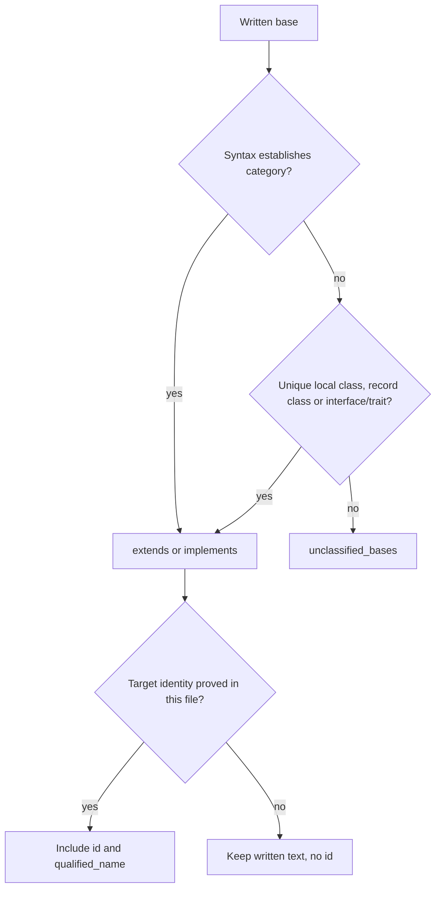

# C#, Swift and Scala Base Lists

Part of [Declared Type Relations](../type-relations.md).

C#, Swift and Scala write a type's superclass and its interfaces (protocols,
traits) in one list, so the list's syntax does not always say which is which:

```csharp
interface I {}
class Child : External, I {}
struct Value : IDisposable {}
```

```console
$ hug types --tree mixed.cs
mixed.cs
  internal interface I [1:1]
  internal class Child implements I; unclassified bases External [2:1]
  internal struct Value implements IDisposable [3:1]
```

`External` could be a base class or an interface, and nothing in the file
says which, so it goes in the third list, `relations.unclassified_bases`. This
page describes how each entry of such a list is classified, and the related
rule for built-in type names in Go and Swift.

## How an entry is classified

Classification comes from syntax first, then from an unambiguous same-file
target declaration. It is independent of target identity: an external
interface can be known conformance while its `id` stays absent.



Uncertainty never changes the meaning of `extends`. Outlines label the third
list `unclassified bases`; JSON and JSONL expose
`relations.unclassified_bases`. Each list preserves its own source order.

## C#

`Value` above records `IDisposable` in `implements` even without a local
interface declaration, because a struct's list can only declare interfaces.
A class's first entry can be either a superclass or an interface; subsequent
entries are interfaces. Interface inheritance stays in `extends`. Enum
underlying types do not create relations. A primary constructor's base
invocation, such as `class Child(int x) : External(x)`, establishes
inheritance without requiring a local target declaration; its relation
retains `External(x)`.

A same-file target is a superclass when its declaration is a class, a
`record` or a `record class`. Records report the `Type` kind, so the
declaration itself decides: a `struct` or `record struct` target is never a
superclass and stays in `unclassified_bases`.

```csharp
namespace NS { record Base; }
record Generic<T>;
record struct Point;
record Child : NS.Base;           // extends NS.Base, with the record's id
record Typed : Generic<int>;      // extends Generic<int>, with Generic's id
class Other : Point {}            // unclassified_bases: Point, with its id
```

`hug types --tree` labels the first two rows `extends NS.Base` and
`extends Generic<int>`. An alias or a duplicated record name still keeps the
entry as written, without an `id`, in `unclassified_bases`.

## Swift

```swift
protocol P {}
struct Point: P {}
extension Point: Codable {}
class Child: External {}
```

`Point` records `P` and `Codable` in `implements`; `Child` keeps `External`
in `unclassified_bases`. Struct, actor and extension lists declare
conformance. A class's first entry is classified only when its target is
proved: a local `class` is a superclass, although Swift classes, structs,
actors and enums all report the `Type` kind. Later entries are protocols.
Protocol inheritance stays in `extends`.

Enum raw-value types established by raw-value cases or standard raw-type
names are excluded; a same-file protocol can classify an enum's first entry.
A standard raw-type name is excluded only while nothing in view redeclares
it; see [Built-in spellings](#built-in-spellings).

### Extension conformances

Extension conformances attach only to a uniquely resolved local class,
struct or enum. A qualified external owner, alias, selective type import, or
ambiguous name never attaches to a same-named local type. The extension's
members follow the same decision under Containment: they belong to the
resolved owner, or, when it is not proved, have a container named by the
extended type as written (`ReviewHolder.ReviewBase`), with no `id` and no
`parent`, and no local type lists them, however its name or position reads.

```swift
protocol P {}
struct Holder { struct Base {} }
struct Holder {}
extension Holder.Base: P { func probe() {} }   // no conformance, no owner for probe()
```

In `implements`, the owner's header entries come first, then extension
entries in file order, with equal written expressions removed. The relation
is a written conformance summary: a conditional extension's `where`
requirements are not represented as edge conditions.

Swift targets retain `source_span`, the written target's location in the
same file. This evidence survives cache hits and distinguishes header
conformance from extension conformance. With `--signatures full`, an outline
shows `struct Point: P implements Codable`, retaining the extension addition
without repeating `P`.

Like Rust impl members, Swift extension members are placed on their owner
while the file is parsed, so widening a cached Swift entry by Containment
parses the file (see [Rust Impls](./rust-impls.md#impls-and-the-cache)).

## Scala

```scala
trait T
class Child extends External with T
```

`Child` keeps `External` in `unclassified_bases` and `T` in `implements`.
Mixins following the first parent are conformance; a first parent resolving
to a local class is `extends`, and one resolving to a local trait is
`implements`. Objects follow the same rule as classes; their `Module`
records retain the written parents. A trait's own parent list remains
`extends`. Written generic and constructor arguments remain intact, such as
`Base[Int]` with the constructor argument `(1)`; the type's path is resolved
independently of those arguments.

## Built-in spellings

Two readers drop a written entry because its spelling names a built-in type
that is no base: a Go interface element spelled like a predeclared
non-interface type (`bool`, `byte`, `complex64`, `complex128`, `float32`,
`float64`, `int`, `int8`, `int16`, `int32`, `int64`, `rune`, `string`,
`uint`, `uint8`, `uint16`, `uint32`, `uint64`, `uintptr`), and a Swift
enum's first entry spelled like a standard raw-value type (`Int`, `Int8`,
`Int16`, `Int32`, `Int64`, `UInt`, `UInt8`, `UInt16`, `UInt32`, `UInt64`,
`String`, `Character`, `Float`, `Double`, `Unicode.Scalar`, each also
qualified as `Swift.Int`, `Swift.Unicode.Scalar`).

Both languages let a program redeclare those names, so the spelling alone
proves nothing. The entry is dropped only when no binding in view gives the
path's first segment (`int`, `Int`, `Unicode`, `Swift`) another meaning:

| Binding of the first segment | Result |
|---|---|
| none in this file | dropped: no relation |
| a same-file type declaration in view, in the declaring scope or any enclosing one (a Go function body included; a finished or sibling block is not in view) | kept, with the declaration's `id` when the lookup proves it |
| a same-file alias, a Swift type import of that name (`import protocol M.Int`), an import whose names cannot be read, a type parameter, or several declarations | kept as written, no `id` (Swift: in `unclassified_bases`) |
| a Swift value import (`import func M.Int`, `import let`, `import var`) | dropped: a value never names the raw type |
| a declaration only inside another owner of the same name (`struct Holder { class Int {} }` beside the `struct Holder` the enum is in) | dropped: that owner's members are not in view |

```go
type int interface{ M() }
type Child interface{ int }   // extends int, with the local interface's id
type Plain interface{ int }   // in a file without that declaration: no relation
```

```swift
protocol P {}
typealias Int = P
enum Child: Int { case a }        // unclassified_bases: Int, no id
enum Code: Swift.Int { case a }   // no relation
```

Only same-file evidence counts. A Swift whole-module import
(`import Foundation`), a member type inherited from a base, and a
declaration in another file of the Go package are not read, so they never
keep an entry. An explicit raw value (`case a = 1`) still proves a Swift
raw-value enum by syntax, whatever its first entry is named.

## Related pages

- [Declared Type Relations](../type-relations.md): the entry page.
- [Name Lookup for Base Types](./name-lookup.md): how a target's identity is
  proved.
- [Rust Impls](./rust-impls.md): the other place a type's conformances are
  written outside its header.
