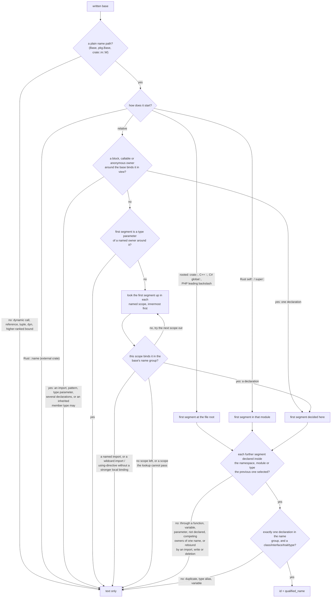

# Name Lookup for Base Types

Part of [Declared Type Relations](../type-relations.md).

A written base gets an `id` and a `qualified_name` only when Tree Hugger can
prove, from the file alone, that it names exactly one declaration in that
file. The [entry page](../type-relations.md#when-a-target-gets-an-id) gives
the principle and the common cases. This page gives the full lookup: how a
path is resolved, every rule with an example, and the language-specific
scoping that decides which declaration a name can mean.

Anything the lookup cannot prove keeps its written text alone. That counts as
a successful result, not a gap.

## How a path is resolved

A path is resolved one segment at a time. Its **first segment** is decided
first, by the nearest scope that binds that name in the right **name group**
(see [Lexical scopes and name groups](#lexical-scopes-and-name-groups)). Only
then are the remaining segments looked up, each inside the declaration the
one before it selected (see [Paths through local owners](#paths-through-local-owners)).



Once a scope binds the first segment, outer scopes are never tried, even when
the full path does not exist there. A scope binds a name when it declares it
in the name group the lookup asks for, when the name qualifies a declaration
there (a package or namespace that has no record of its own), or when one of
its imports, patterns or type parameters names it. In C# a declaration binds
only the generic argument count it declares, so a nearer `Base<T>` does not
bind a written `Base` ([C# generic arity](#c-generic-arity-selects-the-declaration)).

## The rules by example

| Rule | Example | Result |
|---|---|---|
| A bare name resolves in the nearest enclosing scope that declares it | Python `class Outer: class Base` … `class Inner(Base)`, with `Inner` directly in `Outer`'s body | `Outer.Base`, not a module-level `Base` |
| A qualified name must match an in-file qualified name exactly | C++ `struct D : ns::B` | `ns::B` |
| A qualified path to another file never falls back to its last segment | `extends other.Root` next to a local `Root` | text only |
| A nearer binding of the first segment decides, even when it lacks the rest | C++ `namespace inner { namespace ns {} struct C : ns::B {}; }` next to a global `ns::B` | text only |
| A value binding hides a value lookup: a JS/TS class `extends` is an expression | TypeScript `function f(ns: any) { class C extends ns.Inner {} }` next to `namespace ns` | text only |
| Where types and values are separate name groups (every language but Go, Python and JavaScript), a value never hides a type a base clause names, in any scope and whether or not it has a record | Rust `const Base: usize = 0;` beside `trait Base {}`, then `trait C: Base {}`; Java `void m(int Base) { class C extends Base {} }`; TypeScript `const { x: { Base } } = e;` at module level beside `interface Base {}`, then `class C implements Base {}` | the trait / class / interface `Base` |
| In Go, Python and JavaScript any binding of the name hides it | Python `a, Base = e` at module level beside `class Base`, then `class C(Base)` | text only |
| A parameter of a Rust impl, or of a TypeScript signature with no body, is in view only inside it | `impl<Base> Holder<Base> {}` beside `trait Base {}`, then `trait C: Base {}` before or after the impl | the trait `Base` |
| A declaration in a finished or sibling block is out of view | Rust `fn f() { { trait Base {} } trait C: Base {} }` next to a file-level `Base` | the file-level `Base`; text only when there is none |
| A function is not a namespace: its local classes are not reachable through its name | JavaScript `function outer() { class Local {} }` … `class C extends outer.Local {}` | text only |
| A member rebound after its declaration names nothing: an import, deletion or other write of that name in the owner's body, or a write through the owner's path ([Members rebound after their declaration](#members-rebound-after-their-declaration)) | Python `class H: class Base: pass` then `from lib import Base` in `H`'s body, then `class C(H.Base)` | text only |
| A path through a local type or module stays inside the one its first segment names | C++ `void f() { { struct H { struct B {}; }; } { struct H {}; struct C : H::B {}; } }` | text only: the `H` in view has no `B` |
| A Rust module's items are reachable through its path, also for a module declared in a function | `fn f() { mod m { pub trait B {} } trait C: m::B {} }` | `f::m::B` |
| A type parameter shadows a local type, the enclosing declarations' included | C++ `template <class T> struct P : T` next to a `struct T` | text only |
| A value parameter (Rust `const N: usize`, C++ `template <int N>`) is no type parameter | C++ `template <int Base> struct C : Base {}` next to a `struct Base` | the `struct Base` |
| An enclosing declaration's type parameters shadow even when a query does not select it and its list is too long to number | Python `def factory[Base, T0, …, T65535]()` (65,537 parameters) with `class C(Base)` inside, next to a module-level `Base`, queried for types only | text only; a complete index, which selects `factory`, fails with `too_many_generic_parameters` |
| An alias would need expansion | TypeScript `implements Alias` where `type Alias = Root` | text only |
| Two declarations share the name (ambiguity) | Rust `#[cfg(a)] trait Amb` / `#[cfg(not(a))] trait Amb` | text only |
| Two owners share an intermediate name: every later segment stops, however unique the last one is ([Competing owners of one name](#competing-owners-of-one-name)) | Rust `mod H { pub trait B {} }` and `mod H {}`, then `trait C: H::B {}` | text only |
| A namespace reopened in one file is one owner | C++ `namespace ns { struct B {}; }` and `namespace ns {}`, then `struct C : ns::B {}` | `ns::B` |
| An imported name has no declaration at its scope | Rust `use m::V; impl Tr for V` | text only |
| An import binds its name in the scope that holds it | Python `def g(): from lib import Base` then `class C(Base)` inside `g`, next to a module-level `Base` | text only |
| A wildcard import or C++ `using namespace` may bind any name | C++ `namespace n { using namespace other; struct C : B {}; }` next to a global `B` | text only |
| Every expression of a Scala `import` binds its name, and a rename binds its alias | Scala `import lib.Base, lib.Other`, `import lib.{Other}, lib.{Base}`, `import lib.Other as Base` or `import lib.{Other => Base}`, then `class C extends Base`, next to an outer `Base` | text only |
| A Scala exclusion or a rename to another name binds nothing else; only a wildcard (`_`, `*`, `given`) may bind any name | Scala `import lib.{Other as Renamed}` or `import lib.{Other => _}`, then `class C extends Base`, next to an outer `Base` | the outer `Base` |
| A Java, C++, C#, Swift or Scala type with bases may inherit the name, so lookup stops there | Java `class Sub extends A { class C extends Base {} }`, where `A` declares `Base` | text only |
| A class body is never a lexical scope in JS/TS | TypeScript `class Outer { Base = 1; m() { class C extends Base {} } }` | the module-level `Base` |
| A Python class body is a lexical scope only for code written directly in it: a nested class, method or function skips every enclosing class body, with its classes, variables and imports, and continues to the enclosing functions and the module | Python `class Outer: class Base` … `class Middle: class C(Base)`, or `def m(self): class C(Base)` | the module-level `Base`; text only when the module has none |
| A dynamic expression | JavaScript `class D extends mix(Base)` | text only |
| A JS/TS `with` body, or a function holding a direct `eval(…)`, may bind any name it does not declare itself; an optional `eval?.(…)` or a tagged ``eval`…` `` is no direct `eval` and keeps the base's ID | JavaScript `function w(o) { with (o) { class C extends Base {} } }` or `function e() { eval(s); class C extends Base {} }`, next to a module-level `Base` | text only |
| Rust names are looked up only as far as the nearest module | `mod b { trait T: Base {} }` with `Base` at the crate root | text only (`super::Base` resolves) |
| Rust `crate::`, `self::` and `super::` anchor the path | `trait U: crate::Base` | the crate-root `Base` |
| A Rust leading `::` names an external crate | `trait U: ::a::Dup` next to a local `mod a { trait Dup {} }` | text only |
| A C++ leading `::` anchors at the global namespace | `namespace ns { struct C : ::B {}; }` next to `ns::B` | the global `B` |
| C# `global::` anchors at the file root | `namespace N { class Child : global::Base {} }` next to a global `Base` | the global `Base` |
| A PHP leading `\` anchors at the file root | `implements \App\Other` | `App\Other` |
| A PHP name without a leading `\` is relative to its namespace only, also inside a function | `namespace Other; class C extends App\Root {}` next to `App\Root` | text only (it names `Other\App\Root`) |
| A PHP class name never means a function of the same spelling | `namespace App; class Base {} function Base() {} class C extends Base {}` | `App\Base` |
| A PHP class declared in a function, method, closure or conditional is a class of its namespace ([Where a declaration is bound](#where-a-declaration-is-bound)) | `namespace App; function f() { class Base {} } class C extends Base {}` | `App\f::Base` |

A resolved target's `qualified_name` is the in-file name. The scan-root or
module prefix that reports add (`file.rs#Base`) never enters a stored
target.

In C#, Swift, Scala, Java and Go, a local declaration in the current scope
takes precedence over a wildcard, on-demand or whole-module import. Explicit named imports
still stop the lookup. For example, `import Foundation; class Base {}` and
`class Child: Base {}` link to the local `Base`, while `import class Lib.Base`
leaves that base unresolved.

## What the lookup reads

The lookup reads one per-file index of every declaration by the name it is
bound under, which is its in-file qualified name except in the cases listed
in [Where a declaration is bound](#where-a-declaration-is-bound). The index
is built from every record, including records of kinds a query did not
select, so a query for classes alone still resolves a base that is an
interface. The file's lexical scopes, the bindings that no record reports and
its imports are collected in one walk of its syntax tree, only when a lookup
needs them; reference resolution (`hug refs`) is not needed.

The work a lookup does is bounded by the path it resolves, never by how many
declarations share a name: a namespace reopened 400 times, 400 sibling blocks
that each declare a `Holder` with a `Base`, or 400 impls that each name a
parameter `Base` cost each lookup the same as one would.

## Lexical scopes and name groups

Inside a callable, a block or an anonymous owner, a declaration's displayed
qualified name does not say where it is visible: a trait declared in a
finished block of `factory` is named `factory::Base`, exactly like one
declared beside the base. So the first segment is looked up through the
syntax scopes around the base first, innermost first:

- **Blocks are scopes** wherever the language makes them one: Rust, Go, C++,
  Java, JavaScript/TypeScript and Scala blocks, Swift `do` and other
  statement bodies, Go `case` clauses, C++/Java/JS `for` and `catch`. A Python
  `if` or `for` suite is not a scope; a Python function, lambda and
  comprehension are.
- **Declaration position** counts where the language says so: a Go local type
  is in view from its name and a local variable after its declaration, a C++
  declaration from its name, a Java local class from its name. A Rust item,
  a Swift or Scala local type, and a JavaScript/TypeScript declaration are in
  view in their whole scope.

  ```cpp
  struct Base {};
  void f() { struct C : Base {}; struct Base {}; }   // C extends ::Base
  ```

- **Name groups.** A base clause looks a type up, so a value of the same
  spelling (a parameter, local, field, method, function, constant, static,
  Rust `const` generic, C++ non-type template parameter, Scala `val`/`def`,
  PHP function) never hides it, and a type alias still does. A qualifier is
  looked up as a module, namespace or type (Rust, C++, Java, C#, Swift, PHP),
  as a term in Scala (an `object` or a value, so a companion `object` is never
  the base and a pattern-bound `val` hides an `object` qualifier), and as a
  namespace in a TypeScript type (`implements ns.I` ignores a value
  parameter `ns`). A JavaScript or TypeScript class `extends` is an
  expression and looks a value up. Go and Python have one group, so any
  binding hides an outer declaration.
- **Bindings no record reports** count: JS/TS destructuring parameters and
  variables (nested, renamed, defaulted, rest), `catch` and `for…of`
  bindings; Python nested, list and starred targets of an assignment, `for`
  or `with`, augmented assignment and `del` targets, `except … as`, walrus
  names and `match` captures; Scala pattern
  `val`s, `for` generators and `case` patterns (a name starting with a
  lower-case letter or `_`, Scala's variable pattern; an upper-case or
  backquoted name is a stable identifier, a reference; the name before
  `@` in `x @ p` always binds). Such a binding never resolves. It keeps its
  name group and its scope wherever it is written, inside a callable or at
  module, package or object level: a destructured value or a pattern `val`
  is a value, so it hides only a value lookup (a JS/TS class `extends`, a
  Scala qualifier), and Python targets hide every lookup, Python having one
  group. The parameters of an owner that has no record of its own (a Rust
  `impl`, a TypeScript overload or `declare function` signature) are bindings
  of that owner alone.

  ```typescript
  interface Base {}
  const { x: { Base } } = external;    // a value
  class C implements Base {}           // implements the interface Base
  ```
- **Python directives** redirect writes as well as reads. `global Base`
  sends the lookup to the module and `nonlocal Base` to the nearest
  enclosing function that binds `Base`. Any write of `Base` in the
  directive's scope binds at that destination instead: an assignment
  (augmented included) or pattern target, `del`, an import, a `class` or
  `def`, a `for`, `with` or `except` target, a walrus (also inside a
  comprehension) or a `match` capture. Such a write means the destination's
  own declaration is no longer proved, so every base that sees the
  destination stays text only. For `global`, that covers bases anywhere in
  the module: the function may run before any of them. For `nonlocal`, it
  covers the bases inside the enclosing function. A `class Base` declared
  under `global` is not taken as the module's `Base` either, because the
  module binding has more than one writer. A class body's directive works
  the same way: `class H:` with `global Base` and then `class Base: ...` in
  its body declares the module's `Base`, not a member, so `H.Base` (and
  anything nested in that class, `H.Base.Inner`) stays text only. A
  comprehension's own target
  binds only inside the comprehension, and a nested function's assignment
  binds in that function. Neither is a write under the directive.

  ```python
  class Base: ...
  def probe(external):
      global Base
      Base = external          # rebinds the module's Base
      class C(Base): ...       # text only
  class D(Base): ...           # text only: probe() may have run
  ```
- **Anonymous owners** bind like named ones: the type parameters of a
  TypeScript class expression, a C++ generic lambda (`[]<class T>`) and a
  Scala polymorphic lambda (`[T] => …`) are in view inside them, and a Java
  anonymous class, a Scala `new X { … }` and a C++ unnamed `struct : X`
  inherit member types from their base, so lookup stops there as it does for
  a named type with bases. A captured C++ template parameter is never a
  target.
- **Swift extensions** see their owner's type parameters, including those
  of its actual enclosing declarations. For example,
  `struct Outer<T> { struct Inner {} }` followed by
  `extension Outer.Inner { class C: T {} }` keeps `T` as written, without a
  target ID. An extension conformance to `T` also remains textual. The
  owner's context is shared across its extensions and their bodies. These
  names affect lookup only; they are never copied into `C`'s own parameter
  list. A nearer method-local declaration still takes precedence, and an
  ordinary member of `Outer` does not become a lexical extension-header name.
  When the extended owner is not proved (external, aliased, imported, or
  [competing](#competing-owners-of-one-name)), its parameters and member
  types are unknown, not absent: `extension External { class C: Base {} }`
  keeps `Base` as written in `unclassified_bases` beside a file-level
  `class Base`, and an enum's raw-type spelling (`Int`, `Swift.Int`,
  `Unicode.Scalar`, …) is kept the same way instead of dropped. A
  method-local `Base` declared in the extension still decides.

When no lexical scope binds the name, the named scopes (types, namespaces,
modules, the file) are tried by in-file qualified name as above; they never
see a declaration of a block or callable.

## Competing owners of one name

A path continues through a namespace, module or type only when its name
means **one owner**. Repeated definitions are one owner only where the
language reopens them: a C++, TypeScript, C# or PHP `namespace`, including
the same canonical C++ inline namespace defined twice, and the fragments of
one C# `partial` type (see [C# `partial` fragments](#c-partial-fragments)).
Everywhere else two
same-named owners compete: two Rust `mod H` (also under opposite `cfg`
attributes, which extraction does not evaluate), two Scala `object H`, two
file-level types, and a C++ spelling that reaches two distinct namespaces
through inline namespaces (as `clang` reports "reference to `Shared` is
ambiguous"). A competing owner stops the path at that segment, so no later
segment, however unique, gets an ID.

```cpp
namespace ReviewNs {
    inline namespace a { namespace Shared { struct Base {}; } }
    inline namespace b { namespace Shared {} }
}
struct C : ReviewNs::Shared::Base {};      // text only: two Shared namespaces
struct D : ReviewNs::a::Shared::Base {};   // ReviewNs::a::Shared::Base, by its id
```

A lookup made **inside** one of the competing owners knows which one it is
in, from its place in the source: a bare name, `self::` or an inner
module's `super::` reads that owner's own members, never the other's. The
same holds for everything else the owner's scope decides: its imports,
wildcard imports and bindings no record reports, whether it is a type with
bases (which hides the names outside it), and whether a standard raw-type
spelling is shadowed there. Another same-named owner's import, wildcard,
bases or member types change nothing.

```rust
mod holder {
    pub trait Base {}
    pub trait C: Base {}          // this module's Base, by its id
    pub trait D: self::Base {}    // the same Base
}
mod holder {
    pub trait Base {}
    use external::*;              // binds nothing in the first holder
}
trait E: holder::Base {}          // text only: two holder modules
```

```swift
class Base {}
struct Holder {
    class Child: Base {}          // extends the file-level Base, by its id
    enum Kind: Int { case a }     // no base: Int is the standard raw type here
}
struct Holder: External {         // its bases hide names only inside it
    class Int {}
}
```

An import or a base written in the owner the lookup is made in still
leaves the name unproved, exactly as with a single owner:

```java
class Base {}
class Holder extends External {   // External may declare a member Base
    static class Child extends Base {}  // text only
}
class Holder {}
```

| Path | Example | Result |
|---|---|---|
| through two C++ namespaces injected by different inline namespaces, bare, qualified or rooted | the `C` above; `::ReviewNs::Shared::Base`; `Shared::Base` written inside `ReviewNs` | text only |
| through a direct and an injected C++ namespace of one name | `namespace ns { namespace S {} inline namespace v { namespace S {} } }` then `ns::S::B` | text only |
| through the one canonical inline namespace | `ns::a::Shared::Base`, or `ns::Shared::Base` when only `a` declares `Shared` | the `Base` inside it |
| through two Rust modules or two Scala objects of one name | the `E` above; Scala `object H { class B }`, `object H`, then `class C extends H.B` | text only (Scala: in `unclassified_bases`) |
| inside one of them | the `C` and `D` above; Scala `object H { class B; class C extends B }` beside a second `object H { class B }` | that owner's `B` |
| a Scala companion class and object | `class H`, `object H { class B }`, then `class C extends H.B` | `H.B`: a qualifier names the object, a term |
| two fragments of one C# type | `partial class H { class B {} }` and `partial class H {}`, then `class C : H.B` | `H.B`: the fragments are one type, sharing members, bases and paths through it |
| two C# `partial` declarations that are different types | `partial class H { class C : B {} }` beside `partial class H<T> { class B {} }` (or `partial struct H`, or a `namespace H`) | text only, in `unclassified_bases` |
| two C# types of one name that are not `partial` | `class H { class B {} class C : B {} }` beside `class H { class B {} }` | inside the first: that `H`'s `B`; outside, `H.B` is text only |
| a lookup inside one owner while another same-named owner imports the name, has a wildcard import or has bases | Rust `use external::B;`, Python `from lib import B`, Scala `import lib._`, Java `class H extends External`, C++ a same-named `namespace H { using namespace lib; }` beside `struct H` | the first owner's own `B`, or the outer one when it has none |
| the same import, wildcard or bases in the owner the lookup is made in | `mod h { pub trait B {} use external::B; pub trait C: B {} }` | text only |

### C# `partial` fragments

`partial` alone does not make two declarations one type. Two C#
declarations of one name are fragments of the same type only when **all**
of these hold:

- both are written `partial`;
- they declare the same category: `class`, `struct`, `interface`, `record`
  (also written `record class`) or `record struct`;
- they have the same generic arity: `H`, `H<T>` and `H<T, U>` are three
  different types;
- they are declared in the same owner: the same namespace, or the same
  type (itself one identity by these rules). `partial class H` inside
  `Outer` and inside `Outer<T>` are different types.

A namespace and a type never merge. Fragments of one type share members,
bindings and bases; declarations that fail any condition are competing
owners, and a lookup inside one of them reads only that type's own
fragments.

```csharp
class Base {}
partial class Holder {
    class Child : Base {}       // the file-level Base, by its id
    class Other : Inner {}      // the Inner of the third declaration, by its id
}
partial class Holder<T> : External {   // a different type: its base list
    class Inner {}                     // and members change nothing above
}
partial class Holder {                 // the same type as the first
    class Inner {}
}
class FromOutside : Holder.Inner {}       // the non-generic Holder's Inner
class FromGeneric : Holder<int>.Inner {}  // Holder<T>'s Inner
```

A qualified path names the type whose arity it writes: `Holder.Inner`
reads only the non-generic `Holder`, `Holder<int>.Inner` only `Holder<T>`.
When no type of that arity is declared, or several competing declarations
share it (a `partial class H` beside a `partial struct H`, two non-`partial`
`H`), the base keeps its written text with no ID. A base must also have
the arity it writes: `class C : Base<int>` never takes the ID of a
non-generic `Base`. A target declared in several fragments of one type has
no single declaration, so it keeps its text with no ID.

### C# generic arity selects the declaration

In C# the number of generic arguments a name is written with is part of
the name. `Base`, `Base<T>` and `Base<T, U>` are three different types, so
declaring one never hides, and never competes with, another. Every step of
a lookup uses the written count:

- **the final target**, bare, namespace-qualified (`N.Base<int>`), nested
  (`H.Base<int>`) or rooted (`global::Base<int>`): only declarations of
  that arity are candidates;
- **a member of the owner a lookup is made in**, as the target or as an
  intermediate segment (`H<int>.Base` from inside the type holding every
  `H`);
- **the outward search**: a nearer type or namespace that declares the name
  only with other arities does not stop the search, which continues to the
  enclosing scopes.

```csharp
class Base {}
class Base<T> {}
interface IBase<T> {}
interface IBase<T, U> {}
class Child : Base<int>, IBase<int> {}  // extends Base<T>, implements IBase<T>
class Holder {
    class Base<T> {}
    class Inner : Base {}               // the file-level Base: Holder's Base<T>
}                                       // cannot be the one written here
```

The usual rules still apply within one arity: two declarations of the
written arity (two non-`partial` `Base<T>`, or a `partial` type split in
several fragments) leave the base as text with no ID; a count no
declaration has names nothing; and a `using` alias, an import or a type
parameter spelled like the name still ends the lookup as text, whatever
count is written.

## Paths through local owners

When the first segment names a type or Rust module declared in a callable
or block, the rest of the path is looked up among **that declaration's own
members**: what its body declares directly, not inside one of its methods,
blocks or anonymous owners. Two same-named owners in sibling blocks display
the same qualified names (`f::H::B`), so the displayed name never decides;
the owner's place in the syntax tree does. Further segments repeat the step
(C++ `H::M::B`, Scala `holder.middle.Base`, Rust `m::inner::B`).

```cpp
void f() {
    { struct H { struct B {}; }; }
    { struct H { struct B {}; };
      struct C : H::B {}; }      // C extends this block's H::B, by its id
    { struct H {};
      struct D : H::B {}; }      // D keeps H::B as written: this H has no B
}
```

| Path | Example | Result |
|---|---|---|
| both same-named owners declare the member | the `C` above | the member of the owner in view, by its `id` |
| the owner in view lacks the member, a sibling has it | the `D` above | text only (Swift and Scala: in `unclassified_bases`) |
| a three-segment path | Scala `object holder { object middle { class Base } }` then `class C extends holder.middle.Base`, in a block or at the top level | `holder.middle.Base` |
| a Rust module declared in a function | `fn f() { mod m { pub trait B {} } trait C: m::B {} }` | `f::m::B` |
| Rust `self::` and `super::` inside such a module | `mod m { pub trait B {} pub mod inner { pub trait C: super::B {} } }` inside a function | `f::m::B`; `super::` from the function's module itself names the crate-level item, never one of the function's |
| Rust `crate::` inside such a module | `trait C: crate::B {}` | the crate-level `B` |
| a JS/TS static field holding a class expression | `class H { static B = class {}; }` then `class C extends H.B {}` | text only: a field is no type declaration |

Rust impls take the same path: `impl Trait for m::S`, `impl m::Trait for S`
and `impl m::Trait for m::S` inside a function whose module `m` declares
`S` and `Trait` attach to those declarations (see [Rust Impls](./rust-impls.md)).

| Binding in view | Example | Result |
|---|---|---|
| a type in a finished sibling block | Go `func f() { { type Base interface{} }; type C interface{ Base } }` | the package-level `Base` |
| a pattern binding | TypeScript `function f({ a: { Base } }) { class C extends Base {} }` | text only |
| a Python nested target | `(a, (Base, b)) = x` then `class C(Base)` in the same function | text only |
| a Scala pattern-bound qualifier | `val (a, ns) = (1, 2); class C extends ns.Base`, next to `object ns { class Base }` | text only, in `unclassified_bases` |
| a Python `global` with no write of the name | `global Base` then `class C(Base)` inside a function whose enclosing function declares `Base` | the module-level `Base` |
| a Python `global` or `nonlocal` with a write | `global Base`, `Base = x`, then `class C(Base)` | text only |
| a Python `nonlocal` with no write of the name | `nonlocal Base` then `class C(Base)` in a function nested in one that declares `Base` | that enclosing function's `Base` |
| a TypeScript namespace qualifier beside a value parameter | `function f(ns: number) { class C implements ns.I {} }` | `ns.I` |

## Members rebound after their declaration

A Python class body is a namespace that later statements can change, and a
module can write through a class's path. So each segment after the first
is checked against **every binding of that name in the selected owner**,
not only its declarations. The member resolves only when its declaration is
the one binding. This holds for an owner at module level (a named scope)
and for one declared in a function (a lexical owner), for the final member
and for an owner the path passes through.

```python
class Holder:
    class Base: pass
    from lib import object as Base   # rebinds Holder.Base
class C(Holder.Base): pass           # text only

class Other:
    class Base: pass
Other.Base = make()                  # a write through the proved path
class D(Other.Base): pass            # text only

class Plain:
    class Base: pass
    from lib import Unrelated        # another name: no effect
class E(Plain.Base): pass            # Plain.Base, by its id
```

| In the owner's body, or through its path | Example | Result |
|---|---|---|
| an import of the member's name, aliased or not | `from lib import Base`, `import lib as Base` | text only |
| a wildcard import (Python) | `from lib import *` | text only |
| a deletion or an augmented assignment | `del Base`, `Base += x` | text only |
| a pattern target or `match` capture | `(a, (Base, b)) = x`, `a, *Base = x`, `case {"k": Base}:` | text only |
| any other binding of the name | `Base = x`, `a, Base = x`, a `for`, `with`, `except` or walrus target, `def Base(self):`, a second `class Base` | text only |
| a write through the owner's path, anywhere in the file | `Holder.Base = x`, `Holder.Base += x`, `del Holder.Base`, also inside a function | text only |
| the same for an owner the path passes through | `from lib import Middle` in `Holder`, or `del Holder.Middle`, then `class C(Holder.Middle.Base)` | text only |
| a `global` or `nonlocal` directive before the declaration | `global Base` then `class Base: pass` in `Holder`'s body | text only: the class is the destination's `Base` |
| another name, or a write through another owner | `from lib import Other`, `del Other`, `Holder.Other = x`, `Unknown.Base = x` | the member, by its `id` |

A write's owner path counts only when it is a plain dotted name that
resolves to one declaration of the file, looked up from the write the same
way a base is. No expression is evaluated: `factory().Base = x` or
`items[0].Base = x` change nothing, and a write before the owner's
declaration or inside a function that may never run still counts.

In other languages an import beside a same-named member of the same owner
is a compile error, so the rule changes nothing there, with two exceptions
where an import never makes a member: a Scala import inside an object and a
Swift import. A Rust glob or C++ `using namespace` inside the owner yields
to the owner's own declarations, so only a Python star import makes every
member unprovable.

## Where a declaration is bound

A declaration's displayed qualified name is built from the declarations
around it. A few languages bind some declarations in a namespace that this
displayed name does not spell. The lookup indexes those declarations under
the namespace that actually binds them. Their `qualified_name` and `id` stay
as displayed.

| Language | Declaration | Displayed as | Found as |
|---|---|---|---|
| PHP | a class, interface, trait, enum or function declared in a function, method, closure or conditional | `Example\Symbols\probe::Base` | `Example\Symbols\Base` |
| Scala | a member of `package object q` in package `example` | `example.Base` | `example.q.Base` |
| C++ | a member of `inline namespace v1` inside `namespace ns` | `ns::v1::Base` | `ns::v1::Base` and `ns::Base` |

A namespace is inline when any definition says `inline`, so reopenings
share the same identity and lookup rules.

Each later segment is looked up below the **one owner** its prefix reaches:
a namespace or type, or a name that exists only as a qualifier. A function
or variable sharing the spelling is no owner, as in C++ qualified lookup.
Once a prefix reaches two owners, nothing below it is looked up at all: the
path is text only, and each further name written after that prefix costs
its own segment, not another search of every owner.

```cpp
namespace ns {
    inline namespace v1 { void Shared(); }
    inline namespace v2 { void Shared(); }
    namespace Shared { struct Base {}; }
}
struct C : ns::Shared::Base {};   // ns::Shared::Base, by its id
```

```php
namespace Example\Symbols;
function probe() {
    class Base {}
    class Child extends Base {}          // Example\Symbols\probe::Base, by its id
}
class Other extends Base {}              // the same Base
class Rooted extends \Example\Symbols\Base {}   // the same Base
```

The usual rules then apply to that name:

- **Exactly one declaration.** If two PHP functions in one namespace each
  declare `class Base`, or a namespace-level `Base` sits beside one declared
  in a function, then `Base` stays text only. The same applies to a C++
  `ns::Base` beside an inline `ns::v1::Base`. The lookup never takes the first
  match.
- **The binding namespace only.** A PHP class declared in a function in
  namespace `A` is not found by a relative name from namespace `B`. It is
  found by `\A\Base`. In Scala, `package object q`'s members are found
  inside the object and from the enclosing package as `q.Base`, but not as a
  bare `Base`. An import written inside a package object binds in its
  package as well.
- **Nested inline namespaces.** The name is found with any combination of
  inline namespaces left out. So `inline namespace v1 { inline namespace v2
  { struct B {}; } }` inside `ns` is found as `ns::v1::v2::B`, `ns::v1::B`,
  `ns::v2::B` and `ns::B`. A namespace that is not inline is never left out.
  The lookup work grows with the nesting depth, not with the number of
  spellings, which doubles with each level.

A TypeScript `declare global { interface G {} }` declaration stays text only
(`implements G`). A global interface merges with every declaration of that
name in the program, so a single file cannot prove that it is the only one.

## Related pages

- [Declared Type Relations](../type-relations.md): the entry page.
- [Rust Impls](./rust-impls.md): how an `impl`'s self type and trait are
  looked up and what they add.
- [C#, Swift and Scala Base Lists](./mixed-base-lists.md): classifying
  mixed base lists, and built-in spellings in Go and Swift.
