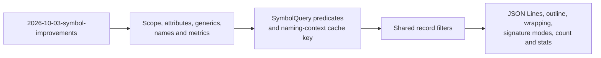

# Precise, filterable symbol reports

## Summary

This feature is the **metadata, filtering and reporting** half of the
symbol-report work. It was split out of `2026-10-03-symbol-improvements` on
2026-10-03 and is a draft: its open questions still need author decisions.

`2026-10-03-symbol-improvements` makes the CLI consume v2 `SymbolRecord`s
directly, adds the declaring `keyword` and `signature_text`, introduces a
`SymbolQuery` with kind and capability selection, emits versioned JSON sized
to the selection (schema 4.0), and renders through one `biscuit-terminal`
component. This feature extends each of those:

| Area | After `2026-10-03-symbol-improvements` | After this feature |
|---|---|---|
| Metadata | Keyword and signature text; kind, visibility, `static` and container from the fix. | Scope, modifiers, attributes, deprecation, test flags, generics, inheritance, qualified names and basic metrics. |
| Filtering | Each command's fixed kind set; name glob or substring (case-sensitive), `--exported`, `--prelude`. | Kind, scope, visibility, container, tests, docs, signature shape, and explicit file/name selectors, through one filter path. |
| Reporting | Versioned `--json`, file/source order, one renderer with today's layout. | JSON Lines, outline view, width-wrapped rendering, signature modes, `--format plain\|table`, `--count` and `--stats`. |

**Depends on `2026-10-03-symbol-improvements` and
`2026-10-03-visibility-and-kind`.** The fix corrects kind, visibility, `static`
and container data for its accepted extraction set across all 16 languages. It
retains some grammar limits and defers some constructs; see “Kind precision
deferred by the prerequisite fix” in Open Questions. Every filter and label
below uses those documented limits.

Section numbers keep their values from before the split, so gaps (A, B1, B6,
B8, B9, C8, D1, D7–D10) belong to `2026-10-03-symbol-improvements` or to an
unscheduled feature.

### Compatibility

The record fields added here (`scope`, `visibility.is_test`, `metrics`, filled
modifier/attribute/generic/relation facets and a populated `qualified_name`)
are additive and follow the existing minor-version rule on top of schema 4.0.
The container-field rename already landed in 4.0. The CLI behavior changes
(locals hidden by default in `hug symbols`, smart-case matching) are
intentional; update the release notes with before/after examples.

---

## B. Metadata

### B2. Scope classification

`SymbolRecord` gains `scope: SymbolScope`, an enum with `Item`, `Member` and `Local`:

| Scope | Meaning | Examples |
|---|---|---|
| `Item` | declared at module or file level, or nested in a namespace or module | free functions, types, top-level constants |
| `Member` | declared inside a type, trait, interface or `impl` | methods, fields, enum variants, associated consts |
| `Local` | declared inside a function body, or a parameter | `let`, `var`, `:=`, parameters, loop bindings |

The nearest semantic declaration determines scope, not merely the nearest
brace. Declarations inside function bodies, including nested functions/types,
are local; their own type members are member-scoped. Parameters are local and
inline-module contents are items. This presentation classification is separate
from the lexical scopes used to resolve names. It keeps local bindings out of
the default listing without discarding their analysis data.

Scope is lightweight data kept for declarations excluded by a kind selection,
alongside the identity, span and container data
`2026-10-03-symbol-improvements` keeps.

### B3. Modifiers and attributes

Fill the existing `Modifier` and `Attribute` facets for supported syntax in
every language; languages without a construct return an empty list:

- **Modifiers:** `async`, `unsafe`, `const fn`, `abstract`, `final`,
  `override`, `virtual`, `readonly`, `mut`, plus `static` from the fix.
- **Attributes:** Rust attributes, Java and C# annotations, TS, JS and Python
  decorators, and Swift attributes. Each is recorded as `{name, value}` in
  source order, using the full syntactic
  name and raw argument text; this does not evaluate arguments or expand macros.
  Use existing modifier variants and `Custom` for `abstract`, `final`,
  `override` and `virtual`, rather than widening the enum without need.

From those, the library derives:

- `visibility.is_deprecated`: `#[deprecated]`, `@Deprecated`, `[Obsolete]`,
  `@deprecated` in a doc comment
- a new `visibility.is_test` flag. It is true for:
  - Rust: `#[test]`, `#[tokio::test]`, and anything inside a `#[cfg(test)]`
    module
  - Java: `@Test`
  - Python: `test_*` functions in `test_*.py`, and `unittest.TestCase`
    subclasses
  - Go: `TestXxx(t *testing.T)` in `_test.go`
  - JS/TS: `describe` and `it` are calls, not declarations, so for JS and TS
    every declaration in files matching `*.test.*` or `*.spec.*` has `is_test`
    set; no test declaration is synthesized from a call

Test detection is a documented syntax/file-name heuristic, not a claim that
a runner will execute the symbol. Rust `cfg(test)` ancestry includes all nested
declarations, but `cfg(any(test, feature = "x"))` does not mean test-only.
Python `TestCase` recognition requires an explicit `unittest.TestCase` base or
an unambiguous same-file import alias; mark the class and its test methods,
not every method in it. Java recognizes `Test` and qualified annotation names
without loading dependencies. Go requires the test naming/signature convention.
Other languages report false until a detection rule is documented and tested.
Fixtures include similarly named non-tests and deprecation words in ordinary
comments, which must not set either flag.

### B4. Generics and inheritance

The following v2 facets exist but are empty today:

- **`type_info.generic_params`:** name, kind (type, lifetime, const), bounds
  and default.
- **`relations.extends`:** for example `class A extends B`.
- **`relations.implements`:** for example `impl Trait for Type`,
  `implements I`, Swift conformance.

Preserve written base names and generic arguments even when the base is
external. Fill a relation target ID only for an unambiguous declaration in the
same file; otherwise leave it absent. Rust trait implementations attach the
trait relation and same-file members to their target type; several impl blocks
must not overwrite each other. A target defined elsewhere retains a textual
container reference. No cross-file type resolution is introduced.

### B5. Qualified names with honest context

Populate the existing `identity.qualified_name`. The container text already
lives in `container_name`, alongside `container_kind`, after
`2026-10-03-symbol-improvements`. A qualified name is a readable lookup name,
not a unique symbol ID: overloads and repeated local names still use the
existing declaration-based IDs.

Use explicit namespace/package syntax and enclosing declarations where those
establish a name. A file path alone cannot prove a Rust module path or a Python
import package. An optional query context supplies a known module/package root
and path mapping; absent that context, use a portable scan-root-relative
`file#container.member` fallback, retaining language-native separators inside
the container portion. The standalone library defaults to the file's parent
as its root. Never guess through Rust `#[path]`, Python import configuration,
or generated module layouts.

| Language/context | Example |
|---|---|
| Rust, module context supplied | `crate::shared::symbol::SymbolInfo::new` |
| Rust, no module context | `symbol.rs#SymbolInfo::new` |
| Python, package context supplied | `package.module.Class.method` |
| Java / Scala explicit package; C# namespace | `com.example.Point` |
| Go explicit package | `pkg.Func` |
| TypeScript / JavaScript file fallback | `src/shared/symbol.ts#Class.method` |
| C++ explicit namespace and class | `ns::Class::method` |
| C file fallback | `src/point.c#make_point` |
| Swift, PHP, Lua, Perl, Bash, Zsh | explicit namespace/package when known; otherwise `file#name` |

**Reader's note:** JavaScript and TypeScript do have module systems. A portable
file-qualified name avoids assuming how a project's module loader maps files.
Normalize displayed separators to `/` without lowercasing paths. Naming context
is part of cache validity and must be identical on cold and warm runs: it joins
the cache key defined by `2026-10-03-symbol-improvements`. IDs are stable for
the same file identity/context and declaration position, not across edits,
renames or different scan roots; changing qualified-name construction must
recompute every affected relation ID consistently.

### B7. Per-symbol metrics

`SymbolRecord` gains an optional `metrics` facet, computed only when requested.
Unrequested metrics are absent; an unsupported metric within a computed facet
is `None`, while a measured zero is `Some(0)`.

| Field | Definition |
|---|---|
| `lines` | physical lines intersecting the half-open body span; missing body → `None`, empty span → 0; an end at column 1 excludes that line |
| `parameters` | declared parameters excluding a separate receiver; one variadic parameter counts once; known empty list → 0 |
| `has_docs` | nonempty attached documentation after removing comment delimiters; ordinary comments do not count |

Cyclomatic complexity is not part of this feature; see the unscheduled
`cyclomatic-complexity` feature.

Doc filtering needs only attached docs, not full structured parsing. Metrics
never force diagnostics. Keep god-files' current declaration-span size/risk
calculations: the tree-hugger package's [god-files analysis](../../lib/src/god_files/analysis.rs)
uses declaration spans, which differ from body lines. Reuse metrics only where
units and definitions are identical, with regression tests proving unchanged
scores; do not make its fast path run complete symbol analysis to obtain them.

### B9 extensions. `SymbolQuery` predicates

`2026-10-03-symbol-improvements` defines `SymbolQuery` with kind and
capability selection. This feature adds predicates and capabilities:

```rust
let query = SymbolQuery::new()
    .kinds([SymbolKindV2::Function, SymbolKindV2::Method])
    .scopes([SymbolScope::Item, SymbolScope::Member])
    .visibility(VisibilityLevel::Public)
    .exclude_tests(true);
```

Library defaults select all kinds and scopes; hiding locals is a CLI default
only. Metrics become a capability. Additional required work:

| Request | Required analysis |
|---|---|
| Outline | declarations plus containment, including excluded parent identities |
| Undocumented/deprecated filtering | attached docs and metadata; structured docs only when requested |
| Metrics/stats | only requested metrics and doc presence, not diagnostics |

The library owns record filtering once; the CLI owns a separate presentation
step for grouping classes and building outlines.

---

## C. Filtering

All filters apply to `functions`, `types`, `symbols` and `classes` alike;
`imports` gets the name and file filters. Filters combine with AND; a filter
that takes a list matches if any of its values matches (OR).

### C1. `--kind <kind>`

`--kind` is repeatable and accepts v2 kind names
(`hug symbols --kind trait --kind interface`). The fixed command sets are
defined by `2026-10-03-symbol-improvements`; `symbols` applies its scope
default after the kind set. An explicit kind set intersects the command set;
it does not widen it. Unknown kind names are argument errors, and unsupported
kinds return no matches. The intersection is pushed into extraction through the
same mechanism as the command sets.

`classes` keeps the container kinds defined by
`2026-10-03-symbol-improvements` (Class, Type, Interface and Trait), along
with its current static/instance partitioning. Kind, scope, name, visibility, test, docs and
deprecation filters select containers. `--in` matches the selected class/type's
own name as a member container. Member-shaped filters (async, return/parameter
type, parameter count, static/instance) select its displayed members. To apply
visibility/kind/docs predicates directly to individual members, use
`hug symbols --in Box` or `hug functions --in Box` instead. A selected container
can therefore have zero matching members; count/stats count selected containers,
not contextual member rows. Machine reports store selected container records
with a separate `members` map from container ID to selected member records. This preserves
class grouping while sharing the library's record predicates.

### C2. `--scope item|member|local`

`--scope` is repeatable. **`hug symbols` defaults to `item` and `member`.**
Explicit scopes replace defaults: `--scope local` selects only locals;
`--scope item --scope member --scope local` or `--all-scopes` selects all three.
`--all-scopes` conflicts with `--scope`. Other commands start with all scopes
within their command kind set, so nested functions remain discoverable. On
`tree-hugger/` this takes `hug symbols` from 8,593 lines (the baseline in
`2026-10-03-symbol-improvements`) to about 2,550.

### C3. Visibility and export filtering

`--visibility <level>` matches the exact existing visibility level and is
repeatable. Unknown matches only `--visibility unknown`; it is never treated
as public or private. These levels describe different access rules across
languages, not a single ordered scale.

Keep `--exported` as an independent test of `visibility.is_exported`, including
re-exports. A public class method can be public without being a module export.
**Reader's note:** the original alias to `--min-visibility public` would change
existing export selection and hide export conventions in languages without
visibility keywords. Preserve the two concepts separately.

The proposed `--min-visibility` needs an author decision under “Visibility
thresholds across languages” in Open Questions. Exact visibility filtering
ships without assuming such an ordering.

### C4. Container and qualified-name matching

- `--in <name>`: members of a named container
  (`hug functions --in TreeFile`).
- A name filter containing the language's separator (`::`, `.`, `#`) matches
  against `qualified_name` (`hug symbols --name '*::schema_v2::*'`). A
  pattern beginning at an inner module needs a leading `*` when a full name
  begins with `crate::`. `--name` handles file-qualified names containing `/`
  that positional classification would otherwise interpret as paths.
- `--in` matches the immediate `container_name` with the same name rules;
  supplying a qualified container pattern disambiguates repeated names.

### C5. Smart-case name matching

The current "fuzzy" match is a case-sensitive substring match
(`wildcard_match` in `cli/src/scanner.rs`). The new rules:

- All-lowercase input matches case-insensitively.
- Any uppercase letter makes the match case-sensitive.
- `--exact` forces whole-string literal matching, as does a trailing `!`.
  Both retain smart-case rules; wildcards under exact matching are literal.
- Only `*` is a name wildcard, matching any sequence; no regex, `?` or bracket
  syntax is introduced. Non-wildcard input retains substring matching.
- Smart case applies to symbol/container inclusion and exclusion patterns.
  Type text and file patterns keep their existing case rules. Apply case
  folding consistently to both pattern and candidate without slicing through
  UTF-8 character boundaries; non-ASCII names need regression coverage.

### C6. Tests, docs and deprecation

- `--exclude-tests` / `--tests-only` are mutually exclusive and use the
  documented `is_test` heuristic under “Modifiers and attributes.”
- `--undocumented` lists symbols with `has_docs == false`, which is a docs
  coverage check.
- `--deprecated` lists symbols marked deprecated.

### C7. Signature shape

- `--async`
- `--returns <glob>`, for example `--returns 'Result<*'`
- `--param-type <glob>`
- `--min-params <n>`

These match declared type text, not resolved types. Type globs are whole-string
and case-sensitive with `*` as the wildcard. Missing type text cannot match;
`--param-type` needs any non-receiver parameter to match. Shape predicates select
function-like declarations only, including constructors when applicable;
`--min-params 0` does not select unrelated types with absent parameters.

### C9. Explicit file and name filters

Positional filters are auto-classified as files or names (`is_file_filter_token`
in `cli/src/scanner.rs`). `--file <path|glob>` and `--name <pattern>` bypass
that classification when it guesses wrong. Values within each include list
are alternatives; file and name lists intersect, and exclusions take precedence.
Keep existing `--exclude-files`, `--exclude-symbols`, `--language`, `--prelude`,
`--comments`, `--sort` and the grouping flags, documenting any aliases/conflicts.
File references use `biscuit-file::FileReference`; discovery retains `.gitignore`
and the default fixture exclusions, with explicitly targeted files re-included.
`imports` retains file-only positional tokens and gains symbol matching through
explicit `--name`, avoiding an accidental positional behavior change.

### C10. One filter path

`hug classes` re-implements export, prelude and name filtering
(`cli/src/main.rs:1056-1084`), and `summarize_file` repeats the
kind-and-filter logic once per command. Each declaration command builds the
common query predicates; records are
filtered once before presentation. Classes can apply that shared predicate to
containers and members as described under “`--kind <kind>`.” Imports use the
same name matcher on import records, preserving alias/original-name fields.

---

## D. Reporting

### D2. JSON Lines

`--jsonl` writes one selected-record line, in deterministic
file/source order. The recommended versioned envelope is an author choice under “JSON Lines record
shape” in Open Questions. Do not emit records in worker-completion order.
Any `--sort` other than the default `file` needs global ordering and may buffer all matches;
streaming then describes serialization, not constant memory. Class lines must
carry the selected container and its selected members together. Paths follow
the portable scan-root-relative convention of the `--json` envelope, and
default records omit `declaration_text` and other source blobs as `--json`
does.

A stdout write error stops work; a broken pipe exits quietly without a panic.
Read/parse failures go to stderr and produce a nonzero status, even if earlier
JSON Lines were emitted. An empty successful JSON Lines report has zero lines.

### D3. Outline view

`--tree` nests members under their container, using `relations.members`, with
the declared inheritance relations on the container line:

```text
lib/src/file/tree_file.rs
  pub struct TreeFile
    pub fn new(path: P) -> Result<Self, TreeHuggerError>
    pub fn symbols(&self) -> Result<Vec<SymbolInfo>, TreeHuggerError>
    …
```

This replaces the container suffix in that view; the flat view keeps it.
Containment is a cheap capability independent of reference resolution. Match
members by container ID where available, including out-of-body Rust impl and
Go receiver declarations. Use a marked contextual container heading when a
selected member's container was excluded or is outside the file; do not emit
that heading as a selected record or include it in count/stats. Repeated impl
blocks are grouped under the type, and missing parents never drop members.
Overloads remain separate rows ordered by source position.

### D4. Rendering goes through `biscuit-terminal`

The single renderer from `2026-10-03-symbol-improvements` is built from
`UnorderedList` and `Prose` (and `Table` for `--format table`), as the repo's
best practices require. Long signatures then wrap at the terminal width with a
hanging indent, instead of running to 200+ characters. One example today is
`struct FileSummary { file: PathBuf, … }`. Hyperlinks keep their current OSC 8
behavior for interactive output. `--plain`, `--format plain`, redirected text
and machine formats disable ANSI styles and OSC 8 links. Width wrapping applies
only to terminal prose/table output, not JSON or JSON Lines. Escape source text
as literal component content so embedded control sequences or markup in a
signature cannot become terminal commands or unintended styling.

### D5. `--signatures full|short|none`

| Mode | What it shows |
|---|---|
| `full` | `signature_text`, the language-native declaration header defined by `2026-10-03-symbol-improvements` |
| `short` (default) | today's compact form, with type field lists truncated past 4 entries (`{ a, b, c, d, … +3 }`) |
| `none` | names only, with normal location/container context |

### D6. Count, stats and formats

- `--count` prints the number of matches and nothing else.
- `--stats` prints counts by kind, visibility and language plus doc coverage,
  using selected declarations as the denominator (zero matches → coverage
  unavailable). Synthetic export records are reported separately from
  declaration doc coverage. Grouping by package is not part of this feature;
  see the unscheduled `stats-package-grouping` feature.
- `--format plain|table`. TSV, Markdown and tags formats are not part of this
  feature; see the unscheduled `extra-report-formats` feature.

Exactly one output mode is active: default terminal text, `--json`,
`--json-full`, `--jsonl`, `--count`, `--stats`, or explicit `--format`.
Conflicting modes are argument errors. `--plain` can disable terminal styling
but does not modify machine formats. `--tree` is valid only with terminal
output. Count prints a single decimal integer plus newline (including 0);
signatures/comments apply only to text formats. Existing class static/instance
options remain mutually exclusive. Empty selections succeed; analysis errors
fail and remain visible on stderr, including under count mode.

---

## Sequencing



Each phase leaves `hug` working, and updates relevant docs/tests with its code.
Open author decisions must be settled or explicitly deferred in the
implementation log before their features ship.

## Decisions

### Resolved

Carried from `2026-10-03-symbol-improvements` before the split:

- **Symbol listings hide locals by default.** Explicit scopes replace that
  default; library queries still default to all scopes.
- **Exports and visibility stay separate.** Exact visibility filters are
  available without imposing an ordering across different access models.
- **Qualified names reflect known context.** A file-qualified fallback is
  preferable to a plausible but incorrect module name.
- **No new matching dependency.** Extend the current wildcard matcher.

Decided by the author on 2026-10-03:

- **This feature was split out and trimmed.** Scoped references (with `hug
  refs`), `--changed`, cyclomatic complexity, TSV/Markdown/tags formats and
  package grouping in `--stats` moved to unscheduled features; the original
  spec was too large to implement and review as one change.
- **Library matrices are exhaustive; CLI goldens are representative.** Each
  extraction fact is asserted for all 16 languages in library tests, while CLI
  output uses one golden per output format over the 16-language `multi/`
  tree, matching the prerequisite fix's rule.

### Open Questions

#### JSON Lines record shape

A line must identify its schema and language as well as its file location.
Bare records currently have no schema or language field, unlike file indexes.

- **Bare record:** smallest shape and least wrapping; consumers must get the
  schema/language out of band, and cannot safely distinguish versions alone.
- **Versioned envelope:** `{report_schema_version, schema_version, file,
  language, completed_passes, completed_capabilities, record}`, with `members` for class lines.
  Self-describing and consistent with JSON; repeats small metadata per line.
- **Recommendation:** the envelope, because a saved or piped line should be
  usable without guessing its language or record version. Keep source blobs
  absent to address size rather than removing interpretation metadata.

#### Visibility thresholds across languages

`Crate`, `Package`, `Internal` and `Protected` express different audiences.
The current enum defines no ordering, and restricted Rust paths are already
collapsed to `Crate` by the prerequisite fix. What should “minimum” mean?

- **Exact/list filtering only:** faithful to stored data and straightforward;
  callers enumerate alternatives for wider queries.
- **Language-specific threshold tables:** familiar within a language; mixed
  language runs need explicit tables, and incomparable audiences remain hard
  to explain.
- **A new exposure model:** could represent audience sets precisely; exceeds
  this feature's scope and requires extraction and schema changes.
- **Recommendation:** ship exact/list filters and defer `--min-visibility`.
  This meets selection needs without claiming an access hierarchy that the
  data cannot support. For Rust, `--visibility crate --visibility public`
  is an explicit alternative with the fix's documented precision limits.

#### Kind precision deferred by the prerequisite fix

The prerequisite matrix marks several constructs as future precision work
(its `FEAT` cells name this feature): for example Python/Java/C#/C++/Swift/PHP constructors, some enum
variants, Go fields/type aliases, and Lua methods. That marker does not define
an implementation plan here. Existing grammar limitations are also not
promises that this feature will lift them.

- **Include every deferred construct:** broad consistency; substantially
  expands extraction work and cannot guarantee grammar support.
- **Keep this feature to records already extracted correctly:** bounded scope
  and clear ownership; richer reports still omit those declarations.
- **Choose a named subset:** adds the most useful kinds first; requires an
  explicit per-language acceptance table and leaves the remainder deferred.
- **Recommendation:** keep the currently defined extraction set, unless the
  author selects a subset before implementation. Document remaining omissions
  and distinguish “unsupported extraction” from “language has no construct”
  in tests. The summary's correctness claim applies to the prerequisite's
  accepted extraction set, not every declaration a language can express.

---

## Testing

**Library extraction facts are tested in every supported language.**
"Supported" means every value of `ProgrammingLanguage::all()`, today 16
languages: Rust, TypeScript, JavaScript, Go, Python, Java, C#, C, C++, Swift,
Scala, PHP, Perl, Lua, Bash and Zsh.

A capability that a language can't express is asserted as not applicable
(`None`, empty, or "filter matches nothing"). Separately label unsupported
extraction/grammar support; those constructs are not falsely classified as
absent from the language. Each row identifies representative positive and
negative cases, rather than pretending every feature is applicable everywhere.

**CLI output is tested representatively**: exhaustive language/value
combinations belong in library tests; CLI tests prove wiring and output shape.

All tests named here are L1 unless marked otherwise. Run them with `just test`
in `tree-hugger/`, using nextest through that recipe; use the monorepo Test
Toolkit for isolated CLI/cache fixtures. Repository fixture reads use
runtime harness roots and literal joined paths that the test-input index can
resolve. No implementation test should read this dated spec as its contract.

### Shared fixtures

- **`lib/tests/fixtures/symbols/<language>.<ext>`**, introduced by the fix and
  extended by `2026-10-03-symbol-improvements`. This feature extends each one
  with:
  - supported attributes and decorators
  - a deprecated symbol where syntax or doc tags express deprecation
  - a recognized test and a similarly named non-test where detection exists
  - generic parameters where the language/extractor supports them
  - inheritance or implementation syntax where supported, including external bases
  - same-named methods on two types where methods exist
- **`lib/tests/fixtures/symbols/<language>_test.<ext>`** (or the language's
  test-file convention), for file-level `is_test` detection.
- **The `lib/tests/fixtures/symbols/multi/` tree** from
  `2026-10-03-symbol-improvements`, for multi-file, ordering and CLI golden
  tests.

### Coverage guard

The language-coverage test (iterate `ProgrammingLanguage::all()`, fail on a
missing fixture or matrix row) is extended to check every matrix below.

### Per-language library matrices

| Capability | Asserted per language |
|---|---|
| Scope | at least one `Item`, one `Member` (or n/a) and one `Local` with the expected classification |
| Modifiers and attributes | each modifier and attribute in the fixture is reported; `is_deprecated` and `is_test` are set exactly on the marked symbols |
| Generics and inheritance | generic parameters with bounds; same-file bases get correct IDs, external/ambiguous bases preserve text without invented IDs |
| Qualified names | explicit/context-supplied names and portable fallbacks for items/members/nested declarations, including ambiguous module layouts |
| Metrics | `lines`, `parameters` and `has_docs` for each fixture function; missing bodies and nested callables have explicit expected values |
| Selection filters | every `SymbolQuery` predicate returns exactly the expected symbol set for that language's fixture; "matches nothing" is asserted where the construct is n/a |
| Containment | members attach to the right container, including Rust `impl` blocks, TS classes, Go receiver methods and Python classes |

### CLI output goldens

One golden per output format or view this feature adds, built from the
16-language `multi/` tree and compared after `strip_ansi_codes` and path
redaction (the existing `corpus` helpers), so they hold on every OS:
`--format table`, `--jsonl`, `--tree`, `--stats` and `--signatures full`.
`--count` is asserted as a single integer line.

### Focused cases

Filter intersections and conflicts; exact versus smart-case matching,
including non-ASCII names; `--file`/`--name` versus positional
classification; class/member counts; contextual outline parents; JSON Lines
parsing, round-trip, schema/language context and failure after partial
output; output-mode conflicts; width wrapping with injected dimensions;
escaped control sequences in signatures; empty selections.

### Host coverage

Path rendering and terminal-width wrapping are OS-sensitive. Their tests run
on the environments CI schedules for the area, and follow the `os` skill's
guidance for path comparison. This feature adds no CI environments or gates.
Width tests with injected dimensions are L1; tests requiring a real terminal
use the area's `just test-l2` and shared harness, with no terminal/browser
focus changes.

---

## Documentation to update in the same change

- **`tree-hugger/docs/symbol-kinds-and-visibility.md`:** scope, modifiers and
  attributes, test and deprecation heuristics, qualified-name spelling per
  language, and the metrics definitions.
- **`tree-hugger/docs/symbol-reports.md`** (created by
  `2026-10-03-symbol-improvements`): every filter with one example, the output
  formats and views with a short sample of each, and the JSON Lines shape.
- **`tree-hugger/README.md`, `cli` help text and the shell completions:** the
  new flags.
- **`.claude/skills/tree-hugger/SKILL.md` and `api-reference.md`:** the new
  facets, `SymbolQuery` predicates and the CLI filter list.
- **`tree-hugger/docs/symbol-schema-design.md`:** the additive 4.x fields and
  metric absence semantics.
- **God-files documentation in `tree-hugger/README.md`:** keep its established
  size/risk definitions accurate if equivalent metric reuse is introduced.
- **`docs/dependencies.md` and area dependency docs:** update only if dependency
  declarations change.

## Out of scope

- Everything delivered by `2026-10-03-symbol-improvements` (performance,
  keyword, signature text, `SymbolQuery` kind/capability selection, the JSON
  envelope, default order, one renderer) and by
  `2026-10-03-visibility-and-kind`.
- Scope-aware reference resolution, occurrence records and `hug refs`; see the
  unscheduled `scoped-references` feature.
- `--changed[=<ref>]`; see the unscheduled `changed-files-filter` feature.
- Cyclomatic complexity; see the unscheduled `cyclomatic-complexity` feature.
- TSV, Markdown and tags output; see the unscheduled `extra-report-formats`
  feature.
- Package grouping in `--stats`; see the unscheduled `stats-package-grouping`
  feature.
- Cross-file or project-wide reference resolution.
- Lint, diagnostics and god-files output, except equivalent internal metric
  reuse that preserves existing scores.
- Language-server or editor integrations.
