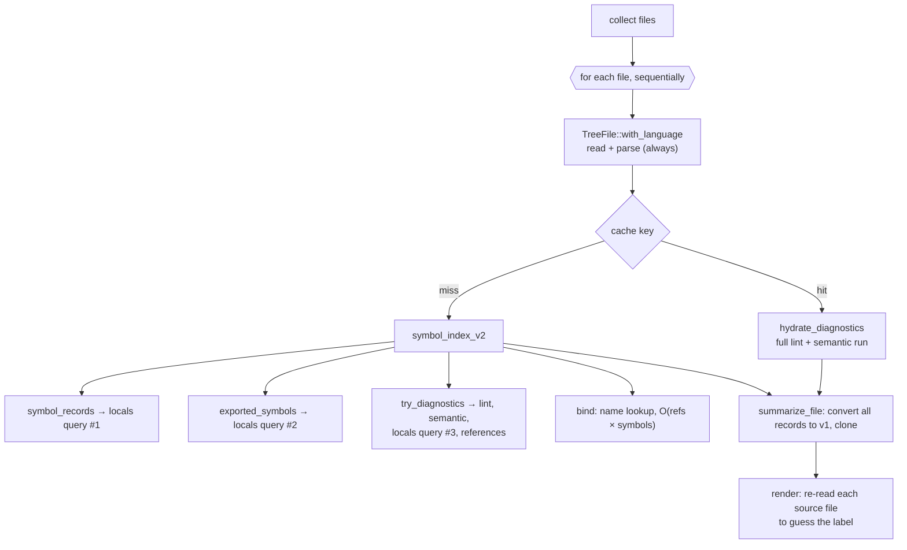
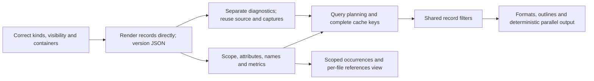

# Fast, precise, filterable symbol reports

## Summary

`hug functions`, `hug types`, `hug symbols` and `hug classes` answer "what is
declared in this code?". They work, but they:

- do much more work than the question needs
- carry less metadata than the library already models
- offer only name-based filtering
- render output that is hard to scan, script against, or pipe

This feature improves the four areas together, because they share one
foundation: the CLI should consume the v2 `SymbolRecord` directly and ask the
library for only the passes and kinds it needs.

| Area | Today (2026-10-03) | After |
|---|---|---|
| Performance | Every command runs the full lint and semantic analysis. A warm cache saves only 40%. Files are processed one at a time. | Symbol commands skip diagnostics, a cache hit skips parsing, and files are processed in parallel. |
| Metadata | The CLI guesses labels by re-reading source lines. References are resolved by name only. There are no qualified names, attributes, scope or metrics. | The library reports the declaring keyword, scope, attributes, generics, qualified names and basic metrics. |
| Filtering | Name glob or substring (case-sensitive), `--exported`, `--prelude`. | Kind, scope, visibility, container, tests, docs, signature shape, and changed files. |
| Reporting | Flat list sorted by name across files. `--json` is 28 MB for 1,236 functions. | Outline view, wrapped rendering through `biscuit-terminal`, JSON sized to the selection, JSON Lines, count and stats. |

**Depends on `2026-10-03-visibility-and-kind`.** That fix corrects kind,
visibility, `static` and container data for its accepted extraction set across
all 16 languages. It retains some grammar limits and defers some constructs;
see “Kind precision deferred by the prerequisite fix” in Open Questions.
Every filter and label below uses those documented limits.

## Baseline

Draft-author measurements from 2026-10-03 on an Apple M4 Max (16 cores),
release build, run in `tree-hugger/` (66 files):

| Command | Result |
|---|---|
| `hug functions --no-cache` | 1.07 s |
| `hug imports --no-cache` | 1.06 s |
| `hug lint --no-cache` | 1.07 s |
| `hug functions`, cache warm | 0.64 s |
| `hug --json functions` | 28.7 MB: 1,236 selected functions, plus all 8,585 full v2 records |
| `hug --json symbols` | 36.8 MB |
| `hug symbols` | 8,593 lines; about 6,000 are `let`, `parameter` or `variable` |

`functions`, `imports` and `lint` cost the same because they do the same work;
see “Diagnostics run only when the command shows them.”

## Background: what one `hug functions` run does today



Every box under "for each file" runs for every symbol command, whether or not
the command shows diagnostics, exports or references.

The implementation contracts used in this review are:

- In the tree-hugger package, [analyze_file](../../lib/src/analysis/mod.rs)
  builds the per-file index and fills relations. Its pass dependencies must
  remain explicit when diagnostics become optional.
- In the tree-hugger package, [IdentityFacet, SymbolRef and ProvenanceFacet](../../lib/src/shared/schema_v2/facets.rs)
  hold names, relation targets and extraction metadata. `qualified_name`
  already exists; this feature populates it rather than adding a second field.
- In the tree-hugger package, [PassFingerprint](../../lib/src/cache/mod.rs)
  describes analysis inputs but does not currently include the source hash or
  requested passes. The file cache key must include those separately.
- In the tree-hugger-cli package, [PreludeFilter and prelude resolution](../../cli/src/prelude.rs)
  include public re-export aliases and environment-provided names. Moving to
  records must preserve that behavior.

These links point to the current package source and documentation. The
[symbol schema contract](../../docs/symbol-schema-design.md) requires a major
version change for renamed fields or changed semantics.

### Intentional compatibility changes

The smaller JSON shape, default scope and sort order, smart-case matching,
container-field rename, and removal of timestamps are intentional changes.
Update the schema documentation and release notes with before/after examples.
Keep the existing `SymbolRecord` model and Rust type names, but advance the
serialized record/index schema from 3.0 to 4.0 when the breaking field changes
land; 3.0 is taken by `2026-10-03-visibility-and-kind`. The CLI report envelope
carries its own `report_schema_version: 1` and
`schema_version: {major: 4, minor: 0}` for its embedded records. Later additive
record changes follow the existing minor-version rule.

Invalidate incompatible cache entries; do not migrate stale records or silently
label the new shape as 3.0. Keep the v1 library API and its adapters working
with the renamed container field. No compatibility flag or deprecation period
is required for this early-stage repository.

---

## A. Performance

### A1. Diagnostics run only when the command shows them

The tree-hugger package's [parse_pass](../../lib/src/analysis/mod.rs)
currently runs diagnostics even for symbol listings. Split that work into
`AnalysisPass::Diagnostics`; ordinary symbol queries do not request it.

Preserve `TreeFile::symbol_index_v2()` as the complete-index convenience API,
including diagnostics. The CLI uses the new query API for selective work.
This avoids silently changing the existing library method's contract while
still removing unnecessary work from listings. `lint` requests diagnostics,
including its existing syntax, experimental-semantics and external-adapter
behavior. A complete cached symbol result requires no parsing or analysis;
a partial cache hit may run the missing passes.

Pass planning removes duplicates and orders prerequisites before consumers:
parse before bind, bind before semantic analysis, and parse before docs.
Diagnostics request their own dependencies without making every listing run
semantic lint. `completed_passes` records only work actually performed;
omitting diagnostics is not evidence that a file is clean.

### A2. A complete cache hit doesn't parse

1. Read the bytes once and hash them through `biscuit-hash`.
2. Look up the cache using the file identity, content hash and analysis inputs.
3. Parse those same bytes only when the requested result is missing.

The library exposes `SourceFile::read(path)` and `.parse()`; `SourceFile`
owns the bytes, detected or explicitly forced language, and source identity.
Its `.query(&query)` uses the same planning path as queries on an already
parsed `TreeFile`. Never reread the file between hashing and parsing: a file
edited in that interval must not cache new records under the old hash.
Existing constructors remain convenience wrappers. Reading, decoding and
language errors retain the existing error contract.

### A3. The locals query runs once per file

`symbol_records()` and `exported_symbols()` each call `symbol_nodes()`, and the
semantic lint calls it again. Within a per-file analysis, capture definitions once and derive exports,
locals and records from that result. Separate reference or comment queries
remain allowed when requested; share definition captures with native semantic
diagnostics rather than re-extracting them.

### A4. Metadata is extracted after duplicates are removed

`symbol_nodes` runs `extract_signature`, `extract_type_metadata` and
`extract_doc_comment` for every capture, then throws duplicates away. The
change removes duplicates on the captured name span and declaration identity
first, choosing the same refined kind regardless of capture order, then
extracts metadata once per surviving symbol. Distinct declarations sharing a
span or name, such as a C typedef and its struct tag, must remain distinct;
regression fixtures establish which captures describe one declaration.

### A5. Kind filters are pushed into extraction

When the caller asks only for function-like kinds (`hug functions`, or
`--kind` described under “Filtering”), the library skips metadata extraction, and when safe the
reference-binding work, for every other kind. Keep lightweight identity,
span, scope and container data for excluded declarations: they can still
shadow a selected symbol or own it. Selecting only methods must not change
reference resolution or lose their containers. The library takes this as the
`SymbolQuery` described under “A `SymbolQuery` API.”

### A6. Files are analyzed in parallel

`rayon` is already a dependency (`god_files` uses it). Per-file analysis
becomes `par_iter`, and results are collected back into file order, so output
is byte-identical to a sequential run. Each worker owns its parser and
per-file state; hash maps never determine output order. Use a bounded number
of outstanding file results and serialize them in the requested order. Cache
writes must be atomic under concurrent workers/processes, and failures are
reported in file order.

### A7. One persistent CLI cache, with complete keys

Remove the CLI's unconditional in-memory cache layers from the ordinary
single-visit scan, keeping their public library APIs. Prelude analysis can
reuse a request-local map of results because it actually revisits files.

Use the tree-hugger package's [PassFingerprint](../../lib/src/cache/mod.rs)
for pass inputs, alongside normalized file identity, source hash, forced
language, canonical requested passes, extraction selection and naming context.
The fingerprint includes schema, grammar version/identity, actual effective
query text (including inherited queries and overlays), relevant configuration,
and extractor implementation revision. Rules and external-tool versions affect
only passes that use them.

**Reader's note:** hashing query text cannot detect a change to Rust extraction
code. Keep `EXTRACTOR_REVISION` as one fingerprint input until a reproducible
build identity replaces it; a computed query digest alone cannot replace it.
Use `biscuit-hash` for all digests and an unambiguous canonical encoding.

Cache analysis before presentation filtering. A kind-restricted extraction
has its own cache selection key and never satisfies a broader request unless
its recorded coverage proves completeness. Name, visibility and output-format
filters do not invalidate complete extraction data. A full-index request
cannot reuse an entry missing relations, docs or diagnostics. Corrupt or
incompatible entries are misses, not empty results; `--no-cache` bypasses reads
and writes. Cache failures remain recoverable and quiet unless verbose output
is requested.

### A8. The bind pass indexes candidate names

`find_reference_target` scans every symbol for each reference. The change:

- A `HashMap<&str, Vec<usize>>` built once per file replaces the full scan.
  Bucket lookup is expected constant time; choosing among same-named candidates
  still costs work proportional to that bucket. No new dependency is needed.
- `push_unique_ref` uses a membership set per owner while preserving ordered
  vectors. Compare resolved references by ID; compare unresolved references by
  name and qualifier. Two missing IDs do not make two references equal.

Scope-aware resolution below changes which candidates are valid; indexing
only removes the repeated full-file scan.

### A9. Output is deterministic and streamed

- `created_at_epoch_ms` and `updated_at_epoch_ms` are both removed from record
  provenance; extractor identity, version and pass remain. Two runs over the
  same tree then produce identical output and identical cache entries.
- JSON is written with `serde_json::to_writer` to a locked, buffered stdout,
  instead of building one large string. This streams serialization; default
  file ordering still requires bounded buffering of parallel results.
- Pretty output goes through one locked `BufWriter`, not a `println!` per line.
- `SOURCE_LINE_CACHE`, the global mutex-guarded copy of every source file kept
  for label guessing, is deleted because records now carry declaration keywords.

### A10. Prelude resolution reuses analysis without losing exports

The tree-hugger-cli package's [prelude resolver](../../cli/src/prelude.rs)
currently parses both preludes and target files independently. Discover its
required files before scheduling work and reuse complete per-file indexes.
An explicitly narrowed scan may exclude a prelude target; analyze that target
on demand without emitting it as an extra selected file.

Preserve alias names and declaration locations, unresolved public re-exports,
and `PRELUDE` environment names. Synthetic export records are marked synthetic
and do not borrow the target declaration's ID while claiming a different
name/location. Prelude membership is determined before ordinary symbol filters;
lookup cannot use a kind-restricted index that omitted the target.

### Performance targets

These are goals for a quick before/after sample on the baseline host using
the same release build settings and command inputs. Ratios are not guarantees
across hosts. Behavioral work counters establish the removed work; timing is
supporting evidence, not a statistical or CI gate. A missed goal is recorded
with the remaining cost rather than triggering a larger measurement program:

| Measurement | Target |
|---|---|
| `hug functions --no-cache` on `tree-hugger/` | ≤ 40% of baseline |
| `hug functions` warm | ≤ 15% of baseline |
| `hug lint --no-cache` | no slower than baseline |
| Peak RSS, `hug symbols` on the whole repo | no higher than baseline |

---

## B. Metadata

### B1. The library reports the declaring keyword

`SymbolRecord.identity` in the tree-hugger package gains
`keyword: Option<String>`, taken from the
declaration's syntax node, not its text. Examples: `struct`, `union`, `enum`,
`type`, `trait`, `impl`, `mod`, `const`, `static`, `let`, `var`, `val`,
`class`, `interface`, `protocol`, `object`, `record`, `def`, `func`, `sub`,
`function`. The renderer prints this keyword, falling back to the kind name.

This replaces `symbol_presentation` and `binding_token_for_symbol` in
`cli/src/main.rs`. Those match source text (`trimmed.contains(" let ")`,
`trimmed.contains('=')`) and print labels like `=`, `for` and `:=`. They also
misfire on multi-line declarations and on comments that contain a keyword.

### B2. Scope classification

`SymbolRecord` gains `scope: SymbolScope`, an enum with `Item`, `Member` and `Local`:

| Scope | Meaning | Examples |
|---|---|---|
| `Item` | declared at module or file level, or nested in a namespace or module | free functions, types, top-level constants |
| `Member` | declared inside a type, trait, interface or `impl` | methods, fields, enum variants, associated consts |
| `Local` | declared inside a function body, or a parameter | `let`, `var`, `:=`, parameters, loop bindings |

The nearest semantic declaration determines scope, not merely the nearest
brace. Declarations inside function bodies, including nested functions/types,
are local; their own type members are member-scoped. Parameters are local and
inline-module contents are items. This presentation classification is separate
from the lexical scopes used to resolve names. It keeps local bindings out of
the default listing without discarding their analysis data.

### B3. Modifiers and attributes

Fill the existing `Modifier` and `Attribute` facets for supported syntax in
every language; languages without a construct return an empty list:

- **Modifiers:** `async`, `unsafe`, `const fn`, `abstract`, `final`,
  `override`, `virtual`, `readonly`, `mut`, plus `static` from the fix.
- **Attributes:** Rust attributes, Java and C# annotations, TS, JS and Python
  decorators, and Swift attributes. Each is recorded as `{name, value}` in
  source order, using the full syntactic
  name and raw argument text; this does not evaluate arguments or expand macros.
  Use existing modifier variants and `Custom` for `abstract`, `final`,
  `override` and `virtual`, rather than widening the enum without need.

From those, the library derives:

- `visibility.is_deprecated`: `#[deprecated]`, `@Deprecated`, `[Obsolete]`,
  `@deprecated` in a doc comment
- a new `visibility.is_test` flag. It is true for:
  - Rust: `#[test]`, `#[tokio::test]`, and anything inside a `#[cfg(test)]`
    module
  - Java: `@Test`
  - Python: `test_*` functions in `test_*.py`, and `unittest.TestCase`
    subclasses
  - Go: `TestXxx(t *testing.T)` in `_test.go`
  - JS/TS: `describe` and `it` are calls, not declarations, so for JS and TS
    every declaration in files matching `*.test.*` or `*.spec.*` has `is_test`
    set; no test declaration is synthesized from a call

Test detection is a documented syntax/file-name heuristic, not a claim that
a runner will execute the symbol. Rust `cfg(test)` ancestry includes all nested
declarations, but `cfg(any(test, feature = "x"))` does not mean test-only.
Python `TestCase` recognition requires an explicit `unittest.TestCase` base or
an unambiguous same-file import alias; mark the class and its test methods,
not every method in it. Java recognizes `Test` and qualified annotation names
without loading dependencies. Go requires the test naming/signature convention.
Other languages report false until a detection rule is documented and tested.
Fixtures include similarly named non-tests and deprecation words in ordinary
comments, which must not set either flag.

### B4. Generics and inheritance

The following v2 facets exist but are empty today:

- **`type_info.generic_params`:** name, kind (type, lifetime, const), bounds
  and default.
- **`relations.extends`:** for example `class A extends B`.
- **`relations.implements`:** for example `impl Trait for Type`,
  `implements I`, Swift conformance.

Preserve written base names and generic arguments even when the base is
external. Fill a relation target ID only for an unambiguous declaration in the
same file; otherwise leave it absent. Rust trait implementations attach the
trait relation and same-file members to their target type; several impl blocks
must not overwrite each other. A target defined elsewhere retains a textual
container reference. No cross-file type resolution is introduced.

### B5. Qualified names with honest context

Populate the existing `identity.qualified_name`; move the current container
text from `module_path` into `container_name`, alongside `container_kind`.
A qualified name is a readable lookup name, not a unique symbol ID: overloads
and repeated local names still use the existing declaration-based IDs.

Use explicit namespace/package syntax and enclosing declarations where those
establish a name. A file path alone cannot prove a Rust module path or a Python
import package. An optional query context supplies a known module/package root
and path mapping; absent that context, use a portable scan-root-relative
`file#container.member` fallback, retaining language-native separators inside
the container portion. The standalone library defaults to the file's parent
as its root. Never guess through Rust `#[path]`, Python import configuration,
or generated module layouts.

| Language/context | Example |
|---|---|
| Rust, module context supplied | `crate::shared::symbol::SymbolInfo::new` |
| Rust, no module context | `symbol.rs#SymbolInfo::new` |
| Python, package context supplied | `package.module.Class.method` |
| Java / Scala explicit package; C# namespace | `com.example.Point` |
| Go explicit package | `pkg.Func` |
| TypeScript / JavaScript file fallback | `src/shared/symbol.ts#Class.method` |
| C++ explicit namespace and class | `ns::Class::method` |
| C file fallback | `src/point.c#make_point` |
| Swift, PHP, Lua, Perl, Bash, Zsh | explicit namespace/package when known; otherwise `file#name` |

**Reader's note:** JavaScript and TypeScript do have module systems. A portable
file-qualified name avoids assuming how a project's module loader maps files.
Normalize displayed separators to `/` without lowercasing paths. Naming context
is part of cache validity and must be identical on cold and warm runs. IDs are
stable for the same file identity/context and declaration position, not across
edits, renames or different scan roots; changing qualified-name construction
must recompute every affected relation ID consistently.

### B6. References resolved by scope, with uncertainty preserved

The tree-hugger package's [find_reference_target](../../lib/src/analysis/mod.rs)
currently selects the first same-named declaration. Replace that rule with
innermost lexical scope first, then outward, honoring each language's declaration
order, hoisting and import aliases. Inventory effective `@local.scope` captures;
they are not present in every current query. Add language-specific scopes or
explicitly report limited resolution where syntax is insufficient, and update
query provenance for modified vendored queries.

Lexical scope alone cannot identify `other.method()` without knowing the
receiver's type. Resolve a qualified target only when its namespace, container,
or receiver is established locally; never redirect it to the caller merely
because the name matches. Ambiguous targets keep an absent ID and their written
qualifier, rather than choosing the first candidate.

Add an occurrence record to `FileSymbolIndex`: owner reference, target reference,
reference span, relation kind (`Call` or `Usage`) and confidence (`Scoped`,
`NameOnly` or `Unresolved`). `Scoped` means syntax and lexical visibility establish
one target; `NameOnly` is explicitly a candidate. Missing scope support is not
proof of resolution. Existing per-symbol relation lists remain deterministic
summaries derived from these occurrences; occurrence spans are required to show
where a use appeared and to distinguish calls from other uses.

`is_recursive` is `Yes` only for a `Call` occurrence resolved to the function's
own ID with `Scoped` confidence. A self-value reference is not recursion.
Use `Unknown` when any potentially recursive call is unresolved, and `No` only
when call extraction/resolution for the body is complete and excludes self-calls.
Nested callable bodies have their own owner and cannot establish recursion for
the enclosing function. No analysis requested remains `None`.

### B7. Per-symbol metrics

`SymbolRecord` gains an optional `metrics` facet, computed only when requested.
Unrequested metrics are absent; an unsupported metric within a computed facet
is `None`, while a measured zero is `Some(0)`.

| Field | Definition |
|---|---|
| `lines` | physical lines intersecting the half-open body span; missing body → `None`, empty span → 0; an end at column 1 excludes that line |
| `parameters` | declared parameters excluding a separate receiver; one variadic parameter counts once; known empty list → 0 |
| `cyclomatic` | decision points + 1 for a callable body, excluding nested callable/type bodies; unavailable rules or body → `None` |
| `has_docs` | nonempty attached documentation after removing comment delimiters; ordinary comments do not count |

Doc filtering needs only attached docs, not full structured parsing. Metrics
never force diagnostics. Keep god-files' current declaration-span size/risk
calculations: the tree-hugger package's [god-files analysis](../../lib/src/god_files/analysis.rs)
uses declaration spans, which differ from body lines. Reuse metrics only where
units and definitions are identical, with regression tests proving unchanged
scores; do not make its fast path run complete symbol analysis to obtain them.

### B8. Deterministic, render-ready records

Records no longer carry timestamps, as specified under “Output is deterministic
and streamed.” Fill `source.signature_text` with the declaration header as
written, without its body. Scripts and `--signatures full` then receive an
exact, language-native signature. Preserve internal whitespace and
line breaks; strip only outer whitespace. Declaration-only signatures stop at
the terminator; expression bodies stop at their grammar-defined boundary.
Initializer expressions, decorators and doc comments are not appended to the
header. Missing grammar support returns `None` and a compact-rendering fallback,
never the full body. Source/body/AST blobs stay absent from default reports;
`--json-full` means complete analysis, not an automatic copy of all source.

### B9. A `SymbolQuery` API

The library gains one entry point for "give me these symbols", used by the CLI
and available to other consumers:

```rust
let query = SymbolQuery::new()
    .kinds([SymbolKindV2::Function, SymbolKindV2::Method])
    .scopes([SymbolScope::Item, SymbolScope::Member])
    .visibility(VisibilityLevel::Public)
    .exclude_tests(true);
let records = SourceFile::read(path)?.query(&query)?;
```

The new API is in the tree-hugger package beside [TreeFile](../../lib/src/file/tree_file.rs),
the existing parsed-file entry point. Both source snapshots and parsed files
accept the same query. Library defaults select all kinds and scopes; hiding
locals is a CLI default only. Queries specify required capabilities separately
from selection: declarations, containment, reference occurrences, semantics,
structured docs and metrics. Selection cannot silently remove prerequisite data.
Return records plus file/language identity and completed capabilities, so an
empty result and an uncomputed facet are distinguishable.

Required work is explicit:

| Request | Required analysis |
|---|---|
| Basic functions/types/symbols | declarations, cheap metadata and any selected filter inputs; no references or diagnostics |
| Classes or outline | declarations plus containment, including excluded parent identities |
| Undocumented/deprecated filtering | attached docs and metadata; structured docs only when requested |
| Metrics/stats | only requested metrics and doc presence, not diagnostics |
| References view | declarations, lexical scopes and reference occurrences; semantics only for requested inferred flags |
| Complete index / `--json-full` | all index capabilities, including diagnostics |

Keep `completed_capabilities` in query results/reports for work such as
containment or metrics that is narrower than a complete pass. A cache hit uses
stored capability coverage; an empty facet is not proof that it was computed.

File discovery, Git selection and output ordering remain CLI responsibilities.
The library owns record filtering once; the CLI owns a separate presentation
step for grouping classes and building outlines. Imports remain import records,
not synthetic declarations forced into `SymbolQuery`.

---

## C. Filtering

All filters apply to `functions`, `types`, `symbols` and `classes` alike;
`imports` gets the name and file filters. Filters combine with AND; a filter
that takes a list matches if any of its values matches (OR).

### C1. `--kind <kind>`

`--kind` is repeatable and accepts v2 kind names
(`hug symbols --kind trait --kind interface`). Fixed command sets are:
`functions` = Function, Method, Constructor; `types` = Type, Class, Interface,
Enum, Trait, TypeAlias; `symbols` = all kinds before its scope default.
An explicit kind set intersects the command set; it does not widen it. Unknown
kind names are argument errors, and unsupported kinds return no matches.

`classes` keeps Class and Type as its container kinds, along with its current
static/instance partitioning. Kind, scope, name, visibility, test, docs and
deprecation filters select containers. `--in` matches the selected class/type's
own name as a member container. Member-shaped filters (async, return/parameter
type, parameter count, static/instance) select its displayed members. To apply
visibility/kind/docs predicates directly to individual members, use
`hug symbols --in Box` or `hug functions --in Box` instead. A selected container
can therefore have zero matching members; count/stats count selected containers,
not contextual member rows. Machine reports store selected container records
with a separate `members` map from container ID to selected member records. This preserves
class grouping while sharing the library's record predicates.

### C2. `--scope item|member|local`

`--scope` is repeatable. **`hug symbols` defaults to `item` and `member`.**
Explicit scopes replace defaults: `--scope local` selects only locals;
`--scope item --scope member --scope local` or `--all-scopes` selects all three.
`--all-scopes` conflicts with `--scope`. Other commands start with all scopes
within their command kind set, so nested functions remain discoverable. On
`tree-hugger/` this takes `hug symbols` from 8,593 lines to about 2,550.

### C3. Visibility and export filtering

`--visibility <level>` matches the exact existing visibility level and is
repeatable. Unknown matches only `--visibility unknown`; it is never treated
as public or private. These levels describe different access rules across
languages, not a single ordered scale.

Keep `--exported` as an independent test of `visibility.is_exported`, including
re-exports. A public class method can be public without being a module export.
**Reader's note:** the original alias to `--min-visibility public` would change
existing export selection and hide export conventions in languages without
visibility keywords. Preserve the two concepts separately.

The proposed `--min-visibility` needs an author decision under “Visibility
thresholds across languages” in Open Questions. Exact visibility filtering
ships without assuming such an ordering.

### C4. Container and qualified-name matching

- `--in <name>`: members of a named container
  (`hug functions --in TreeFile`).
- A name filter containing the language's separator (`::`, `.`, `#`) matches
  against `qualified_name` (`hug symbols --name '*::schema_v2::*'`). A
  pattern beginning at an inner module needs a leading `*` when a full name
  begins with `crate::`. `--name` handles file-qualified names containing `/`
  that positional classification would otherwise interpret as paths.
- `--in` matches the immediate `container_name` with the same name rules;
  supplying a qualified container pattern disambiguates repeated names.

### C5. Smart-case name matching

The current "fuzzy" match is a case-sensitive substring match
(`wildcard_match` in `cli/src/scanner.rs`). The new rules:

- All-lowercase input matches case-insensitively.
- Any uppercase letter makes the match case-sensitive.
- `--exact` forces whole-string literal matching, as does a trailing `!`.
  Both retain smart-case rules; wildcards under exact matching are literal.
- Only `*` is a name wildcard, matching any sequence; no regex, `?` or bracket
  syntax is introduced. Non-wildcard input retains substring matching.
- Smart case applies to symbol/container inclusion and exclusion patterns.
  Type text and file patterns keep their existing case rules. Apply case
  folding consistently to both pattern and candidate without slicing through
  UTF-8 character boundaries; non-ASCII names need regression coverage.

### C6. Tests, docs and deprecation

- `--exclude-tests` / `--tests-only` are mutually exclusive and use the
  documented `is_test` heuristic under “Modifiers and attributes.”
- `--undocumented` lists symbols with `has_docs == false`, which is a docs
  coverage check.
- `--deprecated` lists symbols marked deprecated.

### C7. Signature shape

- `--async`
- `--returns <glob>`, for example `--returns 'Result<*'`
- `--param-type <glob>`
- `--min-params <n>`

These match declared type text, not resolved types. Type globs are whole-string
and case-sensitive with `*` as the wildcard. Missing type text cannot match;
`--param-type` needs any non-receiver parameter to match. Shape predicates select
function-like declarations only, including constructors when applicable;
`--min-params 0` does not select unrelated types with absent parameters.

### C8. `--changed[=<ref>]`

Restrict scanning to the union of tracked files whose current contents differ
from the supplied commit, staged/unstaged changes, and nonignored untracked
files. Default reference is `HEAD`; it answers “what declarations are in my
uncommitted changed files?” Use `--changed=main` for changes against the local
main tip, including committed branch changes. This compares that tip directly,
not the branch's common ancestor, and does not filter individual changed lines.
Use the equals form for the optional reference so a positional file/name token
is not consumed as a Git reference.

Inspect Git through sniff's focused APIs, not full host discovery, remote
refresh or shell-parsed status. The sniff package's [GitRepo status API](../../../sniff/lib/src/filesystem/git/types.rs)
provides working-tree state; an arbitrary-reference path comparison may need
a focused sniff API extension and tests, which are included in scope if needed.
No fetch is permitted. Invalid refs, missing repositories, merge conflicts or
Git failures are actionable errors, not an empty successful selection. An unborn
HEAD uses an empty base only for the default reference.

Intersect changed files with normal language/path/exclusion rules. Parse current
files only: skip deleted paths, use a rename's destination, deduplicate paths,
and retain the normal explicit-path override for fixture exclusions. Untracked
files that Git ignores remain excluded. No changed files is a successful empty
report, even where the scanner ordinarily reports `NoSourceFiles`.

### C9. Explicit file and name filters

Positional filters are auto-classified as files or names (`is_file_filter_token`
in `cli/src/scanner.rs`). `--file <path|glob>` and `--name <pattern>` bypass
that classification when it guesses wrong. Values within each include list
are alternatives; file and name lists intersect, and exclusions take precedence.
Keep existing `--exclude-files`, `--exclude-symbols`, `--language`, `--prelude`,
`--comments`, grouping and sorting flags, documenting any aliases/conflicts.
File references use `biscuit-file::FileReference`; discovery retains `.gitignore`
and the default fixture exclusions, with explicitly targeted files re-included.
`imports` retains file-only positional tokens and gains symbol matching through
explicit `--name`, avoiding an accidental positional behavior change.

### C10. One filter path

`hug classes` re-implements export, prelude and name filtering
(`cli/src/main.rs:1056-1084`), and `summarize_file` repeats the
kind-and-filter logic once per command. Each declaration command builds the
common query predicates; records are
filtered once before presentation. Classes can apply that shared predicate to
containers and members as described under “`--kind <kind>`.” Imports use the
same name matcher on import records, preserving alias/original-name fields.

---

## D. Reporting

### D1. JSON sized to the selection

- `--json` emits `{ report_schema_version, schema_version, root_dir, files:
  [{ file, language, completed_passes, completed_capabilities, symbols: [SymbolRecord] }] }`, containing
  only selected records. Class reports additionally contain `members`, keyed
  by selected container ID, with selected member records; their `symbols`
  array contains the selected containers.
- Remove the old v1 symbols payload and unconditional `symbol_indexes` block.
  Empty selections use `files: []`; omit file entries with no matches.
- `--json-full` emits the same versioned envelope with complete per-file
  `indexes` instead of selected `files`. File selectors still apply; symbol
  selectors are rejected rather than implying a complete index is filtered.
  Request every index capability, including diagnostics and occurrences.
- Default records omit unrequested relations/semantics/metrics and large
  source/body/AST blobs. `completed_passes` and query result capabilities make
  omitted work explicit. A reference may name an excluded symbol; selection
  does not rewrite it or add that symbol to `symbols`.
- All machine-readable paths are portable scan-root-relative paths, with one
  `root_dir` anchor in JSON. JSON Lines follows the same convention; the scan
  root is the invocation's resolved root. Preserve library-native source paths
  internally and project paths without altering record IDs.

Target: `hug --json functions` on the baseline `tree-hugger/` input is under
3 MB; measure serialized bytes, retaining required identity and source spans.
`imports` and `lint` retain their own current report shapes in this feature;
the new declaration envelope is not a global change to `--json`.

### D2. JSON Lines

`--jsonl` writes one selected-record line, in deterministic
file/source order. The recommended versioned envelope is an author choice under “JSON Lines record
shape” in Open Questions. Do not emit records in worker-completion order.
`--sort name` or `--sort kind` needs global ordering and may buffer all matches;
streaming then describes serialization, not constant memory. Class lines must
carry the selected container and its selected members together.

A stdout write error stops work; a broken pipe exits quietly without a panic.
Read/parse failures go to stderr and produce a nonzero status, even if earlier
JSON Lines were emitted. For ordinary JSON, collect analysis errors before
writing the single document so failures cannot silently produce a success
report. An empty successful JSON Lines report has zero lines.

### D3. Outline view

`--tree` nests members under their container, using `relations.members`, with
the declared inheritance relations on the container line:

```text
lib/src/file/tree_file.rs
  pub struct TreeFile
    pub fn new(path: P) -> Result<Self, TreeHuggerError>
    pub fn symbols(&self) -> Result<Vec<SymbolInfo>, TreeHuggerError>
    …
```

This replaces the container suffix in that view; the flat view keeps it.
Containment is a cheap capability independent of reference resolution. Match
members by container ID where available, including out-of-body Rust impl and
Go receiver declarations. Use a marked contextual container heading when a
selected member's container was excluded or is outside the file; do not emit
that heading as a selected record or include it in count/stats. Repeated impl
blocks are grouped under the type, and missing parents never drop members.
Overloads remain separate rows ordered by source position.

### D4. Rendering goes through `biscuit-terminal`

Symbol output is built from `UnorderedList` and `Prose` (and `Table` for
`--format table`), as the repo's best practices require. Long signatures then
wrap at the terminal width with a hanging indent, instead of running to 200+
characters. One example today is `struct FileSummary { file: PathBuf, … }`.
Hyperlinks keep their current OSC 8 behavior for interactive output.
`--plain`, `--format plain`, redirected text and machine formats disable ANSI
styles and OSC 8 links. Width wrapping applies only to terminal prose/table
output, not JSON, JSON Lines, TSV, Markdown or tags. Escape source text as
literal component content so embedded control sequences or markup in a
signature cannot become terminal commands or unintended styling.

### D5. `--signatures full|short|none`

| Mode | What it shows |
|---|---|
| `full` | the language-native declaration header defined under “Deterministic, render-ready records” |
| `short` (default) | today's compact form, with type field lists truncated past 4 entries (`{ a, b, c, d, … +3 }`) |
| `none` | names only, with normal location/container context |

### D6. Count, stats and other formats

- `--count` prints the number of matches and nothing else.
- `--stats` prints counts by kind, visibility and language plus doc coverage,
  using selected declarations as the denominator (zero matches → coverage
  unavailable). Package grouping uses manifest-backed identity from sniff when
  available, otherwise an explicit unassigned bucket; never infer package names
  from directories. Synthetic export records are reported separately from
  declaration doc coverage.
- `--format plain|table|tsv|markdown|ctags`:
  - `ctags` emits a standard tags file
  - `markdown` emits nested lists, escaping signature/name content so it can
    be pasted into docs and PRs without creating unintended links or markup
  - `tsv` has a header `file`, `line`, `column`, `kind`, `name`, `qualified_name`,
    `visibility`, `signature`; encode tabs, CR, LF and backslashes as literal
    escapes, leaving absent values empty

Exactly one output mode is active: default terminal text, `--json`,
`--json-full`, `--jsonl`, `--count`, `--stats`, or explicit `--format`.
Conflicting modes are argument errors. `--plain` can disable terminal styling
but does not modify machine formats. `--tree` is valid only with terminal or
Markdown output. Count prints a single decimal integer plus newline (including
0); signatures/comments apply only to text formats. Existing class static/
instance options remain mutually exclusive. Empty selections succeed; analysis
errors fail and remain visible on stderr, including under count mode.

### D7. A useful default order

| Order | Today | After |
|---|---|---|
| default | by name across all files | by file, then source position (`--sort name` keeps the old order) |
| `--sort kind` | alphabetical by the kind's name | Module, Namespace, Type, Class, Interface, Trait, Enum, TypeAlias, Function, Method, Constructor, Macro, Constant, Field, Property, EnumVariant, Variable, Parameter, Unknown |

Tie-breakers are portable file path, start byte, end byte, kind and ID; name
sorting first uses the written case-sensitive name. Sort relation targets and
occurrences deterministically too. Existing sorting/grouping flags map to these
rules where equivalent; conflicting explicit orders are argument errors. Byte
identity applies to the same input/root/options/build, not different absolute
roots or terminal widths.

### D8. Quiet by default

The cache-stats line printed to stderr on every warm run moves behind
`--verbose`.

### D9. A references view

`hug refs <symbol>` lists reference occurrence paths and spans, grouped by
owning declaration. It requests binding even if ordinary listings do not.
`--callers` / `--callees` are mutually exclusive and show one hop of `Call`
occurrences only; `Usage` is not a call. Every row reports confidence, and
unresolved/name-only candidates stay visibly separate from proven targets.

This is a per-file view: a directory scan combines independent file indexes
and cannot discover callers in another file. State that limitation in command
help and reports. Match the selector as an exact short or qualified name using
smart case; multiple matches are an ambiguity error that lists file locations
and IDs and accepts `--id` to disambiguate overloads. No matches succeeds with
an empty report. Filter the target after analyzing full lexical context, so
excluded declarations cannot change what a reference resolves to.

### D10. One renderer

In the tree-hugger-cli package, [render_symbols and render_symbol_line](../../cli/src/main.rs)
format the same declarations through separate code paths. Replace them with
one `biscuit-terminal` component so wrapping, visibility and signatures agree
in grouped and flat output.

---

## Sequencing



Each phase leaves `hug` working, and updates relevant docs/tests with its code.
Phase 1 consumes records directly and removes diagnostics from listing work;
it does not require the full metadata/filter feature first. Preserve v1 library
adapters until the separate author decision on removing them. Introduce the
shared query planner before kind-restricted cache entries or parallel prelude
reuse, so those optimizations have one completeness contract. Final acceptance
includes all resolved requirements; open author decisions must be settled or
explicitly deferred in the implementation log before their features ship.

## Decisions

### Resolved

- **The CLI consumes records directly.** This preserves metadata and removes
  conversion/cloning work; the v1 public library API remains supported here.
- **Symbol listings hide locals by default.** Explicit scopes replace that
  default; library queries still default to all scopes.
- **Exports and visibility stay separate.** Exact visibility filters are
  available without imposing an ordering across different access models.
- **Queries declare completeness.** Restricted extraction and missing passes
  cannot masquerade as a complete cache hit.
- **Qualified names reflect known context.** A file-qualified fallback is
  preferable to a plausible but incorrect module name.
- **Deterministic records have no wall-clock timestamps.** Breaking record
  changes are versioned; old cache entries are rejected.
- **No new matching or candidate-bucket dependency.** Extend the current
  wildcard matcher and use standard collections.
- **Parallel output preserves order.** Buffering is bounded in file order;
  global name sorting may need to retain all selected records.

### Open Questions

#### JSON Lines record shape

A line must identify its schema and language as well as its file location.
Bare records currently have no schema or language field, unlike file indexes.

- **Bare record:** smallest shape and least wrapping; consumers must get the
  schema/language out of band, and cannot safely distinguish versions alone.
- **Versioned envelope:** `{report_schema_version, schema_version, file,
  language, completed_passes, completed_capabilities, record}`, with `members` for class lines.
  Self-describing and consistent with JSON; repeats small metadata per line.
- **Recommendation:** the envelope, because a saved or piped line should be
  usable without guessing its language or record version. Keep source blobs
  absent to address size rather than removing interpretation metadata.

#### Tags output compatibility

Choose the tags-file contract before advertising editor integration.

- **Minimal format:** name, portable relative file path and numeric line
  address. Easy to implement/test; loses kind and container information.
- **Extended format:** numeric addresses plus documented kind/scope fields
  and format/sort headers. Better editor navigation; needs escaping and a
  reviewed mapping from language-specific kinds to tag kinds.
- **Recommendation:** extended format, because kinds and containers are a
  principal goal. Document escaping for tabs/newlines/backslashes, mark files
  unsorted unless sorted by tag name, and omit synthetic or locationless tags.
  Do not claim full Universal Ctags compatibility until the chosen subset is
  checked against its format contract and an editor-reader fixture.

#### Removing v1 from the library

This is a separate follow-up decision, not work authorized by this feature.
Moving the CLI does not prove that other packages have no v1 callers.

- **Remove after an audit:** one public model and less adapter maintenance;
  requires migrating repository callers and changes the public API.
- **Keep a convenience adapter:** simpler entry point for existing callers;
  carries continuing maintenance and risks losing new metadata.
- **Recommendation:** audit then remove in a follow-up. Complete the CLI move
  first and record actual remaining callers before estimating removal work.

#### Cyclomatic complexity per language

A syntax-based decision-point list must define short-circuit expressions,
pattern guards and nested bodies, not simply count all branch-shaped nodes.

- **Ship reviewed language lists:** useful incrementally and no invented
  values; users see `None` for unreviewed languages.
- **Wait for all supported languages:** uniform coverage; delays useful
  metrics and expands the initial review.
- **Recommendation:** reviewed lists first, with `None` elsewhere and a
  per-language value/unavailable assertion. Do not change god-files scoring
  to fill a missing metric with zero.

#### Visibility thresholds across languages

`Crate`, `Package`, `Internal` and `Protected` express different audiences.
The current enum defines no ordering, and restricted Rust paths are already
collapsed to `Crate` by the prerequisite fix. What should “minimum” mean?

- **Exact/list filtering only:** faithful to stored data and straightforward;
  callers enumerate alternatives for wider queries.
- **Language-specific threshold tables:** familiar within a language; mixed
  language runs need explicit tables, and incomparable audiences remain hard
  to explain.
- **A new exposure model:** could represent audience sets precisely; exceeds
  this feature's scope and requires extraction and schema changes.
- **Recommendation:** ship exact/list filters and defer `--min-visibility`.
  This meets selection needs without claiming an access hierarchy that the
  data cannot support. For Rust, `--visibility crate --visibility public`
  is an explicit alternative with the fix's documented precision limits.

#### Kind precision deferred by the prerequisite fix

The prerequisite matrix marks several constructs as future precision work:
for example Python/Java/C#/C++/Swift/PHP constructors, some enum variants,
Go fields/type aliases, and Lua methods. That marker does not define an
implementation plan here. Existing grammar limitations are also not promises
that this feature will lift them.

- **Include every deferred construct:** broad consistency; substantially
  expands extraction work and cannot guarantee grammar support.
- **Keep this feature to records already extracted correctly:** bounded scope
  and clear ownership; richer reports still omit those declarations.
- **Choose a named subset:** adds the most useful kinds first; requires an
  explicit per-language acceptance table and leaves the remainder deferred.
- **Recommendation:** keep the currently defined extraction set, unless the
  author selects a subset before implementation. Document remaining omissions
  and distinguish “unsupported extraction” from “language has no construct”
  in tests. The summary's correctness claim applies to the prerequisite's
  accepted extraction set, not every declaration a language can express.

---

## Testing: every capability, in every supported language

**Every supported language is tested, for every capability, in every phase.**
"Supported" means every value of `ProgrammingLanguage::all()`. Today that is
16 languages:

- Rust, TypeScript, JavaScript, Go, Python, Java, C#, C, C++, Swift, Scala
- PHP, Perl, Lua, Bash, Zsh

A capability that a language can't express is asserted as not applicable
(`None`, empty, or "filter matches nothing"). Separately label unsupported
extraction/grammar support; those constructs are not falsely classified as
absent from the language. Each row identifies representative positive and
negative cases, rather than pretending every feature is applicable everywhere.

All tests named here are L1 unless marked otherwise. Run them with `just test`
in `tree-hugger/`, using nextest through that recipe; use the monorepo Test
Toolkit for isolated CLI/cache/Git fixtures. Repository fixture reads use
runtime harness roots and literal joined paths that the test-input index can
resolve. No implementation test should read this dated spec as its contract.

### Shared fixtures

- **`lib/tests/fixtures/symbols/<language>.<ext>`**, introduced by the fix.
  This feature extends each one with:
  - supported attributes and decorators
  - a deprecated symbol where syntax or doc tags express deprecation
  - a recognized test and a similarly named non-test where detection exists
  - generic parameters where the language/extractor supports them
  - inheritance or implementation syntax where supported, including external bases
  - a shadowed local
  - same-named methods on two types where methods exist
- **`lib/tests/fixtures/symbols/<language>_test.<ext>`** (or the language's
  test-file convention), for file-level `is_test` detection.
- **A `lib/tests/fixtures/symbols/multi/` tree** containing all 16 languages,
  for multi-file, parallel and ordering tests.

### Coverage guard

The fix's language-coverage test (iterate `ProgrammingLanguage::all()`, fail
on a missing fixture or matrix row) is extended to check every matrix below.
A new language can't be added without a row in each.

### Per-capability matrices

Each matrix is a table-driven test with one row per language, so a failure
names its language.

| Capability | Asserted per language |
|---|---|
| Keyword | every declaration in the fixture reports the expected keyword; none of them `None` unless the language has no keyword for that construct |
| Scope | at least one `Item`, one `Member` (or n/a) and one `Local` with the expected classification |
| Modifiers and attributes | each modifier and attribute in the fixture is reported; `is_deprecated` and `is_test` are set exactly on the marked symbols |
| Generics and inheritance | generic parameters with bounds; same-file bases get correct IDs, external/ambiguous bases preserve text without invented IDs |
| Qualified names | explicit/context-supplied names and portable fallbacks for items/members/nested declarations, including ambiguous module layouts |
| Scoped resolution | shadowing follows language scope/order rules; unrelated receiver calls are unresolved, not recursion; occurrences retain spans, owner, Call/Usage and confidence |
| Metrics | `lines`, `parameters` and `has_docs` for each fixture function; `cyclomatic` matches a reviewed language list or is `None`; missing bodies and nested callables have explicit expected values |
| Selection filters | every filter returns exactly the expected symbol set for that language's fixture; "matches nothing" is asserted where the construct is n/a |
| JSON and JSON Lines | parses, holds only the selected symbols, has schema/language context, and round-trips through serde |
| Outline | members nest under the right container, including Rust `impl` blocks, TS classes, Go receiver methods and Python classes |
| Signatures and formats | golden output per format (`plain`, `table`, `tsv`, `markdown`, `ctags`) for the language's fixture |

Additional focused cases prove filter intersections/conflicts, exact versus
smart-case matching, class/member counts, contextual outline parents, multiline
headers, stable TSV escaping, empty selections and diagnostics-pass preservation
for `lint` and the complete-index library method.

Golden files live in `cli/tests/fixtures/golden/<language>/<command>.<format>`.
They are compared after `strip_ansi_codes` and path redaction (the existing
`corpus` helpers), so they hold on every OS.

### Equivalence and determinism

- **Parallel equals sequential.** Over the 16-language `multi/` tree, the
  parallel run's `--json` output is byte-identical to a run with a single
  rayon thread.
- **Two runs are identical.** Back-to-back runs, cold and then warm, produce
  byte-identical `--json`.
- **Cache correctness.** For each language, a warm-cache result equals a
  `--no-cache` result. Editing the language's query text in a test-local copy
  invalidates the entry. Also vary extractor revision, language override,
  query kinds, naming context, schema and requested capabilities. Warm narrow
  then broad queries (and the reverse) must match uncached results. Simulate
  corrupt and concurrent writes without treating either as empty success.
- **Diagnostics are skipped.** A symbol command over `multi/` records zero
  diagnostics-pass executions. This is observed through a pass counter exposed
  for tests, not through timing. Propagate counters into parallel workers.
  A complete warm hit additionally records zero parser constructions, and a
  cold analysis records one definition-capture extraction per file.
- **References retain uncertainty.** Unresolved receivers, overload ambiguity,
  nested callable owners and self-value uses never become definite recursion;
  callers/callees exclude non-call occurrences.
- **Prelude behavior survives.** Cover aliases, unresolved re-exports, environment
  names and targets outside the selected scan, with no duplicate parse.
- **Git selection is exact.** Use temporary repositories to cover staged,
  unstaged, untracked, ignored, renamed/deleted, invalid-reference and unborn-HEAD
  cases, plus a branch containing committed changes against a supplied tip.
- **Output failures are observable.** Cover broken pipes, file errors and
  deterministic parallel error reporting without real terminal focus.

### Performance sample

Use one host and a quick release-build before/after sample of the existing
baseline commands and inputs. Record elapsed time, serialized bytes and the
already requested peak RSS comparison in the implementation log; record the
build and cache state. The baseline already establishes that listings spend
lint-like time, so no separate exploratory spike is needed to prove that cost.
Do not expand measurements to every language, additional hosts, repetitions,
statistical thresholds or new benchmark corpora. The existing Criterion suite
may remain available through `just bench`; it is not a mandatory new measurement
program or CI gate. The all-language fixture tree proves correctness, not a
performance target.

### Host coverage

Path rendering, `--changed` (Git) and terminal-width wrapping are
OS-sensitive. Their tests run on the environments CI schedules for the area,
and follow the `os` skill's guidance for path comparison. Packages remain
required to work on macOS, Linux, native Windows and WSL2; this feature adds no
CI environments or gates. Width tests with injected dimensions are L1; tests
requiring a real terminal use the area's `just test-l2` and shared harness,
with no terminal/browser focus changes.

---

## Documentation to update in the same change

- **`tree-hugger/docs/symbol-kinds-and-visibility.md`** (created by the fix):
  extend it with keywords, scope, qualified-name spelling per language, and
  the metrics definitions.
- **A new `tree-hugger/docs/symbol-reports.md`.** It covers, for a reader new
  to the repository:
  - every symbol command
  - every filter, each with one example
  - the output formats, with a short sample of each
  - the JSON and JSON Lines shapes
  - a Mermaid diagram of the query → passes → render flow
- **`tree-hugger/docs/cache-design.md`:** the single cache layer and the
  computed fingerprint.
- **`tree-hugger/README.md`, `cli` help text and the shell completions:** the
  new flags.
- **`.claude/skills/tree-hugger/SKILL.md` and `api-reference.md`:**
  - `SymbolQuery`
  - the new facets
  - the CLI filter list
  - the removal of `InMemorySymbolCache` and `InProcessCache` from the CLI
    path
- **`tree-hugger/docs/symbol-schema-design.md`:** record/index version 4.0,
  removed timestamps, container rename, occurrence records, metric absence,
  explicit pass dependencies and retained v1 adapters.
- **God-files documentation in `tree-hugger/README.md`:** keep its established
  size/risk definitions accurate if equivalent metric reuse is introduced.
- **sniff Git docs and skill** only if changed-file selection needs a new
  focused API; document its local-only cost and comparison semantics.
- **`docs/dependencies.md` and area dependency docs:** update only if dependency
  declarations change; no `smallvec` dependency is planned.

## Out of scope

- Correct kinds, visibility, `static` and containers. That is
  `2026-10-03-visibility-and-kind`.
- Cross-file or project-wide reference resolution. Scoped occurrences stay
  in one file; the resolver work in `lib/src/resolver/` covers the project level.
- Removing v1 from the library's public API; see its follow-up Open Question.
- Lint, diagnostics and god-files output, except equivalent internal metric
  reuse that preserves existing scores.
- Language-server or editor integrations.
