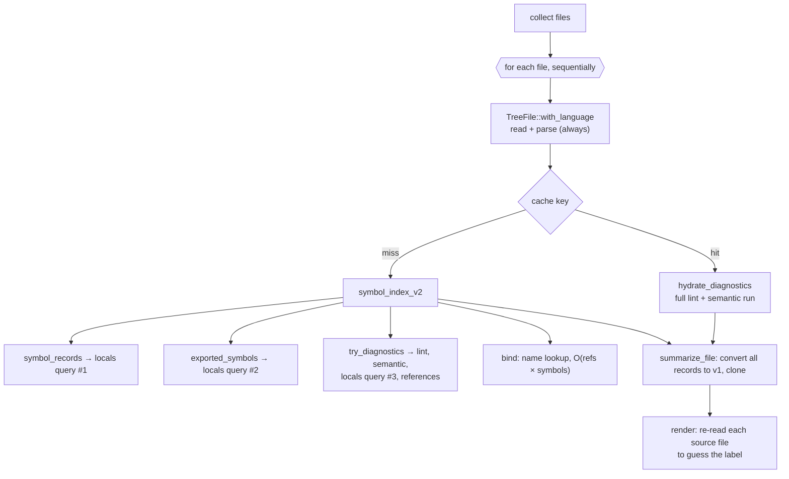

# Fast, deterministic symbol reports on v2 records

## Summary

`hug functions`, `hug types`, `hug symbols` and `hug classes` answer "what is
declared in this code?". They work, but they:

- do much more work than the question needs
- guess labels by re-reading source text instead of using record metadata
- emit JSON far larger than the selection
- render the same declarations through separate code paths

This feature is the **performance and foundation** half of the symbol-report
work. It makes the CLI consume the v2 `SymbolRecord` directly, asks the library
for only the passes and kinds a command needs, and makes output deterministic
and sized to the selection. Richer metadata, new filters and new report formats
build on this foundation in `2026-10-03-symbol-filters-and-reports`.

| Area | Today (2026-10-03) | After this feature |
|---|---|---|
| Performance | Every command runs the full lint and semantic analysis. A warm cache saves only 40%. Files are processed one at a time. | Symbol commands skip diagnostics, a cache hit skips parsing, and files are processed in parallel. |
| Metadata | The CLI guesses labels by re-reading source lines. `source.signature_text` is empty. | Records carry the declaring keyword and a render-ready signature header. |
| Query | Each command filters v1 summaries its own way. | A library `SymbolQuery` selects kinds and required capabilities, with explicit completeness. |
| Reporting | Flat list sorted by name across files. `--json` is 28 MB for 1,236 functions. Cache stats on every warm run. | Versioned JSON sized to the selection, file/source default order, quiet stderr, one renderer. |

Filtering is unchanged except that each command's fixed kind set is pushed
into extraction. `--kind`, `--scope`, visibility, container, test, docs and
signature-shape filters, hiding locals in `hug symbols`, and the outline,
table, JSON Lines, count and stats outputs arrive with
`2026-10-03-symbol-filters-and-reports`.

**Depends on `2026-10-03-visibility-and-kind`; that dependency is met.** The
fix is implemented: it corrects kind, visibility, `static` and container data
for its accepted extraction set across all 16 languages, and the code already
has `SchemaVersion::V3_0`, `identity.container_kind`,
`source.declaration_text` and `EXTRACTOR_REVISION`. It retains some grammar
limits and defers some constructs; this feature operates on that accepted
extraction set and does not widen it.

## Baseline

Draft-author measurements from 2026-10-03 on an Apple M4 Max (16 cores),
release build, run in `tree-hugger/` (66 files):

| Command | Result |
|---|---|
| `hug functions --no-cache` | 1.07 s |
| `hug imports --no-cache` | 1.06 s |
| `hug lint --no-cache` | 1.07 s |
| `hug functions`, cache warm | 0.64 s |
| `hug --json functions` | 28.7 MB: 1,236 selected functions, plus all 8,585 full v2 records |
| `hug --json symbols` | 36.8 MB |
| `hug symbols` | 8,593 lines; about 6,000 are `let`, `parameter` or `variable` |

`functions`, `imports` and `lint` cost the same because they do the same work;
see “Diagnostics run only when the command shows them.”

## Background: what one `hug functions` run does today



Every box under "for each file" runs for every symbol command, whether or not
the command shows diagnostics, exports or references.

The implementation contracts used in this review are:

- In the tree-hugger package, [analyze_file](../../lib/src/analysis/mod.rs)
  builds the per-file index and fills relations. Its pass dependencies must
  remain explicit when diagnostics become optional.
- In the tree-hugger package, [IdentityFacet, SymbolRef and ProvenanceFacet](../../lib/src/shared/schema_v2/facets.rs)
  hold names, relation targets and extraction metadata.
- In the tree-hugger package, [PassFingerprint](../../lib/src/cache/mod.rs)
  describes analysis inputs but does not currently include the source hash.
  The file cache key must include it separately; requested kinds and passes
  are recorded as the entry's coverage, not as key inputs.
- In the tree-hugger-cli package, [PreludeFilter and prelude resolution](../../cli/src/prelude.rs)
  include public re-export aliases and environment-provided names. Moving to
  records must preserve that behavior.

These links point to the current package source and documentation. The
[symbol schema contract](../../docs/symbol-schema-design.md) requires a major
version change for renamed fields or changed semantics.

### Intentional compatibility changes

The smaller JSON shape, file/source default sort order, container-field rename,
and removal of timestamps are intentional changes. Update the schema
documentation and release notes with before/after examples. Keep the existing
`SymbolRecord` model and Rust type names, but advance the serialized
record/index schema from 3.0 to 4.0 when the breaking field changes land; 3.0
is the version `2026-10-03-visibility-and-kind` shipped (`SchemaVersion::V3_0`). The CLI report envelope carries
its own `report_schema_version: 1` and `schema_version: {major: 4, minor: 0}`
for its embedded records. Later additive record changes, including those in
`2026-10-03-symbol-filters-and-reports`, follow the existing minor-version rule.

The container-field rename moves the current container text from
`identity.module_path` into `identity.container_name`, alongside the fix's
`container_kind`. It lands here, without populating `qualified_name`, so every
breaking record change shares the 4.0 bump.

Invalidate incompatible cache entries; do not migrate stale records or silently
label the new shape as 3.0. Keep the v1 library API and its adapters working
with the renamed container field. No compatibility flag or deprecation period
is required for this early-stage repository.

---

Section numbers keep their values from before this spec was split on
2026-10-03, so gaps (B2–B7, C, D2–D6, D9) belong to
`2026-10-03-symbol-filters-and-reports` or an unscheduled feature.

## A. Performance

### A1. Diagnostics run only when the command shows them

The tree-hugger package's [parse_pass](../../lib/src/analysis/mod.rs)
currently runs diagnostics even for symbol listings. Split that work into
`AnalysisPass::Diagnostics`; ordinary symbol queries do not request it.

Preserve `TreeFile::symbol_index_v2()` as the complete-index convenience API,
including diagnostics. The CLI uses the new query API for selective work.
This avoids silently changing the existing library method's contract while
still removing unnecessary work from listings. `lint` requests diagnostics,
including its existing syntax, experimental-semantics and external-adapter
behavior. A complete cached symbol result requires no parsing or analysis;
a partial cache hit may run the missing passes.

Pass planning removes duplicates and orders prerequisites before consumers:
parse before bind, bind before semantic analysis, and parse before docs.
Diagnostics request their own dependencies without making every listing run
semantic lint. `completed_passes` records only work actually performed;
omitting diagnostics is not evidence that a file is clean.

### A2. A complete cache hit doesn't parse

1. Read the bytes once and hash them through `biscuit-hash`.
2. Look up the cache using the file identity, content hash and analysis inputs.
3. Parse those same bytes only when the requested result is missing.

The library exposes `SourceFile::read(path)` and `.parse()`; `SourceFile`
owns the bytes, detected or explicitly forced language, and source identity.
Its `.query(&query)` uses the same planning path as queries on an already
parsed `TreeFile`. Never reread the file between hashing and parsing: a file
edited in that interval must not cache new records under the old hash.
Existing constructors remain convenience wrappers. Reading, decoding and
language errors retain the existing error contract.

### A3. The locals query runs once per file

`symbol_records()` and `exported_symbols()` each call `symbol_nodes()`, and the
semantic lint calls it again. Within a per-file analysis, capture definitions
once and derive exports, locals and records from that result. Separate
reference or comment queries remain allowed when requested; share definition
captures with native semantic diagnostics rather than re-extracting them.

### A4. Metadata is extracted after duplicates are removed

`symbol_nodes` runs `extract_signature`, `extract_type_metadata` and
`extract_doc_comment` for every capture, then throws duplicates away. The
change keeps today's duplicate-removal rule (the same winning capture, chosen
the same way) but extracts metadata lazily: each field is read from the
winning capture, and only when the winner lacks a field does extraction fall
back to the later duplicate captures, in their existing order. Output is
therefore identical to today's by construction, so no census of duplicate
captures is needed first. Distinct declarations sharing a span or name, such
as a C typedef and its struct tag, remain distinct because the
duplicate-removal rule is unchanged; the per-language library matrices catch
any regression.

### A5. Command kind sets are pushed into extraction

Each declaration command has a fixed kind set:

| Command | Kinds |
|---|---|
| `functions` | Function, Method, Constructor |
| `types` | Type, Class, Interface, Enum, Trait, TypeAlias |
| `classes` | containers: Class, Type, Interface, Trait; members: Method, Constructor |
| `symbols` | all kinds |

`classes` today (`extract_class_summaries` in `cli/src/main.rs`) summarizes
Class, Type, Interface and Trait records; enums, modules and Scala objects are
not summarized. For each container it lists:

- the Method and Constructor records reached through the container's
  `relations.members`, split into static and instance sections by `is_static`
- the fields in the container's own type metadata (`kind_data` fields), not
  member records, split the same way

`--static-only` empties the instance sections and `--instance-only` the static
ones. The two flags are not declared as conflicting, so passing both shows
containers with no members. `--name`/`-n` keeps containers whose name contains
the value. This feature keeps all of that behavior.

Container field metadata takes each field's visibility and `static` flag from
the matching Field, Property or Constant member declaration
(`align_field_metadata` in `lib/src/file/tree_file.rs`). Those declarations
fall outside the `classes` kind set, so they keep visibility and `static` as
well as the lightweight data below. This is inferred from the code, not a new
behavior.

When the command's kind set excludes a kind, the library skips metadata
extraction, and when safe the reference-binding work, for that kind. Keep
lightweight identity, span and container data for excluded declarations: they
can still shadow a selected symbol or own it. Selecting only methods must not
change reference resolution or lose their containers. The library takes this
as the `SymbolQuery` described under “A `SymbolQuery` API.” A user-supplied
`--kind` that narrows these sets arrives with
`2026-10-03-symbol-filters-and-reports` and uses the same mechanism.

### A6. Files are analyzed in parallel

Parallelism lives in the CLI. `rayon` is a dependency of the tree-hugger
library (`god_files` uses it) but not of tree-hugger-cli, so this feature adds
`rayon` to tree-hugger-cli. The library's per-file APIs stay sequential. The
CLI's per-file analysis becomes `par_iter`, and results are collected back into file order, so output
is byte-identical to a sequential run. Each worker owns its parser and
per-file state; hash maps never determine output order. Use a bounded number
of outstanding file results and serialize them in the requested order. Cache
writes must be atomic under concurrent workers/processes, and failures are
reported in file order.

### A7. One persistent CLI cache, with complete keys

Remove the CLI's unconditional in-memory cache layers from the ordinary
single-visit scan, keeping their public library APIs. Prelude analysis can
reuse a request-local map of results because it actually revisits files.

Use the tree-hugger package's [PassFingerprint](../../lib/src/cache/mod.rs)
for pass inputs, alongside normalized file identity, source hash and forced
language. The key excludes kind selection and requested passes, so each file
has one persistent entry; the entry records the kinds and capabilities it
covers. The fingerprint includes schema, grammar version/identity, actual effective query
text (including inherited queries and overlays), relevant configuration, and
extractor implementation revision. Rules and external-tool versions affect
only passes that use them. Any later input that changes cached records joins
the key in the change that introduces it. (Superseded example, 2026-10-04:
`2026-10-03-symbol-filters-and-reports` applies its naming context after
cache lookup, so it does not join the key; cached records and IDs never
depend on the scan root.)

**Reader's note:** hashing query text cannot detect a change to Rust extraction
code. Keep `EXTRACTOR_REVISION` as one fingerprint input until a reproducible
build identity replaces it; a computed query digest alone cannot replace it.
Use `biscuit-hash` for all digests and an unambiguous canonical encoding.

Cache analysis before presentation filtering. An entry satisfies a request
only when its recorded coverage includes every requested kind and capability;
a narrower entry never masquerades as a complete hit. Name, export and
output-format filters do not invalidate complete extraction data. A full-index request
cannot reuse an entry missing relations, docs or diagnostics. Corrupt or
incompatible entries are misses, not empty results; `--no-cache` bypasses reads
and writes. Cache failures remain recoverable and print nothing unless
`--verbose` is given (see “Quiet by default”).

**A partial hit is written back as one wider entry.** A lookup has three
outcomes:

| Cached coverage | Action |
|---|---|
| covers the requested kinds and capabilities | complete hit; no parsing or analysis |
| covers the requested kinds, missing some capabilities | run only the missing passes, then write back the merged entry |
| missing some requested kinds | re-extract the file fully for the union of cached and requested kinds and capabilities, then write back the wider entry |

Either write-back replaces the narrower entry with one whose recorded coverage
includes both the old and the new work. The write is atomic: write a
temporary file, then rename it over the entry. If two processes write
the same entry at once, the last rename wins. That is acceptable only because
each entry is internally valid and its recorded coverage matches its contents;
a reader can never see a half-written or mislabeled entry.

### A8. The bind pass indexes candidate names

`find_reference_target` scans every symbol for each reference. The change:

- A `HashMap<&str, Vec<usize>>` built once per file replaces the full scan.
  Bucket lookup is expected constant time; choosing among same-named candidates
  still costs work proportional to that bucket. No new dependency is needed.
- `push_unique_ref` uses a membership set per owner while preserving ordered
  vectors. Compare resolved references by ID; compare unresolved references by
  name and qualifier. Two missing IDs do not make two references equal.

Indexing only removes the repeated full-file scan; it does not change which
candidate is chosen. Name-only binding remains the resolution rule. Scope-aware
resolution is the unscheduled `scoped-references` feature.

**`is_recursive` is honest.** Name-only binding cannot prove that a call
targets the enclosing function, nor that none does. Whenever semantic analysis
runs, `semantics.is_recursive` reports `Unknown`, never a guessed `Yes` or
`No`, until scoped resolution exists. No analysis requested remains `None`.
The v1 adapter has only a `bool`, so it maps both `Unknown` and `None` to
`false`. A v1 `is_recursive: false` therefore means "not known to be
recursive", not "proven non-recursive".

### A9. Output is deterministic and streamed

- `created_at_epoch_ms` and `updated_at_epoch_ms` are both removed from record
  provenance; extractor identity, version and pass remain. Two runs over the
  same tree then produce identical output and identical cache entries.
- JSON is written with `serde_json::to_writer` to a locked, buffered stdout,
  instead of building one large string. This streams serialization; default
  file ordering still requires bounded buffering of parallel results.
- Pretty output goes through one locked `BufWriter`, not a `println!` per line.
- `SOURCE_LINE_CACHE`, the global mutex-guarded copy of every source file kept
  for label guessing, is deleted because records now carry declaration keywords
  (see “The library reports the declaring keyword”).

A stdout write error stops work; a broken pipe exits quietly without a panic.
Read/parse failures go to stderr and produce a nonzero status. JSON reports
stream their file entries and then end with an `errors` array listing every
file that failed (shape under “JSON sized to the selection”), so a failure
can never produce a report that looks successful. A failed file has no file
entry, and the run still exits nonzero.

### A10. Prelude resolution reuses analysis without losing exports

The tree-hugger-cli package's [prelude resolver](../../cli/src/prelude.rs)
currently parses both preludes and target files independently. Discover its
required files before scheduling work and reuse complete per-file indexes.
An explicitly narrowed scan may exclude a prelude target; analyze that target
on demand without emitting it as an extra selected file.

Preserve alias names and declaration locations, unresolved public re-exports,
and `PRELUDE` environment names. Synthetic export records are marked synthetic
and do not borrow the target declaration's ID while claiming a different
name/location. Prelude membership is determined before ordinary symbol filters;
lookup cannot use a kind-restricted index that omitted the target.

### Performance targets

These are goals for a quick before/after sample on the baseline host using
the same release build settings and command inputs. Ratios are not guarantees
across hosts. Behavioral work counters establish the removed work; timing is
supporting evidence, not a statistical or CI gate. A missed goal is recorded
with the remaining cost rather than triggering a larger measurement program:

| Measurement | Target |
|---|---|
| `hug functions --no-cache` on `tree-hugger/` | ≤ 40% of baseline |
| `hug functions` warm | ≤ 15% of baseline |
| `hug lint --no-cache` | no slower than baseline |
| Peak RSS, `hug symbols` on the whole repo | no higher than baseline |

The peak-RSS baseline has not been measured yet. Measuring it is a required
preparatory step, done before any code change and recorded in the
implementation log with the command, build and cache state. From the
repository root, on macOS, run
`/usr/bin/time -l hug symbols --no-cache > /dev/null` with a release build
and read "maximum resident set size"; GNU `/usr/bin/time -v` on Linux is
equally acceptable.

The targets measure the fixed command kind sets. Filters such as `--kind`
beyond those sets arrive with `2026-10-03-symbol-filters-and-reports` and are
not part of this sample.

---

## B. Record foundation

### B1. The library reports the declaring keyword

`SymbolRecord.identity` in the tree-hugger package gains
`keyword: Option<String>`, taken from the declaration's syntax node, never
derived from `declaration_text` or other source text. Examples: `struct`,
`union`, `enum`, `type`, `trait`, `impl`, `mod`, `const`, `static`, `let`,
`var`, `val`, `class`, `interface`, `protocol`, `object`, `record`, `def`,
`func`, `sub`, `function`. A construct with no declaring keyword, such as a
Java method, reports `None`. The renderer prints the keyword, falling back to
the kind name.

This replaces `symbol_presentation` and `binding_token_for_symbol` in
`cli/src/main.rs`. Those match source text (`trimmed.contains(" let ")`,
`trimmed.contains('=')`) and print labels like `=`, `for` and `:=`. They also
misfire on multi-line declarations and on comments that contain a keyword.

### B8. Render-ready signature text

Records no longer carry timestamps, as specified under “Output is deterministic
and streamed.” Fill `source.signature_text` with the declaration header as
written, for display. Scripts then receive an exact, language-native
signature, and `2026-10-03-symbol-filters-and-reports` renders it under
`--signatures full`.

Preserve internal whitespace and line breaks; strip only outer whitespace.
Declaration-only signatures stop at the terminator; expression bodies stop at
their grammar-defined boundary. The header excludes initializer expressions,
leading in-node annotations and decorators, doc comments, and a trailing `=`
or `=>`. Only annotations before the first modifier or keyword are stripped.
An annotation written between modifiers, such as Java
`public @Nullable String name()` or a C# attribute inside a modifier list,
stays in the header, because removing it would break contiguity.
Missing grammar support returns `None` and a compact-rendering fallback, never
the full body.

#### Three fields, three contracts

`declaration_text` (from `2026-10-03-visibility-and-kind`) and `signature_text`
are both kept, with distinct contracts:

- **`declaration_text`** is evidence. It runs from the start of the
  declaration node to its body, including initializers and the annotations
  the grammar parses inside the node, so it keeps syntax a visibility level or
  kind cannot carry.
- **`signature_text`** is the display header. It is the part of the same
  declaration a reader needs to recognize the symbol.
- **`keyword`** comes from the syntax node, not from either text.

Both texts are filled from one declaration node in one extraction pass, and
`signature_text` is always a contiguous sub-range of `declaration_text`.

| Declaration | `declaration_text` | `signature_text` | `keyword` |
|---|---|---|---|
| `pub(in crate::a) fn f() { … }` | `pub(in crate::a) fn f()` | `pub(in crate::a) fn f()` | `fn` |
| `pub const TABLE: [u8; 256] = [0, 1, …];` | `pub const TABLE: [u8; 256] = [0, 1, …];` | `pub const TABLE: [u8; 256]` | `const` |
| `public private(set) var count = 0` | `public private(set) var count = 0` | `public private(set) var count` | `var` |
| `@Override public void run() { … }` | `@Override public void run()` | `public void run()` | `None` (renders `method`) |
| `@Override public @Nullable String name() { … }` | `@Override public @Nullable String name()` | `public @Nullable String name()` | `None` (renders `method`) |
| `private[Shape] def secret() = 2` | `private[Shape] def secret() =` | `private[Shape] def secret()` | `def` |

Syntax the grammar places outside the declaration node, such as a Rust `#[…]`
attribute or a Python decorator, appears in neither text.

#### Default reports carry the header, not the evidence

`signature_text` is part of default `--json` records. `declaration_text` is a
source blob like body and AST text: it is omitted from default `--json`
records and present in `--json-full`. `--json-full` means complete analysis,
not an automatic copy of all source.

### B9. A `SymbolQuery` API

The library gains one entry point for "give me these symbols", used by the CLI
and available to other consumers:

```rust
let query = SymbolQuery::new()
    .kinds([SymbolKindV2::Function, SymbolKindV2::Method])
    .capabilities([Capability::Declarations, Capability::Containment]);
let result = SourceFile::read(path)?.query(&query)?;
```

The new API is in the tree-hugger package beside [TreeFile](../../lib/src/file/tree_file.rs),
the existing parsed-file entry point. Both source snapshots and parsed files
accept the same query. Library defaults select all kinds. Queries specify
required capabilities separately from selection: declarations, containment,
references, semantics, structured docs and diagnostics. Selection cannot
silently remove prerequisite data. Return records plus file/language identity
and completed capabilities, so an empty result and an uncomputed facet are
distinguishable.

This feature defines only kind selection and capability selection.
`2026-10-03-symbol-filters-and-reports` adds scope, visibility, test, docs and
metric predicates and capabilities to the same type.

Required work is explicit:

| Request | Required analysis |
|---|---|
| Basic functions/types/symbols | declarations and cheap metadata (keyword, signature text); no references or diagnostics |
| Classes | declarations plus containment, including excluded parent identities |
| Complete index / `--json-full` | all index capabilities, including diagnostics |

Keep `completed_capabilities` in query results/reports for work such as
containment that is narrower than a complete pass. A cache hit uses stored
capability coverage; an empty facet is not proof that it was computed.

File discovery, Git selection and output ordering remain CLI responsibilities.
The library owns kind selection once; the CLI owns a separate presentation
step for grouping classes. Imports remain import records, not synthetic
declarations forced into `SymbolQuery`.

---

## D. Reporting

### D1. JSON sized to the selection

- `--json` emits `{ report_schema_version, schema_version, root_dir, files:
  [{ file, language, completed_passes, completed_capabilities, symbols: [SymbolRecord] }],
  errors: [{ file, kind, message }] }`, containing only selected records.
  Class reports additionally contain `members`, keyed by selected container
  ID, with the Method and Constructor records the command displays; their
  `symbols` array contains the selected containers, whose fields stay in the
  container record's `kind_data`.
- `errors` is always present and comes last, so file entries can stream
  before it; a successful report has `errors: []`. Each entry names one failed
  file: `file` is its portable scan-root-relative path, `kind` is the
  snake_case name of the `TreeHuggerError` variant (for example `io`,
  `unsupported_language`, `parse_failed`), and `message` is that error's
  display text. Entries are in file order. A non-empty `errors` array means
  the process exits nonzero, and each failure is also written to stderr.
- Remove the old v1 symbols payload and unconditional `symbol_indexes` block.
  Empty selections use `files: []`; omit file entries with no matches.
- `--json-full` emits the same versioned envelope, including the trailing
  `errors` array and its nonzero-exit rule, with complete per-file `indexes` instead of selected
  `files`. File selectors still apply; symbol selectors are rejected rather
  than implying a complete index is filtered. Request every index capability,
  including diagnostics.
- Default records omit unrequested relations/semantics and large
  source/body/AST blobs, including `declaration_text`. `completed_passes` and
  query result capabilities make omitted work explicit. A reference may name an
  excluded symbol; selection does not rewrite it or add that symbol to
  `symbols`.
- All machine-readable paths are portable scan-root-relative paths, with one
  `root_dir` anchor in JSON; the scan root is the invocation's resolved root.
  Preserve library-native source paths internally and project paths without
  altering record IDs.

Target: `hug --json functions` on the baseline `tree-hugger/` input is under
3 MB; measure serialized bytes, retaining required identity and source spans.
`imports` and `lint` retain their own current report shapes in this feature;
the new declaration envelope is not a global change to `--json`.

### D7. A useful default order

`--sort file|name|kind` replaces `--sort-by-kind` and `--sort-by-module`.
Both old flags are removed outright, with no aliases, so passing either is an
argument error. Unlike them, `--sort` is not one of the shared scan options
(`ScanOptions` in `cli/src/main.rs`): only the four declaration commands
(`functions`, `types`, `symbols` and `classes`) accept it, and `lint` and
`imports` reject it as an unknown argument. `imports` shares `CommonArgs` with
`functions`, `types` and `symbols` today, so the flag moves to arguments that
only the declaration commands carry.

| Order | Today | After |
|---|---|---|
| default (`--sort file`) | by case-insensitive name across all files | by file, then source position |
| `--sort name` | (the default) | by the written, case-sensitive name |
| `--sort kind` | alphabetical by the kind's name (`--sort-by-kind`) | Module, Namespace, Type, Class, Interface, Trait, Enum, TypeAlias, Function, Method, Constructor, Macro, Constant, Field, Property, EnumVariant, Variable, Parameter, Unknown |

Every order ends with the same tie-breakers: portable file path, start byte,
end byte, kind (in the `--sort kind` order) and ID. `--sort file` is exactly
these tie-breakers. For example, `--sort name` puts two same-named `Point`
types in different files together, the first file's declaration first. Sort
relation targets deterministically too. `--sort` takes one value; repeating it
is an argument error.

There is no container order. The old `--sort-by-module` sorted by the file's
directory, not by a declaring container, and `--sort file` covers it: the
portable path orders files directory by directory, then source position
orders each file. Directory grouping remains available through
`--group-by-module`.

**JSON keeps file order.** With `--json` or `--json-full`, file entries are
always in portable path order, whatever `--sort` says. A non-default `--sort`
orders the records within each file's `symbols` array, using the same keys
and tie-breakers. JSON output therefore never needs a global sort across
files, and bounded buffering in file order (see “Files are analyzed in
parallel”) suffices for every `--sort` value.

`--group-by-file` and `--group-by-module` are unchanged and independent of
`--sort`. They group terminal output by the file's scan-root-relative path or
its parent directory (both flags: directory, then file), with groups ordered
by that path. `--sort` then orders the declarations within each group.

Byte identity applies to the same input/root/options/build, not different
absolute roots or terminal widths.

### D8. Quiet by default

The cache-stats line printed to stderr on every warm run moves behind a new
`--verbose` flag. It is a global flag on `Cli`, like `--json` and `--plain`,
the existing output-presentation flags; scan behavior flags such as
`--no-cache` stay per-command in `ScanOptions`. `--verbose` gates exactly two
kinds of stderr output:

- the cache-stats line. Today it reports the in-process cache, which
  “One persistent CLI cache, with complete keys” removes, so it now reports
  persistent-cache hits, partial hits and misses.
- recoverable cache-failure messages: an unreadable, corrupt or incompatible
  entry treated as a miss, and a failed cache write. Today these failures are
  discarded silently.

Analysis errors, lint's external-adapter warnings and argument errors are
printed with or without `--verbose`.

### D10. One renderer

In the tree-hugger-cli package, [render_symbols and render_symbol_line](../../cli/src/main.rs)
format the same declarations through separate code paths. Replace them with
one renderer type local to tree-hugger-cli, built on `biscuit-terminal`'s
existing components (`Prose`, `UnorderedList`; `Table` arrives with
`2026-10-03-symbol-filters-and-reports`) and fed from records (keyword, signature,
visibility, container), so visibility and signatures agree in grouped and flat
output. This feature keeps today's visible layout, compact signatures, OSC 8
hyperlinks and `--plain` behavior; the biscuit-terminal package itself does
not change. Width wrapping, `--format table`, signature modes and the outline
view build on this renderer in
`2026-10-03-symbol-filters-and-reports`.

---

## Risks and implementation notes

- `PersistentCache::put` (`lib/src/cache/mod.rs`) writes with plain
  `std::fs::write`; the atomic temp-file-and-rename write is new work.
- Queries are compiled in through `include_str!`. The fingerprint function must
  accept query text as an injectable input so the "edited query text
  invalidates the entry" test can run.
- Work counters must propagate from rayon workers, as atomics or as counts
  returned with each result, not through thread-locals.
- Prelude scheduling is two-phase: analyze the prelude files first to discover
  their targets, then run the scan.
- Peak-RSS target risk: each parallel worker holds a parse tree, and terminal
  `--sort name`/`--sort kind` buffers every selected record. Bound concurrency
  by processing files in chunks.
- `signature_text` boundaries need per-grammar work across 16 languages,
  starting from the fix's `declaration_text` extraction.
- Before the renderer refactor, capture the current plain and JSON output of
  `hug symbols` over `multi/` as goldens, so "keeps today's visible layout" is
  checkable.
- Diagnostics separation is mechanical: `parse_pass` calls `try_diagnostics`
  in one place. Semantic lint currently re-extracts through `symbols()` and
  `exported_symbols()`; it should receive the shared definition captures.

---

## Sequencing


Each phase leaves `hug` working, and updates relevant docs/tests with its code.
Before Phase 1 changes any code, measure the peak-RSS baseline (see
“Performance targets”). Phase 1 consumes records directly and removes diagnostics from listing work.
Preserve v1 library adapters until the separate author decision on removing
them. Introduce the shared query planner before cache coverage records
or parallel prelude reuse, so those optimizations have one completeness
contract. `2026-10-03-symbol-filters-and-reports` starts after this feature
lands; it extends `SymbolQuery`, the record facets and the renderer defined
here. Final acceptance includes all resolved requirements. The only open
question, removing v1 from the library, is a follow-up that does not block
this feature.

## Decisions

### Resolved

- **The CLI consumes records directly.** This preserves metadata and removes
  conversion/cloning work; the v1 public library API remains supported here.
- **Queries declare completeness.** Restricted extraction and missing passes
  cannot masquerade as a complete cache hit.
- **Deterministic records have no wall-clock timestamps.** Breaking record
  changes are versioned; old cache entries are rejected.
- **No candidate-bucket dependency.** Use standard collections for the bind
  index.
- **Parallel output preserves order.** Buffering is bounded in file order;
  global name sorting may need to retain all selected records.

Decided by the author on 2026-10-03:

- **The original feature is split in two and trimmed.** This spec keeps
  performance and the record/query/report foundation; metadata, filters and
  reports move to `2026-10-03-symbol-filters-and-reports`, and five
  lower-priority items become unscheduled features (`scoped-references`,
  `changed-files-filter`, `cyclomatic-complexity`, `extra-report-formats`,
  `stats-package-grouping`). One spec was too large to implement and review as
  a single change.
- **`keyword` lands here.** Deleting `SOURCE_LINE_CACHE` is justified only if
  records already carry the keyword the renderer used to guess.
- **Reference leftovers stay, honestly labeled.** The name→candidates index
  and `push_unique_ref` set remove measured cost without changing results;
  `is_recursive` reports `Unknown` rather than a guess until scoped resolution
  exists, because name-only binding cannot prove either answer.
- **Library matrices are exhaustive; CLI goldens are representative.** Each
  extraction fact is asserted for all 16 languages in library tests, while CLI
  output uses one golden per output format over the 16-language `multi/`
  tree. This matches the prerequisite fix's rule and keeps CLI goldens
  maintainable.
- **`declaration_text` and `signature_text` both stay, with written
  contracts.** One is evidence, the other is display; filling both from one
  node in one pass keeps them consistent and cheap.
- **`declaration_text` is omitted from default JSON.** It is a source blob like
  body text; `--json-full` carries it.
- **JSON reports end with an always-present `errors` array.** File entries
  stream first and failures are listed last, so a report can stream without
  ever looking successful when a file failed; an always-present field keeps
  the schema simple.
- **Parallelism lives in the CLI, which gains `rayon`.** The CLI owns file
  discovery and output order, so it owns scheduling; the library stays
  sequential per file.
- **`signature_text` strips only leading in-node annotations.** An annotation
  between modifiers stays in the header, so `signature_text` remains one
  contiguous sub-range of `declaration_text`.
- **`--sort` replaces `--sort-by-kind` and `--sort-by-module`, with no
  aliases.** One value-taking flag cannot express conflicting orders; grouping
  flags stay separate because grouping and order are independent.
- **The v1 adapter maps `is_recursive` `Unknown` and `None` to `false`.** v1
  has only a `bool`; `false` is documented as "not known to be recursive".
- **The peak-RSS target stays, and its baseline is measured first.** A
  target with no recorded baseline cannot be checked afterward.
- **A partial cache hit writes back one merged entry.** Replacing the narrower
  entry keeps one entry per file; atomic last-rename-wins is safe because every
  entry is internally valid.
- **The `module_path` → `container_name` rename stays in this feature.** Every
  breaking record change then shares schema 4.0, and
  `2026-10-03-symbol-filters-and-reports` stays additive (4.x).
- **Naming context joins the cache key in
  `2026-10-03-symbol-filters-and-reports`.** That feature introduces the
  input, so it extends the key. *Superseded 2026-10-04:* that feature
  applies its naming context after cache lookup instead of keying on it.

Decided by the author on 2026-10-04:

- **`--sort` takes `file|name|kind` only; there is no `container` value.**
  The old `--sort-by-module` sorted by directory, which the default `file`
  order (portable path, then source position) already covers, so a container
  order would be a new feature rather than a replacement.
- **JSON file entries always stay in portable path order.** A non-default
  `--sort` orders records only within each file's `symbols` array, so the
  envelope keeps one entry per file and parallel output never needs a global
  sort.
- **`--json-full` shares the trailing `errors` array and nonzero exit with
  `--json`.** Both reports stream file entries first, so both need the same
  guarantee that a failed file can never look like success.
- **Only `functions`, `types`, `symbols` and `classes` accept `--sort`.** It
  moves out of the shared scan options; `lint` and `imports` reject it because
  their reports are not declaration lists and the declaration order keys do
  not apply to them.
- **The cache key excludes kind selection.** One persistent entry per file
  (file identity, content hash, fingerprint inputs) records its covered kinds
  and capabilities; covered requests hit, missing capabilities run only the
  missing passes, and uncovered kinds re-extract the file for the union, so
  narrow and broad commands never multiply entries.
- **The renderer is CLI-local.** D10's single renderer is a tree-hugger-cli
  type built on biscuit-terminal's existing `Prose` and `UnorderedList`
  (`Table` with `2026-10-03-symbol-filters-and-reports`); keeping it local
  avoids changing a shared package for one consumer.
- **No spikes.** The duplicate-capture census was considered and skipped:
  lazy metadata extraction from the winning capture, with order-preserving
  fallback to later captures, is identical to today's output by construction,
  and the per-language library matrices catch regressions.

### Open Questions

#### Removing v1 from the library

**Follow-up; does not block planning or implementation of this feature.**
This is a separate decision, not work authorized by this feature.
Moving the CLI does not prove that other packages have no v1 callers.

- **Remove after an audit:** one public model and less adapter maintenance;
  requires migrating repository callers and changes the public API.
- **Keep a convenience adapter:** simpler entry point for existing callers;
  carries continuing maintenance and risks losing new metadata.
- **Recommendation:** audit then remove in a follow-up. Complete the CLI move
  first and record actual remaining callers before estimating removal work.

---

## Pre-authorized implementation actions

The author has authorized the implementer to take these actions without
pausing for approval:

- **Fixtures and tests asserting superseded behavior.**
  - Create the 16-language `lib/tests/fixtures/symbols/multi/` tree and extend
    the per-language fixtures as described under “Shared fixtures”.
  - Rewrite existing CLI and library tests whose expectations this feature
    deliberately changes: the old JSON shape, name-first default ordering, the
    removed `--sort-by-kind` and `--sort-by-module` flags, record timestamps,
    schema 3.0 records, and guessed `is_recursive` values.
- **Query files.** Edit the vendored query files under `lib/queries/vendor/`
  where capture deduplication requires it (“Metadata is extracted after
  duplicates are removed”), updating query provenance to match.
- **Dependencies.** Add `rayon` to tree-hugger-cli, and `biscuit-hash` to any
  tree-hugger package that needs it as a normal dependency (tree-hugger-cli
  has it only as a dev-dependency today). Update `docs/dependencies.md` and
  the area's dependency docs to match.

Anything outside this list still needs the author, including any other new
crate dependency and changes outside the `tree-hugger` area other than the
tree-hugger skill and the `docs/` updates listed under “Documentation to
update in the same change”.

---

## Testing

**Library extraction facts are tested in every supported language.**
"Supported" means every value of `ProgrammingLanguage::all()`. Today that is
16 languages:

- Rust, TypeScript, JavaScript, Go, Python, Java, C#, C, C++, Swift, Scala
- PHP, Perl, Lua, Bash, Zsh

A capability that a language can't express is asserted as not applicable
(`None` or empty). Separately label unsupported extraction/grammar support;
those constructs are not falsely classified as absent from the language. Each
row identifies representative positive and negative cases, rather than
pretending every feature is applicable everywhere.

**CLI output is tested representatively**, as in the prerequisite fix:
exhaustive language/value combinations belong in library tests; CLI tests
prove wiring and output shape.

All tests named here are L1 unless marked otherwise. Run them with `just test`
in `tree-hugger/`, using nextest through that recipe; use the monorepo Test
Toolkit for isolated CLI/cache fixtures. Repository fixture reads use
runtime harness roots and literal joined paths that the test-input index can
resolve. No implementation test should read this dated spec as its contract.

### Shared fixtures

- **`lib/tests/fixtures/symbols/<language>.<ext>`**, introduced by the fix.
  This feature extends each one, where the language has the construct, with:
  - a declaration with a large or multi-line initializer
  - a multi-line declaration header
  - an annotated or decorated declaration whose annotation is inside the
    declaration node
  - an annotation between modifiers (Java, C#)
  - a comment containing a declaration keyword
- **A `lib/tests/fixtures/symbols/multi/` tree** containing all 16 languages,
  for multi-file, parallel, ordering and CLI golden tests.

### Coverage guard

The fix's language-coverage test (iterate `ProgrammingLanguage::all()`, fail
on a missing fixture or matrix row) is extended to check every matrix below.
A new language can't be added without a row in each.

### Per-language library matrices

Each matrix is a table-driven test with one row per language, so a failure
names its language.

| Capability | Asserted per language |
|---|---|
| Keyword | every declaration in the fixture reports the expected keyword from its syntax node; `None` only where the language has no keyword for that construct; a keyword inside a comment never produces a label |
| Signature text | expected `signature_text` per declaration; it is a contiguous sub-range of `declaration_text`; it excludes initializers, leading in-node annotations/decorators, doc comments and trailing `=`/`=>`; an annotation between modifiers is kept; missing grammar support is `None`, never the body |
| Cache correctness | a warm-cache result equals a `--no-cache` result |

### CLI output goldens

One golden per output format this feature produces, built from `hug symbols`
over the 16-language `multi/` tree:

- `cli/tests/fixtures/golden/symbols.plain` (terminal text under `--plain`)
- `cli/tests/fixtures/golden/symbols.json` (`--json`)

They are compared after `strip_ansi_codes` and path redaction (the existing
`corpus` helpers), so they hold on every OS. Other commands are covered by
structural assertions: `functions` and `types` select exactly their kind sets,
and a `classes --json` report carries containers in `symbols` and displayed
members in `members`.

### Focused cases

- **JSON envelope.** `--json` parses, holds only selected records, carries
  `report_schema_version`, `schema_version` 4.0, `root_dir`, per-file
  language, `completed_passes` and `completed_capabilities`, and round-trips
  through serde. It omits `declaration_text`; `--json-full` includes it and
  complete indexes, and rejects symbol selectors. An empty selection is
  `files: []` with `errors: []`. A class report's `members` holds only Method
  and Constructor records.
- **JSON with a failed file.** Over a scratch tree with one unreadable or
  unparsable file, `--json` and `--json-full` still parse, list the good files,
  end with one `errors` entry (portable path, `kind`, `message`) for the bad
  file, write the failure to stderr and exit nonzero.
- **Performance counters.** A symbol command over `multi/` records zero
  diagnostics-pass executions. This is observed through a pass counter exposed
  for tests, not through timing. Propagate counters into parallel workers.
  A complete warm hit additionally records zero parser constructions, and a
  cold analysis records one definition-capture extraction per file.
  `lint` and `TreeFile::symbol_index_v2()` still run diagnostics.
- **Parallel equals sequential.** Over `multi/`, the parallel run's `--json`
  output is byte-identical to a run with a single rayon thread.
- **Two runs are identical.** Back-to-back runs, cold and then warm, produce
  byte-identical `--json`.
- **Cache correctness.** Editing a language's query text in a test-local copy
  invalidates the entry (query text is an injectable fingerprint input). Also
  vary extractor revision, language override and schema; each is a miss.
  Varying kinds and capabilities changes coverage, not the key: warm narrow
  then broad queries (and the reverse) must match uncached results. After a
  capability-widening run the file holds one entry covering both requests and
  only the missing passes ran; after a kind-widening run the file was
  re-extracted once for the union. Either way a third, narrow run is a
  complete hit. Simulate corrupt and
  concurrent writes without treating either as empty success; every entry left
  after concurrent writes is readable and its coverage matches its contents.
- **Binding.** The candidate index selects the same targets as the previous
  full scan; `push_unique_ref` keeps distinct unresolved references with
  missing IDs; `is_recursive` is `Unknown` whenever semantics run and `None`
  when not requested, and the v1 adapter maps both to `false`.
- **Prelude behavior survives.** Cover aliases, unresolved re-exports,
  environment names and targets outside the selected scan, with no duplicate
  parse.
- **Order.** Default (`--sort file`) file/source order, `--sort name` and
  `--sort kind`, each with the shared tie-breakers; `--sort` within
  `--group-by-file` and `--group-by-module` groups; under `--json` and
  `--json-full`, a non-default `--sort` leaves file entries in portable path
  order and orders only each file's `symbols` array. `--sort container`, the
  removed `--sort-by-kind` and `--sort-by-module` flags, a repeated `--sort`,
  and `--sort` passed to `lint` or `imports` are argument errors.
- **Classes.** Interface and Trait containers are summarized; `--static-only`
  and `--instance-only` keep their current sections; a field's visibility and
  `static` flag are unchanged when Field, Property and Constant are outside the
  extraction kind set.
- **Output failures are observable.** Cover broken pipes, file errors and
  deterministic parallel error reporting without real terminal focus.
- **Quiet stderr.** A warm run, and a run whose cache write fails, print
  nothing to stderr without `--verbose`; with `--verbose` they print the
  cache-stats line and the cache-failure message.

### Performance sample

Use one host and a quick release-build before/after sample of the existing
baseline commands and inputs. Record elapsed time, serialized bytes and the
peak RSS comparison against the baseline measured before any code change (see
“Performance targets”) in the implementation log; record the build and cache
state. The baseline already establishes that listings spend
lint-like time, so no separate exploratory spike is needed to prove that cost.
Do not expand measurements to every language, additional hosts, repetitions,
statistical thresholds or new benchmark corpora. The existing Criterion suite
may remain available through `just bench`; it is not a mandatory new measurement
program or CI gate. The all-language fixture tree proves correctness, not a
performance target.

### Host coverage

Path rendering is OS-sensitive. Its tests run on the environments CI schedules
for the area, and follow the `os` skill's guidance for path comparison.
Packages remain required to work on macOS, Linux, native Windows and WSL2;
this feature adds no CI environments or gates, and needs no real terminal or
focus changes.

---

## Documentation to update in the same change

- **`tree-hugger/docs/symbol-kinds-and-visibility.md`** (created by the fix):
  extend it with keywords and the `declaration_text` / `signature_text`
  contracts, including the comparison table.
- **A new `tree-hugger/docs/symbol-reports.md`.** It covers, for a reader new
  to the repository:
  - every symbol command and its fixed kind set, including what `classes`
    displays
  - the JSON envelope, with a short sample, the trailing `errors` array and
    exit status, and what `--json-full` adds
  - default and `--sort` ordering, its tie-breakers, how grouping combines
    with it, that JSON keeps file entries in path order and sorts within each
    file, and that only the four declaration commands accept `--sort`
  - `--verbose` and what it gates
  - a Mermaid diagram of the query → passes → render flow
- **`tree-hugger/docs/cache-design.md`:** the single cache layer, the
  computed fingerprint, and partial-hit write-back.
- **`tree-hugger/README.md`, `cli` help text and the shell completions:**
  `--sort`, `--verbose`, the removed `--sort-by-kind` and `--sort-by-module`,
  and the changed JSON shape and default order.
- **`.claude/skills/tree-hugger/SKILL.md` and `api-reference.md`:**
  - `SourceFile` and `SymbolQuery`
  - `keyword` and `signature_text`
  - the removal of `InMemorySymbolCache` and `InProcessCache` from the CLI
    path
- **`tree-hugger/docs/symbol-schema-design.md`:** record/index version 4.0,
  removed timestamps, container rename, `keyword`, the two text contracts,
  `is_recursive` reporting `Unknown` (and v1 `false` meaning "not known to be
  recursive"), explicit pass dependencies and retained v1 adapters.
- **`docs/dependencies.md` and area dependency docs:** `rayon` added to
  tree-hugger-cli, and `biscuit-hash` wherever it becomes a normal dependency.

## Out of scope

- Correct kinds, visibility, `static` and containers. That is
  `2026-10-03-visibility-and-kind`, already implemented.
- Scope classification, modifiers and attributes, generics and inheritance,
  qualified names, metrics, every new filter (`--kind`, `--scope`,
  visibility, `--in`, smart case, tests/docs/deprecation, signature shape,
  `--file`/`--name`), JSON Lines, outline, wrapped rendering, `--format
  table`, `--signatures`, `--count` and `--stats`. That is
  `2026-10-03-symbol-filters-and-reports`.
- Scope-aware reference resolution, occurrence records and `hug refs`; see the
  unscheduled `scoped-references` feature.
- `--changed[=<ref>]`; see the unscheduled `changed-files-filter` feature.
- Cyclomatic complexity; see the unscheduled `cyclomatic-complexity` feature.
- TSV, Markdown and tags output; see the unscheduled `extra-report-formats`
  feature.
- Package grouping in `--stats`; see the unscheduled `stats-package-grouping`
  feature.
- Cross-file or project-wide reference resolution; the resolver work in
  `lib/src/resolver/` covers the project level.
- Removing v1 from the library's public API; see its follow-up Open Question.
- Lint, diagnostics and god-files output.
- Language-server or editor integrations.
