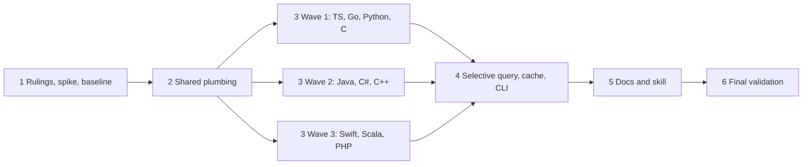

# Plan: precise kinds for previously deferred declarations

## Summary and definition of done

The spec upgrades 25 deferred (`FEAT`) cells across 10 languages so each
declaration appears once, with its precise kind, in library symbol models and
the CLI. The cells are:

- **Constructor** (Python, Java, C#, C++, Swift, PHP)
- **EnumVariant** (TypeScript, Java, C#, C, C++, Scala, PHP)
- **TypeAlias** (Go, Swift, Scala)
- **Field** (Go, Scala)
- **Namespace** (TypeScript, PHP)

No new kinds, record fields, commands or selectors are introduced; record
schema 4.0 is unchanged. Work lives in the `tree-hugger` library
(`lib/queries/**`, `lib/src/file/extract/**`), with CLI changes limited to
agreement checks and tests.

### Shape of the work

Where a deferred form is not reachable in the pinned grammar, the work still
completes by recording a demonstrated grammar limit (spec "Grammar limits").
An extractor gap does not qualify.

### Done means all of the following hold

- [x] Every required form in the acceptance table is extracted with its kind,
  container, access, static flag, signature and header, or has a recorded
  grammar limit (snippet, grammar identity, observed node, remaining
  behavior) in the implementation log and current docs.
- [x] Every negative case in the acceptance table keeps its existing kind.
- [x] `symbols_kinds.rs` has positive and negative assertions;
  `symbols_kind_coverage.rs` has landed cells moved out of `unsupported`.
- [x] `hug functions --kind constructor` selects a Java constructor and
  `--kind method` excludes it. `hug types` includes aliases. `hug classes`
  and `hug symbols` agree on Go and Scala field lists.
- [x] A narrow-kind query equals the same kind selected from a complete
  index. Light records skip expensive passes. One definitions-query run per
  analysis is preserved.
- [x] `EXTRACTOR_REVISION` is bumped. Cache-upgrade tests prove old entries
  are recomputed, warm lookups are hits, and a filtered result is never
  stored as full coverage.
- [x] `just test` and `just lint` pass in `tree-hugger/`, plus CLI goldens
  updated only for intended record changes.
- [x] Docs, READMEs, skill and query provenance are updated; the
  implementation log records every departure from the spec.
- [x] The feature stays in its active directory for author review. No agent
  moves it to `_completed`.

### Input Robustness Matrix

Not applicable. This feature changes tree-sitter queries and classifiers over
source code, not a manifest, lockfile or configuration reader.

---

## Phase 1: Rulings, grammar spike and baseline

Goal: settle open decisions, learn what the pinned grammars can express
before any extractor code is written, and capture a green baseline.

### Necessary Rules

These need a ruling before implementation. Each carries the plan's default so
work is not blocked. A different ruling changes scope, so the author must
confirm it.

- [x] **R1: Go and Swift owner reclassification.** The default is to follow
  the spec's recommendation: keep Go struct/interface and Swift
  class/enum/struct as `Type`, out of scope. Consequence: Go `Field`
  containers and Swift `Constructor` owners report kind `Type`. Choosing the
  other option requires a new acceptance table before work starts, so it is
  not implemented here.
- [x] **R2: Constructor breadth.** The default is the spec's recommendation:
  explicit instance constructors only. Java compact record constructors, C#
  static, primary and destructor forms, and C++ out-of-class definitions
  keep current behavior and are listed as limits in the docs.
- [x] **R3: Where variant data lives.** `SymbolKindData` has no standalone
  variant payload. The default is that a standalone `EnumVariant` record
  carries no kind-specific payload, with discriminant/initializer text taken
  from the declaration text and the owning enum's existing variant list. The
  variant list is reconciled with standalone records without duplicates.
  Confirm that the existing Unknown payload is the intended representation.
- [x] **R4: Which query file gets each capture.** Vendored `locals.scm`
  files are provenance-tracked. The default is to add new captures to the
  overlay `lib/queries/{lang}/locals.scm` where one exists, and otherwise to
  the vendored file with the provenance and capture inventory updated in the
  same change. PHP is the exception: its inherited `php_only` query is
  edited, and the inventory updated, wherever the PHP definitions capture
  actually originates. Confirm this against how `provenance.rs` resolves
  query layers.
- [x] **R5: Python constructor owner rule.** A `def __init__` counts as a
  constructor only when it is a direct class member (`is_direct_member`,
  decorated included). A class nested in a function still yields a
  constructor, since the owner is a class; `__init__` directly inside a
  function body stays Function. The same rule applies to PHP `__construct`,
  case-insensitively, with the source spelling preserved.
- [x] **R6: Enum-member access and static.** Java, C# and PHP enum members
  are Public. C/C++ enumerators keep Unknown access. TypeScript and Scala
  members inherit the owning enum's recorded access. No enum member gets a
  static flag. Confirm that `static` stays absent rather than false.
- [x] **R7: Wider measurement.** The spec requires no performance spike. Any
  wider measurement, such as cost of new captures on large files, is for the
  author to decide and is not scheduled here. Any proposed new full-file
  scan or extra parse stops for review.

### Spike

A spike runs once, before the work it informs, and is not repeated later. The
spec's own step 1 requires it.

- [x] **S1: Grammar node inventory.** For each required form and each
  negative case in the acceptance table, parse a minimal snippet with the
  pinned grammar and record the declaration node, name node, owner node,
  keyword nodes, and any parse error.
  - Use the existing scope-dump tool
    (`features/2026-10-03-symbol-filters-and-reports/scope-dump.md`) or
    `TreeFile::syntax_diagnostics()` plus node walking.
  - Output goes into the feature's `implementation-log.md` as a table with
    columns language, form, node kinds, captured today (yes/no) and verdict
    (capture gap / grammar limit).
  - Flag these forms explicitly, because they are the likeliest limits:
    Swift `init?`/`init!`; C++ `C() = default`, `= delete` and
    template-wrapped constructors; Go grouped `type ( A = B )`; Scala 3
    `enum` cases (`case Value(x: Int)`); TypeScript `module Space {}`; PHP
    braced global `namespace {}`; Java enum constants with class bodies.
  - This is one host and a quick sample. Parse results are
    platform-independent, so no per-OS repetition.
- [x] **S2: Verdict gate.** Every form is classified as capture gap (proceed)
  or grammar limit (record and exclude in the owning Phase 3 task). A grammar
  limit never reaches Phase 3 as work, only as a documented test case.

### Tasks

- [x] **Baseline run.** Run `just test` and `just lint` in `tree-hugger/` and
  record the result.
  - The working tree already holds uncommitted changes from the sibling
    feature `2026-10-03-symbol-filters-and-reports`, including edits under
    `lib/src/file/extract/`, `lib/tests/l1/`, CLI goldens and a new
    `symbols_owner_identity.rs`. Record that exact dirty state as the
    baseline, and do not attribute its failures to this feature.
  - If the baseline is red, stop and report before continuing.
- [x] **Read before changing.** Load the `tree-hugger`, `rust-testing` and
  `os` skills. Read `classify.rs` (`refine_symbol_kind`, `member_slot`,
  `is_direct_member`, `find_symbol_container`),
  `declaration.rs::resolve_declaration_node`, `extract_type_alias_target`,
  `SymbolQuery` in `lib/src/file/query.rs`, and `cli/src/declarations.rs`
  and `cli/src/classes.rs`.
- [x] **Locate the capture path.** Trace how a definitions capture name
  becomes a `SymbolKind` (`symbol_kind_from_capture`). Record the capture
  names the new kinds will use, and confirm every one already maps.
- [x] **Checkpoint 1.** Rulings R1–R7 are accepted or amended, S1's table is in
  the implementation log, and the baseline is green.

---

## Phase 2: Shared plumbing

Goal: extend the shared rules once, so the per-language work in Phase 3 adds
queries and small classifier arms rather than new owner searches. This
phase is sequential because every task edits `classify.rs`,
`declaration.rs` or `extract/mod.rs`.

- [x] **Kind settlement before selection.** Confirm `SymbolQuery` settles
  Constructor, EnumVariant, TypeAlias, Field and Namespace kinds before kind
  selection, including light records that skip expensive metadata.
  - A narrow constructor or alias query must match the same kind selected
    from a complete index.
  - Add the failing L1 test first (narrow vs complete) in
    `symbols_query_filters.rs`, using one already-supported construct such as
    a TypeScript constructor.
- [x] **Owner and wrapper rules.** Extend `member_slot`,
  `is_direct_member` and `resolve_declaration_node` for the new wrapper forms
  found in S1: enum body wrappers, Go `type_spec` inside grouped
  `type_declaration`, and C++ template-wrapped declarations.
  - Do not add a per-reader owner search.
  - Preserve unnamed-owner boundaries: anonymous structs, and enum constants
    with class bodies.
- [x] **Constructor classification hook.** Add one place in
  `classify_symbol_kind` that turns a Function or Method into Constructor
  after the declaration is established as a direct member. Name checks
  (`__init__`, `__construct`) apply only after that. The existing
  `is_function_local_member` demotion must still run afterward and turn
  function-local `__init__` back into Function.
  - Constructors must not become static for lacking a receiver. Check the
    `static_flags` code paths for Python, Swift, PHP and C++.
  - Do not invent a return type from the owner.
- [x] **Alias target.** Generalize `extract_type_alias_target` so it takes
  the right-hand type text for Go `type A = B`, Swift `typealias`, and Scala
  `type A = B`, including generic and grouped forms. Never resolve the
  target and never copy target fields.
- [x] **Variant and field reconciliation.** Reconcile an enum's existing
  variant list with standalone `EnumVariant` records, and a type's field
  list with standalone `Field` records, without duplicates or lost type
  annotations.
  - Variants never enter the ordinary field list.
  - Go interface method elements stay the documented field-list exception
    and never become Field records.
  - Extend `symbols_field_lists.rs` first, and keep the existing expectations
    as regression.
- [x] **Namespace name and container rule.** Keep the full declared name,
  the existing separators and the namespace-root rule. Adding a Namespace
  record must not double-prefix its members (`App\inside` in PHP,
  `Space.inside` in TypeScript). A namespace is never its own container.
  Unrelated names and IDs must not change only because a namespace is now
  captured.
- [x] **Test scaffolding.** Add a table-driven fixture helper to
  `symbols_kinds.rs` taking `(language, source, expected name, kind,
  container)`, and a matching negative helper.
  - The helper asserts through the public `symbol_index_v2()` result, as the
    coverage matrix does, so Phase 3 tasks only add rows.
  - Reserve a section per language so concurrent Phase 3 tasks edit
    disjoint lines.
- [x] **Checkpoint 2.** `just test` and `just lint` are green in
  `tree-hugger/`. No kind has changed yet, so every existing golden stays
  unchanged. Any golden diff here is a plumbing bug.

---

## Phase 3: Per-language extraction

Goal: land each row of the acceptance table with kind, container, access,
static flag, signature, header, spans and docs.

Tasks within a wave are independent by language: each owns its language's
query files, classifier arms, fixtures and test rows. All three waves share
`classify.rs` and the matrix test files, so run each wave's tasks in
separate git worktrees (`isolation: worktree`) and have the lead merge them
in order. If one wave's tasks collide on a shared helper, extend it in
Phase 2 style, one at a time. Do not start a wave before the previous one
is merged and green. Wave 1 deliberately has the least overlap with the
others' hard cases, so it exposes plumbing defects early.

**Per-task recipe.** Every language task below follows these steps. Each
sub-task is tracked in its own checkbox.

1. Add captures to the language's definitions query, per ruling R4.
2. Add the kind arm in `refine_symbol_kind` or the shared hook.
3. Set access, static, container, qualified name, signature, header, spans
   and docs using the shared rules.
4. Add positive and negative rows to `symbols_kinds.rs`, plus rows to the
   scope tests that apply (qualified-name, containment, access, static,
   header, signature, field-list, adapter).
5. Cover repeated names, grouped declarations and overloaded constructors
   where the table requires them. Check that overlapping captures of one
   name give one record.
6. Move the landed cell from `unsupported` to `landed` in
   `symbols_kind_coverage.rs`. For a grammar limit, leave it in
   `unsupported` with the reason from S1.
7. Run the package's `just test` filtered to the language.

### Wave 1: TypeScript, Go, Python, C

- [x] **TypeScript.** Covers EnumVariant and Namespace.
  - `enum E { Red, Blue = 2 }`: each member is an EnumVariant that inherits
    the owning enum's recorded access, with the initializer retained.
  - `namespace Space {}` and `module Space {}` are Namespace, and nested
    named namespaces stay nested.
  - Members of a namespace keep `Space.inside`.
  - Negatives: a property named `Red`, `import`, `export * as Space`, and
    string-named ambient `declare module "x"`.
  - Check the JavaScript fallthrough, since TypeScript shares the ecma
    query.
- [x] **Go.** Covers TypeAlias and Field.
  - `type Alias = int`, alone and in a grouped `type ( ... )` block, is
    TypeAlias with its target text.
  - Each named field in `type S struct { X, Y int }` is a Field with
    Unicode name-based access and instance membership. Its container has
    kind `Type` per R1.
  - Negatives: `type Defined int` stays Type; receivers, parameters and
    interface method elements are not fields; embedded fields and fields in
    anonymous struct types keep current behavior.
- [x] **Python.** Covers Constructor.
  - A directly declared `def __init__(self, value)` is Constructor,
    decorated included. Defaults and parameters are retained and the
    constructor is not static.
  - Negatives: top-level or function-local `__init__` stays Function;
    `__new__` and factory classmethods keep their kinds.
- [x] **C.** Covers EnumVariant.
  - Each enumerator of `enum E { RED, BLUE = 2 };` is an EnumVariant with
    Unknown access and initializer text.
  - An anonymous enum gives variants with no invented container.
  - Negative: a variable initialized from `RED`.
  - C is shared with C++, so keep an eye on the C++ enumerator capture. Land
    the capture in the shared C query and let C++ verify it in Wave 2.
- [x] **Checkpoint 3a.** Merge the four tasks. `just test` and `just lint`
  are green, and the coverage matrix cells for these rows are landed or
  limited with a reason.

### Wave 2: Java, C#, C++

- [x] **Java.** Covers Constructor and EnumVariant.
  - `class C { C(int x) {} }` is Constructor with overloads kept as
    separate records.
  - Each constant of `enum E { RED, BLUE }` is a Public EnumVariant.
  - Negatives: `void C()` stays Method; initializer blocks; methods in an
    enum constant's anonymous body must not become members of the enclosing
    enum.
  - The compact record constructor is out of scope per R2.
- [x] **C#.** Covers Constructor and EnumVariant.
  - `public C(int x) {}` is Constructor, including struct and record
    constructors with a body or an expression body.
  - Each member of `enum E { Red, Blue = 2 }` is a Public EnumVariant.
  - Negatives: a method named `C` with a return type; destructors, static
    constructors and primary constructors keep current behavior per R2.
- [x] **C++.** Covers Constructor and EnumVariant.
  - In-class `C();`, `C(int x) {}`, `C() = default;` and `C() = delete;` are
    Constructor, including template-wrapped declarations.
  - Scoped and unscoped enumerators are EnumVariant with Unknown access,
    verifying the C capture from Wave 1.
  - Negatives: destructors, conversion operators and ordinary methods keep
    their kinds.
  - Out-of-class constructor definitions keep current behavior. Never
    resolve class ownership by name alone.
  - Regression: the already-landed C++ typedef/`using` TypeAlias, C++
    `namespace`, and Lua `M:m` keep passing as non-deliverables.
- [x] **Checkpoint 3b.** Merge and run `just test` and `just lint`.

### Wave 3: Swift, Scala, PHP

- [x] **Swift.** Covers Constructor and TypeAlias.
  - `init`, `init?` and `init!` in types and extensions are Constructor,
    retaining the source name `init` with the existing parameter metrics.
  - `typealias Alias = Int` is TypeAlias with a target.
  - Negatives: `deinit`, factory functions, and associated type
    requirements without an alias.
  - Existing Class/Enum/Type distinctions stay unchanged per R1, so owners
    keep kind `Type`.
- [x] **Scala.** Covers EnumVariant, TypeAlias and Field.
  - `case Red, Blue` and `case Value(x: Int)` in a Scala 3 `enum` are
    EnumVariant, inheriting the owning enum's access.
  - `type Alias = Int` is TypeAlias with a target.
  - Direct type-body `val`/`var` definitions and declarations are Field,
    including trait and object members. Object fields use the static rule;
    class and trait fields use the instance rule.
  - Negatives: abstract `type Element`, method-local `val`/`var` (stay
    Variable), and class parameters, which keep Parameter records and
    field-list behavior.
- [x] **PHP.** Covers Constructor, EnumVariant and Namespace.
  - A direct method named `__construct`, case-insensitive with the source
    spelling preserved, is Constructor.
  - Unit and backed enum cases are Public EnumVariant.
  - Semicolon and braced `namespace` forms are Namespace, with the full
    name. Members keep `App\inside` and are not prefixed twice.
  - Negatives: top-level function `__construct`; legacy class-name
    constructors; `use` imports; a global `namespace {}` block, which gets
    no invented name.
  - Edit the query that PHP actually inherits (`php_only`) and update its
    capture inventory per R4.
- [x] **Checkpoint 3c.** Merge, then run the full `just test` and `just
  lint`. Confirm every cell in the spec's deferred table is landed or
  recorded as a limit.

---

## Phase 4: Selective queries, cache, CLI and goldens

Goal: prove the new records behave through every consumer. Tasks 1 to 3 run
concurrently as one wave because they edit different test files. The wave's
only shared dependency is the `EXTRACTOR_REVISION` bump in the first task,
so make that bump before starting the wave.

- [x] **Revision bump.** Bump `EXTRACTOR_REVISION` in
  `lib/src/file/mod.rs` (currently `"10"`). Record schema and report schema
  versions stay unchanged.

### Wave 4

- [x] **Selective query tests.** Extend `symbols_query_filters.rs`,
  `symbols_query.rs` and `symbols_selection_filters.rs`.
  - For each of Constructor, EnumVariant, TypeAlias, Field and Namespace,
    a narrow-kind query equals the same kind from a complete index, under
    matching capabilities.
  - Capability widening and kind narrowing are both covered.
  - Work counters show skipped analysis stays skipped: no references,
    semantics or diagnostics for a declaration report, and one
    definitions-query run per analysis.
- [x] **Cache tests.** Extend `symbols_cache.rs` and the CLI's
  `cache_upgrade.rs`.
  - An earlier-revision entry is recomputed.
  - A warm lookup of the new records is a real hit, verified with a hit
    counter and not by timing.
  - A filtered result is never stored as the file's complete coverage.
  - Reclassified records and affected descendants get new IDs. Unrelated
    names and IDs stay unchanged, including after a namespace becomes
    captured.
- [x] **CLI assertions.** Extend `tree-hugger/cli/tests/symbols/` in
  `classes.rs`, `filters.rs` and `reports.rs`.
  - `hug functions --kind constructor` selects a Java constructor and
    `--kind method` excludes it.
  - `hug types` includes aliases. `hug symbols` includes namespaces and
    variants under existing scope defaults.
  - `hug classes` summaries include constructors with methods. Go and Scala
    fields agree between `hug classes` and `hug symbols`.
  - Count, statistics and JSON reports all consume the same records.
- [x] **Golden update.** Update `tests/fixtures/golden/symbols.json` and
  `symbols.jsonl` only for the intended record changes, and review the diff
  line by line. An unexplained change is a bug, not a golden update.
  - Run this task after the three others, so goldens reflect the final
    record set.
- [x] **Checkpoint 4.** `just test` and `just lint` are green in
  `tree-hugger/`. Run `just test-l2` only if rendering logic changed, which
  is not expected, and use the test toolkit without focusing windows.

---

## Phase 5: Documentation and skill

Goal: bring current docs to the shipped behavior. The audience is a developer
with no experience of this repository, so lead with what the reader can do,
give a compact example per rule, and use Mermaid where a flow is clearer. Docs
describe behavior directly and never link to this feature's directory. These
tasks run concurrently, since they edit different files.

### Wave 5

- [x] **Kind and visibility doc.** Update `docs/symbol-kinds-and-visibility.md`.
  - Move landed cells from deferred to supported.
  - List the remaining limits: owner types, R2 constructor forms, and any
    S1 grammar limits with their snippet, grammar identity and observed
    node.
- [x] **Reports and schema docs.** Update `docs/symbol-reports.md` and
  `docs/symbol-schema-design.md`.
  - Variants have no standalone payload (R3), and the field and variant list
    reconciliation rules apply.
  - Kind selectors and class summaries have a worked example.
- [x] **Cache doc.** Update `docs/cache-design.md` for the revision bump and
  the ID-change consequence.
- [x] **READMEs.** Update the area, library and CLI READMEs where stated
  support changes.
- [x] **Skill.** Update `.claude/skills/tree-hugger/SKILL.md` limitations and
  extraction rules.
  - `SKILL.md` already has uncommitted edits from the sibling feature, so
    edit it in place and do not overwrite.
  - Keep it under 200 lines and link to the docs.
- [x] **Query provenance.** Update provenance and capture inventories for
  every changed vendored query, including PHP's inherited `php_only`, per
  R4. Run the `query_compile` and `phase6_neovim_query_reuse` L1 tests.
- [x] **Drift pass.** Sweep `///` and `//!` comments and inline comments of
  every changed symbol. When a comment disagrees with the code, treat the
  code as correct and fix the comment. Report each drift found and how it
  was resolved.
- [x] **Checkpoint 5.** Run `just drift` or the `drift` skill over the
  changed docs and confirm that none link to a feature or fix path.

---

## Phase 6: Final validation and close

- [x] **Full gates.** Run `just test` and `just lint` in `tree-hugger/`. Run
  `just test-l2` only if Phase 4 found rendering changes.
- [x] **Matrix audit.** Walk the spec's acceptance table row by row, and
  confirm each has a positive test, a negative test, and a coverage-matrix
  status of `landed`, or `unsupported` with a recorded reason. Check that no
  limit is filed as "language has no construct".
- [x] **Cross-platform check.** Parse results and tests here are
  platform-independent, but confirm there are no path-sensitive assertions
  in the new CLI tests, since Windows path comparison is the known trap.
  Load the `os` skill first. The spec adds no CI environments, so push-time
  CI covers Windows and WSL2 after merge and any failure is fixed forward.
- [x] **Implementation log.** Complete
  `implementation-log.md` with:
  - the rows and forms delivered per phase;
  - S1's table and the final limit list;
  - every departure from the spec;
  - the resolved rulings R1–R7;
  - the drift found and how it was resolved.
- [x] **Hand-off.** Set the spec status to `implemented` only if the author's
  workflow expects it, and leave the feature in its active directory. No
  agent runs `just complete` or moves it to `_completed`. Do not commit
  unless explicitly asked.
