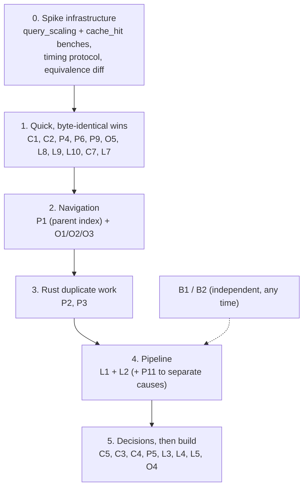

# Tree Hugger performance review

Functionally, Tree Hugger is in good shape after the recent specs. Its
performance is not:
- a cold scan of this monorepo takes **23 s**;
- a warm `hug symbols --plain` takes **6–9 s**;
- `hug symbols lib.rs` on one cached file takes **70–100 ms**;
- for the largest file, a warm cache hit with `--json-full` is **slower than
  re-parsing it**.

This spec covers the whole package area: library pipeline, reference
occurrences, declared relations, persistent cache, and CLI scan and render.
It lists every performance opportunity found. Each finding states:

- the change;
- the expected impact, marked as measured or estimated;
- whether a spike is worth doing;
- how that spike would be run.

## How this review was done

- Five read-only reviews of the code, one each for the parse/query/record
  pipeline, occurrences/scope, extraction/relations, the persistent cache,
  and CLI scan/render/lint.
- Measurements of a `profiling`-profile build (`cargo build --profile
  profiling -p tree-hugger-cli`) on the macOS dev host (Apple Silicon,
  12 performance + 4 efficiency cores, internal SSD).
- `samply` is not installed on that host. Profiles were taken with macOS
  `sample <pid>` and aggregated by inclusive sample count per symbol, and
  by nearest Tree Hugger caller for `Node::parent`.
- The cache was isolated per experiment by pointing `TMPDIR` at a scratch
  directory.

Numbers below are from those runs. "Estimated" means the figure was reasoned
from code and not measured.

> **Measurement caveat: the host was heavily loaded.** During these runs
> the dev host's load average was about 40–56 on 16 cores (concurrent
> `cargo-nextest`, `sniff` test binaries, a local LLM server). Read the
> numbers as follows:
>
> - **Robust:** profile *shares* inside one process, such as "36% of
>   samples in `Node::parent`" and "69% in JSON decode". Contention slows
>   every function roughly alike.
> - **Fairly robust:** like-for-like A/B pairs run back to back:
>   - warm vs `--no-cache` on one file;
>   - in-repo vs outside-repo invocation;
>   - `--count` vs `--plain`;
>   - first vs second `--json`.
> - **Weak:** absolute wall times, and every **parallel-scaling** figure
>   (2.7× and 4.7× on 16 cores, the `RAYON_NUM_THREADS` sweeps, the
>   single-thread wait). On a contended machine, poor scaling is expected
>   whatever the code does.
>
> Every spike re-measures its baseline on a quiet host (load average below
> ~2), or on the Linux build host, before it compares anything. L2, P11 and
> the single-thread open observation must not be prioritized until their
> symptom is reproduced on a quiet host.

## Baseline measurements

The corpus is the whole monorepo: 4,311 analyzed files (4,225 listed in
`--json`), 74 MB of source.

| Scenario | Wall | User | Sys | Notes |
|---|---|---|---|---|
| `hug symbols --count`, cold (empty cache), 16 threads | 22.98 s | 62.96 s | 3.41 s | 270 MB RSS. ~2.7× of 16 cores, under load (weak) |
| `hug symbols --count`, warm (4,311 hits) | 2.40–2.95 s | 2.9 s | 1.1 s | |
| warm `--count`, `RAYON_NUM_THREADS=1` / 4 / 16 | 8.86 / 5.03 / 2.40 s | 2.7–2.8 s | ~1 s | At 1 thread, wall time is 2.4× CPU time; see [open observation](#open-observations) |
| `hug symbols --plain`, warm | 6.26–8.71 s | 5.6–5.8 s | 1.3 s | ~4 s more than `--count`: [L1](#l1-render-on-the-workers-not-the-delivery-thread) |
| `hug --json symbols`, first run after a `--count` cache | 29.77 s | 68.85 s | 3.87 s | **Re-parses every file** (Flags widening): [C5](#c5-compute-cheap-capabilities-on-every-miss) |
| `hug --json symbols`, second run | 4.12 s | 3.60 s | 1.12 s | |
| `hug symbols --count <one cached file>`, in the repo | 70–103 ms | 18–26 ms | 50–77 ms | |
| same, from a scratch directory outside the repo | 8.1 ms | 4.1 ms | 4.0 ms | `hug --version` = 5.9 ms: [L3](#l3-a-literal-file-argument-must-not-walk-the-whole-tree) |
| `darkmatter/` cold, `RAYON_NUM_THREADS` = 1 / 4 / 8 / 16 | 7.74 / 3.00 / 2.15 / 1.63 s | 7.6 → 10.5 s | | 4.7× at 16 threads, under load (weak): [L2](#l2-replace-the-per-chunk-barrier-with-a-sliding-window) |
| `--json-full` on `openai/types.rs` (900 KB), warm hit vs `--no-cache` | 1.387 s vs 0.847 s | | | **Warm is 64% slower than cold**: [C1](#c1-remove-the-quadratic-scan-in-unbound_names_have_a_binding) |
| `symbols --count` on the same file, narrow query over that wide entry | 1.6 s user (3.55 s mean wall, high variance) | | | ~99% of samples in `unbound_names_have_a_binding` |
| `--json-full` on `biscuit-terminal/.../filesystem/mod.rs`, warm vs cold | 0.406 s vs 2.012 s | | | Here the cache helps |
| Cache directory after `--count` + `--json` | 786 MB for 74 MB of source (10.6×) | | | [C4](#c4-shrink-and-speed-up-the-stored-entry) |
| Record count: `--all-scopes` vs default `symbols` | 462,429 vs 149,370 | | | 68% of records are `Local` and hidden by default: [P5](#p5-scope-aware-metadata-selection) |

### Where cold time goes

Profile of `hug symbols --no-cache --count` over the monorepo. Inclusive
samples are given as a share of `SourceFile::query`; these overlap, so they
do not sum to 100%.

| Share | Function | Finding |
|---|---|---|
| **36%** | `tree_sitter::Node::parent` (→ `ts_node_parent` / `ts_node_child_with_descendant`) | [P1](#p1-make-parent-lookups-o1) |
| 21% | `SourceFile::parse` (tree-sitter parsing itself) | the floor |
| 21% | `TreeFile::records_from` | P6–P10 |
| 18% | `Lexical::build` via `Declarations::walk`, both builds included | [P3](#p3-build-rust-declarations-and-lexical-once-per-file) |
| 13% | `occurrences::rust_pattern_non_bindings` (a full walk + scope tree, even with no References) | [P2](#p2-avoid-the-rust-pattern-walk-on-the-declarations-only-path) |
| 11% | `link_relations` | P3, P14 |
| 11% | query cursor advance (all queries) | P4 |
| 8% | `definitions::rust_impl_owners` | P3 |
| 6% | `TreeFile::imported_symbols`, a second run of the locals query | [P4](#p4-run-the-locals-query-once-per-file) |
| 1.6% | `file_identity` (`realpath`) | [C8](#c8-canonicalize-each-file-once) |

`Node::parent` samples by nearest Tree Hugger caller (cold, declarations
only):

| Caller | Samples |
|---|---|
| `ScopeTree::scope_around` | 4,253 |
| `Lexical::build` | 3,242 |
| `classify::is_exported_definition` | 2,522 |
| `qualified_name::Builder::prefix` | 2,458 |
| `occurrences::scope_tree` | 1,852 |
| `scope::symbol_scope` | 1,663 |
| `classify::find_symbol_container` | 1,492 |
| `classify::refine_symbol_kind` | 1,233 |
| `declaration::is_scope_boundary` | 894 |
| `Builder::qualified` | 847 |
| `capture_definitions` | 794 |
| `occurrences::is_false_capture` | 686 |

`rust_outer_attributes` and `extract_doc_comment` also account for ~1,500
samples of `prev_sibling`. Note that this profile runs no References pass:
`hug refs`, `--json-full` and `lint` add the occurrence climbs in O1/O2 on
top.

### Where warm time goes

- **`hug symbols --count`:** in the analysis worker, 69% of samples are
  serde_json decoding `StoredEntry`, nearly all of it `Vec<SymbolRecord>`.
  Source read + hash is 11%, cache file read 8%, `validate_imports` 5%,
  `finish` 5%.
- **`hug symbols --plain`:** the main thread spends ~3 s in
  `ListingStream::push` → `Renderer::symbol_list` → biscuit-terminal
  `UnorderedList` / `Prose` (`preprocess_markdown` alone is ~1 s), while the
  workers decode.
- **Not significant in this non-TTY run:** `listing_order` /
  `find_package_root` (~0.12 s) and terminal construction.

## The single most important fact

In tree-sitter 0.26 (`Cargo.lock` pins 0.26.9), `Node::parent()` does not
follow a pointer:
- `ts_node_parent` (`src/node.c:547`) walks down from the root and, at every
  level, scans the children until it finds the one containing the target;
- `next_sibling`/`prev_sibling` (`node.c:190`, `:254`) call `ts_node_parent`
  first.

So one `parent()` costs roughly depth × (position among siblings) per level,
and an `ancestors()` climb to the root costs that again for every level.
Tree Hugger calls these in per-capture, per-record and per-occurrence loops.
The cost grows faster than file size, and it is the largest single cost
measured (36% of cold analysis). `TreeCursor::goto_parent` is O(1). The fix
direction is to carry or index parents instead of asking tree-sitter for
them.

## Summary of findings

Impact: **H** high, **M** medium, **L** low. "Measured" means the profile or
timing above supports the size. Effort: S small, M medium, L large.
"Decision" means the change alters a documented contract and needs the
author's call.

| ID | Change | Impact | Basis | Effort | Spike |
|---|---|---|---|---|---|
| [P1](#p1-make-parent-lookups-o1) | Per-file parent index / cursor-carried parents | **H** (36% of cold) | measured | M–L | yes |
| [P2](#p2-avoid-the-rust-pattern-walk-on-the-declarations-only-path) | Skip or share the Rust pattern walk | **H** for Rust (13%) | measured | M | yes |
| [P3](#p3-build-rust-declarations-and-lexical-once-per-file) | Build Rust `Declarations` + `Lexical` once | **M–H** for Rust | measured | M | yes |
| [P4](#p4-run-the-locals-query-once-per-file) | Run the locals query once (imports from the same run) | M (6%) | measured | S | yes, cheap |
| [P5](#p5-scope-aware-metadata-selection) | No full metadata for scopes the query discards | **H** for default `symbols` | measured share | L, decision | yes |
| [P6](#p6-no-full-metadata-for-kinds-added-only-by-widening) | No full metadata for kinds added only by widening | M for `types`/`classes` | estimated | S | no |
| [P7](#p7-build-each-records-key-and-id-once) | Build each record's key/ID once; static provenance strings | L–M | estimated | S | cheap |
| [P8](#p8-memoize-comment-and-attribute-runs-and-cfgtest-per-ancestor) | Memoize comment/attribute runs and `cfg(test)` per ancestor | M | measured (prev_sibling) | M | with P1 |
| [P9](#p9-compute-is_exported_definition-and-symbol_scope-once) | `is_exported_definition` and `symbol_scope` once per record | L–M (3.6%) | measured | S | no |
| [P10](#p10-capture-grouping-without-string-keys) | Capture grouping without `String` keys; capture roles by index | L | measured (small) | S | no |
| [P11](#p11-thread-local-work-counters) | Thread-local work counters (no shared cache line) | L–M at high thread counts | estimated | S | yes, cheap |
| [P12](#p12-index-based-keys-and-a-fast-hasher-in-the-bind-pass) | Index-based keys + fast hasher in the bind pass | M for `refs`/`--json-full` | estimated | M | after P1 |
| [P13](#p13-reuse-parser-and-querycursor-per-thread-single-compile-per-query) | Reuse `Parser`/`QueryCursor`; one compile per query | L | estimated | S | optional |
| [P14](#p14-small-algorithmic-cleanups-in-extraction-and-relations) | Small algorithmic cleanups in extraction/relations | L | estimated | S | no |
| [P15](#p15-stop-storing-whole-initializers-in-declaration_text) | Stop storing whole initializers in `declaration_text` | L–M (33 MB of cache) | measured size | M, decision | maybe |
| [O1](#o1-replace-the-two-per-capture-root-climbs-with-interval-lookups) | Interval lookups instead of two root climbs per capture | **H** for `refs`/`--json-full`/`lint` | estimated | M | yes |
| [O2](#o2-parent-index-for-scope-and-region-lookups) | Parent index for scope/region lookups | **H** (shares P1) | measured share | M | with P1 |
| [O3](#o3-no-per-node-parent-or-sibling-calls-in-walkrun) | No per-node `parent()`/sibling calls in `Walk::run` | M for TS/JS/Swift | estimated | S | no |
| [O4](#o4-nameonly-candidate-fan-out) | NameOnly candidate fan-out | H on Python/PHP/Java classes | estimated | S / decision | size it |
| [O5](#o5-compute-written_path-once-per-occurrence) | `written_path` once per occurrence | L–M | estimated | S | no |
| [O6](#o6-cheaper-is_call_target-and-qualified_parent) | Cheaper `is_call_target` / `qualified_parent` | L | estimated | S | no |
| [O7](#o7-memoize-rust_impl_type-and-enum-variant-owners) | Memoize `rust_impl_type` and variant owners | L–M for Rust | estimated | S | if profiled |
| [O8](#o8-allocation-and-hashing-in-scope-tables-and-import-lookup) | Allocation/hashing in scope tables and `import_at` | L–M | estimated | S | no |
| [C1](#c1-remove-the-quadratic-scan-in-unbound_names_have_a_binding) | Remove the quadratic scan in `unbound_names_have_a_binding` | **H** (warm slower than cold) | **measured** | S | yes |
| [C2](#c2-remove-the-quadratic-made-closure) | Remove the quadratic `made` closure | H on wide entries | estimated | S | with C1 |
| [C3](#c3-validate-evidence-only-when-it-will-be-served) | Validate evidence only when it will be served | M–H | measured (narrow over wide) | M, decision | after C1/C2 |
| [C4](#c4-shrink-and-speed-up-the-stored-entry) | Shrink and speed up the stored entry | **H** for warm (69% decode) | measured | L, decision | yes |
| [C5](#c5-compute-cheap-capabilities-on-every-miss) | Compute cheap capabilities (Flags) on every miss | **H** for mixed commands (29.8 s → ~4 s) | measured | S–M, decision | yes |
| [C6](#c6-written-checksum-instead-of-re-derived-validation) | Written checksum instead of re-derived validation | H, but policy | estimated | M, decision | after C1–C3 |
| [C7](#c7-small-validation-costs) | Stream `import_inventory`; one `LineStarts` | L | estimated | S | no |
| [C8](#c8-canonicalize-each-file-once) | Canonicalize each file once | L (1.6%) | measured | S | no |
| [C9](#c9-collect-stale-cache-entries) | Collect stale cache entries | disk only | measured size | S | no |
| [L1](#l1-render-on-the-workers-not-the-delivery-thread) | Render on the workers, not the delivery thread | **H** for listings (~3–4 s warm) | measured | M | yes |
| [L2](#l2-replace-the-per-chunk-barrier-with-a-sliding-window) | Sliding window instead of per-chunk barrier | M–H if reproduced | measured under load, unconfirmed | M | yes, quiet host first |
| [L3](#l3-a-literal-file-argument-must-not-walk-the-whole-tree) | A literal file argument must not walk the whole tree | **H** for single-file use (70 ms → ~8 ms) | measured | S–M | yes |
| [L4](#l4-hug-refs-run-occurrences-only-on-the-declaring-file) | `hug refs`: Occurrences only on the declaring file | **H** for `refs` | estimated | M | yes |
| [L5](#l5-batch-oxlint-and-resolve-it-once) | Batch oxlint; resolve the tool once | **H** for JS/TS lint | estimated | M, decision | yes |
| [L6](#l6-no-terminal-detection-for-unstyled-output) | No terminal detection for unstyled output | M latency on TTY/iTerm2 | estimated | S | yes |
| [L7](#l7-memoize-package-roots-in-listing_order) | Memoize package roots in `listing_order` | L (~0.12 s) | measured | S | no |
| [L8](#l8-one-static-rule-registry-apply-lint-policy-once) | One static rule registry; apply lint policy once | M for cold lint | estimated | S | cheap |
| [L9](#l9-remove-quadratic-scans-in-diagnostics) | Remove quadratic scans in diagnostics (`lines().nth`, `named_child(i)`) | M on pathological files | estimated | S | no |
| [L10](#l10-skip-the-ignore-directive-query-when-it-cannot-match) | Skip the ignore-directive query when it cannot match | L–M | estimated | S | no |
| [L11](#l11-stream-imports-and-lint-output) | Stream `imports`/`lint` output (fixes a broken-pipe panic) | M | estimated | S | small |
| [L12](#l12-god-files-read-once-parse-once) | `god-files`: read once, parse once | M for repeated runs | estimated | S | maybe |
| [L13](#l13---changed-without-re-canonicalizing-every-scanned-file) | `--changed` without re-canonicalizing every scanned file | M for `--changed` | estimated | S | cheap |
| [L14](#l14-move-json-projection-off-the-delivery-thread-and-memoize-is_test_file) | JSON projection off the delivery thread; memoize `is_test_file` | L–M | estimated | S | with L1/L2 |
| [L15](#l15-do-not-deep-clone-reused-prelude-results) | Do not deep-clone reused prelude results | L–M with `--prelude` | estimated | S | no |
| [B1](#b1-release-profile-for-hug) | Release profile: LTO + 1 codegen unit for `hug` | L–M | estimated | S | yes, cheap |
| [B2](#b2-a-faster-global-allocator) | A faster global allocator (mimalloc) | M for warm decode | estimated | S | yes, cheap |

---

## Shared spike infrastructure (do this first)

The existing bench (`lib/benches/tree_file.rs`) only parses 100-item
generated inputs. It never calls `TreeFile::query`, `symbol_records` or the
cache, so it cannot show any finding below. Before or with the first spike:

1. **Add a `query_scaling` criterion group.**
   - Generate Rust, TypeScript, Python and C sources at N ∈ {200, 1000, 5000}
     top-level items: doc comments, one large `impl`/class, nested closures or
     callbacks (depth 30–60), a wide `match`/`switch`.
   - Bench `SymbolQuery::new()`, `.capabilities([References])`,
     `.capabilities([Flags])` and `SymbolQuery::complete_index()`.
   - Time per item that grows with N is the signature of P1/O1/O2.
   - Run with `cargo bench -p tree-hugger --bench tree_file -- query_scaling
     --save-baseline before`, then `--baseline before`.
2. **Add a `cache_hit` criterion group.** It writes a real entry (complete
   index) for a large file, then times:
   - `SymbolCache::query` on a `Hit`;
   - `serde_json::from_slice::<StoredEntry>` alone;
   - `SourceFile::query` cold.

   Use the p90/p99 corpus files: `schematic/definitions/src/openai/types.rs`
   and `biscuit-terminal/lib/src/components/filesystem/mod.rs`.
3. **Fix a monorepo-level timing protocol.** Use a fixed `TMPDIR` per arm,
   with `hyperfine -w 2` over:
   - `hug symbols --count` cold (`--no-cache`) and warm;
   - `hug symbols --plain > /dev/null` warm;
   - `hug --json symbols > /dev/null` warm;
   - `hug refs SymbolCache`;
   - `hug lint`.

   Plus a `RAYON_NUM_THREADS` sweep of 1/4/8/16. Record `--verbose` to prove
   hit/parse counts.
4. **Profiling.** Run `cargo install samply` (the dev host lacks it), then
   `samply record target/profiling/hug …`. macOS `sample <pid> <secs>` also
   works; aggregate by inclusive count per symbol.
5. **Equivalence gate for every spike.** Run `hug --json-full symbols` with
   a cold cache over a fixed corpus (`tree-hugger/`, `lib/tests/fixtures/`,
   the p99 files) and `diff` before against after: output must be
   byte-identical unless the finding says otherwise. Also run `just test` in
   `tree-hugger/`, which carries the cache-robustness, projection and
   work-counter invariants.

---

## Library pipeline: parse, query, records (P)

### P1. Make parent lookups O(1)

- **Change:** Stop calling `Node::parent()` / `prev_sibling()` /
  `next_sibling()` in per-capture and per-record loops. In order of
  increasing invasiveness:
  - (a) **Quick wins with identical output:**
    - hoist the double `parent()` per step in
      `declaration.rs::is_scope_boundary` / `resolve_declaration_node`
      (`:133-136`, `:161-174`);
    - hoist the same in `qualified_name.rs::Builder::prefix` (`:196`,
      `:216-218`);
    - reuse the already-computed `symbol.scope` in `fill_metadata`
      (`definitions.rs:460`, recomputed from `:406`).
  - (b) **Lazy per-file parent memo.** A `HashMap<node.id(), Node>` filled
    for the whole path on each descent, owned by the per-file facts (like
    `SiblingScopes` / `VisibilityMemo`). Ancestor chains share prefixes, so
    most lookups become O(1).
  - (c) **Full parent index** from one `TreeCursor` pass (O(nodes)), threaded
    into the readers. The occurrence/scope code can reuse it too ([O2](#o2-parent-index-for-scope-and-region-lookups)).
- **Where:** callers in [Where cold time goes](#where-cold-time-goes),
  topped by `ScopeTree::scope_around`, `Lexical::build`,
  `is_exported_definition`, `Builder::prefix`, `symbol_scope`,
  `find_symbol_container` and `refine_symbol_kind`.
- **Expected impact:** **High, measured.** 36% of cold declarations-only
  analysis is in `Node::parent`. With (b)/(c), most of that should go:
  - estimate a 25–35% cut in cold CPU across all languages;
  - more on wide or deep files (generated code, flat C headers, big `impl`
    blocks, JSX).

  (a) alone is a few percent.
- **Risk:** Output stays byte-identical if the indexed parent equals
  `Node::parent()`, including hidden and aliased nodes. Check that during the
  spike with `debug_assert_eq!(index.parent(n), n.parent())`. The cost of (c)
  is a wide but mechanical signature change. No `EXTRACTOR_REVISION` bump is
  needed.
- **Spike:** **Yes.** It is the largest measured cost, and (b) vs (c) is a
  design choice the numbers should settle.
- **How:**
  1. Land (a).
  2. Implement (b) behind one helper (`ancestors_of(facts, node)`).
  3. Run `query_scaling` before and after; growth per item at N=5000 should
     flatten.
  4. Re-profile `hug symbols --no-cache --count` over the monorepo and read
     the `ts_node_parent` share.
  5. Compare wall/user time with `hyperfine`.
  6. Gate on the equivalence diff.

### P2. Avoid the Rust pattern walk on the declarations-only path

- **Change:**
  `definitions.rs::drop_non_declarations` → `occurrences::rust_pattern_non_bindings`
  runs `Walk::run`, `scope_tree` and `place_sites` for every Rust file whose
  locals query captured a variable or parameter, which is nearly every Rust
  file. That happens even for `hug symbols` with no References pass. With
  References, `OccurrenceSyntax::resolve` then repeats all three
  (`occurrences.rs:129`, `:486-487`, `:940`).
  - (a) **Share** the `Walk` and placed sites between definitions and the
    bind pass. The decisions are identical: in the definitions run the
    targets are `Unreported`, in `resolve` they are `Record(idx)`, and
    `bare_pattern_meaning` reads neither.
  - (b) **Prefilter** the declarations-only path. A bare pattern name can
    only read or be unknown when:
    - the file has a glob `use`; or
    - a bare captured name equals a `const`/`static`/unit struct/`const`
      generic/import name, or `None`/`Self`.

    When neither holds, nothing can be dropped, so skip the walk.
- **Expected impact:** **High for Rust, measured.** 13% of cold analysis
  over this (Rust-heavy) monorepo. (b) removes most of it from listings, and
  (a) halves it on the bind path (estimated 20–40% of Rust resolution).
- **Risk:**
  - (b) is a correctness argument that must hold exactly. It is the riskier
    half, and it must be pinned by `PATTERN_IDENTITY_MATRIX` /
    `PATTERN_RECORD_MATRIX` plus a corpus-wide equivalence diff.
  - (a) has lifetime friction, since `Walk<'tree>` crosses the
    definitions/records boundary.
- **Spike:** **Yes.** Measure (b)'s skip rate over the monorepo first: how
  many Rust files hit the prefilter. If it is above ~80%, (b) is worth its
  proof.
- **How:**
  1. Add a temporary counter for "pattern walk skipped".
  2. Run `hug symbols --no-cache --count --language rust` over the monorepo.
  3. Diff `--json-full` with and without the prefilter.
  4. Use a `hyperfine` A/B, and `query_scaling/rust` for (a).

### P3. Build Rust `Declarations` and `Lexical` once per file

- **Change:** For every Rust file with impl members, `rust_impl_owners`
  (`definitions.rs:743-766` → `relations.rs::impl_self_types`, `:2452`)
  builds a `Declarations` and forces `walk()`, which runs `Lexical::build`, a
  full DFS that allocates a `Vec` per node (`lexical.rs:182-282`, `:244`).
  Then `link_relations` (`relations.rs:2141`) builds both again, and
  `impl_relations` forces `walk().impls` (`:2366`). Swift's
  `swift_extensions` always forces the walk (`:2336`).

  Build once and hand the result forward. At minimum, carry
  `impl_self_types`' map and `walk().impls` into `link_relations`.
- **Expected impact:** **Medium–high for Rust, measured.**
  - `Lexical::build` is 18% and `rust_impl_owners` 8% of cold analysis.
    About half of `Lexical::build` is the duplicate.
  - Estimate 8–12% of cold CPU on Rust-heavy corpora.
  - With P1, the remaining build is cheaper too, because 3,242 of its
    samples are `parent()`.
- **Risk:** Low–medium. `Declared` borrows `qualified_name` from `pending`
  in one call and from `records` in the other, so share through `Rc<str>`,
  or carry only the decisions. Output is identical when the same entries
  and decisions are reused.
- **Spike:** **Yes, cheap.** Add a temporary `Lexical::build` counter (or
  watch `shared_context_steps` double per Rust file), remove the second build
  and A/B `query_scaling/rust` plus `hyperfine 'hug symbols --no-cache
  --count --language rust'`.

### P4. Run the locals query once per file

- **Change:** `analysis/mod.rs:97` calls `tree_file.imported_symbols()`
  unconditionally. That query is the **same text** as the locals query
  (`queries/mod.rs` resolves `Imports` and `Exports` to the locals text), so
  every planned query runs the full locals query twice and compiles it twice
  under two cache keys.

  `capture_definitions` already sees the `local.definition.import` captures
  and skips them (`definitions.rs:236`). Collect them there and build the
  `ImportSymbol`s from those nodes (`imports_from_nodes`). `imported_symbols()`
  stays as public API. Make `query_for(Imports)` reuse the compiled `Locals`
  query.
- **Expected impact:** **Medium, measured.** `imported_symbols` is 6% of
  cold analysis. Grammars with no import captures (C, C++, Bash, Zsh, Lua,
  Perl, PHP, JS vendor) gain it all for nothing.
- **Risk:** Low.
  - Imports are already sorted and deduplicated by span (`tree_file.rs:236`).
  - Keep the fingerprint hashing the same query text (`RECORD_QUERIES`), so
    existing cache entries stay valid.
  - Keep `QueryKind::Imports` for provenance and drift tests, and
    `definition_captures` at 1.
- **Spike:** **Yes, cheap.** `query_scaling` (declarations only) plus
  `hyperfine 'hug symbols --no-cache --count'`. Expect
  `ts_query_cursor__advance` to drop by about a third.

### P5. Scope-aware metadata selection

- **Change:** `MetadataSelection` is keyed by kind only
  (`definitions.rs:58-62`). The default `hug symbols` scope filter
  (`SYMBOLS_DEFAULT_SCOPES = [Item, Member]`, `cli/src/declarations.rs:57`)
  is applied in `finish`, after analysis and caching. So every `Local`
  record (parameters, locals) gets the full `records_from` work, then is
  thrown away:
  - `fill_metadata`;
  - attributes;
  - `declaration_text` of whole `let x = match …` statements;
  - signature, keyword, generics, modifiers;
  - under Flags, the per-ancestor `is_in_rust_cfg_test` walk.

  Make metadata scope-aware, and record in the cache entry which scopes
  carry metadata. A later `--all-scopes` query then widens, like
  `WidenedKinds`.
- **Expected impact:** **High for the default `hug symbols`, measured
  share.** 68% of all records are `Local` (462,429 vs 149,370 over the
  monorepo). The metadata share of `records_from` (21% of cold) for those
  records would go; estimate 10–15% of cold CPU. Locals still need light
  records for binding, IDs and containment.
- **Risk:**
  - Cache shape and policy: a new coverage dimension next to
    `covered_kinds`.
  - Needs an `EXTRACTOR_REVISION` bump, `docs/cache-design.md` updates, new
    `cache_robustness` cells and new projection tests.
  - It must never serve an entry without local metadata to an
    `--all-scopes` query.
- **Decision:** yes. It adds a cache coverage axis.
- **Spike:** **Yes.**
  1. Temporarily gate the `records_from` metadata block on `scope != Local`
     with no cache (`--no-cache`), to bound the gain.
  2. `hyperfine 'hug symbols --no-cache --count'` with and without the gate.
  3. Proceed with the cache design only if the gain is above ~10%.

### P6. No full metadata for kinds added only by widening

- **Change:** `MetadataSelection::for_kinds` adds Field/Property/Constant/
  EnumVariant when a type kind is selected (`definitions.rs:34-56`), and
  `records_from` treats them as `wanted` (`tree_file.rs:1824`). They need
  only what `align_field_metadata` reads (visibility, `static`, doc). They
  also get declaration/signature text, keyword, generics, attributes,
  modifiers, Flags walks and metrics, then `retain(query.selects)` drops them
  before caching (`analysis/mod.rs:163`).

  Track the originally selected kinds, and use that for `wanted` in
  `records_from`.
- **Expected impact:** Medium for `hug types` / `hug classes` and their
  `--json`, where fields are often most records. Estimated; byte-identical.
- **Risk:** Very low. Nothing downstream reads those facets from unselected
  records, and they never reach the cache.
- **Spike:** No. Just do it, and check with the fixture/snapshot tests and
  `hyperfine 'hug types --no-cache --json'`.

### P7. Build each record's key and ID once

- **Change:** `From<SymbolInfo> for SymbolRecord` (`schema_v2/mod.rs:375-497`)
  computes `stable_symbol_key(.., 0)` and its BLAKE3 hex ID, each with path
  normalization (`to_string_lossy().replace('\\', "/").trim().to_string()`)
  and a `format!`. `records_from` (`tree_file.rs:1871-1895`) then throws both
  away and recomputes them with the real ordinal.

  Also, `provenance.extractor_version` is a `format!` per record, and
  `extractor` / `parse_pass` are fresh `String`s per record.

  Changes:
  - an internal constructor that takes the final key;
  - normalize the path once per file;
  - `LazyLock<String>` for the constant provenance strings.
- **Expected impact:** Low–medium, estimated 1–3 µs per record. Over the
  monorepo's 462k records, that is ~0.5–1.5 s of cold CPU.
- **Risk:** IDs must stay byte-identical. Pin this with an equality test
  against the current function. Do not change public field types.
- **Spike:** Cheap: a criterion micro-bench of `records_from` on a
  5,000-definition file, or the samply self time of `blake3`/`fmt::format`.

### P8. Memoize comment and attribute runs and `cfg(test)` per ancestor

- **Change:**
  - `collect_doc_comments` (`doc_comments.rs:124-148`) steps back one
    `prev_sibling()` at a time. Each is a root descent, and every `///` line
    is its own node.
  - `rust_outer_attributes` (`attributes.rs:153-165`) walks the same run
    again.
  - `type_metadata.rs` (`:183`, `:215`, `:297`) re-reads the doc of every
    field and variant the standalone record already read.
  - `is_in_rust_cfg_test` (`flags.rs:85-112`) calls `rust_outer_attributes`
    for **every ancestor** under Flags (every `--json`/`--jsonl`/`--json-full`).

  Changes:
  - a per-parent "preceding comment/attribute run" table from one forward
    cursor pass, shared by docs and attributes;
  - memoize doc text by node ID;
  - memoize the outer `cfg(test)` answer per ancestor along the walked path.
- **Expected impact:** Medium, partly measured. `prev_sibling` from these
  two callers is ~1,500 samples (~2%) without Flags; with Flags it is more.
- **Risk:**
  - Reproduce run boundaries exactly: Go blank-line breaks,
    `trailing_comment_count`, Go `Attachment` semantics.
  - `GO_SPEC_ATTACHMENT_MATRIX`, `TRAILING_DOC_CASES` and `FLAGS_MATRIX`
    pin these.
- **Spike:** Fold into P1's profile. If P1(c) lands, much of this cost
  disappears with it. Re-measure before memoizing.

### P9. Compute `is_exported_definition` and `symbol_scope` once

- **Change:**
  - `is_exported_definition` runs 2–3 times per definition:
    `analysis/mod.rs:124` (`exports_from`), `tree_file.rs:1870`, and
    `tree_file.rs:1229` under diagnostics.
  - `symbol_scope` runs twice for each winner.
  - Compute both into `ExtractedSymbol` once.
- **Expected impact:** Low–medium, measured. `is_exported_definition`'s
  `parent()` samples are 3.6% of cold analysis. Byte-identical.
- **Spike:** No.

### P10. Capture grouping without `String` keys

- **Change:**
  - `capture_definitions` (`definitions.rs:259-272`) allocates the
    capture's name text into each `(start, end, String)` group key. The text
    is a function of the span, so key on `(start, end)` and read the text
    once per group.
  - Capture-name roles are matched as strings per capture (`:213-240`,
    `ends_with(".context")`). Precompute a role per capture index once per
    compiled query, next to the `Arc<Query>`.
- **Expected impact:** Low, byte-identical.
- **Spike:** No.

### P11. Thread-local work counters

- **Change:** The eight `static AtomicU64` counters (`analysis/counters.rs:11-18`)
  share one cache line. `count_shared_context_steps` is called at 40+ hot
  sites, including inside `partition_point` comparators
  (`relations/inline.rs:70-71`). Accumulate in thread-local `Cell<u64>`s and
  flush at the end of `run_query`, or at minimum pad each counter to its own
  line.
- **Expected impact:** Low–medium, estimated. It shows only as poor
  scaling across threads. The observed 2.7–4.7× on 16 cores was measured
  on a heavily loaded host (see the measurement caveat and
  [L2](#l2-replace-the-per-chunk-barrier-with-a-sliding-window)), so
  first confirm that scaling is still poor on a quiet host.
- **Risk:** Tests read `work_counters()` deltas after analysis returns, so
  a flush at the end of the pass keeps totals exact.
- **Spike:** **Yes, cheap.** Stub `count_shared_context_steps` to a no-op
  in a scratch build, then run `hyperfine` with `RAYON_NUM_THREADS=1,4,8,16
  hug symbols --no-cache --count`. If the 16-thread time improves
  noticeably, do the thread-local version.

### P12. Index-based keys and a fast hasher in the bind pass

- **Change:**
  - `bind_references` maps (`analysis/mod.rs:367-389`), `RefSet`
    (`:578-588`, which clones an ID per edge), `members_by_parent` (`:276`)
    and `semantic_facets` (`:444-459`) hash 64-character hex `SymbolId`
    strings with SipHash.
  - Carry record indices from the resolver instead, and key by `usize`.
  - Where string keys remain, use `FxHashMap` (`rustc-hash`; add it to
    `docs/dependencies.md`).
- **Expected impact:** Medium for `refs`, `--json-full` and bind +
  diagnostics. Estimated 0.3–1 µs per occurrence; no effect on listings.
- **Risk:** Order must not change. Only the dedup key type changes, and map
  iteration order is never observed.
- **Spike:** Yes, but after P1/O1/O2, which dominate the same benchmark:
  `query_scaling` with References.

### P13. Reuse `Parser` and `QueryCursor` per thread; single compile per query

- **Change:**
  - `Parser::new()` per file (`source_file.rs:144`) and `QueryCursor::new()`
    per query call. Use a thread-local parser (`set_language` per file) and
    a reused cursor.
  - The query cache (`queries/mod.rs:56-87`) is one global `Mutex<HashMap>`,
    locked 3–5 times per file. On a cold start several workers may compile
    the same query. Use a per-key `OnceLock`.
- **Expected impact:** Low, estimated tens of µs per file plus a few ms at
  start-up.
- **Risk:** The `parser_constructions` counter is asserted in tests; count
  parses instead.
- **Spike:** Optional: `hyperfine` over many small files.

### P14. Small algorithmic cleanups in extraction and relations

All byte-identical, low impact, no spike:

- `align_field_metadata` / `reconcile_variants` (`definitions.rs:619-630`,
  `:723-734`): linear `find` per member, O(F×M) per type. Use a name →
  `VecDeque<usize>` map. Popping from the front keeps the k-th-to-k-th
  pairing. Also skip building `members` when no selected kind completes
  fields.
- `link_relations` (`relations.rs:2141`) builds `Declarations` for every
  file. Return early when the language is not Rust or Swift, Containment is
  off and no wanted record declares a base.
- `Declarations::binding_name` (Rust, `relations.rs:780`) allocates a
  split/join per entry. Return `Cow::Borrowed` for ASCII names without
  `r#`.
- Parameters are parsed in both `signature` and `symbol_metrics`; type
  parameters in both `type_metadata` and `declared_generics`.
- `docs_pass` clones the whole `DocsFacet` (`analysis/mod.rs:549`); use
  `mem::take`. `parse_pass` gets a new `String` per record per pass.
- Cyclomatic `UnlessLast`/`Arm` use `next_named_sibling`/`prev_named_sibling`
  per arm (`complexity/mod.rs:209-232`), which are root descents. Look ahead
  with a cloned cursor instead. This runs under Metrics only.

### P15. Stop storing whole initializers in `declaration_text`

- **Change:** `declaration_text` is cut only at a body-like child
  (`declaration.rs:285-292`), so `let`/`const` statements, `macro_rules!`,
  const tables and C array initializers are stored whole. `trim_record`
  drops it for `--json`/`--jsonl`/table output; only `--json-full` and
  library callers see it.

  Options:
  - store a byte range and slice the source on demand (the source is read
    on every hit anyway);
  - or cut it with the `signature_text` rules.
- **Expected impact:** Low–medium, measured size: 33 MB of the 786 MB cache
  (4%), plus the allocation on every cold record.
- **Risk:** Changes public output for `--json-full` and the library. Needs
  an `EXTRACTOR_REVISION` bump and a docs update.
- **Decision:** yes (public field semantics).
- **Spike:** Maybe, only if [C4](#c4-shrink-and-speed-up-the-stored-entry)
  keeps the field in the stored form.

---

## Reference occurrences (O)

These run under References/Occurrences: `hug refs`, `--json-full`, every
bind query, and (O1) `lint` for TS/JS. Not measured in the declarations-only
profile above, so the sizes are estimated. The spike is the
[References profile](#spike-for-the-o-findings).

### O1. Replace the two per-capture root climbs with interval lookups

- **Change:**
  - `occurrences.rs:520`, `ancestors(node).any(is_excluded_context)`, runs
    for every reference capture and almost never stops early, so it climbs
    to the root, at O(depth²) with tree-sitter parents.
  - For TS/JS, `is_ecma_export_name` (`:1068`, also used by lint at
    `tree_file.rs:295`) climbs again looking for `export_statement`.

  `Walk::run` already visits every node. Have it record the byte ranges of
  excluded-context nodes and of `export_statement`s as sorted interval
  lists, so each capture needs one binary search.
- **Expected impact:** **High** for `refs`/`--json-full` on deep files
  (JSX, nested callbacks, builder chains), and for TS/JS `lint`.
- **Risk:**
  - Zero-width (`MISSING`) and equal-range parent/child nodes must behave
    like the node climb.
  - `is_excluded_context` is per language (Python `import_statement` is not
    excluded).
  - The export check needs the **nearest** `export_statement` and then
    inspects its `source` field.
- **Spike:** **Yes.** See [below](#spike-for-the-o-findings).

### O2. Parent index for scope and region lookups

- **Change:** `ScopeTree::scope_around` (`scope/mod.rs:361`; the
  single largest `parent()` caller even without References),
  `ScopeTree::with_rules` (`:312`, `:319`, `:329-331`: parent, boundary and
  an `ancestors().count()` depth per scope node), `Regions::around`
  (`occurrences.rs:411`), `is_call_target`, `written_path`,
  `reference_category`, `resolve_rust_path` and `rust_member_of` all climb
  with `parent()`.

  Use P1's parent index, or a span-sorted stack sweep for scope parents and
  depth (the technique `smallest_enclosing` already uses).
- **Expected impact:** **High**, shared with P1. `scope_around` +
  `occurrences::scope_tree` are already ~6,100 `parent()` samples on the
  declarations-only path (via P2/P3), and References multiplies the calls.
- **Risk:** As P1.
- **Spike:** With P1.

### O3. No per-node `parent()` or sibling calls in `Walk::run`

- **Change:**
  - **TS/JS:** `ecma::extra_scope` and `ecma::dynamic` both call
    `is_with_body(node)` → `node.parent()` on every named node
    (`ecma.rs:28`, `:52`, `:62`). Handle `with_statement` in `visit_ecma`
    instead, pushing its body as an extra scope and `Dynamic::Scope`.
  - **Swift:** `swift_element_labels` (`syntax_markers.rs:231-234`) calls
    `next_sibling()`/`next_named_sibling()` per child. Use the cursor.
  - **Smaller per-node callers:** Java `java_inferred_type`,
    `c_type_specifier`, Python `has_ancestor`, ECMA `variable_declarator`.
    Generally, keep a parent stack in the cursor loop and pass `parent` in.
- **Expected impact:** Medium for large TS/JS/Swift files on every bind.
- **Risk:** Low; identical output sets.
- **Spike:** No. Fold into the O1 measurement.

### O4. NameOnly candidate fan-out

- **Change:** The 13 languages without binding rules make every occurrence
  `NameOnly` over **all** same-named records (`occurrences.rs:544`,
  `:581-598`, `records_named` `:764`). Python parameters are records, so in
  a class with M methods every use of `self` carries M candidates, each a
  `SymbolRef` with three `String`s. Each call also sorts and dedups the
  bucket and clones the `Vec`.
  - **Free part:** sort and dedup each `by_name` bucket once in
    `Resolver::new` by `(name_span.start, id)`, and drop the clone.
  - **Contract part:** cap the list, drop out-of-scope parameters/locals,
    or store a per-name candidate table referenced by index.
- **Expected impact:**
  - Free part: low–medium.
  - Contract part: potentially quadratic output and time on large
    Python/PHP/Java classes, affecting `--json-full`, `refs` and cache size.
- **Risk:** The free part must reproduce the exact sort and the first-wins
  dedup.
- **Decision:** the contract part.
  `docs/references.md` says candidates are "the same-named declarations, in
  declaration order".
- **Spike:** **Yes, to size it.** On a generated Python class with ~300
  methods using `self`, and on `scripts/ci/test_affected_scope.py`, report
  occurrences vs total candidates vs `--json-full` bytes.

### O5. Compute `written_path` once per occurrence

- **Change:** `written_path` is computed in `resolve_supported`
  (`occurrences.rs:634`, used only for `.is_some()`), then again for
  `qualified_name` (`:555`). Compute it once and pass it in.
- **Expected impact:** Low–medium: one climb and one `String` per Rust/TS/JS
  occurrence. The function is pure.
- **Spike:** No.

### O6. Cheaper `is_call_target` and `qualified_parent`

- **Change:**
  - `is_call_target` (`occurrences.rs:1416-1473`) calls `parent()` on the
    same node up to three times per step (`transparent_wrapper`, `:1419`,
    `qualified_parent`).
  - `qualified_parent` (`:1181-1185`) resolves 15 field names with
    `children_by_field_name` into a `Vec` each.
  - Thread the computed parent through, and do one children pass with
    `field_name_for_child`.
- **Expected impact:** Low (mostly subsumed by P1/O2).
- **Spike:** No.

### O7. Memoize `rust_impl_type` and enum-variant owners

- **Change:** `rust_member_of` (`occurrences.rs:753`, `:760`) runs
  `rust_impl_type` (a scope lookup with its own climb) per candidate, and
  for each enum variant a full ancestor climb. Precompute both per impl or
  variant in `Resolver::new`.
- **Expected impact:** Low–medium for impl-heavy Rust (path occurrences ×
  same-named members).
- **Spike:** Only if the References profile shows `rust_impl_type`.

### O8. Allocation and hashing in scope tables and import lookup

All small, byte-identical, no spike:

- `ScopeTree::table` (`scope/mod.rs:270`, `:445`) keys
  `HashMap<usize, HashMap<String, Vec<usize>>>` with an owned `String` per
  binding. Use `(scope, Cow<'tree, str>)` → `SmallVec`. `name_key` already
  borrows on the ASCII path.
- `visible()` (`:532-543`) builds two `Vec`s with `partition` per hit.
  Find the ordered maximum in one pass.
- `import_at` (`occurrences.rs:116-121`) scans imports linearly per
  occurrence. Use a `name_start` → index map.
- `(usize, usize)` `HashSet`s with SipHash: `excluded`, `excluded_names`,
  `PatternReads`.
- Node-kind string compares on every named node. Use `kind_id`.
- `definition_ranges` is built twice per bind + lint query
  (`tree_file.rs`, `occurrences.rs:100`).
- `wrapped_member_callees` (`occurrences.rs:1627`) is a third full walk for
  TS/JS/Go/C/C++. Merge it into `Walk::run`.
- Lint path: `references_from_captures` clones `self.file` (a `PathBuf`)
  and allocates the name per capture. The `PathBuf` is public API, so keep
  it, but share the export ranges with O1.

### Spike for the O findings

1. Run `samply record target/profiling/hug --json-full symbols --no-cache <file>`
   and `hug refs <decl> <file>` on:
   - `tree-hugger/lib/src/file/tree_file.rs` (big Rust);
   - a large, deeply nested TS/TSX file;
   - `scripts/ci/test_affected_scope.py` (big Python).
2. The decision metric is the inclusive share of `ts_node_parent` /
   `ts_node_child_with_descendant` / `ts_node__prev_sibling` under
   `OccurrenceSyntax::resolve`, `Walk::run` and `ScopeTree::with_rules`.
3. Add a `reference_evidence` criterion case with depth-30/60 nesting;
   super-linear growth when depth doubles is the O(d²) signature.
4. Keep `work_counters()` `reference_captures`/`occurrence_resolutions`/
   `definition_captures` at 1.

---

## Persistent cache (C)

### C1. Remove the quadratic scan in `unbound_names_have_a_binding`

- **Change:** `stored_evidence.rs:876-900` builds `taken`, a `HashSet` of
  every occurrence span and record name span. Then, for **every identifier
  reading in the source**, it runs `taken.iter().any(..contains..)`: a
  linear scan of a hash set, O(identifiers × spans), on every warm hit of
  an entry with occurrences that has any `Scoped` no-ID target (routine in
  Rust and TS/JS). A second char-level pass follows (`:904-932`).

  Changes:
  - test the cheap `checked.contains(text)` **first** (today the scan runs
    for every identifier, checked or not);
  - sort and merge `taken` into a `Vec` and advance a cursor, since
    readings are in source order;
  - return readings without a `Vec` per identifier;
  - skip the second pass unless `memchr` finds `r#` (Rust) or `\u` (ECMA).
- **Expected impact:** **High, measured.**
  - On `schematic/definitions/src/openai/types.rs` (900 KB), a warm
    `--json-full` hit takes **1.39 s vs 0.85 s uncached**, so the cache
    makes it slower.
  - A narrow `symbols --count` over the same entry spends **~99% of its
    samples here**.
  - The fix should make hits on wide entries far cheaper than a parse,
    which is the whole point of the cache.
- **Risk:** Very low: same predicate, different data structure. The
  accept/refuse sets are pinned by `cache_robustness` and `symbols_cache`.
- **Spike:** **Yes**, and it is the cheapest large win in this spec.
- **How:**
  1. Use the `cache_hit` criterion group on `types.rs` and
     `filesystem/mod.rs` (`--json-full` entries).
  2. A/B the hit time, plus `hyperfine 'hug --json-full symbols <file>'`
     warm vs `--no-cache`.
  3. Success means the hit is several times faster than the cold run on
     both files.

### C2. Remove the quadratic `made` closure

- **Change:** `stored_evidence.rs:657-663`. For every `references` /
  `dependencies` / `referenced_by` edge of every record, `made` scans the
  whole `scoped` set twice (Call, Usage), comparing 64-character IDs and
  calling `name_identity::equal`: O(edges × scoped occurrences).

  Changes:
  - build a `HashSet` keyed by `(owner, target, name_identity::key(name),
    kind)` once;
  - fix the smaller quadratic `contains` checks at `:674`/`:686`;
  - fix `summaries_in_first_occurrence_order`'s per-edge `find`
    (`:768-776`).
- **Expected impact:** High–medium on warm hits of wide entries of large
  files; stacks with C1.
- **Risk:** Very low. Key by `name_identity::key`, which is what `equal`
  compares.
- **Spike:** Same bench as C1. Split the time with a span around
  `validate_evidence`.

### C3. Validate evidence only when it will be served

- **Change:** One entry per file only ever widens. After one `hug refs` or
  `--json-full`, every later `symbols`/`functions`/`classes` hit decodes all
  occurrences and coverage regions (~500 bytes each), runs all of
  `validate_evidence` (`symbol_cache.rs:576-655`), then `project` clears
  them (`coverage.rs:129-132`). Measured: the narrow `--count` over the
  wide `types.rs` entry (above).

  When the query does not need Occurrences/References/Semantics:
  - read the evidence fields as `IgnoredAny`/`RawValue` (still valid JSON,
    no trailing content);
  - skip evidence validation, but keep every record-level check.

  A widening rewrite must decode and validate before carrying evidence
  forward.
- **Expected impact:** Medium–high on warm narrow commands after any
  widening run. It removes evidence decode plus validation (the remainder
  after C1/C2 is mostly decode).
- **Risk:**
  - Policy. A wide entry serving a narrow request would get the same
    assurance as a narrow entry gets today: `validate_evidence` already
    returns early when there are no occurrences.
  - But `docs/cache-design.md`'s tables say "miss" for any malformed field
    regardless of the request, so cells change from M to H for narrow
    requests.
  - Lost cross-checks touching projected fields, such as a callable's
    region vs `source.body_span`, must be kept or moved to the record
    checks.
- **Decision:** yes.
- **Spike:** After C1/C2:
  1. Widen the monorepo's entries with `hug --json-full symbols` in a
     scratch `TMPDIR`.
  2. Time `hug symbols --count` warm against a `TMPDIR` holding only narrow
     entries.
  3. If the gap is still above ~20%, pursue this.

### C4. Shrink and speed up the stored entry

- **Change:** Warm runs are decode-bound.
  - 69% of warm `--count` analysis samples are serde_json decoding
    `Vec<SymbolRecord>`, into owned `String`s.
  - The cache is **786 MB for 74 MB of source**.
  - Measured byte composition, beyond ~35% that is JSON key names:

    | Field | Size | Note |
    |---|---|---|
    | `identity.stable_key` | 69 MB | contains the file path |
    | `name_span` + `declaration_span` | 46 + 46 MB | nested `{start:{line,column},end:…}` objects |
    | `source.file_path` | 42 MB | the same in every record of an entry |
    | `declaration_text` | 33 MB | |
    | `kind_data.data` | 32 MB | |
    | `id` | 30 MB | |
    | `docs.comments` | 30 MB | |
    | constant provenance strings | ~16 MB | repeated per record |

  Options, in increasing risk:
  - (a) A cache-only stored form that drops per-record redundancy: the
    entry's file path; provenance (one per entry); stable key rebuilt from
    entry + record; compact spans as `[start_byte, end_byte, line, col, …]`
    arrays. Requires a schema/revision bump; the strict reader re-derives
    and checks what was dropped.
  - (b) A self-describing binary format (`rmp-serde`/`ciborium`).
    `bincode`/`postcard` cannot round-trip `skip_serializing_if`,
    adjacently tagged enums and `serde_json::Value` fields without a
    mirror DTO.
  - (c) Lazy decode of record facets a query does not need (`RawValue`
    per facet). Today `--count` decodes docs, spans, signatures and kind
    data it never reads.
- **Expected impact:** **High for warm runs.** Decode is the dominant warm
  cost. Estimate 2–4× on warm hits for (a) + (c); (b) adds more. It also
  cuts cold write volume and disk.
- **Risk:**
  - High. `cache_robustness` edits JSON text cell by cell, so a binary
    format means re-encoding that whole matrix.
  - Removing redundancy removes cross-checks: owner names are validated
    against records, and the reader must re-derive the rest.
  - Duplicate-field and trailing-content rejection must be re-implemented
    for any non-JSON format.
- **Decision:** yes (cache format).
- **Spike:** **Yes.**
  1. Bench `serde_json::from_slice::<StoredEntry>` vs a stripped stored
     form (a), on the p90/p99 entries and on all entries of the monorepo.
  2. Then `rmp-serde` with the same structs, to price (b).
  3. Pursue whichever gives above 2× on warm `hug symbols --count`.

### C5. Compute cheap capabilities on every miss

- **Change:** On a miss only the requested query is analyzed and stored
  (`symbol_cache.rs:333-336`). Flags needs the tree, so a widening by Flags
  re-parses. **Measured:** the first `hug --json symbols` after a
  `hug symbols` run re-parsed **all 4,311 files: 29.8 s, against 4.1 s once
  warm.** Every `--json`/`--jsonl` adds Flags; listings do not.

  On every miss, analyze a cheap superset: Flags always (and possibly every
  kind plus Containment), so the common mixed workflow (listing, then
  `--json`, then `classes`) hits.
- **Expected impact:** **High for mixed-command workflows, measured**
  (about 25 s on the monorepo in the case above). It costs a little more
  on each miss: the Flags walk, which is cheaper after P8.
- **Risk:**
  - Low for correctness.
  - Changes the `CacheLookup` outcomes the docs' example table and some
    tests assert.
- **Decision:** yes (cache policy). Which capabilities are "cheap enough"
  to always compute.
- **Spike:** **Yes.**
  1. Measure the cold cost of `hug symbols --no-cache --count` vs
     `hug --json symbols --no-cache` (Flags on vs off) over the monorepo.
  2. If Flags adds under ~10% to a miss, make it unconditional.
  3. Repeat for Containment (`classes`, `--tree`).

### C6. Written checksum instead of re-derived validation

- **Change:**
  - Write `blake3(entry bytes)` (or a keyed MAC with a per-user key outside
    the cache dir) as a trailer.
  - On read, check it and skip `validate_imports`, `validate_evidence` and
    the semantic recompute.
  - A middle ground: always check the checksum, and fully validate only in
    debug/test builds or on a verification read after a write.
- **Expected impact:** High in principle (validation becomes one BLAKE3
  pass at GB/s), but small once C1/C2 make validation roughly linear.
- **Risk:**
  - Policy-level. A checksum proves "these bytes were written by this
    tool", not "the entry is consistent", so a writer bug would be served.
    Catching that is what today's reader is designed for.
  - Every `cache_robustness` refusal reason collapses into one checksum
    miss.
- **Decision:** yes.
- **Spike:** Not until C1–C3 are measured.

### C7. Small validation costs

No spike for either:

- `import_inventory` (`stored_evidence.rs:127-130`) clones every import
  into `StoredImport` and serializes to a `String` before BLAKE3, on every
  read and write. Stream `serde_json::to_writer` into a `blake3::Hasher`
  through a borrowed view. The bytes are identical; pin the digest with a
  unit test.
- `LineStarts::new` is built twice per validated read (`:325`, `:433`).
  Build it once in `StoredEntry::validate`.

### C8. Canonicalize each file once

- **Change:**
  - `collect_files` maps every walked file through `file_identity`
    (`scanner.rs:150`), and `SourceFile::read_with_language` calls it again
    (`source_file.rs:76-78`): two `realpath` calls per file per run.
  - Add a trusted-identity constructor for scanner output.
  - For walked non-symlink entries, `canonical_root.join(relative)` is
    already canonical.
- **Expected impact:** Low, measured: `file_identity` is 1.6% of cold
  analysis and visible on warm runs.
- **Risk:** Identity spelling feeds cache keys and IDs.
  - Windows 8.3 names, `\\?\` prefixes, macOS case.
  - Load the `os` skill and test on Windows before changing the walked-entry
    path.
- **Spike:** No. Optionally count syscalls with `fs_usage` / `strace -c`.

### C9. Collect stale cache entries

- **Change:** Entries are never deleted (`docs/cache-design.md`). The
  review found a 1.02 GB cache with 8,847 entries, 86% not at the current
  schema; this review's own isolated cache reached 786 MB after two
  commands.

  Add a size/age sweep (oldest first beyond N MB, run occasionally after a
  scan), or a `hug cache clear` command.
- **Expected impact:** Disk and page cache only. Lookups are direct paths.
- **Spike:** No.

---

## CLI: scan, render, commands (L)

### L1. Render on the workers, not the delivery thread

- **Change:** Every rendering step runs on the main thread inside the
  `in_file_order` delivery closure:
  - `format!` markup;
  - `Prose` parsing and `preprocess_markdown`;
  - `UnorderedList` projection;
  - layout, `ANSI_ESCAPE_RE` stripping, line copies.

  When the listing unit is one file (the default `--sort file` without
  grouping, see `ListingStream::new`), render the file's block into a
  `Vec<u8>` in `work` (check that `Renderer` is `Sync`). The delivery thread
  then writes only package headers and buffers. Units spanning files
  (name/kind sort, `--prelude`, module grouping) keep today's path.

  Separately, make the per-row path cheaper:
  - skip `preprocess_markdown` for rows built only from `render::literal`
    text, which carries no Markdown;
  - skip the regex when there is no `\x1b` (`memchr`);
  - stop cloning the `Terminal` per line in `Renderer::term_at`.
- **Expected impact:** **High for listings, measured.** Warm
  `hug symbols --plain` takes 6.3–8.7 s against 2.4 s for `--count`; the
  main thread spends ~3 s in `ListingStream::push`/`Renderer::symbol_list`/
  biscuit-terminal (`preprocess_markdown` ~1 s). Parallel rendering should
  bring warm `--plain` close to `--count`.
- **Risk:**
  - Byte-identical output; section and "no symbols" decisions stay in
    `ListingStream`.
  - Memory per window becomes rendered text instead of records, about the
    same size.
- **Spike:** **Yes, with L2.** Prototype worker-side rendering for the
  default unit. Then `hyperfine 'hug symbols --plain > /dev/null'` warm,
  with a `RAYON_NUM_THREADS` sweep, and byte-compare the output with the
  `symbols.plain` golden and over the monorepo.

### L2. Replace the per-chunk barrier with a sliding window

- **Change:** `in_file_order` (`scan.rs:97-114`) processes chunks of
  `4 × threads`:
  - each chunk waits for its slowest file;
  - workers are idle while the main thread delivers;
  - the main thread is idle while workers analyze.

  Keep the contract (file order, bounded memory, stop early on `Break`)
  with a bounded reorder window:
  - workers take indices from an atomic counter and send `(idx, T)`;
  - the main thread delivers from a `BTreeMap` as the head arrives;
  - workers wait while `idx ≥ delivered + W`;
  - `Break` sets a stop flag.

  `flush_at_chunk_end` becomes "every W deliveries or when waiting".
- **Expected impact:** **Medium–high if the symptom survives on a quiet
  host; currently unconfirmed.**
  - Cold monorepo scan used ~2.7× of 16 cores (63 s CPU in 23 s).
  - `darkmatter/` cold scaled 7.74 → 1.63 s (4.7×) from 1 to 16 threads.
  - Both figures were taken at load average ~40–56, which alone explains
    poor scaling (see the measurement caveat).
  - The code-level argument holds regardless: stragglers block each chunk,
    and delivery (L1) never overlaps analysis.
  - Estimate 1.5–2× on cold monorepo wall time if a quiet-host sweep still
    shows the barrier as the main limiter; P11 is the other candidate.
- **Risk:**
  - Output stays identical, since delivery order is index order.
  - The broken-pipe bound moves from "chunk" to "window"; review the docs
    and tests that count work after EPIPE.
- **Spike:** **Yes.**
  1. Log per-file analysis durations in a scratch build, and compute the
     idle share per chunk = Σ(max − each) / (chunk × threads).
  2. Prototype the window.
  3. Run `hyperfine` with `RAYON_NUM_THREADS=1,4,8,16` on cold and warm
     `hug symbols --count`.
  4. Combine with P11's no-op-counter build to separate the two causes.

### L3. A literal file argument must not walk the whole tree

- **Change:** A positional input such as `src/lib.rs` is an ignore-override
  glob (`scanner.rs:105-147`), so naming one file walks **the entire tree
  under the root**, with `.gitignore` evaluation for every directory.
  - Measured: a cached single file takes **70–103 ms in the repo, against
    8 ms from outside it**; `hug --version` takes 6 ms.
  - Add a fast path for an input that has no glob metacharacters and
    contains a `/` (anchored, so it can match at most one path): test that
    one path against the same override + gitignore + default-exclusion
    matchers (`ignore::gitignore::Gitignore::matched_path_or_any_parents`)
    without walking.
  - A bare `lib.rs` matches at any depth by gitignore rules, so it keeps the
    walk.
- **Expected impact:** **High for single-file use**: editor integrations,
  pre-commit hooks, agents calling `hug` per file. Roughly 10× per
  invocation. Nothing for whole-repo scans.
- **Risk:**
  - Must reproduce the walker's decisions exactly: an override whitelist vs
    an ignored parent directory, hidden files, fixture re-inclusion by an
    explicit path, symlinks.
  - Write the equivalence as a property test: fast path vs walk over the
    fixture tree for every input form in `cli/tests/symbols/filters.rs`.
- **Spike:** **Yes.**
  1. `hyperfine -N 'hug symbols --count tree-hugger/lib/src/lib.rs'` from
     the repo root, before and after.
  2. Run the filter suite plus a generated matrix of (ignored dir,
     fixture dir, hidden, symlink) × (anchored path, bare name) comparing
     selected files.

### L4. `hug refs`: run Occurrences only on the declaring file

- **Change:** `refs.rs:158-213` analyzes **every** file with
  `Capability::Occurrences` over all kinds and scopes. Only the declaring
  file's evidence is used; the other files just feed the "several matches"
  check, which needs records only. Each match also clones the whole index.
  1. Phase 1: a declarations-only query over all files, likely served by
     the cache after any listing.
  2. Phase 2: Occurrences only on the one matching file.

  Optionally prefilter phase 1 with `memchr::memmem` for the name's last
  segment. That prefilter must respect smart case and per-language
  `name_identity` keys, and cannot be used for `--id`.
- **Expected impact:** **High for `refs`.** The Occurrences pass and its
  cache payload drop from N files to 1, cold and warm. Today a `refs` run
  also widens every entry it touches, making later warm listings pay
  evidence decode (C3).
- **Risk:** IDs from both phases must agree (both come from stable keys).
  The JSON `completed_capabilities` must come from phase 2.
- **Spike:** **Yes.**
  1. `hyperfine 'hug refs SymbolCache'` (cold and warm) against
     `hug symbols --count`.
  2. Check entry sizes in the cache dir before and after a `refs` run, to
     show the widening side effect.

### L5. Batch oxlint and resolve it once

- **Change:** `hug lint` (`cli/src/main.rs:1564-1617`, `adapter/oxlint.rs`)
  does all of the following per JS/TS file, inside the serial delivery
  closure:
  - a new `OxlintAdapter`;
  - a `PATH` walk;
  - `self.clone()`, which loses the cached version, so `oxlint --version`
    is spawned every time;
  - two config discoveries;
  - one `oxlint` spawn;
  - one `AdapterMetadata` pushed per file.

  Change to: resolve tool and version once, then one `run()` over all JS/TS
  files, in batches of a few hundred, mapped back by file.
- **Expected impact:** **High for JS/TS lint**, estimated. Two process
  spawns per file at 10–50 ms each, serial: about 20–100 s per 1,000 TS
  files, while all rayon workers sit blocked.
- **Risk:** `adapter_metadata` in `--json` changes from one entry per file
  to one per run or batch.
- **Decision:** yes, on that output shape.
- **Spike:** **Yes.** On a TS-heavy package with oxlint installed, run
  `hyperfine 'hug lint --plain > /dev/null'`, count spawns (`execsnoop` /
  `strace -f -e trace=execve -c`), and compare batched vs per-file
  diagnostics.

### L6. No terminal detection for unstyled output

- **Change:** `TerminalBuilder::build()` always runs full detection
  (`biscuit-terminal/lib/src/terminal.rs:37-93`, `:732-767`), even for the
  `--plain`/piped renderer. That includes:
  - three uncached font lookups, each a `defaults read` spawn on iTerm2;
  - config file reads;
  - OSC 10/11 queries with up to a 1 s timeout on a TTY;
  - `find_git_root`, terminfo, image support.

  `hug` uses only color depth, OSC 8, italics, underline, width and
  `color_mode`. Changes:
  - in `hug`, build unstyled/export terminals without detection;
  - in biscuit-terminal, make `build()` detect only fields the builder did
    not set, and make fonts/nerd-font/image support lazy.
- **Expected impact:** Medium latency per invocation on a TTY, especially
  iTerm2 (estimated 100–300 ms) and terminals that never answer OSC
  queries (up to 1 s). Not visible in this review's non-TTY measurements.
- **Risk:** Styled output must keep exactly the capabilities detected
  today.
- **Spike:** **Yes, cheap.**
  1. `hyperfine -N` under a pseudo-TTY (`script -q /dev/null hug symbols
     <file>`) with `TERM_PROGRAM=iTerm.app` and `WezTerm`, before and after.
  2. Count spawns with `execsnoop`.

### L7. Memoize package roots in `listing_order`

- **Change:** `listing_order` (`render.rs:795-829`) calls
  `find_package_root` per file. That walks ancestors, stats nine manifest
  names each and re-parses the TOML or JSON manifest on a hit
  (`package/tree_package.rs:171-237`). Memoize directory → package root
  for one run.
- **Expected impact:** Low, measured: ~0.12 s on the monorepo's warm
  listing. Smaller than the review estimated, but serial and before the
  first byte.
- **Risk:** None. It is a pure function within one run.
- **Spike:** No.

### L8. One static rule registry; apply lint policy once

- **Change:**
  - `diagnostic_metadata` (`tree_file.rs:151-161`) builds
    `RuleRegistry::new()`, about 22 rules and a few hundred allocations,
    **per diagnostic**. The CLI builds it twice per lint file
    (`main.rs:1542`, `:1600`, `:1760`).
  - `get_or_default` clones `RuleMetadata` per diagnostic.
  - `apply_lint_policy` runs twice per file (`summarize_file`, then
    `render_summary`).

  Changes: `static LazyLock<RuleRegistry>`, `Cow` from `get_or_default`,
  and one policy application.
- **Expected impact:** Medium for cold lint on files with many diagnostics
  (estimated 2–4 ms per 200 diagnostics), zero on warm hits.
- **Risk:** Verify the double policy application is idempotent before
  removing the second pass.
- **Spike:** Cheap: profile `hug lint --no-cache` on a file with many
  `unwrap()` calls and `--warn unwrap-call`.

### L9. Remove quadratic scans in diagnostics

No spike for either; fix and pin with tests:

- `build_source_context_from_range` (`tree_file.rs:1606-1631`) uses
  `source.lines().nth(row)` per diagnostic, which is O(diagnostics × file
  size): 1 GB of scanning for a 1 MB file with 1,000 syntax errors. Use
  `memrchr`/`memchr` around `start_byte` and trim a trailing `\r` to match
  `lines()`. Pin CRLF and no-final-newline cases against the old
  implementation.
- `dead_code_ranges` (`tree_file.rs:1309-1313`, `dead_code.rs:311-313`)
  calls `named_child(i)` in a loop, which is quadratic in block children,
  including `source_file` roots. Iterate with `named_children(&mut
  cursor)`.

### L10. Skip the ignore-directive query when it cannot match

- **Change:** Every lint/diagnostics run executes the comments query
  (`tree_file.rs:1157-1167`, `ignore_directives.rs:80-158`), even with no
  diagnostics and no directive text. Return early when diagnostics are
  empty, or when `memmem` finds no `tree-hugger-ignore` in the source.
  Both directive prefixes contain it.
- **Expected impact:** Low–medium for cold lint: one less full-tree query
  for most files.
- **Risk:** None by construction.
- **Spike:** No.

### L11. Stream `imports` and `lint` output

- **Change:** `imports`/`lint` (`main.rs:1141-1239`, `:1717-2134`) collect
  every summary before printing, then `println!` line by line. That is
  unbuffered (one `write` per line) and **panics on a closed pipe**. Use a
  `BufWriter<StdoutLock>`, render per file in the delivery closure when not
  in JSON mode, map `BrokenPipe` to exit 0 as the declaration commands do,
  and serialize by reference instead of cloning `summaries`.
- **Expected impact:** Medium for `hug imports | head` and large lint
  output: time to first byte, syscalls, memory. The broken pipe is a
  correctness fix.
- **Risk:** The "No lint diagnostics in N files." message and the adapter
  warnings must keep their position. Lint's clean-file suppression must
  decide from `files.len() > 1` up front.
- **Spike:** Small: `hug imports | head -1` (watch for the panic) and
  `strace -c -e trace=write`.

### L12. `god-files`: read once, parse once

- **Change:**
  - `god_files/analysis.rs:86-160` reads every candidate three times:
    discovery line count, `count_physical_lines`, then `TreeFile::new`.
  - It copies `source().to_string()`.
  - It runs three separate queries.
  - It never uses the `SymbolCache`.

  Changes: pass line counts forward, borrow the source, skip any file whose
  metadata length is under 400 bytes, and optionally get `symbol_records`
  through the cache.
- **Expected impact:** Medium for repeated runs.
- **Spike:** Maybe: `hyperfine 'hug god-files --plain'` plus a profile, to
  see whether parsing dominates.

### L13. `--changed` without re-canonicalizing every scanned file

- **Change:** `changed.rs:60` runs `file_identity` (`realpath`) on every
  scanned file, serially, after a full walk, though scanner output is
  already in identity form. Use `identities.contains(file)`. Longer term,
  match the small changed set against the walker's matchers instead of
  walking (with the same care as L3).
- **Expected impact:** Medium for `--changed`.
- **Risk:** Safe, because `scanner.rs:150` guarantees identity form.
- **Spike:** Cheap: `hyperfine 'hug symbols --changed --count'` at the repo
  root.

### L14. Move JSON projection off the delivery thread; memoize `is_test_file`

- **Change:**
  - `write_json` (`declarations.rs:410-480`): `trim_record`,
    `relativize_index` and `sort_file_records` run on the delivery thread.
    `portable_relative` is computed twice per record, building a
    `PathIdentity` for the root each time, and twice per file
    (`declarations.rs:216`, `:225`). Do selection, trimming and sorting in
    `work`, and precompute the root identity once.
  - `Stats::add` (`stats.rs:58-88`) runs `serde_json::to_value` three times
    per record for map keys. Key by the enums and stringify on output.
  - Library side: `is_test_file` (`flags.rs:148-184`) stats `Cargo.toml` up
    every ancestor of every Rust file, twice on the narrowed path
    (`query.rs:503`, `:594`), even on warm hits. Memoize nearest
    package-manifest root per directory within one scan, never
    process-wide, since the doc says the answer can change between runs.
- **Expected impact:** Low–medium for warm `--json`/`--jsonl`/`--stats`.
- **Spike:** With L1/L2.

### L15. Do not deep-clone reused prelude results

- **Change:** `declarations.rs:230`, `analyzed.result.clone().narrowed(&query)`,
  deep-clones every reused prelude result: records, occurrences,
  diagnostics. Consume entries from the reuse map instead. Also, prelude
  target modules are resolved serially, and the prelude file is read twice
  (`prelude.rs:46-120`, `:223-266`).
- **Expected impact:** Low–medium with `--prelude`.
- **Spike:** No.

---

## Build and runtime (B)

### B1. Release profile for `hug`

- **Change:** The workspace sets no `[profile.release]` options: no LTO,
  default 16 codegen units. Try `lto = "fat"` (or `"thin"`) with
  `codegen-units = 1` for the distributed `hug` binary. This decoding- and
  tree-walking-heavy code benefits from cross-crate inlining (serde,
  tree-sitter bindings).
- **Expected impact:** Low–medium, estimated 5–15% CPU. Longer release
  builds.
- **Spike:** **Yes, cheap.** Build with
  `CARGO_PROFILE_PROFILING_LTO=fat CARGO_PROFILE_PROFILING_CODEGEN_UNITS=1`
  and `hyperfine` cold and warm `hug symbols --count` against the baseline.
  Check the release tooling (`rust-devops` skill) before changing a
  workspace profile.

### B2. A faster global allocator

- **Change:** Warm decode creates millions of small `String`s, and
  `malloc`/`free` are visible in the warm profile. Try `mimalloc` as `hug`'s
  `#[global_allocator]`. It works on macOS, Linux and Windows; add it to
  `docs/dependencies.md`.
- **Expected impact:** Medium for warm runs, estimated 10–20%. Smaller once
  C4 reduces allocations.
- **Spike:** **Yes, cheap.** Add a two-line `#[global_allocator]` and run
  `hyperfine` warm and cold `hug symbols --count` and `--plain`. Repeat on
  Windows and Linux before adopting it.

---

## Recommended order

1. **Infrastructure:** without the scaling and cache-hit benches, no
   finding here can be verified.
2. **Quick wins.** C1 alone fixes the "warm is slower than cold" case.
3. **P1, the parent index:** the largest measured cost; it also makes
   P2/P3/O2 cheaper, so re-measure them afterward.
4. **P2/P3:** Rust is most of this monorepo, and they account for about 20%
   of cold analysis between them.
5. **L1/L2:** turns per-file savings into wall-clock savings. Today the
   warm path barely uses the cores.
6. **Decision-gated changes:** C5 (the 25 s mixed-command case) and C4 (the
   decode-bound warm path) have the largest measured payoff of the group.

## Decisions needed from the author

| Finding | Question |
|---|---|
| C5 | Which capabilities does every miss compute (Flags? every kind? Containment)? |
| C3 | May a wide entry serve a narrow request with record-level validation only? |
| C4 | Can the stored entry diverge from the public record shape (and, later, leave JSON)? |
| C6 | Checksum/MAC instead of re-derived validation, or keep re-derivation? |
| P5 | Add a scope-coverage axis to the cache entry? |
| P15 | Keep `declaration_text` as stored text, or a range / a cut form? |
| O4 | Keep "every same-named declaration" as NameOnly candidates? |
| L5 | One `adapter_metadata` per oxlint run/batch instead of per file? |
| L3 | Is anchored literal-path equivalence with the walker an acceptable contract to pin? |

## Open observations

- **Single-thread warm runs wait.** At `RAYON_NUM_THREADS=1`, a warm
  `--count` took 8.86 s of wall time for 3.7 s of CPU. The host was at
  load average ~40–56 at the time, so the likeliest explanation is that
  the process was waiting for a core. Re-measure on a quiet host before
  treating this as a finding. If it reproduces, the hypotheses are a
  per-chunk hand-off between the main thread and the single worker (L2),
  or file-open latency (`__open` shows in the profile).
- **Possible bug (correctness, not performance).** `find_git_root`
  (`package/tree_package.rs:152-163`) tests `.git` with `is_dir()`, but in
  a linked worktree `.git` is a file. In worktrees, the display root,
  terminal anchors and package-section split may therefore differ from the
  main checkout. Track it as a fix.
- **Possible bug (correctness, not performance).** `hug imports` / `hug
  lint` panic on a closed pipe (L11). Track it as a fix.

## Checked and found fine

- The pass fingerprint is computed once per `(language, grammar)` per
  process.
- The source is read and hashed once per file.
- A warm `Hit` neither re-parses nor rewrites the entry.
- Cache reads use `fs::read` + `from_slice`, not an unbuffered reader;
  writes are compact JSON without fsync, sharded 256 ways.
- `name_identity::key` skips NFC for ASCII names.
- Cyclomatic complexity is walked only under Metrics, and only for
  Rust/JS/TS.
- `VisibilityMemo`, `SiblingScopes` and the qualified-name owner memo are
  in place.
- The declaration commands already use one `BufWriter` with per-chunk
  flushes.
- Record JSON is streamed with `to_writer`, with no `Value` intermediate.
- The package catalog (sniff) is built only for `--stats`.
