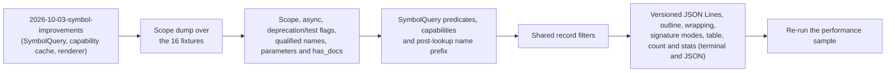

# Precise, filterable symbol reports

## Summary

This feature is the **metadata, filtering and reporting** half of the
symbol-report work. It was split out of `2026-10-03-symbol-improvements` on
2026-10-03; the author settled its open questions in three rounds on
2026-10-04, and the spec is finalized.

`2026-10-03-symbol-improvements` makes the CLI consume v2 `SymbolRecord`s
directly, adds the declaring `keyword` and `signature_text`, introduces a
`SymbolQuery` with kind and capability selection, emits versioned JSON sized
to the selection (schema 4.0), and renders through one `biscuit-terminal`
component. This feature extends each of those:

| Area | After `2026-10-03-symbol-improvements` | After this feature |
|---|---|---|
| Metadata | Keyword and signature text; kind, visibility, `static` and container from the fix. | Scope, the `async` modifier, deprecation and test flags, qualified names, and the `parameters` and `has_docs` metrics: only the facts this feature's filters and reports consume. |
| Filtering | Each command's fixed kind set; name glob or substring (case-sensitive), `--exported`, `--prelude`. | Kind, scope, exact visibility, container, tests, docs, signature shape, and explicit file/name selectors, through one filter path. |
| Reporting | Versioned `--json`, file/source order, one renderer with today's layout. | Versioned JSON Lines, outline view, width-wrapped rendering, signature modes, `--format plain\|table`, `--count`, and `--stats` (terminal or JSON). |

**Depends on `2026-10-03-symbol-improvements` and
`2026-10-03-visibility-and-kind`.** The fix corrects kind, visibility, `static`
and container data for its accepted extraction set across all 16 languages. It
retains some extractor limits (its `LIM` cells) and defers some constructs
(its `FEAT` cells). This feature keeps that accepted extraction set and adds
no new kinds; the deferred constructs are the unscheduled
`deferred-kind-precision` feature. The `LIM` cells (Go interface and struct,
and Swift class, enum and struct, reported as `Type`) are **extractor
limits**, not grammar limits, recorded in that same unscheduled entry; this
feature does not own them, and its filters and labels report those
declarations as `Type`.
Every filter and label below uses those documented limits, and the summary's
correctness claims apply to the accepted extraction set, not every
declaration a language can express.

**Every extracted fact is justified by a flag.** Metadata that no filter or
report here consumes (generic parameters, `extends`/`implements` relations,
modifiers other than `async` and `static`, the raw attribute list and the
`lines` metric) is the unscheduled `symbol-type-relations` feature. Those are
additive facets and can land later without breaking reports.

**Where extraction stands today.** Extraction is hand-written, per-language
Rust under `tree-hugger/lib/src/file/extract/`. Doc comments are already
detected in 12 languages (not Lua, Perl, Bash or Zsh), and parameters and
return types are already extracted in 13. The new facts below extend that
per-language code.

Section numbers keep their values from before the split, so gaps (A, B1, B4,
B6, B8, B9, C8, D1, D7–D10) belong to `2026-10-03-symbol-improvements` or to an
unscheduled feature.

### Compatibility

The record fields added here (`scope`, `visibility.is_test`, `metrics` with
`parameters` and `has_docs`, the `async` entry in the existing modifier facet,
`is_deprecated`) are additive and follow the existing minor-version rule on
top of schema 4.0. The attribute, generic and relation facets stay empty. The
JSON Lines and `--stats` JSON envelopes are new report shapes carrying
`report_schema_version`. The container-field rename already landed in 4.0.

Two changes are not additive:

- **`qualified_name` values and symbol IDs change.** Today the v1→v2 adapter
  fills `qualified_name` as `container::name` with `::` in every language
  (`lib/src/shared/schema_v2/mod.rs`), and `stable_symbol_key` derives the ID
  from it. This feature builds the in-file name with language-native
  separators and adds a display prefix (see “Qualified names with honest
  context”), so IDs and relation IDs change once and `EXTRACTOR_REVISION` is
  bumped.
- **CLI behavior:** locals are hidden by default in `hug symbols`, and name
  matching becomes smart-case. Both are intentional; the release notes get
  before/after examples.

---

## B. Metadata

### B2. Scope classification

`SymbolRecord` gains `scope: SymbolScope`, an enum with `Item`, `Member` and `Local`:

| Scope | Meaning | Examples |
|---|---|---|
| `Item` | declared at module or file level, or nested in a namespace or module | free functions, types, top-level constants |
| `Member` | declared inside a type, trait, interface or `impl` | methods, fields, enum variants, associated consts |
| `Local` | declared inside a function body, or a parameter | `let`, `var`, `:=`, parameters, loop bindings |

The nearest semantic declaration determines scope, not merely the nearest
brace. Declarations inside function bodies, including nested functions/types,
are local; their own type members are member-scoped. Parameters are local and
inline-module contents are items. This presentation classification is separate
from the lexical scopes used to resolve names. It keeps local bindings out of
the default listing without discarding their analysis data.

Two consequences are documented rather than special-cased:

- **Parameters are `Local` only where they are extracted.** Today 13
  languages produce `Parameter` records: C, C++, C#, Java, JavaScript,
  TypeScript, Lua, Python, Scala and Swift through explicit
  `@local.definition.parameter` captures in `lib/queries/vendor/*/locals.scm`,
  and Rust, Go and PHP through variable captures that the classifier labels
  `Parameter`. Perl, Bash and Zsh produce none, so the matrix's parameter case
  is n/a there.
- **Bash and Zsh functions defined inside a function body are `Local`,** by
  the same structural rule, even though the shell makes them global once the
  outer function runs.

```sh
outer() {
  inner() { echo hi; }   # scope: Local
}
```

Scope is computed with every declaration (see the capability table under
“`SymbolQuery` predicates”) and is lightweight data kept for declarations
excluded by a kind selection, alongside the identity, span and container data
`2026-10-03-symbol-improvements` keeps.

### B3. Async, deprecation and test flags

Only the modifier and attribute facts a filter consumes are extracted:

- **Modifiers:** fill the existing `Modifier` facet with `async` (for
  `--async`) in every language that has it, alongside `static` from the fix.
  Languages without async syntax return no `async` entry. Other modifiers
  (`unsafe`, `const fn`, `abstract`, `final`, `override`, `virtual`,
  `readonly`, `mut`) are the unscheduled `symbol-type-relations` feature.
- **Attributes and deprecation markers:** Rust and C++ attributes, Java and
  Scala annotations, C# attributes, Python decorators, Swift attributes, and
  doc comments are parsed only as far as needed to derive `is_deprecated` and
  `is_test` below. Parsing reads the full syntactic name and raw argument
  text; it does not evaluate arguments, resolve imports or expand macros. The
  raw `Attribute` facet is **not** populated and stays an empty list;
  populating it is the unscheduled `symbol-type-relations` feature.

From those, the library derives two flags.

**`visibility.is_deprecated`** is true for a declaration carrying one of these
markers; every other language and form reports false:

| Language | Marker |
|---|---|
| Rust | `#[deprecated]`, with or without arguments |
| Java | `@Deprecated` annotation, or a `@deprecated` doc-comment tag |
| C# | `[Obsolete]` |
| JavaScript, TypeScript, PHP | `@deprecated` tag in the attached doc block |
| Go | a paragraph of the attached doc comment that starts with `Deprecated:` |
| Swift | `@available(*, deprecated…)` |
| Scala | `@deprecated` |
| C++ | `[[deprecated]]` |
| Python | `@deprecated` decorator (PEP 702), including the qualified `typing_extensions.deprecated` and `warnings.deprecated` forms |

An ordinary (non-doc) comment containing the word never sets the flag:

```go
// Deprecated: use NewPoint.      <- attached doc comment: is_deprecated = true
func MakePoint() {}

func run() {
    // this path is deprecated      <- ordinary comment: no effect
}
```

**`visibility.is_test`** (new) means **test-only code**. It is true for:

- **every declaration in a recognized test file**, helpers included:
  - Go: `*_test.go`
  - Python: `test_*.py`, `*_test.py`, `conftest.py`
  - JavaScript and TypeScript: `*.test.*`, `*.spec.*`
  - Rust: any file under a package's `tests/` directory (Cargo integration
    tests and their modules)
- **declarations carrying a test attribute:**
  - Rust: `#[test]` and `#[<path>::test]` (for example `#[tokio::test]`)
  - Java: `@Test`, including qualified forms such as `@org.junit.Test`
  - C#: `[Test]`, `[Fact]`, `[TestMethod]`
- **everything inside a Rust `#[cfg(test)]` item**, including nested
  declarations. `#[cfg(any(test, feature = "x"))]` is not test-only and does
  not set the flag.

Every other language reports false. JavaScript and TypeScript `describe` and
`it` are calls, not declarations, so no test declaration is synthesized from a
call; the file-name rule covers them.

Test detection is a documented syntax/file-name heuristic, not a claim that a
runner will execute the symbol. A helper function in a test file is a test
because it is test-only code. There is no separate Python
`unittest.TestCase` rule: the file-name rule already covers `TestCase`
classes in test files, and dropping the base-class rule removes import-alias
resolution from the heuristic. Two limits are documented, not fixed:

- **Out-of-line `#[cfg(test)] mod tests;`** marks only the `mod` declaration.
  The contents of the other file (`src/foo/tests.rs`) are not tests unless
  that file matches a file-name rule.
- A Python `TestCase` subclass or `test_*` function in a file whose name
  matches no rule is not a test.

Fixtures include similarly named non-tests (a `test_helper` function in a
non-test file, a `latest.rs`) and deprecation words in ordinary comments,
which must not set either flag.

Generic parameters and `extends`/`implements` relations (formerly B4) are not
part of this feature; see the unscheduled `symbol-type-relations` feature.

### B5. Qualified names with honest context

Populate the existing `identity.qualified_name`. The container text already
lives in `container_name`, alongside `container_kind`, after
`2026-10-03-symbol-improvements`. A qualified name is a readable lookup name,
not a unique symbol ID: overloads and repeated local names still use the
existing declaration-based IDs.

Use explicit namespace/package syntax and enclosing declarations where those
establish a name. A file path alone cannot prove a Rust module path or a Python
import package. The library accepts an optional **naming context** on the
query: a known module/package root plus the name prefix it maps to. Absent
that context, use a portable scan-root-relative `file#container.member`
fallback, retaining language-native separators inside the container portion.
The standalone library defaults to the file's parent as its root. Never guess
through Rust `#[path]`, Python import configuration, or generated module
layouts.

**A qualified name has two parts, built at different times:**

| Part | Built | Stored in the cache | Example |
|---|---|---|---|
| in-file name | at extraction, from the file's own source | yes | `Symbol::new`, `schema::Record`, `Class.method`, `com.example.Point` |
| prefix | after cache lookup, from query inputs | no | `src/symbol.rs#`, or a naming-context prefix such as `crate::symbol::` |

The cached record holds only the in-file name: containers joined with the
language's native separator, plus any explicit namespace or package the
source declares (an explicit-namespace name such as `com.example.Point` is
already complete and gets no prefix). After lookup, the library prepends
either the naming-context prefix or the portable scan-root-relative file
path plus `#`, taken from query inputs that are **not** part of the cache
key. Symbol IDs derive from file identity (the normalized identity the cache
key of `2026-10-03-symbol-improvements` uses, not the path as typed) plus the
in-file name, so IDs and cache entries do not depend on the directory `hug`
runs from or on the naming context:

```text
scan root tree-hugger/      ->  qualified_name  lib/src/symbol.rs#Symbol::new
scan root tree-hugger/lib/  ->  qualified_name  src/symbol.rs#Symbol::new
both: cached in-file name Symbol::new, one cache entry, one symbol ID
```

**`hug` never supplies a naming context in this feature.** Rust and Python
names in `hug` output therefore always use the `file#Container.member`
fallback. Languages with explicit namespace syntax (Java and Scala `package`,
C# `namespace`, Go `package`, C++ `namespace`) and inline Rust `mod x { … }`
blocks still qualify from source, because the source itself establishes the
name. Rows marked "library only" below are reachable only through a library
caller that passes a context.

| Language/context | Example |
|---|---|
| Rust, module context supplied (library only) | `crate::shared::symbol::SymbolInfo::new` |
| Rust, no module context (always in `hug`) | `symbol.rs#SymbolInfo::new` |
| Rust, inline `mod schema { … }`, no context | `symbol.rs#schema::Record` |
| Python, package context supplied (library only) | `package.module.Class.method` |
| Python, no package context (always in `hug`) | `pkg/module.py#Class.method` |
| Java / Scala explicit package; C# namespace | `com.example.Point` |
| Go explicit package | `pkg.Func` |
| TypeScript / JavaScript file fallback | `src/shared/symbol.ts#Class.method` |
| C++ explicit namespace and class | `ns::Class::method` |
| C file fallback | `src/point.c#make_point` |
| Swift, PHP, Lua, Perl, Bash, Zsh | explicit namespace/package when known; otherwise `file#name` |

**Reader's note:** JavaScript and TypeScript do have module systems. A portable
file-qualified name avoids assuming how a project's module loader maps files.
Normalize displayed path separators to `/` without lowercasing paths.

**The cache key does not change.** `2026-10-03-symbol-improvements` (A7)
anticipated that the naming context would join its cache key. Because neither
the naming context nor the scan root changes a cached record, neither joins
the key; both stay query inputs applied after lookup. IDs are stable for the
same file identity, in-file name and declaration position, not across edits
or renames. Changing in-file name construction (for example, replacing
today's `::` spelling for every language with native separators) changes
`stable_symbol_key`, so every affected symbol and relation ID is recomputed
consistently and `EXTRACTOR_REVISION` is bumped in the same change.

**Basis for a later CLI option.** Two pieces already exist that a future
`hug` naming-context option could build on: the forward Rust module-to-file
mapping in `tree-hugger/cli/src/prelude.rs` (`rust_module_source_candidates`)
and the library's package-root discovery (`find_package_root`). This feature
does not wire either into naming.

### B7. Per-symbol metrics

`SymbolRecord` gains an optional `metrics` facet, computed only when requested.
Unrequested metrics are absent; an unsupported metric within a computed facet
is `None`, while a measured zero is `Some(0)`.

| Field | Consumed by | Definition |
|---|---|---|
| `parameters` | `--min-params` | declared parameters excluding a separate receiver; one variadic parameter counts once; known empty list → 0 |
| `has_docs` | `--undocumented`, `--stats` doc coverage | nonempty attached documentation after removing comment delimiters; ordinary comments do not count |

Doc comments are detected today in 12 languages; for Lua, Perl, Bash and Zsh
`has_docs` is `None` (unsupported), not `false`. A `None` value never matches
`--undocumented`, and such records are left out of the doc-coverage
denominator and counted separately as `unavailable` (see “`--stats`”). Parameters are extracted
today in 13 languages; elsewhere `parameters` is `None`, and tests label
whether that is unsupported extraction or a language without declared
parameter lists.

The `lines` metric is not part of this feature, because no filter or report
here consumes it; see the unscheduled `symbol-type-relations` feature.
Cyclomatic complexity is not part of this feature either; see the unscheduled
`cyclomatic-complexity` feature.

Doc filtering needs only attached docs, not full structured parsing. Metrics
never force diagnostics. The tree-hugger package's
[god-files analysis](../../lib/src/god_files/analysis.rs) keeps its current
declaration-span size/risk calculations; this feature introduces no metric
with the same units, so it does not change god-files scoring.

### B9 extensions. `SymbolQuery` predicates

`2026-10-03-symbol-improvements` defines `SymbolQuery` with kind and
capability selection. This feature adds predicates and capabilities:

```rust
let query = SymbolQuery::new()
    .kinds([SymbolKindV2::Function, SymbolKindV2::Method])
    .scopes([SymbolScope::Item, SymbolScope::Member])
    .visibility(VisibilityLevel::Public)
    .exclude_tests(true);
```

Library defaults select all kinds and scopes; hiding locals is a CLI default
only. The query also carries two inputs that are applied after cache lookup
and are not cache-key inputs: the scan root for the file-qualified prefix,
and the optional naming context from “Qualified names with honest context”
(`hug` leaves the naming context unset).

What is computed when:

| Fact | When computed |
|---|---|
| scope, the `async` modifier, the in-file qualified name | always, with declarations |
| `is_test`, `is_deprecated` (attribute, doc-marker and file-name rules) | a capability, computed only when a filter or report requests it; `--json` and `--jsonl` always request it, so a `false` in machine output always means "computed and not set", never "not computed" |
| `parameters`, `has_docs` metrics | a capability, computed only when a filter or report requests it |

The capabilities follow the coverage rules of
`2026-10-03-symbol-improvements`: a requested capability that a cache entry
lacks is a partial hit, and the envelope's `completed_capabilities` names
what was computed. Additional required work per request:

| Request | Required analysis |
|---|---|
| Outline | declarations plus containment, including excluded parent identities |
| Undocumented/deprecated/test filtering | attached docs and the test/deprecation capability; structured docs only when requested |
| Metrics/stats | only requested metrics (`parameters`, `has_docs`) and doc presence, not diagnostics |

The library owns record filtering once; the CLI owns a separate presentation
step for grouping classes and building outlines.

---

## C. Filtering

All filters apply to `functions`, `types`, `symbols` and `classes` alike;
`imports` gets the name and file filters. Filters combine with AND; a filter
that takes a list matches if any of its values matches (OR).

### C1. `--kind <kind>`

`--kind` is repeatable and accepts the snake_case spelling of each
`SymbolKindV2` variant name: `function`, `method`, `type_alias`,
`enum_variant` and so on (`hug symbols --kind trait --kind interface`). The
fixed command sets are
defined by `2026-10-03-symbol-improvements`; `symbols` applies its scope
default after the kind set. An explicit kind set intersects the command set;
it does not widen it. Unknown kind names are argument errors, and unsupported
kinds return no matches. The intersection is pushed into extraction through the
same mechanism as the command sets.

`classes` keeps the container kinds defined by
`2026-10-03-symbol-improvements` (Class, Type, Interface and Trait), along
with its current static/instance partitioning. Kind, scope, name, visibility, test, docs and
deprecation filters select containers. `--in` matches the selected class/type's
own name as a member container. Member-shaped filters (async, return/parameter
type, parameter count, static/instance) select its displayed members. To apply
visibility/kind/docs predicates directly to individual members, use
`hug symbols --in Box` or `hug functions --in Box` instead. A selected container
can therefore have zero matching members; count/stats count selected containers,
not contextual member rows. In `--json`, the class report stores selected
container records with a separate `members` map keyed by container ID, whose
values are lists of selected member records; a JSON Lines class line instead
carries its own `members` list (see “JSON Lines”). This preserves class
grouping while sharing the library's record predicates.

### C2. `--scope item|member|local`

`--scope` is repeatable. **`hug symbols` defaults to `item` and `member`.**
Explicit scopes replace defaults: `--scope local` selects only locals;
`--scope item --scope member --scope local` or `--all-scopes` selects all three.
`--all-scopes` conflicts with `--scope`. Other commands start with all scopes
within their command kind set, so nested functions remain discoverable. On
`tree-hugger/` this takes `hug symbols` from 8,593 lines (the baseline in
`2026-10-03-symbol-improvements`) to about 2,550.

### C3. Visibility and export filtering

`--visibility <level>` matches the exact existing visibility level and is
repeatable. Unknown matches only `--visibility unknown`; it is never treated
as public or private. These levels describe different access rules across
languages, not a single ordered scale.

Keep `--exported` as an independent test of `visibility.is_exported`, including
re-exports. A public class method can be public without being a module export.
**Reader's note:** the original alias to `--min-visibility public` would change
existing export selection and hide export conventions in languages without
visibility keywords. Preserve the two concepts separately.

`--visibility` is the only visibility filter. There is no `--min-visibility`:
`Crate`, `Package`, `Internal` and `Protected` express different audiences,
the visibility enum defines no ordering, and restricted Rust paths are already
collapsed to `Crate` by the prerequisite fix. A wider query lists its levels
explicitly; for Rust, `--visibility crate --visibility public`, subject to the
fix's documented precision limits. A threshold flag is deferred and not
planned.

### C4. Container and qualified-name matching

- `--in <name>`: members of a named container
  (`hug functions --in TreeFile`).
- A name filter containing the language's separator (`::`, `.`, `#`) matches
  against `qualified_name`. In `hug`, Rust and Python names are always
  file-qualified (see “Qualified names with honest context”), so
  `hug symbols --name 'symbol.rs#*'` selects every declaration in a
  `symbol.rs` at the scan root, and `hug symbols --name 'ns::Class::*'`
  selects the members of a C++ class declared in namespace `ns`. A wildcard
  pattern is anchored at the start of the name unless it begins with `*`, and
  a file-qualified name starts with its scan-root-relative path, so a file
  below the scan root needs a leading `*` (`--name '*/symbol.rs#*'`). `--name` handles file-qualified names
  containing `/` that positional classification would otherwise interpret as
  paths.
- `--in` matches the immediate `container_name` with the same name rules;
  supplying a qualified container pattern disambiguates repeated names.

### C5. Smart-case name matching

The current "fuzzy" match is a case-sensitive substring match
(`wildcard_match` in `cli/src/scanner.rs`). The new rules:

- All-lowercase input matches case-insensitively.
- Any uppercase letter makes the match case-sensitive.
- `--exact` forces whole-string literal matching, as does a trailing `!`.
  Both retain smart-case rules; wildcards under exact matching are literal.
- Only `*` is a name wildcard, matching any sequence; no regex, `?` or bracket
  syntax is introduced. Non-wildcard input retains substring matching.
- Smart case applies to symbol/container inclusion and exclusion patterns.
  Type text and file patterns keep their existing case rules. Apply case
  folding consistently to both pattern and candidate without slicing through
  UTF-8 character boundaries; non-ASCII names need regression coverage.

### C6. Tests, docs and deprecation

- `--exclude-tests` / `--tests-only` are mutually exclusive and use the
  documented `is_test` heuristic under “Async, deprecation and test flags.”
- `--undocumented` lists symbols with `has_docs == Some(false)`, which is a
  docs coverage check. `has_docs == None` (Lua, Perl, Bash, Zsh) never
  matches: an unsupported language is not reported as undocumented. For
  example, `hug functions --undocumented` over a tree of `.rs` and `.sh`
  files lists only undocumented Rust functions.
- `--deprecated` lists symbols marked deprecated.

### C7. Signature shape

- `--async`
- `--returns <glob>`, for example `--returns 'Result<*'`
- `--param-type <glob>`
- `--min-params <n>`

These match declared type text, not resolved types. Type globs are whole-string
and case-sensitive with `*` as the wildcard. Missing type text cannot match;
`--param-type` needs any non-receiver parameter to match. Shape predicates select
function-like declarations only, including constructors when applicable;
`--min-params 0` does not select unrelated types with absent parameters.

### C9. Explicit file and name filters

Positional filters are auto-classified as files or names (`is_file_filter_token`
in `cli/src/scanner.rs`). `--file <path|glob>` and `--name <pattern>` bypass
that classification when it guesses wrong. Values within each include list
are alternatives; file and name lists intersect, and exclusions take precedence.
Keep existing `--exclude-files`, `--exclude-symbols`, `--language`, `--prelude`,
`--comments`, `--sort` and the grouping flags, documenting any aliases/conflicts.
File references use `biscuit-file::FileReference`; discovery retains `.gitignore`
and the default fixture exclusions, with explicitly targeted files re-included.
`imports` retains file-only positional tokens and gains symbol matching through
explicit `--name`, avoiding an accidental positional behavior change. An
import matches when either its alias or its original name matches, so
`hug imports --name HashMap` finds `use std::collections::HashMap as Map;`
and so does `--name Map`.

### C10. One filter path

`hug classes` re-implements export, prelude and name filtering
(`cli/src/main.rs:1056-1084`), and `summarize_file` repeats the
kind-and-filter logic once per command. Each declaration command builds the
common query predicates; records are
filtered once before presentation. Classes can apply that shared predicate to
containers and members as described under “`--kind <kind>`.” Imports use the
same name matcher on import records, preserving alias/original-name fields.

---

## D. Reporting

### D2. JSON Lines

`--jsonl` writes one line per selected record, in deterministic file/source
order. Each line is a self-describing, versioned envelope, so a saved or
piped line is usable without guessing its language or record version:

```json
{"report_schema_version":"…","schema_version":"…","file":"src/point.rs","language":"rust","completed_passes":[…],"completed_capabilities":[…],"record":{…}}
```

- `report_schema_version` and `schema_version` have the same meaning and
  values as in the `--json` envelope; `file`, `language`, `completed_passes`
  and `completed_capabilities` repeat the per-file values from that envelope.
- `record` is one selected `SymbolRecord`.
- On a `hug classes` line, `record` is the selected container and the line
  adds `members`: a list of that container's selected member records, so a
  class line carries the container and its members together. (The `--json`
  class report uses a map keyed by container ID instead; a line has only one
  container, so it needs no key.)
- Lines carry no source blobs: records omit `declaration_text` and other
  source/body/AST blobs as `--json` does. Size is controlled by omitting blobs,
  not by dropping the interpretation metadata.

JSON Lines follows the `--json` ordering rule of
`2026-10-03-symbol-improvements` (D7): files are always emitted in portable
path order, whatever `--sort` says, and a non-default `--sort` orders the
records within each file using the same keys and tie-breakers. For example,
`--jsonl --sort name` emits every line for `a/x.rs` (sorted by name) before
any line for `b/y.rs`. Output therefore keeps streaming: buffering is bounded
by one file's selected records plus any files that finished ahead of the next
file in path order, never by the whole result. Do not emit records in
worker-completion order. Paths follow the portable scan-root-relative
convention of the `--json` envelope.

A stdout write error stops work; a broken pipe exits quietly without a panic.
Read/parse failures go to stderr and produce a nonzero status, even if earlier
JSON Lines were emitted. An empty successful JSON Lines report has zero lines.

### D3. Outline view

`--tree` nests members under their container, using `relations.members`. The
container line shows the container's own declaration only; inheritance
relations are not shown, because this feature does not extract them (see the
unscheduled `symbol-type-relations` feature):

```text
lib/src/file/tree_file.rs
  pub struct TreeFile
    pub fn new(path: P) -> Result<Self, TreeHuggerError>
    pub fn symbols(&self) -> Result<Vec<SymbolInfo>, TreeHuggerError>
    …
```

This replaces the container suffix in that view; the flat view keeps it.
Containment is a cheap capability independent of reference resolution. Match
members by container ID where available, including out-of-body Rust impl and
Go receiver declarations. Use a marked contextual container heading when a
selected member's container was excluded or is outside the file; do not emit
that heading as a selected record or include it in count/stats. Repeated impl
blocks are grouped under the type, and missing parents never drop members.
Overloads remain separate rows ordered by source position.

How `--tree` combines with other options:

| Combination | Behavior |
|---|---|
| `--tree` alone | files in portable path order; containers and members in source order |
| `--tree --sort name\|kind` | within each file, orders containers, and separately orders the members under each container, using the keys and tie-breakers of `2026-10-03-symbol-improvements` (D7); files stay in path order |
| `--tree --group-by-file` | accepted; no extra effect, because the outline is already grouped by file |
| `--tree --group-by-module` | adds a module (directory) heading above each file |
| `--tree --format plain` | the outline without styles or wrapping |
| `--tree --format table` | argument error |
| `--tree` with `--json`, `--json-full`, `--jsonl`, `--count` or `--stats` | argument error |

### D4. Rendering goes through `biscuit-terminal`

The single renderer from `2026-10-03-symbol-improvements` is built from
`UnorderedList` and `Prose` (and biscuit-terminal's existing `Table` for
`--format table` and the `--stats` terminal view), as the repo's best
practices require. This feature changes nothing in the `biscuit-terminal`
package. Long signatures then wrap at the terminal width with a
hanging indent, instead of running to 200+ characters. One example today is
`struct FileSummary { file: PathBuf, … }`. Hyperlinks keep their current OSC 8
behavior for interactive output. `--plain`, `--format plain`, redirected text
and machine formats disable ANSI styles and OSC 8 links. Width wrapping applies
only to terminal prose/table output, not JSON or JSON Lines. Escape source text
as literal component content so embedded control sequences or markup in a
signature cannot become terminal commands or unintended styling.

### D5. `--signatures full|short|none`

| Mode | What it shows |
|---|---|
| `full` | `signature_text`, the language-native declaration header defined by `2026-10-03-symbol-improvements` |
| `short` (default) | today's compact form, with type field lists truncated past 4 entries (`{ a, b, c, d, … +3 }`) |
| `none` | names only, with normal location/container context |

### D6. Count, stats and formats

#### `--count`

`--count` prints the number of matches and nothing else: a single decimal
integer plus newline (including 0).

#### `--stats`

`--stats` selects **what** is reported: counts of the selected declarations
by kind, visibility and language, plus doc coverage. Doc coverage counts
`documented` (records with `has_docs == Some(true)`) over `total` (records
with a known `has_docs`); records whose language has no doc-comment detection
(`has_docs == None`) are excluded from `total` and reported as `unavailable`.
`ratio` is `documented / total`, and is null when `total` is 0 (including zero
matches). Synthetic export records are reported separately from declaration
doc coverage. Every filter applies before counting. `hug classes --stats`
counts selected containers only, never their member rows. `hug imports`
rejects `--stats` as an argument error, because import records carry none of
the aggregated facts. `--sort`, `--signatures` and
`--tree` have no meaning for an aggregate and are argument errors with
`--stats`. Grouping by package is not part of this feature; see the
unscheduled `stats-package-grouping` feature.

`--stats` composes with how it is written:

- **Terminal (default, also `--format table`):** three small biscuit-terminal
  `Table`s (by kind, by visibility, by language) followed by one doc-coverage
  line that includes the `unavailable` count. The tables' arrangement and the
  coverage line's wording are left to the golden. `--stats --format table` is
  accepted and identical to the default; it is redundant but not an error.
- **`--stats --format plain`:** the same tables and coverage line without ANSI
  styles, OSC 8 links or width wrapping.

- **`--stats --json`:** a versioned stats envelope:

  ```json
  {"report_schema_version":"…",
   "root_dir":"…",
   "stats":{"by_kind":{…},"by_visibility":{…},"by_language":{…},
            "doc_coverage":{"documented":40,"total":50,"unavailable":3,"ratio":0.8},
            "synthetic_exports":…},
   "errors":[]}
  ```

  `root_dir` follows the `--json` envelope's convention. There is no record
  `schema_version`, because the envelope carries no records. `ratio` is null
  when `total` is 0.

  `errors` follows the same rule as the `--json` envelope of
  `2026-10-03-symbol-improvements`: it is always present and comes last, each
  entry is `{file, kind, message}`, and a non-empty array means a nonzero exit
  with each failure also written to stderr.

#### `--format plain|table`

- **`--format plain`:** the default terminal layout without ANSI styles, OSC 8
  links or width wrapping.
- **`--format table`:** one biscuit-terminal `Table` row per selected record,
  with these columns:

  | Column | Content |
  |---|---|
  | Location | `file:line`; an OSC 8 link when output is interactive |
  | Kind | the record's kind |
  | Visibility | the record's visibility level |
  | Name | the record's name |
  | Signature | the signature in the `--signatures` mode; wraps within the column |

TSV, Markdown and tags formats are not part of this feature; see the
unscheduled `extra-report-formats` feature.

#### Output modes

Exactly one output mode is active: default terminal text, `--json`,
`--json-full`, `--jsonl`, `--count`, `--stats`, or explicit `--format`. The
one exception is `--stats`, which composes with `--json` (the stats envelope),
with default terminal output or `--format table` (the stats tables), or with
`--format plain` (unstyled stats tables). Every other combination of modes,
including `--stats` with `--json-full`, `--jsonl` or `--count`, is an argument
error. `--plain` can disable terminal styling but does not modify
machine formats. `--tree` is valid only with terminal output (see “Outline
view”). Signatures/comments apply only to text formats. `classes
--static-only` and `--instance-only` become an argument-parsing conflict
(today both flags are accepted together). Empty selections succeed;
analysis errors fail and remain visible on stderr, including under count and
stats modes.

---

## Risks and implementation notes

- **Start depends on unbuilt work.** This feature builds on
  `2026-10-03-symbol-improvements`'s `SymbolQuery`, capability-aware cache
  and single renderer, which are planned there but not yet built. Do not
  start until those land.
- **`declaration_list` is ambiguous.** The same node kind holds a Rust inline
  module body, C++ and C# namespace bodies, and Rust `impl`/`trait` bodies.
  `is_member_owner_kind` (`lib/src/file/extract/classify.rs`) treats every
  `declaration_list` as a member owner, so scope must classify by the
  parent node's kind (Rust `mod_item`, C++ `namespace_definition`, C#
`namespace_declaration` → `Item`;
  `impl_item`, `trait_item` → `Member`). The existing helpers
  `is_local_declaration` (`lib/src/file/extract/declaration.rs`) and
  `is_member_owner_kind` are the starting point. **The first plan task is a
  scope dump over the 16 language fixtures** (each declaration with its
  current kind, container and proposed scope), reviewed before the classifier
  is written.
- **IDs are coupled to qualified names.** `stable_symbol_key` hashes the
  qualified name, so the new in-file name construction changes symbol and
  relation IDs. Bump `EXTRACTOR_REVISION` (today `"5"`) and add the matching
  stale-revision case to `cli/tests/symbols/cache_upgrade.rs`.
- **Tests may rely on today's `::` spelling.** Existing tests and goldens may
  assert `container::name` for languages whose native separator is `.`;
  rewrite those expectations in the same change (pre-authorized below).
- **Rust fixtures live under a `tests/` directory.** The per-language fixtures
  sit in `lib/tests/fixtures/symbols/`, below the `tree-hugger` library
  package's `tests/` directory, so the Rust file-name rule marks every
  declaration in `rust.rs` as a test when it is read in place. Library tests
  that assert `is_test == false` on Rust declarations must analyze an isolated
  copy outside a package `tests/` directory (the Test Toolkit's temporary
  fixtures) or supply a path that is not under one. *(Implementation note,
  not an author decision.)*
- **Out-of-line `cfg(test)` modules** are a documented limit (see “Async,
  deprecation and test flags”), not a defect to fix here.
- **Breaking CLI changes** (smart-case matching, locals hidden in
  `hug symbols`) need before/after examples in the release notes.

## Sequencing



Each phase leaves `hug` working, and updates relevant docs/tests with its code.

## Definition of done

- [ ] `just test`, `just test-l2` and `just lint` pass in `tree-hugger/`.
- [ ] Every per-language library matrix under “Testing” has a row for all 16
      languages, enforced by the coverage guard.
- [ ] One CLI golden exists per output format or view listed under “CLI output
      goldens”, and each focused case is covered.
- [ ] `hug symbols` on `tree-hugger/` hides locals by default; `--all-scopes`
      restores them.
- [ ] `--json` and `--jsonl` output always includes computed `is_test` and
      `is_deprecated`; the test/deprecation capability appears in
      `completed_capabilities`.
- [ ] A symbol's ID and cache entry are identical when `hug` runs from two
      different scan roots over the same file; only the displayed
      `qualified_name` prefix differs.
- [ ] `EXTRACTOR_REVISION` is bumped and `cache_upgrade` covers the previous
      revision.
- [ ] The performance sample of `2026-10-03-symbol-improvements` (its
      “Performance sample” section, same host, commands and inputs) is re-run
      after landing and recorded in the implementation log. There is no hard
      gate; a regression is recorded with its cause.
- [ ] Every doc listed under “Documentation to update in the same change” is
      updated, and the release notes carry the before/after examples.
- [ ] Agent terminal state is "implementation complete, ready for review"; no
      move to `_completed`, no `just complete`, no commit unless asked.

## Decisions

### Resolved

Carried from `2026-10-03-symbol-improvements` before the split:

- **Symbol listings hide locals by default.** Explicit scopes replace that
  default; library queries still default to all scopes.
- **Exports and visibility stay separate.** Exact visibility filters are
  available without imposing an ordering across different access models.
- **Qualified names reflect known context.** A file-qualified fallback is
  preferable to a plausible but incorrect module name.
- **No new matching dependency.** Extend the current wildcard matcher.

Decided by the author on 2026-10-03:

- **This feature was split out and trimmed.** Scoped references (with `hug
  refs`), `--changed`, cyclomatic complexity, TSV/Markdown/tags formats and
  package grouping in `--stats` moved to unscheduled features; the original
  spec was too large to implement and review as one change.
- **Library matrices are exhaustive; CLI goldens are representative.** Each
  extraction fact is asserted for all 16 languages in library tests, while CLI
  output uses one golden per output format over the 16-language `multi/`
  tree, matching the prerequisite fix's rule.

Decided by the author on 2026-10-04:

- **JSON Lines lines are versioned envelopes.** Each line is
  `{report_schema_version, schema_version, file, language, completed_passes,
  completed_capabilities, record}`, plus `members` on class lines, with no
  source blobs. A saved or piped line must be usable without guessing its
  language or record version; size is addressed by omitting blobs, not
  interpretation metadata.
- **Visibility filtering is exact only.** `--visibility <level>` is repeatable;
  `--min-visibility` is deferred and not planned. The levels describe
  different audiences with no defensible cross-language ordering.
- **No new kinds.** This feature keeps the prerequisite fix's accepted
  extraction set; its `FEAT` cells moved to the unscheduled
  `deferred-kind-precision` feature, and tests distinguish “unsupported
  extraction” from “language has no construct.” This bounds extraction work
  that grammar support cannot guarantee.
- **Metadata is limited to what this feature's filters and reports consume.**
  Kept in every applicable language: scope, qualified names, the `parameters`
  and `has_docs` metrics, the `async` modifier, attribute parsing only for
  `is_deprecated` and `is_test`, and `static` from the fix. Generic
  parameters, `extends`/`implements`, the other modifiers, the raw attribute
  facet and the `lines` metric moved to the unscheduled `symbol-type-relations`
  feature, and the outline's container line drops inheritance relations.
  Every extracted fact is then justified by a flag, and facets can be added
  later additively.
- **`hug` supplies no naming context.** The library accepts an optional naming
  context on the query; `hug` never sets it in this feature, so its Rust and
  Python names always use the file-qualified fallback while explicit
  namespaces and inline Rust modules still qualify from source. This avoids a
  guessed module path now; the existing prelude mapping and package-root
  discovery are a basis for a later option.
- **`--stats` composes with `--json` or terminal output.** It selects what is
  reported; JSON gets a versioned stats envelope with the trailing `errors`
  rule, and terminal output gets three `Table`s plus a doc-coverage line. This
  is the single exception to “exactly one output mode.” Aggregates are useful
  to scripts as well as people.
- **`--format table` columns are Location, Kind, Visibility, Name and
  Signature,** using biscuit-terminal's existing `Table` with no change to that
  package. These are the fields a reader scans for, and reusing `Table` keeps
  the change inside tree-hugger.
- **Remaining reporting defaults are accepted.** `--tree` keeps file order;
  `--sort name|kind` orders containers and, separately, members within each
  file. `--tree` with `--group-by-file` has no extra effect, with
  `--group-by-module` adds a module heading, and with `--format table` is an
  argument error. With `--stats`, all filters apply and `--sort`,
  `--signatures` and `--tree` are argument errors. `--format plain` is the
  terminal layout without styles or wrapping. Each follows from an existing
  rule without a new concept.

Decided by the author on 2026-10-04 (second round):

- **JSON Lines follows the `--json` ordering rule.** Files stay in portable
  path order; a non-default `--sort` orders records within each file, and
  output keeps streaming with bounded buffering. One ordering rule for both
  machine formats, without buffering the whole result.
- **Unknown `has_docs` is neither documented nor undocumented.** Where a
  language has no doc-comment detection (Lua, Perl, Bash, Zsh), `has_docs` is
  `None`, never matches `--undocumented`, and is excluded from the coverage
  denominator and reported as `unavailable`. Coverage figures must not count
  an unmeasured symbol either way.
- **Stats details.** The stats JSON envelope is `{report_schema_version,
  root_dir, stats: {by_kind, by_visibility, by_language, doc_coverage:
  {documented, total, unavailable, ratio}, synthetic_exports}, errors}`, with
  a null `ratio` when `total` is 0 and no record `schema_version`. Terminal
  stats accept `--format plain` (unstyled tables) and `--format table` (the
  default, redundant but accepted). `hug classes --stats` counts selected
  containers only, and `hug imports` rejects `--stats`. Accepting both formats
  keeps `--format` meaning the same thing in every command, and an aggregate
  has no meaning for import records.
- **`--tree --format plain` is allowed** and prints the outline without styles
  or wrapping, matching `--format plain`'s definition everywhere else.
- **Inline Rust modules qualify from source,** for example
  `symbol.rs#schema::Record`: the `mod` block itself establishes the name, so
  no guessed module path is involved.
- **Class `members` shape differs by format.** A JSON Lines class line carries
  a `members` list, while the `--json` class report uses a `members` map keyed
  by container ID. A line holds one container and needs no key; the whole
  report holds many.

Decided by the author on 2026-10-04 (third round):

- **Qualified-name prefixes are applied after cache lookup.** The cached
  record holds only the in-file name (`Symbol::new`, `schema::Record`;
  explicit-namespace names such as `com.example.Point` stay complete). The
  library prepends the scan-root-relative path plus `#`, or a naming-context
  prefix, from query inputs outside the cache key, and IDs derive from file
  identity plus the in-file name. IDs and cache entries then do not depend on
  where `hug` runs, and the cache key of `2026-10-03-symbol-improvements` does
  not grow. Changing name construction changes IDs, so `EXTRACTOR_REVISION`
  is bumped.
- **`is_test` means test-only code.** It covers every declaration in a
  recognized test file (Go, Python, JS/TS and Rust `tests/` rules), declarations
  with a Rust, Java or C# test attribute, and everything inside Rust
  `#[cfg(test)]`; helpers in test files count. The Python `unittest.TestCase`
  base-class rule is dropped as the simpler choice: the file-name rule covers
  `TestCase` classes in test files and avoids import-alias resolution.
  Out-of-line `#[cfg(test)] mod tests;` content is a documented limit. A flag
  that answers "is this test-only?" is more useful to `--exclude-tests` than
  one that tracks only runner entry points.
- **`is_deprecated` has an explicit source list** per language (attributes,
  annotations, decorators, doc-comment tags and Go's `Deprecated:` paragraph);
  ordinary comments never set it, and other languages report false. Each
  source is a convention the language's own tooling recognizes.
- **Compute-on-demand defaults are accepted.** Scope, `async` and the in-file
  qualified name are always computed with declarations; test/deprecation
  detection and metrics are capabilities computed on request, and `--json`
  and `--jsonl` always request test/deprecation detection so `false` never
  means "not computed". The performance sample of
  `2026-10-03-symbol-improvements` is re-run after landing and recorded in the
  implementation log, with no hard gate. Cheap facts every report shows stay
  unconditional; parsing that only some filters need stays opt-in.
- **Smaller accepted defaults.** The scope matrix's parameter case applies only
  where parameters are extracted; `imports --name` matches alias or original
  name; `--kind` takes the snake_case of `SymbolKindV2` names; Bash and Zsh
  nested functions are `Local`. Each follows the structural rule already
  stated, with no special case.
- **The `LIM` cells are extractor limits,** not grammar limits, recorded in
  the unscheduled `deferred-kind-precision` entry.
- **No spike is warranted.** The risk assessment found the scope helpers
  (`is_local_declaration`, `is_member_owner_kind`) already exist and the
  attribute and annotation node shapes are well known; the scope dump that
  opens the plan covers the remaining uncertainty.

### Open Questions

None. Every question raised so far has an author decision above.

---

## Pre-authorized implementation actions

The author has authorized the implementer to take these actions without
pausing for approval:

- **Stale unscheduled entries.** Correct text in entries under
  `tree-hugger/features/_unscheduled/` that this feature's decisions made
  stale (for example, an entry that still says this feature provides the
  `lines` metric, which now belongs to the unscheduled `symbol-type-relations`
  feature).
- **Fixtures and tests asserting superseded behavior.**
  - Extend the per-language fixtures and add the test-file fixtures described
    under “Shared fixtures”.
  - Rewrite existing CLI and library tests whose expectations this feature
    deliberately changes: case-sensitive name matching, locals shown by
    default in `hug symbols`, the old `classes` filtering, and the
    `container::name` qualified-name spelling and the IDs derived from it.
- **Query files.** Edit the vendored query files under `lib/queries/vendor/`
  where scope, attribute or test detection requires it, updating query
  provenance to match.
- **`classes --static-only` / `--instance-only` conflict.** Make the two flags
  conflict at argument parsing (today both flags are accepted
  together) and rewrite the tests this affects.

Anything outside this list still needs the author, including any new crate
dependency and changes outside the `tree-hugger` area other than the
tree-hugger skill and the `docs/` updates listed under “Documentation to
update in the same change”.

---

## Testing

**Library extraction facts are tested in every supported language.**
"Supported" means every value of `ProgrammingLanguage::all()`, today 16
languages: Rust, TypeScript, JavaScript, Go, Python, Java, C#, C, C++, Swift,
Scala, PHP, Perl, Lua, Bash and Zsh.

A capability that a language can't express is asserted as not applicable
(`None`, empty, or "filter matches nothing"). Separately label unsupported
extraction; those constructs are not falsely classified as
absent from the language. Each row identifies representative positive and
negative cases, rather than pretending every feature is applicable everywhere.

**CLI output is tested representatively**: exhaustive language/value
combinations belong in library tests; CLI tests prove wiring and output shape.

All tests named here are L1 unless marked otherwise. Run them with `just test`
in `tree-hugger/`, using nextest through that recipe; use the monorepo Test
Toolkit for isolated CLI/cache fixtures. Repository fixture reads use
runtime harness roots and literal joined paths that the test-input index can
resolve. No implementation test should read this dated spec as its contract.

### Shared fixtures

- **`lib/tests/fixtures/symbols/<language>.<ext>`**, introduced by the fix and
  extended by `2026-10-03-symbol-improvements`. This feature extends each one
  with:
  - an `async` declaration where the language has async syntax
  - a deprecated symbol where syntax or doc tags express deprecation, and an
    ordinary comment containing a deprecation word
  - a recognized test and a similarly named non-test where detection exists
  - documented and undocumented functions, and functions with zero, one and
    several parameters (including a receiver and a variadic where they exist)
  - same-named methods on two types where methods exist
  - an explicit namespace/package declaration, and an inline Rust module,
    where the language has one
- **Test-file fixtures** for each file-name rule: Go `*_test.go`; Python
  `test_*.py`, `*_test.py` and `conftest.py`; JavaScript and TypeScript
  `*.test.*` and `*.spec.*`; and a Rust file under a package `tests/`
  directory. Each holds a test and a non-test helper, which are both
  `is_test`. Rust fixtures that must read as non-test are analyzed from an
  isolated copy (see “Risks and implementation notes”).
- **The `lib/tests/fixtures/symbols/multi/` tree** from
  `2026-10-03-symbol-improvements`, for multi-file, ordering and CLI golden
  tests.

### Coverage guard

The language-coverage test (iterate `ProgrammingLanguage::all()`, fail on a
missing fixture or matrix row) is extended to check every matrix below.

### Per-language library matrices

| Capability | Asserted per language |
|---|---|
| Scope | at least one `Item`, one `Member` (or n/a) and one `Local` with the expected classification; a parameter is `Local` in the 13 languages that extract parameters and n/a in Perl, Bash and Zsh; Rust inline-module and C++/C# namespace contents are `Item`, Rust `impl`/`trait` contents are `Member`; Bash/Zsh nested functions are `Local` |
| Async, deprecation and test flags | `async` is reported exactly on the fixture's async declarations (n/a where the language has none); `is_deprecated` is set exactly on each marker in the source table and false elsewhere (including ordinary comments); `is_test` is set exactly by the file-name, attribute and `cfg(test)` rules, false for `cfg(any(test, …))`, and false in languages without a rule; the attribute facet stays empty |
| Qualified names | cached in-file names with native separators; explicit-namespace names; portable file-qualified fallbacks with no context; library-only context-supplied names; for items/members/nested declarations, including ambiguous module layouts; the same file under two scan roots yields one ID |
| Metrics | `parameters` and `has_docs` for each fixture function; missing parameter lists, nested callables and languages without doc-comment detection (`None`, labeled unsupported, excluded by `--undocumented`) have explicit expected values |
| Kind coverage | each deferred `FEAT` construct is asserted as unsupported extraction, distinct from `—` (language has no construct) |
| Selection filters | every `SymbolQuery` predicate returns exactly the expected symbol set for that language's fixture; "matches nothing" is asserted where the construct is n/a |
| Containment | members attach to the right container, including Rust `impl` blocks, TS classes, Go receiver methods and Python classes |

### CLI output goldens

One golden per output format or view this feature adds, built from the
16-language `multi/` tree and compared after `strip_ansi_codes` and path
redaction (the existing `corpus` helpers), so they hold on every OS:
`--format table`, `--format plain`, `--jsonl`, `--tree`, `--stats`,
`--stats --json` and `--signatures full`. `--count` is asserted as a single
integer line.

### Focused cases

Filter intersections and conflicts; exact versus smart-case matching,
including non-ASCII names; `--file`/`--name` versus positional
classification; file-qualified and namespace `--name` patterns, including the
leading `*` for files below the scan root; class/member counts; contextual
outline parents; `--tree` with `--sort`, `--group-by-file`,
`--group-by-module` and `--format table`; JSON Lines parsing, round-trip,
envelope fields, `members` on class lines, and failure after partial output;
`--jsonl --sort name|kind` over several files (files in path order, records
sorted within each file); `--stats --json` with a failing file (trailing
`errors`, nonzero exit); `--stats --json` envelope fields, including
`doc_coverage.unavailable` from a Lua/Bash file and a null `ratio` on zero
matches; `--undocumented` excluding `has_docs == None` records; `--stats` with
each filter, with `--format plain` and `--format table` (accepted), and with
`--sort`, `--signatures` and `--tree` (argument errors); `hug classes --stats`
counting containers only; `hug imports --stats` (argument error);
`classes --static-only --instance-only` (argument error); output-mode conflicts; width wrapping with injected
dimensions; escaped control sequences in signatures; empty selections;
`--kind type_alias` and an unknown `--kind` (argument error);
`hug imports --name` matching an alias and an original name; `--json` and
`--jsonl` carrying computed `is_test`/`is_deprecated` without a test or
deprecation filter; a warm run from a different scan root reusing the cache
entry with a different displayed prefix; a stale-revision cache entry after
the `EXTRACTOR_REVISION` bump.

### Host coverage

Path rendering and terminal-width wrapping are OS-sensitive. Their tests run
on the environments CI schedules for the area, and follow the `os` skill's
guidance for path comparison. This feature adds no CI environments or gates.
Width tests with injected dimensions are L1; tests requiring a real terminal
use the area's `just test-l2` and shared harness, with no terminal/browser
focus changes.

---

## Documentation to update in the same change

- **`tree-hugger/docs/symbol-kinds-and-visibility.md`:** scope (including
  parameters only where extracted and Bash/Zsh nested functions as `Local`),
  the `async` modifier, the test rules (test-only code, helpers in test files,
  the out-of-line `cfg(test)` limit) and the deprecation source table,
  qualified-name spelling per language (the cached in-file name, the
  post-lookup prefix, and that `hug` always uses the file-qualified fallback
  for Rust and Python), the `parameters` and `has_docs` definitions, and which
  constructs remain unsupported extraction.
- **`tree-hugger/docs/symbol-reports.md`** (created by
  `2026-10-03-symbol-improvements`): every filter with one example, the output
  formats and views with a short sample of each (including the `--format
  table` columns and the `--stats` forms), how `--tree` combines with
  sorting, grouping and formats, the output-mode rule and its `--stats`
  exception, JSON Lines ordering, the JSON Lines and stats JSON envelopes
  (including `doc_coverage.unavailable` and a null `ratio`), and the different
  `members` shapes in `--json` and JSON Lines class output.
- **`tree-hugger/README.md`, `cli` help text and the shell completions:** the
  new flags.
- **`.claude/skills/tree-hugger/SKILL.md` and `api-reference.md`:** the new
  facets, `SymbolQuery` predicates and the CLI filter list.
- **`tree-hugger/docs/symbol-schema-design.md`:** the additive 4.x fields, the
  facets that stay empty (attributes, generics, relations), the library-only
  naming context, that qualified-name prefixes are applied after cache lookup
  and are not cache-key inputs, the ID change, which facts are always
  computed versus capabilities, and metric absence semantics.
- **`tree-hugger/docs/cache-design.md`:** the post-lookup prefix and why the
  naming context and scan root are not cache-key inputs.
- **`docs/dependencies.md` and area dependency docs:** update only if dependency
  declarations change.

## Out of scope

- Everything delivered by `2026-10-03-symbol-improvements` (performance,
  keyword, signature text, `SymbolQuery` kind/capability selection, the JSON
  envelope, default order, one renderer) and by
  `2026-10-03-visibility-and-kind`.
- Scope-aware reference resolution, occurrence records and `hug refs`; see the
  unscheduled `scoped-references` feature.
- `--changed[=<ref>]`; see the unscheduled `changed-files-filter` feature.
- Cyclomatic complexity; see the unscheduled `cyclomatic-complexity` feature.
- TSV, Markdown and tags output; see the unscheduled `extra-report-formats`
  feature.
- Package grouping in `--stats`; see the unscheduled `stats-package-grouping`
  feature.
- Generic parameters, `extends`/`implements` relations (and showing them on
  the outline's container line), modifiers other than `async` and `static`,
  the raw attribute facet, and the `lines` metric; see the unscheduled
  `symbol-type-relations` feature.
- New kinds or kind-precision upgrades, including the prerequisite fix's
  `FEAT` cells; see the unscheduled `deferred-kind-precision` feature.
- `--min-visibility` or any other visibility ordering (deferred, not planned).
- A `hug` option that supplies a naming context; Rust and Python names in
  `hug` stay file-qualified.
- Changes to the `biscuit-terminal` package.
- Cross-file or project-wide reference resolution.
- Lint, diagnostics and god-files output.
- Language-server or editor integrations.
