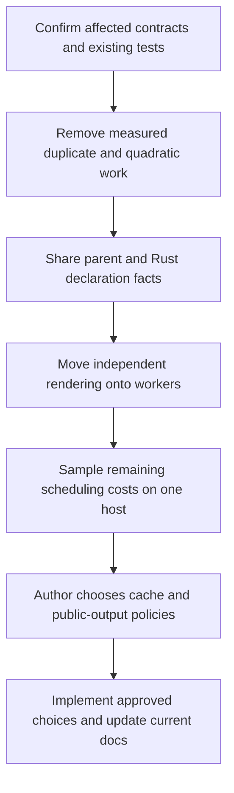

# Tree Hugger performance review

The measurements below identify costs in large scans, repeated commands,
and single-file use. They were taken on a busy host, so they establish
optimization opportunities rather than promised speedups:
- a cold scan of this monorepo takes **23 s**;
- a warm `hug symbols --plain` takes **6–9 s**;
- `hug symbols lib.rs` on one cached file takes **70–100 ms**;
- for the largest file, a warm cache hit with `--json-full` is **slower than
  re-parsing it**.

This spec covers the whole package area: library pipeline, reference
occurrences, declared relations, persistent cache, and CLI scan and render.
It lists every performance opportunity found. Each finding states:

- the change;
- the expected impact, marked as measured or estimated;
- whether a spike is worth doing;
- how that spike would be run.

## How this review was done

- Five read-only reviews of the code, one each for the parse/query/record
  pipeline, occurrences/scope, extraction/relations, the persistent cache,
  and CLI scan/render/lint.
- Measurements of a `profiling`-profile build (`cargo build --profile
  profiling -p tree-hugger-cli`) on the macOS dev host (Apple Silicon,
  12 performance + 4 efficiency cores, internal SSD).
- `samply` is not installed on that host. Profiles were taken with macOS
  `sample <pid>` and aggregated by inclusive sample count per symbol, and
  by nearest Tree Hugger caller for `Node::parent`.
- The cache was isolated per experiment by pointing `TMPDIR` at a scratch
  directory.

Numbers below are from those runs. "Estimated" means the figure was reasoned
from code and not measured.

> **Measurement caveat: the host was heavily loaded.** During these runs
> the dev host's load average was about 40–56 on 16 cores (concurrent
> `cargo-nextest`, `sniff` test binaries, a local LLM server). Read the
> numbers as follows:
>
> - **Useful for locating work:** profile *shares* inside one process, such
>   as "36% of samples in `Node::parent`" and "69% in JSON decode". These
>   are inclusive samples, not exact CPU attribution or guaranteed savings;
>   scheduling, I/O and overlapping callers can affect them.
> - **Fairly robust:** like-for-like A/B pairs run back to back:
>   - warm vs `--no-cache` on one file;
>   - in-repo vs outside-repo invocation;
>   - `--count` vs `--plain`;
>   - first vs second `--json`.
> - **Weak:** absolute wall times, and every **parallel-scaling** figure
>   (2.7× and 4.7× on 16 cores, the `RAYON_NUM_THREADS` sweeps, the
>   single-thread wait). On a contended machine, poor scaling is expected
>   whatever the code does.
>
> Use one available host with less competing work for a quick before/after
> sample when a design question remains unanswered. Do not add a second host
> or a mandatory load threshold. The sliding-window pipeline, shared work
> counters and single-thread waiting observation depend on scaling behavior;
> do not prioritize those until their symptom is reproduced without heavy
> contention. No timings in this review are CI pass/fail requirements.

## Baseline measurements

The corpus is the whole monorepo: 4,311 analyzed files (4,225 listed in
`--json`), 74 MB of source.

| Scenario | Wall | User | Sys | Notes |
|---|---|---|---|---|
| `hug symbols --count`, cold (empty cache), 16 threads | 22.98 s | 62.96 s | 3.41 s | 270 MB RSS. ~2.7× of 16 cores, under load (weak) |
| `hug symbols --count`, warm (4,311 hits) | 2.40–2.95 s | 2.9 s | 1.1 s | |
| warm `--count`, `RAYON_NUM_THREADS=1` / 4 / 16 | 8.86 / 5.03 / 2.40 s | 2.7–2.8 s | ~1 s | At 1 thread, wall time is 2.4× CPU time; see [open observation](#open-observations) |
| `hug symbols --plain`, warm | 6.26–8.71 s | 5.6–5.8 s | 1.3 s | ~4 s more than `--count`: [L1](#l1-render-on-the-workers-not-the-delivery-thread) |
| `hug --json symbols`, first run after a `--count` cache | 29.77 s | 68.85 s | 3.87 s | **Re-parses every file** (Flags widening): [C5](#c5-compute-cheap-capabilities-on-every-miss) |
| `hug --json symbols`, second run | 4.12 s | 3.60 s | 1.12 s | |
| `hug symbols --count <one cached file>`, in the repo | 70–103 ms | 18–26 ms | 50–77 ms | |
| same, from a scratch directory outside the repo | 8.1 ms | 4.1 ms | 4.0 ms | `hug --version` = 5.9 ms: [L3](#l3-a-literal-file-argument-must-not-walk-the-whole-tree) |
| `darkmatter/` cold, `RAYON_NUM_THREADS` = 1 / 4 / 8 / 16 | 7.74 / 3.00 / 2.15 / 1.63 s | 7.6 → 10.5 s | | 4.7× at 16 threads, under load (weak): [L2](#l2-replace-the-per-chunk-barrier-with-a-sliding-window) |
| `--json-full` on `openai/types.rs` (900 KB), warm hit vs `--no-cache` | 1.387 s vs 0.847 s | | | **Warm is 64% slower than cold**: [C1](#c1-remove-the-quadratic-scan-in-unbound_names_have_a_binding) |
| `symbols --count` on the same file, narrow query over that wide entry | 1.6 s user (3.55 s mean wall, high variance) | | | ~99% of samples in `unbound_names_have_a_binding` |
| `--json-full` on `biscuit-terminal/.../filesystem/mod.rs`, warm vs cold | 0.406 s vs 2.012 s | | | Here the cache helps |
| Cache directory after `--count` + `--json` | 786 MB for 74 MB of source (10.6×) | | | [C4](#c4-shrink-and-speed-up-the-stored-entry) |
| Record count: `--all-scopes` vs default `symbols` | 462,429 vs 149,370 | | | 68% of records are `Local` and hidden by default: [P5](#p5-scope-aware-metadata-selection) |

### Where cold time goes

Profile of `hug symbols --no-cache --count` over the monorepo. Inclusive
samples are given as a share of `SourceFile::query`; these overlap, so they
do not sum to 100%.

| Share | Function | Finding |
|---|---|---|
| **36%** | `tree_sitter::Node::parent` (→ `ts_node_parent` / `ts_node_child_with_descendant`) | [P1](#p1-make-parent-lookups-o1) |
| 21% | `SourceFile::parse` (tree-sitter parsing itself) | the floor |
| 21% | `TreeFile::records_from` | P6–P10 |
| 18% | `Lexical::build` via `Declarations::walk`, both builds included | [P3](#p3-build-rust-declarations-and-lexical-once-per-file) |
| 13% | `occurrences::rust_pattern_non_bindings` (a full walk + scope tree, even with no References) | [P2](#p2-avoid-the-rust-pattern-walk-on-the-declarations-only-path) |
| 11% | `link_relations` | P3, P14 |
| 11% | query cursor advance (all queries) | P4 |
| 8% | `definitions::rust_impl_owners` | P3 |
| 6% | `TreeFile::imported_symbols`, a second run of the locals query | [P4](#p4-run-the-locals-query-once-per-file) |
| 1.6% | `file_identity` (`realpath`) | [C8](#c8-canonicalize-each-file-once) |

`Node::parent` samples by nearest Tree Hugger caller (cold, declarations
only):

| Caller | Samples |
|---|---|
| `ScopeTree::scope_around` | 4,253 |
| `Lexical::build` | 3,242 |
| `classify::is_exported_definition` | 2,522 |
| `qualified_name::Builder::prefix` | 2,458 |
| `occurrences::scope_tree` | 1,852 |
| `scope::symbol_scope` | 1,663 |
| `classify::find_symbol_container` | 1,492 |
| `classify::refine_symbol_kind` | 1,233 |
| `declaration::is_scope_boundary` | 894 |
| `Builder::qualified` | 847 |
| `capture_definitions` | 794 |
| `occurrences::is_false_capture` | 686 |

`rust_outer_attributes` and `extract_doc_comment` also account for ~1,500
samples of `prev_sibling`. Note that this profile runs no References pass:
`hug refs`, `--json-full` and `lint` add the occurrence climbs in O1/O2 on
top.

### Where warm time goes

- **`hug symbols --count`:** in the analysis worker, 69% of samples are
  serde_json decoding `StoredEntry`, nearly all of it `Vec<SymbolRecord>`.
  Source read + hash is 11%, cache file read 8%, `validate_imports` 5%,
  `finish` 5%.
- **`hug symbols --plain`:** the main thread spends ~3 s in
  `ListingStream::push` → `Renderer::symbol_list` → biscuit-terminal
  `UnorderedList` / `Prose` (`preprocess_markdown` alone is ~1 s), while the
  workers decode.
- **Not significant in this non-TTY run:** `listing_order` /
  `find_package_root` (~0.12 s) and terminal construction.

## The single most important fact

In tree-sitter 0.26 (`Cargo.lock` pins 0.26.9), `Node::parent()` does not
follow a pointer:
- `ts_node_parent` (`src/node.c:547`) walks down from the root and, at every
  level, scans the children until it finds the one containing the target;
- `next_sibling`/`prev_sibling` (`node.c:190`, `:254`) call `ts_node_parent`
  first.

So one `parent()` costs roughly depth × (position among siblings) per level,
and an `ancestors()` climb to the root costs that again for every level.
Tree Hugger calls these in per-capture, per-record and per-occurrence loops.
The cost grows faster than file size, and it is the largest single cost
measured (36% of cold analysis). `TreeCursor::goto_parent` is O(1). The fix
direction is to carry or index parents instead of asking tree-sitter for
them.

## Summary of findings

Impact: **H** high, **M** medium, **L** low. "Measured" means the profile or
timing above supports the size. Effort: S small, M medium, L large.
"Decision" means the change alters a documented contract and needs the
author's call.

| ID | Change | Impact | Basis | Effort | Spike |
|---|---|---|---|---|---|
| [P1](#p1-make-parent-lookups-o1) | Per-file parent index / cursor-carried parents | **H** (36% of cold) | measured | M–L | yes |
| [P2](#p2-avoid-the-rust-pattern-walk-on-the-declarations-only-path) | Skip or share the Rust pattern walk | **H** for Rust (13%) | measured | M | yes |
| [P3](#p3-build-rust-declarations-and-lexical-once-per-file) | Build Rust `Declarations` + `Lexical` once | **M–H** for Rust | measured | M | yes |
| [P4](#p4-run-the-locals-query-once-per-file) | Run the locals query once (imports from the same run) | M (6%) | measured | S | no; evidence supplied |
| [P5](#p5-scope-aware-metadata-selection) | No full metadata for scopes the query discards | **H** for default `symbols` | measured share | L, decision | yes |
| [P6](#p6-no-full-metadata-for-kinds-added-only-by-widening) | No full metadata for kinds added only by widening | M for `types`/`classes` | estimated | S | no |
| [P7](#p7-build-each-records-key-and-id-once) | Build each record's key/ID once; static provenance strings | L–M | estimated | S | cheap |
| [P8](#p8-memoize-comment-and-attribute-runs-and-cfgtest-per-ancestor) | Memoize comment/attribute runs and `cfg(test)` per ancestor | M | measured (prev_sibling) | M | with P1 |
| [P9](#p9-compute-is_exported_definition-and-symbol_scope-once) | `is_exported_definition` and `symbol_scope` once per record | L–M (3.6%) | measured | S | no |
| [P10](#p10-capture-grouping-without-string-keys) | Capture grouping without `String` keys; capture roles by index | L | measured (small) | S | no |
| [P11](#p11-thread-local-work-counters) | Thread-local work counters (no shared cache line) | L–M at high thread counts | estimated | S | yes, cheap |
| [P12](#p12-index-based-keys-and-a-fast-hasher-in-the-bind-pass) | Index-based keys + fast hasher in the bind pass | M for `refs`/`--json-full` | estimated | M | after P1 |
| [P13](#p13-reuse-parser-and-querycursor-per-thread-single-compile-per-query) | Reuse `Parser`/`QueryCursor`; one compile per query | L | estimated | S | optional |
| [P14](#p14-small-algorithmic-cleanups-in-extraction-and-relations) | Small algorithmic cleanups in extraction/relations | L | estimated | S | no |
| [P15](#p15-stop-storing-whole-initializers-in-declaration_text) | Stop storing whole initializers in `declaration_text` | L–M (33 MB of cache) | measured size | M, decision | maybe |
| [O1](#o1-replace-the-two-per-capture-root-climbs-with-interval-lookups) | Interval lookups instead of two root climbs per capture | **H** for `refs`/`--json-full`/`lint` | estimated | M | yes |
| [O2](#o2-parent-index-for-scope-and-region-lookups) | Parent index for scope/region lookups | **H** (shares P1) | measured share | M | with P1 |
| [O3](#o3-no-per-node-parent-or-sibling-calls-in-walkrun) | No per-node `parent()`/sibling calls in `Walk::run` | M for TS/JS/Swift | estimated | S | no |
| [O4](#o4-nameonly-candidate-fan-out) | NameOnly candidate fan-out | H on Python/PHP/Java classes | estimated | S / decision | size it |
| [O5](#o5-compute-written_path-once-per-occurrence) | `written_path` once per occurrence | L–M | estimated | S | no |
| [O6](#o6-cheaper-is_call_target-and-qualified_parent) | Cheaper `is_call_target` / `qualified_parent` | L | estimated | S | no |
| [O7](#o7-memoize-rust_impl_type-and-enum-variant-owners) | Memoize `rust_impl_type` and variant owners | L–M for Rust | estimated | S | if profiled |
| [O8](#o8-allocation-and-hashing-in-scope-tables-and-import-lookup) | Allocation/hashing in scope tables and `import_at` | L–M | estimated | S | no |
| [C1](#c1-remove-the-quadratic-scan-in-unbound_names_have_a_binding) | Remove the quadratic scan in `unbound_names_have_a_binding` | **H** (warm slower than cold) | **measured** | S | no; evidence supplied |
| [C2](#c2-remove-the-quadratic-made-closure) | Remove the quadratic `made` closure | H on wide entries | estimated | S | no |
| [C3](#c3-validate-evidence-only-when-it-will-be-served) | Validate evidence only when it will be served | M–H | measured (narrow over wide) | M, decision | after C1/C2 |
| [C4](#c4-shrink-and-speed-up-the-stored-entry) | Shrink and speed up the stored entry | **H** for warm (69% decode) | measured | L, decision | yes |
| [C5](#c5-compute-cheap-capabilities-on-every-miss) | Compute cheap capabilities (Flags) on every miss | **H** for mixed commands (29.8 s → ~4 s) | measured | S–M, decision | yes |
| [C6](#c6-retain-consistency-validation-checksum-is-not-a-replacement) | Retain consistency validation; no checksum replacement | contract preservation | review decision | — | no |
| [C7](#c7-small-validation-costs) | Stream `import_inventory`; one `LineStarts` | L | estimated | S | no |
| [C8](#c8-canonicalize-each-file-once) | Canonicalize each file once | L (1.6%) | measured | S | no |
| [C9](#c9-collect-stale-cache-entries) | Collect stale cache entries | disk only | measured size | S | no |
| [L1](#l1-render-on-the-workers-not-the-delivery-thread) | Render on the workers, not the delivery thread | **H** for listings (~3–4 s warm) | measured | M | no; evidence supplied |
| [L2](#l2-replace-the-per-chunk-barrier-with-a-sliding-window) | Sliding window instead of per-chunk barrier | M–H if reproduced | measured under load, unconfirmed | M | yes, once reproduced without heavy contention |
| [L3](#l3-a-literal-file-argument-must-not-walk-the-whole-tree) | A literal file argument must not walk the whole tree | **H** for positional single-file use | measured | S–M | no; evidence supplied |
| [L4](#l4-hug-refs-run-occurrences-only-on-the-declaring-file) | `hug refs`: Occurrences only on the declaring file | **H** for `refs` | estimated | M | no; unnecessary work established |
| [L5](#l5-batch-oxlint-and-resolve-it-once) | Batch oxlint; resolve the tool once | **H** for JS/TS lint | estimated | M, decision | yes |
| [L6](#l6-no-terminal-detection-for-unstyled-output) | No terminal detection for unstyled output | M latency on TTY/iTerm2 | estimated | S | yes |
| [L7](#l7-memoize-package-roots-in-listing_order) | Memoize package roots in `listing_order` | L (~0.12 s) | measured | S | no |
| [L8](#l8-one-static-rule-registry-apply-lint-policy-once) | One static rule registry; apply lint policy once | M for cold lint | estimated | S | cheap |
| [L9](#l9-remove-quadratic-scans-in-diagnostics) | Remove quadratic scans in diagnostics (`lines().nth`, `named_child(i)`) | M on pathological files | estimated | S | no |
| [L10](#l10-skip-the-ignore-directive-query-when-it-cannot-match) | Skip the ignore-directive query when it cannot match | L–M | estimated | S | no |
| [L11](#l11-stream-imports-and-lint-output) | Stream `imports`/`lint` output (fixes a broken-pipe panic) | M | correctness + estimated | S | no |
| [L12](#l12-god-files-read-once-parse-once) | `god-files`: read once, parse once | M for repeated runs | estimated | S | maybe |
| [L13](#l13---changed-without-re-canonicalizing-every-scanned-file) | `--changed` without re-canonicalizing every scanned file | M for `--changed` | estimated | S | no |
| [L14](#l14-move-json-projection-off-the-delivery-thread-and-memoize-is_test_file) | JSON projection off the delivery thread; memoize `is_test_file` | L–M | estimated | S | no separate experiment |
| [L15](#l15-do-not-deep-clone-reused-prelude-results) | Do not deep-clone reused prelude results | L–M with `--prelude` | estimated | S | no |
| [B1](#b1-release-profile-for-hug) | Release profile: LTO + 1 codegen unit for `hug` | L–M | estimated | S | yes, cheap |
| [B2](#b2-a-faster-global-allocator) | A faster global allocator (mimalloc) | M for warm decode | estimated | S | yes, cheap |

---

## Review decisions and compatibility boundaries

This remains a draft review, not authorization to implement every finding.
The recommendations in [Open Questions](#open-questions) need the author's
choice before becoming an implementation plan. Existing behavior is the
baseline until that choice is recorded.

- **Public results:** keep IDs, spans, declaration text, candidate order,
  selectors, report order and exit status unchanged. The tree-hugger library's
  [SymbolQueryResult](../../lib/src/file/query.rs) represents the requested
  analysis; the cache may store more work, but must project it back to exactly
  that result, including reported capabilities and passes.
- **Cache integrity:** the strict refusal rules in
  [Cache Design](../../docs/cache-design.md) remain in force. Faster validation
  must accept and reject the same entries unless the author explicitly changes
  that policy. Preserve import provenance, coverage geometry, list ordering,
  semantic cross-checks, and concurrent atomic replacement. A cache failure
  continues to cause recomputation rather than an analysis failure.
- **Identity:** keep native paths for filesystem access, cache keys and IDs.
  Display paths are lossy and must never become inputs. Use `biscuit-file`'s
  `FileReference` for user file references and sniff for repository/package
  discovery. Reuse existing identity helpers; joining a canonical root to a
  relative path is not proof that the resulting spelling is canonical.
- **Shared libraries:** changes to biscuit-terminal or biscuit-hash must keep
  their existing public APIs and behavior. Use biscuit-terminal's
  `TerminalRenderable` components for output and biscuit-hash for hashing;
  extend their APIs narrowly if a required capability is missing. A broad
  terminal-discovery redesign or new hashing dependency is a separate author
  decision, not an incidental tree-hugger optimization.
- **Delivery:** bounded output pipelines retain deterministic order, flush
  promptly, treat a closed stdout pipe as success, and report other write
  errors. `--verbose` remains truthful about actual work. Tests and terminal
  captures must not bring a terminal or browser window into focus.

## Proportional measurement and verification

The existing figures already establish the repeated locals query, quadratic
cache validation, listing rendering cost and directory-walk overhead. Those
findings need implementation verification, not another discovery spike.
There is no mandatory shared benchmark suite or profiling-tool installation.

For an unresolved performance choice, use the finding's existing workload
and one quick before/after sample on one host. Record the build profile,
command, source revision, worker count and cache preparation so the result is
interpretable. An empty-cache run includes writes; `--no-cache` includes neither
reads nor writes. Keep those cases distinct. Use an isolated system temporary
directory (`TMPDIR` on macOS; the applicable `TMP`/`TEMP` on Windows) and
`--verbose` to establish hits, widening and parse counts. Existing macOS
`sample` output is sufficient; installing `samply` is optional.

Correctness verification follows the affected behavior:

- Compare the same command and options at the same absolute corpus root before
  and after. IDs include file identity, so separate checkout paths are not a
  byte-equivalence comparison. Complete-index JSON checks record semantics;
  narrow queries check filtering and cache projection; listing/export goldens
  check text, ordering, wrapping and links. Exclude elapsed-time metadata and
  intentional work-count changes from byte comparisons, and check their
  meaning separately.
- Pin cache changes against existing corruption, widening, projection and
  concurrent-writer tests. Compare cold, warm and wide-entry-to-narrow-request
  results. Never regenerate a golden to conceal unintended drift.
- Explicitly select fixture files or copy them with the existing `Scratch`
  helper: ordinary scans omit fixture directories. Do not mistake an empty
  fixture scan for equivalence evidence.
- Use existing tests first; add focused regressions for new failure modes.
  Run tests at the scale [Evidence budget](#evidence-budget-builds-and-ci-cycles)
  sets out: targeted filters while iterating, then the full `just test` and
  `just lint` once per batch. Use `just test-l2` only when a batch changes
  real-terminal output. Required portability remains macOS, Linux, native
  Windows and WSL2. Functional portability checks are separate from
  performance spikes; this draft adds no CI matrix cells or timing thresholds.
- Update affected READMEs, topic docs, skills and dependency catalogs with the
  implementation. A stored-format change must reject old entries cleanly;
  public record changes follow record-schema and extractor-revision rules.
  Do not bump public record schemas merely to change private storage.

Each finding is complete when its stated repeated work is removed, affected
results and failures retain their contracts, and any unresolved performance
choice has one recorded sample. Estimated speedups are hypotheses, not gates.

## Evidence budget: builds and CI cycles

The two costs to manage:
- **Builds.** A `profiling` build of `hug` takes about 5 minutes here, and
  a full LTO build takes longer.
- **CI.** Recent `ci.yml` runs took 48–131 minutes, and every pull request
  pays one.

The rules below **keep every spike in this spec**, so we lose no visibility.
They make spikes share builds and scale verification to risk, so neither
cost multiplies per finding.

### Spikes: many arms, few builds

- **One spike branch, one build.** Put every spike arm that is a code path
  behind a runtime toggle, read once into a static: for example
  `HUG_SPIKE=p1b,p2-prefilter,p3-share,p5-gate,p11-nocount,window,oxlint-batch,flags-on-miss`.
  An A/B comparison is then two runs of the same binary, not two builds.
  Temporary counters (P2's skip rate, P3's `Lexical::build` count) ride in
  the same build and print under `--verbose`.
- **Spikes that need no build at all** use the existing `target/profiling/hug`:
  - L2's symptom check: a thread sweep without heavy contention;
  - L5's spawn count;
  - L6's TTY sample;
  - O4's candidate sizing;
  - C3/C5's cache-state comparisons where no toggle is required;
  - every re-profile.
- **Spikes that need their own build** are scheduled together, after the
  toggle spikes:
  - B1 + B2 go in one combined build (LTO + mimalloc). Isolate the two only
    if the combined gain is clearly above run-to-run noise.
  - C4's decode bench is one `cargo bench` build. It can also carry any
    criterion cases another spike wants.

  Run long builds in the background while measuring the toggle arms.
- **Workloads sized for repetition.** Iterate on `darkmatter/` (1.6–7.7 s
  cold) or `tree-hugger/`, with `hyperfine -w 1 -r 3`. Confirm each
  promising arm once over the whole monorepo (23 s cold). Single-file arms
  use the measured p99 files.
- **Spikes never run in CI.** Do not open a pull request from the spike
  branch. Record each result (command, arm, counts, time) in the
  implementation log. Remove the toggles when the chosen arm is implemented.

### Proof: proportional to risk, cheapest strong evidence first

- **Output diff before test runs.** Comparing `hug` output from the same
  absolute root, using the release binary before and after (with the
  [corpus and commands above](#proportional-measurement-and-verification)),
  needs no test build and catches most regressions. Use it as the
  iteration-time equivalence check.
- **Targeted tests while iterating.** Run only the matrices and tests each
  finding names, for example `just test -E 'test(/symbols_cache::|cache_robustness::/)'`
  for C1/C2, or `symbols_occurrences` for O-findings. Do not run the full
  suite per edit.
- **Full suite once per batch.** Run `just test` and `just lint` once before
  pushing a batch, not once per finding. Run `just test-l2` only for a batch
  that changes real-terminal output (L1, L6).
- **Add tests only for new failure modes.** Where an existing matrix
  already pins a behavior (`PATTERN_IDENTITY_MATRIX`, `cache_robustness`,
  the filter suites), it is the proof. Add focused cases for genuinely new
  behavior (L2's cancellation paths, L3's fast-path fallback, L11's closed
  pipe), not parallel matrices restating the old ones.

### CI: few pull requests, no extra cells

- **Batch findings into a small number of pull requests**, along the
  [recommended order](#recommended-order):
  1. byte-identical algorithmic fixes;
  2. navigation and Rust sharing;
  3. rendering and pipeline;
  4. each approved policy change.

  One pull request per finding would multiply the CI wall time for no
  added evidence.
- **Rely on pre-push evidence reuse.** A passing local L1 on macOS satisfies
  that environment's cells. Do not re-trigger runs to "double-check" a
  green result.
- **Use the standard environment schedule.** Windows and WSL2 failures are
  found on `main` and the nightly run and fixed forward, so `ci:all-os` is
  not needed by default. The exception is a change to native path identity
  (C8, the L3 fast path, L13): it alters cache keys and IDs on Windows, and
  justifies `ci:all-os` once, on that pull request.
- **Add nothing CI runs.** Add no timing assertions, no benchmark runs in
  CI and no new test targets. `lib/` already declares a `[[bench]]` target,
  so new criterion groups add no new cell.

## Library pipeline: parse, query, records (P)

### P1. Make parent lookups O(1)

- **Change:** Stop calling `Node::parent()` / `prev_sibling()` /
  `next_sibling()` in per-capture and per-record loops. In order of
  increasing invasiveness:
  - (a) **Quick wins with identical output:**
    - hoist the double `parent()` per step in
      `declaration.rs::is_scope_boundary` / `resolve_declaration_node`
      (`:133-136`, `:161-174`);
    - hoist the same in `qualified_name.rs::Builder::prefix` (`:196`,
      `:216-218`);
    - reuse the already-computed `symbol.scope` in `fill_metadata`
      (`definitions.rs:460`, recomputed from `:406`).
  - (b) **Lazy per-file parent memo.** A `HashMap<node.id(), Node>` filled
    for the whole path on each descent, owned by the per-file facts (like
    `SiblingScopes` / `VisibilityMemo`). Ancestor chains share prefixes, so
    most lookups become O(1).
  - (c) **Full parent index** from one `TreeCursor` pass (O(nodes)), threaded
    into the readers. The occurrence/scope code can reuse it too ([O2](#o2-parent-index-for-scope-and-region-lookups)).
- **Where:** callers in [Where cold time goes](#where-cold-time-goes),
  topped by `ScopeTree::scope_around`, `Lexical::build`,
  `is_exported_definition`, `Builder::prefix`, `symbol_scope`,
  `find_symbol_container` and `refine_symbol_kind`.
- **Expected impact:** **High, measured.** 36% of cold declarations-only
  analysis is in `Node::parent`. With (b)/(c), most of that should go:
  - estimate a 25–35% cut in cold CPU across all languages;
  - more on wide or deep files (generated code, flat C headers, big `impl`
    blocks, JSX).

  (a) alone is a few percent.
- **Risk:** Output stays byte-identical if the indexed parent equals
  `Node::parent()`, including hidden and aliased nodes. Check that during the
  spike with `debug_assert_eq!(index.parent(n), n.parent())`. The cost of (c)
  is a wide but mechanical signature change. No `EXTRACTOR_REVISION` bump is
  needed for exactly equivalent extraction; a discovered semantic repair
  must be separated and invalidate affected records.
- **Spike:** **Yes.** It is the largest measured cost, and (b) vs (c) is a
  design choice the numbers should settle.
- **How:**
  1. Land (a).
  2. Implement (b) behind one helper (`ancestors_of(facts, node)`).
  3. Use a quick before/after sample on an existing wide or deep file;
     record time and parent-lookup counts. A reusable benchmark is optional.
  4. Re-profile `hug symbols --no-cache --count` over the monorepo and read
     the `ts_node_parent` share.
  5. Compare wall/user time with `hyperfine`.
  6. Verify the affected queries and fixtures as described above. Keep node
     IDs scoped to the owning tree; indexes must not outlive it or survive
     reparsing. Include anonymous nodes, aliases and missing nodes. A map
     lookup can be constant time; a full ancestor climb is still depth-bound.

### P2. Avoid the Rust pattern walk on the declarations-only path

- **Change:**
  `definitions.rs::drop_non_declarations` → `occurrences::rust_pattern_non_bindings`
  runs `Walk::run`, `scope_tree` and `place_sites` for every Rust file whose
  locals query captured a variable or parameter, which is nearly every Rust
  file. That happens even for `hug symbols` with no References pass. With
  References, `OccurrenceSyntax::resolve` then repeats all three
  (`occurrences.rs:129`, `:486-487`, `:940`).
  - (a) **Share** the `Walk` and placed sites between definitions and the
    bind pass. The decisions are identical: in the definitions run the
    targets are `Unreported`, in `resolve` they are `Record(idx)`, and
    `bare_pattern_meaning` reads neither.
  - (b) **Prefilter** the declarations-only path. A bare pattern name can
    only read or be unknown when:
    - the file has a glob `use`; or
    - a bare captured name equals a `const`/`static`/unit struct/`const`
      generic/import name, or `None`/`Self`.

    When neither holds, nothing can be dropped, so skip the walk.
- **Expected impact:** **High for Rust, measured.** 13% of cold analysis
  over this (Rust-heavy) monorepo. (b) removes most of it from listings, and
  (a) halves it on the bind path (estimated 20–40% of Rust resolution).
- **Risk:**
  - (b) is a correctness argument that must hold exactly. It is the riskier
    half, and it must be pinned by `PATTERN_IDENTITY_MATRIX` /
    `PATTERN_RECORD_MATRIX` plus a corpus-wide equivalence diff.
  - (a) has lifetime friction, since `Walk<'tree>` crosses the
    definitions/records boundary.
- **Spike:** **Yes.** Measure (b)'s skip rate over the monorepo first: how
  many Rust files hit the prefilter. Keep it only if the sample supports
  the added complexity and the existing pattern tests establish correctness.
- **How:**
  1. Add a temporary counter for "pattern walk skipped".
  2. Run `hug symbols --no-cache --count --language rust` over the monorepo.
  3. Diff `--json-full` with and without the prefilter.
  4. Use one quick A/B sample for the remaining choice. Do not infer pattern
     meaning from a source substring search: raw names, imports, shadowing,
     macros and unknown pattern contexts must retain their current treatment.

### P3. Build Rust `Declarations` and `Lexical` once per file

- **Change:** For every Rust file with impl members, `rust_impl_owners`
  (`definitions.rs:743-766` → `relations.rs::impl_self_types`, `:2452`)
  builds a `Declarations` and forces `walk()`, which runs `Lexical::build`, a
  full DFS that allocates a `Vec` per node (`lexical.rs:182-282`, `:244`).
  Then `link_relations` (`relations.rs:2141`) builds both again, and
  `impl_relations` forces `walk().impls` (`:2366`). Swift's
  `swift_extensions` always forces the walk (`:2336`).

  Build once and hand the result forward. At minimum, carry
  `impl_self_types`' map and `walk().impls` into `link_relations`.
- **Expected impact:** **Medium–high for Rust, measured.**
  - `Lexical::build` is 18% and `rust_impl_owners` 8% of cold analysis.
    About half of `Lexical::build` is the duplicate.
  - Estimate 8–12% of cold CPU on Rust-heavy corpora.
  - With P1, the remaining build is cheaper too, because 3,242 of its
    samples are `parent()`.
- **Risk:** Low–medium. `Declared` borrows `qualified_name` from `pending`
  in one call and from `records` in the other, so share through `Rc<str>`,
  or carry only the decisions. Output is identical when the same entries
  and decisions are reused.
- **Spike:** **Yes, cheap.** Add a temporary `Lexical::build` counter (or
  inspect `shared_context_steps`), remove the second build
  and take one A/B sample with `hyperfine 'hug symbols --no-cache
  --count --language rust'`.

### P4. Run the locals query once per file

- **Change:** `analysis/mod.rs:97` calls `tree_file.imported_symbols()`
  unconditionally. That query is the **same text** as the locals query
  (`queries/mod.rs` resolves `Imports` and `Exports` to the locals text), so
  every planned query runs the full locals query twice and compiles it twice
  under two cache keys.

  `capture_definitions` already sees the `local.definition.import` captures
  and skips them (`definitions.rs:236`). Collect them there and build the
  `ImportSymbol`s from those nodes (`imports_from_nodes`). `imported_symbols()`
  stays as public API. Make `query_for(Imports)` reuse the compiled `Locals`
  query.
- **Expected impact:** **Medium, measured.** `imported_symbols` is 6% of
  cold analysis. Grammars with no import captures (C, C++, Bash, Zsh, Lua,
  Perl, PHP, JS vendor) gain it all for nothing.
- **Risk:** Low.
  - Imports are already sorted and deduplicated by span (`tree_file.rs:236`).
  - Keep the fingerprint hashing the same query text (`RECORD_QUERIES`), so
    existing cache entries stay valid.
  - Keep `QueryKind::Imports` for provenance and drift tests, and
    `definition_captures` at 1.
- **Spike:** No. The profile already identifies the repeated query. Verify
  that one capture run supplies the identical imports, exports, definitions
  and diagnostics, including grouped imports and duplicate captures. Keep
  public direct-call APIs working and fingerprints unchanged when query text
  is unchanged; work counters must count executions rather than captures.

### P5. Scope-aware metadata selection

- **Change:** `MetadataSelection` is keyed by kind only
  (`definitions.rs:58-62`). The default `hug symbols` scope filter
  (`SYMBOLS_DEFAULT_SCOPES = [Item, Member]`, `cli/src/declarations.rs:57`)
  is applied in `finish`, after analysis and caching. So every `Local`
  record (parameters, locals) gets the full `records_from` work, then is
  thrown away:
  - `fill_metadata`;
  - attributes;
  - `declaration_text` of whole `let x = match …` statements;
  - signature, keyword, generics, modifiers;
  - under Flags, the per-ancestor `is_in_rust_cfg_test` walk.

  Make metadata scope-aware, and record in the cache entry which scopes
  carry metadata. A later `--all-scopes` query then widens, like
  `WidenedKinds`.
- **Expected impact:** **High for the default `hug symbols`, measured
  share.** 68% of all records are `Local` (462,429 vs 149,370 over the
  monorepo). The metadata share of `records_from` (21% of cold) for those
  records would go; estimate 10–15% of cold CPU. Locals still need light
  records for binding, IDs and containment.
- **Risk:**
  - Cache shape and policy: a new coverage dimension next to
    `covered_kinds`.
  - Needs private cache-format invalidation, `docs/cache-design.md` updates, new
    `cache_robustness` cells and new projection tests.
  - It must never serve an entry without local metadata to an
    `--all-scopes` query. Coverage must describe kind-and-scope combinations,
    not independent unions: Functions/Item plus Variables/Local does not
    cover Functions/Local. IDs, binding facts, member completion and exports
    still need their required information from unselected scopes. Scope
    coverage stays separate from post-cache predicates and naming prefixes.
- **Decision:** yes. It adds a cache coverage axis.
- **Spike:** **Yes.**
  1. Gate the `records_from` metadata block on `scope != Local` under the
     `p5-gate` spike toggle, with no cache (`--no-cache`), to bound the gain.
  2. `hyperfine 'hug symbols --no-cache --count'` with and without the gate.
  3. Record the gain and the added coverage complexity for the author; the
     prototype deliberately omits metadata and is not an equivalence test.

### P6. No full metadata for kinds added only by widening

- **Change:** `MetadataSelection::for_kinds` adds Field/Property/Constant/
  EnumVariant when a type kind is selected (`definitions.rs:34-56`), and
  `records_from` treats them as `wanted` (`tree_file.rs:1824`). They need
  only what `align_field_metadata` reads (visibility, `static`, doc). They
  also get declaration/signature text, keyword, generics, attributes,
  modifiers, Flags walks and metrics, then `retain(query.selects)` drops them
  before caching (`analysis/mod.rs:163`).

  Track originally selected kinds separately from kinds needed to complete
  selected types. Retain access, static flags, documentation and enum-variant
  data required by completion; omit only facets no retained result reads.
  `classes` explicitly selects members, so its displayed members still need
  full requested metadata.
- **Expected impact:** Medium for `hug types` / `hug classes` and their
  `--json`, where fields are often most records. Estimated; byte-identical.
- **Risk:** Member data contributes to retained type records, exports and
  relations before unselected records are dropped. Verify those consumers
  before reducing metadata; record omission alone does not prove safety.
- **Spike:** No. Just do it, and check with the fixture/snapshot tests and
  `hyperfine 'hug types --no-cache --json'`.

### P7. Build each record's key and ID once

- **Change:** `From<SymbolInfo> for SymbolRecord` (`schema_v2/mod.rs:375-497`)
  computes `stable_symbol_key(.., 0)` and its BLAKE3 hex ID, each with path
  normalization (`to_string_lossy().replace('\\', "/").trim().to_string()`)
  and a `format!`. `records_from` (`tree_file.rs:1871-1895`) then throws both
  away and recomputes them with the real ordinal.

  Also, `provenance.extractor_version` is a `format!` per record, and
  `extractor` / `parse_pass` are fresh `String`s per record.

  Changes:
  - an internal constructor that takes the final key;
  - normalize the path once per file;
  - share immutable provenance construction within the run. A `LazyLock`
    avoids constructing the template repeatedly, but public owned `String`
    fields still allocate when cloned; do not claim it removes those copies.
- **Expected impact:** Low–medium, estimated 1–3 µs per record. Over the
  monorepo's 462k records, that is ~0.5–1.5 s of cold CPU.
- **Risk:** IDs must stay byte-identical. Pin this with an equality test
  against the current function. Do not change public field types.
- **Spike:** Cheap: a criterion micro-bench of `records_from` on a
  5,000-definition file, or the samply self time of `blake3`/`fmt::format`.

### P8. Memoize comment and attribute runs and `cfg(test)` per ancestor

- **Change:**
  - `collect_doc_comments` (`doc_comments.rs:124-148`) steps back one
    `prev_sibling()` at a time. Each is a root descent, and every `///` line
    is its own node.
  - `rust_outer_attributes` (`attributes.rs:153-165`) walks the same run
    again.
  - `type_metadata.rs` (`:183`, `:215`, `:297`) re-reads the doc of every
    field and variant the standalone record already read.
  - `is_in_rust_cfg_test` (`flags.rs:85-112`) calls `rust_outer_attributes`
    for **every ancestor** under Flags (every `--json`/`--jsonl`/`--json-full`).

  Changes:
  - a per-parent "preceding comment/attribute run" table from one forward
    cursor pass, shared by docs and attributes;
  - memoize doc text by node ID;
  - memoize the outer `cfg(test)` answer per ancestor along the walked path.
- **Expected impact:** Medium, partly measured. `prev_sibling` from these
  two callers is ~1,500 samples (~2%) without Flags; with Flags it is more.
- **Risk:**
  - Reproduce run boundaries exactly: Go blank-line breaks,
    `trailing_comment_count`, Go `Attachment` semantics.
  - `GO_SPEC_ATTACHMENT_MATRIX`, `TRAILING_DOC_CASES` and `FLAGS_MATRIX`
    pin these.
- **Spike:** Fold into P1's profile. If P1(c) lands, much of this cost
  disappears with it. Re-measure before memoizing.

### P9. Compute `is_exported_definition` and `symbol_scope` once

- **Change:**
  - `is_exported_definition` runs 2–3 times per definition:
    `analysis/mod.rs:124` (`exports_from`), `tree_file.rs:1870`, and
    `tree_file.rs:1229` under diagnostics.
  - `symbol_scope` runs twice for each winner.
  - Compute both into `ExtractedSymbol` once.
- **Expected impact:** Low–medium, measured. `is_exported_definition`'s
  `parent()` samples are 3.6% of cold analysis. Byte-identical.
- **Spike:** No.

### P10. Capture grouping without `String` keys

- **Change:**
  - `capture_definitions` (`definitions.rs:259-272`) allocates the
    capture's name text into each `(start, end, String)` group key. The text
    is a function of the span, so key on `(start, end)` and read the text
    once per group.
  - Capture-name roles are matched as strings per capture (`:213-240`,
    `ends_with(".context")`). Precompute a role per capture index once per
    compiled query, next to the `Arc<Query>`.
- **Expected impact:** Low, byte-identical.
- **Spike:** No.

### P11. Thread-local work counters

- **Change:** The eight `static AtomicU64` counters (`analysis/counters.rs:11-18`)
  share one cache line. `count_shared_context_steps` is called at 40+ hot
  sites, including inside `partition_point` comparators
  (`relations/inline.rs:70-71`). Accumulate in thread-local `Cell<u64>`s and
  flush at analysis boundaries, or first consider padding the hot atomics
  without changing snapshot semantics. Static placement suggests contention;
  the draft has not proved that all counters occupy one physical cache line.
- **Expected impact:** Low–medium, estimated. It shows only as poor
  scaling across threads. The observed 2.7–4.7× on 16 cores was measured
  on a heavily loaded host (see the measurement caveat and
  [L2](#l2-replace-the-per-chunk-barrier-with-a-sliding-window)), so
  first confirm that scaling is still poor without heavy contention.
- **Risk:** Public direct APIs also increment counters outside `run_query`.
  A query-only flush loses those counts. A thread-local design needs nested
  boundary handling and cleanup on errors/panics, without double counting;
  document whether concurrent snapshots can see pending work. Prefer padding
  if it addresses the measured cost while preserving the current contract.
- **Spike:** **Yes, cheap.** Make `count_shared_context_steps` a no-op
  under the `p11-nocount` spike toggle (no separate build), then run
  `hyperfine` with `RAYON_NUM_THREADS=1,4,8,16 hug symbols --no-cache
  --count`. If the 16-thread time improves
  noticeably, do the thread-local version.

### P12. Index-based keys and a fast hasher in the bind pass

- **Change:**
  - `bind_references` maps (`analysis/mod.rs:367-389`), `RefSet`
    (`:578-588`, which clones an ID per edge), `members_by_parent` (`:276`)
    and `semantic_facets` (`:444-459`) hash 64-character hex `SymbolId`
    strings with SipHash.
  - Carry record indices from the resolver instead, and key by `usize`.
  - Prefer integer indices. For remaining keys, use an appropriate existing
    biscuit-hash facility before adding another hashing crate. Keep hash-map
    iteration out of report order and preserve full-key equality; a digest
    alone is not a deduplication key. Consider collision behavior for
    user-controlled source names.
- **Expected impact:** Medium for `refs`, `--json-full` and bind +
  diagnostics. Estimated 0.3–1 µs per occurrence; no effect on listings.
- **Risk:** Order must not change. Only the dedup key type changes, and map
  iteration order is never observed.
- **Spike:** Yes, but after P1/O1/O2, which dominate the same benchmark:
  one existing References workload. No new scaling suite is required.

### P13. Reuse `Parser` and `QueryCursor` per thread; single compile per query

- **Change:**
  - `Parser::new()` per file (`source_file.rs:144`) and `QueryCursor::new()`
    per query call. Use a thread-local parser (`set_language` per file) and
    a reused cursor.
  - The query cache (`queries/mod.rs:56-87`) is one global `Mutex<HashMap>`,
    locked 3–5 times per file. On a cold start several workers may compile
    the same query. Use a per-key `OnceLock`.
- **Expected impact:** Low, estimated tens of µs per file plus a few ms at
  start-up.
- **Risk:** `parser_constructions` publicly counts constructions, so do not
  silently redefine it as parse count. Add a separately named parse counter
  if needed and update verbose reporting. Reused parsers/cursors must reset
  language, query ranges, limits and cancellation state between calls. Direct
  library calls may nest on a thread: avoid a `RefCell` borrow panic by falling
  back to a fresh object when the reusable one is already in use.
- **Spike:** Optional: `hyperfine` over many small files.

### P14. Small algorithmic cleanups in extraction and relations

All byte-identical, low impact, no spike:

- `align_field_metadata` / `reconcile_variants` (`definitions.rs:619-630`,
  `:723-734`): linear `find` per member, O(F×M) per type. Use a name →
  `VecDeque<usize>` map. Popping from the front keeps the k-th-to-k-th
  pairing. Also skip building `members` when no selected kind completes
  fields.
- `link_relations` (`relations.rs:2141`) builds `Declarations` for every
  file. Return early when the language is not Rust or Swift, Containment is
  off and no wanted record declares a base.
- `Declarations::binding_name` (Rust, `relations.rs:780`) allocates a
  split/join per entry. Return `Cow::Borrowed` for ASCII names without
  `r#`.
- Parameters are parsed in both `signature` and `symbol_metrics`; type
  parameters in both `type_metadata` and `declared_generics`.
- `docs_pass` clones the whole `DocsFacet` (`analysis/mod.rs:549`); use
  `mem::take`. `parse_pass` gets a new `String` per record per pass.
- Cyclomatic `UnlessLast`/`Arm` use `next_named_sibling`/`prev_named_sibling`
  per arm (`complexity/mod.rs:209-232`), which are root descents. Look ahead
  with a cloned cursor instead. This runs under Metrics only.

### P15. Stop storing whole initializers in `declaration_text`

- **Change:** `declaration_text` is cut only at a body-like child
  (`declaration.rs:285-292`), so `let`/`const` statements, `macro_rules!`,
  const tables and C array initializers are stored whole. `trim_record`
  drops it for `--json`/`--jsonl`/table output; only `--json-full` and
  library callers see it.

  Options:
  - store a byte range and slice the source on demand (the source is read
    on every hit anyway);
  - or cut it with the `signature_text` rules.
- **Expected impact:** Low–medium, measured size: 33 MB of the 786 MB cache
  (4%), plus the allocation on every cold record.
- **Risk:** Cutting text changes public output for `--json-full` and library
  callers and needs schema/revision review and docs updates. Storing a private
  source range and reconstructing the existing text does not change that
  contract; validate bounds, UTF-8 boundaries and exact trimming. A raw
  declaration span is not necessarily the range of the trimmed text.
- **Decision:** yes (public field semantics).
- **Spike:** Maybe, only if [C4](#c4-shrink-and-speed-up-the-stored-entry)
  keeps the field in the stored form.

---

## Reference occurrences (O)

These run under References/Occurrences: `hug refs`, `--json-full`, every
bind query, and (O1) `lint` for TS/JS. Not measured in the declarations-only
profile above, so the sizes are estimated. The spike is the
[References profile](#spike-for-the-o-findings).

### O1. Replace the two per-capture root climbs with interval lookups

- **Change:**
  - `occurrences.rs:520`, `ancestors(node).any(is_excluded_context)`, runs
    for every reference capture and almost never stops early, so it climbs
    to the root, at O(depth²) with tree-sitter parents.
  - For TS/JS, `is_ecma_export_name` (`:1068`, also used by lint at
    `tree_file.rs:295`) climbs again looking for `export_statement`.

  `Walk::run` already visits every node. Have it record the byte ranges of
  excluded-context nodes and of `export_statement`s as sorted interval
  lists, so each capture needs one binary search.
- **Expected impact:** **High** for `refs`/`--json-full` on deep files
  (JSX, nested callbacks, builder chains), and for TS/JS `lint`.
- **Risk:**
  - Zero-width (`MISSING`) and equal-range parent/child nodes must behave
    like the node climb.
  - `is_excluded_context` is per language (Python `import_statement` is not
    excluded).
  - The export check needs the **nearest** `export_statement` and then
    inspects its `source` field. A single predecessor search over overlapping
    byte intervals does not prove ancestry or find the nearest owner. Keep
    node/parent identity or use a nesting-aware index; byte-equal siblings and
    zero-width nodes must not inherit each other's context.
- **Spike:** **Yes.** See [below](#spike-for-the-o-findings).

### O2. Parent index for scope and region lookups

- **Change:** `ScopeTree::scope_around` (`scope/mod.rs:361`; the
  single largest `parent()` caller even without References),
  `ScopeTree::with_rules` (`:312`, `:319`, `:329-331`: parent, boundary and
  an `ancestors().count()` depth per scope node), `Regions::around`
  (`occurrences.rs:411`), `is_call_target`, `written_path`,
  `reference_category`, `resolve_rust_path` and `rust_member_of` all climb
  with `parent()`.

  Use P1's parent index, or a span-sorted stack sweep for scope parents and
  depth (the technique `smallest_enclosing` already uses).
- **Expected impact:** **High**, shared with P1. `scope_around` +
  `occurrences::scope_tree` are already ~6,100 `parent()` samples on the
  declarations-only path (via P2/P3), and References multiplies the calls.
- **Risk:** As P1.
- **Spike:** With P1.

### O3. No per-node `parent()` or sibling calls in `Walk::run`

- **Change:**
  - **TS/JS:** `ecma::extra_scope` and `ecma::dynamic` both call
    `is_with_body(node)` → `node.parent()` on every named node
    (`ecma.rs:28`, `:52`, `:62`). Handle `with_statement` in `visit_ecma`
    instead, pushing its body as an extra scope and `Dynamic::Scope`.
  - **Swift:** `swift_element_labels` (`syntax_markers.rs:231-234`) calls
    `next_sibling()`/`next_named_sibling()` per child. Use the cursor.
  - **Smaller per-node callers:** Java `java_inferred_type`,
    `c_type_specifier`, Python `has_ancestor`, ECMA `variable_declarator`.
    Generally, keep a parent stack in the cursor loop and pass `parent` in.
- **Expected impact:** Medium for large TS/JS/Swift files on every bind.
- **Risk:** Low; identical output sets.
- **Spike:** No. Fold into the O1 measurement.

### O4. NameOnly candidate fan-out

- **Change:** The 13 languages without binding rules make every occurrence
  `NameOnly` over **all** same-named records (`occurrences.rs:544`,
  `:581-598`, `records_named` `:764`). Python parameters are records, so in
  a class with M methods every use of `self` carries M candidates, each a
  `SymbolRef` with three `String`s. Each call also sorts and dedups the
  bucket and clones the `Vec`.
  - **Free part:** sort and dedup each `by_name` bucket once in
    `Resolver::new` by `(name_span.start, id)`, and drop the clone.
  - **Contract part:** cap the list, drop out-of-scope parameters/locals,
    or store a per-name candidate table referenced by index.
- **Expected impact:**
  - Free part: low–medium.
  - Contract part: potentially quadratic output and time on large
    Python/PHP/Java classes, affecting `--json-full`, `refs` and cache size.
- **Risk:** The free part must reproduce the exact sort and the first-wins
  dedup.
- **Decision:** the contract part.
  `docs/references.md` says candidates are "the same-named declarations, in
  declaration order".
- **Spike:** **Yes, to size it.** On a generated Python class with ~300
  methods using `self`, and on `scripts/ci/test_affected_scope.py`, report
  occurrences vs total candidates vs `--json-full` bytes.

### O5. Compute `written_path` once per occurrence

- **Change:** `written_path` is computed in `resolve_supported`
  (`occurrences.rs:634`, used only for `.is_some()`), then again for
  `qualified_name` (`:555`). Compute it once and pass it in.
- **Expected impact:** Low–medium: one climb and one `String` per Rust/TS/JS
  occurrence. The function is pure.
- **Spike:** No.

### O6. Cheaper `is_call_target` and `qualified_parent`

- **Change:**
  - `is_call_target` (`occurrences.rs:1416-1473`) calls `parent()` on the
    same node up to three times per step (`transparent_wrapper`, `:1419`,
    `qualified_parent`).
  - `qualified_parent` (`:1181-1185`) resolves 15 field names with
    `children_by_field_name` into a `Vec` each.
  - Thread the computed parent through, and do one children pass with
    `field_name_for_child`.
- **Expected impact:** Low (mostly subsumed by P1/O2).
- **Spike:** No.

### O7. Memoize `rust_impl_type` and enum-variant owners

- **Change:** `rust_member_of` (`occurrences.rs:753`, `:760`) runs
  `rust_impl_type` (a scope lookup with its own climb) per candidate, and
  for each enum variant a full ancestor climb. Precompute both per impl or
  variant in `Resolver::new`.
- **Expected impact:** Low–medium for impl-heavy Rust (path occurrences ×
  same-named members).
- **Spike:** Only if the References profile shows `rust_impl_type`.

### O8. Allocation and hashing in scope tables and import lookup

All small, byte-identical, no spike:

- `ScopeTree::table` (`scope/mod.rs:270`, `:445`) keys
  `HashMap<usize, HashMap<String, Vec<usize>>>` with an owned `String` per
  binding. Use `(scope, Cow<'tree, str>)` → `SmallVec`. `name_key` already
  borrows on the ASCII path.
- `visible()` (`:532-543`) builds two `Vec`s with `partition` per hit.
  Find the ordered maximum in one pass.
- `import_at` (`occurrences.rs:116-121`) scans imports linearly per
  occurrence. Use a `name_start` → index map.
- `(usize, usize)` `HashSet`s with SipHash: `excluded`, `excluded_names`,
  `PatternReads`.
- Node-kind string compares on every named node. Use `kind_id`.
- `definition_ranges` is built twice per bind + lint query
  (`tree_file.rs`, `occurrences.rs:100`).
- `wrapped_member_callees` (`occurrences.rs:1627`) is a third full walk for
  TS/JS/Go/C/C++. Merge it into `Walk::run`.
- Lint path: `references_from_captures` clones `self.file` (a `PathBuf`)
  and allocates the name per capture. The `PathBuf` is public API, so keep
  it, but share the export ranges with O1.

### Spike for the O findings

1. Run `samply record target/profiling/hug --json-full symbols --no-cache <file>`
   and `hug refs <decl> <file>` on:
   - `tree-hugger/lib/src/file/tree_file.rs` (big Rust);
   - a large, deeply nested TS/TSX file;
   - `scripts/ci/test_affected_scope.py` (big Python).
2. The decision metric is the inclusive share of `ts_node_parent` /
   `ts_node_child_with_descendant` / `ts_node__prev_sibling` under
   `OccurrenceSyntax::resolve`, `Walk::run` and `ScopeTree::with_rules`.
3. A reusable reference-evidence benchmark is optional. Use the existing
   workload to decide whether parent navigation remains worth changing.
4. Keep `work_counters()` `reference_captures`/`occurrence_resolutions`/
   `definition_captures` at 1.

---

## Persistent cache (C)

### C1. Remove the quadratic scan in `unbound_names_have_a_binding`

- **Change:** `stored_evidence.rs:876-900` builds `taken`, a `HashSet` of
  every occurrence span and record name span. Then, for **every identifier
  reading in the source**, it runs `taken.iter().any(..contains..)`: a
  linear scan of a hash set, O(identifiers × spans), on every warm hit of
  an entry with occurrences that has any `Scoped` no-ID target (routine in
  Rust and TS/JS). A second char-level pass follows (`:904-932`).

  Changes:
  - test the cheap `checked.contains(text)` **first** (today the scan runs
    for every identifier, checked or not);
  - sort and merge `taken` into a `Vec` and advance a cursor, since
    readings are in source order;
  - return readings without a `Vec` per identifier;
  - skip the second pass unless `memchr` finds `r#` (Rust) or `\u` (ECMA).
- **Expected impact:** **High, measured.**
  - On `schematic/definitions/src/openai/types.rs` (900 KB), a warm
    `--json-full` hit takes **1.39 s vs 0.85 s uncached**, so the cache
    makes it slower.
  - A narrow `symbols --count` over the same entry spends **~99% of its
    samples here**.
  - The fix should make hits on wide entries far cheaper than a parse,
    which is the whole point of the cache.
- **Risk:** Very low: same predicate, different data structure. The
  accept/refuse sets are pinned by `cache_robustness` and `symbols_cache`.
- **Spike:** No. The supplied timings and profile already answer whether
  this quadratic scan matters. Verify the same refusal/acceptance behavior
  with existing cache tests and take an optional quick before/after sample
  on the already measured entry; no speed ratio is a correctness gate.

### C2. Remove the quadratic `made` closure

- **Change:** `stored_evidence.rs:657-663`. For every `references` /
  `dependencies` / `referenced_by` edge of every record, `made` scans the
  whole `scoped` set twice (Call, Usage), comparing 64-character IDs and
  calling `name_identity::equal`: O(edges × scoped occurrences).

  Changes:
  - build a `HashSet` keyed by `(owner, target, name_identity::key(name),
    kind)` once;
  - fix the smaller quadratic `contains` checks at `:674`/`:686`;
  - fix `summaries_in_first_occurrence_order`'s per-edge `find`
    (`:768-776`).
- **Expected impact:** High–medium on warm hits of wide entries of large
  files; stacks with C1.
- **Risk:** Very low. Key by `name_identity::key`, which is what `equal`
  compares.
- **Spike:** No. Verify exact normalized-name matching, first-occurrence
  summary order and corruption refusals alongside the preceding cache fix.

### C3. Validate evidence only when it will be served

- **Change:** One entry per file only ever widens. After one `hug refs` or
  `--json-full`, every later `symbols`/`functions`/`classes` hit decodes all
  occurrences and coverage regions (~500 bytes each), runs all of
  `validate_evidence` (`symbol_cache.rs:576-655`), then `project` clears
  them (`coverage.rs:129-132`). Measured: the narrow `--count` over the
  wide `types.rs` entry (above).

  When the query does not need Occurrences/References/Semantics:
  - potentially read evidence lazily while retaining the required strict
    checks; `IgnoredAny`/`RawValue` alone does not reject unknown nested
    fields, duplicate keys or invalid nested types;
  - skip evidence validation, but keep every record-level check.

  A widening rewrite must decode and validate before carrying evidence
  forward.
- **Expected impact:** Medium–high on warm narrow commands after any
  widening run. It removes evidence decode plus validation (the remainder
  after C1/C2 is mostly decode).
- **Risk:**
  - Policy. An entry with no computed evidence differs from a wide entry
    with discarded evidence. Skipping the latter's validation loses checks
    on stored relationships and corruption even if occurrences are absent
    from the final report. Record-level checks alone do not establish the
    existing assurance.
  - But `docs/cache-design.md`'s tables say "miss" for any malformed field
    regardless of the request, so cells change from M to H for narrow
    requests.
  - Lost cross-checks touching projected fields, such as a callable's
    region vs `source.body_span`, must be kept or moved to the record
    checks.
- **Decision:** yes.
- **Spike:** After C1/C2:
  1. Widen the monorepo's entries with `hug --json-full symbols` in a
     scratch `TMPDIR`.
  2. Time `hug symbols --count` warm against a `TMPDIR` holding only narrow
     entries.
  3. Report the remaining gap for the author. Do not weaken validation on
     the basis of a timing threshold; Open Questions recommends retaining it.

### C4. Shrink and speed up the stored entry

- **Change:** Warm runs are decode-bound.
  - 69% of warm `--count` analysis samples are serde_json decoding
    `Vec<SymbolRecord>`, into owned `String`s.
  - The cache is **786 MB for 74 MB of source**.
  - Measured byte composition, beyond ~35% that is JSON key names:

    | Field | Size | Note |
    |---|---|---|
    | `identity.stable_key` | 69 MB | contains the file path |
    | `name_span` + `declaration_span` | 46 + 46 MB | nested `{start:{line,column},end:…}` objects |
    | `source.file_path` | 42 MB | the same in every record of an entry |
    | `declaration_text` | 33 MB | |
    | `kind_data.data` | 32 MB | |
    | `id` | 30 MB | |
    | `docs.comments` | 30 MB | |
    | constant provenance strings | ~16 MB | repeated per record |

  Options, in increasing risk:
  - (a) A cache-only stored form that drops per-record redundancy: the
    entry's file path; provenance (one per entry); stable key rebuilt from
    entry + record; compact spans as `[start_byte, end_byte, line, col, …]`
    arrays. Requires a schema/revision bump; the strict reader re-derives
    and checks what was dropped.
  - (b) A self-describing binary format (`rmp-serde`/`ciborium`).
    `bincode`/`postcard` cannot round-trip `skip_serializing_if`,
    adjacently tagged enums and `serde_json::Value` fields without a
    mirror DTO.
  - (c) Lazy decode of record facets a query does not need (`RawValue`
    per facet). Today `--count` decodes docs, spans, signatures and kind
    data it never reads.
- **Expected impact:** **High for warm runs.** Decode is the dominant warm
  cost. Estimate 2–4× on warm hits for (a) + (c); (b) adds more. It also
  cuts cold write volume and disk.
- **Risk:**
  - High. `cache_robustness` edits JSON text cell by cell, so a binary
    format means re-encoding that whole matrix.
  - Removing redundancy removes cross-checks: owner names are validated
    against records, and the reader must re-derive the rest.
  - Duplicate-field and trailing-content rejection must be re-implemented
    for any non-JSON format.
- **Decision:** yes (cache format).
- **Spike:** **Yes.**
  1. Bench `serde_json::from_slice::<StoredEntry>` vs a stripped stored
     form (a), on the p90/p99 entries and on all entries of the monorepo.
  2. Start with compact JSON; binary storage is a separate author choice,
     not a required second prototype.
  3. Report decode time and reconstruction cost together. Preserve IDs,
     public record shapes and corruption refusals. Do not adopt a format
     solely because its raw decoder is faster.

### C5. Compute cheap capabilities on every miss

- **Change:** On a miss only the requested query is analyzed and stored
  (`symbol_cache.rs:333-336`). Flags needs the tree, so a widening by Flags
  re-parses. **Measured:** the first `hug --json symbols` after a
  `hug symbols` run re-parsed **all 4,311 files: 29.8 s, against 4.1 s once
  warm.** Every `--json`/`--jsonl` adds Flags; listings do not.

  On every miss, analyze a cheap superset: Flags always (and possibly every
  kind plus Containment), so the common mixed workflow (listing, then
  `--json`, then `classes`) hits.
- **Expected impact:** **High for mixed-command workflows, measured**
  (about 25 s on the monorepo in the case above). It costs a little more
  on each miss: the Flags walk, which is cheaper after P8.
- **Risk:**
  - Low for correctness.
  - Changes the `CacheLookup` outcomes the docs' example table and some
    tests assert.
- **Decision:** yes (cache policy). Which capabilities are "cheap enough"
  to always compute.
- **Spike:** **Yes.**
  1. The existing timings already establish mixed-command reparsing. If
     needed, take a quick sample of the same query with Flags off/on and
     identical output suppression; count vs JSON confounds flags with
     serialization and different selected records.
  2. Recommend Flags only for cache-enabled misses, subject to the author's
     choice. Keep `--no-cache` selective and project the stored superset
     back to the requested passes and capabilities.
  3. Do not extend the policy to all kinds or Containment without a separate
     decision. File-wide test detection still runs after lookup, never in
     the stored entry, so manifest changes remain visible.

### C6. Retain consistency validation; checksum is not a replacement

- **Reader's note:** The earlier proposal treated a checksum as proof that
  the tool wrote an entry. An unkeyed checksum only detects changes when
  the checksum was not changed with them. A keyed authenticator can establish
  possession of a key, but neither mechanism proves that the writer produced
  internally consistent records. This matters because current cache readers
  intentionally reject inconsistent, well-formed entries.
- **Decision:** retain the documented validation contract while removing
  repeated work. Do not add per-user secrets, trailers or production-only
  validation bypasses in this feature. See Open Questions if the author wants
  to change that policy after the algorithmic fixes.
- **Expected impact:** no independent speedup promised. The quadratic fixes
  address the measured validation cost directly.
- **Spike:** No. The provided profile supports fixing those algorithms first.

### C7. Small validation costs

No spike for either:

- `import_inventory` (`stored_evidence.rs:127-130`) clones every import
  into `StoredImport` and serializes to a `String` before BLAKE3, on every
  read and write. Serialize a borrowed view and route hashing through
  biscuit-hash. Its current reader API is not a serialization sink; if a
  streaming sink is needed, add a narrow API there instead of introducing
  direct BLAKE3 use here. Preserve byte order and digest, including optional
  fields, and propagate serialization errors rather than hashing a prefix.
- `LineStarts::new` is built twice per validated read (`:325`, `:433`).
  Build it once in `StoredEntry::validate`.

### C8. Canonicalize each file once

- **Change:**
  - `collect_files` maps every walked file through `file_identity`
    (`scanner.rs:150`), and `SourceFile::read_with_language` calls it again
    (`source_file.rs:76-78`): two `realpath` calls per file per run.
  - Add a crate-private identity-preserving path through source loading,
    only for values already produced by `file_identity`. Keep ordinary
    public constructors canonicalizing arbitrary callers' paths.
  - Do not replace `file_identity` with `canonical_root.join(relative)`;
    root canonicalization alone does not settle descendant spelling,
    directory aliases, Windows junctions or case normalization.
- **Expected impact:** Low, measured: `file_identity` is 1.6% of cold
  analysis and visible on warm runs.
- **Risk:** Identity spelling feeds cache keys and IDs.
  - Windows 8.3 names, `\\?\` prefixes, macOS case.
  - Load the `os` skill and test on Windows before changing the walked-entry
    path.
- **Spike:** No. Optionally count syscalls with `fs_usage` / `strace -c`.

### C9. Collect stale cache entries

- **Change:** Entries are never deleted (`docs/cache-design.md`). The
  review found a 1.02 GB cache with 8,847 entries, 86% not at the current
  schema; this review's own isolated cache reached 786 MB after two
  commands.

  Prefer an explicit `hug cache clear` command over an automatic size/age
  sweep; the choice and cache namespace belong in Open Questions. Deletion
  must stay inside the selected cache namespace, avoid following symlinks,
  and tolerate concurrent readers/writers. No recursive deletion inferred
  from a source path and no cleanup pause on every scan.
- **Expected impact:** Disk and page cache only. Lookups are direct paths.
- **Spike:** No.

---

## CLI: scan, render, commands (L)

### L1. Render on the workers, not the delivery thread

- **Change:** Every rendering step runs on the main thread inside the
  `in_file_order` delivery closure:
  - `format!` markup;
  - `Prose` parsing and `preprocess_markdown`;
  - `UnorderedList` projection;
  - layout, `ANSI_ESCAPE_RE` stripping, line copies.

  When the listing unit is one file (the default `--sort file` without
  grouping, see `ListingStream::new`), render the file's block into a
  `Vec<u8>` in `work` (check that `Renderer` is `Sync`). The delivery thread
  then writes only package headers and buffers. Units spanning files
  (name/kind sort, `--prelude`, module grouping) keep today's path.

  Separately, make the per-row path cheaper:
  - consider a biscuit-terminal literal/structured-text path for rows that
    contain no authored Markdown. Escaped strings from `render::literal`
    are not automatically safe to send through a different parser; preserve
    escaping, Unicode width, styles and OSC 8 links;
  - skip escape stripping only when none of the forms its matcher handles
    can occur, including C1 sequences; absence of ESC alone is not proof;
  - stop cloning the `Terminal` per line in `Renderer::term_at`.
- **Expected impact:** **High for listings, measured.** Warm
  `hug symbols --plain` takes 6.3–8.7 s against 2.4 s for `--count`; the
  main thread spends ~3 s in `ListingStream::push`/`Renderer::symbol_list`/
  biscuit-terminal (`preprocess_markdown` ~1 s). Parallel rendering should
  bring warm `--plain` close to `--count`.
- **Risk:**
  - Byte-identical output; section and "no symbols" decisions stay in
    `ListingStream`.
  - Rendered text can be larger than records, and sorting/grouping may
    retain both. Bound the number of outstanding file units and document
    that a single large file can still exceed the typical memory budget.
  - Capture terminal capabilities and width on the main thread once; workers
    render through the existing components without probing the TTY. If the
    renderer is not `Sync`, use immutable configuration or worker-local
    instances rather than locking the entire rendering operation.
- **Spike:** No separate discovery spike: the profile already locates the
  rendering cost. Verify worker rendering with existing plain/export goldens
  and affected styled-terminal tests. A quick sample of the existing warm
  listing can confirm the gain independently of a pipeline redesign.

### L2. Replace the per-chunk barrier with a sliding window

- **Change:** `in_file_order` (`scan.rs:97-114`) processes chunks of
  `4 × threads`:
  - each chunk waits for its slowest file;
  - workers are idle while the main thread delivers;
  - the main thread is idle while workers analyze.

  Keep the contract (file order, bounded memory, stop early on `Break`)
  with a bounded reorder window:
  - workers take indices from an atomic counter and send `(idx, T)`;
  - the main thread delivers from a `BTreeMap` as the head arrives;
  - admit an index only while `idx < delivered + W`, with `W` initially
    equal to today's `4 × threads` bound;
  - `Break` sets a stop flag and wakes waiting producers.

  A stop flag alone is insufficient. Bound both pending jobs and results;
  waits and sends must observe cancellation or receiver closure. The delivery
  loop must not share the sole worker needed to produce its head result.
  A failed/panicking head job must become an error or propagated panic, never
  a missing index that blocks forever. Wake and join scoped workers on all
  exits; no background analysis survives the command. Already-started work
  may finish, but no later window is admitted after a break.

  `flush_at_chunk_end` becomes "every W deliveries or before waiting for an
  unavailable head result", plus a final flush. A flush error follows the
  same cancellation path. Preserve the declared bounded-work behavior for
  closed pipes; test one worker, a slow head, empty inputs and failed writes.
- **Expected impact:** **Medium–high if the symptom survives without heavy
  contention; currently unconfirmed.**
  - Cold monorepo scan used ~2.7× of 16 cores (63 s CPU in 23 s).
  - `darkmatter/` cold scaled 7.74 → 1.63 s (4.7×) from 1 to 16 threads.
  - Both figures were taken at load average ~40–56, which alone explains
    poor scaling (see the measurement caveat).
  - The code-level argument holds regardless: stragglers block each chunk,
    and delivery (L1) never overlaps analysis.
  - Estimate 1.5–2× on cold monorepo wall time if a sweep without heavy
    contention still shows the barrier as the main limiter; P11 is the
    other candidate.
- **Risk:**
  - Output stays identical, since delivery order is index order.
  - The broken-pipe bound moves from "chunk" to "window"; review the docs
    and tests that count work after EPIPE.
- **Spike:** **Yes.**
  1. Log per-file analysis durations in a scratch build, and compute the
     spread between each chunk's longest job and its other jobs. The old
     formula divided a duration by a count and was not an idle fraction;
     actual worker idle time also depends on job scheduling.
  2. Prototype the window behind the `window` spike toggle, in the shared
     spike build.
  3. Run `hyperfine` with `RAYON_NUM_THREADS=1,4,8,16` on cold and warm
     `hug symbols --count`.
  4. Combine with P11's no-op-counter build to separate the two causes.

### L3. A literal file argument must not walk the whole tree

- **Current behavior:** tree-hugger's shared
  [collect_selected_files](../../lib/src/scanner.rs) walks ordinary positional
  patterns such as `src/lib.rs`. However, resolved `--file` references already
  avoid the walk, as do existing positional files under a forced `--language`.
  These explicit files bypass ignores and extension detection while still
  honoring exclusions. Ordinary positional patterns have different semantics;
  this optimization must not merge the two routes.
- **Change:** recognize only literal positional patterns whose current override
  semantics identify at most one root-relative path. Use the same discovery
  rules without traversing unrelated directories. A slash alone is not enough
  to prove this: escaping, negation, glob syntax, absolute paths, `..`, native
  separators and multiple ordered patterns all matter. Fall back to the
  existing walker whenever equivalence is uncertain. Bare `lib.rs` continues
  to match at any depth; a directory argument still selects no files.
- **Expected impact:** high for the measured positional single-file case
  (70–103 ms in the repo versus 8 ms outside it). No benefit is promised for
  already explicit files or whole-tree scans.
- **Risk:** reproduce ancestor ignore precedence, nested ignore files, global
  and repository excludes, fixture overrides, extension filtering and explicit
  exclusions. The current walker includes hidden files (`hidden(false)`) and
  excludes symlink entries; resolved explicit files can follow symlinks. Keep
  those differences and native identity/deduplication. A single
  `Gitignore::matched_path_or_any_parents` call is not a substitute for all
  `WalkBuilder` rules.
- **Decision:** preserve existing positional semantics; do not make positional
  paths behave like `--file`. Open Questions offers that alternative only as
  an intentional public change.
- **Spike:** No. The measurements already establish the walk cost. Verify
  selection against the existing walker with focused cases in the filter and
  spelling suites, including multiple patterns and no-match results.

### L4. `hug refs`: run Occurrences only on the declaring file

- **Change:** `refs.rs:158-213` analyzes **every** file with
  `Capability::Occurrences` over all kinds and scopes. Only the declaring
  file's evidence is used; the other files just feed the "several matches"
  check, which needs records only. Each match also clones the whole index.
  1. Phase 1: a declarations-only query over all files, likely served by
     the cache after any listing.
  2. Phase 2: Occurrences only on the one matching file.

  Phase 1 must include every kind and scope, including locals: a default
  listing's filtered records are insufficient. Drop the optional raw-text
  prefilter from this feature; escaped/raw identifiers, normalization and
  smart case make a byte search an unsafe negative test. Matching continues
  through the existing library selector, including file-qualified names.
- **Expected impact:** **High for `refs`.** The Occurrences pass and its
  cache payload drop from N files to 1, cold and warm. Today a `refs` run
  also widens every entry it touches, making later warm listings pay
  evidence decode (C3).
- **Risk:** decide ambiguity over all phase-1 matches before writing stdout.
  Preserve no-match output, file errors, partial-result exit status and
  deterministic ambiguity messages. For one match, reuse its `SourceFile`
  snapshot in phase 2 so the selected ID and evidence describe the same
  bytes; do not combine phase-1 records with a later read of changed content.
  The JSON capabilities come from phase 2; verbose totals include both
  phases accurately. Move the chosen index rather than cloning it per match.
- **Spike:** No. File-local evidence already establishes the unnecessary
  work. Verify zero occurrence analysis in nonmatching files, one declaring
  file resolution, and unchanged reference reports for cold/warm, ambiguous,
  local, missing and failed-file cases.

### L5. Batch oxlint and resolve it once

- **Change:** `hug lint` (`cli/src/main.rs:1564-1617`, `adapter/oxlint.rs`)
  does all of the following per JS/TS file, inside the serial delivery
  closure:
  - a new `OxlintAdapter`;
  - a `PATH` walk;
  - a clone made inside `run()` whose newly detected version is not retained
    by the original adapter, so `oxlint --version` is spawned every time;
  - two config discoveries;
  - one `oxlint` spawn;
  - one `AdapterMetadata` pushed per file.

  Change to: retain tool/version discovery for one invocation, then batch
  files sharing effective tool path, project root, language and configuration.
  Keep the current project-root/config semantics; do not introduce per-package
  configuration changes incidentally. Bound batches by command-line byte
  length as well as file count for native Windows. Match returned filenames
  to native selected-file identities, including files with no diagnostics;
  reject unexpected paths instead of attaching them to an arbitrary file.
  Bound temporary diagnostic storage and define when each batch becomes ready
  for ordered streaming. External diagnostics remain outside the native cache.
- **Expected impact:** **High for JS/TS lint**, estimated. Two process
  spawns per file at 10–50 ms each, serial: about 20–100 s per 1,000 TS
  files, while all rayon workers sit blocked.
- **Risk:** `adapter_metadata` in `--json` changes from one entry per file
  to one per run or batch. Preserve rule IDs, severity policy, ignore handling,
  missing-tool warnings and native fallback. Distinguish a normal findings
  exit from process/JSON failure; never discard native results because an
  adapter batch fails. Update docs and adapter tests for any approved shape.
- **Decision:** yes, on that output shape.
- **Spike:** **Yes.** On a TS-heavy package with oxlint installed, run
  `hyperfine 'hug lint --plain > /dev/null'`, count spawns (`execsnoop` /
  `strace -f -e trace=execve -c`), and compare batched vs per-file
  diagnostics.

### L6. No terminal detection for unstyled output

- **Change:** `TerminalBuilder::build()` always runs full detection
  (`biscuit-terminal/lib/src/terminal.rs:37-93`, `:732-767`), even for the
  `--plain`/piped renderer. That includes:
  - three uncached font lookups, each a `defaults read` spawn on iTerm2;
  - config file reads;
  - OSC 10/11 queries with up to a 1 s timeout on a TTY;
  - `find_git_root`, terminfo, image support.

  Start with a narrowly defined biscuit-terminal constructor for deterministic
  unstyled/export rendering, consumed by tree-hugger-cli's
  [Renderer](../../cli/src/render.rs). Do not change the default builder's
  detection contract in this feature. Explicitly provide every capability
  that the relevant components read, including Unicode/glyph behavior and
  width. Unstyled output disables OSC 8; Markdown/Prose exports deliberately
  retain source links and need their current export configuration. Broader
  lazy font/image discovery is a separate design choice in Open Questions.
- **Expected impact:** Medium latency per invocation on a TTY, especially
  iTerm2 (estimated 100–300 ms) and terminals that never answer OSC
  queries (up to 1 s). Not visible in this review's non-TTY measurements.
- **Risk:** Styled output must keep exactly the capabilities detected
  today.
- **Spike:** **Yes, cheap.**
  Use one quick sample on the current macOS host because the draft names
  iTerm2-specific subprocess cost. A pseudo-TTY with a forged terminal name
  cannot answer OSC queries like the real terminal; it measures timeout
  behavior only. Use the existing no-focus terminal harness for actual
  styled behavior, and component tests for deterministic unstyled/export
  output. No second OS or terminal performance sweep is required.

### L7. Memoize package roots in `listing_order`

- **Change:** `listing_order` (`render.rs:795-829`) calls
  `find_package_root` per file. That walks ancestors, stats nine manifest
  names each and re-parses the TOML or JSON manifest on a hit
  (`package/tree_package.rs:171-237`). Memoize directory → package root
  for one run.
- **Expected impact:** Low, measured: ~0.12 s on the monorepo's warm
  listing. Smaller than the review estimated, but serial and before the
  first byte.
- **Risk:** Package discovery reads manifests and is not a pure function.
  Share a run-scoped snapshot/memo, keep deepest-package boundaries and
  existing fallback behavior, and discard it between runs. Do not substitute
  display names for native directory keys or silently change package grouping.
- **Spike:** No.

### L8. One static rule registry; apply lint policy once

- **Change:**
  - `diagnostic_metadata` (`tree_file.rs:151-161`) builds
    `RuleRegistry::new()`, about 22 rules and a few hundred allocations,
    **per diagnostic**. The CLI builds it twice per lint file
    (`main.rs:1542`, `:1600`, `:1760`).
  - `get_or_default` clones `RuleMetadata` per diagnostic.
  - `apply_lint_policy` runs twice per file (`summarize_file`, then
    `render_summary`).

  Changes: share the built-in immutable registry and apply policy once after
  native and external diagnostics are combined. Preserve public return types:
  introduce an internal borrowing lookup rather than silently changing
  `get_or_default` to return `Cow`. Direct library diagnostics still receive
  metadata; CLI policy must not leak into persistent native entries.
- **Expected impact:** Medium for cold lint on files with many diagnostics
  (estimated 2–4 ms per 200 diagnostics). Registry construction during native
  analysis disappears on warm hits, but CLI policy/lookup costs can remain.
- **Risk:** Verify the double policy application is idempotent before
  removing the second pass.
- **Spike:** Cheap: profile `hug lint --no-cache` on a file with many
  `unwrap()` calls and `--warn unwrap-call`.

### L9. Remove quadratic scans in diagnostics

No spike for either; fix and pin with tests:

- `build_source_context_from_range` (`tree_file.rs:1606-1631`) uses
  `source.lines().nth(row)` per diagnostic, which is O(diagnostics × file
  size): 1 GB of scanning for a 1 MB file with 1,000 syntax errors. Use
  `memrchr`/`memchr` around `start_byte` and trim a trailing `\r` to match
  `lines()`. Pin CRLF and no-final-newline cases against the old
  implementation.
- `dead_code_ranges` (`tree_file.rs:1309-1313`, `dead_code.rs:311-313`)
  calls `named_child(i)` in a loop, which is quadratic in block children,
  including `source_file` roots. Iterate with `named_children(&mut
  cursor)`.

### L10. Skip the ignore-directive query when it cannot match

- **Change:** Every lint/diagnostics run executes the comments query
  (`tree_file.rs:1157-1167`, `ignore_directives.rs:80-158`), even with no
  diagnostics and no directive text. Return early when diagnostics are
  empty, or when `memmem` finds no `tree-hugger-ignore` in the source.
  Both directive prefixes contain it.
- **Expected impact:** Low–medium for cold lint: one less full-tree query
  for most files.
- **Risk:** None by construction.
- **Spike:** No.

### L11. Stream `imports` and `lint` output

- **Change:** `imports`/`lint` (`main.rs:1141-1239`, `:1717-2134`) collect
  every summary before printing, then `println!` line by line. That is
  unbuffered (one `write` per line) and **panics on a closed pipe**. Use a
  `BufWriter<StdoutLock>`, render per file in the delivery closure when not
  in JSON mode, map `BrokenPipe` to exit 0 as the declaration commands do,
  and serialize by reference instead of cloning `summaries`.
- **Expected impact:** Medium for `hug imports | head` and large lint
  output: time to first byte, syscalls, memory. The broken pipe is a
  correctness fix.
- **Risk:** The "No lint diagnostics in N files." message and the adapter
  warnings must keep their position. Lint's clean-file suppression must
  decide from `files.len() > 1` up front.
- **Spike:** No. Closed-pipe handling is a correctness requirement. Reuse
  the existing pipe-test pattern and pin other write failures, all-clean
  multi-file lint, single clean files, partial file errors and adapter-warning
  placement. Coordinate batching with streaming: buffering one adapter batch
  is allowed; buffering the entire report is not needed for text output.

### L12. `god-files`: read once, parse once

- **Change:**
  - `god_files/analysis.rs:86-160` reads every candidate three times:
    discovery line count, `count_physical_lines`, then `TreeFile::new`.
  - It copies `source().to_string()`.
  - It runs three separate queries.
  - It never uses the `SymbolCache`.

  Changes: reject files smaller than the existing minimum physical-line
  threshold using metadata as a conservative lower bound, then read candidates
  once and count/parse from those same bytes. Pass counts and source together,
  borrowing rather than copying; passing an old line count into a later read
  can produce inconsistent metrics if the file changes. Keep final-line and
  CRLF counting and the unparseable-source fallback.

  Do not promise a zero-parse cache hit for this command: comment ranges and
  maximum nesting still need the tree, and the symbol cache does not store
  the complete god-file analysis. First remove duplicate reads/query work;
  broader caching needs its own coverage and invalidation design.
- **Expected impact:** Medium for repeated runs.
- **Spike:** Maybe: `hyperfine 'hug god-files --plain'` plus a profile, to
  see whether parsing dominates.

### L13. `--changed` without re-canonicalizing every scanned file

- **Change:** `changed.rs:60` runs `file_identity` (`realpath`) on every
  scanned file, serially, after a full walk, though scanner output is
  already in identity form. Use `identities.contains(file)`. Longer term,
  match the small changed set against the walker's matchers instead of
  walking (with the same care as L3).
- **Expected impact:** Medium for `--changed`.
- **Risk:** Add an identity-only internal membership method for scanner
  output; preserve `contains` for arbitrary spellings if other callers need
  it. The changed-set ownership checks, nested-checkout rejection, conflict
  errors and ordinary scanner intersection remain unchanged. Direct candidate
  scanning is deferred, not implied by this lookup optimization.
- **Spike:** No. Verify the existing changed-file and spelling suites; a
  quick timing sample is optional.

### L14. Move JSON projection off the delivery thread and memoize `is_test_file`

- **Change:**
  - `write_json` (`declarations.rs:410-480`): `trim_record`,
    `relativize_index` and `sort_file_records` run on the delivery thread.
    `portable_relative` is computed twice per record, building a
    `PathIdentity` for the root each time, and twice per file
    (`declarations.rs:216`, `:225`). Do selection, trimming and sorting in
    `work`, and precompute the root identity once.
  - `Stats::add` (`stats.rs:58-88`) runs `serde_json::to_value` three times
    per record for map keys. Key by the enums and stringify on output.
  - Library side: `is_test_file` (`flags.rs:148-184`) stats `Cargo.toml` up
    every ancestor of every Rust file, twice on the narrowed path
    (`query.rs:503`, `:594`), even on warm hits. Memoize nearest
    package-manifest root per directory within one scan, never
    process-wide, since the doc says the answer can change between calls.
    Keep fresh detection for ordinary library calls. A CLI scan may explicitly
    use a run-scoped manifest snapshot, but must not place its answer in cached
    records or carry it into a later run. Reused filtered results still need
    the existing check for a changed test-file decision.
- **Risk:** Keep native records until native-path writers (ctags, OSC 8 links)
  finish; moving projection must not turn display paths back into filenames.
  Enum-keyed stats must serialize the same key spellings and ordering.
- **Expected impact:** Low–medium for warm `--json`/`--jsonl`/`--stats`.
- **Spike:** No separate experiment; verify affected JSON/export/statistics
  and manifest-change tests with the worker-rendering change.

### L15. Do not deep-clone reused prelude results

- **Change:** `declarations.rs:230`, `analyzed.result.clone().narrowed(&query)`,
  deep-clones every reused prelude result: records, occurrences,
  diagnostics. Consume entries from the reuse map instead. Also, prelude
  target modules are resolved serially, and the prelude file is read twice
  (`prelude.rs:46-120`, `:223-266`).
- **Expected impact:** Low–medium with `--prelude`.
- **Risk:** Consume a reused entry only after its last consumer, including
  synthetic export creation. Prelude reuse holds unfinished in-file records;
  query projection must still undo earlier prefixes, selectors and file-wide
  test flags. Keep reuse counts and one analysis per native file identity.
- **Spike:** No.

---

## Build and runtime (B)

### B1. Release profile for `hug`

- **Change:** The workspace sets no `[profile.release]` options: no LTO,
  default 16 codegen units. Try `lto = "fat"` (or `"thin"`) with
  `codegen-units = 1` for the distributed `hug` binary. This decoding- and
  tree-walking-heavy code benefits from cross-crate inlining (serde,
  tree-sitter bindings).
- **Expected impact:** Low–medium, estimated 5–15% CPU. Longer release
  builds.
- **Spike:** **Yes**, in one combined build with B2 (see
  [Evidence budget](#evidence-budget-builds-and-ci-cycles)): build with
  `CARGO_PROFILE_PROFILING_LTO=fat CARGO_PROFILE_PROFILING_CODEGEN_UNITS=1`
  plus the B2 allocator, in the background, and `hyperfine` cold and warm
  `hug symbols --count` against the baseline.
  Check the release tooling (`rust-devops` skill) before changing a
  workspace profile. Cargo profile settings apply across a workspace build;
  a setting described as "for hug" must be scoped to its build invocation or
  an explicitly approved profile, rather than silently changing every release.

### B2. A faster global allocator

- **Change:** Warm decode creates millions of small `String`s, and
  `malloc`/`free` are visible in the warm profile. Try `mimalloc` as `hug`'s
  `#[global_allocator]` in the CLI binary only, subject to author approval
  of the dependency. Preserve library callers' allocator choices and verify
  supported-target compilation/behavior, including native Windows and WSL2.
  Update the root and area dependency catalogs if adopted.
- **Expected impact:** Medium for warm runs, estimated 10–20%. Smaller once
  C4 reduces allocations.
- **Spike:** **Yes**, in the combined B1 + B2 build. Add a two-line
  `#[global_allocator]` and take one quick before/after sample on this
  host, using the existing count/listing workloads. Portability uses normal compile and functional checks, not
  additional OS performance spikes. Revisit after storage changes reduce
  allocations, because the remaining benefit may be smaller.

---

## Recommended order

1. Remove quadratic cache validation and repeated locals queries first;
   the supplied evidence already supports them. Include focused metadata,
   diagnostics and memoization fixes where their consumers are understood.
2. Share parent navigation and Rust declaration facts next. Their inclusive
   profile shares overlap, so do not add the estimated savings together.
3. Move per-file rendering independently of scheduling changes. Only prototype
   a sliding window or different counters if the remaining scheduling symptom
   appears without heavy contention.
4. Resolve policy choices below before planning cache coverage/storage changes,
   candidate changes or adapter output changes. Build/allocator experiments are
   optional and should not delay the measured algorithmic wins.

## Open Questions

These are author decisions, not implied approvals. Finding IDs are locators in
[Summary of findings](#summary-of-findings); each question below names the
behavior being decided. Recommendations preserve existing contracts unless a
specific public change is justified.

### Which capabilities should cache misses compute in advance? (C5)

The cache in tree-hugger can compute Flags while the tree is already available,
avoiding a later parse when a listing is followed by JSON output.

- **Flags only — recommended.** Pros: targets the measured mixed-command
  reparsing while preserving selective kinds. Cons: adds Flags work and stored
  data to misses that never need them. Recommend a quick same-query sample to
  check that cost; always project the result to the caller's requested work.
- **Flags, every kind and Containment.** Pros: more later commands hit directly.
  Cons: adds unrelated cold work and larger entries, undermining selectivity.
- **Requested capabilities only.** Pros: lowest miss cost, existing policy.
  Cons: retains the measured second-command parse. Keep this if Flags cost
  outweighs the intended mixed-command benefit.

### May narrow requests skip validation of stored evidence? (C3, C6)

[SymbolCache](../../lib/src/cache/symbol_cache.rs) in tree-hugger rejects damaged
entries before serving them. Faster narrow requests must not silently weaken
that guarantee.

- **Keep validation and optimize its algorithms — recommended.** Pros:
  preserves documented corruption refusal and avoids secret/key management.
  Cons: wide entries still require some evidence work. The existing profile
  already identifies quadratic work to remove first.
- **Validate only projected fields.** Pros: may reduce narrow-hit cost further.
  Cons: changes corruption refusal, including nested shape checks and stored
  edge/geometry consistency; requires an explicit request-dependent contract,
  full validation before reuse/rewrite, and updated robustness tables.
- **Authenticate or checksum entries instead of consistency validation.** Pros:
  quick byte checking. Cons: unkeyed checksums do not authenticate writers,
  keyed checks add key lifecycle costs, and neither catches writer bugs. Do not
  choose this solely to address the measured quadratic scans.

### Should private cache storage differ from public records? (C4, P15)

Public declaration text is the declaration up to its body, or all text when
there is no body. Shortening initializers would change library and complete
JSON results, whereas reconstructing exact text from private ranges need not.

- **Compact private JSON, exact public reconstruction — recommended.** Pros:
  removes repeated paths/provenance and can store exact text ranges without
  changing public output. Cons: adds reconstruction and bounds validation;
  requires private format versioning and revised corruption tests. Start here
  because the measured decode/size costs already justify addressing redundancy.
- **Private binary format.** Pros: may reduce size/decode further. Cons: needs
  verified Serde representation support, strict duplicate/trailing-content
  checks and adapted corruption tooling; speed is not yet established.
- **Change public fields to ranges or shortened text.** Pros: reduces public
  allocation too. Cons: breaks record semantics and source-independent callers;
  needs explicit schema/API documentation and consumer changes. The measured
  declaration-text payload is only 4% of cache size, so this is not the first
  recommendation.

### Should metadata coverage also depend on scope? (P5)

Most default symbol listings omit locals, but local identity and binding facts
can still be needed to resolve the retained declarations.

- **Keep scope-independent stored metadata for now — recommended.** Pros:
  avoids a new coverage dimension while simpler measured fixes land. Cons:
  retains local metadata cost. Prefer this until a small prototype shows that
  the remaining cost warrants the complexity.
- **Coverage over kind-and-scope pairs.** Pros: can skip full local metadata
  while widening later requests correctly. Cons: changes storage, union and
  projection logic; independent kind/scope sets overclaim coverage. Preserve
  light identities and completion/binding facts even for omitted metadata.

### How should uncertain reference candidates be represented? (O4)

The reference contract lists all same-named declarations in declaration order;
these candidates are suggestions, not proven bindings.

- **Preserve public lists; share lookup/storage internally — recommended.**
  Pros: reduces repeated sorting and private duplication without losing useful
  candidates. Cons: full public JSON still has its inherent size. Recommend
  this because scope filtering could imply precision unsupported by the language.
- **Cap or scope-filter candidate lists.** Pros: bounds public size. Cons:
  loses suggestions and changes `refs`; needs explicit truncation/coverage
  semantics so an absent candidate is not mistaken for an absent reference.
- **Expose a candidate table with references to it.** Pros: removes output
  duplication. Cons: changes the public schema and burdens consumers with a
  lookup; needs a clearly documented replacement shape.

### How should batched external-linter metadata be reported? (L5)

One external invocation serves several files, so its duration and exit status
cannot truthfully describe independent per-file invocations.

- **One metadata record per actual batch — recommended.** Pros: truthful
  process-level reporting and fewer records. Cons: intentional JSON shape/count
  change; document which files each batch covers and retain deterministic order.
- **Retain per-file records.** Pros: keeps the current array cardinality. Cons:
  repeated duration/status can be misread as separate runs; define shared-run
  attribution rather than inventing per-file timings.

### Should positional literal paths become explicit selectors? (L3)

A positional path currently obeys scanner pattern rules; a resolved `--file`
reference already provides direct file selection with different ignore rules.

- **Preserve positional semantics with a conservative fast path — recommended.**
  Pros: addresses measured traversal cost without changing selection. Cons:
  uncertain patterns keep walking. Falling back is preferable to silently
  including ignored or symlinked files.
- **Make existing literal positional files explicit.** Pros: simpler and matches
  the direct `--file` route. Cons: intentionally changes ignores, fixtures,
  extension handling, symlinks and multi-pattern selection; requires docs and
  acceptance tests for the new behavior.

### How broad should terminal-discovery changes be? (L6)

- **Deterministic unstyled/export constructor only — recommended.** Pros:
  bypasses irrelevant probing while preserving default builder behavior for
  other packages. Cons: adds a small shared API and explicit capability defaults.
- **Redesign builder detection and make fields lazy.** Pros: could benefit more
  callers. Cons: public fields and consumers may depend on eager values;
  requires a separate biscuit-terminal design and broader functional review.

### How should obsolete cache entries be removed? (C9)

- **Explicit cache-clear command — recommended.** Pros: user-controlled,
  predictable scan latency and no eviction races during ordinary commands.
  Cons: does not reclaim space automatically. Define the namespace and report
  partial deletion errors before implementation.
- **Automatic bounded age/size eviction.** Pros: controls disk growth without
  user action. Cons: needs retention defaults, frequency, coordination and
  deletion safeguards; can add scan latency. Those policy defaults remain
  undecided and should not be guessed in a performance fix.

### Should hug change its release profile or allocator? (B1, B2)

- **Defer until allocation and algorithm fixes land — recommended.** Pros:
  avoids workspace-wide build cost and a new dependency before the remaining
  benefit is known. Cons: delays potential additional CPU savings.
- **Adopt after the existing one-host samples.** Pros: relatively small CLI
  implementation. Cons: needs supported-target functional evidence, explicit
  build scoping, dependency docs and acceptance of release-build costs. If
  the author wants OS-specific timing, schedule that separately.

## Open observations

- **Single-thread warm runs wait.** At `RAYON_NUM_THREADS=1`, a warm
  `--count` took 8.86 s of wall time for 3.7 s of CPU. The host was at
  load average ~40–56 at the time, so the likeliest explanation is that
  the process was waiting for a core. Re-measure without heavy contention before
  treating this as a finding. If it reproduces, the hypotheses are a
  per-chunk hand-off between the main thread and the single worker (L2),
  or file-open latency (`__open` shows in the profile).
- **Possible bug (correctness, not performance).** `find_git_root`
  (`package/tree_package.rs:152-163`) tests `.git` with `is_dir()`, but in
  a linked worktree `.git` is a file. In worktrees, the display root,
  terminal anchors and package-section split may therefore differ from the
  main checkout. Track separately; a repair must use sniff repository discovery
  rather than adding another `.git` heuristic. This is not an incidental
  output change authorized by the package-root memoization finding.
- **Possible bug (correctness, not performance).** `hug imports` / `hug
  lint` panic on a closed pipe (L11). Track it as a fix.

## Checked and found fine

- The pass fingerprint is computed once per `(language, grammar)` per
  process.
- The declaration-analysis path reads and hashes source once per file;
  the god-file and prelude paths have the exceptions identified above.
- A warm `Hit` neither re-parses nor rewrites the entry.
- Cache reads use `fs::read` + `from_slice`, not an unbuffered reader;
  writes are compact JSON without fsync, sharded 256 ways.
- `name_identity::key` skips NFC for ASCII names.
- Cyclomatic complexity is walked only under Metrics, and only for
  Rust/JS/TS.
- `VisibilityMemo`, `SiblingScopes` and the qualified-name owner memo are
  in place.
- The declaration commands already use one `BufWriter` with per-chunk
  flushes.
- Record JSON is streamed with `to_writer`, with no `Value` intermediate.
- The package catalog (sniff) is built only for `--stats`.
