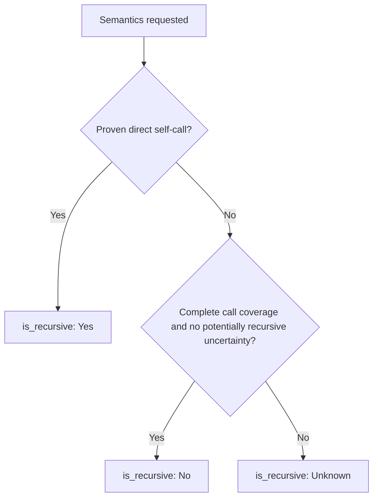

# Spec: Scope-Aware References and `hug refs`

## Problem

The tree-hugger library's [bind_references](../../lib/src/analysis/mod.rs),
which constructs relationships between declarations, binds a reference to the
first same-named declaration in the file. A shadowed local, a same-named
method on another type, or `other.method()` can bind to the wrong declaration.
Because of that, `semantics.is_recursive` cannot be trusted, and
`2026-10-03-symbol-improvements` makes it report `Unknown` whenever semantic
analysis runs.

## Goal and boundaries

Callers can inspect each captured reference's location, owner and resolution
evidence, and distinguish an established in-file binding from a same-name
candidate. Declaration filters must not change binding. Recursion must never
be inferred from a name coincidence or a use of a function as a value.

Resolution uses the source of one file and the pinned grammar. A directory
scan aggregates independent file results; it does not connect them. Compiler
integration, dependency loading, overload selection by argument types,
whole-program type inference, macro expansion and transitive callers remain
outside this feature. The library's [resolver module](../../lib/src/resolver/mod.rs)
is the separate boundary for project-level resolution.

**Reader's note:** this review retains the intended replacement of first-match
binding, but separates uncertain candidates from established relationships.
Existing relationship lists have no confidence field, so placing candidate
IDs there would make consumers mistake suggestions for resolved targets. The
changed relationship semantics require a schema version change, described below.

## Scoped resolution

Replace first-match binding with innermost lexical scope first, then outward,
honoring the supported language's declaration order, hoisting, name categories
and import aliases. Resolution case rules follow the language, not CLI smart
case. Inventory effective `@local.scope` captures, including inherited queries;
add language-specific scope rules where needed. Update provenance notes when
modifying vendored queries.

The tree-hugger library's [SymbolScope](../../lib/src/shared/schema_v2/types.rs)
classifies declarations as item, member or local for reports. It is not a
lexical scope tree. Build scopes from syntax nodes with a file-root scope,
parent links and indexed declaration tables per scope and language name
category (for example, Rust types and values). Assign declarations to the scope
where their names are visible: a function name can belong to the enclosing
scope while its parameters belong to its body.

Collect scope captures during the existing definitions-query traversal. Keep
binding facts for all declarations, including kinds omitted from the result;
uncaptured shadowing bindings must prevent an unjustified outer match. Use
indexed lookup and parent links rather than scanning all declarations for
each occurrence. Syntax needed only for reference resolution remains optional
when declaration reports do not request references.

Each language's support table must state rules for block versus function
scope, parameters and destructuring, loop/catch/pattern bindings, visibility
before declaration, hoisting, nested callable capture, imports and aliases,
and separate type/value names where applicable. Unsupported rules produce
limited coverage and uncertain occurrences, not first-match fallback.
Examples that defeat a generic "nearest declaration before the use" rule:

- Rust `let f = f();` can use an outer `f` in the initializer.
- A TypeScript block's `let f` hides the outer name even before initialization.
- Python assignment makes a name local throughout a function unless `global`
  or `nonlocal` changes that rule.

Resolve a qualified target only when its complete namespace/container path
or receiver binding is established locally and identifies one declaration.
Never redirect `other.method()` to the caller because names match. Preserve
the written qualifier on an unresolved target. Ambiguous overloads, wildcard
imports and dynamic member access cannot establish a unique target here.

An import alias establishes a local import binding, not an external
symbol ID. Use the alias for lookup and preserve the import source and
original name in the existing import record. Do not assume that a receiver
annotation proves one method implementation, or that `self`/`this` excludes
inheritance or dynamic dispatch. Broader receiver support is an author choice
under Open Questions.

For method calls, a known receiver alone is insufficient for a `Scoped`
method target ID when dispatch can select another implementation. Keep those
methods as candidates unless supported syntax and language rules establish
one called declaration. This prevents a source-level member lookup from
becoming false evidence of direct recursion.

## Occurrence records and summaries

Add `occurrences` and `reference_coverage` to the tree-hugger library's
[FileSymbolIndex](../../lib/src/shared/schema_v2/mod.rs), its per-file analysis
result. Each occurrence contains:

| Field | Meaning |
|---|---|
| `owner` | Optional declaration reference. Absent for file-level code or an anonymous callable without a declaration record; never invent an ID. |
| `owner_span` | Span of the owning declaration or anonymous callable; whole-file span for file-level code. Separate anonymous bodies remain distinguishable. |
| `target` | Reference retaining the written name and qualifier. Its ID is present only for one established in-file declaration. |
| `candidates` | Distinct in-file declaration references for a `NameOnly` match. Their IDs are suggestions, not target IDs. Empty for `Scoped` and `Unresolved`. |
| `span` | Referenced name-token span using the existing text-span conventions: one-based line/column and half-open byte offsets. |
| `kind` | `Call` for a syntactic invocation target, including explicit constructor invocation; `Usage` for other references, such as types and functions used as values. |
| `confidence` | `Scoped`, `NameOnly` or `Unresolved`, defined below. |

`Scoped` means syntax and supported lexical visibility rules establish one
source-level binding. It does not promise which implementation executes at
runtime. A bound import may be `Scoped` with an absent external target ID.
`NameOnly` means declarations suggest candidates but visibility or receiver
evidence cannot establish one. `Unresolved` means no supported binding or
in-file candidate was found. Missing scope support is not proof of resolution.
Ambiguous candidates never receive a target ID.

Keep occurrences in file-level code, initializers and anonymous callables;
the current binder drops references without declaration owners. Respect
callable boundaries even when a closure has no extracted record. Assign
default arguments, decorators and initializers according to supported language
evaluation rules; if ownership cannot be established, leave the owner absent
and mark the enclosing region limited instead of choosing a nearby function.

Inspect invocation syntax and capture member names that broad identifier
queries miss. In `object.run()`, `object` is a `Usage` and `run` the `Call`;
in `consume(run)`, `consume` is a `Call` and `run` a `Usage`. Definitions,
import binding names, comments and string text are not occurrences. Macro
invocations are `Usage` of the macro; unknown expansions can limit call
coverage. Indirect invocations remain `Call`, but binding a variable does not
identify the function it may invoke.

Deduplicate overlapping captures of the same occurrence, not distinct uses:
two calls on the same line remain two records. Sort by start byte, end byte,
owner span, kind, written target and confidence; sort candidates by declaration
position and ID. Order cannot depend on hash-map iteration or capture order.

`reference_coverage` records each owning region's optional owner, span,
`Complete` or `Limited` state and machine-readable limitation reasons, such as
unsupported binding form, missing call capture, parse error or indirect
dispatch. Completeness means all relevant reference forms in that region were
extracted and supported rules suffice to assess its calls. Running the pass
or finding no occurrences is not evidence of completeness. Empty reference
queries report limited coverage. Keep coverage for named callable bodies even
when they have no occurrences, and retain anonymous boundaries. Cache this
evidence so recursion and reports can explain uncertainty.

Derive existing per-symbol relationships in first occurrence order:
`references` contains established local targets and bound imports;
`dependencies` contains bound imports; `referenced_by` contains declaration
owners of established local targets. Preserve existing deduplication by
resolved ID, otherwise name plus qualifier. Uncertain occurrences stay in the
occurrence list, outside these summaries. Ownerless occurrences cannot create
fabricated reverse edges. Containment and export binding retain their existing
contracts. Changes to reference evidence must not silently change diagnostic
severity, confidence or default enablement.

## Selective analysis, serialization and cache

Add `Capability::Occurrences` to the tree-hugger library's
[SymbolQuery](../../lib/src/file/query.rs), which selects declarations and
optional analysis work. `Occurrences` requires `References`; `Semantics`
requires `Occurrences`, so recursion reads the same evidence. Use one
extraction/resolution path for occurrences and summaries. `References` alone
can discard occurrence output after constructing summaries. Complete indexes
and `--json-full` request the new capability. Ordinary declaration and
containment reports continue to skip reference work.

When requested, occurrences and coverage describe the whole file,
independently of selected declaration kinds or predicates. Their references
may name declarations absent from `symbols`, as existing relationships can.
Narrowing kinds or names removes declarations, not lexical context or
occurrences; dropping the occurrence capability clears occurrence and coverage
output. This makes narrow queries agree with projected wide queries without
losing incoming references owned by unselected kinds. The CLI selects the
requested incoming/outgoing occurrences after analysis.

Update the library's [coverage projection](../../lib/src/analysis/coverage.rs),
which adapts stored results to requested work, and its
[SymbolCache](../../lib/src/cache/symbol_cache.rs), which stores one unfinished
result per file. Widening by occurrences requires syntax unless complete
occurrence evidence is stored. Widening by semantics can use stored occurrences
and coverage; relationship summaries alone no longer suffice. Resolve before
discarding light records. Do not repeat the definitions query or parse to
compute a second reference representation.

Stored occurrence references retain in-file names. Apply scan-root-relative
prefixes only for presentation; never store them or use them for binding.
Validate spans, confidence/ID/candidate consistency and capability coverage
on cache reads. Missing or malformed required data is a cache miss, not a
computed empty result. Preserve the one-entry-per-file cache design. Public
serialization defaults for additive lists must not let the strict cache
reader accept an entry claiming occurrences while omitting their evidence.

The established [schema policy](../../docs/symbol-schema-design.md#serialization-and-compatibility)
requires a major bump for semantic changes: use schema 5.0 from the current
4.0 baseline for changed relationship meanings, on records, indexes, envelopes
and fingerprints. Coordinate the next major if another feature has already
advanced it. Bump the extractor revision too. Old entries are recomputed under
the cache's exact-version policy; update report versions where envelope shapes
change. Declaration IDs remain stable when their declaration identity remains
unchanged. The legacy symbol adapter gains no occurrence fields and continues
mapping recursion `Unknown` and `None` to `false` (not known to be recursive).

## Honest recursion

`is_recursive` is `Yes` only for a direct `Call` to the callable's own ID with
`Scoped` confidence and supported rules establishing that called declaration.
A self-value reference is not recursion. Evaluate
functions, methods and body-bearing constructors; bodyless declarations are
`Unknown` when semantics run. No analysis requested remains `None`.

A proven direct self-call makes `Yes` even when other calls are uncertain.
Otherwise, limited coverage or a potentially recursive unresolved/indirect
call makes `Unknown`. `No` requires complete call coverage and no such
uncertainty. A call through a variable does not prove a call to its initializer.
Nested callable bodies have their own owner and cannot establish recursion for
the enclosing function. Mutual recursion does not establish direct recursion.



## `hug refs <symbol>`

The tree-hugger-cli command lists incoming `Call` and `Usage` occurrences,
grouped by owner, with file paths, spans and confidence. `--callers` and
`--callees` are mutually exclusive: callers shows incoming calls, callees
shows calls owned by the selected declaration. Keep each call site, not just
one row per owner. Label file-level and anonymous owners with their spans.

The command contract is `hug refs [<symbol> | --id <id>] [file-globs...]`.
Exactly one selector is required; `--id` replaces the name selector and is
case-sensitive. Names use existing exact smart-case rules, including language
separators, file-prefixed qualified names and trailing `!` syntax. Check
ambiguity across all selected files, kinds and scopes, including locals;
do not inherit `hug symbols`' hidden-local default. Multiple declarations
produce a nonzero ambiguity error listing locations and IDs, without partial
success output. An unknown name or ID succeeds with an empty report.

```sh
hug refs parse 'src/**'
hug refs 'src/parser.rs#Parser::parse' --callers 'src/**'
hug refs --id 'ID_COPIED_FROM_REPORT' --callees 'src/**'
```

Incoming established rows match the target ID. Show name-only suggestions in
a separate group only when their candidates include that ID; they are not
proven callers. Unresolved same-name references are not attached to a selected
ID. Callees includes unresolved and import targets, visibly explaining absent
IDs. An ID selector cannot make uncertain evidence certain.

Use existing discovery, ignore rules, language overrides, file-glob behavior
and cache options. Text and `--json` are required; other declaration-report
formats and selectors are outside required scope and must be rejected if
unsupported. JSON follows existing versioned envelope conventions, adding
selected declaration identity, per-file occurrences, coverage and completed
capabilities. Both text and JSON state the file-local resolution boundary,
including on empty reports. A directory scan cannot discover cross-file
callers even when the same name appears elsewhere. Render text through
`biscuit-terminal` components using existing location links and wrapping.

## Scheduling and prerequisites

Scheduled 2026-10-08, after:

- `2026-10-03-symbol-improvements`: candidate-name index, selective query
  capabilities and recursion reporting `Unknown`.
- `2026-10-03-symbol-filters-and-reports`: qualified names and smart-case
  matching used by reference selection.
- `2026-10-05-deferred-kind-precision`: constructors and other precise kinds
  used as reference targets.

The author moved scoped binding and reference reporting from the pre-split
symbol-improvements draft on 2026-10-03. They ruled on 2026-10-05 that the
absence of a consumer is not a reason to defer: callers cannot adopt reference
data that does not exist. The prerequisite list above determines readiness;
there is no additional dependency on a metrics feature.

## Scope study and implementation sequence

**Review correction:** the original note said Perl had no scope captures.
Its current query has block and function scopes. All 16 supported languages
have effective scope captures, with JavaScript/TypeScript sharing the ECMA
query. The analysis does not yet use them for reference binding. Capture
presence does not prove correct scope assignment or complete reference
extraction; some scope captures are attached to import or declaration nodes.

Keep the proposed half-day scope study for Rust and TypeScript: build scope
trees from existing captures and inspect changed targets against first-match
binding, distinguishing corrected and still-uncertain matches. Record scope
and reference-query gaps and use them to size implementation. Changed-target
counts alone are not correctness evidence. The study informs the plan, not
whether the feature proceeds. It is not a performance benchmark. If a timing
sample is useful for the new indexed lookup, use one host and a quick sample;
this spec requires no extra hosts, workloads or statistical thresholds.

1. Inventory effective scope, definition and reference captures and document
   supported rules and limitations for every language.
2. Implement the shared occurrence model, lexical lookup and coverage with
   Rust/TypeScript examples; expand according to the author-selected breadth.
3. Derive summaries and recursion, then integrate selective queries, schema,
   cache and the CLI. Verify filtered and cached equivalence.
4. Update current documentation and the skill, then leave implementation
   ready for review. Record departures in the implementation log.

## Validation and documentation

Use existing fixture matrices and the repository test toolkit. Cover all 16
languages with explicit supported or limited states; a language limitation is
not an empty passing result. Required assertions include:

- Correct shadowing and language order/hoisting; aliases; type/value names;
  overload ambiguity; two types with same-named methods; unrelated and
  dynamic receivers remaining uncertain.
- Occurrence spans and qualifiers, non-ASCII source, repeated call sites,
  overlapping captures, constructors, file-level initializers, anonymous
  callables and nested named functions. Exclude declaration names and text
  inside comments/strings.
- Direct self-call `Yes`; self-value `No` only with complete coverage;
  unresolved/indirect calls, missing captures and parse errors `Unknown`;
  nested calls cannot establish enclosing recursion. Callers/callees exclude
  `Usage`, preserve repeated calls and keep uncertain groups separate.
- Cold, warm, capability-widened and kind-narrowed results agree with uncached
  analysis. Assert an actual cache hit, malformed evidence rejection and old
  version invalidation. Work counters prove skipped and nonduplicated work.
- CLI exact/smart-case selection, duplicate names across files, ID selection,
  local targets, empty reports, conflicting flags and versioned JSON. A
  cross-file same-name call must not become an incoming resolved reference.

Run `just test` and `just lint` in `tree-hugger/` for implementation. Run
`just test-l2` for the new terminal report using the shared harness without
focusing terminal or browser windows. Existing macOS, Linux, native Windows
and WSL2 requirements apply; this feature adds no CI environments or gates.
No code tests are required for this inline specification review.

Implementation updates the area/library/CLI READMEs, current symbol schema,
cache and report documentation, and `.claude/skills/tree-hugger/`. Explain
confidence, language limitations, direct recursion, schema migration and the
file-local boundary with compact examples. Current docs must describe behavior
without linking to this dated spec. Until implemented, mark decided behavior
as planned. Update query provenance alongside query edits.

## Open Questions

Recommendations below require author acceptance before expanding or narrowing
the implementation commitments.

### How much language resolution must ship in the first release?

The source languages have different scope and visibility rules; merely reading
scope captures cannot finish their resolvers. Every language needs occurrence
reporting and explicit limitations, but the first release's required resolved
forms need an author-approved support table.

1. **Resolve common lexical forms in all 16 languages at once.** Pros: broad
   immediate usefulness and one release contract. Cons: substantial grammar
   and language-rule work before any report ships; “common” needs an explicit
   form list per language.
2. **Ship proven Rust/TypeScript forms first, with conservative occurrences
   and explicit limited coverage elsewhere (recommended).** Pros: tests and
   the scope study anchor the first usable release; uncertain languages cannot
   emit misleading IDs or `No` recursion. Cons: usefulness differs by language
   and later phases still need scheduled work. Recommended because it provides
   trustworthy data without treating capture presence as semantic support.
3. **Gate all new reports until every language has full lexical coverage.**
   Pros: uniform availability. Cons: difficult to define “full,” delays useful
   output and still cannot remove dynamic dispatch or cross-file limits.

Record the accepted language/form table before implementation is finalized;
limited rows cannot count as completed resolved forms promised by that table.

### Should receiver type inference be part of this feature?

Lexical lookup does not determine `other.method()` merely because a variable
has a type annotation. Inheritance, interfaces and runtime mutation can leave
multiple implementations possible, which matters for callers and recursion.

1. **Resolve only explicit local paths and receiver forms whose language
   rules prove one declaration (recommended).** Pros: bounded syntax-based
   implementation and honest uncertainty. Cons: many instance calls remain
   unresolved. Recommended because it meets the feature's trust goal without
   introducing a partial type checker. Document each supported receiver form.
2. **Add limited annotation/initializer inference.** Pros: more instance calls
   get useful candidates. Cons: aliases, generics and dispatch require new
   confidence/coverage rules; inferred types cannot automatically prove a
   method ID or recursion. Define those rules before accepting this option.
3. **Delegate receiver resolution to project-level resolvers.** Pros: a natural
   home for compiler-backed evidence. Cons: project setup and external tools
   exceed this feature's per-file boundary; keep it as later work rather than
   silently introducing those dependencies here.
