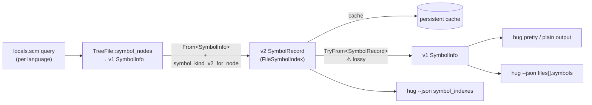

# Preserve symbol kinds, declaration visibility, and static members across all supported languages

## Summary

`hug` tells you *what* a symbol is (its kind) and *who can see it* (its
visibility). On 2026-10-03 both answers are wrong often enough that the output
can't be trusted:

- **Function and declaration visibility is lost before rendering.** The
  author's baseline run found no visibility labels on standalone symbols
  across 31 fixtures, despite more than 50 visibility keywords. Field labels
  inside type metadata are an exception: their visibility already survives.
  The baseline describes that run, rather than a guarantee that every output
  path loses visibility.
- **Static members are reported as instance members.** `hug classes` lists a
  TypeScript `private static make()` and a Java `public static create()` under
  *Instance Methods*.
- **Some kinds become `unknown`, or are wrong.** TypeScript constructors,
  properties and type aliases print as `unknown`, so they drop out of
  `hug functions` and `hug types`. Rust enum variants print as `field`, Rust
  `mod` as `namespace`, Python, Java and C++ classes as `type`, and C#
  properties and Swift protocol property requirements as `variable`. Swift
  and Scala member functions, Python `@staticmethod`/`@classmethod` methods
  and Rust associated functions print as `function`, so `hug classes` drops
  them.
- **Some declarations are missing entirely.** These produce no symbol at all:
  - Rust `type`, `static` and `union` items, and bodyless trait method
    declarations
  - Java `interface`, `package` and interface constants
  - C and C++ `union`, and C++ methods defined inside a class body
  - TypeScript `abstract class`, `#private` methods, abstract and interface
    method signatures, and interface property signatures
  - every Perl `sub`, because Perl has no symbol query
- **Some members lose their container.** PHP-trait and Scala-trait methods
  print without one, C++ class members name the enclosing namespace instead
  of their class, Rust `impl` members name `impl X` rather than the type `X`
  (so `hug classes` lists no Rust methods), and every `[in X]` suffix is
  missing X's kind.

This spec fixes the data at its source (extraction) and at its one lossy
boundary (the v2→v1 adapter). It also adds a **test matrix that covers all 16
supported languages**, so that a construct can no longer regress in one
language while the others pass.

Rendering improvements, such as showing `struct` rather than `type`, are out of
scope. So is moving the CLI off the v1 types. Both belong to
`2026-10-03-symbol-improvements`, which depends on this fix.

## Background, for a reader new to this area

Tree Hugger has two symbol models, and every symbol `hug` prints crosses
between them twice:

- **v1 [SymbolInfo](../../lib/src/shared/symbol.rs)** in the `tree-hugger` library is the original flat
  struct: name, kind, range, container, signature and type metadata.
- **v2 [SymbolRecord](../../lib/src/shared/schema_v2/mod.rs)** in the `tree-hugger` library is the newer,
  facet-based record: identity, source, visibility, docs, relations and
  semantics. A per-file `FileSymbolIndex` holds the records.
  [The schema design](../../docs/symbol-schema-design.md) proposes eventual
  removal of v1; it remains a draft, not evidence of a scheduled release.



Extraction produces v1. The analysis pipeline converts v1 to v2 and refines
some kinds that only v2 can express. The CLI then converts each v2 record
**back** to v1 to render it. Whatever the return trip can't carry silently
disappears. Most of the defects below are that return trip; the rest are gaps
in the per-language queries that feed the start of the pipeline.

## Reproduction

These fixtures are run with the release `hug` in a scratch git repository.
Outside a git repository, `hug` currently fails with `NoSourceFiles`; that
defect is out of scope here.

```ts
// a.ts
export type Id = string;
export class Box {
  private width: number;
  static count = 0;
  constructor(w: number) { this.width = w; }
  public area(): number { return this.width; }
  private static make(): Box { return new Box(1); }
  protected tick() {}
}
```

```text
$ hug --plain symbols a.ts
  - method area(): number [in Box] a.ts:7:3        ← "public" lost; [in class Box] expected
  - unknown constructor a.ts:6:3                   ← Constructor
  - unknown count a.ts:5:3                         ← Property
  - unknown Id a.ts:1:8                            ← TypeAlias
  - method make(): Box [in Box] a.ts:8:3           ← "private static" lost
  - method tick [in Box] a.ts:9:3                  ← "protected" lost; "()" lost
$ hug --plain functions a.ts                       ← constructor missing
$ hug --plain types a.ts                           ← type alias Id missing
$ hug --plain classes a.ts
    Instance Methods (4)
      - constructor, area, make, tick              ← make is static
```

```rust
// b.rs and d.rs
pub mod inner {}                 // printed as "namespace"
pub(crate) fn crate_fn() {}      // no visibility printed; v2 index says Public
fn private_fn() {}               // no visibility printed; v2 index says Unknown
pub enum E { A, B(u8) }          // A and B printed as "field"
pub type Alias = u8;             // not reported at all
pub static COUNTER: u32 = 0;     // not reported at all
pub union U { a: u32, b: f32 }   // not reported; fields a and b orphaned
```

Java `public interface Shape { double area(); }` reports `area` in `Shape`,
but `Shape` itself is never reported. TypeScript `export abstract class Base {}`
is not reported. `sub greet { … }` in `sample.pl` yields `(no symbols)`.

## Baseline spike

A baseline spike on 2026-10-03 checked every committed matrix cell against
today's output before implementation. The full results are in
[the baseline report](spike/baseline.md).

**Method.** One fixture per language, plus JavaScript/TypeScript script and
CommonJS files, was written under [spike/fixtures/](spike/fixtures/) and
checked with each language's own parser or compiler where one was available.
`hug` was built at rev `21debbcc5` and run with `--no-cache` over each fixture
in a scratch git repository. The JSON and plain output is kept under
[spike/raw/](spike/raw/), and [summarize.py](spike/summarize.py) prints each
symbol's v1 and v2 records side by side.

**Findings.**

- **The adapter defects are confirmed exactly.** Across all 19 output files no
  symbol has a v1 `container_kind`, a v1 `signature.visibility`, or a true v1
  `signature.is_static`, even where v2 holds a level or a `Static` modifier.
- **Seven `ok` kind cells are wrong in whole or in part** and are flipped or
  split under the rule in "The acceptance matrix": Swift, Rust, Python and
  TypeScript Method; Java Namespace; C++ union; and C named union tags. Two
  more, Java and Swift Field, are split the same way because non-method
  interface and protocol members were ruled inside them (see "Decisions").
- **Every `LIM` cell holds**, as does Rust `const` → `Constant`.
- **C++ is worse than described.** Methods defined inside a class body are not
  reported at all, and class members inside a namespace take the namespace as
  their container.
- **Several keyword levels already reach v2.** Java, C#, PHP and TypeScript
  method keywords, Java and C# interface-member defaults, and C++ access
  sections in field metadata are already correct. The missing work there is
  defaults, non-function kinds and the adapter.
- **Section 5's missing signatures reach beyond parameterless functions.**
  Every Lua, Bash and Zsh function, and C# expression-bodied methods returning
  a user-defined type, have no signature.

**Effect on scope.** Kind work grows by about four query or classification
items: Java `package_declaration`, C++ `union_specifier` and in-class method
definitions, Rust bodyless trait methods, and the shared direct-member rule of
section 6 (Swift, Scala, Python decorated methods and Rust associated
functions). C++ grows the most, because it needs a query change as well as
class-over-namespace containment. The two rulings made after the spike add
three member patterns (Java interface constants, TypeScript interface property
signatures and Swift protocol property requirements) and change the container
that Rust `impl` members name. Visibility work for Java, C#, PHP and
TypeScript methods is somewhat smaller than expected, since their keyword
levels already reach v2. Rust, Swift, C/C++, Go, Scala, Lua and the JS/TS
module rules are built from scratch.

## Defects and root causes

### The v2→v1 adapter discards visibility and `static`

`signature_from_function_data` hardcodes both fields
(`lib/src/shared/schema_v2/mod.rs:483-484`):

```rust
return_type: function.return_info.type_text,
visibility: None,
is_static: false,
```

The v2 record does carry them, in `visibility.level` and in
`Modifier::Static`. The CLI renders visibility from `signature.visibility` and
partitions `hug classes` on `signature.is_static`, so both are always wrong.
Field visibility survives (`private width: number` renders correctly) because
fields travel through a different path, `field_data_from_field`.

### Visibility is only extracted for functions, and the Rust levels are wrong

`extract_visibility` (`lib/src/file/extract/signatures.rs:344`) runs only
inside `extract_signature`. Types, constants, modules and type aliases never
get a visibility, so `From<SymbolInfo>` records `VisibilityLevel::Unknown` for
them.

Even for functions it reads only explicit keywords. The extractor applies no
unmarked default in any language, so an unmodified declaration is always
Unknown. Go, C, Scala
and Lua return nothing at all. The C++ reader looks back for an access section
(`public:` and so on), but stops at the first declaration it passes. In the
baseline spike every C++ method came out Unknown, including those directly
after `public:`. The separate access-section walk that type metadata uses is
already correct for fields (`protected:` fields report Protected) and can be
reused.

For Rust, `extract_rust_visibility` maps every `pub…` to `Public`, so
`pub(crate)` claims to be public API, and even `pub(self)`, which is private,
reports Public. It also returns `None` for a missing modifier, although an
unmarked Rust item is definitely private. v1 `Visibility` has no `Crate` level
that could carry the difference.

Other keyword readers are partly right today:

- **Already correct in v2:** Java, C#, PHP and TypeScript `public`,
  `protected` and `private` on methods; unmarked Java and C# interface members
  (Public), with an explicit C# `private` winning; and the same keywords in
  Java, C#, PHP and TypeScript field metadata.
- **Wrong today:** Swift `fileprivate` reports Private rather than
  ModulePrivate, and `open` and `package` report Unknown. C# `protected
  internal` collapses to Protected and `private protected` to Private, in
  standalone symbols and field metadata alike. A C# explicit interface
  implementation (`double IShape.Area()`) reports Unknown.

The conversion to v2 also derives export from the level:
`From<SymbolInfo> for SymbolRecord` sets `is_exported: level ==
VisibilityLevel::Public` (`lib/src/shared/schema_v2/mod.rs:433`).
`symbol_records()` and the bind pass overwrite the flag from
`is_exported_definition`, but any other caller of the conversion gets an export
inferred from access alone. Section 3 gives many more declarations a Public
level, such as every unmarked TypeScript class member and PHP or Scala member,
and that default would claim each of them as an export.

### Declaration text is never recorded

`From<SymbolInfo> for SymbolRecord` always sets `source.declaration_text` to
`None` (`lib/src/shared/schema_v2/mod.rs:427`), and nothing in extraction fills
it later. This spec keeps original syntax there wherever a level cannot carry
it: restricted Rust `pub(...)`, unresolved Scala qualifiers, Swift and C#
setter-only modifiers, other unmappable access, and the Perl `my`, `our` and
`state` keywords. Without the text those promises have nowhere to land.

### A function with no parameters and no return type loses its signature

`signature_from_function_data` returns `None` when there are no parameters and
no return type (`mod.rs:467`). The renderer then prints a bare `tick` instead
of `tick()`.

Extraction also omits signatures that do have content. The baseline spike
found no signature on any Lua function, even one with parameters, on any Bash
or Zsh function, or on a C# expression-bodied method whose return type is
user-defined (`public static PublicWidget StaticFactory() => …`), while
`public int PublicMethod() => …` has one.

### The container kind is dropped

`TryFrom<SymbolRecord> for SymbolInfo` sets `container_kind: None`
(`mod.rs:556`). `From<SymbolInfo>` never stored it: the record keeps only the
container *name*, in `identity.module_path`. Every `[in X]` suffix therefore
loses `class`, `trait` or `interface`. Rust `impl` members only look
unaffected, because `find_symbol_container` names their container after the
`impl` header itself (`[in impl Greeter]`). The CLI renderer even
special-cases a `Type` container whose name starts with `impl ` so that the
name prints alone.

That name is also why `hug classes` lists no Rust methods at all: a method's
container is `impl PublicStruct` or `impl PublicTrait for PublicStruct`, never
the struct itself. Section 6 makes the container the implemented type, which
also retires the CLI's `impl ` special case. Two container names are wrong
outright: a Rust `mod` names itself as its own container, and a C++ class
member inside a `namespace` names the namespace instead of its class.

### Kinds that only v2 can express collapse to `Unknown`

`impl From<SymbolKindV2> for SymbolKind` ends in `_ => Self::Unknown`
(`mod.rs:159`). `Constructor`, `Property`, `TypeAlias` and `EnumVariant`
therefore come back as `Unknown`. They fail both `is_function()` and
`is_type()`, so `hug functions` and `hug types` drop them. The wildcard also
means a future v2 kind would degrade the same way without a compile error.

### Query and classification gaps

| Language | Gap | Cause |
|---|---|---|
| Rust | `type`, `static` and `union` items not reported | no `type_item`, `static_item` or `union_item` pattern in `queries/vendor/rust/locals.scm` |
| Rust | enum variants reported as `Field` | `enum_variant` captured as `@local.definition.field` |
| Rust | `mod` reported as `Namespace`, and named as its own container | `mod_item` captured as `@local.definition.namespace`, with no context capture, so the container search starts from the name and finds the `mod_item` itself |
| Rust | associated functions without a `self` receiver reported as `Function` | not classified as direct members of the `impl` (section 6) |
| Rust | bodyless trait method declarations (`fn f(&self) -> u32;`) not reported; only their `self` parameter is | no `function_signature_item` pattern in `queries/vendor/rust/locals.scm` |
| Rust | members of an `impl` block name `impl X` or `impl Trait for X` as their container, so `hug classes` lists no Rust methods | `find_symbol_container` (`lib/src/file/extract/classify.rs`) builds the container name from the `impl` header rather than the implemented type (section 6) |
| Java | `interface` not reported | no `interface_declaration` pattern in `queries/vendor/java/locals.scm` |
| Java | `package` not reported, in the new fixture and every existing Java fixture | the `package_declaration` pattern requires a bare `identifier` child, so a dotted name such as `com.example` (a `scoped_identifier`) never matches |
| Java | interface constants (`int SIDES = 0;`) not reported | an interface constant parses as `constant_declaration`, and `queries/vendor/java/locals.scm` captures fields only from `field_declaration` |
| Java | `class` reported as `Type` | `class_declaration` captured as `@local.definition.type` in `queries/vendor/java/locals.scm`; intentionally change the classification to `Class` |
| TypeScript | `abstract class` not reported | no `abstract_class_declaration` pattern |
| TypeScript | `#private` methods not reported (JavaScript reports them) | the inherited `ecma` method pattern matches only `property_identifier`; JavaScript's own query adds `private_property_identifier` |
| TypeScript | abstract method signatures (`abstract f(): void;`) and interface method signatures not reported | no `abstract_method_signature` or `method_signature` pattern |
| TypeScript | interface property signatures (`name: string;`) not reported | no `property_signature` pattern |
| JavaScript | every `this.x = …` assignment reported as a `Variable` of the class: assigning the same property in several methods yields duplicates, and each also duplicates any class-body field of the same name | catch-all `(assignment_expression left: (member_expression object: (this) …))` pattern in `queries/vendor/javascript/locals.scm`; TypeScript's query inherits `ecma`, not `javascript`, so it has no such pattern |
| Python | class reported as `Type` | `class_definition` captured as `@local.definition.type` in `queries/vendor/python/locals.scm` |
| Python | `@staticmethod` and `@classmethod` methods reported as `Function`, so `hug classes` drops them | a decorated method is not classified as a direct member of its class (section 6) |
| Python | every attribute assignment reported as `Field`: `self.x` set in several methods yields duplicates, a class attribute reassigned through `self` appears twice, and `obj.attr = …` in a free function yields a container-less field | catch-all `(assignment left: (attribute …))` pattern in `queries/vendor/python/locals.scm` |
| Python | `hug symbols` and `hug classes` disagree about class attributes | `hug classes` reads `extract_python_class_fields` (`lib/src/file/extract/type_metadata.rs`), which keeps only annotated class-body lines, all `is_static: false`; standalone symbols come from the query |
| Swift | enum `case` reported as `Field` | captured as a field |
| Swift | member functions of classes, structs, enums and extensions reported as `Function`, so `hug classes` lists no Swift methods | `function_declaration` is captured only as `@local.definition.function` and not classified as a direct member (section 6) |
| Swift | protocol requirements: `func draw()` not reported, and `var name: String { get }` reported as `Variable` | no pattern for protocol function or property requirements |
| Swift | a function-local `let` reported as a container-less `Field` | tree-sitter-swift parses every `let`/`var` binding as a `property_declaration`, and `refine_symbol_kind` turns any binding under a `property_declaration` into a `Field`; section 2 forbids classifying a local as a field |
| C | struct tags and typedef aliases both report `Type` | typedef captures are not classified as `TypeAlias`; two distinct declarations must not be mistaken for a duplicate |
| C | a named `union` tag not reported, and its fields have no container | no `union_specifier` pattern in `queries/vendor/c/locals.scm` |
| C++ | `class` reported as `Type` | `class_specifier` captured as `@local.definition.type`; intentionally change the classification to `Class` |
| C++ | `union` not reported, and its fields name the enclosing namespace as container | no `union_specifier` pattern in `queries/vendor/cpp/locals.scm` |
| C++ | methods defined inside a class body (`void f() {}`) not reported at all; only bodyless declarations (`void f();`) are | the only in-class method pattern is a `field_declaration` with a `function_declarator`; an in-class `function_definition` has none |
| C++ | methods and fields of a class inside a `namespace` name the namespace as container; at file scope they have none | `find_symbol_container` does not recognize the C++ class body, so it reaches the next recognized ancestor |
| PHP | methods inside a `trait` have no container | as above, for trait bodies |
| Scala | methods inside a `trait` or `object` are `Function` with no container; methods inside a `class` or case class are `Function` with the correct container | as above, and direct member functions are not classified as `Method` (section 6) |
| C# | file-scoped `namespace` not reported | no namespace pattern of any form in `queries/vendor/c_sharp/locals.scm` |
| C# | an interface's type metadata lists its methods as fields, with the whole declaration as `type_annotation`, all marked Public (including `private void Log()`); Swift protocol metadata likewise lists function requirements as fields | interface/protocol bodies go through the field-metadata path; section 3 requires `FieldInfo` to agree with the standalone symbol |
| C# | `property` reported as `Variable` | `property_declaration` captured as bare `@local.definition` in `queries/vendor/c_sharp/locals.scm`, which maps to `Variable` |
| Perl | no symbols at all | `queries/vendor/perl/locals.scm` contains only `; No locals query available for perl yet.` |

The baseline spike also found a gap outside the committed cells, which is
recorded here and not fixed: Go `type A = B` is not reported at all, rather
than reported with the wrong kind. Go TypeAlias is a `FEAT` cell.

### Stale cache entries would hide the fix

The persistent cache key (`cli/src/main.rs:1638-1649`) hashes an analyzer
fingerprint built from the schema version (`SchemaVersion::V2_0`), the crate
version, the language name, the constant string `"locals+imports+references"`
and a fingerprint of the CLI's analysis options. Nothing in it tracks the
extraction rules, so a change to extracted records that bumps neither the
schema nor the crate version keeps the same key, and a developer's warm cache
keeps serving the old, broken records. This fix's move to schema 3.0 already
changes the digest on its own; the key still needs a component that the next
extraction change will move. `2026-10-03-symbol-improvements` replaces this
fingerprint properly. This fix only has to make sure extraction changes
invalidate the cache.

## What this fix does

### 1. The old and new models represent the same kinds and visibility levels

- v1 `SymbolKind` gains `Constructor`, `Property`, `TypeAlias` and
  `EnumVariant`.
  - `is_function()` includes `Constructor`.
  - `is_type()` includes `TypeAlias`.
- v2 `VisibilityLevel` and v1 `Visibility` both gain `ProtectedInternal` and
  `PrivateProtected` (labels `protected internal` and `private protected`) for
  C#'s compound access.
- v1 `Visibility` also gains `Package`, `Crate` and `ModulePrivate`, so it
  mirrors `VisibilityLevel` exactly. `Unknown` is represented as `None`.
- Both directions of kind conversion and the `Option<Visibility>` ↔
  `VisibilityLevel` conversions use exhaustive `match`
  expressions with **no wildcard arm**. Adding a variant on one side is then a
  compile error until the other side handles it.

**Why mirror rather than map down:** each down-mapping that loses a
distinction would recreate the unknown-kind defect. v1 is planned for removal, so
widening two enums now is cheaper than auditing lossy mappings until then.

### 2. Kinds are decided once, at extraction

In the `tree-hugger` library, the refinement that
[symbol_kind_v2_for_node](../../lib/src/file/extract/classify.rs) applies after
conversion (constructor, property, type alias) moves into extraction, next to
[refine_symbol_kind](../../lib/src/file/extract/classify.rs), which classifies
query captures. Classification uses the declaration node, language, and name,
not a broad search through ancestor bodies. `TreeFile::symbols()`,
`symbol_records()` and the CLI
then agree on every kind, and the post-conversion override is deleted.
Update capture-name mapping, duplicate-capture priority, display labels, and
all exhaustive matches. Constructors outrank method captures at the same name
span; properties outrank generic variable captures. Do not classify a local
variable as a field merely because its enclosing function is in a class, or
because its grammar node is a property declaration: a Swift `let` or `var`
inside a function body is a `Variable`.

Keep kind-specific data consistent with the final kind: constructors use
`FunctionData`, properties use `FieldData`, aliases use `TypeAliasData`, and
variants retain their enclosing enum's metadata. Rust aliases capture their
right-hand type, as TypeScript aliases already do. A variant must not acquire a
function signature merely because its declaration contains tuple fields.
Rust `static` and `static mut` items report `Variable` and carry the
`Modifier::StaticStorage` marker (section 4); they are not `Constant`.

### 3. Visibility is extracted for every symbol kind

In the `tree-hugger` library,
[extract_visibility](../../lib/src/file/extract/signatures.rs), which reads
declaration access, takes any declaration node, not just function nodes. Its
result is stored on a new top-level `SymbolInfo::visibility` and on
`SymbolRecord.visibility.level`. `FunctionSignature::visibility` is
**removed**, so visibility has exactly one home, and the CLI reads
`symbol.visibility`. `FieldInfo::visibility` stays, because it describes a
field listed inside its type's metadata.

**Meaning of the level:** it describes the access declared or implicitly
assigned to this declaration, not effective access through all enclosing
modules, types, imports, or package configuration. For example, `pub fn f()`
inside a private Rust module remains `Public`; that does not make it external
API. Local variables, parameters, and local function declarations receive
`None` / `Unknown` where member or module access does not apply. `Unknown`
also covers syntax whose access cannot be established from this file.

Use the nearest declaration and applicable access section. Never search the
entire body for a keyword: a private method must not make its public class
private. Explicit modifiers override defaults. Keep standalone field access
and the corresponding `FieldInfo` entry consistent. Type metadata lists only
fields and properties: a C# interface's methods and a Swift protocol's
function requirements are not `FieldInfo` entries, though both are listed as
fields today.

The levels each language reports for declarations to which access applies:

| Language | Keyword → level | No modifier → level |
|---|---|---|
| Rust | `pub` → Public; `pub(crate)`, `pub(super)` and `pub(in path)` → Crate; `pub(self)` → Private | Private for ordinary items and struct/union fields. Associated items in trait declarations and enum variants (including variant fields) inherit the trait/enum level. Trait-implementation items use the level of a trait declared in the same file, otherwise Unknown; standard-library traits are not hardcoded. An `impl` itself has no access modifier. |
| TypeScript | `public` / `protected` / `private` → same; `#name` → Private; `export` (top-level) → Public | class member → Public; interface member (property and method signatures) → Public; unexported top-level → ModulePrivate in a module file, Unknown in a global script (see "JavaScript and TypeScript module files" below) |
| JavaScript | `#name` → Private; `export` (top-level) → Public | class member → Public; unexported top-level → ModulePrivate in a module file, Unknown in a classic script (see "JavaScript and TypeScript module files" below) |
| Go | Unicode uppercase initial on a package-level identifier, field, or method → Public | otherwise Package for those declarations; locals/parameters and the package clause itself → Unknown |
| Java | `public` / `protected` / `private` → same | Package; interface members → Public |
| C# | `public` / `protected` / `private` / `internal` → same; `protected internal` → ProtectedInternal; `private protected` → PrivateProtected; `file` → ModulePrivate | class/struct member → Private; top-level type → Internal; any interface member, including default-implemented methods, static members and nested types → Public; explicit interface implementation → Private (see "C# interface members" below) |
| C | `static` at file scope → ModulePrivate for objects/functions | file-scope objects/functions → Public unless the linkage rule below makes them ModulePrivate; type/tag/member/macro declarations → Unknown (no access modifier) |
| C++ | `public:` / `protected:` / `private:` section → same; namespace-scope `static` objects/functions or unnamed namespace → ModulePrivate | `class` member → Private; `struct`/`union` member → Public; namespace-scope objects/functions → Public unless the linkage rule below makes them ModulePrivate; namespace-scope objects that are themselves `const` (including `constexpr`) without `extern` or `inline` → ModulePrivate |
| Swift | `open` and `public` → Public; `package` → Package; `internal` → Internal; `fileprivate` → ModulePrivate; `private` → Private | ordinarily Internal; enum cases and protocol requirements inherit their container; members of a `private` or `fileprivate` type → ModulePrivate; members of an extension with an explicit access level take that level; members of a `public` or `open` type → Internal (see "Swift members of types and extensions" below) |
| Scala | `private` / `protected` → same; `private[this]` → Private; `protected[this]` → Protected; a qualifier equal to a segment of the file's `package` clause (`private[pkg]`, `protected[pkg]`) → Package; any other qualifier, such as an enclosing class name → Unknown, with the source text kept in `source.declaration_text` (see "Scala qualified access" below) | Public |
| PHP | `public` / `protected` / `private` → same | Public |
| Lua | chunk-level `local` declarations → ModulePrivate; block-local declarations → Unknown | global binding → Public; table fields → Unknown (no enforced access) |
| Python, Perl, Bash, Zsh | — | Unknown. Privacy is only a naming convention (Python's `_name`, Perl's `_sub`) or doesn't exist (shell functions). Reporting a guess as fact is the defect this spec removes. |

The "No modifier" column matters as much as the keyword column. In most of
these languages an unmarked declaration has a definite level, and `None` is
also correct for declarations without access semantics or unresolved access.
The rules that need more than a table cell are spelled out below.

**C and C++ linkage rule.** Visibility for a top-level (file-scope or
namespace-scope) function or variable is decided from its own declaration plus
a scan of earlier declarations in the same file. It is Public unless any of
these holds, in which case it is ModulePrivate:

- the declaration is `static`
- it is inside an unnamed `namespace { … }` (C++)
- it is a C++ `const` variable declared without `extern` or `inline`
- an earlier declaration of the same function in the same file is `static`

The C++ `const` condition looks at the top-level `const` of the object itself,
not at what a pointer points to. `constexpr` makes the object `const`, so it
counts. `const char* p` is a mutable pointer to `const` data and stays Public;
`char* const p` is itself `const` and is ModulePrivate.

"The same function" means the same name in C. In C++ it means the same
enclosing namespace, the same name, and identical parameter-type text after
whitespace normalization. A typedef'd spelling of the same parameter type does
not match, so the later declaration falls back to its own rule. That can only
report Public where the earlier `static` made the function ModulePrivate,
never the reverse, and keeps the scan textual. `extern "C"`, `inline`, and
whether the file is a header or a source file do not affect the level.

```cpp
static int helper(int);          // ModulePrivate
int helper(int x) { return x; }  // ModulePrivate: earlier static prototype
int helper(long x);              // Public: different overload
namespace { int hidden; }        // ModulePrivate
const int LIMIT = 3;             // ModulePrivate (C++)
constexpr int MAX = 8;           // ModulePrivate (C++): constexpr is const
const char* name = "n";          // Public: the pointer itself is not const
char* const slot = nullptr;      // ModulePrivate (C++): const pointer
extern const int SHARED = 4;     // Public
extern "C" void api(void);       // Public
```

**JavaScript and TypeScript module files.** A file is a module when its
extension is `.mjs`, `.cjs`, `.mts` or `.cts`, or when it contains an
`import` or `export` statement (the language allows these only at top level),
or, anywhere in the file, a `require(...)` call or an assignment to
`module.exports` or `exports.…`. A `require` inside a function or an
`exports.x = …` inside an `if` counts just as a top-level one does. In a
module, an unexported
top-level declaration is ModulePrivate. In any other file (a classic script,
or a TypeScript global script) it is Unknown, because its top-level
declarations are global. `package.json`'s `"type"` field is not consulted, so
extraction stays a single-file operation. CommonJS counts as a module because
Node wraps each CommonJS file in a module function: its top-level declarations
are private to the file and leave it only through `module.exports`.

**C# interface members.** Any member declared inside an interface without an
access keyword is Public. That includes default-implemented (bodied) methods,
static interface members, and nested types. An explicit access keyword wins.
An explicit interface implementation in a class or struct (tree-sitter node
`explicit_interface_specifier`) is Private, which is what the C# compiler
reports as its declared accessibility.

```csharp
interface IShape {
    double Area();                          // Public
    void Draw() { }                         // Public: default implementation
    static IShape Unit() => new Square();   // Public: static member
    class Helper { }                        // Public: nested type
    private void Log() { }                  // Private: explicit keyword wins
}
class Square : IShape {
    double IShape.Area() => 1;              // Private: explicit implementation
}
```

**Swift members of types and extensions.** An unmarked member takes its level
from the nearest enclosing type or extension that has an explicit access
keyword; a top-level `private` behaves as `fileprivate`:

- inside a `private` or `fileprivate` type → ModulePrivate
- inside an extension with an explicit access level → that level, so a
  `private extension` → ModulePrivate
- inside a `public` or `open` type → Internal
- otherwise → Internal

```swift
private struct Hidden { func a() {} }       // a: ModulePrivate
private extension Widget { func b() {} }    // b: ModulePrivate
public extension Widget { func c() {} }     // c: Public
public struct Api {
    func d() {}                             // d: Internal
    private struct Inner { func e() {} }    // e: ModulePrivate (Inner is nearest)
}
struct Plain { func f() {} }                // f: Internal
```

**Setter-only access modifiers.** A modifier that restricts only a setter does
not set the declaration's level. In Swift, `private(set)`,
`fileprivate(set)`, `internal(set)` and `package(set)` limit writes only; the
declaration takes its level from any other access keyword, otherwise from the
defaults above. In C#, an accessor-level modifier such as
`{ get; private set; }` likewise leaves the property's own level unchanged.
The setter restriction stays visible in `source.declaration_text`.

```swift
public private(set) var count = 0           // Public
private(set) var total = 0                  // Internal (the default)
```

```csharp
public int Count { get; private set; }      // Public
internal int Total { get; private set; }    // Internal
```

**Scala qualified access.** A qualifier is resolved only from what the file
shows:

- `private[this]` → Private and `protected[this]` → Protected
- a qualifier equal to a segment of the file's `package` clause → Package
- any other qualifier, such as the name of an enclosing class → Unknown, with
  the source text kept in `source.declaration_text`

```scala
package com.acme.shapes

class Shape {
  private[this] val id = 0                  // Private
  protected[this] def tick() = ()           // Protected
  private[shapes] def area() = 0            // Package
  private[acme] def scale() = 1             // Package
  private[Shape] def secret() = 2           // Unknown
}
```

**Rust trait-implementation items.** An item in `impl Trait for Type` takes the
level of `Trait` when `Trait` is declared in the same file, and is Unknown
otherwise. Standard-library traits are not special-cased: `fmt` in
`impl Display for X` is Unknown.

**Reader's note:** this replaces the draft's promise of exact visibility for
every symbol. The existing enum cannot encode every language's access rules.
Restricted Rust access remains a documented upper bound: preserve its original
`pub(...)` text in `source.declaration_text` and do not claim crate-wide access.
Preserve other unmappable access syntax there too; do not silently relabel it.
Section 9 defines what that text contains.

**A level is not an export.** `From<SymbolInfo> for SymbolRecord` stops
deriving `is_exported` from the level and sets it to `false`. Export comes only
from [is_exported_definition](../../lib/src/file/extract/classify.rs), applied
by `symbol_records()`, and from the bind pass, as "Out of scope" already
requires. A Public Java class or TypeScript class member is not thereby
exported.

The access defaults should follow the
[Rust reference](https://doc.rust-lang.org/reference/visibility-and-privacy.html),
[C# access rules](https://learn.microsoft.com/en-us/dotnet/csharp/programming-guide/classes-and-structs/access-modifiers),
[C# interface rules](https://learn.microsoft.com/en-us/dotnet/csharp/language-reference/keywords/interface),
[Swift access rules](https://docs.swift.org/swift-book/documentation/the-swift-programming-language/accesscontrol/),
[Go export rules](https://go.dev/ref/spec#Exported_identifiers),
and [Lua scope rules](https://www.lua.org/manual/5.4/manual.html#3.3.7).
These references matter especially for inherited access and compound modifiers.

### 4. `static` survives the adapter

The adapter reads `Modifier::Static` into `FunctionSignature::is_static`.
Extraction sets that modifier in every language that has static members:

- TypeScript and JavaScript `static`
- Java, C# and PHP `static`
- Java interface constants, which are implicitly `public static final`
  whether or not they say so
- C++ `static` data members and member functions
- Swift `static` and `class`
- Scala `object` members, which `extract_scala_is_static` already flags
- Python `@staticmethod` and `@classmethod`; for fields, class-body
  `x: ClassVar[T]` and unannotated `x = v` (see section 7)
- Rust associated functions without a `self` receiver, which already get it

Add `SymbolInfo::is_static: bool` (Serde default `false`) as the shared value
that survives both conversions, including standalone fields/properties.
`FunctionSignature::is_static` and `FieldInfo::is_static` remain convenience
copies and must agree with it for the same declaration. Conversion to v2
writes `Modifier::Static`; conversion back restores the shared value and its
signature copy. `FieldData::is_static` and type metadata use the same extraction
rule, so `hug classes` partitions fields as well as methods correctly.

Here, static on a member means it can be accessed without an instance, and
that is the **only** meaning of `Modifier::Static`, `SymbolInfo::is_static`,
`FunctionSignature::is_static` and `FieldInfo::is_static`. Python class
methods and Swift `class` methods use this grouping but retain their original
declaration syntax; do not describe them as identical to static methods. Free
functions remain non-static for member grouping.

The `static` keyword that controls storage or linkage gets its own marker. In
the `tree-hugger` library, the v2
[Modifier](../../lib/src/shared/schema_v2/facets.rs) enum gains
`StaticStorage`, set on:

- Rust `static` and `static mut` items
- C and C++ file-scope or namespace-scope `static` functions and variables
- C and C++ function-local `static` variables

These declarations have `is_static: false` and no `Modifier::Static`, so
`hug classes` never lists them as static members. `extract_cpp_is_static`
flags any `static` storage specifier that is a direct child of the node it
is given. For an in-class member declaration that node is the
`field_declaration`, so `static` members are flagged. For a free function it
is the `function_declarator`, which never holds the specifier, so in the
baseline spike no file-scope `static` function or variable carried
`Modifier::Static`. The member rule therefore has nothing to remove; it must
keep flagging only class members as extraction is reworked, and storage
`static` gains `StaticStorage`. The spike also found that the standalone
symbol for a `static` data member carries no `Modifier::Static`, although its
`FieldInfo` entry has `is_static: true`; the shared `SymbolInfo::is_static`
fixes that.

v1 carries the marker as `SymbolInfo::is_static_storage: bool` (Serde default
`false`). Conversion to v2 writes `Modifier::StaticStorage` from it, and
conversion back restores it, so the adapter round-trip test covers it. Schema
3.0 (see "Decisions") already covers the new variant.

### 5. Function-like symbols always carry a signature

`signature_from_function_data` returns `Some` for every function-like kind,
with an empty parameter list when there are none. `tick` renders as `tick()`.
Extraction must also provide `FunctionData` for every function-like
declaration; fixing only the return adapter cannot recover data it never
received. That explicitly includes parameterless declarations, every Lua
function (with or without parameters), every Bash and Zsh function, and C#
expression-bodied methods whatever their return type, all of which lack a
signature today.
Non-function kinds never gain a signature. Preserve existing parameter,
receiver, return-type, and documentation information during the change.

### 6. The container kind is stored on the record

In the `tree-hugger` library,
[IdentityFacet](../../lib/src/shared/schema_v2/facets.rs), which stores a
symbol's identity, gains `container_kind: Option<SymbolKindV2>` with Serde
default and omission when absent. Populate it from
[find_symbol_container](../../lib/src/file/extract/classify.rs), the helper
that finds the nearest containing declaration. The adapter restores it into
`SymbolInfo::container_kind`, so the renderer's existing `"{kind} {name}"`
path prints `[in class Box]`. The misnamed `module_path` field, which holds
the container name, is left alone here; `2026-10-03-symbol-improvements`
renames it to `container_name`, and `2026-10-03-symbol-filters-and-reports`
adds real qualified names.

Container kinds use the same classifier as standalone declarations; for
example, a Swift class currently classified as `Type` must not become `Class`
only when named as a container. Add abstract TypeScript classes, Rust unions,
C and C++ unions, C++ classes, PHP traits, and Scala traits/objects to
containment handling. A C++ class member's container is its class, never the
namespace that encloses the class. A declaration is never its own container:
a Rust `mod`'s container is the enclosing `mod`, or none at file level.

**A function declared directly in a class, struct, enum, trait, interface,
protocol, object, `impl` block or extension body is a `Method`**, whatever its
decorators, receiver or `static`-ness, and whether or not it has a body. A
function nested inside another function's body stays a `Function`. This one
rule covers several defects the baseline spike found:

- Swift member functions, including those in extensions and protocol
  requirements such as `func draw()`
- Scala members of classes, case classes, traits and objects
- Python `@staticmethod` and `@classmethod` methods
- Rust associated functions without a `self` receiver, and bodyless trait
  method declarations
- TypeScript abstract and interface method signatures

Whether a method is static is a separate fact, carried by `is_static`
(section 4), not by the kind. Swift protocol requirements must be reported
for the visibility rule that they inherit their protocol's level to be
testable.

**A member of a Rust `impl` block names the implemented type as its
container.** Methods, associated constants and associated types in an
inherent impl (`impl Point { … }`) and in a trait impl
(`impl Display for Point { … }`) all report the container name `Point`: the
last path segment of the impl's self type, without generic arguments, so
`impl crate::geo::Point` gives `Point` and `impl<T> Wrapper<T>` gives
`Wrapper`. The same-file kind lookup uses that name. The container kind is
`Point`'s own kind when `Point` is declared in the same file (`Type` for a
struct or union, `Enum` for an enum), and absent when it is declared
elsewhere, so the member prints as `[in type Point]` or `[in Point]`. Because
the lookup is by name alone, two same-named types in different `mod`s of one
file share a container name, and `hug classes` may merge their members; that
rare case is accepted. If those same-file declarations disagree on kind, the
container kind is absent rather than guessed.

The trait's identity is not part of the container. It is recorded as
structured data instead, in the existing `RelationFacet::implements` list
([facets.rs](../../lib/src/shared/schema_v2/facets.rs)), which no extractor
populates today: every member of `impl Trait for Type` carries one `SymbolRef`
whose `name` is the trait's last path segment without generic arguments
(`impl fmt::Display for Point` gives `Display`), with `id` set to the trait's
record ID when the trait is declared in the same file. A member of an inherent
impl has an empty `implements` list. No new field is needed. `symbol_records()`
fills the list from the enclosing `impl_item`'s `trait` field, and the bind
pass leaves it untouched. v1 `SymbolInfo` has no relations, so the list is
visible only in v2 records and the JSON `symbol_indexes`.

Populate the container/member relations from the same-file type to these
members, so `hug classes` lists them under `Point`, with associated functions
under *Static Methods* (section 4). The CLI's special case for a `Type`
container whose name starts with `impl ` then has nothing to match and is
removed.

C# file-scoped namespaces and Perl package statements require sibling-aware
scope handling: they may not be ancestors of subsequent declarations. For Perl
only the statement form, `package Foo;`, is sibling-scoped; it covers the
declarations that follow it until the next `package` statement or the end of
the enclosing block or file. The block form, `package Foo { … }`, is an
ordinary ancestor of the declarations inside it.

Populate existing container/member relations consistently so `hug classes`
can find all of these members. Out-of-line C++ member resolution and
cross-file type and trait lookup remain deferred; do not guess missing
containers or container kinds.

### 7. Close the listed query and classification gaps

Each gap in the "Query and classification gaps" table gets the pattern or classification that produces the
expected kind in the matrix below.

Python class-body attributes are `Field`s contained by their class, and the
annotation decides whether they are static:

- `x: T` and `x: T = v` → instance `Field`
- `x: ClassVar[T]` (with or without a value) and unannotated `x = v` → static
  `Field`, a class attribute. An instance may shadow it by assigning
  `self.x`; the record describes the class-level declaration only.

This matches PEP 526 and dataclass semantics. The catch-all attribute
assignment pattern is removed, so `self.x` and `obj.attr` assignments are no
longer reported. Discovering `self.x` instance attributes is deferred; until
then those attributes do not appear in `hug symbols`. The standalone symbol
path and `extract_python_class_fields` apply the same rule, so `hug symbols`
and `hug classes` list the same fields with the same static flag.

JavaScript follows the same decision. Class-body field declarations
(`x = 1;`, `static y;`, `#z`) are `Property`s contained by their class. The
catch-all `this.x = …` assignment pattern is removed, so those assignments are
no longer reported. A property assigned only through `this.x` and never
declared in the class body is not reported until `this.x` discovery is added.
TypeScript's query never had this pattern; its `this.x`-only properties are
already unreported, and its class-body declarations remain `Property`s.

C# `property_declaration` gets its own capture and reports `Property`, like
TypeScript and JavaScript class-body properties, instead of the bare capture
that currently makes it a `Variable`. C# fields remain `Field`.

Non-method members of interfaces and protocols are reported with the member
kind their language already uses for class members, contained by their
interface or protocol:

- a Java interface constant (`int SIDES = 0;`) → a static `Field`
  (section 4)
- a TypeScript interface property signature (`name: string;`) → `Property`,
  Public like every TypeScript interface member (section 3)
- a Swift protocol property requirement (`var name: String { get }`) →
  `Field`, not `Variable`

Perl gets a first `locals.scm` that captures:

- named `sub` → Function; anonymous subs have no declaration name and are
  not synthesized as symbols
- `package` → Module, in both the statement form (`package Foo;`) and the
  block form (`package Foo { … }`); see section 6 for how each scopes the
  declarations after or inside it
- every name declared by `my`, `our` or `state` → Variable, including
  declarations inside subs. A list form such as `my ($a, $b) = @_` reports
  each name individually. The container is the enclosing sub, otherwise the
  enclosing package (package statements are sibling-scoped, see section 6).
- `local` → not captured; it temporarily overrides an existing variable
  rather than declaring one
- `sub` parameters are not identified as parameters; names unpacked from
  `@_` by `my` are reported as ordinary variables of the sub

In tree-sitter-perl 1.1.2, `my`, `our`, `local` and `state` all parse as a
`variable_declaration` node whose scope keyword child carries the keyword, and
list forms parse through an array-like child node. The query therefore filters
on the keyword to exclude `local`.

In the `tree-hugger` library,
[QueryProvenance](../../lib/src/queries/provenance.rs) records where each query
came from. The current vendor helper assigns `CapturesRenamed` uniformly;
update it to describe changed languages individually, using `MultipleChanges`
when patterns were added as well as renamed. A newly authored Perl query is
`Original`, with tree-hugger authorship and the repository's license, even if
its file remains under `vendor/`. Do not attribute it to nvim-treesitter.
Update provenance notes, capture inventory expectations, and query-compilation
tests together.

### 8. The cache key changes with the extractor

The CLI's `query_fingerprint` stops being a hand-written constant. It becomes
a value containing `EXTRACTOR_REVISION`, a constant exported by the library
and bumped by any change that alters extracted records. This fix introduces
the first value and invalidates entries keyed by the old literal as well as
entries from earlier revisions. Keep schema, grammar, language, and crate
version components of the analyzer fingerprint. Use the same revision in the
record's extractor provenance so cached output can be traced to its rules.
`2026-10-03-symbol-improvements` replaces this with a computed fingerprint.

### 9. Every record carries its declaration text

Extraction fills `source.declaration_text` for every symbol, in
`symbol_records()`, where the declaration node and source are at hand. The text
runs from the start of the declaration up to, but not including, its body, with
trailing whitespace trimmed; a declaration without a body contributes its whole
text. The body is the span `body_span_for_declaration` already reports. Doc
comments are not included.

The start includes the leading modifiers, access keywords and attributes or
annotations that the grammar parses as part of the declaration, so the text
keeps every piece of syntax a level could not carry:

| Declaration | `declaration_text` |
|---|---|
| `pub(in crate::a) fn f() { … }` | `pub(in crate::a) fn f()` |
| `fn area(&self) -> u32;` (trait method, no body) | `fn area(&self) -> u32;` |
| `public private(set) var count = 0` | `public private(set) var count = 0` |
| `public int Count { get; private set; }` | `public int Count { get; private set; }` |
| `private[Shape] def secret() = 2` | `private[Shape] def secret() =` |
| `my ($a, $b) = @_;` | `my ($a, $b)`, for both `$a` and `$b` |

A C# accessor list is part of the declaration, not its body, so an
accessor-level modifier stays in the text. For Perl the declaration is the
`variable_declaration` node, which includes the scope keyword; each name of a
list form shares its text. Syntax the grammar places outside the declaration
node, such as a Rust `#[…]` attribute, a Python decorator or a TypeScript
`export` wrapper, is not included, because no rule in this spec reads it from
the text.

v1 `SymbolInfo` has no field for the text, so it appears only in v2 records and
the JSON `symbol_indexes`; the adapter test (test 5) does not cover it.

## The acceptance matrix

The matrix is the contract for this fix. Each cell identifies constructs in one
language. Committed expectations are asserted by L1 tests (see Verification);
deferred cells do not add requirements. Cell
states:

- `ok`: correct today; asserted so it can't regress.
- `FIX`: wrong today; this spec makes it pass.
- `LIM`: a documented current extractor limitation, asserted as it is today.
  This does not mean the grammar lacks the information; Swift already exposes
  `declaration_kind`. A future precision change updates the expectation and
  documentation together.
- `FEAT`: a precision upgrade deferred to
  `2026-10-03-symbol-filters-and-reports`; not asserted here.
- `—`: the language has no such construct.

### Kinds

Each cell gives the expected record kind, followed by its state.

| Language | Function | Method | Constructor | Class | Interface / trait / protocol | Enum | Enum variant | Struct / record / union | Type alias | Module / namespace / package | Field / property |
|---|---|---|---|---|---|---|---|---|---|---|---|
| Rust | Function `ok` | Method `ok` (`self` method); Method `FIX` (associated fn without `self`, bodyless trait method); `impl` members' container `FIX` (the implemented type) | — | — | Trait `ok` | Enum `ok` | EnumVariant `FIX` | Type `ok` (struct); Type `FIX` (union) | TypeAlias `FIX` | Module `FIX` | Field `ok` |
| TypeScript | Function `ok` | Method `ok`; Method `FIX` (`#private`, abstract and interface method signatures) | Constructor `FIX` | Class `ok`; abstract `FIX` | Interface `ok` | Enum `ok` | EnumVariant `FEAT` | — | TypeAlias `FIX` | Namespace `FEAT` | Property `FIX` (class-body properties, interface property signatures) |
| JavaScript | Function `ok` | Method `ok` | Constructor `FIX` | Class `ok` | — | — | — | — | — | — | Property `FIX` |
| Go | Function `ok` | Method `ok` | — | — | Type `LIM` | — | — | Type `LIM` | TypeAlias `FEAT` | Namespace `ok` | Field `FEAT` |
| Python | Function `ok` | Method `ok` (instance); Method `FIX` (`@staticmethod`, `@classmethod`) | Constructor `FEAT` | Class `FIX` | — | — | — | — | — | — | Field `FIX` |
| Java | — | Method `ok` | Constructor `FEAT` | Class `FIX` | Interface `FIX` | Enum `ok` | EnumVariant `FEAT` | Type `ok` (record) | — | Namespace `FIX` | Field `ok` (class members); Field `FIX` (interface constants) |
| C# | — | Method `ok` | Constructor `FEAT` | Class `ok` | Interface `ok` | Enum `ok` | EnumVariant `FEAT` | Type `ok` | — | Namespace `FIX` | Field `ok`; Property `FIX` |
| C | Function `ok` | — | — | — | — | Enum `ok` | EnumVariant `FEAT` | Type `ok` (named struct tag); Type `FIX` (named union tag) | TypeAlias `FIX` | — | Field `ok` |
| C++ | Function `ok` | Method, with container `FIX` (declared or defined in the class body) | Constructor `FEAT` | Class `FIX` | — | Enum `ok` | EnumVariant `FEAT` | Type `ok` (struct); Type `FIX` (union) | TypeAlias `FEAT` | Namespace `FEAT` | Field, with container `FIX` |
| Swift | Function `ok` | Method `FIX` | Constructor `FEAT` | Type `LIM` | Interface `ok` | Type `LIM` | EnumVariant `FIX` | Type `LIM` | TypeAlias `FEAT` | — | Field `ok` (type properties); Field `FIX` (protocol property requirements) |
| Scala | Function `ok` | Method, with container `FIX` (class, trait, object) | — | Class `ok` | Trait `ok` | Enum `ok` | EnumVariant `FEAT` | Class `ok` (case class) | TypeAlias `FEAT` | Module `ok` (object) | Field `FEAT` |
| PHP | Function `ok` | Method, with container `FIX` (trait) | Constructor `FEAT` | Class `ok` | Interface `ok`; Trait `ok` | Enum `ok` | EnumVariant `FEAT` | — | — | Namespace `FEAT` | Field `ok` |
| Lua | Function `ok` | Method `FEAT` | — | — | — | — | — | — | — | — | — |
| Perl | Function `FIX` | — | — | — | — | — | — | — | — | Module `FIX` | — |
| Bash | Function `ok` | — | — | — | — | — | — | — | — | — | — |
| Zsh | Function `ok` | — | — | — | — | — | — | — | — | — | — |

The `ok` states were first taken from the author's 2026-10-03 run over the
existing `types.*`, `sample.*` and `signatures.*` fixtures, and then
re-verified by the 2026-10-03 baseline spike over new fixtures that cover
every committed cell (see "Baseline spike"). Cells the spike found wrong, in
whole or in part, are already flipped to `FIX` or split above, as are the Java
and Swift Field cells once non-method interface and protocol members were
ruled inside them (see "Decisions"). **The fixtures
exist under [spike/fixtures/](spike/fixtures/) and are the seed for
`lib/tests/fixtures/symbols/`, and the baseline has been recorded in
[the baseline report](spike/baseline.md).** Implementation still re-runs the
baseline over the committed fixtures before changing code. Every committed
`ok`, `FIX` and `LIM` cell must then pass as written. If that run finds a
further `ok` cell is actually wrong, it is fixed in this change, its state is
flipped to `FIX`, and the discovery is recorded in the implementation log.
Precision gaps outside the committed cells are only recorded there for the
author, not fixed. Deferred constructs have no required new kind in this
change.

Also assert Rust `static` and `static mut` as `Variable`, Rust `const` as
`Constant`, a Swift function-local `let` as `Variable` (not `Field`), and Perl
`my`, `our` and `state` as `Variable`; these declarations
are required although the table has no variable/constant column. The Perl
rows cover a package-level `our`, a `my` and a `state` inside a sub, and a
list form `my ($a, $b) = @_`, whose names are asserted individually. Each
asserts kind, container (the enclosing sub or package), and that the
declaring keyword appears in the symbol's `source.declaration_text`. A
`local` declaration in the fixture produces no symbol. The Perl fixture
declares a `package` in both the statement and the block form, and the
container assertions cover declarations under each. The JavaScript fixture
declares class-body fields `x = 1;`, `static y;` and `#z`, each asserted as a
`Property` of its class, plus a `this.w = …` assignment that produces no
symbol. The Java, TypeScript and Swift fixtures each declare a non-method
interface or protocol member (`int SIDES = 0;`, `name: string;` and
`var name: String { get }`), asserted as `Field`, `Property` and `Field`
respectively, with the interface or protocol as container. The TypeScript
interface also declares a method signature; both of its members are asserted
Public in the visibility matrix.

The Rust fixture asserts the container of `impl` members (section 6):

- a method in an inherent `impl Point` and a method in a trait
  `impl Display for Point`, where `Point` is a struct in the same file, both
  report container `Point` with container kind `Type`
- the inherent-impl method has an empty `relations.implements`; the
  trait-impl method has exactly one entry, named `Display`, with no `id`
- a method in an impl of a trait declared in the same file has one
  `relations.implements` entry whose `id` is that trait's record ID
- a method in `impl crate::geo::Coord`, where `Coord` is a struct declared in
  `mod geo` of the same file, reports container `Coord` with container kind
  `Type`
- a method in `impl<T> Wrapper<T>`, where `Wrapper<T>` is a struct in the same
  file, reports container `Wrapper` with container kind `Type`
- a method in an `impl` for a type not declared in the file reports the type's
  name with no container kind

For C,
`typedef struct Tag { int x; } Alias;` produces `Tag: Type` and
`Alias: TypeAlias`, once each. An anonymous typedef struct produces the named
alias without inventing a tag. Distinct names or source spans remain distinct
symbols, including `typedef struct S { int x; } S;`.

### Visibility

For each language with a row in the visibility table above, the fixture
declares at least one symbol at **every mapped level in the table**,
plus one with no modifier. The test asserts each symbol's level on both
`SymbolInfo::visibility` and `SymbolRecord.visibility.level`.

Cover each applicable symbol kind where that kind is extracted (not `FEAT`):
functions, methods, types, modules, aliases, constants, variables, and
fields. Scala and Go fields, for example, are not required. Include private
members in public types, public members in private types, and locals/parameters
that must stay Unknown. Add restricted Rust access, asserting both its level
and that the original `pub(...)` text is retained in
`source.declaration_text`; Java interface defaults; and C#
`protected internal` / `private protected` (standalone and in field metadata)
as edge cases, plus:

- **Rust trait implementations:** an item implementing a trait declared in the
  same file takes that trait's level; an item implementing a standard-library
  trait such as `Display` is Unknown.
- **TypeScript interfaces:** an interface property signature and an interface
  method signature, both unmarked and Public.
- **C# interfaces:** an abstract member, a default-implemented method, a
  static member, and a nested type, all unmarked and Public; an interface
  member with an explicit `private` keyword; and an explicit interface
  implementation in a class, which is Private.
- **Swift:** unmarked members of a `private` type, a `fileprivate` type, a
  `private extension`, a `public extension`, a `public` type, and a plain
  type; a `private` type nested in a `public` one; and enum cases and protocol
  requirements inheriting their container. The protocol requirement asserted
  is a function requirement such as `func draw()`, which section 6 makes a
  reported `Method`; today it produces no symbol.
- **Setter-only modifiers:** Swift `public private(set)` and an otherwise
  unmarked `private(set)` / `fileprivate(set)` declaration, and a C# property
  with `{ get; private set; }`, each reporting the declaration's own level.
- **Scala qualified access:** `private[this]`, `protected[this]`, a qualifier
  naming a segment of the file's `package` clause, and a qualifier naming an
  enclosing class, which is Unknown with its text retained in
  `source.declaration_text`.

For the
C/C++ linkage rule, cover an unnamed namespace, a C++ `const` variable with
and without `extern` or `inline`, a `constexpr` variable, a `const char*`
variable (Public) and a `char* const` variable (ModulePrivate), an earlier
`static` prototype followed by
its definition, a C++ overload with different parameters that stays Public,
and an `extern "C"` declaration. For JavaScript and TypeScript, add a script
file with no module evidence, whose unexported top-level declarations are
Unknown, and a CommonJS file, whose unexported top-level declarations are
ModulePrivate. Visibility on
types is a required part of fixing extraction. For Python, Perl, Bash and Zsh the
test asserts `None` and `Unknown` for access levels. Perl `my`, `our` and
`state` variables are also Unknown; their scope is recorded only through the
declaring keyword in declaration text and their container, as asserted in the
kind matrix, never as a guessed access level.

### Static

For each language listed under "`static` survives the adapter", the fixture declares one static and one
instance method, plus one static and one instance field where the language
allows it and fields are extracted (not `FEAT`). The library test asserts the shared flag, signature/field copies, and v2
modifier. Python declares `x: T`, `x: T = v`, `x: ClassVar[T]` and `x = v` in a
class body, plus `self.y = …` and `obj.attr = …` assignments; the test asserts
the instance/static split, that standalone symbols and
`extract_python_class_fields` agree, and that the attribute assignments
produce no symbol. Scala declares an `object` member alongside a class
member. Java declares an interface constant without any modifier
(`int SIDES = 0;`), asserted static on the shared flag, its `FieldInfo` copy and
`Modifier::Static`.

Storage `static` is asserted separately: Rust `static` and `static mut` items,
and C and C++ file-scope and function-local `static` variables and file-scope
`static` functions, carry `Modifier::StaticStorage` and
`SymbolInfo::is_static_storage`, and do not carry `Modifier::Static` or
`is_static`. C++ `static` members carry `Modifier::Static` only.

Representative CLI tests assert `hug classes` method and field partitions, and
that no storage-`static` declaration appears as a static member: a C++
function-local `static` inside a member function is not listed, while a C++
`static` data member is listed as a static field, and a Java interface
constant is listed under *Static Fields*. A language without fields
does not need synthetic field coverage.

## Decisions

### Resolved

- **Fix at the source, not in the CLI.** Every defect is fixed in the library
  or the adapter. The CLI reads `symbol.visibility`, uses the updated schema
  version, drops the `impl ` container special case that section 6 leaves
  unreachable, and preserves its existing member grouping behavior.
  Patching the CLI would leave `TreeFile::symbols()` and the JSON
  `symbol_indexes` disagreeing with the rendered output.
- **Don't move the CLI to v2 here.** Rendering `SymbolRecord` directly is the
  durable answer and is the first item of `2026-10-03-symbol-improvements`. This fix keeps the
  adapter because the adapter is what every current consumer, including the
  JSON `files[]` block, goes through today.
- **`pub(super)` and `pub(in path)` map to `Crate`.** These items are only
  ever visible inside the crate, so `Crate` is a true upper bound. A new
  `Restricted(path)` level would make `VisibilityLevel` non-`Copy` for a
  distinction no consumer uses yet.
- **Java and C++ classes report `Class`.** This intentionally changes Java's
  existing tested contract, not an accidental mismatch to preserve. Update
  the Java type-distinction test and its explanatory comment; records remain
  `Type`, and interfaces become `Interface`. The goal is consistent class
  filtering across languages. The `is_class()` helper continues to accept
  `Type` for existing record/struct support.
- **Version the changed serialized meaning.** The schema design requires a
  major version for semantic changes and a minor version for additive fields.
  This fix changes kinds and visibility meaning as well as moving a legacy
  JSON field, so add `SchemaVersion::V3_0` and emit it consistently on records,
  file indexes, CLI envelopes, and analyzer fingerprints. The historical Rust
  module/type names containing `v2` do not need renaming in this fix.
  `files[].symbols[].signature.visibility` becomes
  `files[].symbols[].visibility`; omit the latter for Unknown, rather than
  printing an invented level. Additive optional fields have Serde defaults.
  Existing Rust constructors and consumers must compile with the new fields
  and enum variants; there is no deprecation cycle or historical cache
  migration. Corrected kinds and containers change IDs because both
  contribute to the stable key (a Rust `impl` member's key, for example, no
  longer contains `impl Point`); document that consequence rather than promise
  identity stability across this revision.
- **This fix takes schema 3.0; `2026-10-03-symbol-improvements` moves 3.0 →
  4.0.** Only `tree-hugger-cli` consumes the library (its cache keys in
  `lib/src/cache/mod.rs`, record stamping, and CLI JSON), so spending a major
  number costs nothing. Each label then describes exactly one shape, and
  neither change has to ship in the same release as the other.
- **The full visibility table ships in this fix.** Every inference rule in
  section 3 stays: C/C++ linkage, C++ namespace-scope `const`, Rust
  trait-implementation lookup through a locally resolved trait, Rust trait
  items and enum variants inheriting their container's level, the Swift
  inheritance, extension and private-type rules, C# interface defaults, Lua
  chunk-level versus block-level `local`, and JavaScript/TypeScript top-level
  ModulePrivate. The author chose this deliberately, for precision, over a
  recommended middle ground that would have dropped the inference rules. The
  C#, Swift and Rust trait-implementation rules that were too vague to
  implement are settled in the entries below.
- **Python class attributes: the annotation decides.** `x: T` and `x: T = v`
  are instance fields; `x: ClassVar[T]` and unannotated `x = v` are static
  fields (class attributes, which instances may shadow). The catch-all
  attribute-assignment pattern is removed and `self.x` discovery is deferred.
  The open question's premise was outdated: the query already reports
  class-body names as fields, and the earlier recommendation to make every
  class-body assignment static would have regressed dataclass fields. This
  rule follows PEP 526 and dataclass semantics, and applying it on both the
  standalone and the class-metadata path makes `hug symbols` and `hug classes`
  agree.
- **`Property` applies outside TypeScript.** C# `property_declaration` reports
  `Property` rather than the `Variable` its bare capture produces today, so a
  C# property means the same thing as a TypeScript one. JavaScript class-body
  field declarations (`x = 1;`, `static y;`, `#z`) remain `Property`s.
- **The JavaScript `this.x = …` pattern is removed, as Python's is.** The
  author chose removal over keeping the pattern. Like Python's catch-all, it
  reports every assignment rather than every property: a property assigned in
  several methods appears several times, without a container. Discovering
  instance properties assigned only through `this.x` is deferred for
  JavaScript, and TypeScript, whose query inherits `ecma` rather than
  `javascript`, never reported them.
- **C# compound access gets two exact levels.** `ProtectedInternal` and
  `PrivateProtected` are added to both `VisibilityLevel` and v1 `Visibility`,
  with exhaustive conversions, for standalone symbols and field metadata alike.
  They carry no data, so the objection to a Rust `Restricted(path)` level does
  not apply. Mapping to a "safe wider level" was rejected because it only
  works for `private protected` (→ Internal); only Public covers
  `protected internal`.
- **Storage `static` gets its own marker, `Modifier::StaticStorage`.**
  `static` means two things: a member usable without an instance, and storage
  or linkage (Rust `static` items, C/C++ file-scope and function-local
  `static`). `Modifier::Static` and every `is_static` flag keep only the first
  meaning; the second becomes `Modifier::StaticStorage`, carried in v1 as
  `SymbolInfo::is_static_storage` so the adapter round-trips it (section 4).
  The author chose this over a recommended middle ground that would have made
  `Static` member-only and left the storage keyword visible only in
  declaration text. A marker lets consumers ask about storage `static`
  without parsing source, and keeps it out of member grouping. Scala `object` members join the static member list
  because the extractor already flags them.
- **The fix lands as one change.** The author chose a single pull request over
  a recommended three-step phasing, so the schema bump, adapter, extraction,
  and query changes are reviewed and released together. As a consequence,
  every Open Question must be resolved before implementation begins.
- **C/C++ linkage is decided from the declaration plus a same-file scan.**
  The rule in section 3 replaces "Public when external linkage is
  established, otherwise Unknown". A non-`static` top-level declaration
  outside an unnamed namespace is Public, except a C++ `const` variable
  without `extern` or `inline`, and except a function an earlier same-file
  declaration made `static`. C++ matches that earlier declaration by namespace,
  name, and normalized parameter-type text, falling back to the declaration's
  own rule when the spelling differs. `extern "C"`, `inline`, and header versus
  source file do not affect the level. This follows the language's linkage
  rules as far as one file can show them, without type resolution.
- **JavaScript/TypeScript ModulePrivate applies to module files only.** A file
  is a module by extension (`.mjs`, `.cjs`, `.mts`, `.cts`) or by containing an
  `import`/`export` statement, a `require(...)` call, or a `module.exports` /
  `exports.` assignment (see the next entry for where each counts).
  Unexported top-level declarations are ModulePrivate
  in a module and Unknown otherwise. The open question was partly mistaken:
  CommonJS top-level declarations are private to the file because of the
  module wrapper, so ModulePrivate is correct there; only classic scripts are
  global. `package.json` `"type"` is not consulted, which keeps extraction
  single-file.
- **CommonJS module evidence counts anywhere in the file.** `require(...)`
  calls and `module.exports` / `exports.` assignments are evidence wherever
  they appear, not only at top level; `import` and `export` statements are
  top-level by language rule, so no extra restriction is needed for them.
  CommonJS code routinely calls `require` lazily inside functions and assigns
  exports inside conditionals, and the module wrapper applies to the whole
  file either way.
- **C# interface members follow the C# reference.** Any member declared
  inside an interface without an access keyword is Public, including
  default-implemented methods, static interface members, and nested types; an
  explicit access keyword wins. An explicit interface implementation in a
  class (`void IShape.Draw() { }`) is Private, matching the accessibility the
  C# compiler (Roslyn's `DeclaredAccessibility`) reports. Each level is exact
  per the language reference rather than a guess.
- **Swift members take the default of their nearest access-determining
  container, as the Swift book documents.** Unmarked members of a `private` or
  `fileprivate` type are ModulePrivate (a top-level `private` behaves as
  `fileprivate`); unmarked members of an extension with an explicit access
  level take that level; unmarked members of a `public` or `open` type are
  Internal; everything else is Internal. The rule is documented by the
  language and needs only one walk up the enclosing types and extensions.
- **Rust trait-implementation items whose trait is not in the file are
  Unknown.** An item in `impl Trait for Type` takes the level of a trait
  declared in the same file, and is Unknown otherwise; standard-library traits
  are not hardcoded. Single-file extraction cannot see other files, and a
  hardcoded list would need maintenance and could be shadowed by a local trait
  of the same name.
- **Scala qualified access resolves only what the file shows.** A qualifier
  equal to a segment of the file's `package` clause is Package;
  `private[this]` is Private and `protected[this]` is Protected; any other
  qualifier, such as an enclosing class name, is Unknown with its source text
  kept. This replaces "Unknown unless the scope can be established locally",
  which named no rule an implementer could test. The `package` clause is in
  the file, so that match is exact; `[this]` is narrower than the unqualified
  modifier, so its unqualified level is a true upper bound; and a class
  qualifier grants access across a scope no existing level describes.
- **Every committed matrix cell must pass as written.** An `ok` cell found
  wrong is fixed in this change and flipped to `FIX`. The 2026-10-03 baseline
  spike applied this to seven cells before implementation, and the ruling on
  non-method interface and protocol members applied it to two more; any
  further cell the implementation's re-run finds wrong follows the same rule,
  with the discovery recorded in the implementation log. Precision gaps
  outside committed cells are only recorded. The author chose this over a
  recommended "fix if small, otherwise mark it `LIM`", so that the matrix
  means exactly what it says, and accepted the scope risk.
- **Perl variables: every `my`, `our` and `state` name is a `Variable`.**
  Each name in a list form such as `my ($a, $b) = @_` is reported
  individually, and declarations inside subs are included. The container is
  the enclosing sub, otherwise the enclosing package (sibling-scoped, as in
  section 6). `local` is not captured, because it temporarily overrides an
  existing variable rather than declaring one. Visibility stays Unknown. Tests
  assert kind, container, and that the declaring keyword appears in the
  symbol's declaration text. This replaces an earlier requirement that Perl
  scope be "distinguished by its syntax and containing package", which named
  no observable output and so could not be tested.
- **Module and Namespace stay as they are; the rule is documented.** No kind
  changes beyond the matrix: Rust `mod`, Perl `package` and Scala `object`
  report Module; Go and Java `package` and C# and C++ `namespace` report
  Namespace; TypeScript `namespace` remains deferred. The new
  `symbol-kinds-and-visibility.md` page states this per language and that the
  two kinds are not unified here. Unifying them would flip the Go `ok` cell
  and change the kind Java `package` gains in this fix, in an already large
  single change, and no filter depends on the
  distinction yet.
- **A Rust `impl` member's container is the implemented type.** Methods,
  associated constants and associated types in both inherent impls
  (`impl Point { … }`) and trait impls (`impl Display for Point { … }`) report
  the container name `Point`, the self type's name without generic arguments.
  The container kind is `Point`'s kind when `Point` is declared in the same
  file, and absent otherwise. The trait's identity is not part of the
  container; it is recorded in `relations.implements` (see the entry on
  declaration text and trait identity below). `hug classes` groups these
  members under `Point`. This replaces
  today's `impl Point` / `impl Display for Point` container names, which no
  type ever matches, and retires the CLI's `impl ` container special case.
  It makes `hug classes` useful for Rust with only a same-file lookup, the
  same single-file limit the Rust trait-implementation visibility rule
  already accepts.
- **Non-method interface and protocol members are inside the committed
  cells.** A Java interface constant reports `Field`, a TypeScript interface
  property signature reports `Property`, and a Swift protocol property
  requirement reports `Field` rather than `Variable`. The Java and Swift
  Field cells are split into an `ok` part and a `FIX` part, and the
  TypeScript Property `FIX` cell covers interface property signatures. These
  constructs fall inside cells this fix already commits to, so the "every
  committed matrix cell must pass as written" ruling applies: they are fixed
  here rather than recorded as precision gaps.
- **Extraction records declaration text, and Rust trait impls record their
  trait.** `source.declaration_text` holds the declaration from its start,
  including the modifiers, access keywords and attributes the grammar parses
  as part of it, up to but not including its body, or the whole declaration
  when it has none (section 9). The conversion sets it to `None` today, yet
  this spec relies on it in several places to keep what a level cannot carry:
  restricted Rust `pub(...)`, unresolved Scala qualifiers, setter-only
  modifiers, other unmappable access, and the Perl declaring keyword. Members
  of `impl Trait for Type` record the trait in the existing
  `RelationFacet::implements` list, which no extractor fills today, rather
  than in a new field (section 6). Moving the container from `impl Display
  for Point` to `Point` would otherwise drop the trait from the record, and
  the relation keeps it queryable without parsing the impl header.
- **A Rust `impl` path names its last segment.** The container name is the
  self type's last path segment without generic arguments
  (`impl crate::geo::Point` → `Point`, `impl<T> Wrapper<T>` → `Wrapper`), and
  the same-file kind lookup uses that name. Same-named types in different
  `mod`s of one file therefore share a container name and may be merged in
  `hug classes`; that is accepted as rare, and a kind disagreement leaves the
  container kind absent. Resolving module paths would need name resolution
  that single-file extraction does not have, and the name matches how the
  type is declared and how `hug classes` groups members.
- **TypeScript interface members are Public.** Property and method signatures
  in an interface report Public. TypeScript forbids access modifiers on
  interface members, so every member is as visible as the interface itself;
  this matches the Java and C# interface-member rules.
- **Java interface constants are static.** An interface constant is
  implicitly `public static final`, so it carries `is_static = true` and
  `Modifier::Static`, and `hug classes` lists it under *Static Fields*. The
  language makes it static whether or not the keyword is written, and
  grouping it with instance fields would repeat the defect section 4 fixes.
- **Routine implementation actions are pre-authorized.** The author listed
  the query, test, skill, feature-spec and test-environment changes the
  implementer may make without pausing (see "Pre-authorized implementation
  actions"), so that a single-change implementation is not stalled by
  approvals for work this spec already requires.

### Open Questions

None remain.

## Pre-authorized implementation actions

The author has authorized the implementer to take these actions without
pausing for approval:

- **Query files.** Edit the vendored nvim-treesitter query files under
  `lib/queries/vendor/` for the languages this fix changes, and add the new
  Perl query, updating query provenance and the capture inventory to match
  (section 7).
- **Tests asserting superseded behavior.** Rewrite existing tests whose
  expectations this fix deliberately changes:
  - Java and C++ classes reporting `Class`
  - Rust `mod` reporting `Module`
  - Rust `impl` members naming the implemented type as container (an
    existing CLI test expects `[in impl Greeter]`)
  - Python class-attribute fields and the removed attribute-assignment
    pattern
  - the removed JavaScript `this.x = …` pattern and C# properties reporting
    `Property`
  - the C++ `static` flag applying only to class members
  - schema 2.0 assertions moving to 3.0
  - removal of the post-conversion kind override
- **Skill and feature-spec text.** Edit files under `.claude/skills/tree-hugger/`,
  and keep the text of `2026-10-03-symbol-improvements` and
  `2026-10-03-symbol-filters-and-reports` in step with what is implemented
  here, such as schema version numbers and field names.
- **CLI test environments.** Have CLI tests create scratch Git repositories,
  isolated home and config directories, an isolated temp directory (which holds
  the persistent cache), seeded old-format cache entries, and edits to cache
  snapshots a test run wrote (Verification, test 8).

Anything outside this list still needs the author, including new crate
dependencies and changes outside the `tree-hugger` area other than the skill
and the feature specs named above.

## Verification

All new tests are L1: library calls and isolated subprocess/filesystem tests.
Run them with `just test` in `tree-hugger/` (nextest). Wire new modules into the
existing consolidated test binaries; `autotests = false` means an unregistered
file would never run. Use the monorepo Test Toolkit and the area's binary-launch
helper. CLI tests own their working directory, home/config state, temp
directory (and so the persistent cache), and a scratch Git repository so they do not inherit the caller's checkout. No real
terminal or focus changes are needed.

Fixtures are read through the existing `manifest_dir!()`-based `fixture_path` helper,
in a form the `rust-testing` skill lists. The CLI tests already read
`tree-hugger/lib/tests/fixtures/…`; keep that form so test-input scheduling
(`docs/cicd/test-inputs.md`) keeps seeing those reads.

### Fixtures

Add one primary fixture per language at `lib/tests/fixtures/symbols/<language>.<ext>`
(16 files), seeded from the baseline spike's
[spike/fixtures/](spike/fixtures/). Each exercises the committed `ok`, `FIX`,
and `LIM` expectations,
its mapped visibility levels, and its applicable static members. Deferred
constructs need not be added just to occupy a table cell.
A language may also have extra fixtures beside its primary one where one file
cannot show a case: for example a JavaScript or TypeScript classic script, a
CommonJS file (the spike's `typescript_script.ts`, `javascript_script.js` and
`javascript_commonjs.js`), and files whose module status comes from an `.mjs` or `.cts`
extension. The coverage guard (test 1) checks only the primary
`symbols/<language>.<ext>`.
Keep the existing `types.*`,
`sample.*` and `signatures.*` fixtures; their tests continue to cover
signatures and type metadata.

### Tests

1. **Language-coverage guard.** Iterate `ProgrammingLanguage::all()` and fail
   if any language lacks its primary `symbols/<language>.<ext>` fixture or a
   row in the matrix table
   used by tests 2–4. Adding a 17th language then fails the suite until it is
   covered, instead of passing silently.
2. **Kind matrix.** A table-driven test with one row per
   `(language, symbol name, expected kind, expected container kind)`. It
   asserts every `ok`, `FIX` and `LIM` cell through `TreeFile::symbols()` and
   through `symbol_index_v2()`. An `ok` cell flipped to `FIX`, by the
   baseline spike or by the implementation's re-run, is asserted at its
   corrected value. The Rust `impl` rows also assert the container name and,
   through `symbol_index_v2()`, `relations.implements`, as listed under
   "The acceptance matrix".
3. **Visibility matrix.** As in "The acceptance matrix", for all 16 languages.
4. **Static matrix.** As in "The acceptance matrix", for every language listed under "`static` survives the adapter",
   plus the storage-`static` cases in Rust, C and C++.
5. **The adapter preserves the fields promised by this fix.** For every
   symbol in every fixture of every language, `SymbolRecord → SymbolInfo`
   must agree with the record on:

   - kind
   - visibility
   - `is_static`
   - `is_static_storage`
   - container kind
   - whether a signature is present for function-like kinds

   Use explicit expected values, including parameterless constructors/methods,
   and assert both conversion directions. Also retain signature and type
   metadata regression coverage. This does not claim that every v2 facet can
   fit in the old model; relations and semantic enrichment still cannot.
6. **No `Unknown` kinds.** No fixture symbol in any language reports
   `SymbolKind::Unknown`. An exception needs an allowlist entry with a reason.
7. **Representative CLI wiring checks.** Keep exhaustive language/value
   combinations in library tests. Use TypeScript for visibility, constructor,
   alias, container, and static method/field wiring, Rust for restricted
   access and `impl` member grouping, C++ for storage `static`, Java for an
   interface constant, and one language with Unknown access:

   - `hug --plain symbols <fixture>` prints known visibility for all kinds,
     and omits the visibility prefix for Unknown. Pretty output uses the same
     data and labels; exercise its formatting in-process where possible.
   - `hug --plain functions` includes constructors.
   - `hug --plain types` includes type aliases.
   - `hug --plain classes` lists static methods under *Static Methods*. For
     a C++ class, it lists a `static` data member as a static field and does
     not list a function-local `static` variable inside one of its member
     functions as a static member. (A file-scope `static` belongs to no class,
     so it could never appear and proves nothing here.)
   - `hug --plain classes` on the Java fixture lists an interface constant
     under *Static Fields* of its interface.
   - `hug --plain classes` on the Rust fixture lists the methods of a
     struct's inherent impl and of a trait impl under that struct, with an
     associated function without `self` under *Static Methods*.
   - `hug --json symbols` populates `files[].symbols[].visibility`.
   - Assert the version and matching kinds/access in both legacy `files[]`
     symbols and full symbol indexes. Known labels include `package`, `crate`,
     `module-private`, `protected internal` and `private protected`; raw source keywords remain available in declaration
     text. Reuse biscuit-terminal rendering components for output changes.
   - Failure messages identify the language, declaration, and differing field.
8. **Cache invalidation.** This proves the actual warm-cache upgrade, not just
   inequality between two revision constants. The stderr `cache:` line can't
   show it: it counts only in-process hits, and the persistent-hit path
   (`cli/src/main.rs:1657-1664`) records nothing. The test therefore works on
   the cache files directly:

   - **Isolate the cache.** The persistent cache lives under
     `std::env::temp_dir()/tree-hugger/cache/<project_id>`, where
     `<project_id>` is the package root with path separators, `:`, spaces and
     `.` replaced by `_`. Point `TMPDIR` (`TMP` and `TEMP` on Windows) at a
     test-owned directory for every run.
   - **Seed an old entry.** Hard-code the historical key formula in the test
     rather than calling the code under test: the normalized file path,
     language name and file hash, plus an analyzer-fingerprint digest of
     schema `2.0`, the crate version, the language name, the literal
     `"locals+imports+references"` and the CLI-private options fingerprint
     string exactly as the CLI
     formats it for the options used. Write a snapshot under that key whose
     records are recognizably stale.
   - **Run 1 misses.** It must return corrected records, not the seeded ones.
   - **Run 2 hits.** Alter the snapshot run 1 wrote under the new key (for
     example, rename one symbol), run again with the same options, and observe
     the alteration in the output. That proves run 2 read the persistent
     entry; the remaining records must match run 1's kinds, access, static
     flags, and containers.
9. **Declaration text.** Every symbol in every primary fixture has a
   non-empty `source.declaration_text` in `symbol_index_v2()`. Exact-text
   assertions cover the cases in section 9's table: a restricted Rust
   `pub(in path)` function with a body, a bodyless Rust trait method, a Swift
   `public private(set)` property, a C# property with `{ get; private set; }`,
   a Scala `private[Shape]` method, and both names of a Perl
   `my ($a, $b) = @_` list. Add a type with a body (a Java class with an
   annotation), whose text ends before the body and keeps the annotation.
10. **Export does not follow access.** Converting a `SymbolInfo` whose
    visibility is Public with `From<SymbolInfo> for SymbolRecord` yields
    `is_exported: false`. Through `symbol_index_v2()`, a Public Java class and
    a Public TypeScript class method report `is_exported: false`, while a
    TypeScript `export function` and a Rust `pub fn` report `true`.

Run `just lint` in `tree-hugger/` before marking the work ready for review.

## Documentation to update in the same change

- **A new `tree-hugger/docs/symbol-kinds-and-visibility.md`.** It states, for
  a reader new to the repository:
  - what kind each language's constructs report
  - which constructs report Module and which report Namespace, per language:
    Rust `mod`, Perl `package` and Scala `object` → Module; Go and Java
    `package`, C# and C++ `namespace` → Namespace; TypeScript `namespace` is
    deferred. The page states that the two kinds are not unified.
  - that Perl `my`, `our` and `state` names are Variables, each name of a list
    declaration separately, and that `local` is not reported
  - that a Rust `impl` member's container is the last path segment of the
    implemented type without generic arguments, with that type's kind only
    when it is declared in the same file, that same-named types in different
    modules of one file may be merged, and that the trait of a trait impl is
    not part of the container but is recorded in `relations.implements`
  - that Java interface constants and Swift protocol property requirements
    report `Field`, and TypeScript interface property signatures `Property`;
    that Java interface constants are static members; and that TypeScript
    interface members are Public
  - what `source.declaration_text` contains: the declaration up to its body,
    with the modifiers and attributes its grammar node includes
  - which visibility levels exist and what an unmarked declaration means in
    each language
  - the remaining extractor limitations and unresolved access cases,
    including that Go `type A = B` aliases are not yet reported
  - the C# `protected internal` and `private protected` levels
  - C# interface members: unmarked members (default-implemented, static, and
    nested types included) are Public, and explicit interface implementations
    are Private
  - Swift member defaults inside `private`/`fileprivate` types, access-qualified
    extensions, and `public`/`open` types
  - why a Rust trait-implementation item is Unknown unless its trait is
    declared in the same file, standard-library traits included
  - the C/C++ linkage rule, including the same-file scan for an earlier
    `static` declaration
  - how a JavaScript or TypeScript file is recognized as a module, and why
    unexported top-level declarations are Unknown in a classic script
  - the two meanings of `static`: member `static` (`Modifier::Static`,
    `is_static`) versus storage `static` (`Modifier::StaticStorage`,
    `is_static_storage`)
  - the Python class-attribute rule: annotated names are instance fields,
    `ClassVar` and unannotated names are static class attributes that
    instances may shadow, and `self.x` attributes are not yet reported
  - that JavaScript and TypeScript class-body fields and C# properties report
    `Property`, and that JavaScript properties assigned only through `this.x`
    are not yet reported
  - Scala qualified access (`[this]`, package-segment and other qualifiers)
    and setter-only modifiers (Swift `private(set)`, C# accessor-level
    modifiers), which do not change a declaration's level

  The two tables in this spec are its starting point. In keeping with the
  repo's rule that docs pages never name a spec, the page states the behavior
  in its own words.
- **`tree-hugger/lib/README.md`:** the `SymbolKind` and `Visibility` listings
  (including `ProtectedInternal` and `PrivateProtected`),
  the new `SymbolInfo::visibility`, `SymbolInfo::is_static` and
  `SymbolInfo::is_static_storage`, the new `Modifier::StaticStorage`, the
  removal of `FunctionSignature::visibility`, the now-populated
  `source.declaration_text` and Rust `relations.implements`, and that
  `is_exported` never follows from a Public level.
- **`.claude/skills/tree-hugger/SKILL.md` and `api-reference.md`:**
  - the `SymbolKind` enum list
  - "Known Limitations": add Perl's narrow coverage, Python's unreported
    `self.x` attributes and JavaScript's unreported `this.x`-only properties,
    and keep the Swift and Go limitations
- **`tree-hugger/docs/symbol-schema-design.md`:** update the current schema
  examples, version contract (3.0), container kind, visibility ownership, the
  separation of export from visibility, `source.declaration_text`, and the
  Rust use of `relations.implements`; keep
  proposed future migration behavior clearly marked planned.
- **`tree-hugger/cli/README.md`:** known visibility labels (including
  `protected internal` and `private protected`), Unknown omission,
  constructor/alias inclusion, member grouping (including Rust `impl`
  members grouped under their type, rendered `[in type Point]` rather than
  `[in impl Point]`), and the changed JSON payload.
- **Every changed query:** accurate provenance and inventory expectations.
- **Comment drift:** the doc comment on v1 `Visibility::Internal`
  (`lib/src/shared/symbol.rs`) gives "default in Java" as an example, but an
  unmarked Java declaration reports Package under this fix. Correct it in this
  change, along with any other comment the new levels contradict.

## Out of scope

- **`NoSourceFiles` outside a git repository**, even for a file named
  explicitly. This is a separate fix.
- **The rendered label.** Showing `struct`, `union`, `const`, `static` or
  `let` instead of the kind name, and removing the CLI's source-text label
  guessing (`symbol_presentation`, `binding_token_for_symbol`), belong to
  `2026-10-03-symbol-improvements`. The guessing produces labels like `=`, `for` and `:=`.
- **Unifying Module and Namespace.** Each language keeps its current
  Module/Namespace split, apart from the matrix's Rust `mod` correction; the
  per-language rule is documented instead.
- **Rust `-> ()`.** It is rendered for functions with no return type; that is
  noisy but correct.
- **Lifting the deferred Swift and Go extractor distinctions.** These are
  current classification limits, not proof that their grammars cannot tell
  the constructs apart.
- **Python `self.x` instance attributes.** Discovering attributes assigned
  through `self` (deduplication across methods, receiver aliases, conditional
  assignment) is deferred; until then they are not reported.
- **JavaScript `this.x` instance properties.** Properties assigned only
  through `this.x` and never declared in the class body are deferred for the
  same reasons; until then they are not reported. TypeScript never reported
  them, because its query does not inherit the JavaScript pattern.
- **Effective project-wide access and export resolution.** Access levels
  do not replace export flags. In the `tree-hugger` library,
  [is_exported_definition](../../lib/src/file/extract/classify.rs) determines
  syntactic exposure independently; exclude newly added `Constructor`,
  `Property`, and `EnumVariant` member kinds from export inference just as
  methods/fields are excluded today. Do not infer exports from `Public`
  alone. Full re-export, CommonJS, and cross-file resolution remain deferred.
- **Performance, filtering and reporting changes.** See
  `2026-10-03-symbol-improvements` (performance and the report foundation)
  and `2026-10-03-symbol-filters-and-reports` (filters and new report
  formats).
