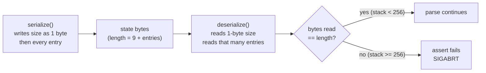

# A large, valid Zsh file aborts the process inside the Zsh grammar

## Summary

`tree-sitter-zsh` 0.56.0, the grammar tree-hugger uses for Zsh
(`tree-hugger/lib/Cargo.toml`, line 42), aborts the whole process on an
ordinary Zsh file once the file holds about 256 functions or brace groups:

```text
Assertion failed: (size == length), function deserialize, file scanner.c, line 446.
```

The process dies with `SIGABRT`. No `Result` is returned, so nothing in
tree-hugger can report the failure for that one file and carry on: every
`hug` report that parses the file terminates, and so does any test runner
that calls the library in-process.

Two defects in the grammar's external scanner combine:

1. **The scanner's context stack leaks.** Each top-level `name() { … }`
   function, `function name { … }` function, or `{ … }` brace group leaves
   one entry on the stack that is never popped. The stack therefore grows
   with the length of the file, not with its nesting depth.
2. **The serialized stack size is stored in one byte.** Once the stack
   reaches 256 entries the size byte wraps, the reader consumes fewer bytes
   than the writer produced, and an `assert` aborts.

The latest release, `tree-sitter-zsh` 0.63.4, carries both defects unchanged
and aborts at the same size, so upgrading alone does not fix this. Upstream
has the bug open (issues #33 and #35) with an unmerged pull request (#36).

This was found by review-8 of `2026-10-03-symbol-filters-and-reports`, which
established that the defect predates that feature and assigned it to a
separate grammar fix.

## Background, for a reader new to this area

Tree-sitter grammars may ship an *external scanner*: hand-written C that
lexes tokens the generated parser cannot. The scanner keeps its own state.
Tree-sitter asks the scanner to **serialize** that state into a byte buffer
of at most `TREE_SITTER_SERIALIZATION_BUFFER_SIZE` (1,024) bytes, and later
hands those bytes back to **deserialize** when it needs to resume or retry
from that point. The two functions must agree exactly on the byte layout.

The Zsh scanner keeps a `context_stack` that records which construct it is
inside (`${…}`, `$(…)`, `[[ … ]]`, a `{ … }` group, and so on), so it can
decide what a `}` or `)` closes.



## Reproduction

Any of these reproduces the abort. Each `.zsh` file passes `/bin/zsh -n`.

```zsh
# 1. The reviewer's shape: the primary fixture plus 500 functions.
cp tree-hugger/lib/tests/fixtures/symbols/zsh.zsh /tmp/repro/zsh.zsh
for i in {0..499}; do print "scale_$i() { :; }"; done >> /tmp/repro/zsh.zsh
cd /tmp/repro && git init -q && hug functions zsh.zsh --no-cache --plain
# Assertion failed: (size == length), function deserialize, file scanner.c, line 446.

# 2. The minimal shape: 256 functions and nothing else.
for i in {0..255}; do print "f$i() { :; }"; done > /tmp/repro/min.zsh
```

`hug` refuses paths under `lib/tests/fixtures/` inside the repository, so the
fixture is copied into a scratch Git repository first.

### Measured thresholds

A standalone probe crate (`tree-sitter` 0.26.9, the workspace's locked
version, plus the grammar under test) parsed generated files in a
subprocess. Exit 134 is `SIGABRT`.

| File | 0.56.0 | 0.63.4 |
|---|---|---|
| Primary fixture alone (8 functions) | exit 0, 8 functions, no error | exit 0, 8 functions, no error |
| Fixture + 50 functions | exit 0, 58 | exit 0, 58 |
| Fixture + 100 functions | exit 0, 108 | exit 0, 108 |
| Fixture + 200 functions | exit 0, 208 | exit 0, 208 |
| Fixture + 246 functions | exit 0 | not bisected |
| Fixture + 247 functions | **abort** | not bisected |
| Fixture + 255, 256, 300, 500, 1,000, 2,000 functions | **abort** | **abort** (`scanner.c` line 475) |
| 255 bare `f() { :; }` functions | exit 0 | exit 0 |
| 256 bare `f() { :; }` functions | **abort** | **abort** |
| 255 / 256 `function g { :; }` functions | exit 0 / **abort** | exit 0 / **abort** |
| 1,000 `{ :; }` brace groups | **abort** | not run |
| 1,000 multi-line `function f {` … `}` | **abort** | not run |

The primary fixture leaves 9 entries on the stack by itself, so the fixture
case aborts at 247 added functions (9 + 247 = 256) and the bare case at
exactly 256.

## Root cause

All line numbers are in `src/scanner.c` of the published crate.

### The one-byte size field (the abort)

| Step | 0.56.0 | 0.63.4 |
|---|---|---|
| `serialize()` begins | 343 | 372 |
| Writes `(char)scanner->context_stack.size`, one byte | 349 | 378 |
| Writes every stack entry, guarded only by the 1,024-byte buffer | 357–363 | 386–392 |
| `deserialize()` begins | 387 | 416 |
| Reads the size back as `(unsigned char)buffer[size++]` | 401 | 430 |
| Reads only that many entries | 415–420 | 444–449 |
| `assert(size == length);` | 446 | 475 |

With 256 entries the writer emits 9 + 256 bytes; the reader decodes a size
of 0, consumes 9 bytes, and the assertion fails. The writer's buffer guard
(358 in 0.56.0) returns `0` only beyond about 1,015 entries, so every stack
size from 256 up to that limit is written inconsistently.

`heredocs.size` is also written as one byte (350 / read at 402), but it
cannot wrap in practice: each heredoc needs at least 7 bytes, so the buffer
guard at 367–370 returns `0` well before 256 heredocs.

### The context-stack leak (why ordinary files reach 256)

An instrumented copy of the 0.56.0 scanner printed the stack depth whenever
it grew. For three sibling top-level constructs it reached:

| Source | Maximum depth | Leaked entry |
|---|---|---|
| `a() { :; }` ×3 | 3 | `CTX_COMMAND` (3) |
| `function a() { :; }` ×3 | 3 | `CTX_COMMAND` |
| `function a { :; }` ×3 | 3 | `CTX_COMPOUND` (9) |
| `{ :; }` ×3 | 3 | `CTX_COMPOUND` |
| `(:)` ×3 | 1 | none (balanced) |
| `x=$(:)` ×3 | 1 | none (balanced) |

- `CTX_COMMAND` is pushed when the scanner returns `OPENING_PAREN` for a `(`
  not preceded by `$` (0.56.0 line 1163; 0.63.4 line 1168). The empty `()`
  of a function definition is closed without going through the
  `CLOSING_PAREN` branch that pops it (1282–1294).
- `CTX_COMPOUND` is pushed when the scanner returns `BRACE_START` (0.56.0
  line 1071; 0.63.4 line 1131). The closing `}` of a brace group or
  function body is not lexed through the `CLOSING_BRACE` branch that pops it
  (906–949).

The exact path by which each closing token escapes the scanner is inferred
from the instrumented depths and the push/pop sites; it was not traced
token by token.

## Affected callers

Every Zsh parse goes through one grammar entry point:
`ProgrammingLanguage::grammar_for_path` (`lib/src/shared/symbol.rs`), used by
`SourceFile::parse` (`lib/src/file/source_file.rs`). `TreeFile::new` and
`TreeFile::with_language` (`lib/src/file/tree_file.rs`) call
`SourceFile::read_with_language(..)?.parse()`, so they reach the same native
code. A scanner repair therefore protects every caller at once.

Review-8 observed the abort through:

| Caller | Path to the grammar |
|---|---|
| `hug functions`, `hug types`, `hug symbols`, `hug classes` | CLI scan (`cli/src/scan.rs`) → `SourceFile::parse` |
| `hug imports`, `hug lint` | same |
| `hug god-files` | `god_files::analysis` → `TreeFile::new` |

`SourceFile::parse` documents that it returns `TreeHuggerError::ParseFailed`
when parsing does not produce a tree. A native abort cannot honor that
contract, and neither the per-file error envelope nor partial-output
handling can observe it.

`symbol_cache::grammar_identity` keys cached results on the grammar's name,
version, ABI, and table sizes. A file that aborts is never cached, so no
stale entry hides this defect.

## Options

| Option | Fixes the abort? | Evidence | Cost |
|---|---|---|---|
| A. Upgrade to `tree-sitter-zsh` 0.63.4 | **No** | Identical `serialize`/`deserialize`; aborts at 256 (table above) | Dependency change, node-type changes (below) |
| B. Wait for upstream #36, then upgrade | Yes, by resetting state | #36 makes `serialize()` return `0` when a count exceeds 255, so the next `deserialize()` resets the scanner. It does not stop the leak | Unmerged since 2026-07-01; no release date |
| C. Patch the scanner's size field to 4 bytes | Yes | Probe with the patch below: no abort at 0–20,000 added functions; function counts exact; no `ERROR` nodes; 20,000 functions parse in 0.23 s; a heredoc and `${…}`/`$(…)` after 500 functions parse cleanly | Carrying a patched grammar (vendored crate or `[patch.crates-io]`) — a new or replaced dependency |
| D. Fix the leak upstream (balanced push/pop) | Yes, for these shapes | Root cause above; not prototyped | Grammar work upstream; still leaves the one-byte field for genuinely deep nesting |

The prototype patch for option C (against 0.56.0):

```diff
@@ serialize()
-    buffer[size++] = (char)scanner->context_stack.size;
+    memcpy(&buffer[size], &scanner->context_stack.size, sizeof(uint32_t));
+    size += sizeof(uint32_t);
@@ deserialize()
-        uint32_t context_stack_size = (unsigned char)buffer[size++];
+        uint32_t context_stack_size;
+        memcpy(&context_stack_size, &buffer[size], sizeof(uint32_t));
+        size += sizeof(uint32_t);
```

With the leak still present, the patched stack grows to 1,013 entries; past
that, `serialize()` hits its buffer guard and returns `0`, and the next
`deserialize()` resets the scanner. Parsing stays correct because the leaked
entries carry no live state. That reset is the same behavior option B
reaches at 256.

Options C and D combine well: patch the size field now, and offer upstream
both the encoding fix and the leak fix.

### ABI and runtime compatibility

- Both 0.56.0 and 0.63.4 generate `LANGUAGE_VERSION 15` and depend only on
  `tree-sitter-language = "0.1"`, with `tree-sitter = "0.25"` as a
  dev-dependency. Neither constrains the runtime.
- The probe built and ran 0.63.4 against the workspace's locked
  `tree-sitter` 0.26.9 without a version conflict and reported
  `abi_version() == 15`.
- 0.63.4 is the latest release on crates.io. The `docs/dependencies.md` entry
  for this crate is already stale: it says v0.52.0 and links
  `zsh-users/tree-sitter-zsh`, while the manifest uses 0.56.0 from
  `georgeharker/tree-sitter-zsh`.

### Query and node-type impact of an upgrade to 0.63.4

Comparing `src/node-types.json` between the two releases:

- No named node type is removed. Four are added: `arithmetic_call`,
  `case_fallthrough`, `case_test_next`, `expansion_default_list`.
- Every node and field tree-hugger's Zsh queries name is unchanged:
  `comment`, `simple_variable_name`, `command_name`, `word`,
  `function_definition` (`name`, `body`), `variable_assignment` (`name`,
  `value`), `variable_name` (`lib/queries/zsh/*.scm`,
  `lib/queries/vendor/zsh/locals.scm`).
- `variable_ref` and `expansion` keep their fields and the `name` field the
  references query uses; only the allowed child types widen (for example
  `glob_pattern` in `index`).
- The god-files nesting kinds (`if_statement`, `for_statement`,
  `c_style_for_statement`, `terse_for_statement`, `while_statement`,
  `repeat_statement`, `case_statement`, `select_statement`) all still exist.
  `if_statement` and `while_statement` change only the token types in
  `condition`.
- `case_item.fallthrough` changes from the anonymous tokens `;&` / `;;&` to
  the named nodes `case_fallthrough` / `case_test_next`. No tree-hugger query
  or code reads that field.

An upgrade is therefore unlikely to need query changes, but the parse trees
of real files can still differ, so the fixture-based tests are the check.
Option C, which keeps 0.56.0's tables, changes no node types at all and
leaves `grammar_identity`, and so every cache key, unchanged.

## Requirements for the fix

These come from review-8 and are part of this fix's acceptance:

- **Correct or replace the scanner's state encoding** so that a valid Zsh
  file of any size parses, while preserving Zsh support.
- **Add a subprocess regression.** The test runs the parse in a child process
  (for example the `hug` binary, as `cli/tests` already does) so a native
  abort fails exactly one test and does not kill the test runner. It asserts
  a successful exit and the expected function count, not merely "did not
  crash".
- **Keep the controls.** Retain the original `zsh.zsh` fixture unedited and
  include the smaller sizes (50, 100, 200) next to the failing sizes (500 or
  more). Build the large file at test time from the literal fixture path, in
  the form the `rust-testing` skill lists, so the CI test-input index sees
  the read.
- **Sweep every caller.** Cover the six report commands (`functions`,
  `types`, `symbols`, `classes`, `imports`, `lint`) plus `god-files` on the
  large file.
- **Do not silently exclude large Zsh files**, for example by a size or
  function-count cut-off that skips them.
- **Do not use `catch_unwind`.** It cannot catch `SIGABRT` and would only
  disguise the gap.
- **Update the dependency documentation** if the dependency changes: the
  `tree-sitter-zsh` entry in `docs/dependencies.md` (correcting its version
  and repository at the same time) and the `tree-hugger` skill's grammar
  notes.

## Decisions needed from the author

1. Which option to take. A alone is ruled out by the evidence. C needs a new
   or replaced dependency (a vendored or patched grammar), which the parent
   feature's specification reserves for the author.
2. Whether to also report the context-stack leak upstream, and whether to
   offer the option C patch on #36 as an alternative that keeps scanner
   state past 255 entries.

## Out of scope

- The parse-time cost of other languages at large sizes. Review-8 records it
  as a separate finding; the 15 other grammars do not abort at 500, 1,000,
  or 2,000 additions.
- `dead_code`'s Bash/Zsh terminal-statement kinds (`return_statement`,
  `exit_statement`, `break_statement`, `continue_statement`), none of which
  exists in either Zsh release. Noticed while comparing node types; not part
  of this defect.

## Closes when

- The subprocess regression passes for the large file on every supported
  OS, alongside the unedited-fixture and smaller-size controls.
- All seven commands complete on the large file with the expected
  functions.
- The dependency documentation matches the manifest.
