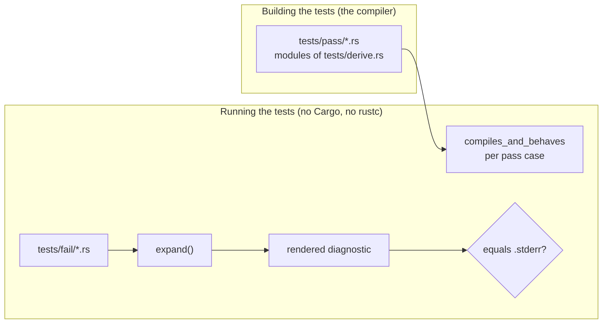

# Testing the `model_id` derive macro

`model_id` is a procedural macro: it runs inside the compiler. Its tests prove
two things, and neither starts a Cargo build of its own:

- every file in `model_id/tests/pass/` compiles and the code the derive
  generates behaves as expected;
- every file in `model_id/tests/fail/` is rejected by the derive with exactly
  the diagnostic stored beside it in a `.stderr` file.

Run them like any other L1 test:

```sh
cd unchained-ai
just test model_id
```

## Compile-pass cases

Each `tests/pass/*.rs` file is a module of the `tests/derive.rs` integration
test, listed in its `compile_pass_cases!` invocation. Building that test
binary compiles every case through the real compiler and the real derive;
each case's `#[test] fn compiles_and_behaves` then checks the generated API:

```rust
// tests/pass/no_bespoke.rs
#[derive(ModelId, Debug, Clone, PartialEq, Eq)]
pub enum StrictProvider { ModelA, ModelB }

#[test]
fn compiles_and_behaves() {
    assert_eq!(StrictProvider::ModelA.model_id(), "modela");
    assert!("unknown".parse::<StrictProvider>().is_err());
}
```

A case that stops compiling fails the build of the test binary, so it can
never be reported as a pass.

To add a case, create `tests/pass/<name>.rs` with one
`#[test] fn compiles_and_behaves()` and add `<name>` to `compile_pass_cases!`.
`every_compile_pass_fixture_is_compiled` fails while a file in `tests/pass/`
is missing from that list.

## Compile-fail cases

The derive's whole expansion is the private function `expand` in
`model_id/src/lib.rs`; the `#[proc_macro_derive]` entry point only parses its
input, calls it, and turns an error into `compile_error!`. A unit test per
`tests/fail/*.rs` file parses the file, runs `expand` on the item that derives
`ModelId`, and renders the error the way rustc prints it: the message, the
`file:line:column` of its span, the source line, and a caret under the span.
The rendering must equal the `.stderr` file:

```text
error: ModelId can only be derived for enums
 --> tests/fail/not_enum.rs:4:12
  |
4 | pub struct NotAnEnum {
  |            ^^^^^^^^^
```

The span's line and column come from `proc-macro2`'s `span-locations`
feature, which the crate enables for its tests only. The renderer handles
spans on one line; a case whose error spans several lines fails with a message
saying so.

To add a case, create `tests/fail/<name>.rs` and `tests/fail/<name>.stderr`,
add a `#[test] fn <name>()` beside the others in `src/lib.rs`, and add
`<name>` to `COMPILE_FAIL_CASES`.
`every_compile_fail_fixture_has_a_test_and_an_expected_diagnostic` fails while
a `.rs` file has no `.stderr` file or no entry in that list.



## What the tests need from the host

Nothing beyond the test binaries. No test runs `cargo` or `rustc`, downloads
crates, or reads the Cargo home, so the suite runs from a prebuilt test
archive on every CI environment, including the WSL2 guest that has no Rust
toolchain. The package declares no `requires-toolchain` policy.

## What the in-process diagnostic check does not cover

The compile-fail tests assert the derive's own output: which input it
rejects, the message, and the exact tokens the error points at. They do not
run rustc, so two steps that belong to `syn` and the compiler are not
exercised for these cases: `syn::Error::into_compile_error`, which turns the
error into a `compile_error!` invocation, and rustc's rendering of that
invocation. The entry point's call to `into_compile_error` is a single line.
When you change how errors are reported, compare a case's real compiler
output with its `.stderr` file once by hand, for example by compiling the
fixture in a scratch crate that depends on `model_id`.
