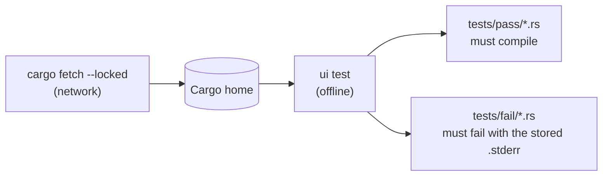

# Testing the `model_id` derive macro

`model_id` is a procedural macro: it runs inside the compiler. Its behavior
can only be observed by compiling code that uses it, so its UI test
(`model_id/tests/ui.rs`) uses [trybuild](https://docs.rs/trybuild) to compile
small example crates:

- every file in `model_id/tests/pass/` must compile;
- every file in `model_id/tests/fail/` must fail to compile, with the
  compiler output stored beside it in a `.stderr` file.

Run it like any other L1 test:

```sh
cd unchained-ai
just test ui
```

## What the test needs from the host

Unlike most tests in this repository, the UI test starts real `cargo` builds
of its own. Two things must be true before it runs:

1. **`cargo` is on `PATH`.** Without it the test fails with
   "the trybuild UI tests need `cargo` on PATH". It never passes without
   compiling anything.
2. **The registry sources are already downloaded.** trybuild always runs its
   nested builds with `cargo --offline`, so every crate in the workspace
   lockfile that the examples depend on (`syn`, `quote`, `proc-macro2`, …) must
   already be in the Cargo home. On a development machine an ordinary
   `cargo build` has done this. On a fresh machine, fetch them first:

   ```sh
   cargo fetch --locked --manifest-path unchained-ai/model_id/Cargo.toml
   ```

   A missing crate shows up as
   `error: no matching package named `proc-macro2` found … offline mode`.



## In CI

The package declares this in its manifest:

```toml
[package.metadata.ci.tests]
requires-toolchain = true
```

That has two effects:

- **Hosted Linux, macOS, and Windows cells** install the pinned toolchain,
  run `cargo fetch --locked` for this package, and then run the tests with
  `CARGO_NET_OFFLINE=true`. The test binary itself comes from the prebuilt
  archive; only the examples are compiled on the runner.
- **The WSL2 cell** runs prebuilt archives in a guest that deliberately has no
  Rust toolchain, so it cannot run this test. The plan reports that cell as a
  governed *accepted gap* for the `cargo_toolchain` capability, never as a
  pass.
