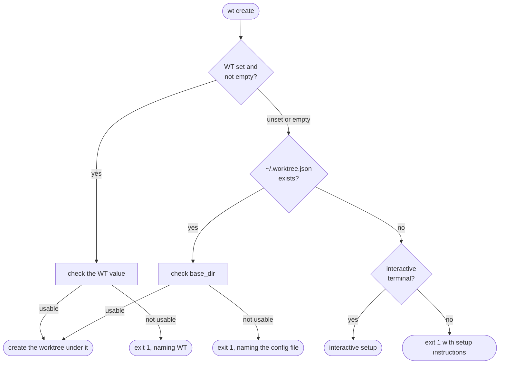

# The Worktree Base Directory

`wt create` puts every new worktree under one **base directory**, at
`{base}/{repo-name}/{dasherized-branch}/`. With a base directory of
`/home/me/wt`, `wt create fix/login` in the `api` repository creates
`/home/me/wt/api/fix-login/`.

This page explains where `wt` gets that directory, what makes a value usable,
and how to fix each error it reports.

## Setting it

There are two ways, checked in this order:

1. **The `WT` environment variable**, for example in your shell profile:

   ```sh
   export WT=/home/me/wt
   ```

2. **`~/.worktree.json`** in your home directory:

   ```json
   {
     "base_dir": "/home/me/wt"
   }
   ```

If neither is set and you run `wt create` in an interactive terminal, `wt`
offers to set one up and saves your choice to `~/.worktree.json`
([Interactive setup](#interactive-setup)).

`wt list`, `wt go`, and `wt remove` never read the base directory; they find
worktrees through Git.

## Which source wins



- A `WT` that is **unset or exactly empty** (`WT=`) means "no override", and
  `~/.worktree.json` is used.
- Any **other** `WT` value is used or rejected. An invalid `WT` never falls
  back to the config file, even when the config file is valid: fix or unset
  `WT`. Editing `~/.worktree.json` alone does not override a nonempty `WT`.
- A **missing** `~/.worktree.json` is not an error; it leads to setup or to
  the instructions below.

## What makes a value usable

A base directory, from either source or from setup, must be all of these:

| Rule | Accepted | Rejected |
| ---- | -------- | -------- |
| An absolute path on **this** operating system | `/home/me/wt` (Linux, WSL), `/Users/me/wt` (macOS), `C:\Users\me\wt` or `\\server\share\wt` (Windows) | `wt`, `./wt`, `~/wt`, `C:wt` or `\wt` on Windows |
| Written in this operating system's path syntax | as above | `b:\wt` on Linux, macOS, or WSL; `/home/me/wt` on Windows |
| Not blank | | `""` in the config file, `WT="   "` |
| An existing directory (a symbolic link to a directory is fine) | | a path that does not exist, or names a file |
| Not the root of a Git repository | `/home/me/code/api/wt` (inside a repository, but not its root) | `/home/me/code/api` (has `.git` directly inside it) |

Some details that surprise people:

- **`~` is never expanded.** `~/wt` and `$HOME/wt` are text, not paths. Write
  the full path, such as `/home/me/wt`.
- **The value is used exactly as written.** `wt` does not trim it, strip
  quotes, expand variables, or make it relative to the current directory.
  Only text you type into the setup prompt has surrounding spaces removed.
- **Only the repository root is checked.** A directory with a `.git` file or
  folder directly inside it is refused, because creating worktrees there would
  put them inside that checkout. A directory deeper inside a repository is
  allowed.
- **WSL is Linux.** Under WSL, `wt` is a Linux program and needs a Linux path.
  A Windows drive is usually mounted under `/mnt`, so `B:\wt` becomes
  `/mnt/b/wt`.
- **`WT` must be valid Unicode**, because `wt` reads and saves it as text.

`wt` checks the spelling before it looks at the filesystem, so a value written
for another operating system is reported as such and never creates a
directory.

### Host-valid examples

| Host | `WT` | `~/.worktree.json` |
| ---- | ---- | ------------------ |
| Linux | `export WT=/home/me/wt` | `{"base_dir": "/home/me/wt"}` |
| macOS | `export WT=/Users/me/wt` | `{"base_dir": "/Users/me/wt"}` |
| WSL, storing on drive B: | `export WT=/mnt/b/wt` | `{"base_dir": "/mnt/b/wt"}` |
| Windows (PowerShell) | `$env:WT = 'C:\Users\me\wt'` | `{"base_dir": "C:\\Users\\me\\wt"}` |

JSON needs each Windows backslash doubled.

## Interactive setup

Setup runs only when **neither** source is set **and** the session is
interactive: stdin and stderr are terminals and `CI` is unset or empty.

1. `wt` offers `~/worktrees`, `~/wt`, and `~/.claudine/worktrees` (leaving out
   any that is a repository root), plus **Other** to type a path.
2. The choice is checked against the rules above **before** anything is
   created:
   - an unusable suggestion (it names a file, or is a repository root) shows
     why and returns to the menu;
   - an unusable typed path (blank, relative, `~/wt`, written for another
     operating system, a file, or a repository root) shows why and asks for
     another path.
3. A directory that does not exist yet is created, checked again, and only
   then saved to `~/.worktree.json`.
4. If the directory cannot be created or read, setup stops with an error
   (exit 1) and saves nothing.
5. Pressing Esc or Ctrl-C cancels setup (exit 0) and saves nothing.

Setup writes only `~/.worktree.json`. A value that fails the rules is never
written, so an existing config file is never replaced by a bad one.

## Without a terminal

A script, CI job, or agent never sees the setup prompt. When no base directory
is configured, `wt create` exits 1 with instructions:

```text
Error: No worktree base directory is configured. Set the WT environment variable to an absolute directory on this host (for example /home/me/wt), or create ~/.worktree.json containing {"base_dir": "<absolute directory>"}. Running wt create in an interactive terminal offers to set one up.
```

## Errors and how to fix them

Every base-directory problem stops `wt create` with **exit 1** before it
creates a directory, a branch, or a worktree. The message goes to stderr and
names the value, where it came from (`the WT environment variable` or `the
config file <path>`), and how to fix it. When the value came from
`~/.worktree.json`, the message also ends with an **Edit ~/.worktree.json**
link to the file. With the shell wrapper active, no `cd:` line is printed.

The fix depends on the source:

- **From `WT`:** set `WT` to an absolute directory on this host, or unset it.
- **From `~/.worktree.json`:** edit `base_dir`, or delete the file and run
  `wt create` again in an interactive terminal to choose a directory.

| Problem | Example message (Linux) |
| ------- | ----------------------- |
| Another operating system's syntax | `Base directory 'b:\wt' from the config file /home/me/.worktree.json uses Windows path syntax on this POSIX host.` |
| Not absolute | `Base directory 'wt' from the WT environment variable is not an absolute path.` |
| Home-relative | `… is not an absolute path. wt does not expand ~; write the full home-directory path instead.` |
| Blank | `The base directory from the WT environment variable is empty.` |
| Missing | `Base directory '/mnt/b/wt' from … does not exist. If it is on a drive or mount that is not available, restore the mount. …` |
| A file | `Base directory '/home/me/wt' from … exists but is not a directory.` |
| Unreadable (for example, permission denied) | `Cannot check base directory '/home/me/wt' from …: <reason>.` |
| Repository root | `Base directory '/home/me/code/api' from … is the root of a Git repository (it has .git directly inside).` |
| Not Unicode | `Base directory '…' from the WT environment variable is not valid Unicode, which wt needs to read and save it.` |

Each message continues with the source's fix and a host-valid example path.

**A missing directory is not recreated.** A missing directory and an
unmounted drive look the same, and recreating it could put worktrees on the
wrong disk. Restore the mount, create the directory yourself, or point the
setting elsewhere. The config file is left as it is.

**Under WSL**, a Windows drive path such as `B:\wt` or `B:/wt` also gets a
suggestion:

```text
Under WSL, Windows drive B: is usually mounted at /mnt/b. If it is mounted there, use /mnt/b/wt.
```

The suggestion is conditional because WSL can mount drives elsewhere. It is
not offered for `b:wt`, `b:`, network shares, or `\\?\` paths.

### A malformed config file

`~/.worktree.json` must be UTF-8 JSON holding one string field, `base_dir`.
Anything else exits 1 with the expected format and a link to the file:

- a missing, `null`, or non-string `base_dir` (a number, object, or array);
- a `base_dir` key that appears twice;
- invalid JSON, or valid JSON followed by other text;
- bytes that are not valid UTF-8.

An empty or whitespace-only `base_dir` string is reported as blank, with the
config file as its source.

## For library callers

The `worktree` library exposes the same rules:

- `config::resolve_base_dir()` applies the precedence and every check above.
- `config::validate_base_dir(raw, origin)` checks only the spelling, without
  touching the filesystem.
- `config::save_config(path)` checks the spelling before writing and creates
  no directories; the caller makes sure the directory exists and is not a
  repository root.
- `worktree::create_worktree(branch, base, from)` does not check `base`;
  resolve it first.

The home directory for `~/.worktree.json` and the setup suggestions comes
from `HOME` (`USERPROFILE` on Windows), falling back to the operating
system's record of your home when that variable is unset; a relative value
counts as no home directory. `wt`'s caches and `~/.wt.json` use the operating
system's own home and cache lookups; on native Windows those ignore
`USERPROFILE`, so changing it moves `~/.worktree.json` but not them.
