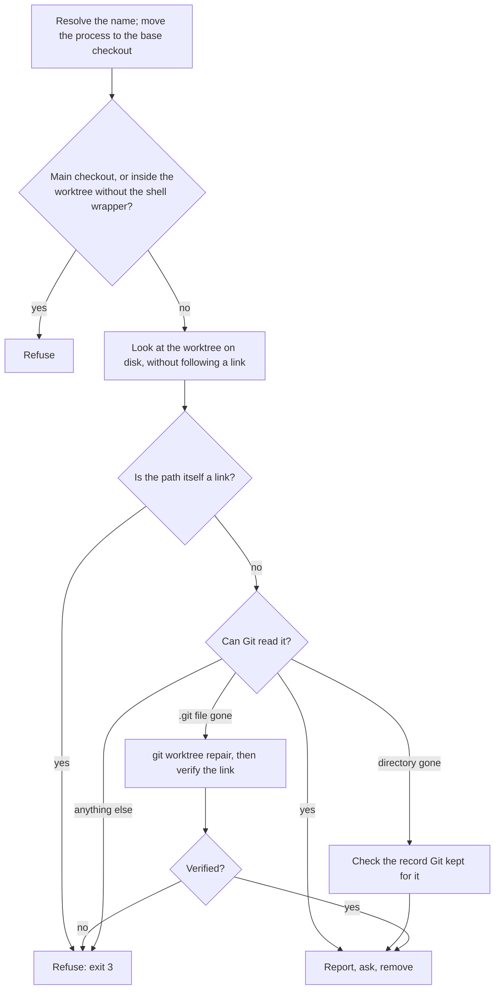
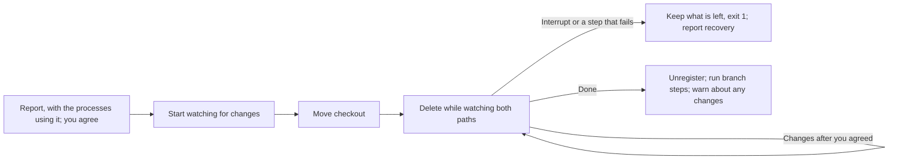
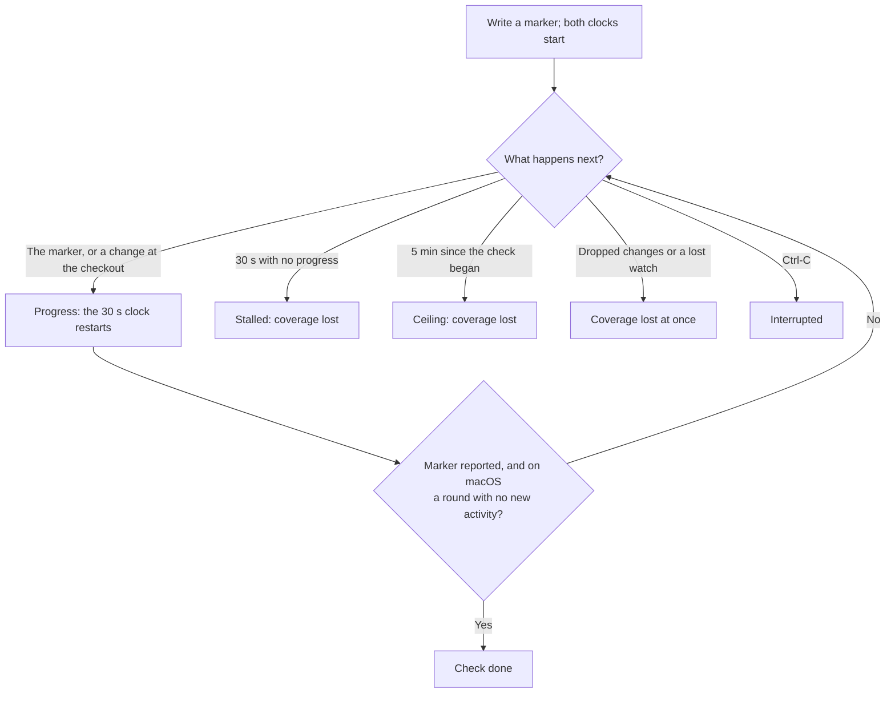
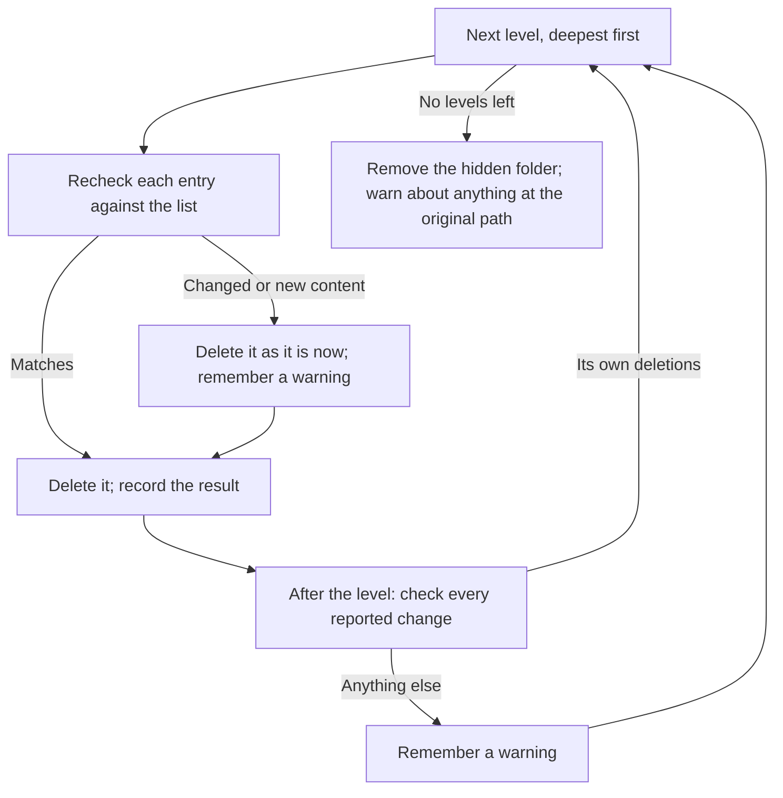
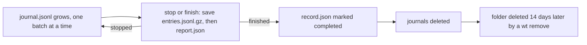
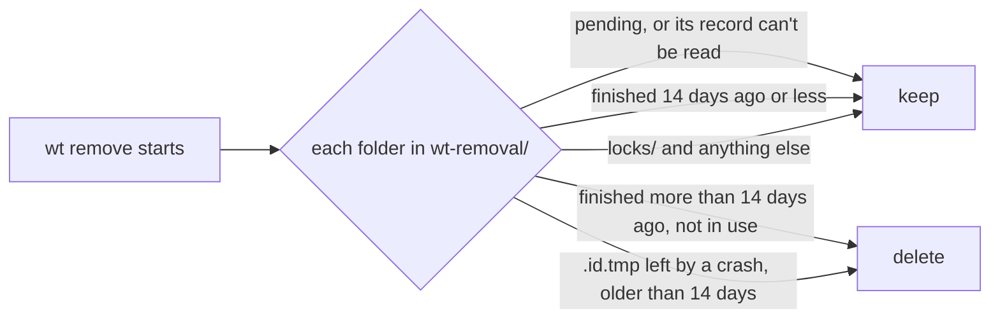
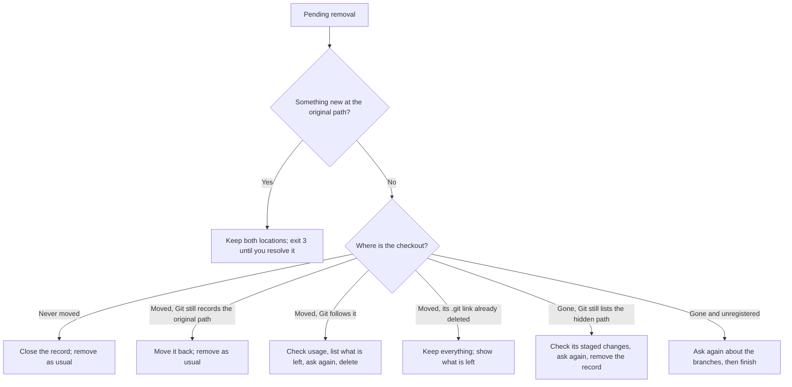

# `wt remove`

Removes a worktree, by branch or directory name, and its local branch when that branch's commits are safe elsewhere. Every decision comes from one question: **would removing this lose work?** If it would, `wt remove` asks first, or refuses when it can't ask.

```bash
wt remove feat/theme                  # by branch name
wt remove feat-theme                  # by directory name
wt remove feat/theme --force-worktree # discard uncommitted files without asking
wt remove feat/theme --force-branch   # delete the branch even if its commits exist nowhere else
wt remove feat/theme --force-remote   # also delete the branch on origin (and close its open PR)
```

Names resolve as in `wt go`: `base` is the main checkout, any other name matches a branch or a worktree directory, and a name matching more than one worktree is an error listing each one. The main checkout itself is never removed; use plain `git` for that.

## How a removal runs



Nothing is ever deleted before the report has been printed and every needed consent has been given. A checkout that exists is then moved aside and deleted under watch, as described in [Deleting the checkout](#deleting-the-checkout).

### The report

Before asking or removing anything, `wt remove` prints what removal would affect:

```text
Removing worktree theme at /code/wts/repo/theme

Uncommitted files (1):
└── notes.txt

Branch feat/theme
- Safe: its commits are on main
- 0 ahead, 0 behind main
```

- **The worktree's files**: uncommitted files, and included ignored files (selected by `.worktreeinclude`; see the [README](../../README.md#included-ignored-files)) that are new, changed since `wt create` copied them, or impossible to compare. These need consent. Unchanged included copies and other ignored files (`target/`, `node_modules/`) do not need consent and are omitted from the report.
- **The branch**, by where its last commit is found:

    | Tier | Where the commits are | What happens |
    |---|---|---|
    | Safe | on the default branch (local or `origin/<default>`), or the exact head of an open or merged PR from this repository | deleted |
    | Pretty safe | on another local branch, a tag, or an `origin/*` branch whose live head `wt` checked with `git ls-remote` | deleted; the report says where the commits still live |
    | Not safe | nowhere else, or it could not be checked | an interactive run lists the commits and offers "keep" (default) or "delete"; a non-interactive run keeps it with a warning and still exits 0 |

    The tier, and any consent to delete, applies to the commit the report showed. Immediately before `git branch -D`, the branch must still point there. If a commit landed on it in the meantime, that commit was never assessed: the branch is kept and `wt remove` exits 1 after removing the worktree (`branch feat/theme moved from <old> to <new> after it was checked, so it was kept`).

- **The branch on origin**, its PR, and ahead/behind counts against the default branch.

### Consent and the force flags

An interactive run (stdin and stderr are terminals, `CI` unset or empty) asks each question, default No. A non-interactive run can't ask, so it needs a flag or it refuses with exit 3:

| Flag | Allows |
|---|---|
| `--force-worktree` | discarding the uncommitted and protected included files listed in the report |
| `--force-branch` | deleting a Not-safe branch (`git branch -D`) |
| `--force-remote` | deleting the branch on origin, under a lease on the head the report showed, and closing its open PR |

The flags only stand in for answers to questions the report asked, so they approve discarding exactly what the report listed. If the files or staged changes differ when removal is about to run (something was edited or staged while the question was open), `wt remove` refuses with exit 3 and asks you to run it again. **No flag lets `wt remove` delete a directory whose files it could not check.** A worktree Git can't read, a failed `git status`, or an unreadable file refuses whatever flags are given.

`--force-branch` without `--force-worktree` on a worktree that has files is a conflict (exit 3 when non-interactive), because the branch can't go before the worktree.

With `--force-remote`, the branch on origin is deleted through origin's push URL. An origin with several push URLs, or one Git would rewrite (`url.<base>.insteadOf` / `pushInsteadOf`) or read as the name of another remote, is refused before anything is removed. If origin can't be reached, the local removal still happens and `wt` exits 1 with the `git push origin --delete <branch>` that finishes the job.

### Background programs writing into the worktree

While it builds the report, `wt remove` checks whether another process is
using the checkout: standing in the worktree, holding a file open in it,
watching it, or running a program from it. Your own shell and the programs
that started `wt` are never listed. What it finds is part of the report, so
you see it before you answer:

```text
In use: 1 process is using this worktree now.

PID 39871  rust-analyzer /opt/bin/rust-analyzer
  Watching: /code/wts/repo/feat-x/src

They don't stop the removal; a tool watching for changes is often harmless. A program working in the worktree may lose its files. On Windows, a file one of them holds open can stop deletion partway; running the same command again continues it.
```

**Usage never stops a removal you agreed to**, and `wt` never waits for a
process to let go. If you agree, the removal goes ahead, and its completion
warns again: `rust-analyzer (PID 39871) was using the worktree when it was
removed`. The removal reuses the report's check rather than running a second
one, and its saved report keeps it under `discovery`. A check that saw
nothing adds nothing to the report. Only a check that could not verify the
checkout at all (it vanished, or its identity could not be read) refuses,
with exit 3, before anything moves.

A program the check cannot see can still write while the checkout is
deleted. **Once you have agreed, `wt remove` deletes**: it never stops
because something changed. It deletes what is in the moved checkout as it
is then, new files included, removes the worktree's record and the branches
you approved, and exits 0. It then tells you what happened after you agreed:

```text
Removed worktree feat-x at /code/wts/repo/feat-x
Deleted branch feat/x
Warning: 3 changes happened after you agreed; wt removed the worktree anyway.
  /code/wts/repo/.wt-remove-feat-x-a91c0d2e4f6b8a10/target/build.log was created
  watching for changes stopped: macOS could not report every change (UserDropped, MustScanSubDirs; flags 0x3)
  /code/wts/repo/feat-x was created (outside the worktree; not touched)
Full report: /code/repo/.git/wt-removal/<operation-id>/report.json
```

At most three changes are listed, then a count; the saved report's
`activity` lists them all. What counts as a change:

| What happened after you agreed | What `wt` does |
| --- | --- |
| A file or folder inside the moved checkout was created, changed, replaced, or deleted | Deletes what is there (nothing, if it is gone) |
| A Git command touched the worktree's record (its `index` or `HEAD`; see [Git commands during a removal](#git-commands-during-a-removal)) | Removes the record anyway |
| The worktree's files, staged changes, or `HEAD` differ from what the questions showed | Removes the worktree. An approved branch deletion still compares the tip you approved, so a branch that moved is kept and the report says so |
| The system stopped reporting changes (see [When watching stops](#when-watching-stops)) | Carries on without watching |
| Something appeared at the original path | Never touches it: it is outside what you agreed to |

Deleting what appeared never follows a link (the link itself is removed;
its target is untouched) and never crosses into another filesystem.

A removal still stops when you interrupt it, when an entry cannot be
deleted (permission denied, a mount point inside the checkout, a file held
open on Windows), when the recovery record cannot be written, or when the
hidden folder is no longer the checkout `wt` moved there. It then keeps what
is left and exits 1 with a report on stderr:

```text
Removal stopped: a step failed (/code/wts/repo/.wt-remove-feat-x-a91c0d2e4f6b8a10/locked/kept.txt could not be removed: Permission denied (os error 13)).

Original: /code/wts/repo/feat-x
Moved to: /code/wts/repo/.wt-remove-feat-x-a91c0d2e4f6b8a10
Deleted before stopping: 124 files (listed in entries.jsonl.gz)
Remaining: 6 entries in the moved directory
Git registration: now points to the moved directory
Branch feat/x: kept (not attempted)
Only entries you approved before the move were deleted.
  A file written in the instant before wt deleted its path would have been deleted too; the saved entries list (entries.jsonl.gz) names every deleted path.
Before the move: Discovery is partial; FSEvents subscriptions cannot be listed on this system; open handles were only partly read.

Retry: wt remove feat-x
  Run it from anywhere outside the moved directory, such as the base checkout at /code/repo. It lists what is left and asks again about anything new or changed before deleting more.
Full report: /code/repo/.git/wt-removal/<operation-id>/report.json
```

When the hidden folder was replaced, the report adds a step before the
retry: `Stop whatever is writing to <path>.`

A process check with the same gap before the move and after the stop gets
one line, `Before the move and after the stop, at <path>: …`. A removal
goes ahead when the usage check found nothing, even if it could not see
everything, so a stop report says what each check missed:

- `Before the move:` the check that let the removal start. A retry that
  checks again before deleting from the moved directory reports
  `Before deleting from the moved directory:` instead; a retry that made no
  check of its own repeats the earlier one, marked `(earlier attempt)`.
- `After the stop, at <path>:` the check `wt` makes at each location that
  is still a real directory once deletion stops, including
  `Discovery could not run (<error>).` when that check failed.

A check that saw everything adds no line, and a removal that finishes never
mentions the usage check.

`Retry` runs the same command again. It finds the stopped removal by the name
you typed, shows what is left, and asks again about anything that needs
consent, except tracked files the stopped removal itself deleted (see
[What a retry asks again](#what-a-retry-asks-again)). While something new is
at the original path, the retry refuses with exit 3 and changes nothing, so
move or save that content first. When the checkout was removed but a branch
step failed, the report says so, tells "kept" from "already deleted" for each
branch, and the retry only asks about the branches again.

### Standing in the worktree you remove

A program can't move its parent shell, so removing the worktree your shell is in needs the shell wrapper (`wt --completions <shell>`; see the [README](../../README.md#shell-integration)). Without it `wt remove` refuses with exit 4 and nothing changes.

With the wrapper, removal happens in two runs:

1. The first run reports and asks everything, records what you approved, then moves your shell to the fork parent's worktree (or the base checkout), keeping your subdirectory when it exists there.
2. The wrapper runs `wt remove --handoff <token>` from there, which checks again and removes.

The second run deletes nothing when anything approved has changed in between: protected files, the include rules, the copy record, the branch tip, the worktree's `.git` link (where it leads, or whether Git can still read it), the worktree's path (a link now standing [in its place](#a-link-in-place-of-the-worktree)), or the branch on origin. It also refuses when the handoff is more than a minute old. A changed state is exit 3; a file it can't read, a shell still inside the worktree, or an expired or unknown handoff is exit 4. The second run never repairs anything. It asks the network only for what the approvals still need: a branch approved because a PR or an `origin/*` copy held its commits is checked live again.

The first run reports the other processes using the worktree, as any removal does; your own shell is never among them. The second run, after the shell has moved, checks again: a program still using the worktree is named in a warning when the removal finishes (see [Background programs writing into the worktree](#background-programs-writing-into-the-worktree)), and no `cd:` or `remove-handoff:` line is printed after a failure. A retry of a stopped removal is never handed off: run it from outside the moved checkout, for example from the base checkout.

## Deleting the checkout

A checkout that exists is never deleted in place. After the report, the
questions, and the [usage check](#background-programs-writing-into-the-worktree),
`wt remove` moves it to a unique hidden sibling on the same filesystem
(`.wt-remove-<name>-<token>`, beside the original), deletes it there while
watching both paths, and only then unregisters it and runs the branch steps:



The usage check informs; it never decides. It is also incomplete:
some platforms cannot see every kind of usage, and a move does not revoke a
handle that is already open or stop a process from recreating the original
path. That is why the deletion itself is watched: not to stop it, but so
the warnings at the end can tell you what else happened. A recreated
original is never deleted or overwritten.

For example, a writer may recreate `checkout/.gitnexus/index.db` after the
checkout has moved to `.wt-remove-checkout-<token>`. The removal finishes,
and its warning names `checkout` as created and not touched.

### Git commands during a removal

Git's record of the worktree is watched too (see
[Watching for changes](#watching-for-changes)), and plain `git status`
writes there: it refreshes the worktree's index file, through `index.lock`.
A Git command run in the worktree while it is being deleted, including one
run for you by a shell prompt that shows Git status or by an editor's Git
integration, shows up in the warnings as a change to
`.git/worktrees/<name>/index.lock` or `HEAD`. A terminal still standing in
the old directory counts: its working directory follows the move. The
removal is not affected. `wt list` never runs Git in a worktree being
removed ([why](list.md#worktrees-being-removed)).

Before the list of entries is taken, something still writing into the
checkout makes no difference either: an entry that vanishes while the list
is taken is left out, and anything written is deleted with the rest.

While the checkout is moved, Git keeps it registered as the same worktree at
the hidden path: `git worktree list` shows it at the new path with its branch,
`git status` works inside it, and `git worktree prune` leaves it alone. Only
Git's record of the location changes. If that record cannot be updated, the
checkout is moved back when nothing has appeared at the original path and no
activity was seen; otherwise it stays at the hidden path and the report says
so.

### Watching for changes

Watching covers three places: the folder holding the checkout (only the
checkout's own name and the hidden name, so busy sibling worktrees never stop a
removal), every directory in the checkout, and the files in Git's record of the
worktree that hold its identity and staged changes (`HEAD`, `gitdir`,
`locked`, `index`, `index.lock`, and split-index `sharedindex.*` files). If
the system drops change notifications, a watch ends unexpectedly, or `wt`
cannot confirm that changes are being reported, coverage is lost and removal
stops; it never continues on partial watching. On Linux,
each directory in the checkout uses one inotify watch, so a checkout with more
directories than `fs.inotify.max_user_watches` allows, or a user already at
`fs.inotify.max_user_instances`, cannot be watched and exits 4.

On macOS, watching uses FSEvents, which watches paths rather than folders: it
watches the checkout's path and the hidden path (each with everything below
it) instead of the folder holding them, with the same effect. Each check for
new activity writes a marker file into a private folder in your per-user
temporary directory (`wt-observe-<random>`, removed when the removal ends)
and waits until the system reports it. macOS does not report changes in the
order they were made, so one reported marker does not prove that every
earlier change has arrived: the check writes markers until one round brings
no new activity at the checkout's locations, and a change that arrives even
later is reported by a later check. The checks therefore never decide on
their own what is safe to delete. `wt` compares every entry with its list
immediately before deleting it, and rereads Git's index and `HEAD` before
removing the worktree's record (see [Checked deletion](#checked-deletion));
those direct checks are what protect a write the system reported late. The
folder holding the checkout, or Git's record of the worktree, being moved or
deleted while watching runs also counts as lost coverage, and so does the
system flagging that it dropped changes or that a folder must be rescanned
(see [When watching stops](#when-watching-stops)).
macOS can report a folder's removal or rename in place of changes inside it
that happened just before, so `wt` checks for activity after deleting a
folder's contents and before removing the folder itself.

On Windows, watching uses one watch on the folder holding the checkout,
covering everything below it, and one on Git's record of the worktree.
Changes in sibling worktrees still reach `wt` there, which ignores them. Each
check for new activity creates a hidden marker file
(`.wt-observe-<random>-<number>`) in each of those two folders and waits until
Windows reports it, because Windows reports each folder's changes in order. The
marker deletes itself when `wt` closes it, even if `wt` crashes. Checks wait
as described in [Waiting for changes to be reported](#waiting-for-changes-to-be-reported),
with the 30 seconds counted separately for each of the two watches. Either
folder being moved or deleted counts as lost coverage, and so does Windows
reporting that it dropped changes because too many arrived at once. `wt` stops watching
Git's record before the step that removes it, so that step is never blocked.
Windows reports a change to a file's attributes the same way as a change to its
content. On a ReFS volume (such as a Dev Drive), a folder deleted by some
tools is not reported at all. `wt` therefore checks every entry again
before deleting it.

### Waiting for changes to be reported

On macOS and Windows, a check for new activity waits for its marker. It
waits as long as the system keeps making progress, meaning the marker
arrives or a change at the checkout's locations is reported. It gives up in
only two cases:

| Limit | What happened | `reason.kind` in the report |
|---|---|---|
| 30 seconds with no progress | the system went quiet before confirming the marker | `delivery_stalled` |
| 5 minutes for one check | progress kept arriving, but the check never finished | `drain_ceiling` |

When both run out at the same moment, the 5-minute limit is reported. Changes
in sibling worktrees, the cleanup of `wt`'s own markers, and a marker that was
already reported do not count as progress, so they cannot keep a check
waiting. On Windows each of the two watches has its own 30 seconds, so
activity in the folder holding the checkout never hides a silent watch on
Git's record. On Linux a check reads every pending notification and writes no
marker, so it never waits.



The same waiting applies while watching starts, after the move, at every
check during deletion, and before Git's record is removed. A check that gives
up means `wt` could not confirm that every change was reported, not that a
change was lost. `wt` still cannot continue without that confirmation, so it
counts as lost coverage, as described in [When watching stops](#when-watching-stops).
Ctrl-C ends a wait at once: before the move the removal stops with nothing
changed, and after it the removal stops as at any other
[interrupt](#interrupting-a-removal), leaving a pending removal that a retry
continues.

If confirming that a new watch works takes more than a second, `wt` warns
once, before it moves anything (on a retry, before it deletes anything
more). The warning gives the time taken, says the removal may take longer,
and says it stops if that confirmation stalls. A slow start alone never
refuses a removal.

### When watching stops

The system can stop reporting changes: it drops notifications, a watch ends,
or `wt` cannot confirm that changes are arriving. After you agreed, that is
never a reason to stop. `wt` warns once, with the reason and the step, and
finishes the removal without watching; each entry is still compared with the
list immediately before it is deleted (see [Checked deletion](#checked-deletion)).

Only when watching cannot start at all, before anything has moved, does
`wt` refuse (exit 4) and name the reason; after a stall or the 5-minute
limit it says to run the command again (on macOS, with the fseventsd note
below).

The reason names exactly what the system reported:

| `reason.kind` | Where | What the message names |
|---|---|---|
| `fs_events_dropped` | macOS | every loss flag the system set (`KernelDropped`, `UserDropped`, `MustScanSubDirs`) and the whole flag mask in hex |
| `overflow` | Linux, Windows | the system's change queue overflowed |
| `queue_full` | all | more changes arrived between two checks than `wt` holds |
| `watch_lost` | all | the watch that ended |
| `read_failed` | all | the error reading changes |
| `delivery_stalled`, `drain_ceiling` | macOS, Windows | the seconds waited, and on Windows the silent watch (the folder holding the checkout, or Git's record of the worktree); nothing is known to have been lost |

`MustScanSubDirs` alone also counts as lost watching: it means the system
could not report each change below a folder. The same details are saved in
the report's [`observation`](#recovery-records-and-retry) field.

### When fseventsd is slow (macOS)

Every program's file-change notifications on macOS pass through one system
service, fseventsd. When it falls behind, `wt remove` waits, and a check can
stall. Two cases have been seen:

- **A stuck fseventsd.** After 26 days of uptime, fseventsd spent one full
  CPU core matching paths while very few files were changing anywhere.
  Notifications took more than 10 seconds to arrive, and quitting the
  programs that watch files made no difference. Overall CPU use looked low,
  because the busy thread ran on a single efficiency core, so nothing pointed
  at fseventsd.
- **A fast burst of deletions.** A healthy fseventsd can still drop
  notifications when about 6,600 to 7,000 entries are deleted a second, which
  ends as `fs_events_dropped`. Drops are intermittent: in a later comparison
  on the same Mac, deleting at up to 11,000 entries a second dropped nothing,
  and checking for activity more often than every 2,048 entries made
  deletion about twice as slow without a measurable benefit. No checking
  interval can rule out a drop, since fseventsd is shared with every other
  program. A drop is a warning: the removal finishes without watching.

To see whether fseventsd is busy:

```bash
ps -o %cpu,etime -p "$(pgrep fseventsd)"   # CPU use, and how long it has run
top -o cpu                                 # or Activity Monitor, sorted by CPU
sudo sample fseventsd 5                    # optional: where its threads spend their time
```

`ps` shows an average over the process's life, so read `top` for its current
use. High CPU alone does not show that fseventsd is the cause. If it is
pinned and notifications are slow, an administrator can restart it with
`sudo killall fseventsd`; launchd starts it again at once. **This affects
the whole system:** every program that uses FSEvents, such as Spotlight, Time
Machine, editors, file watchers, and build tools, may miss changes made
around the restart or rescan its folders. `wt` never restarts fseventsd
itself; it is a manual troubleshooting step.

### Checked deletion

Before moving anything, `wt` lists everything it is about to delete,
including ignored build output: each file, folder, and link with its identity
on disk, size, modification time, and permissions, and a link's target. Only
the files you were asked about (changed, untracked, and protected included
files) are also hashed; ignored output is never read. An entry that vanishes
while the list is taken is left out. If an entry is a FIFO, socket, device,
mount point, or unsupported reparse point, nothing is moved and `wt` exits
3. The list is saved in the removal's recovery record before the move, so a
later retry can compare what is left with what was approved.

Deletion then works from the deepest folders up, `.git` last:



- Every entry is compared with the list immediately before it is deleted, by
  identity and metadata, and a hashed file by its content. A file that grew,
  was rewritten, or was replaced is deleted as it is now, and named in the
  warnings. A file that someone else already deleted is recorded as already
  absent, never as deleted by `wt`.
- Folders are opened one at a time from the checkout down, and each is checked
  to be the folder in the list. A folder replaced by a link is never entered:
  the link is removed and its target, outside the checkout, is untouched. A
  link in the checkout is deleted itself.
- A folder that is not empty when its turn comes (something new appeared in
  it) has its contents deleted first, without following links or entering
  another filesystem. That content was never on the list, so it is named in
  the warnings rather than in the recovery record.
- Reported changes are checked after each level, and within a level after
  every 2,048 entries: a change at a path `wt` deleted must still be a
  deletion, a change to an entry not yet reached must leave it matching the
  list, and anything else at either location, or in Git's record of the
  worktree, becomes a warning. The count is checked after each batch
  (below), so a check can come up to 255 entries late. On macOS each check
  also waits for the system to catch up (see
  [When fseventsd is slow](#when-fseventsd-is-slow-macos)); once watching is
  lost, no check waits again.
- Each batch of up to 256 entries from one folder is written to the
  recovery record before it is deleted, and its results after. A crash between
  the two leaves those entries marked uncertain, not deleted.
- When the hidden folder is gone, `wt` stops watching Git's record of the
  worktree, compares the record's index and `HEAD` with the ones you
  approved (a difference is a warning), and unregisters the worktree with
  `git worktree remove`. Something new at the hidden folder's path is not
  the checkout `wt` moved: the record is kept, since `git worktree remove`
  would delete it, and the removal stops.

For example, if an editor still running in `checkout/target` writes
`build.log` after the move, the file appears in
`.wt-remove-checkout-<token>/target/`; it is deleted with `target/`, and
the warnings name it.

Deletion and observation cannot be atomic with all possible writers: a write
that lands between an entry's last check and its deletion is deleted with it,
and a writer can start after the final check. Every report of a removal that
deleted anything states this limit and lists the entries it deleted, rather
than promise that every concurrent write was preserved.

### Interrupting a removal

Pressing Ctrl-C (or Ctrl-Break on Windows, or sending `SIGTERM` or `SIGHUP`)
while `wt remove` is checking usage, moving, or deleting does not kill it.
`wt` prints `Interrupted: stopping at the next safe point; files not yet
deleted are kept.` and then:

- **Before the move**, it moves nothing, discards the removal's record, and
  exits 1 with `Nothing was removed.`, saying the removal was interrupted
  before it changed anything. Run the command again when you are ready.
- **During a retry, while watching starts**, it deletes nothing, keeps the
  pending removal, and exits 1 saying it stopped before deleting more of the
  worktree; running the command again continues it. Later in a retry, it
  stops as after the move.
- **After the move**, it finishes the entry it is deleting, deletes nothing
  more, and exits 1 with the same report as any other stop: both locations,
  what was deleted and what is left, Git's registration, each branch (kept),
  `Retry: wt remove <name>`, and `Full report:` with the saved report's path.
  The removal stays pending, and running `wt remove <name>` again continues
  it, as in [Recovery records and retry](#recovery-records-and-retry).

```text
$ wt remove feat-x
^C
Interrupted: stopping at the next safe point; files not yet deleted are kept.
Removal stopped: a step failed (the removal was interrupted).

Original: /work/feat-x
Moved to: /work/.wt-remove-feat-x-<token>
Deleted before stopping: nothing
Remaining: 2 entries in the moved directory
Git registration: now points to the moved directory
Branch feat/x: kept (not attempted)
Error: the removal was interrupted

Retry: wt remove feat-x
  Run it from anywhere outside the moved directory, such as the base checkout at /work/repo. It lists what is left and asks again about anything new or changed before deleting more.
Full report: /work/repo/.git/wt-removal/<operation-id>/report.json
```

The questions before a removal keep their usual Ctrl-C behavior (the
removal is cancelled and nothing changes), and an interrupt after the
checkout is removed, while branch steps run, does not stop those steps.
Ctrl-C in a terminal also reaches a `git` process `wt` is running at that
moment; if that call fails, the report names it. A removal killed outright
(`SIGKILL`, power loss) leaves the same pending record, and a retry by name
continues it.

## What `wt remove` refuses to move

These checkouts are refused before anything changes:

- A checkout containing submodules, or holding a FIFO, a device, a nested
  mount, or an unsupported reparse point, exits 3.
- A locked worktree (`git worktree lock`) exits 3. `wt` never unlocks it; run
  `git worktree unlock <path>` yourself if the lock is stale.
- A checkout whose `.git` file uses a relative link that would break after
  the move (anything other than leading `..` steps) exits 3.
- A checkout that can no longer be identified when usage is checked (it
  vanished, or its path is no longer a directory) exits 3; run the command
  again.
- A checkout on a filesystem that cannot move a directory without risking
  replacement exits 4. One example is a WSL checkout under `/mnt/<drive>`;
  remove it from Windows instead. The same applies when change watching
  cannot be started or confirmed, or coverage is lost before the move (see
  [When watching stops](#when-watching-stops)), or the recovery record cannot
  be written.
- On Windows, a move blocked by a file open anywhere in the checkout exits 4.

Exits 3 and 4 always mean "nothing removed". A stop after the checkout
has moved exits 1, even if no file was deleted yet.

## Recovery records and retry

Each removal keeps its state in `<git-common-dir>/wt-removal/<operation-id>/`:

| File | Holds | Written |
| --- | --- | --- |
| `record.json` | what the removal set out to do, and the last step it finished | before anything changes, then after each step |
| `journal.jsonl` | the list of approved entries, then each deletion batch | before and after each batch |
| `report.json` | the report: outcome, counts, the first 200 deleted paths, timeline, activity, errors, earlier attempts | on every stop and on completion |
| `entries.jsonl.gz` | every journal entry of every attempt, gzip-compressed | with `report.json`, when there are entries |

While the record is pending, starting another removal of the same worktree
exits 3. A completed record keeps `record.json`, `report.json`, and
`entries.jsonl.gz` for reference (see
[How long records are kept](#how-long-records-are-kept)) and never authorizes
another removal. Its journals are deleted once `entries.jsonl.gz` holds every
journal entry; if the entries could not be read, the journals are kept and
`wt remove` warns.

Over its life, an operation folder goes through these steps:



### The journal

`journal.jsonl` is JSON Lines, written only by appending whole lines. It
starts with a header and the list of every entry the removal is approved to
delete, then holds two lines for each deletion batch:

```text
{"header":{"journal_version":3,"operation_id":"0123456789abcdef0123456789abcdef"}}
{"inventory":{"root":{…},"entries":[{"path":{"display":"target"},…},{"path":{"display":"target/a.o"},…},…]}}
{"intent":{"batch":1,"entries":[4,5,6]}}
{"results":{"batch":1,"states":["deleted","deleted","externally_absent"]}}
```

- The `inventory` line is the approved list: each entry's path, identity, and
  type. A batch can only delete entries it lists.
- An `intent` names the entries a batch is about to delete by their position
  in that list, counting from 0, so `4` is the fifth entry. It is written
  before anything in the batch is deleted.
- A `results` line follows with one state per entry, in the intent's order:
  `deleted`, `externally_absent` (already gone), or `kept`. An intent with no
  results is the batch a stop interrupted; its missing entries become
  `uncertain`.
- A batch holds at most 256 entries of one folder, and no entry appears in
  two batches. A journal that breaks any of these rules, or has a malformed
  line, cannot be read: a retry stops with exit 1 before deleting anything,
  printing `Nothing was removed.` and the problem, for example `deletion
  journal line 3 is malformed: a batch plans a position the inventory does
  not have`. Only an unfinished last line, which a crash can leave, is
  ignored.

Journals written by `wt` before 2026-10-23 have `"journal_version":2` and
repeat each entry's path in every batch line instead of its position:

```text
{"intent":{"batch":1,"entries":[{"path":{"display":"target/a.o"},"kind":"file"}]}}
{"results":{"batch":1,"entries":[{"path":{"display":"target/a.o"},"state":"deleted"}]}}
```

`wt` reads both versions, each file by its own header. A removal an older
`wt` stopped keeps its version 2 journals, including any
`journal-<n>.jsonl` from earlier attempts, and the retry starts a version 3
journal beside them. The approved list itself is the same in both versions.

### How long records are kept

A finished removal's folder is deleted once it is more than **14 days** old.
A pending one is kept until it finishes, however old, because its journal is
the only list of what is left in the moved checkout.



- **When:** every `wt remove` (and the shell wrapper's `wt remove --handoff`)
  checks the store before it looks up the name you typed. `wt list` reads
  the store but never deletes anything from it.
- **Age:** a finished removal's age is measured from the last event in its
  `report.json` `timeline`. If the report is missing, can't be read, or has
  no events, the folder's modification time is used instead. Exactly 14 days
  old, or dated in the future, is kept.
- **In use:** a folder is deleted only while `wt` holds the lock for the
  worktree its record names, taken without waiting. If another `wt remove`
  holds that lock, the folder waits for a later run.
- **Quiet:** cleanup prints nothing and never changes the exit status. A
  folder that can't be deleted (a link, a permission problem) is skipped and
  tried again on the next run.
- **Safe to interrupt:** a finished removal is renamed to a hidden
  `.<operation-id>.expired` folder before it is deleted, so an interrupted
  deletion never looks like a pending removal; the next run finishes it.

### What the report holds

`report.json` describes the whole removal, not only the last run of it:

- `journal` counts cover every attempt, and `entries.jsonl.gz` lists every
  entry they count (see [below](#the-entries-file)). `entries_file` names
  that file, `"entries.jsonl.gz"`, or is `null` when the removal planned no
  entries or its journals could not be read. Saving a `null` report removes
  any earlier entries file, so an entries file is never left looking
  complete when it is not.
- `deleted` names at most 200 deleted paths, with the rest counted in
  `truncation.deleted_omitted`. `activity` lists at most 200 changes `wt`
  saw, with the rest counted in `truncation.activity_omitted`. Changes stay
  in `report.json`; the entries file lists only what the journals planned.
- `discovery` lists the run's process checks by `purpose`: `preflight` (the
  check made for the report, or before deleting from the moved directory on a
  retry), and `diagnostic` (a check of each location after a stop). A report
  from before 2026-10-23 may also list `windows_search_hold`, a first check a
  since-removed recheck followed.
- `observation` describes the run's change watching: the `backend`
  (`fs_events`, `inotify`, or `read_directory_changes`), how long watching
  took to start (`startup_ms`), and the latest and longest time a check's
  marker took to be reported (`last_round_trip_ms`, `longest_round_trip_ms`;
  `null` until one is, and always on Linux, which uses no markers). If
  coverage was lost, `loss` says where (`stage`: `startup`, `pre_move`,
  `post_move`, `deletion`, or `unregistration`), why (`reason`, tagged by
  `kind` as in [When watching stops](#when-watching-stops)), and, during
  deletion, how many entries `wt` had processed since its previous check
  (`entries_since_drain`; `null` at other stages). A loss while `wt` stops
  watching Git's admin directory, just before it removes the worktree's
  record, is recorded at `unregistration` but does not stop the removal:
  the final check rereads the index and HEAD directly. On macOS a
  dropped-notification `reason` keeps the system's whole flag mask (`raw`)
  and names every loss flag in it (`kernel_dropped`, `user_dropped`,
  `must_scan_sub_dirs`). A stall or the 5-minute limit records the time
  waited (`waited_ms`) and the silent `watch` (`parent` or `admin` on
  Windows, `null` on macOS). The round trips time markers only, not how long
  each change took to arrive. On macOS a round trip is either about 10 ms or
  about 1 s, never in between: a marker fseventsd has not processed when
  `wt` asks for it arrives about a second later. A `longest_round_trip_ms`
  near 1,000 there means a check missed the fast path, not how far behind
  the system was, and the deletion count is context, not proof
  that `wt` caused a drop. A report from before `report_version` 5 has no
  `observation`, which reads as unknown.
- `earlier_attempts` keeps what each earlier run reported when it stopped:
  its outcome, both locations, timeline, process checks, observed activity,
  change-watching `observation`, branch results, and errors. The top-level
  fields describe the last run.

For example, a removal interrupted after deleting 4 files, then retried to
completion, ends with a report like this (abridged):

```json
{
  "report_version": 6,
  "outcome": "removed",
  "journal": { "deleted": { "files": 7, "directories": 3, "links": 0 }, "...": "..." },
  "entries_file": "entries.jsonl.gz",
  "deleted": [{ "display": "/work/.wt-remove-fix-a91c/target/debug/a.o" }, "..."],
  "earlier_attempts": [{ "outcome": "cleanup_failed", "errors": ["the removal was interrupted"], "...": "..." }]
}
```

A macOS run that stopped because the system dropped notifications during
deletion records its watching like this:

```json
{
  "observation": {
    "backend": "fs_events",
    "startup_ms": 14,
    "last_round_trip_ms": 9,
    "longest_round_trip_ms": 31,
    "loss": {
      "stage": "deletion",
      "reason": { "kind": "fs_events_dropped", "raw": 6, "flags": ["kernel_dropped", "user_dropped"] },
      "entries_since_drain": 2048
    }
  }
}
```

A Windows run whose watch on Git's record went silent records
`"reason": { "kind": "delivery_stalled", "waited_ms": 30000, "watch": "admin" }`
instead.

### The entries file

`entries.jsonl.gz` is gzip-compressed JSON Lines: one line per journal
entry, oldest attempt first, never cut short. Read it with
`gzip -dc entries.jsonl.gz` (or `zcat`). The removal above lists:

```json
{"attempt":1,"batch":1,"path":{"display":"target/debug/a.o"},"kind":"file","state":"deleted"}
{"attempt":2,"batch":1,"path":{"display":"README.md"},"kind":"file","state":"deleted"}
```

Each entry names its `attempt` (1 for the first run, then one more per
retry), its `batch` in that run's journal, its path relative to the moved
checkout, its `kind` (`file`, `directory`, or `link`), and its state:
`deleted`, `externally_absent` (already gone), `uncertain` (gone, but the run
stopped before recording who removed it), `kept`, or `planned`. A retry never
lists an entry twice and never turns an uncertain entry into a deleted one.
The entries file holds `wt`'s own record of what it deleted: the 200
`deleted` paths in `report.json` are a preview of the same list.

Both files are written on every stop and on completion, each under a hidden
temporary name that is then renamed into place, so neither is ever seen half
written:

1. `entries.jsonl.gz`, when there are entries;
2. `report.json`, which then names it; a report naming no entries file
   removes an earlier one;
3. on completion only, the record is marked completed, and then the
   journals are deleted.

If writing either file fails, the removal is not marked completed and its
journals are kept. A stop between the two renames can leave a newer
`entries.jsonl.gz` beside the previous `report.json`; the removal is still
pending then, and a retry reads its journals, not the entries file. `wt`
never reads `entries.jsonl.gz` back.

Reports saved by earlier versions of `wt` (`report_version` 4 and 5) list
their entries inline as `journal_entries` and have no entries file. They are
still read, and a retry carries such a report into `earlier_attempts` as
usual. A report that cannot be read is not carried; the retry warns, naming
the file, and continues from the journals.

### Retrying a stopped removal

A retry keeps the earlier journal as `journal-<n>.jsonl` and starts a new
`journal.jsonl`. The new journal is written in full under a hidden name and
only then takes the old one's place, so a retry that crashes or cannot write
before then leaves the earlier attempt's record and journal exactly as they
were: the next retry reads them and has deleted nothing more.

A stopped removal is continued by running the same command again, from
outside the moved checkout; the base checkout always works. A retry is never
[handed off](#standing-in-the-worktree-you-remove): a shell standing inside
the moved checkout gets exit 4 and this instruction.

A retry uses the name you removed, even when Git no longer lists anything by
that name (while the checkout is moved, Git lists it at the hidden path; after
the checkout is gone, not at all). The name is matched against live worktrees
and pending removals together. If it matches a pending removal and a
different live worktree, for example a new worktree created at the original
path or one that now has the old branch checked out, `wt` lists both and
exits 3 rather than choose. The hidden folder's own name reaches the same
pending removal, never a second way around it.

What the retry does depends on what it finds on disk and in Git, never on the
step the record says was last finished:



- A retry approves everything again: it lists what is left, asks about
  changed and untracked files (a file written after the stop is new work and
  needs your answer), checks usage, and reassesses branch safety and the
  remote branch. No earlier answer is reused; see
  [What a retry asks again](#what-a-retry-asks-again).
- Something new at the original path is never deleted or entered, and the
  moved checkout is left as it is until you have moved or saved that content.
- If the hidden folder is no longer the moved checkout, or what is left of it
  has lost its `.git` link, nothing is cleaned up or repaired; the report lists
  what remains so you can save it and delete the folder yourself.
- When a pending removal cannot continue, its report also repeats what the
  saved check before the move could not see, as
  `Saved from before the move: Discovery is partial; …`, and names the
  recovery record's folder.

### What a retry asks again

A stopped removal has already deleted some tracked files, and Git lists each
of them as an unstaged deletion in what is left. Asking about those again
would ask you to approve the removal's own work, so a retry leaves a file out
of its questions only when all of these hold:

- Git's status for the file is exactly an unstaged deletion (` D`), with
  nothing staged for it;
- this removal's journal, from any of its attempts, records that `wt` itself
  deleted that exact path;
- the path is still empty, checked without following a link.

The retry then says how many files it left out, for example
`3 tracked files this removal already deleted are not asked about again.`

Everything else is asked about as usual: a staged deletion or any other
staged change, a file staged as added whose copy is gone, a modified or
untracked file, a protected included file, and a file that vanished for
another reason or that the journal marks as uncertain. A deleted folder does
not cover the files that were in it; each file needs its own record. If a
journal cannot be read or does not match the removal, the retry refuses
instead of leaving anything out.

For example, a removal stopped after deleting `src/main.rs` and `README.md`.
You then edit `notes.txt` and recreate `README.md`. The retry asks about
`notes.txt` and `README.md`, and not about `src/main.rs`.

Your answers cover what the retry showed. Immediately before it deletes
anything more, `wt` repeats the same check; if a file was recreated, or a
change staged, after the retry's report, it refuses and asks you to run it
again. The left-out files stay in the journal counts and the report as
deletions of the attempt that made them.

## Worktrees Git can't read

A linked worktree can lose its connection to the repository while Git still records it. `git worktree list --porcelain` then marks the entry `prunable`, and `wt list` shows it as `✕` (see [`wt list`](list.md#worktrees-git-cant-read)). `wt remove` looks at the recorded path on disk and handles three cases differently. "Gone" always means the operating system answered "not found"; a permission or I/O error is never read as absence.

### The directory is gone

Only Git's record of the worktree is left. That record still holds the worktree's own **index**, which can contain staged changes that were never committed, so `wt remove` compares it with the worktree's last commit before removing anything:

```text
Removing worktree staged at /code/wts/repo/staged

Its directory is already gone, but the index Git kept for it holds staged changes that removing its record discards (1):
└── a.txt
```

- An index that matches the last commit needs no consent: `Its directory is already gone. The index Git kept for it matches its last commit, so removing its record loses no staged changes.`
- Staged changes need the ordinary consent: a question in an interactive run, `--force-worktree` otherwise.
- An index that is missing or can't be read refuses (exit 3) with any flags, because staged work can't be ruled out.

The branch is then judged exactly as for any other worktree. Removal runs `git -C <base> worktree remove <path>` for this one record only, never `git worktree prune` and never `--force`. Git does not protect that index once the directory is gone, so immediately before, `wt remove` checks that everything the report and your consent rested on still holds:

- Git still lists the same worktree at the path, under the same record;
- the branch tip (or the recorded HEAD when detached) is still the commit the index was compared with;
- nothing has appeared at the path;
- the index still holds exactly the bytes that were checked, and Git still reads the same entries from it.

The second half matters for a **split index** (`git update-index --split-index`, or `core.splitIndex`). There, `index` holds only recent changes and points at a `sharedindex.<id>` file beside it that holds the rest of the entries, so the `index` bytes alone can stay the same while what it stages changes. `wt remove` asks Git to list every entry, with their flags, at the check and again just before removal. A shared file that has been changed, removed, emptied, extended, or replaced by a directory since the check refuses (exit 3) with any flags, because Git can no longer read the index that was reported:

```text
Nothing was removed. The record of worktree gone was not removed: its index at /code/repo/.git/worktrees/gone/index can't be inspected: failed to execute git command: fatal: /code/repo/.git/worktrees/gone/sharedindex.39d8…: index file smaller than expected.
  Run wt remove again to start over.
```

If any of these changed, or can't be read, it refuses with exit 3 and asks you to run it again, so the new state is reported and asked about. `--force-worktree` approves discarding the staged changes that were reported, never ones staged after the check:

```text
Nothing was removed. The record of worktree gone was not removed: its index at /code/repo/.git/worktrees/gone/index changed after it was checked.
  Run wt remove again to start over.
```

Branch steps run only after the record is gone:

```text
Removed the record of worktree gone (its directory at /code/wts/repo/gone was already gone)
Deleted branch feat/gone
```

There is no directory to stand in, so this never needs the two-run handoff.

### The directory is there but its `.git` file is gone

Git can't check the files without the link, so `wt remove` first runs `git -C <base> worktree repair <path>` and then **verifies** the result. It never trusts the repair's exit status: Git can exit 1 after a complete repair, so the status proves nothing either way. The link counts as restored only when all of these hold:

- the worktree's `.git` leads to the exact worktree record Git keeps for this path, in this repository;
- that record points back to the worktree's `.git`;
- Git sees the worktree itself as the top of the checkout, not an enclosing repository;
- a fresh `git worktree list` shows the same worktree, with the same branch or detached commit, no longer marked `prunable`;
- the path is still a real directory, not a link (every other check reads through a link, so only this one notices a checkout moved away and replaced by a link to it).

Then the ordinary report, consent, and handoff follow, exactly as for a healthy worktree. The report says the `.git` file was missing, right under its heading and before any question:

```text
Removing worktree unlinked at /code/wts/repo/unlinked
Its .git file was missing; wt restored it to check the files (Git may restore other worktrees' broken links too).

Uncommitted files (1):
└── notes.txt
...
Nothing was removed. Worktree unlinked has uncommitted or protected included files (listed above), and there is no terminal to confirm discarding them.
  Add --force-worktree to discard them.
  The .git link restored for unlinked was left in place.
```

The repair happens **before** you are asked anything, because nothing can be asked about files that can't be checked. It is not undone if you then decline, or if a later check refuses; those messages say the restored link was left in place. Run from the base checkout, `git worktree repair` also restores the links of **other** worktrees whose `.git` is missing or broken, which is why the report line says so. It never deletes anything.

When the link can't be verified, nothing is removed, whatever the flags (exit 3):

```text
Can't remove ro: its .git file was missing and Git couldn't restore a verified link.
No working files, branches, or worktree records were removed. The repair attempt may have changed Git metadata for this or other worktrees.
From the base checkout, inspect the repair result with git worktree list --porcelain and try git worktree repair /code/wts/repo/ro, then retry wt remove feat/ro.
  Not verified: Git's worktree list still marks it prunable
  Repair output: fatal: could not open '/code/wts/repo/ro/.git' for writing: Permission denied
```

Each `Not verified:` line names a condition above that failed, and each `Repair output:` line is what Git printed (or why it could not run). Before running the repair at all, `wt remove` requires exactly one of Git's worktree records to point at this path; when none does, more than one does, or one can't be read, it refuses without attempting a repair.

### Anything else

Everything else Git can't read refuses with exit 3 and says what was found, with Git's own reason when it gave one:

- a file, or a link, where the worktree directory was (a link is never followed: it may have replaced the original checkout);
- a path or `.git` that can't be inspected;
- a `.git` that exists but Git can't use.

```text
Can't remove file: Git can't read this worktree: /code/wts/repo/file is not a directory; Git reports: gitdir file points to non-existent location.
No working files, branches, or worktree records were removed. wt remove deletes a directory only after checking its files, and no --force flag changes that.
  Restore or move what is at /code/wts/repo/file, then retry wt remove feat/file.
```

Two cases are not marked `prunable` by Git and so look healthy until `wt remove` tries to check the files. Both stop with exit 1, the worktree's name and path, and Git's message, and remove nothing:

- a **locked** worktree whose directory is gone (`git worktree lock`). Unlock it with `git worktree unlock <path>` and run `wt remove` again;
- a `.git` file that holds something Git can't use:

    ```text
    Error: failed to execute git command: could not check the files of worktree b2 at /code/wts/repo/b2: fatal: gitfile does not point to a valid repository: /code/wts/repo/b2/.git
    ```

**Run `wt remove` from outside a worktree whose `.git` is gone.** From a shell standing inside it, `wt` can't find the repository (the directory is no longer connected to it) and stops with Git's `fatal: not a git repository` before it can repair anything. The one exception is a worktree nested inside another checkout of the same repository. From any other directory the removal works as described above.

## A link in place of the worktree

A worktree directory can be moved away and replaced by a link to its new location. Git reads the checkout through the link and does **not** mark it `prunable`, yet `git worktree remove` would delete the files the link leads to and then fail on the link itself. So `wt remove` looks at the recorded path without following it, whatever Git reports, and refuses with exit 3 when the path itself is a symbolic link or, on Windows, any reparse point (a junction included). No flag changes that:

```text
Can't remove feat-x: /code/wts/repo/feat-x is a link, which may have replaced the original checkout.
No working files, branches, or worktree records were removed. wt remove deletes a directory only after checking its files, and no --force flag changes that.
  Restore or move what is at /code/wts/repo/feat-x, then retry wt remove feat-x.
```

The path is checked before anything else, again after a [repair](#the-directory-is-there-but-its-git-file-is-gone), in both runs of a [handoff](#how-a-removal-runs), and once more immediately before the directory is deleted, so a link that appears while a question is open is still caught. Only the worktree's own path counts: a link among its parent directories, such as macOS's `/tmp` → `/private/tmp`, is just another spelling of the same place and is removed as usual. To remove such a worktree, put the real directory back at the recorded path, or remove the link and let `wt remove` treat the directory as gone.

`wt list` shows the row as `✕` with the note `<name>: <path> is a link, which may have replaced the original checkout.` (see [`wt list`](list.md#worktrees-git-cant-read)).

## Exit codes

| Code | Meaning |
|---|---|
| 0 | Done, including a question you declined or cancelled, and a removal that warned about changes after you agreed |
| 1 | Something failed, or the removal was [interrupted](#interrupting-a-removal). Git failures name the worktree, its path, and what was being done (`could not check the files of worktree …`). A removal that stopped after the checkout was moved exits 1 even if nothing was deleted yet, with both locations and the saved report; when a branch step fails after the checkout was removed, the report says which branches were deleted and which were kept |
| 2 | Invalid arguments |
| 3 | Refused, to avoid losing work: the usage check could not verify the checkout, approved files or the branch changed between a handoff's two runs, the checkout holds something it cannot safely delete, or a pending removal or a name matching it and another worktree needs resolving. **No working files, branches, or worktree records were removed**, but a repair attempt may have changed Git's link metadata, and the message says so when it might have |
| 4 | Blocked by the environment (no shell wrapper, an expired handoff, a filesystem that cannot move the checkout without risking replacement, change watching that cannot start, a recovery record that cannot be written, another `wt remove` of the same worktree running, or on Windows a file held open that blocks the move); nothing was removed, and no flag helps |

Exit 3 means "nothing removed", not "nothing changed": `wt remove` never prints "nothing was changed" after a repair attempt.
