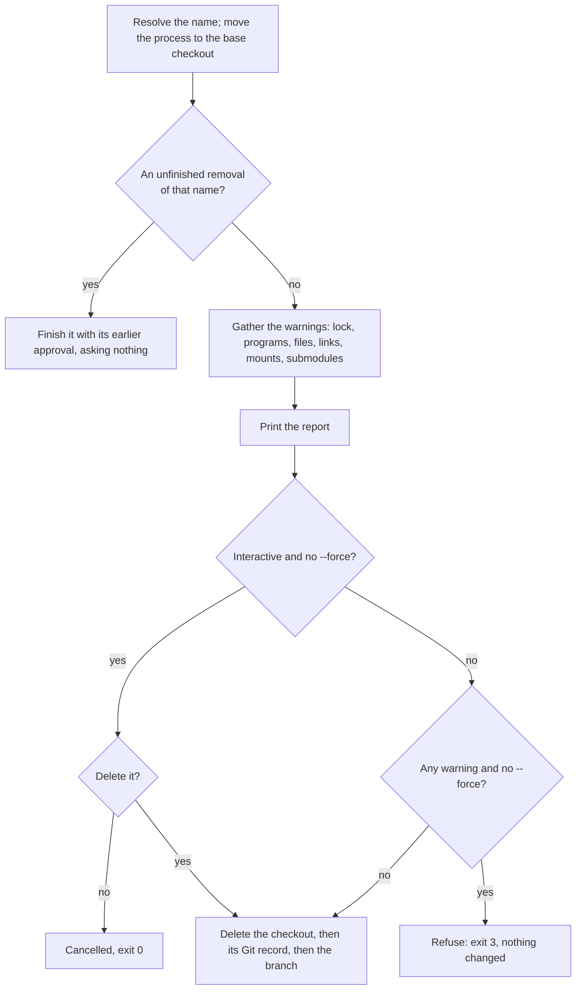
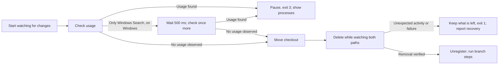
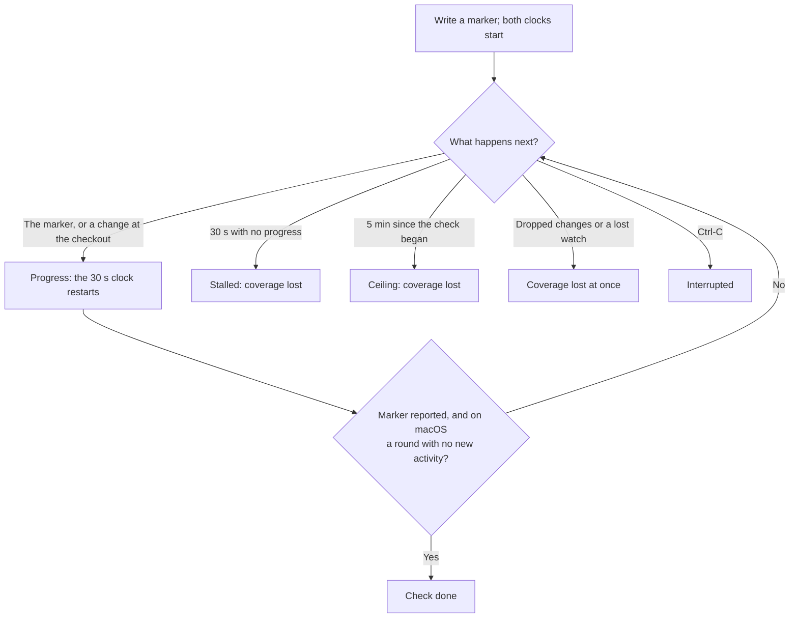
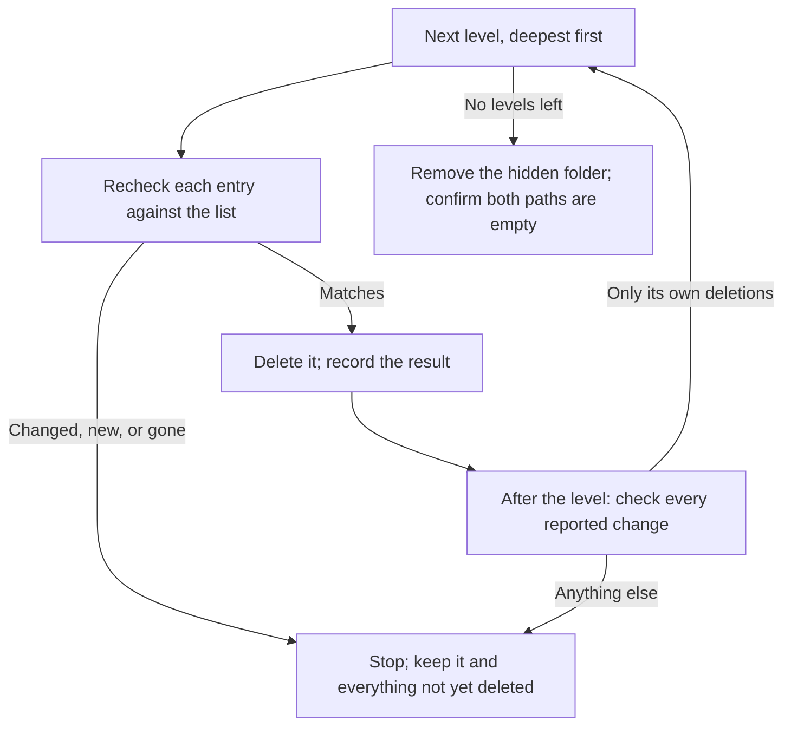
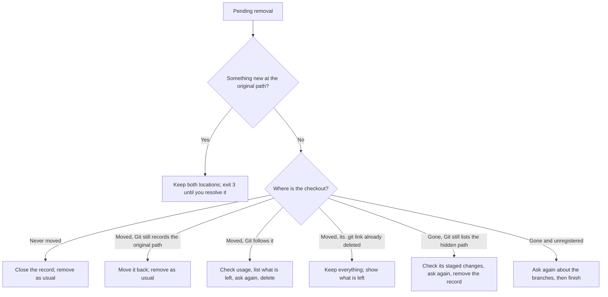

# `wt remove`

Removes a worktree, by branch or directory name, and its local branch when that branch's commits are safe elsewhere. Before anything is deleted, `wt remove` shows everything it can see that makes the removal risky and asks once. **Yes means delete:** after you answer yes (or pass `--force`), the checkout is deleted in that run, including files created or changed while it runs.

```bash
wt remove feat/theme                  # by branch name: shows the warnings, asks once
wt remove feat-theme                  # by directory name
wt remove feat/theme --force          # delete the worktree without asking, whatever the warnings say
wt remove feat/theme --force-branch   # delete the branch even if its commits exist nowhere else
wt remove feat/theme --force-remote   # also delete the branch on origin (and close its open PR)
```

Names resolve as in `wt go`: `base` is the main checkout, any other name matches a branch or a worktree directory, and a name matching more than one worktree is an error listing each one. The main checkout itself is never removed, even with `--force`; use plain `git` for that.

## How a removal runs



### The report and the question

Before asking or removing anything, `wt remove` prints what removal would affect. Interactively it ends with the one question about the checkout:

```text
Remove worktree feat-modern-config (/code/wts/repo/feat-modern-config)?

⚠ 2 programs are using files in this worktree:
    cargo (pid 4123, started 14:02, run from VS Code) is writing target/debug
    rust-analyzer (pid 3990) is watching src
  Deleting now may make them fail.
⚠ 3 uncommitted files will be lost: src/config.rs, src/lib.rs, notes.md

Files created or changed before deletion finishes are deleted too.

Branch feat/modern-config
- Safe: its commits are on main
- 0 ahead, 0 behind main

Delete it? (y/N) y

Removed feat-modern-config (441,203 entries) and deleted branch feat/modern-config.
```

Each warning names what was seen and what deleting does to it. Process names, lock reasons, paths, and Git's messages are shown as literal text, with control characters escaped. A count is given only when it is known. The warnings, in the order shown:

| Warning | When | What yes does |
|---|---|---|
| Locked | `git worktree lock` was used; its reason is shown (the lock file's time is never shown as when it was locked) | unlocks it, then deletes |
| Git's record unreadable | whether it is locked can't be told | deletes |
| A link | the worktree's path is a symlink (on Windows a junction) | to its own checkout: deletes both; to anything else: deletes only the link and Git's record, and the target is not touched |
| Git cannot read it | a broken `.git`, or a repair that couldn't be verified | deletes everything in it and Git's record |
| A file, or something uninspectable, at the path | | deletes it and Git's record |
| Your shell is inside | Unix, without the shell wrapper | deletes; `cd` out afterward. On Windows this refuses before the question instead (see [Standing in the worktree you remove](#standing-in-the-worktree-you-remove)) |
| Programs using files | a process holds a file open, watches, runs from, or stands in the worktree; "writing" only when writing was seen | deletes; the programs may fail |
| Some programs could not be checked | the check failed, ran out of time, or a mechanism failed | deletes |
| Uncommitted files | `git status` lists them (up to five are named) | they are lost |
| Uncommitted files could not be checked | `git status` failed | deletes whatever is there |
| Included files | `.worktreeinclude` copies that are new, changed since `wt create` copied them, or impossible to compare (see the [README](../../README.md#included-ignored-files)) | they are lost |
| Staged changes, or staged changes unknown | the directory is gone and Git's index for it holds staged changes, or can't be read | removes Git's record |
| Submodule work | a submodule has uncommitted files or commits on no remote | lost with the worktree |
| Nested mounts | another filesystem is mounted inside the worktree | nothing on it is deleted; the removal stays incomplete until it is unmounted |
| WSL drive | the worktree is on a Windows drive mounted into WSL | deletes; slower than from Windows |
| Synced folder | the worktree is inside a OneDrive folder | deletes the cloud copies too |

Unchanged included copies and other ignored files (`target/`, `node_modules/`) add no warning. A clean worktree has no warning, and a non-interactive run removes it without a question.

**The branch**, by where its last commit is found:

| Tier | Where the commits are | What happens |
|---|---|---|
| Safe | on the default branch (local or `origin/<default>`), or the exact head of an open or merged PR from this repository | deleted |
| Pretty safe | on another local branch, a tag, or an `origin/*` branch whose live head `wt` checked with `git ls-remote` | deleted; the report says where the commits still live |
| Not safe | nowhere else, or it could not be checked | an interactive run lists the commits and offers "keep" (default) or "delete"; a non-interactive run keeps it with a warning and still exits 0 |

The tier, and any consent to delete, applies to the commit the report showed. Immediately before `git branch -D`, the branch must still point there. If a commit landed on it in the meantime, that commit was never assessed: the checkout is still deleted, the branch is kept, and `wt remove` exits 1 (`Branch feat/theme was kept: it moved to <sha> after it was checked.`).

### Answering for a script: `--force` and the branch flags

An interactive run (stdin and stderr are terminals, `CI` unset or empty) asks the checkout question, default No, unless `--force` is given. A non-interactive run can't ask: with any warning and no `--force` it refuses with exit 3 before anything is unlocked or deleted, listing what it saw:

```text
Nothing was removed. There is no terminal to ask whether to delete worktree feat-x despite the warnings listed above.
  Add --force to delete it anyway.
```

| Flag | Answers |
|---|---|
| `--force` | yes to the checkout question, whatever the warnings say (files, programs, a lock, files `wt` could not check), including any wait that follows |
| `--force-branch` | deleting a Not-safe branch (`git branch -D`) |
| `--force-remote` | deleting the branch on origin, under a lease on the head the report showed, and closing its open PR |

`--force` never implies `--force-branch` or `--force-remote`: with `--force` alone, a Not-safe branch is kept with a warning. The removed `--force-worktree` spelling is an invalid argument (exit 2).

With `--force-remote`, the branch on origin is deleted through origin's push URL. An origin with several push URLs, or one Git would rewrite (`url.<base>.insteadOf` / `pushInsteadOf`) or read as the name of another remote, is refused before anything is removed. If origin can't be reached, the local removal still happens and `wt` exits 1 with the `git push origin --delete <branch>` that finishes the job. A branch someone else already deleted on origin counts as done.

### What the final line says

A removal that finishes prints one line:

```text
Removed feat-x (1,204 entries) and deleted branch feat/x; also deleted 1 file changed after you answered: src/new.rs.
```

- The entry count is what this run deleted, or `unknown number of entries` when it was not counted.
- Immediately before deleting, `wt` runs `git status` once more and names uncommitted files the question did not show. That never stops the removal, and it is not every change: ignored files such as `target/`, and changes made after that `git status`, are not listed.
- A worktree whose directory was already gone reads `Removed the record of worktree feat-x (its directory was already gone).`

A normal removal prints no hidden directory name, retry command, or report path. When something needs you, the run exits 1 with one plain sentence that names the path, hidden or not:

- `/code/wts/repo/.wt-remove-feat-x-…/target/x could not be deleted: the disk is read-only.` Everything else was deleted; after you fix the cause, `wt remove feat-x` finishes without asking.
- `/code/wts/repo/feat-x/mnt is still mounted inside the worktree; unmount it, then run wt remove again.` Nothing on the mount is deleted; the worktree's Git record and branch are kept until it is unmounted.
- `Branch feat/x was kept: <reason>.` The checkout is gone; the branch step did not run.

### An unfinished removal

A removal that was interrupted (Ctrl-C, a crash, a permanent failure, a mount) keeps a small record. The next `wt remove` of the same name, or of the worktree's original directory name, finishes it with the earlier approval: it asks nothing, needs no `--force`, and prints the same final line. A name that matches both an unfinished removal and a different worktree is refused (exit 3) and nothing is chosen.

Ctrl-C while the removal runs stops it at the next entry or wait and exits 1 (`The removal was cancelled; run wt remove again to finish it.`). Ctrl-C while the question is open ends `wt` and changes nothing.

### Standing in the worktree you remove

A program can't move its parent shell. Without the shell wrapper (`wt --completions <shell>`; see the [README](../../README.md#shell-integration)):

- on macOS and Linux the question warns that your shell is inside, and yes deletes; `cd` out afterward. Your own shell is not listed as a program using the worktree.
- on Windows the shell's working directory blocks deleting that folder, so `wt remove` refuses with exit 4 before the question, naming the shell.

With the wrapper, removal happens in two runs:

1. The first run reports and asks everything, saves what you approved, then moves your shell to the fork parent's worktree (or the base checkout), keeping your subdirectory when it exists there. It deletes nothing.
2. The wrapper runs `wt remove --handoff <token>` from there, which finishes the saved removal.

The second run compares nothing about the checkout's content and asks nothing: files changed, added, or restaged in between are deleted with it. It still checks that your shell left the worktree, that the repository is the same, and that the checkout and its Git record are the ones that were approved; and it keeps every branch protection: a branch whose tip moved is kept (exit 1), a branch deleted because it was safe is checked again, and a remote deletion is checked against origin's push URL and made under its lease. The handoff is single-use and expires after 10 minutes; an expired or unknown handoff is exit 3, and a later `wt remove <name>` finishes the saved removal. No `cd:` or `remove-handoff:` line is printed after a failure.

A worktree reached through a link to its own checkout has nothing to hand off: it is deleted in the first run, which then prints only `cd:` so the wrapper moves your shell out.

## Deleting the checkout

A checkout that exists is never deleted in place. After the report, the
questions, and the [usage check](#the-report-and-the-question),
`wt remove` moves it to a unique hidden sibling on the same filesystem
(`.wt-remove-<name>-<token>`, beside the original), deletes it there while
watching both paths, and only then unregisters it and runs the branch steps.
A checkout whose `.git` file uses a relative link that would break after the
move (anything other than leading `..` steps, for example
`gitdir: ../x/../../repo/.git/worktrees/x`) is moved too: its `.git` file is
rewritten to name Git's record by its absolute path, and restored if the move
is undone. Nothing is asked or shown for this.



The usage check is conservative: observed usage does not necessarily mean a
handle would prevent deletion, but it always refuses. It is also incomplete:
some platforms cannot see every kind of usage, and a move does not revoke a
handle that is already open or stop a process from recreating the original
path. That is why the deletion itself is watched. If unexpected writes appear
at either location, removal stops at the next safe point, keeps what is left,
and runs no branch step. A recreated original is never deleted or
overwritten.

For example, a writer may recreate `checkout/.gitnexus/index.db` after the
checkout has moved to `.wt-remove-checkout-<token>`. The report then tells
you to stop tasks using either path, inspect both directories, and save new
work before you [retry](#recovery-records-and-retry).

While the checkout is moved, Git keeps it registered as the same worktree at
the hidden path: `git worktree list` shows it at the new path with its branch,
`git status` works inside it, and `git worktree prune` leaves it alone. Only
Git's record of the location changes. If that record cannot be updated, the
checkout is moved back when nothing has appeared at the original path and no
activity was seen; otherwise it stays at the hidden path and the report says
so.

### Watching for changes

Watching covers three places: the folder holding the checkout (only the
checkout's own name and the hidden name, so busy sibling worktrees never stop a
removal), every directory in the checkout, and the files in Git's record of the
worktree that hold its identity and staged changes (`HEAD`, `gitdir`,
`locked`, `index`, `index.lock`, and split-index `sharedindex.*` files). If
the system drops change notifications, a watch ends unexpectedly, or `wt`
cannot confirm that changes are being reported, coverage is lost and removal
stops; it never continues on partial watching. On Linux,
each directory in the checkout uses one inotify watch, so a checkout with more
directories than `fs.inotify.max_user_watches` allows, or a user already at
`fs.inotify.max_user_instances`, cannot be watched and exits 4.

On macOS, watching uses FSEvents, which watches paths rather than folders: it
watches the checkout's path and the hidden path (each with everything below
it) instead of the folder holding them, with the same effect. Each check for
new activity writes a marker file into a private folder in your per-user
temporary directory (`wt-observe-<random>`, removed when the removal ends)
and waits until the system reports it. macOS does not report changes in the
order they were made, so one reported marker does not prove that every
earlier change has arrived: the check writes markers until one round brings
no new activity at the checkout's locations, and a change that arrives even
later is reported by a later check. The checks therefore never decide on
their own what is safe to delete. `wt` compares every entry with its list
immediately before deleting it, and rereads Git's index and `HEAD` before
removing the worktree's record (see [Checked deletion](#checked-deletion));
those direct checks are what protect a write the system reported late. The
folder holding the checkout, or Git's record of the worktree, being moved or
deleted while watching runs also counts as lost coverage, and so does the
system flagging that it dropped changes or that a folder must be rescanned
(see [When watching stops](#when-watching-stops)).
macOS can report a folder's removal or rename in place of changes inside it
that happened just before, so `wt` checks for activity after deleting a
folder's contents and before removing the folder itself.

On Windows, watching uses one watch on the folder holding the checkout,
covering everything below it, and one on Git's record of the worktree.
Changes in sibling worktrees still reach `wt` there, which ignores them. Each
check for new activity creates a hidden marker file
(`.wt-observe-<random>-<number>`) in each of those two folders and waits until
Windows reports it, because Windows reports each folder's changes in order. The
marker deletes itself when `wt` closes it, even if `wt` crashes. Checks wait
as described in [Waiting for changes to be reported](#waiting-for-changes-to-be-reported),
with the 30 seconds counted separately for each of the two watches. Either
folder being moved or deleted counts as lost coverage, and so does Windows
reporting that it dropped changes because too many arrived at once. `wt` stops watching
Git's record before the step that removes it, so that step is never blocked.
Windows reports a change to a file's attributes the same way as a change to its
content. On a ReFS volume (such as a Dev Drive), a folder deleted by some
tools is not reported at all. `wt` therefore checks every entry again
before deleting it.

### Waiting for changes to be reported

On macOS and Windows, a check for new activity waits for its marker. It
waits as long as the system keeps making progress, meaning the marker
arrives or a change at the checkout's locations is reported. It gives up in
only two cases:

| Limit | What happened | `reason.kind` in the report |
|---|---|---|
| 30 seconds with no progress | the system went quiet before confirming the marker | `delivery_stalled` |
| 5 minutes for one check | progress kept arriving, but the check never finished | `drain_ceiling` |

When both run out at the same moment, the 5-minute limit is reported. Changes
in sibling worktrees, the cleanup of `wt`'s own markers, and a marker that was
already reported do not count as progress, so they cannot keep a check
waiting. On Windows each of the two watches has its own 30 seconds, so
activity in the folder holding the checkout never hides a silent watch on
Git's record. On Linux a check reads every pending notification and writes no
marker, so it never waits.



The same waiting applies while watching starts, after the move, at every
check during deletion, and before Git's record is removed. A check that gives
up means `wt` could not confirm that every change was reported, not that a
change was lost. `wt` still cannot continue without that confirmation, so it
counts as lost coverage, as described in [When watching stops](#when-watching-stops).
Ctrl-C ends a wait at once: before the move the removal stops with nothing
changed, and after it the removal stops as at any other
[interrupt](#interrupting-a-removal), leaving a pending removal that a retry
continues.

If confirming that a new watch works takes more than a second, `wt` warns
once, before it moves anything (on a retry, before it deletes anything
more). The warning gives the time taken, says the removal may take longer,
and says it stops if that confirmation stalls. A slow start alone never
refuses a removal.

### When watching stops

Lost coverage is final for the run: no later check can prove that nothing
happened in between, and no flag lets `wt` continue past it. What you see
depends on when it happens:

- **While watching starts**, nothing has moved. `wt` exits 4 and names the
  reason; after a stall or the 5-minute limit it says to run the command
  again (on macOS, with the fseventsd note below).
- **In the checks before the move**, nothing has moved either, and `wt`
  refuses with exit 4.
- **After the move**, `wt` deletes nothing more and exits 1 with the usual
  stop report (both locations, what was deleted and what is left, `Retry:`
  and `Full report:`), even if nothing was deleted yet. The report adds a
  `Watching stopped` line that says at which step watching stopped and why.
- **During a retry**, before it deletes anything more, the retry refuses and
  says it stopped before deleting more of the worktree; the removal stays
  pending, and running the command again continues it.

The reason names exactly what the system reported:

| `reason.kind` | Where | What the message names |
|---|---|---|
| `fs_events_dropped` | macOS | every loss flag the system set (`KernelDropped`, `UserDropped`, `MustScanSubDirs`) and the whole flag mask in hex |
| `overflow` | Linux, Windows | the system's change queue overflowed |
| `queue_full` | all | more changes arrived between two checks than `wt` holds |
| `watch_lost` | all | the watch that ended |
| `read_failed` | all | the error reading changes |
| `delivery_stalled`, `drain_ceiling` | macOS, Windows | the seconds waited, and on Windows the silent watch (the folder holding the checkout, or Git's record of the worktree); nothing is known to have been lost |

`MustScanSubDirs` alone also stops the removal: it means the system could
not report each change below a folder, so complete coverage is unavailable
even though nothing says "dropped". On macOS, a stall or the 5-minute limit
also says that the system's file-change service, fseventsd, may be delayed,
that `wt` does not restart it, and points to
[When fseventsd is slow](#when-fseventsd-is-slow-macos). The same details are
saved in the report's [`observation`](#recovery-records-and-retry) field.

### When fseventsd is slow (macOS)

Every program's file-change notifications on macOS pass through one system
service, fseventsd. When it falls behind, `wt remove` waits, and a check can
stall. Two cases have been seen:

- **A stuck fseventsd.** After 26 days of uptime, fseventsd spent one full
  CPU core matching paths while very few files were changing anywhere.
  Notifications took more than 10 seconds to arrive, and quitting the
  programs that watch files made no difference. Overall CPU use looked low,
  because the busy thread ran on a single efficiency core, so nothing pointed
  at fseventsd.
- **A fast burst of deletions.** A healthy fseventsd can still drop
  notifications when about 6,600 to 7,000 entries are deleted a second, which
  ends as `fs_events_dropped`. Drops are intermittent: in a later comparison
  on the same Mac, deleting at up to 11,000 entries a second dropped nothing,
  and checking for activity more often than every 2,048 entries made
  deletion about twice as slow without a measurable benefit. No checking
  interval can rule out a drop, since fseventsd is shared with every other
  program. A stopped removal continues where it left off when you run the
  same `wt remove <name>` again.

To see whether fseventsd is busy:

```bash
ps -o %cpu,etime -p "$(pgrep fseventsd)"   # CPU use, and how long it has run
top -o cpu                                 # or Activity Monitor, sorted by CPU
sudo sample fseventsd 5                    # optional: where its threads spend their time
```

`ps` shows an average over the process's life, so read `top` for its current
use. High CPU alone does not show that fseventsd is the cause. If it is
pinned and notifications are slow, an administrator can restart it with
`sudo killall fseventsd`; launchd starts it again at once. **This affects
the whole system:** every program that uses FSEvents, such as Spotlight, Time
Machine, editors, file watchers, and build tools, may miss changes made
around the restart or rescan its folders. `wt` never restarts fseventsd
itself; it is a manual troubleshooting step. Afterwards, run the same
`wt remove <name>` to continue the stopped removal.

### Checked deletion

Before moving anything, `wt` lists everything it is about to delete,
including ignored build output: each file, folder, and link with its identity
on disk, size, modification time, and permissions, and a link's target. Only
the files you were asked about (changed, untracked, and protected included
files) are also hashed; ignored output is never read. If anything changes
while the list is taken, or an entry is a FIFO, socket, device, mount point,
or unsupported reparse point, nothing is moved and `wt` exits 3. The list is
saved in the removal's recovery record before the move, so a later retry can
compare what is left with what was approved.

Deletion then works from the deepest folders up, `.git` last:



- Every entry is compared with the list immediately before it is deleted, by
  identity and metadata, and a hashed file by its content. A file that grew,
  was rewritten, or was replaced stops removal and is kept. So does a file
  that someone else already deleted: it is recorded as already absent, never
  as deleted by `wt`.
- Folders are opened one at a time from the checkout down, and each is checked
  to be the folder in the list. A folder replaced by a link is never entered,
  so nothing outside the checkout is deleted. A link in the checkout is
  deleted itself; its target is untouched.
- Reported changes are checked after each level, and within a level after
  every 2,048 entries: a change at a path `wt`
  deleted must still be a deletion, a change to an entry not yet reached must
  leave it matching the list, and anything else at either location, or in
  Git's record of the worktree, stops removal. A folder whose contents are
  gone but which cannot be removed (a new file appeared in it) also stops
  removal. The count is checked after each batch (below), so a check can come
  up to 255 entries late. On macOS each check also waits for the system to
  catch up (see [When fseventsd is slow](#when-fseventsd-is-slow-macos)).
- Each batch of up to 256 entries from one folder is written to the
  recovery record before it is deleted, and its results after. A crash between
  the two leaves those entries marked uncertain, not deleted.
- When the hidden folder is gone, `wt` confirms that nothing exists at either
  path, stops watching Git's record of the worktree, checks that the record
  still has the index and `HEAD` that were approved (a change staged after
  you answered is new work), and only then unregisters the worktree with
  `git worktree remove`.

For example, if an editor still running in `checkout/target` writes
`build.log` after the move, the file appears in
`.wt-remove-checkout-<token>/target/`; the next check finds it, and removal
stops with `target/build.log` and every entry not yet deleted still in place.

Deletion and observation cannot be atomic with all possible writers: a write
that lands between an entry's last check and its deletion is deleted with it,
and a writer can start after the final check. Every report of a removal that
deleted anything states this limit and lists the entries it deleted, rather
than promise that every concurrent write was preserved.

### Large, built checkouts

A checkout that has been built, with a `target/` or `node_modules/` of
hundreds of thousands of entries, is normal for a Rust project. The size of
its file list never stops a removal. Three things make that work.

On macOS, a removal of such a checkout usually still stops partway, once or
more. Deleting at full speed outruns fseventsd, which drops change
notifications, and `wt` stops when it can no longer see every change (see
[When watching stops](#when-watching-stops)). Running the same command again
continues where it stopped, without asking anything new. A 500,000-entry
checkout took three to four runs. **Planned:** a confirmed removal will
finish in one run on every OS, and losing change notifications will no longer
stop it.

**The journal has no fixed size.** Every batch is written to the recovery
record's journal before it is deleted (see
[Recovery records and retry](#recovery-records-and-retry)). Before the move,
`wt` works out from the list of entries exactly how large that journal can
grow, counting each batch's plan and its worst-case results, and lets the
journal grow to that size. A long path costs more than a short one, and the
size is worked out per attempt, so the number of entries never stops a
removal partway. If `wt` ever reaches that size, it is a defect in `wt`, and
the stop says `wt reached an internal limit of its deletion journal; a retry
continues`.

**It checks free space before the move.** The journal of a checkout with
500,000 long paths can run to a few hundred megabytes. It lives in the
repository's `.git/wt-removal/`, which may be on a different disk from the
checkout. Before it writes anything, `wt` reads the space available to you
there and compares it with what the attempt needs: the journal, plus the
removal's record on a first run, or plus a copy of the previous journal on a
retry. When that does not fit, or the space cannot be read, `wt remove`
refuses with exit 4 and nothing moves:

```text
Nothing was removed. wt stopped before moving worktree feat-x: /code/repo/.git/wt-removal has 104857600 bytes available, but this removal's deletion journal needs 218103808.
  Run wt remove feat-x again.
```

Free some space on that disk, then run the command again. On a retry the
check runs before the earlier journal is archived or replaced and before
anything more is deleted, so the message reads `stopped before deleting more
of worktree feat-x`, and the earlier record and journal still read as they
did. Two limits apply:

- the space the deletion would free is not counted, because the journal is
  written before the files it describes are deleted;
- a reading is not a reservation: another program can fill the disk after the
  check. A write that then fails stops the removal like any other failure,
  and a retry continues it.

**The usage check reuses the list.** The list of entries `wt` builds before
the move is handed to the [usage check](#the-report-and-the-question),
so the check does not walk the checkout a second time and spends its time
looking at processes. Each process check in the saved report records this as
`"index_provenance": "supplied"` (`walked` when the check read the tree itself,
as the checks after a stop do; `unknown` in a report saved before
`report_version` 6). This makes the check faster on a large checkout, but it
does not make it complete: a platform that cannot see a kind of usage still
cannot, and a check that runs out of time still says what it did not reach.

### Interrupting a removal

Pressing Ctrl-C (or Ctrl-Break on Windows, or sending `SIGTERM` or `SIGHUP`)
while `wt remove` is checking usage, moving, or deleting does not kill it.
`wt` prints `Interrupted: stopping at the next safe point; files not yet
deleted are kept.` and then:

- **Before the move**, it moves nothing, discards the removal's record, and
  exits 1 with `Nothing was removed.`, saying the removal was interrupted
  before it changed anything. Run the command again when you are ready.
- **During a retry, while watching starts**, it deletes nothing, keeps the
  pending removal, and exits 1 saying it stopped before deleting more of the
  worktree; running the command again continues it. Later in a retry, it
  stops as after the move.
- **After the move**, it finishes the entry it is deleting, deletes nothing
  more, and exits 1 with the same report as any other stop: both locations,
  what was deleted and what is left, Git's registration, each branch (kept),
  `Retry: wt remove <name>`, and `Full report:` with the saved report's path.
  The removal stays pending, and running `wt remove <name>` again continues
  it, as in [Recovery records and retry](#recovery-records-and-retry).

```text
$ wt remove feat-x
^C
Interrupted: stopping at the next safe point; files not yet deleted are kept.
Removal stopped: a step failed (the removal was interrupted).

Original: /work/feat-x
Moved to: /work/.wt-remove-feat-x-<token>
Deleted before stopping: nothing
Remaining: 2 entries in the moved directory
Git registration: now points to the moved directory
Branch feat/x: kept (not attempted)
Error: the removal was interrupted

Stop any tasks using either path. Inspect both locations and save new work.
Retry: wt remove feat-x
  Run it from the base checkout at /work/repo.
Full report: /work/repo/.git/wt-removal/<operation-id>/report.json
```

The questions before a removal keep their usual Ctrl-C behavior (the
removal is cancelled and nothing changes), and an interrupt after the
checkout is removed, while branch steps run, does not stop those steps.
Ctrl-C in a terminal also reaches a `git` process `wt` is running at that
moment; if that call fails, the report names it. A removal killed outright
(`SIGKILL`, power loss) leaves the same pending record, and a retry by name
continues it.

## What `wt remove` refuses to move

These checkouts are refused before anything changes:

- A checkout containing submodules, or holding a FIFO, a device, a nested
  mount, or an unsupported reparse point, exits 3.
- A locked worktree (`git worktree lock`) exits 3. `wt` never unlocks it; run
  `git worktree unlock <path>` yourself if the lock is stale.
- A checkout that can no longer be identified when usage is checked (it
  vanished, or its path is no longer a directory) exits 3; run the command
  again.
- A checkout on a filesystem that cannot move a directory without risking
  replacement exits 4. One example is a WSL checkout under `/mnt/<drive>`;
  remove it from Windows instead. The same applies when change watching
  cannot be started or confirmed, or coverage is lost before the move (see
  [When watching stops](#when-watching-stops)), or the recovery record cannot
  be written, including when the disk holding it has too little free space
  for the journal or its free space cannot be read (see
  [Large, built checkouts](#large-built-checkouts)).
- On Windows, a move blocked by a file open anywhere in the checkout exits 4.

Exits 3 and 4 always mean "nothing removed". A stop after the checkout
has moved exits 1, even if no file was deleted yet.

## Recovery records and retry

Each removal keeps its state in `<git-common-dir>/wt-removal/<operation-id>/`:
`record.json` (what the removal set out to do), `journal.jsonl` (the list of
approved entries, then each deletion batch), and `report.json` (the full
report). While the record is pending, starting another removal of the same
worktree exits 3. A completed record keeps `record.json` and `report.json`
for reference and never authorizes another removal. Its journals are deleted
once `report.json` lists every journal entry; if the entries could not be
read, the journals are kept and `wt remove` warns.

`report.json` describes the whole removal, not only the last run of it:

- `journal` counts and `journal_entries` cover every attempt. Each entry
  names its `attempt`, its path relative to the moved checkout, its kind, and
  its state: `deleted`, `externally_absent` (already gone), `uncertain` (gone,
  but the run stopped before recording who removed it), `kept`, or `planned`.
  A retry never counts an entry twice and never turns an uncertain entry into
  a deleted one.
- `deleted` names at most 200 deleted paths, with the rest counted in
  `truncation.deleted_omitted`; `journal_entries` is never cut short.
- `discovery` lists the run's process checks by `purpose`: `preflight` (the
  check that let the move or the deletion start), `diagnostic` (a check of
  each location after a stop), and `windows_search_hold` (a first check that
  found only Windows Search; the `preflight` after it is the one recheck that
  decided).
- `observation` describes the run's change watching: the `backend`
  (`fs_events`, `inotify`, or `read_directory_changes`), how long watching
  took to start (`startup_ms`), and the latest and longest time a check's
  marker took to be reported (`last_round_trip_ms`, `longest_round_trip_ms`;
  `null` until one is, and always on Linux, which uses no markers). If
  coverage was lost, `loss` says where (`stage`: `startup`, `pre_move`,
  `post_move`, `deletion`, or `unregistration`), why (`reason`, tagged by
  `kind` as in [When watching stops](#when-watching-stops)), and, during
  deletion, how many entries `wt` had processed since its previous check
  (`entries_since_drain`; `null` at other stages). A loss while `wt` stops
  watching Git's admin directory, just before it removes the worktree's
  record, is recorded at `unregistration` but does not stop the removal:
  the final check rereads the index and HEAD directly. On macOS a
  dropped-notification `reason` keeps the system's whole flag mask (`raw`)
  and names every loss flag in it (`kernel_dropped`, `user_dropped`,
  `must_scan_sub_dirs`). A stall or the 5-minute limit records the time
  waited (`waited_ms`) and the silent `watch` (`parent` or `admin` on
  Windows, `null` on macOS). The round trips time markers only, not how long
  each change took to arrive. On macOS a round trip is either about 10 ms or
  about 1 s, never in between: a marker fseventsd has not processed when
  `wt` asks for it arrives about a second later. A `longest_round_trip_ms`
  near 1,000 there means a check missed the fast path, not how far behind
  the system was, and the deletion count is context, not proof
  that `wt` caused a drop. A report from before `report_version` 5 has no
  `observation`, which reads as unknown.
- `earlier_attempts` keeps what each earlier run reported when it stopped:
  its outcome, both locations, timeline, process checks, observed activity,
  change-watching `observation`, branch results, and errors. The top-level
  fields describe the last run.

For example, a removal interrupted after deleting 4 files, then retried to
completion, ends with a report like this (abridged):

```json
{
  "outcome": "removed",
  "journal": { "deleted": { "files": 7, "directories": 3, "links": 0 }, "...": "..." },
  "journal_entries": [
    { "attempt": 1, "batch": 1, "path": { "display": "target/debug/a.o" }, "kind": "file", "state": "deleted" },
    { "attempt": 2, "batch": 1, "path": { "display": "README.md" }, "kind": "file", "state": "deleted" }
  ],
  "earlier_attempts": [{ "outcome": "cleanup_failed", "errors": ["the removal was interrupted"], "...": "..." }]
}
```

A macOS run that stopped because the system dropped notifications during
deletion records its watching like this:

```json
{
  "observation": {
    "backend": "fs_events",
    "startup_ms": 14,
    "last_round_trip_ms": 9,
    "longest_round_trip_ms": 31,
    "loss": {
      "stage": "deletion",
      "reason": { "kind": "fs_events_dropped", "raw": 6, "flags": ["kernel_dropped", "user_dropped"] },
      "entries_since_drain": 2048
    }
  }
}
```

A Windows run whose watch on Git's record went silent records
`"reason": { "kind": "delivery_stalled", "waited_ms": 30000, "watch": "admin" }`
instead.

A retry keeps the earlier journal as `journal-<n>.jsonl` and starts a new
`journal.jsonl`. The new journal is written in full under a hidden name and
only then takes the old one's place, so a retry that crashes or cannot write
before then leaves the earlier attempt's record and journal exactly as they
were: the next retry reads them and has deleted nothing more.

A stopped removal is continued by running the same command again, from
outside the moved checkout; the base checkout always works. A retry is never
[handed off](#standing-in-the-worktree-you-remove): a shell standing inside
the moved checkout gets exit 4 and this instruction.

A retry uses the name you removed, even when Git no longer lists anything by
that name (while the checkout is moved, Git lists it at the hidden path; after
the checkout is gone, not at all). The name is matched against live worktrees
and pending removals together. If it matches a pending removal and a
different live worktree, for example a new worktree created at the original
path or one that now has the old branch checked out, `wt` lists both and
exits 3 rather than choose. The hidden folder's own name reaches the same
pending removal, never a second way around it.

What the retry does depends on what it finds on disk and in Git, never on the
step the record says was last finished:



- A retry approves everything again: it lists what is left, asks about
  changed and untracked files (a file written after the stop is new work and
  needs your answer), checks usage, and reassesses branch safety and the
  remote branch. No earlier answer is reused; see
  [What a retry asks again](#what-a-retry-asks-again).
- Something new at the original path is never deleted or entered, and the
  moved checkout is left as it is until you have moved or saved that content.
- If the hidden folder is no longer the moved checkout, or what is left of it
  has lost its `.git` link, nothing is cleaned up or repaired; the report lists
  what remains so you can save it and delete the folder yourself.
- When a pending removal cannot continue, its report also repeats what the
  saved check before the move could not see, as
  `Saved from before the move: Discovery is partial; …`, and names the
  recovery record's folder.

### What a retry asks again

A stopped removal has already deleted some tracked files, and Git lists each
of them as an unstaged deletion in what is left. Asking about those again
would ask you to approve the removal's own work, so a retry leaves a file out
of its questions only when all of these hold:

- Git's status for the file is exactly an unstaged deletion (` D`), with
  nothing staged for it;
- this removal's journal, from any of its attempts, records that `wt` itself
  deleted that exact path;
- the path is still empty, checked without following a link.

The retry then says how many files it left out, for example
`3 tracked files this removal already deleted are not asked about again.`

Everything else is asked about as usual: a staged deletion or any other
staged change, a file staged as added whose copy is gone, a modified or
untracked file, a protected included file, and a file that vanished for
another reason or that the journal marks as uncertain. A deleted folder does
not cover the files that were in it; each file needs its own record. If a
journal cannot be read or does not match the removal, the retry refuses
instead of leaving anything out.

For example, a removal stopped after deleting `src/main.rs` and `README.md`.
You then edit `notes.txt` and recreate `README.md`. The retry asks about
`notes.txt` and `README.md`, and not about `src/main.rs`.

Your answers cover what the retry showed. Immediately before it deletes
anything more, `wt` repeats the same check; if a file was recreated, or a
change staged, after the retry's report, it refuses and asks you to run it
again. The left-out files stay in the journal counts and the report as
deletions of the attempt that made them.

## Worktrees Git can't read

A linked worktree can lose its connection to the repository while Git still records it. `git worktree list --porcelain` then marks the entry `prunable`, and `wt list` shows it as `✕` (see [`wt list`](list.md#worktrees-git-cant-read)). `wt remove` looks at the recorded path on disk and handles three cases differently. "Gone" always means the operating system answered "not found"; a permission or I/O error is never read as absence.

### The directory is gone

Only Git's record of the worktree is left. That record still holds the worktree's own **index**, which can contain staged changes that were never committed, so `wt remove` compares it with the worktree's last commit before removing anything:

```text
Removing worktree staged at /code/wts/repo/staged

Its directory is already gone, but the index Git kept for it holds staged changes that removing its record discards (1):
└── a.txt
```

- An index that matches the last commit needs no consent: `Its directory is already gone. The index Git kept for it matches its last commit, so removing its record loses no staged changes.`
- Staged changes need the ordinary consent: a question in an interactive run, `--force-worktree` otherwise.
- An index that is missing or can't be read refuses (exit 3) with any flags, because staged work can't be ruled out.

The branch is then judged exactly as for any other worktree. Removal runs `git -C <base> worktree remove <path>` for this one record only, never `git worktree prune` and never `--force`. Git does not protect that index once the directory is gone, so immediately before, `wt remove` checks that everything the report and your consent rested on still holds:

- Git still lists the same worktree at the path, under the same record;
- the branch tip (or the recorded HEAD when detached) is still the commit the index was compared with;
- nothing has appeared at the path;
- the index still holds exactly the bytes that were checked, and Git still reads the same entries from it.

The second half matters for a **split index** (`git update-index --split-index`, or `core.splitIndex`). There, `index` holds only recent changes and points at a `sharedindex.<id>` file beside it that holds the rest of the entries, so the `index` bytes alone can stay the same while what it stages changes. `wt remove` asks Git to list every entry, with their flags, at the check and again just before removal. A shared file that has been changed, removed, emptied, extended, or replaced by a directory since the check refuses (exit 3) with any flags, because Git can no longer read the index that was reported:

```text
Nothing was removed. The record of worktree gone was not removed: its index at /code/repo/.git/worktrees/gone/index can't be inspected: failed to execute git command: fatal: /code/repo/.git/worktrees/gone/sharedindex.39d8…: index file smaller than expected.
  Run wt remove again to start over.
```

If any of these changed, or can't be read, it refuses with exit 3 and asks you to run it again, so the new state is reported and asked about. `--force-worktree` approves discarding the staged changes that were reported, never ones staged after the check:

```text
Nothing was removed. The record of worktree gone was not removed: its index at /code/repo/.git/worktrees/gone/index changed after it was checked.
  Run wt remove again to start over.
```

Branch steps run only after the record is gone:

```text
Removed the record of worktree gone (its directory at /code/wts/repo/gone was already gone)
Deleted branch feat/gone
```

There is no directory to stand in, so this never needs the two-run handoff.

### The directory is there but its `.git` file is gone

Git can't check the files without the link, so `wt remove` first runs `git -C <base> worktree repair <path>` and then **verifies** the result. It never trusts the repair's exit status: Git can exit 1 after a complete repair, so the status proves nothing either way. The link counts as restored only when all of these hold:

- the worktree's `.git` leads to the exact worktree record Git keeps for this path, in this repository;
- that record points back to the worktree's `.git`;
- Git sees the worktree itself as the top of the checkout, not an enclosing repository;
- a fresh `git worktree list` shows the same worktree, with the same branch or detached commit, no longer marked `prunable`;
- the path is still a real directory, not a link (every other check reads through a link, so only this one notices a checkout moved away and replaced by a link to it).

Then the ordinary report, consent, and handoff follow, exactly as for a healthy worktree. The report says the `.git` file was missing, right under its heading and before any question:

```text
Removing worktree unlinked at /code/wts/repo/unlinked
Its .git file was missing; wt restored it to check the files (Git may restore other worktrees' broken links too).

Uncommitted files (1):
└── notes.txt
...
Nothing was removed. Worktree unlinked has uncommitted or protected included files (listed above), and there is no terminal to confirm discarding them.
  Add --force-worktree to discard them.
  The .git link restored for unlinked was left in place.
```

The repair happens **before** you are asked anything, because nothing can be asked about files that can't be checked. It is not undone if you then decline, or if a later check refuses; those messages say the restored link was left in place. Run from the base checkout, `git worktree repair` also restores the links of **other** worktrees whose `.git` is missing or broken, which is why the report line says so. It never deletes anything.

When the link can't be verified, nothing is removed, whatever the flags (exit 3):

```text
Can't remove ro: its .git file was missing and Git couldn't restore a verified link.
No working files, branches, or worktree records were removed. The repair attempt may have changed Git metadata for this or other worktrees.
From the base checkout, inspect the repair result with git worktree list --porcelain and try git worktree repair /code/wts/repo/ro, then retry wt remove feat/ro.
  Not verified: Git's worktree list still marks it prunable
  Repair output: fatal: could not open '/code/wts/repo/ro/.git' for writing: Permission denied
```

Each `Not verified:` line names a condition above that failed, and each `Repair output:` line is what Git printed (or why it could not run). Before running the repair at all, `wt remove` requires exactly one of Git's worktree records to point at this path; when none does, more than one does, or one can't be read, it refuses without attempting a repair.

### Anything else

Everything else Git can't read refuses with exit 3 and says what was found, with Git's own reason when it gave one:

- a file, or a link, where the worktree directory was (a link is never followed: it may have replaced the original checkout);
- a path or `.git` that can't be inspected;
- a `.git` that exists but Git can't use.

```text
Can't remove file: Git can't read this worktree: /code/wts/repo/file is not a directory; Git reports: gitdir file points to non-existent location.
No working files, branches, or worktree records were removed. wt remove deletes a directory only after checking its files, and no --force flag changes that.
  Restore or move what is at /code/wts/repo/file, then retry wt remove feat/file.
```

Two cases are not marked `prunable` by Git and so look healthy until `wt remove` tries to check the files. Both stop with exit 1, the worktree's name and path, and Git's message, and remove nothing:

- a **locked** worktree whose directory is gone (`git worktree lock`). Unlock it with `git worktree unlock <path>` and run `wt remove` again;
- a `.git` file that holds something Git can't use:

    ```text
    Error: failed to execute git command: could not check the files of worktree b2 at /code/wts/repo/b2: fatal: gitfile does not point to a valid repository: /code/wts/repo/b2/.git
    ```

**Run `wt remove` from outside a worktree whose `.git` is gone.** From a shell standing inside it, `wt` can't find the repository (the directory is no longer connected to it) and stops with Git's `fatal: not a git repository` before it can repair anything. The one exception is a worktree nested inside another checkout of the same repository. From any other directory the removal works as described above.

## A link in place of the worktree

A worktree directory can be moved away and replaced by a link to its new location. Git reads the checkout through the link and does **not** mark it `prunable`, yet `git worktree remove` would delete the files the link leads to and then fail on the link itself. So `wt remove` looks at the recorded path without following it, whatever Git reports, and when the path itself is a symbolic link or, on Windows, any reparse point (a junction included), the question says where it leads:

- **to this worktree's own checkout** (the target's `.git` leads back to this worktree's Git record, and the target is no other registered checkout and contains none): `The path is a link to the worktree's real location at /code/elsewhere/feat-x; both will be deleted.` Yes deletes the checkout and the link.
- **anywhere else**, or somewhere that can't be verified: `The path is a link to /code/elsewhere, which is not touched; only the link and Git's record are deleted.`

Only the worktree's own path counts: a link among its parent directories, such as macOS's `/tmp` → `/private/tmp`, is just another spelling of the same place and is removed as usual.

`wt list` shows the row as `✕` with the note `<name>: <path> is a link, which may have replaced the original checkout.` (see [`wt list`](list.md#worktrees-git-cant-read)).

## Exit codes

| Code | Meaning |
|---|---|
| 0 | Done, including a question you declined or cancelled |
| 1 | Something needs you: a permanent failure (one sentence names the path and the cause), a nested mount still mounted, a branch that was kept, an approval that could not be saved (nothing was deleted, and the message says so), the removal was interrupted, or Git failed. An unfinished removal is finished by the next `wt remove` of that name |
| 2 | Invalid arguments, including the removed `--force-worktree` |
| 3 | Refused before anything was deleted: warnings with no terminal to ask and no `--force`, a name matching an unfinished removal and another worktree, an unknown or expired handoff, a shell still inside the worktree in a handoff's second run, or what is at the path is no longer what was approved. A repair attempt may have changed Git's link metadata |
| 4 | On Windows, the shell running `wt` stands in the worktree without the shell wrapper |
