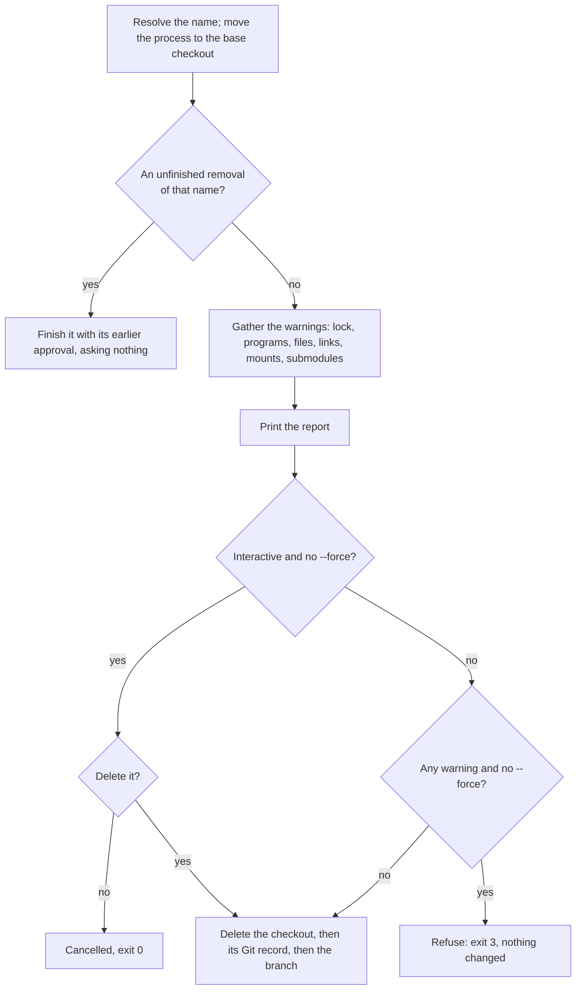
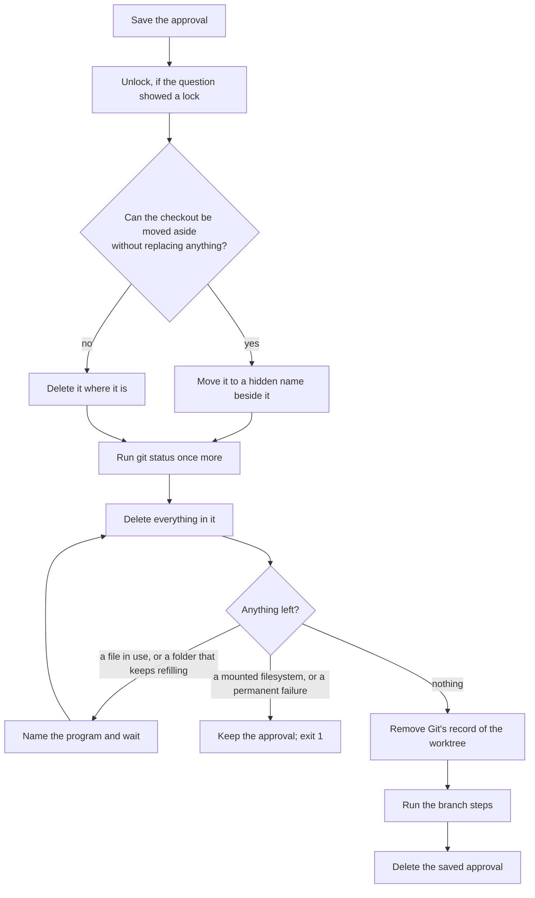
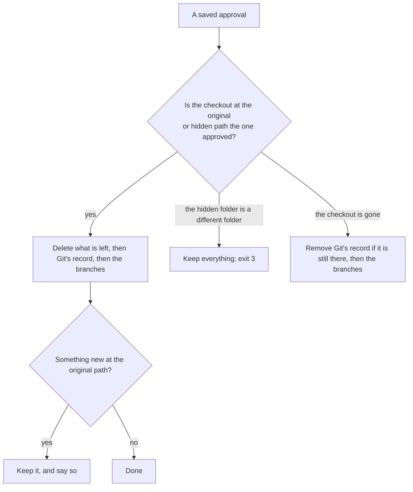

# `wt remove`

Removes a worktree, by branch or directory name, and its local branch when that branch's commits are safe elsewhere. Before anything is deleted, `wt remove` shows everything it can see that makes the removal risky and asks once. **Yes means delete:** after you answer yes (or pass `--force`), the checkout is deleted in that run, including files created or changed while it runs.

```bash
wt remove feat/theme                  # by branch name: shows the warnings, asks once
wt remove feat-theme                  # by directory name
wt remove feat/theme --force          # delete the worktree without asking, whatever the warnings say
wt remove feat/theme --force-branch   # delete the branch even if its commits exist nowhere else
wt remove feat/theme --force-remote   # also delete the branch on origin (and close its open PR)
```

Names resolve as in `wt go`: `base` is the main checkout, any other name matches a branch or a worktree directory, and a name matching more than one worktree is an error listing each one. The main checkout itself is never removed, even with `--force`; use plain `git` for that.

## How a removal runs



### The report and the question

Before asking or removing anything, `wt remove` prints what removal would affect. Interactively it ends with the one question about the checkout:

```text
Remove worktree feat-modern-config (/code/wts/repo/feat-modern-config)?

⚠ 2 programs are using files in this worktree:
    cargo (pid 4123, started 14:02, run from VS Code) is writing target/debug
    rust-analyzer (pid 3990) is watching src
  Deleting now may make them fail.
⚠ 3 uncommitted files will be lost: src/config.rs, src/lib.rs, notes.md

Files created or changed before deletion finishes are deleted too.

Branch feat/modern-config
- Safe: its commits are on main
- 0 ahead, 0 behind main

Delete it? (y/N) y

Removed feat-modern-config (441,203 entries) and deleted branch feat/modern-config.
```

Each warning names what was seen and what deleting does to it. Process names, lock reasons, paths, and Git's messages are shown as literal text, with control characters escaped. A count is given only when it is known. The warnings, in the order shown:

| Warning | When | What yes does |
|---|---|---|
| Locked | `git worktree lock` was used; its reason is shown (the lock file's time is never shown as when it was locked) | unlocks it, then deletes |
| Git's record unreadable | whether it is locked can't be told | deletes |
| A link | the worktree's path is a symlink (on Windows a junction) | to its own checkout: deletes both; to anything else: deletes only the link and Git's record, and the target is not touched |
| Git cannot read it | a broken `.git`, or a repair that couldn't be verified | deletes everything in it and Git's record |
| A file at the path | | deletes it and Git's record. Something at the path that can't be inspected is refused instead (see [Worktrees Git can't read](#worktrees-git-cant-read)) |
| Your shell is inside | Unix, without the shell wrapper | deletes; `cd` out afterward. On Windows this refuses before the question instead (see [Standing in the worktree you remove](#standing-in-the-worktree-you-remove)) |
| Programs using files | a process holds a file open, watches, runs from, or stands in the worktree; "writing" only when writing was seen | deletes; the programs may fail |
| Some programs could not be checked | the check failed, ran out of time, or a mechanism failed | deletes |
| Uncommitted files | `git status` lists them (up to five are named) | they are lost |
| Uncommitted files could not be checked | `git status` failed | deletes whatever is there |
| Included files | `.worktreeinclude` copies that are new, changed since `wt create` copied them, or impossible to compare (see the [README](../../README.md#included-ignored-files)) | they are lost |
| Staged changes, or staged changes unknown | the directory is gone and Git's index for it holds staged changes, or can't be read | removes Git's record |
| Submodule work | a submodule has uncommitted files or commits on no remote | lost with the worktree |
| Nested mounts | another filesystem is mounted inside the worktree | nothing on it is deleted; the removal stays incomplete until it is unmounted |
| WSL drive | the worktree is on a Windows drive mounted into WSL | deletes; slower than from Windows |
| Synced folder | the worktree is inside a OneDrive folder | deletes the cloud copies too |

Unchanged included copies and other ignored files (`target/`, `node_modules/`) add no warning. A clean worktree has no warning, and a non-interactive run removes it without a question.

**The branch**, by where its last commit is found:

| Tier | Where the commits are | What happens |
|---|---|---|
| Safe | on the default branch (local or `origin/<default>`), or the exact head of an open or merged PR from this repository | deleted |
| Pretty safe | on another local branch, a tag, or an `origin/*` branch whose live head `wt` checked with `git ls-remote` | deleted; the report says where the commits still live |
| Not safe | nowhere else, or it could not be checked | an interactive run lists the commits and offers "keep" (default) or "delete"; a non-interactive run keeps it with a warning and still exits 0 |

The tier, and any consent to delete, applies to the commit the report showed. Immediately before `git branch -D`, the branch must still point there. If a commit landed on it in the meantime, that commit was never assessed: the checkout is still deleted, the branch is kept, and `wt remove` exits 1 (`Branch feat/theme was kept: it moved to <sha> after it was checked.`).

### Answering for a script: `--force` and the branch flags

An interactive run (stdin and stderr are terminals, `CI` unset or empty) asks the checkout question, default No, unless `--force` is given. A non-interactive run can't ask: with any warning and no `--force` it refuses with exit 3 before anything is unlocked or deleted, listing what it saw:

```text
Nothing was removed. There is no terminal to ask whether to delete worktree feat-x despite the warnings listed above.
  Add --force to delete it anyway.
```

| Flag | Answers |
|---|---|
| `--force` | yes to the checkout question, whatever the warnings say (files, programs, a lock, files `wt` could not check), including any wait that follows |
| `--force-branch` | deleting a Not-safe branch (`git branch -D`) |
| `--force-remote` | deleting the branch on origin, under a lease on the head the report showed, and closing its open PR |

`--force` never implies `--force-branch` or `--force-remote`: with `--force` alone, a Not-safe branch is kept with a warning. The removed `--force-worktree` spelling is an invalid argument (exit 2).

With `--force-remote`, the branch on origin is deleted through origin's push URL. An origin with several push URLs, or one Git would rewrite (`url.<base>.insteadOf` / `pushInsteadOf`) or read as the name of another remote, is refused before anything is removed. If origin can't be reached, the local removal still happens and `wt` exits 1 with the `git push origin --delete <branch>` that finishes the job. A branch someone else already deleted on origin counts as done.

### What the final line says

A removal that finishes prints one line:

```text
Removed feat-x (1,204 entries) and deleted branch feat/x; also deleted 1 file changed after you answered: src/new.rs.
```

- The entry count is what this run deleted, or `unknown number of entries` when it was not counted.
- Immediately before deleting, `wt` runs `git status` once more and names uncommitted files the question did not show. That never stops the removal, and it is not every change: ignored files such as `target/`, and changes made after that `git status`, are not listed.
    - The shell wrapper's second run does the same against the files the first run's question listed (see [Standing in the worktree you remove](#standing-in-the-worktree-you-remove)).
    - Nothing is named when the question could not list the checkout's files (Git could not read it), when the path held no checkout directory (a missing worktree, a file, or a link to something else), or when a later `wt remove` finishes a removal that was interrupted.
- A worktree whose directory was already gone reads `Removed the record of worktree feat-x (its directory was already gone).`

A normal removal prints no hidden directory name, retry command, or report path. When something needs you, the run exits 1 with one plain sentence that names the path, hidden or not:

- `/code/wts/repo/.wt-remove-feat-x-…/target/x could not be deleted: the disk is read-only.` Everything else was deleted; after you fix the cause, `wt remove feat-x` finishes without asking.
- `/code/wts/repo/feat-x/mnt is still mounted inside the worktree; unmount it, then run wt remove again.` Nothing on the mount is deleted; the worktree's Git record and branch are kept until it is unmounted.
- `Branch feat/x was kept: <reason>.` The checkout is gone; the branch step did not run.

### An unfinished removal

A removal that was interrupted (Ctrl-C, a crash, a permanent failure, a mount) keeps a small record. The next `wt remove` of the same name, or of the worktree's original directory name, finishes it with the earlier approval: it asks nothing, needs no `--force`, and prints the same final line. A name that matches both an unfinished removal and a different worktree is refused (exit 3) and nothing is chosen.

While a removal is unfinished, [`wt list`](list.md#worktrees-being-removed) marks its worktree `⊘` and names the command that finishes it.

Ctrl-C while the removal runs stops it at the next entry or wait and exits 1 (`The removal was cancelled; run wt remove again to finish it.`). Ctrl-C while the question is open ends `wt` and changes nothing.

### Standing in the worktree you remove

A program can't move its parent shell. Without the shell wrapper (`wt --completions <shell>`; see the [README](../../README.md#shell-integration)):

- on macOS and Linux the question warns that your shell is inside, and yes deletes; `cd` out afterward. Your own shell is not listed as a program using the worktree.
- on Windows the shell's working directory blocks deleting that folder, so `wt remove` refuses with exit 4 before the question, naming the shell.

With the wrapper, removal happens in two runs:

1. The first run reports and asks everything, saves what you approved, then moves your shell to the fork parent's worktree (or the base checkout), keeping your subdirectory when it exists there. It deletes nothing.
2. The wrapper runs `wt remove --handoff <token>` from there, which finishes the saved removal.

The second run compares nothing about the checkout's content and asks nothing: files changed, added, or restaged in between are deleted with it, and its final line names the uncommitted ones the question did not show. It still checks that your shell left the worktree, that the repository is the same, and that the checkout and its Git record are the ones that were approved; and it keeps every branch protection: a branch whose tip moved is kept (exit 1), a branch deleted because it was safe is checked again, and a remote deletion is checked against origin's push URL and made under its lease. The handoff is single-use and expires after 10 minutes; an expired or unknown handoff is exit 3, and a later `wt remove <name>` finishes the saved removal. No `cd:` or `remove-handoff:` line is printed after a failure.

A worktree reached through a link to its own checkout is not handed off: it is deleted in the first run, which then prints only `cd:` so the wrapper moves your shell out.

## Deleting the checkout

After you answer yes (or pass `--force`), `wt remove` works through these steps in one run. Nothing it sees in the checkout after that, such as a new file, a changed file, or a program still writing, makes it stop or ask again.



1. **The approval is saved first**, before anything is unlocked, moved, deleted, or unregistered, for every kind of worktree path (a checkout, a link, a file, or nothing). It is bound to what the question looked at: the folder, link, or file at the path, the checkout a link leads to, and Git's record of the worktree, each by its identity on disk as the question found it. If any of them was replaced after the question, for example a folder moved away and another put in its place, nothing is changed and `wt` exits 3 with `<path> changed after the question, so nothing was removed.` If the approval cannot be saved, nothing changes and `wt` exits 1: `Nothing was deleted. The approval could not be saved, so the removal did not start: <reason>.` See [The saved approval](#the-saved-approval).
2. **A lock the question showed is removed** with `git worktree unlock`. A lock added after the question is never removed: the removal stops with exit 3 before anything is deleted, and nothing is left pending.
3. **The checkout is moved aside**, to a hidden folder beside it (`.wt-remove-<name>-<token>`). The original path is free at once. The move never replaces anything already at the hidden name. Git keeps the worktree registered at the hidden path until it is gone. A checkout whose `.git` file holds a relative link that would break after the move (for example `gitdir: ../x/../../repo/.git/worktrees/x`) gets an absolute link for the move; nothing is shown for this.
4. **`git status` runs once more** so the final line can name uncommitted files the question did not show (see [What the final line says](#what-the-final-line-says)).
5. **Everything in the checkout is deleted**, ignored output such as `target/` and `node_modules/` included.
6. **Git's record of the worktree is removed** with `git worktree remove` of the now-empty path (never `prune`, never `--force`), and then the branch steps run.
7. **The saved approval is deleted.** A finished removal leaves nothing behind: no hidden folder, no record, no report.

You never see the hidden name in a removal that finishes. It appears only in a sentence about something that needs you, such as a file that could not be deleted.

### When the checkout is deleted where it is

`wt` deletes the checkout at its own path, with the same saved approval, when moving it aside is not possible or not safe:

| Situation | Why it is not moved |
|---|---|
| WSL, a checkout under `/mnt/<drive>` | the Windows drive cannot move a folder without the risk of replacing one that appears at the destination, and checking first and then moving would leave that gap open |
| A filesystem mounted inside the checkout | the mount would block the move |
| Windows, a program has a file open anywhere in the checkout | Windows refuses to move a folder while something inside it is open; everything that is not open is deleted, and the rest is waited on |
| The `.git` link cannot be rewritten for the move, or Git cannot read the checkout | the move could not keep Git's record pointing at the checkout |

The result is the same; only the original path stays in use until the deletion is done.

### What is deleted, and what is not

- **Links inside the checkout** (symlinks, and on Windows junctions and other reparse points) are deleted themselves. What they point to is never entered or touched.
- **Cloud placeholders and deduplicated files** on Windows are deleted without opening or downloading their content. A checkout inside a OneDrive folder gets a warning in the question, because deleting there removes the cloud copies too.
- **FIFOs, sockets, and devices** are deleted without being opened.
- **Read-only files and folders** are made deletable first. On Windows that clears the read-only attribute; it never overrides a Windows permission that denies the deletion, which is a [permanent failure](#when-a-removal-does-not-finish).
- **A filesystem mounted inside the checkout** is never entered and never unmounted, including one mounted while the deletion runs and, on Linux, a bind mount of a folder on the same disk: `wt` checks each folder for a mount just before it enters it. Everything else is deleted; the mount point and the folders above it stay until you unmount it. A checkout moved aside before the mount appeared keeps the mount at its hidden path beside the original (`.wt-remove-…`), and the next `wt remove` of the name finishes there.
- **Submodules** are deleted with the worktree, including their Git data under `.git/worktrees/<id>/modules/`. A submodule whose Git data lives somewhere else (its `.git` file points outside this worktree's record) keeps that data, and the question says so.
- **The path must still be the checkout you approved.** If the folder has been replaced (by a link, a file, or a different folder), nothing more is deleted.

### Waiting for a file in use

On macOS and Linux an open file never blocks deletion. On Windows a program that holds a file open without allowing deletion does, until it closes the file. `wt` deletes everything else first, then names what is left and who holds it, and waits in the same run:

```text
Waiting: C:\code\wts\repo\.wt-remove-feat-x-3f2a9c1d0e4b5a67\target\debug\app.exe is in use: app.exe (pid 4123) has a file open. Waiting until it is released (Ctrl-C to stop).
```

- `wt` tries again after a short delay that doubles from 50 ms up to 2 seconds. There is no time limit: the wait ends when the program closes the file, or when you press Ctrl-C.
- The line is printed when the wait starts and again only when what is blocked, or who holds it, changes.
- A program is said to be writing only when writing was seen; otherwise it "has a file open". When the program cannot be identified, the line says `the program using it could not be identified`, and `wt` still waits.
- From WSL, `wt` cannot see Windows programs, so it never names one; the question warns about this for a worktree on a Windows drive (`/mnt/<drive>`), and suggests removing it from Windows instead.
- `--force` answers yes to these waits too, so a script can wait as well; stop it the way you would stop any other program.

`wt` never ends or pauses another program.

### A folder that keeps filling up

A program that keeps writing into the checkout can refill a folder between the moment `wt` empties it and the moment it removes the folder. `wt` lists the folder again and deletes what appeared. After three such rounds in a row, it checks which program is using the folder, names it, and waits as for a file in use:

```text
Waiting: /code/wts/repo/.wt-remove-feat-x-3f2a9c1d0e4b5a67/.gitnexus keeps filling up again: gitnexus (pid 7310) is writing to it. Waiting until it is released (Ctrl-C to stop).
```

Stop the program, or press Ctrl-C; a later `wt remove` of the same name finishes the removal.

### Another removal of the same worktree

Only one `wt remove` deletes a given worktree at a time. A second one prints `Another wt remove of this worktree is running; waiting for it to finish (Ctrl-C to stop waiting).` and waits. When the first one finishes, the second reports that the worktree is removed; when the first one ended without finishing (it was interrupted, or crashed), the second one finishes it.

### Which programs are using the checkout

Before the question, `wt` asks the operating system once which programs use files in the worktree: holding a file open, watching it, running from it, or standing in it. That check has a fixed time allowance. When it fails or runs out of time, the question says `Some programs could not be checked (<reason>); one using this worktree may not be listed.`, and a script then needs `--force`. The allowance is two seconds. On a very large checkout (around 500,000 files) it is spent looking at the files before any program is checked, so this warning appears there on every run. Deleting is not affected.

The check runs again only to name the program in a wait.

## When a removal does not finish

Every case keeps the saved approval and whatever is left, and the next `wt remove` of the same name finishes the job without asking (see [An unfinished removal](#an-unfinished-removal)):

| What happened | What you see | Exit | What to do |
|---|---|---|---|
| A permanent failure: a read-only disk, a storage error, a full disk, a permission `wt` cannot change | one sentence per entry, for example `/code/wts/repo/.wt-remove-feat-x-…/target/x could not be deleted: the disk is read-only.`; everything else is deleted | 1 | fix the cause, then run `wt remove feat-x` |
| A filesystem mounted inside the checkout | `/code/wts/repo/feat-x/mnt is still mounted inside the worktree; unmount it, then run wt remove again.` Git's record and the branch are kept | 1 | unmount it, then run `wt remove feat-x` |
| Ctrl-C (or `SIGTERM`, `SIGHUP`, Ctrl-Break) during deletion or a wait | `Interrupted: stopping at the next safe point; files not yet deleted are kept.` then `The removal was cancelled; run wt remove again to finish it.` | 1 | run `wt remove feat-x` when ready |
| The process was killed outright, or the machine lost power | nothing | — | run `wt remove feat-x` |
| A branch that moved, or whose push URL changed, after the question | `Branch feat/x was kept: it moved to <sha> after it was checked.` with the `git branch -D` or `git push origin --delete` that would finish it; the checkout is gone | 1 | run that command if you no longer need the branch |

Ctrl-C while the question is open, or before the approval is saved, changes nothing. Permanent failures are never retried in a loop: `wt` tries once, makes a read-only entry writable if it can, and then reports it.

## The saved approval

The approval is a small file in the repository, `<git-common-dir>/wt-removal/<operation-id>/record.json`, about a kilobyte whatever the size of the checkout. It names the worktree, its original and hidden paths, what was at the path (the checkout folder, a link and the checkout it leads to, a file, or nothing) with the identity of each, the identity of Git's record of it, whether the checkout is being deleted where it is, and each approved branch step with the branch tip (and for origin, the push URL and the remote head) it was approved for. It has no expiry. A lock file per worktree in `wt-removal/locks/` keeps two runs from deleting the same worktree at once.

The files are private to you: on macOS and Linux `wt` refuses to use them if other users can read or change them. A Windows drive mounted into WSL (`/mnt/<drive>`) always reports every file as open to everyone and cannot change that, so there only the owner is checked and the files rely on the drive's Windows permissions. Native Windows relies on the folder's Windows permissions.

A later run decides what to do from what it finds on disk and in Git, not only from the step the record says was done last:



- **New content at the original path** after the checkout was moved aside is never deleted: `New content found at /code/wts/repo/feat-x after the worktree was moved away was kept.`
- **A hidden folder that is no longer the moved checkout**, or a Git record reused by a different worktree, is refused (exit 3) and nothing is deleted.
- **A checkout deleted where it is that has been replaced** is outside the approval: nothing is deleted, the approval is closed, and the next `wt remove` asks afresh. The same holds for a link, a file, or the checkout a link led to, replaced before the removal finished.
- **A branch step is checked again** before it runs: a branch deleted because it was safe must still be safe, its tip must be the approved one, and a remote deletion keeps its push URL check and lease. A branch already deleted counts as done.
- **A record that cannot be read** (damaged, written by a newer `wt`, or of another removal) is never guessed at. `wt remove <name>` that matches nothing while such a record exists exits 1 with `Nothing was removed. The record of an earlier removal could not be read: removal record <id> cannot be used: <reason>.`
- **A removal saved by an older `wt`**, which kept a deletion journal and a `report.json`, is converted to the small record and finished. Its step for the worktree's own branch is checked again as above. Any other branch step, and any deletion on origin, was not recorded precisely enough to repeat: that branch is kept, and the run exits 1 saying so, with the command that would finish it.
- **A finished removal saved by an older `wt`** kept its record and `report.json` behind, often tens of megabytes each. The next `wt remove` or `wt list` deletes it, unless another removal of that worktree holds its lock, and it no longer matches any name.

## Worktrees Git can't read

A linked worktree can lose its connection to the repository while Git still records it. `git worktree list --porcelain` then marks the entry `prunable`, and `wt list` shows it as `✕` (see [`wt list`](list.md#worktrees-git-cant-read)). `wt remove` looks at the recorded path on disk, says in the question what it found, and yes removes what is there and Git's record. "Gone" always means the operating system answered "not found"; a permission or I/O error is never read as absence.

| Found at the path | The question says | Yes |
|---|---|---|
| Nothing, and Git's index for it matches its last commit | no warning | removes Git's record |
| Nothing, and the index holds staged changes | `The worktree's directory is gone; 1 staged change in Git's record will be lost: a.txt` | removes Git's record, and the staged changes with it |
| Nothing, and the index is missing or can't be read | `The worktree's directory is gone, and its staged changes cannot be checked (<reason>); Git's record will be removed.` | removes Git's record |
| A directory whose `.git` file is gone, and the repair below worked | the usual warnings, under `Its .git file was missing; wt restored it to check the files (Git may restore other worktrees' broken links too).` | deletes it as usual |
| A directory Git cannot read (a repair that could not be verified, or a `.git` Git cannot use) | `Git cannot read this worktree: <reason>. Its uncommitted files cannot be listed, and everything in it will be deleted.` | deletes everything in it, and Git's record |
| A file | `A file is where the worktree's directory should be (<path>). It will be deleted, with Git's record.` | deletes the file and Git's record |
| Something that can't be inspected | `The worktree's path <path> cannot be inspected: <reason>. Nothing there can be removed until it can be inspected.` | nothing: what is there could not be identified, so it cannot be bound to the approval; `wt` exits 3 with `<path> could not be identified before the question, so nothing was removed.` |

Git never marks a locked worktree `prunable`, so `wt` checks the path itself: a locked worktree whose directory is gone, or whose path holds a file or cannot be inspected, gets the lock warning followed by the row above that describes what is there. Yes unlocks it and does what that row says; for a directory that is gone, it removes the record. Git's record is removed with `git -C <base> worktree remove <path>` for this one worktree only, never `git worktree prune` and never `--force`, and the branch is then judged exactly as for any other worktree:

```text
Removed the record of worktree gone (its directory was already gone) and deleted branch feat/gone.
```

A worktree whose directory is gone has nothing to stand in, so it never needs the two-run handoff.

### Restoring a missing `.git` file

Git can't check the files of a directory whose `.git` file is gone, so before the question `wt remove` runs `git -C <base> worktree repair <path>` and then **verifies** the result. It never trusts the repair's exit status: Git can exit 1 after a complete repair, so the status proves nothing either way. The link counts as restored only when all of these hold:

- the worktree's `.git` leads to the exact worktree record Git keeps for this path, in this repository;
- that record points back to the worktree's `.git`;
- Git sees the worktree itself as the top of the checkout, not an enclosing repository;
- a fresh `git worktree list` shows the same worktree, with the same branch or detached commit, no longer marked `prunable`;
- the path is still a real directory, not a link (every other check reads through a link, so only this one notices a checkout moved away and replaced by a link to it).

When the link is verified, the question lists the worktree's uncommitted files as usual. When it is not, the question says Git cannot read the worktree, with what failed as the reason, and yes deletes everything in it.

The repair happens **before** you are asked anything, because nothing can be asked about files that can't be checked. It is not undone if you then decline. Run from the base checkout, `git worktree repair` also restores the links of **other** worktrees whose `.git` is missing or broken, which is why the line says so. It never deletes anything. Before running the repair at all, `wt remove` requires exactly one of Git's worktree records to point at this path; otherwise it does not attempt one.

**Run `wt remove` from outside a worktree whose `.git` is gone.** From a shell standing inside it, `wt` can't find the repository (the directory is no longer connected to it) and stops with Git's `fatal: not a git repository` before it can repair anything. The one exception is a worktree nested inside another checkout of the same repository. From any other directory the removal works as described above.

## A link in place of the worktree

A worktree directory can be moved away and replaced by a link to its new location. Git reads the checkout through the link and does **not** mark it `prunable`, yet `git worktree remove` would delete the files the link leads to and then fail on the link itself. So `wt remove` looks at the recorded path without following it, whatever Git reports, and when the path itself is a symbolic link or, on Windows, any reparse point (a junction included), the question says where it leads:

- **to this worktree's own checkout** (the target's `.git` leads back to this worktree's Git record, and the target is no other registered checkout and contains none): `The path is a link to the worktree's real location at /code/elsewhere/feat-x; both will be deleted.` Yes deletes the checkout where it is, then the link. The approval binds both: if either the link or the folder it led to is replaced after the question, neither is deleted. A removal interrupted part way is finished by the next `wt remove` of the name, like any other.
- **anywhere else**, or somewhere that can't be verified: `The path is a link to /code/elsewhere, which is not touched; only the link and Git's record are deleted.`

Only the worktree's own path counts: a link among its parent directories, such as macOS's `/tmp` → `/private/tmp`, is just another spelling of the same place and is removed as usual.

`wt list` shows the row as `✕` with the note `<name>: <path> is a link, which may have replaced the original checkout.` (see [`wt list`](list.md#worktrees-git-cant-read)).

## Exit codes

| Code | Meaning |
|---|---|
| 0 | Done, including a question you declined or cancelled |
| 1 | Something needs you: a permanent failure (one sentence names the path and the cause), a nested mount still mounted, a branch that was kept, an approval that could not be saved (nothing was deleted, and the message says so), the removal was interrupted, or Git failed. An unfinished removal is finished by the next `wt remove` of that name |
| 2 | Invalid arguments, including the removed `--force-worktree` |
| 3 | Refused before anything was deleted: warnings with no terminal to ask and no `--force`, a name matching an unfinished removal and another worktree, an unknown or expired handoff, a shell still inside the worktree in a handoff's second run, or what is at the path is no longer what was approved. A repair attempt may have changed Git's link metadata |
| 4 | On Windows, the shell running `wt` stands in the worktree without the shell wrapper |
