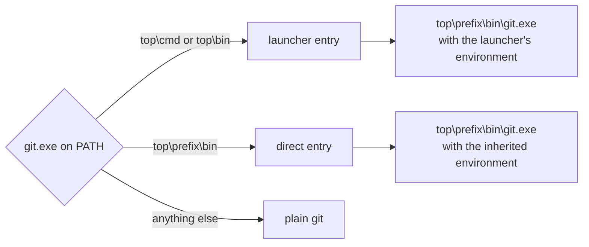

# Running Git on Windows

Every Git process `wt` starts, in production and in test fixtures, is built by
`worktree::git::command()` ([`git/program.rs`](../lib/src/git/program.rs)).
On macOS and Linux that is simply `git`. On Windows it looks at which
`git.exe` the `PATH` names and, when that file belongs to a Git for Windows
installation it recognizes, starts the real Git binary itself. This page
explains what it recognizes, what environment each kind of entry gets, and how
to check the behavior on a Windows host.

## The two files `PATH` can name

A Git for Windows installation directory (`<top>`, usually
`C:\Program Files\Git`) contains two kinds of `git.exe`:

- **The launcher**, `<top>\cmd\git.exe` (or `<top>\bin\git.exe`). The
  installer puts `<top>\cmd` on `PATH`. The launcher sets a few environment
  variables and then starts the real binary, so every Git call through it
  costs two process creations.
- **The real binary**, `<top>\<prefix>\bin\git.exe`. Some setups (CI images,
  hand-edited `PATH`s, other tools' shims removed) put this directory on
  `PATH` directly.

`<prefix>` is the MSYS2 environment the installation was built for:

| Prefix | Installations | `MSYSTEM` the launcher sets |
| --- | --- | --- |
| `mingw64` | x86_64, before Git for Windows 2.56 | `MINGW64` |
| `ucrt64` | x86_64, from Git for Windows 2.56 | `UCRT64` |
| `clangarm64` | arm64 | `CLANGARM64` |
| `mingw32` | 32-bit x86 | `MINGW32` |



## What each entry gets

**Launcher entry.** `wt` skips the launcher and starts
`<top>\<prefix>\bin\git.exe` with what the launcher would have set for it:

- `MSYSTEM` to the prefix's system, always;
- `PLINK_PROTOCOL=ssh`, when unset;
- `HOME`, when unset, to `%HOMEDRIVE%%HOMEPATH%` if that is a directory other
  than System32, else `%USERPROFILE%`;
- `PATH` prefixed with `<top>\<prefix>\bin;<top>\usr\bin;%HOME%\bin;`.

Hooks, `!` aliases, `GIT_SSH_COMMAND`, and transports therefore find the same
`sh`, `ssh`, and helpers as through the launcher, at one process creation per
call instead of two.

**Direct entry.** `wt` runs the binary `PATH` named with the inherited
environment, exactly as plain `git` would. It does not add the launcher's
variables: whoever put the binary on `PATH` chose not to go through the
launcher, and sharing an installation with a launcher does not change that.

For example, with `C:\Program Files\Git\ucrt64\bin` first on `PATH` and
`MSYSTEM` unset, a `!env` alias run by `wt` sees the same `MSYSTEM` and `PATH`
as one run by `C:\Program Files\Git\ucrt64\bin\git.exe` from that shell.

**Plain `git`** is used for any other layout and on every other OS.

## When an installation is recognized

`wt` decides once per process, from the `git.exe` that `PATH` names:

- The file must be named `git.exe` and sit in `<top>\cmd`, `<top>\bin`, or
  `<top>\<prefix>\bin` for one of the prefixes above. A shim directory,
  `<top>\usr\bin\git.exe`, `<top>\<prefix>\libexec\git-core\git.exe`, or an
  unlisted prefix keeps plain `git`.
- `<top>` must contain exactly one prefix directory, and that prefix's
  `bin\git.exe` must exist. A leftover directory from another build (for
  example an old `mingw64` beside a new `ucrt64`) makes the installation
  ambiguous, so `wt` keeps plain `git`.
- A direct entry must name that one prefix.
- A `<top>\etc\git-bash.config` keeps plain `git`, because it makes the
  launcher also change `MSYS`.
- A `git.exe` in `wt`'s own directory or the Windows system directories keeps
  plain `git`, since Windows would run that one before searching `PATH`.

## The installation hint for in-process reads

`wt` reads most repository metadata in-process with `gix`. To find Git's
system configuration, gix-path runs `git --exec-path` with a hidden console,
once per process (three process creations through the launcher), unless
`EXEPATH` names the installation, as Git Bash does. `wt`'s `main` therefore
sets `EXEPATH` to `<top>` for either entry, when neither `EXEPATH` nor
`GIT_EXEC_PATH` is already set, and removes it again from every process it
starts, so a child sees what it would have inherited.

Known limitation: the gix-path release `wt` uses (0.12, through gix 0.84)
reads `EXEPATH` only for the `mingw64`, `clangarm64`, and `mingw32` prefixes.
On a `ucrt64` installation (Git for Windows 2.56 and later on x86_64) the hint
is set but ignored:

- the first in-process read still runs `git --exec-path`, so the process
  creations the hint exists to save remain;
- gix reports the installation's top directory, not `<top>\ucrt64`, as its
  system prefix.

Results are unaffected: Git 2.56 keeps its system configuration in
`<top>\etc\gitconfig`, which is the file gix reads from that prefix. The
Windows tests that pin the hint (`named_installation`, and the `list_output`
exec-path tests) fail on a `ucrt64` installation until gix-path 0.14, which
needs gix 0.89 or later.

## Checking it on Windows

The layout rules are pure path logic, tested on every OS against temporary
directories (`git::program::tests`, one test per prefix and entry plus every
rejected layout). The Windows-only tests run against the host's real
installation. Because the resolution is cached per process, each starts a
fresh copy of the test binary with the chosen entry first on `PATH`:

```sh
cargo nextest run -p worktree -E 'test(git::program::tests::entries)'
cargo nextest run -p git-wt-cli -E 'binary(list_output) & test(exec_path)'
```

- `through_the_launcher_the_named_installation_is_the_prefix_git_reports`
  and `through_the_direct_binary_the_named_installation_is_the_prefix_git_reports`
  check that the hint names the prefix `git --exec-path` reports and never
  reaches a Git child.
- `the_launcher_entry_sees_the_launchers_environment` compares a `!env` alias
  run by `wt` with one run by the sibling `<top>\cmd\git.exe`.
- `the_direct_entry_sees_what_the_found_binary_sees` compares it with one run
  by the found binary, unwrapped.
- The `list_output` tests trace a real `wt list` (`GIT_TRACE2_EVENT`) with the
  inherited `PATH`, the launcher first, and the real binary first, and assert
  that no Git process was `git --exec-path`.
