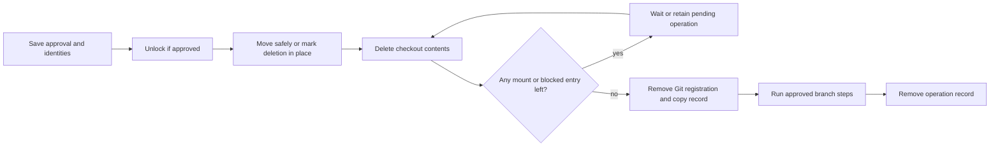

---
$schema:
    status: |-
        enum(
            draft-spec,
            finalized-spec,
            planned,
            implemented,
            review-findings,
            human-in-the-loop,
            completed,
            on-hold,
            abandoned
        ) -> an indicator of progress for this specification
    reviewed: boolean -> indicates whether the specification file has been reviewed by another agent from the one which created the spec
    reviewed_by: string -> the agent and model used in the spec review
    reviewed_on: date -> the date the spec was reviewed
    review_iterations: number -> the number of implementation reviews have taken place in the review/fix cycle
    clarified: boolean -> indicates whether the specification was built -- _in part_ -- with the 'clarify.md' prompt
    implemented: boolean -> indicates whether this spec's plan has been implemented
    implemented_by: string -> the agent who implemented the plan
status: draft-spec
reviewed: true
reviewed_by: codex/gpt-6.1-sol
reviewed_on: 2026-10-22
review_iterations: 0
clarified: false
implemented: false
related:
    - 2026-10-22-remove-large-checkout
    - 2026-10-18-remove-observation-under-load
    - 2026-10-19-macos-drain-interval-comparison
    - 2026-10-05-graceful-file-contention
---

# A confirmed `wt remove` always deletes

## Outcome

A user who types `wt remove <name>` and confirms authorizes deletion of that
checkout, including files created or changed while removal runs. Watcher
failures and changes to its contents never require another confirmation or
another invocation. Removal continues in the same run while the operating
system permits progress.

> **Reader's note:** this intentionally replaces consent to an exact file
> snapshot with consent to delete the selected checkout. It does not authorize
> deleting a different checkout, following a link into unrelated data, or
> discarding new branch commits. Confirmation cannot overcome a permanent
> refusal by the operating system; R29 rules how that ends.

- **Warn, don't block.** Everything `wt` can see that makes the removal risky
  is shown in the confirmation question: processes using the checkout,
  uncommitted files, a `git worktree lock`, contents `wt` treats specially.
  Each warning gives enough context for a user who does not know `wt`'s
  internals to judge it.
- **"Yes" means delete.** After confirmation no watcher or file-content
  change stops the removal. A normal successful removal shows no hidden
  `.wt-remove-…` directory, `Retry:` line, report path, or watcher, journal,
  or coverage diagnostic. A permanent filesystem failure is described in
  plain terms (R29).
- **Interruptions and waits:**
    - the user's own Ctrl-C;
    - on Windows, a file another program holds open without delete sharing,
      which cannot be deleted until that program closes it. `wt` deletes
      everything else, names the program in plain terms, and waits in the same
      run until it closes the file (or the user presses Ctrl-C), then finishes.
- **A nested mount is deliberately retained.** Deletion never crosses a
  filesystem mounted inside the checkout. Its mount point and any ancestors
  needed to reach it remain until it is unmounted, as described under nested
  mounts below. This is an incomplete removal, not a success message.
- **Permanent operating-system failures:** a permanent permission error, a
  read-only filesystem, failed storage, an approval record that cannot be
  saved, or an unidentifiable replacement of the target ends the run with a
  plain failure and keeps recoverable state (R29). Confirmation cannot make
  these deletable.
- **Non-interactive runs** (stdin or stderr not a terminal, or `CI` nonempty)
  cannot show a question. When there is anything to warn about, they refuse
  before any deletion or unlock, with exit 3 and a plain message listing
  what was seen. `--force` is the scripted equivalent of answering yes: with it, `wt`
  deletes as an interactive "yes" would. A clean checkout with no warnings
  still removes without a question in a non-interactive run. In an interactive
  run, show one checkout-deletion question unless `--force` was supplied;
  branch questions retain their existing behavior.

Example of the interactive question:

```text
$ wt remove feat/modern-config
Remove worktree feat/modern-config (/Volumes/coding/wt/rusty-biscuit/feat-modern-config)?

  ⚠ 2 programs are using files in this worktree:
      cargo build   (pid 4123, started 14:02) — writing target/debug/
      rust-analyzer (pid 3990) — watching src/
    Deleting now may make them fail.
  ⚠ 3 uncommitted files will be lost: src/config.rs, src/lib.rs, notes.md
  • Branch feat/modern-config is merged into main and will be deleted.

Delete it? [y/N] y
Removed feat/modern-config (441,203 entries) and deleted branch feat/modern-config.
```

The exact wording is for the plan. The rule is that each warning names what
was seen and what deleting will do to it.

## Why

The author ruled this on 2026-10-22, while reviewing
`2026-10-22-remove-large-checkout`. Built checkouts of this monorepo
(hundreds of thousands of entries under `target/`) are the normal case, not
the large one. On macOS every such removal stopped partway, often several
times, for reasons the user never agreed to and could not act on:

- fseventsd dropping change notifications under deletion load
  (`CoverageLost::FsEventsDropped`), three of three runs at 500,000 entries;
- before that, the journal's fixed size limit;
- a stalled watcher (`DeliveryStalled`, `DrainCeiling`);
- changes `wt` could not tell apart from its own deletions (`Stop::Uncertain`).

Each stop left a half-deleted checkout under a hidden name and a long report.
The user's only option was to run the command again with no new information,
which made the stop a manual "continue" button rather than a safety check.
Pacing deletion to avoid the drops was measured and gave no benefit it could
detect (`2026-10-19-macos-drain-interval-comparison`).

## Rulings

All rulings were decided by the author on 2026-10-22; the spec review's
implementation boundaries below were accepted the same day. This replaces the rule, in place
since `2026-10-05-graceful-file-contention`, that `wt` stops whenever it
cannot prove nothing else touched the tree. The plan removes machinery that
no longer protects anything; it does not keep that machinery and hide its
output.

### Contracts retained deliberately

The main checkout is never removed, even with `--force`. A name that matches
both a pending removal and a different live checkout remains ambiguous. A
saved name is a lookup key, never authority to delete whichever directory
now has that name.

Consent is broader for checkout contents only. The branch safety tiers,
explicit branch approvals, expected branch tip, remote push endpoint checks,
and remote deletion lease remain enforced. If a branch changes, keep it and
report that result after deleting the checkout. `--force` does not imply
`--force-branch` or `--force-remote`.

Terminal detection still uses stdin and stderr, with `CI` unset or empty;
stdout does not establish interactivity or the presence of the shell wrapper.
Human-readable output stays on stderr. Only the existing shell protocol
(`cd:` and `remove-handoff:`) goes to stdout, and the wrapper acts only after
a successful first run. Process names, lock reasons, paths, and Git messages
must escape terminal controls and render as literal text using
`biscuit-terminal` components.

### What a removal does in each case

| # | Today | After this spec |
|---|---|---|
| R1 | A process using the checkout pauses the removal (exit 3, no override) | A warning in the question, with the process context of R27. Yes deletes; non-interactive runs refuse unless `--force` |
| R2 | Submodules refused (exit 3), copying Git's `validate_no_submodules` | Supported. `wt` inspects each submodule and warns about work that exists only there (uncommitted files, commits on no remote), then deletes it with the worktree, including `.git/worktrees/<id>/modules/<name>`. A submodule with nothing at risk adds no warning |
| R3 | A locked worktree (`git worktree lock`) refused (exit 3), lock never removed | The most prominent warning, with the lock's reason where available; do not present the lock file's modification time as a verified creation time. Yes unlocks and deletes; non-interactive runs refuse without `--force`. The same applies to a locked worktree whose directory is gone |
| R4 | A WSL checkout under `/mnt/<drive>` refused (exit 4): drvfs rejects `RENAME_NOREPLACE` | Supported. `wt` uses an atomic move that refuses to replace an existing destination where supported. If drvfs does not support that operation, it deletes in place using the same saved recovery record. A check followed by plain rename is forbidden because another directory could appear between them. The question warns that Windows programs using the checkout cannot be seen from WSL and that deletion over drvfs is slow, and suggests removing it from Windows. A file held open on the Windows side is waited on, named by file because the program cannot be named |
| R5 | A FIFO, socket, or device inside the checkout refused (exit 3) | Deleted without a warning. Unlinking never opens it; a socket in use by a process is covered by R1 |
| R6 | A Windows reparse point other than a link (cloud placeholder, deduplicated file) refused (exit 3) | Deleted. When the checkout is inside a synced folder (OneDrive), the question warns that deleting removes the cloud copies too |
| R7 | A nested mount (another filesystem mounted inside the checkout) refused (exit 3) | A warning naming the mount and its device; `wt` never deletes across it. Everything else is deleted; the mount point and necessary parent directories remain. Keep the Git registration, recovery record, submodule metadata, and branches until unmounting allows the same operation to finish. Report incomplete removal with exit 1 and a plain instruction to unmount; after that, `wt remove` again finishes without asking |
| R8 | A relative `.git` link with `..` steps after the first non-`..` component refused (exit 3): it would break after the move | Handled internally: `wt` rewrites the `.git` file for the move and restores the registration to the moved checkout. If it cannot move safely, it uses recorded deletion in place. No warning |
| R9 | A link (symlink, or on Windows a junction or other reparse point) in place of the worktree directory refused (exit 3) | When the target is this worktree's own checkout (its `.git` leads back to this worktree's record), the question says the path is a link to the worktree's real location, and yes deletes both. Otherwise the question says the target is not touched, and yes deletes only the link and Git's record |
| R10 | Git cannot read the worktree (broken `.git`, a repair that cannot be verified) refused (exit 3), no flag helps | The question warns that Git cannot read it (with Git's reason), so uncommitted files cannot be listed, and that everything in it will be deleted. Yes deletes it and Git's record; non-interactive runs need `--force` |
| R11 | A file where the worktree directory should be, or a path that cannot be inspected, refused (exit 3) | As R10: the question says what is there; yes deletes it and Git's record |
| R12 | Directory gone, index missing or unreadable, refused (exit 3) | The question warns that staged changes cannot be checked; yes removes the record |
| R13 | Files `wt` could not check (a failed `git status`, a permission error) refused (exit 3), no flag helps | The question gives the reason and a count only where known; yes deletes them. `wt` makes read-only entries deletable |
| R14 | Files changed or staged while the question was open: refused (exit 3), "run it again" | Deleted. The question explicitly says that files created or changed before deletion finishes are included. Immediately before deletion, `wt` runs `git status` once more and the final line names uncommitted files that the question did not show, for example `also deleted 1 file changed after you answered: src/new.rs`. This never blocks. It covers only what `git status` reports (not ignored files such as `target/`, and not changes made after that second status), so the message never claims to be exhaustive |
| R15 | Your shell is standing in the worktree without the shell wrapper: refused (exit 4) | Unix: the question warns that your shell is inside the worktree and says to `cd` out afterward; yes deletes. Windows: refused before the question with one plain line naming the shell, because the shell's working directory blocks deleting that folder, and the shell is the one running `wt` |
| R16 | Another `wt remove` of the same worktree is running: refused (exit 4) | `wt` names the running removal and waits interruptibly on the operation lock. Once acquired, it inspects the saved state: reports completion if done, or continues the same operation if its owner exited. It never launches a second deletion engine for that checkout |
| R17 | The checkout vanished during the usage check: refused (exit 3), "run again" | Treated as already removed; `wt` finishes the record and branch steps |
| R18 | The handoff's second run refuses after a minute, or when anything changed between its two runs (exit 3 or 4) | The second run carries out what the first run approved without comparing file contents or asking again. It still verifies the checkout and repository identities, that the caller is outside the deletion target, and all existing branch and remote protections. The handoff token stays single-use; its expiry rises to 10 minutes |
| R19 | A pending removal from an interrupted or crashed run: hidden directory, `Retry:`, `report.json` path, consent asked again | Finished by the next `wt remove` of that name using the earlier approvals, asking nothing and never mentioning the hidden directory. Legacy recovery record version 1, including operations with report versions up to 6, is migrated as described below; a report version alone does not establish authority to resume |
| R20 | Activity observed during deletion (`Stop::Activity`) | Deletion continues. A directory that keeps refilling is handled by R24 |
| R21 | `Stop::Uncertain`, `CoverageLost`, stalls, ceilings | Gone with the watcher (R23) |
| R22 | `Stop::Io` on Windows from an open file | `wt` deletes everything else, names the program, and waits in the same run until it closes the file or the user presses Ctrl-C |
| — | The free-space refusal before the move (added by `2026-10-22-remove-large-checkout`) | Removed with the journal (R25) |
| — | Ctrl-C | Unchanged: ends the run; the next run finishes silently (R19) |
| — | Consent for uncommitted files | Part of the single confirmation question |
| — | A name that matches more than one worktree | Unchanged: an input error before any question |
| — | Branch safety: the branch tiers, the Not-safe branch question, `--force-branch`, `--force-remote`, a branch kept because its tip moved after it was assessed | Unchanged and out of scope: it protects commits, not files |

### Machinery

- **R23. The watcher is removed on every OS**, with its FSEvents, inotify,
  and `ReadDirectoryChanges` adapters and their test groups. Nothing it
  reports changes the outcome any more.
- **R24. A program that keeps writing during deletion** makes a final
  directory removal fail as not empty. `wt` lists what is there again and
  deletes it. When the directory keeps refilling, `wt` runs the usage check,
  names the program as in R1, and waits as in R22.
- **R25. The quarantine move stays; the per-entry checks and the journal
  go.** The move to a hidden sibling frees the original path at once and
  gives an interrupted removal one place to finish. The per-entry checks
  (identity, size, modification time, permission bits, BLAKE3) existed only
  to stop on change and are removed. The journal is replaced by a small, versioned record containing the
  operation id, lookup aliases, original and deletion paths, checkout and
  repository identities, the associated Git admin record, deletion mode
  (moved or in place), approved branch steps and their bindings, and progress
  through registration and branch cleanup. Identity checks that restrict
  deletion to this checkout remain; file-content comparisons do not. The hidden directory itself is the list of what is left. A normal
  built checkout's bookkeeping drops from about 0.5 GB to a few kilobytes,
  and the free-space refusal goes away.
- **R26. `report.json`.** A finished removal keeps nothing. An interrupted
  one keeps only R25's record.
- **R27. Process context.** Sniff's usage report supplies, where available, a
  recognizable name (the app name on macOS, the program's description on
  Windows), its start time, and a bounded parent chain up to something the user
  knows (a terminal, an editor, an agent), alongside what it is doing
  (writing, watching, running from, standing in) and where. Example:
  `cargo build (pid 4123, started 14:02, run from VS Code's terminal), writing target/debug/`.
- **R28. One `--force`** is the scripted equivalent of yes for everything
  about the worktree: files, processes, a lock, files `wt` could not check.
  `--force-worktree` is removed. `--force-branch` and `--force-remote` are
  unchanged. Update argument help, examples, completions, and the policy
  matrix together. The removed `--force-worktree` spelling is a usage error
  (exit 2), with no compatibility alias needed in this early codebase.

### Deletion boundaries and progress

Keep the existing association checks in the `worktree` library's
[admin-entry resolution](../../lib/src/remove/admin_entry.rs), which tie a
checkout to its own Git record, and the no-replacement guarantee in its
[quarantine move](../../lib/src/remove/quarantine/rename.rs). They prevent
removing unrelated data and remain necessary after content checks go away.

- Resolve and bind the target before asking. For a root link, resolve the
  target once, verify its own forward and backward Git association, and bind
  both objects in the durable record, including the original link and resolved
  deletion path. Never delete the main checkout, another registered checkout,
  or an enclosing repository through such a link. If the link's target
  cannot be verified, delete only the approved link and its own Git record.
- During recursive deletion, do not follow symlinks, junctions, or reparse
  points that redirect access outside the checkout. Remove the link itself.
  Cloud placeholders and deduplicated files must be removed without opening
  their content or downloading it. An unknown reparse type is not permission
  to traverse its destination; if it cannot be removed as an entry, report a
  filesystem failure.
- Detect nested mounts using the platform's mount information, including
  same-device bind mounts on Linux. Comparing device IDs alone is insufficient.
  Recheck a directory boundary before descending so a newly mounted tree is
  not traversed. Do not unmount filesystems or request elevated privileges.
- A replaced original path after a quarantine move is left untouched. Remove
  the bound quarantine and its own Git record, then state plainly that new
  content at the original path was kept. During deletion in place, a replaced
  root is outside the earlier approval and stops the operation. Retain the
  handle-based traversal protections needed to avoid following a directory
  replaced by a link; do not restore per-file content hashing.
- Unlink FIFOs, sockets, devices, and hard links without opening or modifying
  their contents. Permission changes must not follow links or change another
  hard link's shared permissions. Clearing Windows' read-only attribute does
  not overcome an access-control denial; such a denial follows R29.

Process discovery remains a focused Sniff path-usage query. Its current
[filesystem-query contract](../../../sniff/docs/topics/filesystem-query.md)
uses a shared work budget, which stops scheduling more work rather than
promising an exact return deadline. Removing the deletion inventory must
not accidentally add repeated full-tree discovery walks: use one initial
query for the warnings and query again only to explain an actual wait.
Share its results across warning rendering and context enrichment. A failed
or partial query adds a plain warning that some programs could not be
checked; it does not restore a refusal after consent. Unknown file counts
must be described as unknown, not invented.

Process details are best effort, bounded by the same discovery budget.
Reuse Sniff's process lifetime identity, start time, and parent information where exposed;
add missing app descriptions or parent context in Sniff rather than a
second process scanner in `worktree-cli`. The Windows Search recheck is no
longer a refusal gate; ordinary sharing-violation waits handle temporary
Search holds. If a name or parent is unavailable,
show the PID and the observed path. An open handle does not prove a process
is writing; say “has a file open” unless writing was actually observed.
A missing process record is never proof that a Windows sharing violation
has cleared. No process is terminated or suspended by this command.

Retry deletion only for an operation that can plausibly become possible:
a confirmed sharing violation or a directory that refills. Delete other
entries first, then retry remaining entries with capped backoff and an
interruptible wait, without busy polling. Report the affected path and any
verified holder when entering a wait, and update only when that information
changes. If the holder cannot be identified, say so and still wait. Windows
can block the initial quarantine rename too; use recorded deletion in place
when safe so unrelated files can be removed, then wait for the blocked
entries. A mount that prevents moving its ancestor also uses deletion in
place, without crossing the mount. `--force` authorizes the same waits in non-interactive runs; callers
can cancel the process. Permanent I/O and permission failures must not enter
this retry loop.

### Submodule data

Inspect initialized submodules recursively for dirty files and commits not
preserved by locally known remote refs; no fetch is added. An uninitialized
submodule needs no checkout scan. A failed inspection warns that its work
could not be checked rather than treating it as clean. A clean working tree
can still have unique commits and must warn about those.

Delete module Git directories only when they belong to this worktree's admin
record. A submodule's `.git` file can point elsewhere: report that external
Git data will be retained, and do not recursively delete it. This allows
submodule checkout removal without damaging a shared repository.

### Durable approval and recovery

The small record is stored in the existing repository-local removal store.
Save it atomically and durably **after consent and before the first unlock,
move, or deletion**. If it cannot be saved, return exit 1 without starting
deletion. It must be enough to recover crashes between every pair of steps:



After a crash, inspect actual paths and registration as well as recorded
progress. A phase marker alone is not proof a step completed. Keep the
operation lock through deletion, registration, and branch steps; a stale
record does not mean a live owner exists. A waiter acquires the lock and
checks state instead of inferring ownership from a PID alone. All waits,
including this lock wait, respond to cancellation.

New records persist checkout-deletion approval across invocations without
expiry, tied to the recorded objects. Do not ask again for new files within
that checkout. Do not resume into a directory or Git record that has been
replaced, and never use a saved alias to select a replacement. Corrupt,
foreign, or unknown-version records produce a plain explanation and no
speculative deletion. This replaces content reapproval, while keeping the
repository and root identity protections.

Branch actions remain separate, run after content and registration cleanup,
and are safe to repeat after a crash. Persist the expected local branch tip,
whether deletion was explicitly approved or conditional on safety, and for
remote deletion the exact destination, validated push endpoint, and expected
remote head. Revalidate conditional safety and retain endpoint and lease
checks on resume and handoff. A changed branch or endpoint is kept and
reported with exit 1; it never causes renewed checkout consent. An already
absent branch is completed successfully. Do not silently add a branch action
because the retry supplies a new force flag; that would require a separate
branch approval.

Legacy migration is an explicit change to the `worktree` library's
[recovery-record contract](../../lib/src/remove/recovery/record.rs), which
currently states that records describe intent but do not authorize retry.
Read and validate recovery **record version 1** separately from its optional
reports (including **report version 6**). Use its checkout-removal intent as
continued approval only when its stored repository and checkout bindings
still match; an unstarted operation may resume only for that same bound
checkout. A partially deleted `.git` file does not require Git repair to
resume the verified directory. A crash between rename and reassociation
must be recoverable without a new question.

Do not infer remote deletion authority from a legacy action's remote name:
that record does not bind a push endpoint or remote head. Finish the checkout
and leave any branch step whose approval cannot be reconstructed safely
undone, with a plain explanation and exit 1. Preserve the original recovery
files until their validated compact replacement is durable; after migration,
remove obsolete reports and journals. Never require a readable per-entry
journal merely to continue deleting the bound checkout.

A completed operation leaves no recovery record, journal, report, or copy
record. An interrupted operation keeps its compact record and any remaining
checkout entries. Preserve the existing cancellation exit mapping; changing
signal exit codes is outside this feature. Recovery normally requires no
technical output. If a real failure needs manual action, name the affected
path honestly, even if it is hidden; suppressing that path must not make the
remaining data impossible to find.

### Permanent operating-system failures

- **R29. Fail plainly, and resume without asking.** Temporary contention (a
  file held open, a directory that refills) is waited out as above. A
  permanent refusal by the operating system (a read-only filesystem, failed
  storage, an access-control denial `wt` cannot fix, an approval record that
  cannot be saved) does not wait. `wt` deletes everything else it safely can,
  then exits 1 with one plain sentence naming the path and the cause, for
  example `/code/wts/repo/feat-x/target/x could not be deleted: the disk is
  read-only`. After the user fixes the cause, `wt remove <name>` finishes
  without asking again. When the approval record itself cannot be saved,
  nothing has been deleted yet, and the message says so.

## Open Questions

None.

## Verification

- L1: every ruling R1–R29, using injected usage sources and test seams, and
  replacing the tests that pin the old stops. The watcher's tests are removed
  with it (R23).
- L1: non-interactive refusal without `--force`, and deletion with it.
- L1: a worktree with a submodule holding uncommitted files and an unpushed
  commit warns about both and is deleted, its `modules/<name>` included; a
  clean submodule with no unique commits adds no warning.
- L1: a locked worktree shows the lock's reason, and yes unlocks and deletes
  it.
- L1: a nested mount is warned about, nothing on it is deleted, and a second
  `wt remove` after it is unmounted finishes without another question. Use
  injected mount information for mandatory L1 coverage, including same-device bind mounts;
  an optional native mount check is supplementary and is not counted as proof
  when its prerequisites are unavailable.
- L1: a link to this worktree's own checkout deletes both; a link to anything
  else deletes only the link and Git's record, and the target is untouched
  (R9).
- L1: files changed, created, or staged while the question is open are
  deleted after approval, and an uncommitted file the question did not show
  is named in the final line (R14). No test requires exhaustive change
  reporting.
- L1: a permanent failure (an injected read-only or access-denied entry)
  deletes everything else, exits 1 with one plain sentence, does not retry,
  and a later `wt remove` finishes without a question once the cause is
  removed; an approval record that cannot be saved deletes nothing (R29).
- L1: an interrupted removal, including legacy recovery record version 1
  with report version 6, is finished by the next `wt remove` without another
  checkout question; unbound legacy branch actions remain undone as specified
  under durable approval and recovery.
- WSL2: a checkout under `/mnt/<drive>` warns as specified and is deleted;
  a collision at the hidden name is still detected and nothing is replaced.
- L2: the interactive question with a process warning, answered yes, in a
  tmux pane (no window takes focus).
- Large-checkout acceptance: one disposable 500,000-entry checkout on macOS
  finishes in one run, with no retry and only the confirmation and final line
  in the uncontended case. Record elapsed time and compact-record size once;
  no new statistical threshold or multi-host performance campaign. Existing
  measurements already justify removing watcher pacing; do not repeat that
  spike. Cross-platform correctness uses small targeted cases on macOS,
  Linux, native Windows, and WSL2 under existing evidence rules.
- Windows: a file held open without delete sharing is waited on and named,
  and the removal finishes once it is released.
- L1: crash injection before and after unlock, rename, registration removal,
  and each branch action; record-write failure before mutation; migration
  interrupted before publishing the compact record; malformed and
  unknown-version records; replacement roots and admin records; recreated
  original paths; concurrent removals and stale locks. Never delete a
  replacement or replay an unbound remote action.
- L1: links swapped during traversal never expose external data; cloud
  placeholders are not hydrated; hard-linked data outside the checkout is
  unchanged; partial or unavailable process information is a warning.
- L1: permanent errors do not retry forever; temporary contention clears
  without another question; cancellation works during deletion and every
  wait. Test backoff through an injected clock instead of sleeping.
- Branch regressions: `--force` alone keeps an unsafe branch, moved tips stay
  intact, and remote endpoint changes or lease failures cannot delete the
  wrong branch. File removal still completes before branch failure is shown.
- Use the Test Toolkit and the area's `just test`, `just test-l2`, and
  `just lint` recipes. Platform-specific filesystem cases remain L1; the
  terminal question uses L2 with no terminal or browser window gaining focus.

## Documentation

- `worktree/docs/cli/remove.md` is largely rewritten: the confirmation
  question and its warnings, `--force`, the Windows wait, and silent recovery
  of an interrupted removal. The sections on watching, coverage loss,
  fseventsd, stop reports, and retry shrink or go away, along with the
  **Planned** markers this spec's ruling added.
- `worktree/README.md`: the `wt remove` bullet and exit-code overview.
- `.claude/skills/worktree/`: `remove.md`, `lifecycle.md`, `observation.md`.
- `sniff/docs/topics/filesystem-query.md` and the Sniff skill if public
  process-context fields are added. Keep unavailable fields explicit and
  document their platform limits.
- `worktree/docs/performance-testing.md` and existing watcher-specific test
  recipes: remove gates for deleted machinery while retaining relevant
  large-checkout coverage. Remove watcher-only dependencies after checking
  other consumers; update dependency documentation for any removed crates.
- Current behavior in topic pages stays separate from planned behavior until
  implementation lands.
