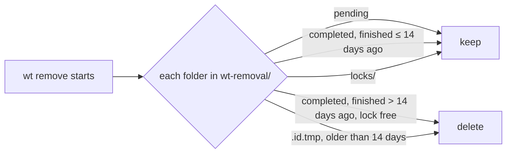

---
$schema:
    status: |-
        enum(
            draft-spec,
            finalized-spec,
            planned,
            implemented,
            review-findings,
            human-in-the-loop,
            completed,
            on-hold,
            abandoned
        ) -> an indicator of progress for this specification
    reviewed: boolean -> indicates whether the specification file has been reviewed by another agent from the one which created the spec
    reviewed_by: string -> the agent and model used in the spec review
    reviewed_on: date -> the date the spec was reviewed
    review_iterations: number -> the number of implementation reviews have taken place in the review/fix cycle
    clarified: boolean -> indicates whether the specification was built -- _in part_ -- with the 'clarify.md' prompt
    implemented: boolean -> indicates whether this spec's plan has been implemented
    implemented_by: string -> the agent who implemented the plan
status: draft-spec
reviewed: false
review_iterations: 0
clarified: false
implemented: false
related:
    - 2026-10-23-remove-stopped-by-list
    - 2026-10-18-remove-observation-under-load
---

# `wt remove` fills `.git` with recovery data it never cleans up

## Outcome

The removal store under `<git-common-dir>/wt-removal/` stays small enough
to forget about. A finished removal leaves a compact record that is deleted
after a retention period. A pending removal's journal grows by a few bytes
per deleted entry, not by two copies of each path. The store stays where it
is.

## Where the store lives, and why it stays there

The store is the recovery state of a removal: what was approved, what was
deleted, and what is left. It belongs in the repository's common Git
directory:

- every worktree shares that directory, so a retry from any checkout finds
  the pending removal by name;
- Git never shows it in `git status`, never commits it, and `git gc` and
  `git worktree prune` leave folders they don't own alone;
- Git keeps its own in-progress operations there (`rebase-merge/`,
  `MERGE_HEAD`), as do tools such as Git LFS (`lfs/`);
- deleting the repository deletes the store, which only describes that
  repository's worktrees. A per-user folder would need a repository-to-folder
  mapping and would leave orphans.

Moving it is not part of this fix. Its size and its lifetime are.

## What happened

On 2026-10-23 the store of `/Volumes/coding/personal/rusty-biscuit` held
913 MB:

| Operation | Outcome | Entries | `report.json` | Journals |
| --- | --- | --- | --- | --- |
| `0c7e8ea5…` | pending (being retried) | 817,460 approved | 53 MB | 269 MB + 324 MB |
| `c1dfc920…` | removed | 441,048 | 144 MB | deleted |
| `b8e62f07…` | removed | 354,650 | 107 MB | deleted |
| `597c4f9a…` | removed | 72,000 | 17 MB | deleted |
| `b8dc6072…` | removed | 30,752 | 11 MB | deleted |
| `0e0aaba3…` | removed | 41,715 | 9 MB | deleted |
| `b67762de…` | pending since 2026-10-18 (`deleting`) | 7,035 | 2.5 MB | 21 MB |

Most removals in this repository are this size: a checkout with a
populated `target/` holds hundreds of thousands of entries.

Three things make it large:

1. **Finished removals are kept forever.** A completed record keeps
   `record.json` and `report.json` "for reference", and nothing ever
   deletes them.
2. **The report carries every entry.** `report.json`'s `journal_entries`
   lists every journal entry of every attempt, never cut short, because the
   journals are deleted once the report holds them. In `c1dfc920…` that list
   is 119 MB of the 144 MB. The same paths alone are 79 MB, and 8 MB
   gzipped (`target/` paths share long prefixes).
3. **Each batch repeats its paths.** Journal version 2 writes the approved
   inventory once (257 MB for `0c7e8ea5…`: path, identity, and shape per
   entry), then every deletion batch writes each planned entry's path again
   in its intent and again in its results, about 440 bytes per entry. The
   inventory already holds those paths, so the batch lines need only refer
   to them.

## Requirements

### 1. Finished removals are deleted after 14 days

- A completed operation's folder is deleted once its completion is more
  than **14 days** old. Completion time is the last timeline event of its
  saved report; a report that can't be read uses the folder's modification
  time.
- `wt remove` does this at the start of every run, before it resolves the
  name. Locks are keyed by the worktree record's admin name
  (`RecoveryStore::lock`), not by operation, so an operation folder is
  deleted only while `wt` holds the lock of the admin name its record
  names, taken without waiting; a busy lock skips the folder. `wt list`
  never writes to the store, so it never does this.
- **A pending operation is never deleted automatically**, however old.
  Deleting one would throw away the only list of what is left in a
  quarantine.
- A folder that is not an operation (a staging leftover named
  `.<id>.tmp`, older than 14 days) is deleted too. The `locks/` folder is
  left alone.
- A deletion that fails is skipped silently and tried again on the next
  run; it never fails or delays the removal.
- The cleanup prints nothing. (`--verbose` is global and means commit
  history for `wt list`; it is not reused for this.)



### 2. Per-entry lists live in one compressed file

- `report.json` no longer holds `journal_entries`. Each operation folder
  gets `entries.jsonl.gz`: one JSON line per journal entry, in the same
  form `journal_entries` has today (`attempt`, `batch`, `path`, `kind`,
  `state`), gzip-compressed.
- Content `wt` deleted without approval (new files swept after the user
  agreed; see `2026-10-23-remove-deletes-what-was-agreed`) is not in the
  journal and so not in the entries file. The report's `activity` names it,
  capped as today, and stays in `report.json`.
- `report.json` keeps everything else: the `journal` counts, the first 200
  `deleted` paths with `truncation.deleted_omitted`, timeline, discovery,
  activity, branches, errors, earlier attempts. It names its entries file
  (`entries_file: "entries.jsonl.gz"`, or `null` when there are no entries).
- The entries file is written wherever the report is written: on every
  stop and on completion. It is written under a temporary name and renamed
  into place, so a crash never leaves a half-written file under the real
  name.
- A completed operation's journals are deleted once `entries.jsonl.gz`
  holds every journal entry, as today with `report.json`.
- `report_version` becomes 6. A version 5 report, with `journal_entries`
  inline, is still read.
- The stop report's caveat names the new file: "the saved entries list
  (`entries.jsonl.gz`) names every deleted path."

Expected effect on `c1dfc920…`: `report.json` falls from 144 MB to under
1 MB, plus about 10 MB of `entries.jsonl.gz`.

### 3. Journal version 3: batches refer to inventory positions

- Intent and results lines refer to entries by their position in the
  journal's own inventory line:

  ```text
  {"header":{"journal_version":3,"operation_id":"…"}}
  {"inventory":{"root":{…},"entries":[…]}}
  {"intent":{"batch":1,"entries":[4,5,6]}}
  {"results":{"batch":1,"states":["deleted","deleted","externally_absent"]}}
  ```

  A results line holds one state per intent entry, in the intent's order.
- The kind is not written: the inventory's entry has it. The checks that
  version 2 makes on each batch still hold: every position is in the
  inventory, one directory per batch, at most `MAX_BATCH_ENTRIES` entries,
  no entry twice in one batch or across batches (the writer enforces the
  last since `2026-10-23-remove-stopped-by-list`).
- `journal::limit_for` is recomputed for the new line shapes.
- `wt` writes version 3 and reads versions 2 and 3, each journal file by its
  own header. A pending operation started by an older `wt`, including its
  archived `journal-<n>.jsonl` files, resumes as today.

Expected effect on `0c7e8ea5…`: about 360 MB of batch lines become about
10 MB. The inventory line is unchanged.

### Not in this fix

- **The inventory line** (257 MB for 817,460 entries) stays as it is. It is
  the approval itself, and it shrinks the most once the per-entry identity
  and shape go into a more compact encoding; that is a separate change.
- **Stranded pending removals** such as `b67762de…`, pending since
  2026-10-18 with no registered worktree, are kept, because requirement 1
  never deletes a pending operation. Telling the user they exist (for
  example a line in `wt list`, or in `wt remove`'s verbose output) is a
  separate fix.
- **Moving the store** out of `.git`; see above.

## Delivery

The three requirements are independent and can land in order, each with
its own tests and docs:

1. Retention: small, no format change, and stops the growth.
2. The entries file: `report_version` 6.
3. Journal version 3.

## Success criteria

- An L1 test fills a store with a completed operation finished 15 days
  ago, one finished 13 days ago, a pending one started 30 days ago, an old
  staging folder, and a locked completed one. One `wt remove` run deletes
  only the first and the staging folder, and prints nothing.
- A removal's `report.json` has no `journal_entries`. Its `entries.jsonl.gz`
  decompresses to exactly the entries a version 5 report would have listed,
  across attempts and after a resume.
- A version 5 report and a version 2 journal from a pending operation
  are read, and the removal resumes and completes with version 3 journals
  for its new attempts.
- `limit_for` holds its worst case for version 3 lines (the existing
  every-entry-alone test, updated).
- On a fixture of 100,000 entries with 150-byte paths, a completed
  removal's folder is under 5 % of its version 2 / report version 5 size.
- `docs/cli/remove.md` ("Recovery records and retry") describes the
  entries file, the 14-day retention, and the version 3 journal; the
  worktree skill's `remove.md` journal facts are updated.
- `just test` and `just lint` pass in `worktree/`, with no flaky test.
